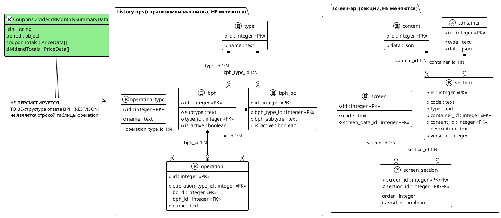

# bph-coupons-dividends-monthly-summary

## 1. Бизнес-требования

#### Анализ требований — Сумма купонов и дивидендов за месяц

**Источник требования:**

| Параметр | Значение |
|----------|----------|
| Фича | Сумма купонов и дивидендов за месяц (BPH monthly summary) |
| Источник | Product request |
| Инициатор | Владелец продукта; реализация ручки — команда BPH |
| Дата / версия | Draft (контракт отсутствует) |

**Стейкхолдеры:**

| Стейкхолдер | Роль | Интерес / ожидание | Влияние / ответственность |
|-------------|------|--------------------|---------------------------|
| Клиент мобильного банка | Пользователь | Видит месячную сумму купонов и дивидендов на ленте и на карточке инструмента без ручного суммирования | Использует результат фичи |
| Владелец продукта | Инициатор требования | Получить агрегированную сводку купонного/дивидендного дохода за месяц | Принимает функциональный результат |
| Команда BPH | Владелец внешней системы | Получить готовый контракт новой ручки агрегата и реализовать его по спеке | Реализует ручку и отвечает за контракт |
| Команда history-ops | Владелец сервиса истории | Подключить новую ручку как параллельный source-запрос к ленте | Реализует gateway и конвертацию |
| Команда history-ops-screen-api | Владелец экранного композита | Получить агрегат и отобразить его отдельной секцией на ленте и карточке инструмента | Реализует секцию в композите |

**Бизнес-правила и ограничения:**

| ID | Тип | Описание | Источник / обоснование |
|----|-----|----------|------------------------|
| BR-01 | Бизнес-правило | Новая ручка BPH возвращает месячную сводку — агрегат суммы купонов и дивидендов за месяц, а не список операций | Бриф |
| BR-02 | Бизнес-правило | Существующие операции купон/дивиденд (семейство CA_CASH_MOVEMENT, типы coupon, coupon_output, dividend_input, dividend_output) сохраняются; новая ручка их не заменяет | Бриф; analytics/02-Modules/MOD-001-history-ops/integrations/corp-actions.md |
| BR-03 | Бизнес-правило | history-ops запрашивает новую ручку параллельно с основной историей ленты, по образцу подключения BphLinkedOperationsGateway (GetLinkedEvents) | Бриф |
| BR-04 | Бизнес-правило | Корпоративные действия (DCA/ECM/DCM) и карточки купонов/дивидендов в ленте не заменяются | Бриф |
| BR-05 | Бизнес-правило | history-ops-screen-api отображает результат как новую секцию на экране ленты и на карточке инструмента (раздел «История»); это агрегат, не новая операция и не деталка | Бриф |
| CN-01 | Ограничение | Интеграция BPH — протокол REST/JSON, синхронный, заголовки rqUID и systemName | Бриф; analytics/02-Modules/MOD-001-history-ops/integrations/bph.md |
| CN-02 | Ограничение | Контракт новой ручки отсутствует (в bph.yml нет endpoint); ручка проектируется в спеке и реализуется командой BPH по спеке | Бриф; repositories/ИО/history-ops/src/main/swagger/bph/bph.yml |
| CN-03 | Ограничение | Новая ручка опциональна: при её отсутствии/ошибке лента и карточка инструмента работают как раньше (обратная совместимость) | CONTEXT_DOC § «Ограничения и риски текущего состояния» |

**Цель фичи:**

| Вопрос | Ответ |
|--------|-------|
| Какую бизнес-проблему решает? | Пользователь видит купоны и дивиденды только как отдельные операции в ленте; агрегированной суммы за месяц нет |
| Какую ценность приносит пользователю? | Пользователь видит месячную сумму купонов и дивидендов на экране ленты и на карточке инструмента без ручного суммирования |
| Какие метрики улучшает? | Метрики и целевые значения в брифе не заданы (non-SMART — улучшение UX без количественной метрики, решение D-12) |

**SMART-проверка цели:**

| Критерий | Описание | Значение |
|----------|----------|----------|
| Specific | Конкретная | Реализовать новую агрегатную ручку BPH «сумма купонов и дивидендов за месяц» и вывести её результат отдельной секцией на экране ленты и на карточке инструмента |
| Measurable | Измеримая | Целевые метрики и способ измерения в брифе не заданы (non-SMART — улучшение UX без количественной метрики, решение D-12) |
| Achievable | Достижимая | Достижимость зависит от готовности контракта BPH (TO BE) и согласования с командой BPH |
| Relevant | Релевантная | Напрямую влияет на полноту информации о купонном и дивидендном доходе пользователя |
| Time-bound | Ограниченная по времени | Срок/релиз/контрольная дата в брифе не заданы (non-SMART, решение D-12) |

**Противоречия и решения:**

| Требование 1 | Требование 2 | Источник 1 | Источник 2 | Решение | Обоснование |
|--------------|--------------|------------|------------|---------|-------------|
| Противоречия не выявлены | - | Бриф | - | - | На текущем уровне постановки конфликтующих требований нет |

#### Use Case — Просмотреть историю операций (ленту)

**Структура Use Case:**

| Элемент | Значение |
|---------|----------|
| Название | Просмотреть историю операций (ленту) |
| Актор(ы) | Клиент мобильного банка (авторизован) |
| Триггер | Клиент открывает экран «История операций» (ленту) |
| Предусловия | См. таблицу предусловий ниже |
| Постусловия | См. таблицу постусловий ниже |
| Бизнес-правила | BR-02, BR-04, CN-01 (см. §1.1) |

**Предусловия:**

| № | Предусловие | Проверяемое условие |
|---|-------------|---------------------|
| 1 | Клиент авторизован в мобильном банке | Сессия клиента активна |
| 2 | У клиента есть хотя бы один договор | Список договоров (`agreements`) непустой |
| 3 | Сервисы history-ops и history-ops-screen-api доступны | Оба сервиса отвечают на запросы |
| 4 | Источники ленты (BPH, источники КД) настроены и доступны | Вызовы к источникам выполняются |

**Постусловия:**

| Исход | Постусловие |
|-------|-------------|
| Успех | Лента сформирована из операций источников. Купоны и дивиденды отображаются как отдельные операции (семейство CA_CASH_MOVEMENT); связанные операции и КД (DCA/ECM/DCM) отображаются отдельными операциями. Месячной агрегированной сводки купонов/дивидендов нет |
| Неуспех (бизнес) | За период нет операций — лента пустая; операция с неподходящим статусом исключена из ленты |
| Неуспех (техн.) | Часть источников недоступна — лента сформирована частично (`bcDataComplete=false`, недоступные типы в `failOperationTypes`); остальные операции отображаются |

**Бизнес-правила:**

| ID | Правило | Применяется на шаге |
|----|---------|---------------------|
| BR-02 | Операции купон/дивиденд (семейство CA_CASH_MOVEMENT, типы coupon, coupon_output, dividend_input, dividend_output) поступают через BPH GET_OPERATIONS_WITH_DETAILS и сохраняются как отдельные операции | Шаг 4 |
| BR-04 | Корпоративные действия (DCA/ECM/DCM) и карточки купонов/дивидендов обрабатываются отдельными источниками и не смешиваются с операциями BPH | Шаг 5 |
| CN-01 | Вызовы к BPH выполняются синхронно по REST/JSON с заголовками rqUID и systemName | Шаг 4, 5 |

**Основной сценарий — Happy Path:**

```
Шаг 1:  Клиент открывает экран «История операций» (ленту) в мобильном банке
Шаг 2:  history-ops-screen-api принимает запрос экрана и вызывает history-ops (getHistoryOperationsFeed)
Шаг 3:  history-ops формирует параллельные source-запросы к источникам ленты
Шаг 4:  history-ops запрашивает у BPH операции с деталями (GET_OPERATIONS_WITH_DETAILS)
          ЕСЛИ [BR-02] операция относится к семейству CA_CASH_MOVEMENT (coupon, coupon_output, dividend_input, dividend_output)
            ТО выполнить включение операции в ленту как отдельной операции
          ИНАЧЕ
            сценарий продолжается без применения BR-02
Шаг 5:  history-ops параллельно запрашивает связанные операции (GET_LINKED_EVENTS) и корпоративные действия (DCA/ECM/DCM)
          ЕСЛИ [BR-04] источник относится к корпоративным действиям (DCA/ECM/DCM)
            ТО выполнить включение корпоративного действия в ленту как отдельной операции
          ИНАЧЕ
            сценарий продолжается без применения BR-04
Шаг 6:  history-ops объединяет операции из всех источников, сортирует и применяет пагинацию
          ЕСЛИ все источники ответили успешно и операции найдены
            ТО сценарий продолжается с шага 7
          ИНАЧЕ ЕСЛИ часть источников недоступна
            ПЕРЕЙТИ К альтернативному сценарию 6a
          ИНАЧЕ ЕСЛИ операций за период нет
            ПЕРЕЙТИ К альтернативному сценарию 6b
Шаг 7:  history-ops возвращает операции через исходящий контракт history.yml (SEND_OPERATIONS)
Шаг 8:  history-ops-screen-api формирует экран ленты из screenData и sections[] (шаблоны секций)
Шаг 9:  Клиент видит ленту с операциями; купоны и дивиденды отображаются как обычные операции
Шаг 10: Клиент открывает карточку операции купона или дивиденда
          ЕСЛИ клиент выбрал операцию купона или дивиденда
            ТО выполнить extend «Открыть карточку операции купона/дивиденда»
          ИНАЧЕ
            сценарий завершается успешно
```

**Альтернативные сценарии:**

```
6a. Часть источников недоступна (Технические ошибки):
  6a.1. history-ops фиксирует недоступные типы операций (failOperationTypes) и признак неполноты данных (bcDataComplete=false)
  6a.2. history-ops возвращает операции из доступных источников
  6a.3. Возврат к шагу 7

6b. Нет операций за запрошенный период (Пограничные случаи):
  6b.1. history-ops возвращает пустой набор операций
  6b.2. history-ops-screen-api отображает пустую ленту
  6b.3. Сценарий завершается успешно (пустой результат)
```

**Связи между Use Cases:**

| Связь | Связанный Use Case | Шаг / Extension Point | Условие |
|-------|--------------------|-----------------------|---------|
| extend | Открыть карточку операции купона/дивиденда | Extension point: Шаг 10 | Клиент выбирает операцию купона или дивиденда в ленте |
| extend | Просмотреть историю операций по инструменту (карточка инструмента) | Extension point: Шаг 9 | Клиент переходит к карточке инструмента из ленты |

#### Use Case — Просмотреть историю операций по инструменту (карточка инструмента)

**Структура Use Case:**

| Элемент | Значение |
|---------|----------|
| Название | Просмотреть историю операций по инструменту (карточка инструмента) |
| Актор(ы) | Клиент мобильного банка (авторизован) |
| Триггер | Клиент открывает карточку инструмента и переходит в раздел «История» |
| Предусловия | См. таблицу предусловий ниже |
| Постусловия | См. таблицу постусловий ниже |
| Бизнес-правила | BR-02, BR-04 (см. §1.1) |

**Предусловия:**

| № | Предусловие | Проверяемое условие |
|---|-------------|---------------------|
| 1 | Клиент авторизован в мобильном банке | Сессия клиента активна |
| 2 | Выбран инструмент | Задан идентификатор инструмента (ISIN) |
| 3 | Сервисы history-ops и history-ops-screen-api доступны | Оба сервиса отвечают на запросы |

**Постусловия:**

| Исход | Постусловие |
|-------|-------------|
| Успех | Раздел «История» на карточке инструмента сформирован из операций по инструменту (включая купоны и дивиденды). Месячной агрегированной сводки купонов/дивидендов нет |
| Неуспех (бизнес) | Операций по инструменту за период нет — раздел «История» пустой |
| Неуспех (техн.) | Часть источников недоступна — раздел «История» сформирован частично |

**Бизнес-правила:**

| ID | Правило | Применяется на шаге |
|----|---------|---------------------|
| BR-02 | Операции купон/дивиденд (семейство CA_CASH_MOVEMENT, типы coupon, coupon_output, dividend_input, dividend_output) сохраняются и отображаются как отдельные операции | Шаг 4 |
| BR-04 | Карточки купонов/дивидендов не заменяются | Шаг 7 |

**Основной сценарий — Happy Path:**

```
Шаг 1:  Клиент открывает карточку инструмента
Шаг 2:  Клиент переходит в раздел «История» карточки инструмента
Шаг 3:  history-ops-screen-api вызывает history-ops с фильтром по инструменту (instrumentFilter)
Шаг 4:  history-ops запрашивает операции по инструменту из источников ленты
          ЕСЛИ [BR-02] операция относится к семейству CA_CASH_MOVEMENT (coupon, coupon_output, dividend_input, dividend_output)
            ТО выполнить включение операции в раздел «История»
          ИНАЧЕ
            сценарий продолжается без применения BR-02
Шаг 5:  history-ops возвращает операции по инструменту
          ЕСЛИ операции найдены
            ТО сценарий продолжается с шага 6
          ИНАЧЕ ЕСЛИ источник недоступен
            ПЕРЕЙТИ К альтернативному сценарию 5a
          ИНАЧЕ ЕСЛИ операций нет
            ПЕРЕЙТИ К альтернативному сценарию 5b
Шаг 6:  history-ops-screen-api формирует раздел «История» карточки инструмента
Шаг 7:  Клиент видит операции по инструменту (включая купоны и дивиденды); месячной сводки нет
```

**Альтернативные сценарии:**

```
5a. Источник недоступен (Технические ошибки):
  5a.1. history-ops возвращает операции из доступных источников
  5a.2. Возврат к шагу 6

5b. Нет операций по инструменту (Пограничные случаи):
  5b.1. history-ops возвращает пустой набор операций
  5b.2. history-ops-screen-api отображает пустой раздел «История»
  5b.3. Сценарий завершается успешно (пустой результат)
```

**Связи между Use Cases:**

| Связь | Связанный Use Case | Шаг / Extension Point | Условие |
|-------|--------------------|-----------------------|---------|
| extend | Открыть карточку операции купона/дивиденда | Extension point: Шаг 7 | Клиент выбирает операцию купона или дивиденда в разделе «История» |

#### Sequence Diagram — Просмотр истории операций (лента), AS IS

**Назначение:**

Диаграмма показывает текущий процесс формирования ленты истории операций: клиент открывает экран, композит BDUI (history-ops-screen-api) вызывает history-ops, тот выполняет параллельные source-запросы к BPH (операции с деталями и связанные операции) и к источникам корпоративных действий (DCA/ECM/DCM), объединяет результат и возвращает операции для формирования экрана из `screenData` и `sections[]`. Месячная сводка купонов и дивидендов в текущем процессе отсутствует. Перечень источников ограничен теми, что затрагивает фича (BPH и КД); прочие источники ленты (BC/OG и др.) фичей не изменяются и выходят за её рамки.

**Участники:**

| Участник | Тип | Роль |
|---|---|---|
| `Client` | actor | Клиент мобильного банка |
| `ScreenApi` | participant | history-ops-screen-api (BDUI-композит экрана) |
| `HistoryOps` | participant | history-ops (сервис истории операций) |
| `BPH` | participant | Внешняя система BPH |
| `CorpActions` | participant | Источники корпоративных действий (DCA/ECM/DCM) |

**PlantUML:**

```plantuml
@startuml
title Sequence Diagram — Просмотр истории операций (лента), AS IS
caption Текущий процесс формирования ленты без месячной сводки купонов и дивидендов

actor "Клиент\n(мобильный банк)" as Client
participant "history-ops-screen-api\n(BDUI-композит)" as ScreenApi
participant "history-ops" as HistoryOps
participant "BPH" as BPH
participant "КД-источники\n(DCA/ECM/DCM)" as CorpActions

== Формирование ленты ==

Client -> ScreenApi: 1. Открыть экран «История операций»
activate ScreenApi
ScreenApi -> HistoryOps ++: 2. getHistoryOperationsFeed (gRPC)

par [Параллельные source-запросы ленты]
  HistoryOps -> BPH ++: 3a. POST /operations-with-details\n(GET_OPERATIONS_WITH_DETAILS)
  BPH --> HistoryOps --: 4a. операции (вкл. CA_CASH_MOVEMENT\ncoupon/coupon_output/dividend_input/dividend_output)
and
  HistoryOps -> BPH ++: 3b. POST /operations/linked-events\n(GET_LINKED_EVENTS)
  BPH --> HistoryOps --: 4b. связанные операции
and
  HistoryOps -> CorpActions ++: 3c. запросы КД (DCA/ECM/DCM)
  CorpActions --> HistoryOps --: 4c. корпоративные действия
end

alt все источники ответили успешно
  HistoryOps --> ScreenApi --: 5. операции (history.yml, SEND_OPERATIONS)
  ScreenApi --> Client: 6. лента операций (без месячной сводки)
else часть источников недоступна (partial failure)
  HistoryOps --> ScreenApi --: 5a. операции + bcDataComplete=false / failOperationTypes
  ScreenApi --> Client: 6a. лента из доступных операций
end

deactivate ScreenApi

legend right
  | Правило | Значение |
  | actor | Единственный участник, который может слать без activation |
  | activate ScreenApi | Сразу после Client -> ScreenApi, до любого ответа/вызова |
  | -> Target ++ | Sync-вызов всегда открывает activation callee |
  | --> Source -- | Return закрывает activation callee |
  | par | Параллельные source-запросы ленты (сходятся перед объединением) |
  | alt / else | Оба operands согласованы по activation на merge-point |
endlegend
@enduml
```

**Легенда:**

| Обозначение | Значение |
|---|---|
| `->` | Синхронный вызов |
| `-->` | Ответ / return |
| `++` / `--` | Activation start / end на callee |
| `activate` / `deactivate` | Явное открытие/закрытие lifeline композита |
| `actor` | Может инициировать сообщение без activation bar |
| `participant` | Должен быть live на каждой sync-стрелке |
| `par` | Параллельные source-запросы ленты |
| `alt` / `else` | Ветвление по доступности источников |

**Соответствие тексту:**

| Элемент на диаграмме | Номер | Описание в тексте |
|---|---|---|
| `Открыть экран «История операций»` | 1 | Use Case «Просмотреть историю операций (ленту)», Шаг 1 |
| `getHistoryOperationsFeed` | 2 | Use Case, Шаг 2 |
| `POST /operations-with-details` | 3a | Use Case, Шаг 4 |
| `POST /operations/linked-events` | 3b | Use Case, Шаг 5 |
| `запросы КД (DCA/ECM/DCM)` | 3c | Use Case, Шаг 5 |
| `лента операций (без месячной сводки)` | 6 | Use Case, Шаг 8–9 |
| `bcDataComplete=false / failOperationTypes` | 5a/6a | Use Case, Альтернативный сценарий 6a |

#### Use Case — Просмотреть месячную сумму купонов и дивидендов (лента)

**Структура Use Case:**

| Элемент | Значение |
|---------|----------|
| Название | Просмотреть месячную сумму купонов и дивидендов (лента) |
| Актор(ы) | Клиент мобильного банка (авторизован) |
| Триггер | Клиент открывает экран «История операций» (ленту) |
| Предусловия | См. таблицу предусловий ниже |
| Постусловия | См. таблицу постусловий ниже |
| Бизнес-правила | BR-01, BR-02, BR-03, BR-04, BR-05, CN-01, CN-03 (см. §1.1) |

**Предусловия:**

| № | Предусловие | Проверяемое условие |
|---|-------------|---------------------|
| 1 | Клиент авторизован в мобильном банке | Сессия клиента активна |
| 2 | У клиента есть хотя бы один договор | Список договоров (`agreements`) непустой |
| 3 | Фича-флаг месячной сводки включён | Тоггл новой ручки активен (`enableBphCouponsDividendsMonthlySummary`, решение D-09) |
| 4 | Новая ручка BPH реализована и доступна | Endpoint `POST /api/v1/incoming-gateway/operations/coupons-dividends-monthly-summary` отвечает (§4.1.1) |

**Постусловия:**

| Исход | Постусловие |
|-------|-------------|
| Успех | На экране ленты отображается новая секция с месячной суммой купонов и дивидендов по всем инструментам клиента — перечень инструментов с суммами [BR-05] (решение D-11). Существующие операции купонов/дивидендов (семейство CA_CASH_MOVEMENT) и корпоративные действия (DCA/ECM/DCM) отображаются как раньше [BR-02][BR-04] |
| Неуспех (бизнес) | Ручка вернула пустой агрегат — секция сводки не отображается; лента операций отображается как раньше |
| Неуспех (техн.) | Ручка месячной сводки недоступна — секция сводки не отображается, лента формируется как раньше [CN-03]; секция скрывается без предупреждения, лента НЕ считается неполной (`bcDataComplete`/`failOperationTypes` не затрагиваются), лог WARN (решение D-08) |

**Бизнес-правила:**

| ID | Правило | Применяется на шаге |
|----|---------|---------------------|
| BR-01 | Новая ручка BPH возвращает месячную сводку — агрегат суммы купонов и дивидендов за месяц, а не список операций | Шаг 5 |
| BR-02 | Существующие операции купон/дивиденд (семейство CA_CASH_MOVEMENT) сохраняются; новая ручка их не заменяет | Шаг 8 |
| BR-03 | history-ops запрашивает новую ручку параллельно с основной историей ленты, по образцу подключения BphLinkedOperationsGateway | Шаг 5 |
| BR-04 | Корпоративные действия (DCA/ECM/DCM) и карточки купонов/дивидендов в ленте не заменяются | Шаг 8 |
| BR-05 | history-ops-screen-api отображает результат как новую секцию на экране ленты; это агрегат, не операция и не деталка | Шаг 7 |
| CN-01 | Вызов к BPH выполняется синхронно по REST/JSON с заголовками rqUID и systemName | Шаг 5 |
| CN-03 | Новая ручка опциональна: при её отсутствии/ошибке лента работает как раньше | Шаг 3, альт. 5a |

**Основной сценарий — Happy Path:**

```
Шаг 1:  Клиент открывает экран «История операций» (ленту) в мобильном банке
Шаг 2:  history-ops-screen-api принимает запрос экрана и вызывает history-ops (getHistoryOperationsFeed)
Шаг 3:  history-ops проверяет включён ли фича-флаг месячной сводки
          ЕСЛИ фича-флаг включён [CN-03]
            ТО сценарий продолжается с шага 4
          ИНАЧЕ
            ПЕРЕЙТИ К альтернативному сценарию 3a
Шаг 4:  history-ops формирует параллельные source-запросы: основную историю ленты и новую ручку месячной сводки
Шаг 5:  history-ops запрашивает у BPH месячную сводку купонов и дивидендов параллельно с основной историей [BR-01][BR-03][CN-01]
          ЕСЛИ ручка доступна и вернула агрегат
            ТО сценарий продолжается с шага 6
          ИНАЧЕ ЕСЛИ ручка недоступна
            ПЕРЕЙТИ К альтернативному сценарию 5a
          ИНАЧЕ ЕСЛИ агрегат пустой
            ПЕРЕЙТИ К альтернативному сценарию 5b
Шаг 6:  history-ops объединяет результат основной истории и агрегат и возвращает ответ композиту
Шаг 7:  history-ops-screen-api формирует секцию «Сумма купонов и дивидендов за месяц» на ленте — перечень инструментов клиента с суммами [BR-05] (решение D-11)
Шаг 8:  Клиент видит секцию сводки; существующие операции купонов/дивидендов [BR-02] и корпоративные действия (DCA/ECM/DCM) и карточки купонов/дивидендов [BR-04] отображаются как раньше
Шаг 9:  Клиент может открыть карточку операции купона/дивиденда или перейти к карточке инструмента
          ЕСЛИ клиент выбрал операцию купона или дивиденда
            ТО выполнить extend «Открыть карточку операции купона/дивиденда»
          ИНАЧЕ
            сценарий завершается успешно
```

**Альтернативные сценарии:**

```
3a. Фича-флаг месячной сводки выключен (Пограничные случаи):
  3a.1. history-ops не выполняет запрос месячной сводки
  3a.2. Лента формируется как раньше, без секции сводки
  3a.3. Сценарий завершается успешно (без секции сводки)

5a. Ручка месячной сводки недоступна (Технические ошибки):
  5a.1. history-ops продолжает формировать ленту из основной истории [CN-03]
  5a.2. history-ops-screen-api не отображает секцию сводки
  5a.3. Сценарий завершается успешно (лента без секции сводки)

5b. Агрегат пустой (Пограничные случаи):
  5b.1. history-ops-screen-api не отображает секцию сводки
  5b.2. Сценарий завершается успешно (лента без секции сводки)
```

**Связи между Use Cases:**

| Связь | Связанный Use Case | Шаг / Extension Point | Условие |
|-------|--------------------|-----------------------|---------|
| extend | Открыть карточку операции купона/дивиденда | Extension point: Шаг 9 | Клиент выбирает операцию купона или дивиденда в ленте |
| extend | Просмотреть месячную сумму купонов и дивидендов по инструменту (карточка инструмента) | Extension point: Шаг 9 | Клиент переходит к карточке инструмента из ленты |

#### Use Case — Просмотреть месячную сумму купонов и дивидендов по инструменту (карточка инструмента)

**Структура Use Case:**

| Элемент | Значение |
|---------|----------|
| Название | Просмотреть месячную сумму купонов и дивидендов по инструменту (карточка инструмента) |
| Актор(ы) | Клиент мобильного банка (авторизован) |
| Триггер | Клиент открывает карточку инструмента и переходит в раздел «История» |
| Предусловия | См. таблицу предусловий ниже |
| Постусловия | См. таблицу постусловий ниже |
| Бизнес-правила | BR-01, BR-02, BR-04, BR-05, CN-01, CN-03 (см. §1.1) |

**Предусловия:**

| № | Предусловие | Проверяемое условие |
|---|-------------|---------------------|
| 1 | Клиент авторизован в мобильном банке | Сессия клиента активна |
| 2 | Выбран инструмент | Задан идентификатор инструмента (ISIN) |
| 3 | Фича-флаг месячной сводки включён | Тоггл новой ручки активен (`enableBphCouponsDividendsMonthlySummary`, решение D-09) |

**Постусловия:**

| Исход | Постусловие |
|-------|-------------|
| Успех | В разделе «История» карточки инструмента отображается новая секция с месячной суммой купонов и дивидендов по инструменту [BR-05]. Операции по инструменту (включая купоны и дивиденды) отображаются как раньше [BR-02] |
| Неуспех (бизнес) | Ручка вернула пустой агрегат — секция сводки не отображается; раздел «История» формируется как раньше |
| Неуспех (техн.) | Ручка месячной сводки недоступна — секция сводки не отображается, раздел «История» формируется как раньше [CN-03] |

**Бизнес-правила:**

| ID | Правило | Применяется на шаге |
|----|---------|---------------------|
| BR-01 | Новая ручка BPH возвращает месячную сводку — агрегат суммы купонов и дивидендов за месяц, а не список операций | Шаг 5 |
| BR-02 | Существующие операции купон/дивиденд (семейство CA_CASH_MOVEMENT) сохраняются; новая ручка их не заменяет | Шаг 7 |
| BR-04 | Карточки купонов/дивидендов не заменяются | Шаг 7 |
| BR-05 | history-ops-screen-api отображает результат как новую секцию в разделе «История» карточки инструмента; это агрегат, не операция и не деталка | Шаг 6 |
| CN-01 | Вызов к BPH выполняется синхронно по REST/JSON с заголовками rqUID и systemName | Шаг 5 |
| CN-03 | Новая ручка опциональна: при её отсутствии/ошибке карточка инструмента работает как раньше | Шаг 4, альт. 5a |

**Основной сценарий — Happy Path:**

```
Шаг 1:  Клиент открывает карточку инструмента
Шаг 2:  Клиент переходит в раздел «История» карточки инструмента
Шаг 3:  history-ops-screen-api вызывает history-ops с фильтром по инструменту (instrumentFilter)
Шаг 4:  history-ops проверяет включён ли фича-флаг месячной сводки
          ЕСЛИ фича-флаг включён [CN-03]
            ТО сценарий продолжается с шага 5
          ИНАЧЕ
            ПЕРЕЙТИ К альтернативному сценарию 4a
Шаг 5:  history-ops запрашивает у BPH месячную сводку купонов и дивидендов параллельно с историей операций по инструменту [BR-01][CN-01]
          ЕСЛИ ручка доступна и вернула агрегат
            ТО сценарий продолжается с шага 6
          ИНАЧЕ ЕСЛИ ручка недоступна
            ПЕРЕЙТИ К альтернативному сценарию 5a
          ИНАЧЕ ЕСЛИ агрегат пустой
            ПЕРЕЙТИ К альтернативному сценарию 5b
Шаг 6:  history-ops-screen-api формирует секцию «Сумма купонов и дивидендов за месяц» в разделе «История» [BR-05]
Шаг 7:  Клиент видит секцию сводки и операции по инструменту (включая купоны и дивиденды) [BR-02]; карточки купонов/дивидендов не изменяются [BR-04]
```

**Альтернативные сценарии:**

```
4a. Фича-флаг месячной сводки выключен (Пограничные случаи):
  4a.1. history-ops не выполняет запрос месячной сводки
  4a.2. Раздел «История» формируется как раньше, без секции сводки
  4a.3. Сценарий завершается успешно (без секции сводки)

5a. Ручка месячной сводки недоступна (Технические ошибки):
  5a.1. history-ops продолжает формировать раздел «История» из истории операций по инструменту [CN-03]
  5a.2. history-ops-screen-api не отображает секцию сводки
  5a.3. Сценарий завершается успешно (раздел «История» без секции сводки)

5b. Агрегат пустой (Пограничные случаи):
  5b.1. history-ops-screen-api не отображает секцию сводки
  5b.2. Сценарий завершается успешно (раздел «История» без секции сводки)
```

**Связи между Use Cases:**

| Связь | Связанный Use Case | Шаг / Extension Point | Условие |
|-------|--------------------|-----------------------|---------|
| extend | Открыть карточку операции купона/дивиденда | Extension point: Шаг 7 | Клиент выбирает операцию купона или дивиденда в разделе «История» |

#### Sequence Diagram — Просмотр месячной суммы купонов и дивидендов (лента), TO BE

**Назначение:**

Диаграмма показывает целевой процесс формирования ленты: композит BDUI (history-ops-screen-api) вызывает history-ops, тот выполняет параллельные source-запросы к BPH — существующие операции с деталями и связанные операции, а также новую ручку месячной сводки купонов и дивидендов [BR-03]. При успехе композит отображает новую секцию «Сумма купонов и дивидендов за месяц» [BR-05]; при недоступности ручки секция не отображается и лента работает как раньше [CN-03]. Корпоративные действия (DCA/ECM/DCM) и карточки купонов/дивидендов не изменяются [BR-04].

**Участники:**

| Участник | Тип | Роль |
|---|---|---|
| `Client` | actor | Клиент мобильного банка |
| `ScreenApi` | participant | history-ops-screen-api (BDUI-композит экрана) |
| `HistoryOps` | participant | history-ops (сервис истории операций) |
| `BPH` | participant | Внешняя система BPH (включая новую ручку месячной сводки) |

**PlantUML:**

```plantuml
@startuml
title Sequence Diagram — Просмотр месячной суммы купонов и дивидендов (лента), TO BE
caption Целевой процесс: параллельный source-запрос к новой ручке месячной сводки BPH и новая секция на ленте

actor "Клиент\n(мобильный банк)" as Client
participant "history-ops-screen-api\n(BDUI-композит)" as ScreenApi
participant "history-ops" as HistoryOps
participant "BPH" as BPH

== Формирование ленты с месячной сводкой ==

Client -> ScreenApi: 1. Открыть экран «История операций»
activate ScreenApi
ScreenApi -> HistoryOps ++: 2. getHistoryOperationsFeed (gRPC)

par [Параллельные source-запросы ленты]
  HistoryOps -> BPH ++: 3a. POST /operations-with-details\n(GET_OPERATIONS_WITH_DETAILS)
  BPH --> HistoryOps --: 4a. операции (CA_CASH_MOVEMENT:\ncoupon/coupon_output/dividend_input/dividend_output)
and
  HistoryOps -> BPH ++: 3b. POST /operations/linked-events\n(GET_LINKED_EVENTS)
  BPH --> HistoryOps --: 4b. связанные операции
and
  HistoryOps -> BPH ++: 3c. [NEW] POST /api/v1/incoming-gateway/operations/\ncoupons-dividends-monthly-summary
  alt ручка месячной сводки доступна
    BPH --> HistoryOps --: 4c. агрегат за месяц (по инструментам\nклиента, суммы по валютам)
  else ручка недоступна
    BPH --> HistoryOps --: 4d. ошибка (секция скрывается,\nлента не неполна [CN-03])
  end
end

note right of HistoryOps
  КД (DCA/ECM/DCM) и карточки
  купонов/дивидендов не изменяются [BR-04]
end note

alt агрегат получен
  HistoryOps --> ScreenApi --: 5. лента + месячная сводка\n(расширение OperationHistoryResponse)
  ScreenApi --> Client: 6. лента + секция «Сумма купонов\nи дивидендов за месяц» [BR-05]
else агрегат недоступен
  HistoryOps --> ScreenApi --: 5a. лента без сводки [CN-03]
  ScreenApi --> Client: 6a. лента как раньше\n(секция сводки отсутствует)
end

deactivate ScreenApi

legend right
  | Правило | Значение |
  | actor | Единственный участник, который может слать без activation |
  | activate ScreenApi | Сразу после Client -> ScreenApi, до любого ответа/вызова |
  | -> Target ++ | Sync-вызов всегда открывает activation callee |
  | --> Source -- | Return закрывает activation callee |
  | par | Параллельные source-запросы ленты |
  | alt / else | Ветвление по доступности ручки месячной сводки |
  | [NEW] | Новый элемент (месячная сводка BPH и секция на ленте) |
endlegend
@enduml
```

**Легенда:**

| Обозначение | Значение |
|---|---|
| `->` | Синхронный вызов |
| `-->` | Ответ / return |
| `++` / `--` | Activation start / end на callee |
| `activate` / `deactivate` | Явное открытие/закрытие lifeline композита |
| `actor` | Может инициировать сообщение без activation bar |
| `participant` | Должен быть live на каждой sync-стрелке |
| `par` | Параллельные source-запросы ленты |
| `alt` / `else` | Ветвление по доступности ручки месячной сводки |
| `[NEW]` | Новый элемент (месячная сводка BPH и секция на ленте) |

**Соответствие тексту:**

| Элемент на диаграмме | Номер | Описание в тексте |
|---|---|---|
| `Открыть экран «История операций»` | 1 | Use Case «Просмотреть месячную сумму… (лента)», Шаг 1 |
| `getHistoryOperationsFeed` | 2 | Use Case, Шаг 2 |
| `POST /operations-with-details` | 3a | Use Case, Шаг 4 (основная история) |
| `POST /operations/linked-events` | 3b | Use Case, Шаг 4 (основная история) |
| `запрос месячной сводки` | 3c | Use Case, Шаг 5 [BR-03] |
| `агрегат за месяц` | 4c | Use Case, Шаг 5 [BR-01] |
| `лента + месячная сводка` | 5 | Use Case, Шаг 6 |
| `секция «Сумма купонов и дивидендов за месяц»` | 6 | Use Case, Шаг 7–8 [BR-05] |
| `лента без сводки` | 5a/6a | Use Case, Альтернативный сценарий 5a [CN-03] |

## 2. Ограничения и допущения

**Ограничения и допущения:**

| ID | Тип | Описание | Источник / обоснование |
|----|-----|----------|------------------------|
| CN-01 | Ограничение | Интеграция с BPH — синхронный REST/JSON с заголовками `rqUID` (uuid) и `systemName` (`history_ops` — значение зафиксировано решением D-05) | Бриф; `analytics/02-Modules/MOD-001-history-ops/integrations/bph.md`; `repositories/ИО/history-ops/src/main/java/com/sberbank/si20/history/ops/adapter/bph/BphClient.java` |
| CN-02 | Ограничение | Контракт новой ручки BPH зафиксирован в спеке как TO BE (§4.1.1): `POST /api/v1/incoming-gateway/operations/coupons-dividends-monthly-summary`, схемы `RequestCouponsDividendsMonthlySummaryData`/`CouponsDividendsMonthlySummaryData`; в `bph.yml` endpoint пока отсутствует — команда BPH реализует по спеке | Бриф; `repositories/ИО/history-ops/src/main/swagger/bph/bph.yml` (endpoint месячной сводки отсутствует) |
| CN-03 | Ограничение | Ручка опциональна: при её недоступности или выключенном feature-флаге лента и карточка инструмента работают как раньше. Fallback зафиксирован решением D-08: секция сводки скрывается без предупреждения, лента НЕ считается неполной (`bcDataComplete` не меняется, `failOperationTypes` не затрагивается), логируется WARN | Бриф; `analytics/02-Modules/MOD-001-history-ops/behavior/feed-orchestration.md` § Partial failure |
| CN-04 | Ограничение | Новый source-запрос в history-ops включается через feature-флаг `enableBphCouponsDividendsMonthlySummary` (enum `FeatureToggleName`); `enabled()` нового gateway = `enableServiceBPH && enableBphCouponsDividendsMonthlySummary` (AND с общим флагом `FeatureToggleName.ENABLE_BPH`); default `false` (решения D-09, D-29) | `repositories/ИО/history-ops/src/main/java/com/sberbank/si20/history/ops/adapter/bph/linked_events/BphLinkedOperationsGateway.java`; бриф |
| CN-05 | Ограничение | Результат месячной сводки — агрегат, не операция и не деталка: не добавляет `operationType`, не переиспользует lead-конвертеры; выводится отдельной секцией композита. Канал доставки агрегата в композит — расширение исходящего `OperationHistoryResponse` полем `couponsDividendsMonthlySummary` (решение D-10) | Бриф; `analytics/02-Modules/MOD-001-history-ops/behavior/operation-type-catalog.md`; `repositories/ИО/history-ops-screen-api/src/test/resources/db/init-test-screens.sql` |
| CN-06 | Ограничение | Корпоративные действия (DCA/ECM/DCM) и карточки купонов/дивидендов в ленте не заменяются: существующие источники и детальные экраны сохраняются | Бриф; `analytics/02-Modules/MOD-001-history-ops/integrations/corp-actions.md`; `init-test-screens.sql` |
| CN-07 | Ограничение | Доступ к новой ручке по политике BPH (allow-list `systemName=history_ops`) должен быть предварительно согласован с командой BPH; согласование access-политики — **предусловие go-live** (иначе риск стабильного HTTP 403 и молчаливого отсутствия секции у всех клиентов — решение D-26) | Бриф; `repositories/ИО/history-ops/src/main/swagger/bph/bph.yml` (security scheme для новой ручки не объявлена) |

## 4. Функциональные требования

#### 4.1.1. Синхронный контракт — ручка BPH «Сумма купонов и дивидендов за месяц» (TO BE)

Контракт новой ручки BPH отсутствует в `bph.yml` и `BphClient` — фиксируется как **TO BE**, по образцу существующих обменов `GET_LINKED_EVENTS` и `GET_OPERATIONS_WITH_DETAILS`; реализуется командой BPH по данной спеке [CN-02].

**Общая информация:**

| Параметр | Значение |
|----------|----------|
| Назначение | Получение агрегата «сумма купонов и дивидендов за месяц» — сводная сумма, **не список операций** [BR-01] |
| Система-источник | `history-ops` (новый вызов `BphClient`, параллельный source-запрос по образцу `BphLinkedOperationsGateway`) |
| Система-получатель | BPH incoming-gateway (`exSystem="BPH"`, новый `eventType`) |
| Тип интеграции | Синхронная |
| Протокол | REST (HTTPS), JSON |
| Направление | Однонаправленная (запрос-ответ) |
| Версия API | `v1` (`/api/v1/incoming-gateway/...`) |
| Аутентификация | Заголовки `rqUID` (uuid) + `systemName`; security scheme в `bph.yml` не объявлена (как и у существующих обменов — AS IS, решение D-13) |
| Формат данных | JSON (`application/json`) |
| Rate Limit / Timeout / Retry | Timeout — отдельный `app-config.bph.monthlySummary.deadline` (1500–3000 мс, решение D-19) для новой ручки; Rate Limit / Retry не настроены в конфиге (AS IS); prod-значения — GAP-NFR-05 |

**Метод:** `POST /api/v1/incoming-gateway/operations/coupons-dividends-monthly-summary` — зафиксирован решением D-01 (TO BE для команды BPH).

**Request Headers (по образцу `bph.yml` `rqUIDParam` / `systemNameParam`):**

| Заголовок | Обязат. | Описание | Пример | Статус |
|-----------|---------|----------|--------|--------|
| rqUID | Да | Сквозной идентификатор запроса (`format: uuid`); соответствует `requestId` в вызове `BphClient` | c4a5dccd-0fe2-4aa1-823e-a5a5d9ee04a4 | переиспользуемое |
| systemName | Да | Идентификатор системы-инициатора; значение `history_ops` зафиксировано решением D-05 | history_ops | переиспользуемое |

**Входящие параметры (тело запроса, схема `RequestCouponsDividendsMonthlySummaryData`):**

| Поле | Тип | Формат | Обязат. | Описание | Валидация | Статус | Пример |
|------|-----|--------|---------|----------|-----------|--------|--------|
| isin | array&lt;string&gt; | — | Да | Список ISIN инструментов, по которым считается агрегат (решение D-02: агрегат по инструменту; решение D-11: для ленты — все инструменты из соглашений клиента, для карточки — один ISIN). Дубликаты в запросе не дедуплицируются на history-ops; контрактное требование BPH — вернуть один элемент `data[]` на уникальный `isin` (решение D-32) | pattern ISIN; верхней границы (`maxItems`) нет — риск размера тела задокументирован (решение D-25) | новое | ["RU000A103YM3"] |
| dateForFilter | string | enum `FilterDateEnum` | Да | Поле даты, по которому применяется окно; фиксировано `EVENT_DATE` — месяц считается по `eventDate` (решение D-18) | = EVENT_DATE | новое | EVENT_DATE |
| startSearchDate | string | date-time | Да | Начало окна: первое число календарного месяца `00:00:00Z` (включительно, UTC) | — | новое | 2026-01-01T00:00:00Z |
| endSearchDate | string | date-time | Да | Конец окна (исключительно): первое число следующего месяца `00:00:00Z`; полуинтервал `[startSearchDate, endSearchDate)` | — | новое | 2026-02-01T00:00:00Z |
| types | array&lt;string&gt; | — | Да | Состав типов, входящих в агрегат; обязательный — history-ops всегда передаёт 4 значения, фиксированных решением D-03 (`coupon`, `coupon_output`, `dividend_input`, `dividend_output`); поле всегда передаётся, семантика «поле отсутствует» не определена (решение D-30) | enum из 4 значений | новое | ["coupon","coupon_output","dividend_input","dividend_output"] |

> Агрегат — не список операций: параметры пагинации (`page`, `pageSize`) и фильтры статусов (`statuses`, `subtypesAndStatuses`) из `RequestLinkedData`/`RequestParamsData` в запрос сводки не включаются. Агрегация — **по инструменту** (ключ `isin`, решение D-02); месяц определяется **по `eventDate`** через обязательное `dateForFilter=EVENT_DATE` (решение D-18). **Таймзона окна — UTC**, `eventDate` хранится/нормализуется в UTC; включение — полуинтервал `[start, start+1мес)` без `<= end` (решение D-17). Для карточки инструмента `isin` — один ISIN из выбранного инструмента; для ленты — список ISIN всех инструментов из соглашений клиента (решение D-11), **не зависящий от активного фильтра/таба ленты** (решение D-31). `types` — обязательный: history-ops всегда передаёт 4 значения (решение D-30). Дубликаты `isin` в запросе не дедуплицируются на history-ops; контрактное требование BPH — вернуть один элемент `data[]` на уникальный `isin` (решение D-32). Верхней границы числа `isin` (`maxItems`) нет — риск большого тела запроса на каждой странице ленты задокументирован (решение D-25).

**ENUM: `FilterDateEnum` (`bph.yml:1420`):**

| Значение | Описание |
|----------|----------|
| EVENT_DATE | Фильтрация по дате события |
| FORMATION_DATE | Фильтрация по дате формирования |

> `FilterDateEnum` подаётся в запросе обязательным полем `dateForFilter`; для месячной сводки фиксировано `EVENT_DATE` — окно применяется к `eventDate` (решение D-18).

**Исходящие параметры — верхний уровень (ответ `200`: `{ status, data[] }`, по образцу `bph.yml`):**

| Поле | Тип | Nullable | Описание | Статус |
|------|-----|----------|----------|--------|
| status | object `ResponseStatusData` | Нет | Информация о статусе запроса: `code` (integer, 0 = успех), `message` (string) | переиспользуемое |
| data | array `CouponsDividendsMonthlySummaryData` | Нет | Элементы агрегата (по инструменту/месяцу) | новое |

**Структура элемента `data[]` — агрегат `CouponsDividendsMonthlySummaryData` (НЕ `OperationData`/`DetailsData`):**

| Поле | Тип | Nullable | Описание | Статус |
|------|-----|----------|----------|--------|
| isin | string | Нет | ISIN инструмента (ключ агрегата — решение D-02) | новое |
| period | object | Нет | Период агрегации (календарный месяц) | новое |
| period.startDate | string (date-time) | Нет | Первое число календарного месяца (`00:00:00Z`, UTC) | новое |
| period.endDate | string (date-time) | Нет | Последнее число календарного месяца (`23:59:59Z`, UTC) | новое |
| couponTotals | array&lt;`PriceData`&gt; | Да | Суммы купонов за период по валютам (мультивалютный массив, решение D-02); валюта уникальна — одна запись на валюту (дубликат недопустим, решение D-22) | новое |
| dividendTotals | array&lt;`PriceData`&gt; | Да | Суммы дивидендов за период по валютам (мультивалютный массив, решение D-02); валюта уникальна — одна запись на валюту (дубликат недопустим, решение D-22) | новое |

> **Агрегат ≠ операция.** Ответ — отдельная схема `CouponsDividendsMonthlySummaryData` с суммами за период, а не массив lead-операций `OperationData`/`DetailsData` (`bph.yml:1088`, `bph.yml:1238`). Существующие lead-конвертеры history-ops для агрегата **не переиспользуются** [CN-05].
>
> Купоны и дивиденды приводятся **раздельно** (`couponTotals`/`dividendTotals`), каждая сумма — массив элементов `PriceData` (`value` big_decimal + `currency`) для поддержки нескольких валют (решение D-02). Единого `total` нет — суммы в разных валютах не суммируются. В каждом массиве `couponTotals`/`dividendTotals` **валюта уникальна** — одна запись на валюту; дубликат валюты недопустим (контрактное требование к BPH, решение D-22). Период — календарный месяц (первое/последнее число) по `eventDate` (решение D-04); значения `period.startDate`/`period.endDate` — `date-time` в UTC (решение D-27); включение окна — полуинтервал `[start, start+1мес)` (решение D-17).

**Пример запроса:**

```json
{
  "isin": ["RU000A103YM3", "RU000A0ZYTR7"],
  "dateForFilter": "EVENT_DATE",
  "startSearchDate": "2026-01-01T00:00:00Z",
  "endSearchDate": "2026-02-01T00:00:00Z",
  "types": ["coupon", "coupon_output", "dividend_input", "dividend_output"]
}
```

**Пример ответа:**

```json
{
  "status": {
    "code": 0,
    "message": null
  },
  "data": [
    {
      "isin": "RU000A103YM3",
      "period": {
        "startDate": "2026-01-01T00:00:00Z",
        "endDate": "2026-01-31T23:59:59Z"
      },
      "couponTotals": [
        { "value": "1234.56", "currency": "RUB" }
      ],
      "dividendTotals": [
        { "value": "789.01", "currency": "RUB" },
        { "value": "12.34", "currency": "USD" }
      ]
    }
  ]
}
```

> Имена схем `RequestCouponsDividendsMonthlySummaryData`/`CouponsDividendsMonthlySummaryData` и поля агрегата (`isin`, `period`, `couponTotals`/`dividendTotals`) зафиксированы решениями D-01/D-02/D-03/D-04 как TO BE-контракт, передаваемый команде BPH на реализацию.

**Пограничный случай: за период нет купонов/дивидендов:**

```json
{
  "status": {
    "code": 0,
    "message": null
  },
  "data": []
}
```

> Пустой результат — пустой массив `data: []` (не `null`), по образцу существующих обменов BPH.

**Коды ошибок (по образцу `bph.yml`):**

| HTTP код | Код ошибки | Описание | Условие возникновения |
|----------|------------|----------|-----------------------|
| 200 | — | OK, `{ status: ResponseStatusData, data: CouponsDividendsMonthlySummaryData[] }` | Успешный ответ |
| 400 | `ErrorData` (`status`, `error`, `path`) | Bad Request | Невалидный запрос |
| 500 | `Response500Data` (`code=500`, `message`) | Internal Server Error | Внутренняя ошибка BPH |

> Способ подключения в history-ops: новый gateway по образцу `BphLinkedOperationsGateway` — `exSystem()="BPH"`, `eventType()`=`GET_COUPONS_DIVIDENDS_MONTHLY_SUMMARY`, `ruleKey()`=`bphGetCouponsDividendsMonthlySummary` (`RpcNamesForRequestCondition`) и `enabled()` = `enableServiceBPH && enableBphCouponsDividendsMonthlySummary` (AND с общим флагом `FeatureToggleName.ENABLE_BPH` — решения D-07, D-09, D-29). Запрос идёт параллельно с основными источниками ленты [BR-03] и выполняется на каждой странице ленты (не участвует в `RqCoordinator`/пагинации); существующие операции `CA_CASH_MOVEMENT` (coupon/coupon_output/dividend_input/dividend_output) и КД (DCA/ECM/DCM) не заменяются [BR-02, BR-04].

#### 4.1.1.1. Исходящий контракт history-ops (проброс агрегата в композит)

**Общая информация:**

| Параметр | Значение |
|----------|----------|
| Назначение | Доставка агрегата «сумма купонов и дивидендов за месяц» наружу для screen-api/фронта |
| Система-источник | `history-ops` (контракт `history.yml`, исходящий `SEND_OPERATIONS`) |
| Система-получатель | `history-ops-screen-api` (BDUI-композит) / фронт |
| Тип интеграции | Синхронная |
| Протокол | gRPC (HO → screen-api) + REST (screen-api → фронт), JSON |
| Формат данных | JSON |

**Существующие поля `OperationHistoryResponse` (`history.yml:533`):**

| Поле | Тип | Обязат. | Описание | Статус |
|------|-----|---------|----------|--------|
| clientRequestId | string | Да | Идентификатор клиентского запроса | существующее |
| resp | array | Да | Массив ответов по дескрипторам | существующее |
| resp[].operations | array&lt;`HistoryOperationBase`&gt; | Да | Операции (lead `HistoryOperationLead` + `agreementDetails` + `instrumentDetails` + `details`) | существующее |
| resp[].counterId | string | Да | Счётчик/курсор | существующее |
| responseCode | integer | Да | Код ответа | существующее |
| responseTime | string (date-time) | Да | Время ответа | существующее |
| bcDataComplete | boolean | Да | Полнота данных (false при partial failure источников) | существующее |
| failOperationTypes | array&lt;`PortfolioOperationType`&gt; | Да | Типы операций, не загрузившиеся по источникам | существующее |
| couponsDividendsMonthlySummary | array&lt;`CouponsDividendsMonthlySummaryData`&gt; | Нет | Месячная сводка купонов/дивидендов — отдельное поле/блок ответа (не операция, не `operationType`), вкладывается агрегатом целиком как перечень инструментов (решение D-10); на карточке — один элемент (решение D-20) | **новое** |

> Канал доставки агрегата — расширение `OperationHistoryResponse` полем `couponsDividendsMonthlySummary` (агрегат целиком, решение D-10); отдельный gRPC-метод не вводится. Агрегат не попадает в `resp[].operations[]` и не участвует в `failOperationTypes` (это не тип операции). Поле опционально: при недоступности ручки оно отсутствует в ответе.

#### 4.1.1.2. Контракт композита history-ops-screen-api (экран ленты / карточка инструмента)

**Общая информация:**

| Параметр | Значение |
|----------|----------|
| Назначение | Отображение агрегата отдельной секцией на экране ленты и в разделе «История» карточки инструмента [BR-05] |
| Система-источник | МП / web (клиент) |
| Система-получатель | `history-ops-screen-api` (композит) |
| Тип интеграции | Синхронная |
| Протокол | REST (HTTPS), JSON |
| Вход | `POST /history/api/public/v1/screens/feed` |
| Внутренний вызов | gRPC `getHistoryOperationsFeed` → `SEND_OPERATIONS` от history-ops |
| Выход | `screenData` + `sections[]` |

**Существующие поля ответа композита (`screenData` + `sections[]`, `send-operations-feed.md`):**

| Поле | Тип | Описание | Статус |
|------|-----|----------|--------|
| screenData | object | Метаданные экрана (`type`, `data.title`, `data.pagination`, `data.bcDataComplete`, `data.failedOperationType`, `data.paginationResponseId`, `data.selectedTab`, `data.tabs`, `data.filters`, `data.sortType`) | существующее |
| screenData.data.bcDataComplete | boolean | Полнота данных от HO | существующее |
| screenData.data.failedOperationType | string[] | Человекочитаемые названия не загрузившихся типов | существующее |
| sections[] | array | UI-секции: заголовки дней + карточки операций | существующее |
| sections[].id | integer | ID секции | существующее |
| sections[].type | string | `history.feed.title` / `history.feed.operationActive` / `operationHistory` (карточки) | существующее |
| sections[].container | object | Контейнер секции (`type: plain`) | существующее |
| sections[].content | object | Контент секции (карточка операции: `id`, `type`, `title`, `totalSum`, `logoUrl`, `subtitle`, ...) | существующее |
| &lt;новая секция агрегата&gt; | object | Секция «Сумма купонов и дивидендов за месяц» — отдельный `sections[]`-элемент, **не карточка операции**: `type`=`history.feed.couponsDividendsMonthlySummary`, `code`=`HISTORY_OPS_COUPONS_DIVIDENDS_MONTHLY_SUMMARY_SECTION` (решение D-06). На ленте — **одна секция со сводной таблицей**: screen-api разворачивает массив `data[]` (перечень инструментов `{isin, period, couponTotals[], dividendTotals[]}`) из `OperationHistoryResponse.couponsDividendsMonthlySummary`; на карточке инструмента — скалярный `isin` (single ISIN) с `{period, couponTotals[], dividendTotals[], isin}` (решение D-20) | **новое** (решение D-06, D-20) |

> Агрегат выводится отдельной секцией `sections[]` с собственным `type`/шаблоном (решение D-06), не карточкой операции `history.feed.operation*`: `type`=`history.feed.couponsDividendsMonthlySummary`, `code`=`HISTORY_OPS_COUPONS_DIVIDENDS_MONTHLY_SUMMARY_SECTION`. На ленте это **одна секция со сводной таблицей**: screen-api разворачивает массив `data[]` из `OperationHistoryResponse.couponsDividendsMonthlySummary` в строки таблицы (перечень инструментов с суммами, решение D-20); на карточке инструмента — одна запись, `content.data` со скалярным `isin`. На экране ленты секция размещается вверху (над списком операций); на карточке инструмента — в разделе «История» (`instrumentFilter`). При недоступности ручки секция скрывается без предупреждения, лента/карточка не считаются неполными, логируется WARN (решение D-08).

#### 4.2.2. Алгоритм обработки месячной сводки купонов и дивидендов

Обработка месячной сводки купонов и дивидендов состоит из четырёх этапов: встраивание параллельного source-запроса в оркестрацию ленты (§4.2.2.1), обработка ответа-агрегата от BPH (§4.2.2.2), доставка агрегата в композит history-ops → screen-api (§4.2.2.3) и рендер секции в history-ops-screen-api (§4.2.2.4). Фича интеграционно-экранная: history-ops добавляет новый параллельный source-запрос к ручке BPH по образцу `BphLinkedOperationsGateway` [BR-03], а композит отображает результат отдельной секцией [BR-05]. Существующие операции `CA_CASH_MOVEMENT` (coupon/coupon_output/dividend_input/dividend_output) и корпоративные действия (DCA/ECM/DCM) не затрагиваются [BR-02][BR-04].

##### 4.2.2.1. Встраивание параллельного source-запроса в оркестрацию ленты

Вход: `ExecutionProcess` (период, соглашения клиента), фильтры запроса ленты, тело запроса `RequestCouponsDividendsMonthlySummaryData` (§4.1.1). Выход: агрегат сводки в ответе history-ops либо отсутствие агрегата при выключенном флаге/недоступной ручке.

Шаг 1. Новый gateway (по образцу `BphLinkedOperationsGateway`: `exSystem() = "BPH"`, `eventType() = GET_COUPONS_DIVIDENDS_MONTHLY_SUMMARY`, `ruleKey() = bphGetCouponsDividendsMonthlySummary` / `RpcNamesForRequestCondition`, `enabled()` = `enableServiceBPH && enableBphCouponsDividendsMonthlySummary` — AND с общим флагом `FeatureToggleName.ENABLE_BPH` — решения D-07, D-09, D-29) проверяет `enabled()` [CN-04]:
          ЕСЛИ feature-флаг выключен
            ТО source-запрос не выполняется; алгоритм завершается без секции сводки; лента и карточка инструмента работают как раньше [CN-03] (соответствует §1.3 альт. 3a)
          ИНАЧЕ
            ПЕРЕЙТИ К шагу 2

Шаг 2. Определяется календарный месяц для сводки [D-24]:
          ЕСЛИ период запроса ленты задан явным `periodFilter` календарного месяца
            ТО месяц сводки = этот календарный месяц; сценарий продолжается с шага 3
          ИНАЧЕ (скользящее окно / interval-окна `intervalActiveDays`/`intervalInactiveDays`, не календарный месяц)
            source-запрос месячной сводки не выполняется; секция сводки скрывается; лента/карточка формируются как раньше [CN-03] — решение D-24

Шаг 3. Формируется тело запроса `RequestCouponsDividendsMonthlySummaryData` (§4.1.1):
   - `isin` — список ISIN инструментов (агрегат по инструменту, решение D-02): для карточки инструмента — один ISIN из выбранного инструмента (`instrumentFilter`); для ленты — список ISIN всех инструментов из соглашений клиента (решение D-11), **не зависящий от активного фильтра/таба ленты** (решение D-31); дубликаты не дедуплицируются на history-ops — контрактное требование BPH вернуть один элемент `data[]` на уникальный `isin` (решение D-32); верхней границы `maxItems` нет — риск большого тела запроса задокументирован (решение D-25);
   - `dateForFilter` = `EVENT_DATE` — месяц считается по `eventDate` (решение D-18);
   - `startSearchDate` / `endSearchDate` — границы окна в UTC по полуинтервалу `[start, start+1мес)`: `startSearchDate` = первое число месяца `00:00:00Z` (включительно), `endSearchDate` = первое число следующего месяца `00:00:00Z` (исключительно); `eventDate` хранится/нормализуется в UTC (решение D-17);
   - `types` — обязательный; history-ops всегда передаёт фиксированный состав `coupon`/`coupon_output`/`dividend_input`/`dividend_output` (решения D-03, D-30).

Шаг 4. Запрос к ручке BPH выполняется **параллельно** с основными источниками ленты [BR-03]: в том же блоке `par`, что и `GET_OPERATIONS_WITH_DETAILS` (`POST /operations-with-details`), `GET_LINKED_EVENTS` (`POST /operations/linked-events`), DCA/ECM/DCM. Вызов — через новый метод `BphClient` (по образцу `getLinkedEvents()`), синхронно REST/JSON с заголовками `rqUID` + `systemName` (`history_ops`, решение D-05) [CN-01]; таймаут — отдельный `app-config.bph.monthlySummary.deadline` (1500–3000 мс, решение D-19), чтобы медленная ручка не добавляла к ответу ленты полный общий `app-config.bph.deadline`.

Шаг 5. Ветвление по доступности ручки:
          ЕСЛИ ручка доступна и ответ получен
            ТО переход к §4.2.2.2
          ИНАЧЕ (timeout / network / REST-ошибка / HTTP 4xx-5xx)
            источник помечается failed, логируется WARN; агрегат в ответе отсутствует; секция сводки скрывается; лента и карточка формируются из остальных источников [CN-03]; `bcDataComplete` и `failOperationTypes` НЕ затрагиваются (лента не считается неполной) — решение D-08

> **Участие в пагинации.** Агрегат — не список операций, у него нет курсора и страницы; он не участвует в merge/дедупликации по canonical id (`og_*`, `bph_*`, …) и в лимите `maxRecords` (100). Новый источник **не входит** в `RqCoordinator` (`SourcesInfo`), **не кэшируется** и запрашивается **на каждой странице ленты** (не только при первичном запросе) — решение D-07.

##### 4.2.2.2. Обработка ответа-агрегата от BPH

Вход: ответ BPH `{ status: ResponseStatusData, data: CouponsDividendsMonthlySummaryData[] }` (§4.1.1). Выход: агрегат для доставки в композит либо отсутствие секции.

Шаг 1. Проверка `status.code`:
          ЕСЛИ `status.code = 0`
            ТО переход к шагу 2
          ИНАЧЕ (business error, `status.code ≠ 0`)
            агрегат не включается в ответ; источник помечается failed; логируется WARN; секция сводки скрывается; `bcDataComplete`/`failOperationTypes` НЕ затрагиваются (решение D-08)

Шаг 2. Проверка массива `data[]`:
          ЕСЛИ `data` непуст и содержит хотя бы один элемент с ненулевыми суммами (непустой `couponTotals` или `dividendTotals`)
            ТО агрегат (по инструменту `isin`; суммы `couponTotals`/`dividendTotals` — массивы `PriceData` по валютам) маппится в структуру доставки в композит [BR-01]
          ИНАЧЕ (пустой агрегат: `data: []` либо все элементы `data[]` с `couponTotals`/`dividendTotals` = null/пустыми массивами — решение D-21)
            секция сводки не отображается; пустой результат — `data: []` (пустой массив, не null); лента/карточка не считаются неполными (решение D-08)

Шаг 3. Сверка ответа с запросом (решение D-33):
          ЕСЛИ хотя бы один запрошенный `isin` отсутствует в `data[]` ответа
            ТО источник помечается failed; логируется WARN + метрика (`comment="missing_isin"`); секция сводки скрывается (это сбой BPH, а не тихое «нет данных»); лента/карточка не считаются неполными (`bcDataComplete`/`failOperationTypes` не меняются) [CN-03]
          ИНАЧЕ
            переход к §4.2.2.3

> **Агрегат ≠ операция [CN-05].** Ответ — отдельная схема `CouponsDividendsMonthlySummaryData` с суммами за период, а не lead-операция `OperationData`/`DetailsData`. Агрегат **не** проходит через lead-конвертеры (`BphCommonClientConverter` и аналоги), не участвует в merge/дедупликации и сортировке ленты, не попадает в `resp[].operations[]` и не влияет на `failOperationTypes` (это не `operationType`).

##### 4.2.2.3. Доставка агрегата в композит (history-ops → screen-api)

Вход: агрегат после §4.2.2.2. Выход: агрегат в ответе history-ops.

Шаг 1. Агрегат добавляется в ответ HO отдельным полем `couponsDividendsMonthlySummary` в `OperationHistoryResponse` (`history.yml`), **не** в `resp[].operations[]` (решение D-10: расширение `OperationHistoryResponse` полем с агрегатом целиком; отдельный gRPC-метод не вводится).

Шаг 2. Полнота ответа. Агрегат не является типом операции, поэтому не включается в `failOperationTypes`. Недоступность ручки сводки **не** отражается на `bcDataComplete` — лента/карточка не считаются неполными, `bcDataComplete`/`failOperationTypes` не меняются (решение D-08). Существующая семантика `bcDataComplete`/`failOperationTypes` для операционных источников (лента) не меняется [BR-02][BR-04].

##### 4.2.2.4. Рендер секции в history-ops-screen-api

Вход: агрегат из ответа history-ops + шаблоны секций PostgreSQL `sections`. Выход: `screenData` + `sections[]` с новой секцией сводки.

Шаг 1. screen-api формирует секцию сводки в `sections[]` с собственным `type`=`history.feed.couponsDividendsMonthlySummary` и `code`=`HISTORY_OPS_COUPONS_DIVIDENDS_MONTHLY_SUMMARY_SECTION` [BR-05] (решение D-06), **не** карточкой операции `history.feed.operation*`. На ленте — **одна секция со сводной таблицей**: screen-api разворачивает массив `data[]` из `OperationHistoryResponse.couponsDividendsMonthlySummary` в строки таблицы (перечень инструментов с суммами, решение D-20); на карточке инструмента — одна запись со скалярным `isin` и полями `content.data`={`period`, `couponTotals[]`, `dividendTotals[]`, `isin`} (решение D-20).

Шаг 2. Размещение секции:
   - на экране ленты — отдельная секция сводки вверху, над списком операций (решение D-06);
   - на карточке инструмента — в разделе «История» (`instrumentFilter`), вместе с существующими 24 типами операций.

Шаг 3. Ветвление по результату:
          ЕСЛИ агрегат получен и непуст (есть хотя бы один элемент с ненулевыми суммами — решение D-21)
            ТО секция сводки отображается с суммами за период
          ИНАЧЕ ЕСЛИ ручка недоступна, агрегат пуст либо период ленты — не календарный месяц [D-24]
            секция сводки скрывается без предупреждения; лента/карточка не считаются неполными (решение D-08)

#### 4.2.3. Модель данных — Сумма купонов и дивидендов за месяц (BPH monthly summary)

Фича интеграционно-экранная и **не меняет схему БД**: новых таблиц, колонок, индексов и DDL-миграций в `history-ops` и `screen-api` не требуется. Новым является **TO BE-агрегат** ответа BPH (`CouponsDividendsMonthlySummaryData`, REST/JSON, не персистируется в ИО) и **новая секция** композита, которая хранится как новая строка в существующих таблицах `screen-api`. Существующие маппинг-справочники `type`/`bph`/`bph_bc`/`operation` не изменяются; агрегат не является операцией — отдельной строки в `operation` не предполагает [CN-05][BR-02].

**Контекст изменения:**

| Элемент | Значение |
|---------|----------|
| Фича / изменение | BPH monthly summary — агрегат «сумма купонов и дивидендов за месяц» (новая ручка BPH + новая секция композита) |
| Тип хранилища | Реляционное (PostgreSQL: `history-ops`, `screen-api`); агрегат BPH — внешняя структура ответа REST/JSON, не персистируется в БД ИО |
| СУБД / движок | PostgreSQL |
| Тип изменения | Изменение схемы хранилища не требуется (без миграции); новая TO BE-структура ответа BPH + новая строка секции в существующих таблицах `screen-api` |
| Связанные артефакты | Use Case TO BE (§1.3), Интеграция §4.1.1 (контракт ручки BPH), Алгоритм §4.2.2 |

**ER-диаграмма:**



**Новые и изменённые сущности:**

**Таблица/структура: CouponsDividendsMonthlySummaryData** (новая, TO BE — агрегат ответа BPH, не таблица БД)

| Атрибут | Тип | Nullable | Описание | Ограничения |
|---------|-----|----------|----------|-------------|
| isin | string | NOT NULL | ISIN инструмента (ключ агрегата — решение D-02) | новое |
| period | object | NOT NULL | Период агрегации (календарный месяц) | новое |
| period.startDate | string (date-time) | NOT NULL | Первое число календарного месяца (`00:00:00Z`, UTC) | новое |
| period.endDate | string (date-time) | NOT NULL | Последнее число календарного месяца (`23:59:59Z`, UTC) | новое |
| couponTotals | array `PriceData` | NULL | Суммы купонов за период по валютам (мультивалютный массив) | новое |
| dividendTotals | array `PriceData` | NULL | Суммы дивидендов за период по валютам (мультивалютный массив) | новое |

> Агрегат — отдельная схема ответа BPH, **не** `OperationData`/`DetailsData` (§4.1.1); lead-конвертеры history-ops не переиспользуются [CN-05]. В БД ИО агрегат не персистируется: отдельной строки в `operation` и новых колонок в справочниках не предполагает. Поля зафиксированы решениями D-01/D-02/D-04 как TO BE-контракт, передаваемый команде BPH.

**Таблица: section** (screen-api, существующая — схема не меняется; новая секция = новая строка)

| Атрибут | Тип | Nullable | Описание | Ограничения |
|---------|-----|----------|----------|-------------|
| id | integer | NOT NULL | Уникальный идентификатор секции | PK |
| code | text | NOT NULL | Код секции | существующее |
| type | text | NOT NULL | Тип секции (шаблон); для сводки — `history.feed.couponsDividendsMonthlySummary` | существующее; новое значение (решение D-06) |
| container_id | integer | NOT NULL | Ссылка на контейнер (`plain`) | FK → container.id |
| content_id | integer | NOT NULL | Ссылка на JSON-контент | FK → content.id |
| description | text | NULL | Описание секции | существующее |
| version | integer | NOT NULL | Версия секции | существующее |

> Новая секция сводки — новая строка `section` со своим `code`=`HISTORY_OPS_COUPONS_DIVIDENDS_MONTHLY_SUMMARY_SECTION`, `type`=`history.feed.couponsDividendsMonthlySummary` и `content`-JSON (`content.data`), а не карточку операции `history.feed.operation*` [BR-05] (решение D-06). На ленте `content.data` содержит перечень инструментов (`data[]` — `{isin, couponTotals, dividendTotals, period}`, разворачивается screen-api в сводную таблицу); на карточке инструмента — скалярные поля агрегата (`couponTotals`/`dividendTotals`/`period`/`isin`) (решение D-20).

**Существующие справочники (не меняются; приведены для полноты)** — источник колонок: `db-export/БД ИО.md` (ERD + «Описание таблиц»).

**Таблица: type** (history-ops, 9 строк)

| Атрибут | Тип | Nullable | Описание | Ограничения |
|---------|-----|----------|----------|-------------|
| id | integer | NOT NULL | Уникальный идентификатор семейства источника | PK |
| name | text | NOT NULL | Название семейства (`CA_CASH_MOVEMENT`, `NON_TRADE_ORDERS`, `CASH_FLOW`, `SM_SECURITY_MOVEMENT`, `VAR_MARGIN`, `COMMISSION`, `TAXES`, `MONEY_DIAS`, `CA_SECURITIES_MOVEMENT`) | — |

**Таблица: bph** (history-ops, 24 строки)

| Атрибут | Тип | Nullable | Описание | Ограничения |
|---------|-----|----------|----------|-------------|
| id | integer | NOT NULL | Уникальный идентификатор связки type/subtype | PK |
| subtype | text | NOT NULL | Подтип BPH (`INTEREST_PAYMENT_CREDIT`, `CASH_DIVIDEND_CREDIT`, `CASH_DIVIDEND_DEBIT`, `INTEREST_PAYMENT_DEBIT`, …) | — |
| type_id | integer | NOT NULL | Семейство источника | FK → type.id |
| is_active | boolean | NOT NULL | Флаг активности связки | — |

**Таблица: bph_bc** (history-ops, 14 строк)

| Атрибут | Тип | Nullable | Описание | Ограничения |
|---------|-----|----------|----------|-------------|
| id | integer | NOT NULL | Уникальный идентификатор legacy BC-подтипа | PK |
| bph_type_id | integer | NOT NULL | Семейство источника | FK → type.id |
| bph_subtype | text | NOT NULL | Подтип legacy BC (`COUPON_CREDITING`, `DIVIDEND_CREDITING`, `DIVIDEND_WITHDRAWAL`, …) | — |
| is_active | boolean | NOT NULL | Флаг активности | — |

**Таблица: operation** (history-ops, 26 строк)

| Атрибут | Тип | Nullable | Описание | Ограничения |
|---------|-----|----------|----------|-------------|
| id | integer | NOT NULL | Уникальный идентификатор операции | PK |
| operation_type_id | integer | NOT NULL | Внутренний тип операции ИО | FK → operation_type.id |
| bc_id | integer | NULL | Legacy BC-подтип (актуальная ветка) | FK → bph_bc.id (NULL для не-BC) |
| bph_id | integer | NULL | Связка BPH type/subtype | FK → bph.id (NULL для не-BPH) |
| name | text | NOT NULL | Отображаемое имя («Зачисление купона», …) | — |

> Купоны/дивиденды уже замапплены в `operation` и фичей **не меняются** [BR-02]: coupon → `operation.id=5` (`bc_id=114` COUPON_CREDITING, `bph_id=1` INTEREST_PAYMENT_CREDIT), dividend_input → `id=6` (`bc_id=111` DIVIDEND_CREDITING, `bph_id=2` CASH_DIVIDEND_CREDIT), dividend_output → `id=12` (`bc_id=112` DIVIDEND_WITHDRAWAL, `bph_id=3` CASH_DIVIDEND_DEBIT), coupon_output → `id=15` (`bph_id=4` INTEREST_PAYMENT_DEBIT, `bc_id=NULL`). Все четыре относятся к семейству `type=CA_CASH_MOVEMENT` (`type_id=1`). Агрегат сводки в `operation` строку не добавляет [CN-05].

**Связи между сущностями:**

| Сущность 1 | Сущность 2 | Тип связи | FK / Reference | Описание |
|------------|------------|-----------|----------------|----------|
| type | bph | 1:N | bph.type_id → type.id | Семейство источника объединяет подтипы BPH |
| type | bph_bc | 1:N | bph_bc.bph_type_id → type.id | Семейство источника объединяет legacy BC-подтипы |
| operation_type | operation | 1:N | operation.operation_type_id → operation_type.id | Внутренний тип операции ИО (coupon, dividend_input, …) |
| bph | operation | 1:N | operation.bph_id → bph.id | Операция ссылается на связку BPH (NULL для не-BPH) |
| bph_bc | operation | 1:N | operation.bc_id → bph_bc.id | Операция ссылается на legacy BC-подтип (NULL для не-BC) |
| container | section | 1:N | section.container_id → container.id | Секция использует контейнер UI |
| content | section | 1:N | section.content_id → content.id | Секция хранит JSON-контент |
| screen | screen_section | 1:N | screen_section.screen_id → screen.id | Экран включает секции |
| section | screen_section | 1:N | screen_section.section_id → section.id | Секция входит в экраны |
| — | CouponsDividendsMonthlySummaryData | — | — | Агрегат BPH не персистируется; FK-связей с таблицами ИО нет |

**Сводные таблицы (junction):**

Существующая junction **screen_section** (screen-api) — связь «экран ↔ секция» (N:M через junction), не меняется. Новая секция сводки подключается к экрану ленты и разделу «История» карточки инструмента новыми строками `screen_section`.

**Таблица: screen_section**

| Атрибут | Тип | Nullable | Описание | Ограничения |
|---------|-----|----------|----------|-------------|
| screen_id | integer | NOT NULL | Ссылка на экран | PK/FK → screen.id |
| section_id | integer | NOT NULL | Ссылка на секцию | PK/FK → section.id |
| order | integer | NULL | Порядок секции на экране | — |
| is_visible | boolean | NULL | Видимость секции | — |

**Область изменения:**

| Категория | Элементы |
|-----------|----------|
| Новые сущности | CouponsDividendsMonthlySummaryData (TO BE-структура ответа BPH, не персистируется); новая строка `section` + `content` + `screen_section` (данные, не схема) |
| Изменённые сущности | — (таблицы БД не меняются; type, bph, bph_bc, operation, operation_type — без изменений) |
| Удалённые / deprecated сущности | — |
| Затронутые связи | — (FK-связи справочников не меняются); новые строки `screen_section` для экрана ленты и карточки инструмента |
| Индексы и ограничения | — (новых индексов/CHECK не требуется; DDL-миграция отсутствует) |

**Gaps и допущения:**

| ID | Тип | Где обнаружено | Что не хватает / что предполагается | Как закрыть |
|----|-----|----------------|-------------------------------------|-------------|
| GAP-DM-07 | Gap | Точные DDL-типы справочников | Типы колонок справочников (`integer`/`text`/`boolean`/`json`) взяты из ERD выгрузки `db-export/БД ИО.md`, а не из Liquibase-миграций; точные length/precision/default не подтверждены (справочники фичей не меняются — не blocker, решение D-15) | Проверить Liquibase changeset в `repositories/ИО/history-ops` и `repositories/ИО/history-ops-screen-api` (отложено — D-15) |

#### Маппинг данных — BPH «Сумма купонов и дивидендов за месяц» → history-ops → history-ops-screen-api

**Контекст маппинга:**

| Элемент | Значение |
|---|---|
| Фича | BPH monthly summary — агрегат «Сумма купонов и дивидендов за месяц» |
| Назначение маппинга | Integration + UI (сквозной проброс поля агрегата от BPH до секции композита) |
| Связанные артефакты | §4.1.1 (контракт ручки BPH), §4.2.3 (модель данных), §4.2.2 (алгоритм), sibling `bph-linked-events-yield` |
| Статус | draft (контракт BPH — TO BE, зафиксирован решениями D-01…D-04 в §4.1.1) |

**Source и Target:**

| Сторона | Система / модель | Контракт / версия | Owner |
|---|---|---|---|
| Source | BPH Incoming-gateway | `CouponsDividendsMonthlySummaryData` (TO BE, зафиксирована в §4.1.1) | Команда BPH |
| Intermediate | history-ops (исходящий контракт) | `OperationHistoryResponse` (`history.yml:533`); расширение полем `couponsDividendsMonthlySummary` (решение D-10) | Команда history-ops |
| Target | history-ops-screen-api (BDUI-композит) | `sections[]` / `content.data` (шаблон секции в PostgreSQL `section`/`content`) | Команда history-ops-screen-api |

Маппинг описывается тремя хопами: **Хоп 1** — ответ BPH → промежуточное представление history-ops; **Хоп 2** — HO → исходящий `history.yml`; **Хоп 3** — HO → секция композита. Все целевые поля агрегата — **новые**; существующий маппинг операций coupon/dividend (см. § «Enum / status mapping») **не меняется**.

---

**Field mapping — Хоп 1: BPH `CouponsDividendsMonthlySummaryData` → HO (промежуточное представление)**

| Target field | Source path | Transformation | Required / nullable / default | Validation | Example | Статус |
|---|---|---|---|---|---|---|
| `isin` | `CouponsDividendsMonthlySummaryData.isin` | passthrough (строка) | required | string (ISIN) | `RU000A103YM3` | новый |
| `period.startDate` | `CouponsDividendsMonthlySummaryData.period.startDate` | passthrough, без преобразования | required | date-time | `2026-08-01T00:00:00Z` | новый |
| `period.endDate` | `CouponsDividendsMonthlySummaryData.period.endDate` | passthrough, без преобразования | required | date-time | `2026-08-31T23:59:59Z` | новый |
| `couponTotals[].value` | `CouponsDividendsMonthlySummaryData.couponTotals[].value` | passthrough (без округления на Хоп 1; округление — на бэке композита, Хоп 3) | optional / nullable (нет купонов за период) | big_decimal | `"1500.00"` | новый |
| `couponTotals[].currency` | `CouponsDividendsMonthlySummaryData.couponTotals[].currency` | passthrough | required при наличии `couponTotals[].value` | string (ISO-4217) | `RUB` | новый |
| `dividendTotals[].value` | `CouponsDividendsMonthlySummaryData.dividendTotals[].value` | passthrough (без округления на Хоп 1; округление — на бэке композита, Хоп 3) | optional / nullable (нет дивидендов за период) | big_decimal | `"800.00"` | новый |
| `dividendTotals[].currency` | `CouponsDividendsMonthlySummaryData.dividendTotals[].currency` | passthrough | required при наличии `dividendTotals[].value` | string (ISO-4217) | `RUB` | новый |

> Имена полей `isin`, `period`, `couponTotals`/`dividendTotals` зафиксированы решениями D-01/D-02/D-04 (§4.1.1) как TO BE-контракт. Суммы — раздельно купоны/дивиденды, каждая — мультивалютный массив `PriceData` (`value` + `currency`, решение D-02); единого `total` нет.

---

**Field mapping — Хоп 2: HO → исходящий `OperationHistoryResponse` (`history.yml`)**

Канал доставки агрегата в композит — расширение `OperationHistoryResponse` опциональным полем `couponsDividendsMonthlySummary` (агрегат целиком, решение D-10). `OperationHistoryResponse` (существующие поля: `clientRequestId`, `resp[]`, `responseCode`, `responseTime`, `bcDataComplete`, `failOperationTypes`) дополняется опциональным полем `couponsDividendsMonthlySummary`.

| Target field | Source path | Transformation | Required / nullable / default | Validation | Example | Статус |
|---|---|---|---|---|---|---|
| `couponsDividendsMonthlySummary` | HO `CouponsDividendsMonthlySummary` (результат Хоп 1) | вложение агрегата целиком как отдельное поле ответа; **не** в `resp[].operations[]` (агрегат ≠ операция, `PortfolioOperationType` не расширяется); поле — **массив** `CouponsDividendsMonthlySummaryData[]` (перечень инструментов; на карточке — один элемент) | optional / nullable (при недоступности ручки — поле отсутствует) | массив элементов новой схемы | `[{ "isin": "...", "period": {...}, "couponTotals": [...], "dividendTotals": [...] }]` | новый |
| `couponsDividendsMonthlySummary.isin` | Хоп 1 `isin` | passthrough | required (при наличии `couponsDividendsMonthlySummary`) | string | `RU000A103YM3` | новый |
| `couponsDividendsMonthlySummary.period` | Хоп 1 `period` | passthrough | required (при наличии `couponsDividendsMonthlySummary`) | object | `{ "startDate": "...", "endDate": "..." }` | новый |
| `couponsDividendsMonthlySummary.couponTotals` | Хоп 1 `couponTotals` | passthrough | optional / nullable | массив `PriceData`-подобных объектов | `[{ "value": "1500.00", "currency": "RUB" }]` | новый |
| `couponsDividendsMonthlySummary.dividendTotals` | Хоп 1 `dividendTotals` | passthrough | optional / nullable | массив `PriceData`-подобных объектов | `[{ "value": "800.00", "currency": "RUB" }]` | новый |

> Канал доставки зафиксирован решением D-10: расширение `OperationHistoryResponse` полем `couponsDividendsMonthlySummary` (массив `CouponsDividendsMonthlySummaryData[]` — перечень инструментов); отдельный gRPC-канал/поле вне `OperationHistoryResponse` **не вводится**. Имя промежуточного DTO HO — `CouponsDividendsMonthlySummary`. Поле `.isin`/`.period`/`.couponTotals`/`.dividendTotals` выше описывают **один элемент** массива; для ленты элементов несколько (по инструменту), для карточки — один (решение D-20).

---

**Field mapping — Хоп 3: HO → секция композита `sections[]` / `content.data`**

| Target field | Source path | Transformation | Required / nullable / default | Validation | Example | Статус |
|---|---|---|---|---|---|---|
| `section.type` | — (константа шаблона) | код секции сводки (решение D-06) | required | string | `history.feed.couponsDividendsMonthlySummary` | новый |
| `section.code` | — (константа шаблона) | код строки секции в PostgreSQL (решение D-06) | required | string | `HISTORY_OPS_COUPONS_DIVIDENDS_MONTHLY_SUMMARY_SECTION` | новый |
| `content.data.couponTotals` | `OperationHistoryResponse.couponsDividendsMonthlySummary.couponTotals` (Хоп 2) | passthrough массива сумм | optional / nullable | массив объектов цены | `[{"value": "1500.00", "currency": "RUB"}]` | новый |
| `content.data.dividendTotals` | `OperationHistoryResponse.couponsDividendsMonthlySummary.dividendTotals` | passthrough массива сумм | optional / nullable | массив объектов цены | `[{"value": "800.00", "currency": "RUB"}]` | новый |
| `content.data.period` | `OperationHistoryResponse.couponsDividendsMonthlySummary.period` | passthrough | required | object | `{"startDate": "...", "endDate": "..."}` | новый |
| `content.data.isin` | `OperationHistoryResponse.couponsDividendsMonthlySummary.isin` | passthrough (для карточки инструмента) | optional / nullable | string | `RU000A103YM3` | новый |

> Код/тип секции зафиксированы решением D-06 (`type`=`history.feed.couponsDividendsMonthlySummary`, `code`=`HISTORY_OPS_COUPONS_DIVIDENDS_MONTHLY_SUMMARY_SECTION`). На ленте — **одна секция со сводной таблицей**: screen-api разворачивает массив `data[]` (перечень инструментов `{isin, period, couponTotals[], dividendTotals[]}`) из `OperationHistoryResponse.couponsDividendsMonthlySummary`; скалярный `content.data.isin` — только для карточки инструмента (single ISIN) (решение D-20). Округление/форматирование суммы выполняется на бэке композита (history-ops-screen-api) до проброса числового представления на экран; точность — по minor units валюты ISO-4217 (RUB — 2 знака, JPY — 0, KWD — 3), тип округления — банковское (решения D-16, D-35); для некомпозитного фронта секция сводки не добавляется (решение D-16).

---

**Enum / status mapping — существующий маппинг типов (НЕ меняется):**

| Source value | Target value | Условие / комментарий | Unknown behavior | Статус |
|---|---|---|---|---|
| `coupon` | `CA_CASH_MOVEMENT` / `INTEREST_PAYMENT_CREDIT` (bc `COUPON_CREDITING`) | существующий маппинг `CommissionTest.java` (`app-config.operation-cache.default-value`); не меняется фичей | — | Подтверждено |
| `coupon_output` | `CA_CASH_MOVEMENT` / `INTEREST_PAYMENT_DEBIT` | не меняется | — | Подтверждено |
| `dividend_input` | `CA_CASH_MOVEMENT` / `CASH_DIVIDEND_CREDIT` (bc `DIVIDEND_CREDITING`) | не меняется | — | Подтверждено |
| `dividend_output` | `CA_CASH_MOVEMENT` / `CASH_DIVIDEND_DEBIT` (bc `DIVIDEND_WITHDRAWAL`) | не меняется | — | Подтверждено |
| [агрегат «Сумма купонов и дивидендов за месяц»] | — | **не добавляет** `operationType`/`PortfolioOperationType`; не участвует в `failOperationTypes` и дедупликации операций [BR-02][CN-05] | — | новый |

**Enum / status mapping — статус запроса BPH:**

| Source value | Target value | Условие / комментарий | Unknown behavior | Статус |
|---|---|---|---|---|
| `ResponseStatusData.code = 0` | успех, агрегат включён в ответ | обёртка ответа `{ status: ResponseStatusData, data[] }` | — | Подтверждено (`bph.yml:1436`) |
| `code != 0` / network / timeout / HTTP 4xx–5xx | источник помечен failed, `couponsDividendsMonthlySummary` отсутствует, секция скрыта | `bcDataComplete`/`failOperationTypes` НЕ затрагиваются (решение D-08) | скрытие секции без предупреждения | новый |
| `FilterDateEnum` (`EVENT_DATE`/`FORMATION_DATE`) | не выводится на экран | месяц агрегируется по `EVENT_DATE` (по `eventDate`, решение D-04) | — | Подтверждено (`bph.yml:1420`) |

---

**Validation и rejection:**

| Условие | Поведение | Ошибка / событие | Статус |
|---|---|---|---|
| `data[]` пуст либо все элементы с `couponTotals`/`dividendTotals` = null/пустыми (пустой агрегат, решение D-21) | `couponsDividendsMonthlySummary` отсутствует; секция скрыта | не является ошибкой; пустой результат — `data: []` (решение D-02) | новый |
| Дубликат валюты в `couponTotals`/`dividendTotals` (две записи с одним `currency`) | недопустимо — контрактное требование к BPH (решение D-22); ответ не валиден, источник failed, секция скрыта | source failed | новый |
| Запрошенный `isin` отсутствует в `data[]` ответа | источник failed, секция скрыта, лог WARN + метрика `missing_isin` (сверка ответа с запросом, решение D-33) — сбой BPH, а не «нет данных» | source failed | новый |
| Дубликат `isin` в запросе | не дедуплицируется на history-ops; контрактное требование BPH — вернуть один элемент `data[]` на уникальный `isin` (решение D-32) | — | новый |
| Отсутствует required `period.startDate`/`endDate` | ответ BPH не валиден, источник failed, агрегат не включается | source failed | новый |
| Отсутствует `value` при наличии суммы (невалидный `PriceData`) | поле суммы не пробрасывается, секция без суммы | источник failed / частичный вывод | новый |
| `code != 0` или транспортная ошибка | `couponsDividendsMonthlySummary` отсутствует, лента/карточка работают без секции [CN-03] | source failed; `bcDataComplete`/`failOperationTypes` НЕ затрагиваются (решение D-08) | новый |
| Мультивалютность агрегата (купон RUB + дивиденд USD) | поддерживается: каждая сумма — массив `PriceData` по валютам (решение D-02) | — | подтверждено (D-02) |

---

**Примеры:**

```json
{
  "source": {
    "status": { "code": 0, "message": "OK" },
    "data": [{
      "isin": "RU000A103YM3",
      "period": { "startDate": "2026-08-01T00:00:00Z", "endDate": "2026-08-31T23:59:59Z" },
      "couponTotals": [{ "value": "1500.00", "currency": "RUB" }],
      "dividendTotals": [
        { "value": "800.00", "currency": "RUB" },
        { "value": "12.34", "currency": "USD" }
      ]
    }]
  },
  "target": {
    "section": {
      "code": "HISTORY_OPS_COUPONS_DIVIDENDS_MONTHLY_SUMMARY_SECTION",
      "type": "history.feed.couponsDividendsMonthlySummary"
    },
    "content": {
      "data": {
        "couponTotals": [{ "value": "1500.00", "currency": "RUB" }],
        "dividendTotals": [
          { "value": "800.00", "currency": "RUB" },
          { "value": "12.34", "currency": "USD" }
        ],
        "period": { "startDate": "2026-08-01T00:00:00Z", "endDate": "2026-08-31T23:59:59Z" },
        "isin": "RU000A103YM3"
      }
    }
  }
}
```

---

## 5. Нефункциональные требования

### 5.1. Безопасность

#### NFR — Сумма купонов и дивидендов за месяц (Безопасность)

> Область действия: новая ручка BPH «сумма купонов и дивидендов за месяц» — синхронный REST/JSON-вызов из `history-ops` (service-to-service), по образцу существующих обменов `GET_LINKED_EVENTS` / `GET_OPERATIONS_WITH_DETAILS`. Пользовательских каналов и ролей не добавляется. Агрегат — финансовая сводка (суммы по инструменту), без персональных данных (PII) клиента.

### Требования к безопасности

Аутентификация:

| Сценарий / Операция | Механизм аутентификации | Требование | Условие / порог |
|---------------------|-------------------------|------------|-----------------|
| `history-ops` → BPH (новая ручка месячной сводки) | Заголовки `rqUID` (uuid) + `systemName` | Передавать `rqUID` (сквозной uuid запроса) и `systemName` в каждом запросе | Для каждого вызова ручки |
| `history-ops` → BPH (механизм доверия на уровне транспорта) | security scheme в `bph.yml` не объявлена (как у существующих обменов — AS IS, решение D-13) | Отдельная security scheme (mTLS / API key / иное) для новой ручки не добавляется | Как у существующих обменов |

Авторизация:

| Роль / Субъект | Ресурс / Операция | Разрешение | Условие |
|----------------|-------------------|------------|---------|
| Сервис `history-ops` (по `systemName`) | Новая ручка BPH «сумма купонов и дивидендов за месяц» | allow | Доступ service-to-service; политика доступа определяется на стороне BPH. Предусловие go-live — предварительное согласование с командой BPH allow-list `systemName=history_ops` для новой ручки [CN-07] (решение D-26) |

Транспорт и API:

| Граница | Требование | Реализация / политика |
|---------|------------|----------------------|
| `history-ops` → BPH | HTTPS (TLS) | SSL-клиент `WebClient` (`@Bean("BPH")` в `WebClientBphConfiguration`, через `WebClientUtil`); base URL `app-config.bph.url` |
| `history-ops` → BPH | Сквозной идентификатор запроса | Заголовок `rqUID` = `requestId` вызова `BphClient` (`REQUEST_ID`/`rqUID`) |
| `history-ops` → BPH | Идентификация инициатора | Заголовок `systemName` = `history_ops` (значение зафиксировано решением D-05) |

Аудит и логирование (без утечки секретов):

| Событие | Что логировать | Маскирование / исключения |
|---------|----------------|---------------------------|
| Вызов ручки месячной сводки | `rqUID`, `traceId`/`sessionId` (`ExecutionProcess`), HTTP-код ответа, длительность | Правила маскирования для нового endpoint не добавляются (решение D-14); в теле запроса логируется число `isin` (`isinCount`) вместо полного списка ISIN, суммы в ответе — без изменений (решение D-34) |
| Ошибка / недоступность ручки | `rqUID`, код ошибки, признак `dataComplete`/`failOperationTypes` | Не логировать токены/секреты |

### Чувствительные данные и защита

| Данные / Поле | Класс чувствительности | Хранение | Передача | Отображение (UI/API) | Шифрование / маскирование | Срок хранения / удаление |
|---------------|------------------------|----------|----------|----------------------|---------------------------|--------------------------|
| `isin` (инструмент) | финансы / средний | не персистируется в HO; в screen-api — в `content.data` секции | HTTPS (TLS) | в секции сводки | маскирование не добавляется (решение D-14) | не хранится отдельно |
| `couponTotals` / `dividendTotals` (суммы) | финансы | в history-ops не персистируется; в screen-api — в `content.data` секции | HTTPS (TLS) | в секции сводки | маскирование не добавляется (решение D-14) | не хранится отдельно |
| `rqUID` / `systemName` | служебное | — | заголовки запроса | — | не секрет; `rqUID` — trace-коррелятор | — |

> Персональных данных (PII) в контракте ручки нет — это агрегат сумм по инструменту. Агрегат в history-ops не персистируется (см. блок data-model: схема БД не меняется); в screen-api суммы попадают в `content.data` существующей таблицы `content` (данные секции, без отдельной схемы). Отдельные требования к шифрованию at rest / сроку удаления не применяются.

---

### 5.2. Производительность

#### NFR — Сумма купонов и дивидендов за месяц (Производительность)

> Область действия: один новый синхронный вызов BPH (параллельный source-запрос) и отображение секции сводки на экране ленты и карточке инструмента. Ключевое ограничение — новый запрос не должен деградировать основную ленту/карточку [CN-03]; агрегат за месяц — малый объём данных (суммы, не список операций) [BR-01].

### 7.1.1. ВРЕМЯ ОТКЛИКА

| Endpoint / Операция | p85 | Условия измерения | Критичность | Статус |
|---------------------|-----|-------------------|-------------|--------|
| `POST /api/v1/incoming-gateway/operations/coupons-dividends-monthly-summary` (новый вызов BPH) | [GAP-NFR-08] | CCU/RPS/объём данных не заданы | Medium (опциональный источник, не блокирует ленту [CN-03]) | [GAP-NFR-08] |

Классификация:

| Endpoint | Категория |
|----------|-----------|
| Месячная сводка BPH | Быстрая/Стандартная — малый объём данных (суммы за месяц, не список операций [BR-01]); целевое время не задано — [GAP-NFR-08] |

### 7.1.2. ПРОПУСКНАЯ СПОСОБНОСТЬ

| Endpoint / Очередь | Штатная (RPS) | Пиковая (RPS) | Множитель | Продолжительность пика |
|---------------------|---------------|---------------|-----------|------------------------|
| `POST .../coupons-dividends-monthly-summary` | [GAP-NFR-08] | [GAP-NFR-08] | [GAP-NFR-08] | [GAP-NFR-08] |

Профиль нагрузки:

| Параметр | Значение |
|----------|----------|
| Средний RPS (штатный режим) | [GAP-NFR-08] |
| Пиковый RPS | [GAP-NFR-08] |
| Время пиковой нагрузки | [GAP-NFR-08] (ожидаемо — конец месяца / даты выплат купонов и дивидендов, не подтверждено) |

### 7.1.3. ВРЕМЯ ОБРАБОТКИ ТРАНЗАКЦИЙ

| Транзакция | SLA (85-й перцентиль) | Включает (ожидаемое время шага) | Таймаут клиента / HTTP |
|------------|----------------------|--------------------------------|------------------------|
| Получение месячной сводки (в составе ленты/карточки) | [GAP-NFR-08] | Один синхронный REST-вызов `history-ops` → BPH (без внутренних шагов) | `app-config.bph.monthlySummary.deadline` (1500–3000 мс, отдельный timeout; решение D-19) |

> **Примечание:** это не распределённая транзакция (нет saga) — один синхронный вызов BPH, выполняемый параллельно с остальными source-запросами ленты [BR-03]. Отдельные step/global timeout не применимы; HTTP-таймаут = отдельный deadline WebClient BPH для месячной сводки (`app-config.bph.monthlySummary.deadline`, 1500–3000 мс — решение D-19), меньше общего `app-config.bph.deadline`, чтобы медленная ручка не добавляла полный общий таймаут к ответу ленты [CN-03].

### 7.1.4. ВРЕМЯ ЗАГРУЗКИ СТРАНИЦ

| Экран | LCP | FID | CLS | TTI |
|-------|-----|-----|-----|-----|
| Лента «История операций» (секция «Сумма купонов и дивидендов за месяц») | [GAP-NFR-11] | [GAP-NFR-11] | [GAP-NFR-11] | [GAP-NFR-11] |
| Карточка инструмента (раздел «История», секция сводки) | [GAP-NFR-11] | [GAP-NFR-11] | [GAP-NFR-11] | [GAP-NFR-11] |

> **LCP** — время отрисовки крупнейшего элемента; **FID** — задержка до первой реакции; **CLS** — сдвиг элементов при загрузке; **TTI** — время до полной интерактивности. Целевые Web Vitals для новой секции не заданы.

Стратегия загрузки:

| Элемент | Стратегия | Обоснование |
|---------|-----------|-------------|
| Секция сводки (лента) | Lazy / Skeleton (отрисовка после получения источника) | Параллельный источник не должен блокировать отрисовку основной ленты при задержке/недоступности ручки [CN-03]; при недоступности секция скрывается, лента не считается неполной (решение D-08) |
| Секция сводки (карточка инструмента) | Lazy / Skeleton | Аналогично; секция в разделе «История» — не критичный above-the-fold элемент (решение D-08) |

### 7.1.5. ОДНОВРЕМЕННЫЕ ПОЛЬЗОВАТЕЛИ

| Параметр | Значение |
|----------|----------|
| Максимум CCU | [GAP-NFR-08] |
| Максимум сессий на пользователя | [GAP-NFR-08] |
| Штатное количество активных | [GAP-NFR-08] |
| Поведение при превышении лимита | [GAP-NFR-08] |

Управление нагрузкой:

| Механизм | Описание | Параметры | Применение |
|----------|----------|-----------|------------|
| Timeout (deadline) | Ограничение времени ожидания ответа BPH | `app-config.bph.deadline` (общий, prod-значение — [GAP-NFR-05]); для месячной сводки — отдельный `app-config.bph.monthlySummary.deadline` (1500–3000 мс, решение D-19) | Все вызовы BPH; новая ручка использует собственный меньший deadline |
| Rate Limiting | Не настроено в конфиге (AS IS, решение D-13) | — | Не применяется к новой ручке |
| Throttling | Не настроено в конфиге (AS IS, решение D-13) | — | Не применяется к новой ручке |
| Circuit Breaker | Не настроено в конфиге (AS IS, решение D-13) | — | Не применяется к новой ручке |

> Механизмы управления нагрузкой для новой ручки (rate limit, throttle, circuit breaker) в конфиге не настроены (решение D-13); подтверждён только timeout WebClient BPH (`app-config.bph.deadline`).

### 7.1.6. ПРОИЗВОДИТЕЛЬНОСТЬ БД

| Запрос / Операция | Тип | Макс. время | Объём данных | Требуемые индексы |
|-------------------|-----|-------------|-------------|-------------------|
| — (агрегат не персистируется в history-ops) | — | — | — | — |

> Новых запросов к БД `history-ops` под агрегат нет: схема БД не меняется (см. блок data-model). Секция screen-api — новая строка в существующих таблицах `section`/`content`/`screen_section`; целевых SLA на эти операции чтения/записи не задано — [GAP-NFR-08].

Пул соединений: не затрагивается — используется существующий пул WebClient BPH (`@Bean("BPH")`), новых пулов не добавляется.

### 7.1.7. КЭШИРОВАНИЕ

| Ресурс / Ключ кэша | Уровень | TTL | Инвалидация | Макс. размер | При промахе |
|---------------------|---------|-----|-------------|-------------|-------------|
| Месячная сводка (агрегат BPH) | не кэшируется | — | — | — | запрос к BPH на каждой странице ленты |

> Кэширование агрегата **не применяется**: новый источник не входит в `RqCoordinator`/Ignite `SourcesInfo`, не кэшируется и запрашивается на каждой странице ленты (решение D-07).

---

### 5.2. Надёжность

#### NFR — Сумма купонов и дивидендов за месяц (Надёжность)

> Область действия: поведение ленты/карточки при недоступности или ошибке новой ручки BPH. Ключевое требование — опциональность и обратная совместимость [CN-03]: отказ нового источника не должен ломать существующую ленту, КД (DCA/ECM/DCM) и карточки купонов/дивидендов [BR-02, BR-04].

### 7.2. НАДЁЖНОСТЬ

SLA/SLO:

| Метрика | SLO | Описание |
|---------|-----|----------|
| Availability | [GAP-NFR-10] | Доступность новой ручки BPH; целевой SLO не задан |
| Error rate | [GAP-NFR-10] | Доля ошибок вызова месячной сводки; не задан |
| Latency p85 | [GAP-NFR-08] | Вызов месячной сводки BPH |

Graceful Degradation:

| Зависимость | Поведение при отказе | Fallback |
|-------------|---------------------|----------|
| BPH — новая ручка месячной сводки | Секция сводки не отображается; лента/карточка продолжают работать от остальных источников [CN-03] | Скрыть секцию без предупреждения; `bcDataComplete`/`failOperationTypes` не затрагиваются; лог WARN (решение D-08) |
| BPH — общая недоступность | `dataComplete=false` по источнику; агрегат отсутствует в ответе | Лента собирается из `GET_OPERATIONS_WITH_DETAILS` + `GET_LINKED_EVENTS` + КД (DCA/ECM/DCM) [BR-03] |

Retry / идемпотентность:

| Аспект | Поведение |
|--------|-----------|
| Retry | Не настроено в конфиге (AS IS, решение D-13) |
| Идемпотентность | Вызов read-only (агрегат сумм); повторный вызов не меняет состояние; политика retry не настроена (решение D-13) |

> Поведение при недоступности ручки зафиксировано решением D-08: секция скрывается без предупреждения, лента/карточка не считаются неполными (`bcDataComplete`/`failOperationTypes` не меняются), логируется WARN. `failOperationTypes` относится к типам операций (`PortfolioOperationType`); агрегат не является типом операции [CN-05], поэтому его недоступность в этот механизм не попадает.

---

### 5.4. Требования к настройкам

#### NFR — Сумма купонов и дивидендов за месяц (Конфигурация)

### Настройки и конфигурация

Классификация:
- Уровень безопасности: `internal`
- Частота изменения: `static` (URL, путь endpoint) / `dynamic` (timeout, pageSize, cache) / `runtime` (feature-флаг)
- Область: `environment-specific`

| Параметр | Тип | Уровень | Частота | Область | Хранение | По умолчанию | Описание | Валидация | Влияние при изменении | Процедура отката | Статус |
|----------|-----|---------|---------|---------|----------|-------------|----------|-----------|----------------------|------------------|--------|
| `app-config.bph.url` | string | internal | static | environment-specific | app-config (внешний ConfigMap) | `http://localhost:9843` (test) / prod — [GAP-NFR-05] | Base URL BPH (incoming-gateway) | валидный URL | Смена адреса BPH; неверный URL → недоступность источника | Вернуть прежний URL | Подтверждено — evidence (`BphProperties`, `application-test.yml`) |
| `app-config.bph.deadline` | long (ms) | internal | dynamic | environment-specific | app-config (внешний ConfigMap) | `50000` (test) / prod — [GAP-NFR-05] | Timeout (deadline) WebClient BPH (общий, для существующих вызовов; месячная сводка использует отдельный `monthlySummary.deadline`) | > 0 | Снижение → чаще таймауты/`dataComplete=false`; повышение → дольше ожидание ленты | Вернуть прежнее значение | Подтверждено — evidence (`BphProperties`, `WebClientBphConfiguration`) |
| `app-config.bph.monthlySummary.deadline` | long (ms) | internal | dynamic | environment-specific | app-config (внешний ConfigMap) | `1500–3000` (диапазон зафиксирован решением D-19; точное значение — при настройке среды) | Отдельный timeout (deadline) WebClient BPH для вызова месячной сводки; меньше общего `app-config.bph.deadline`, чтобы медленная ручка не деградировала ленту [CN-03] | > 0 и ≤ `app-config.bph.deadline` | Снижение → чаще таймауты/скрытие секции; повышение → дольше ожидание ленты | Вернуть прежнее значение | подтверждено (D-19) |
| `app-config.bph.cacheRefreshMs` | long (ms) | internal | dynamic | environment-specific | app-config (внешний ConfigMap) | `3600000` (test) / prod — [GAP-NFR-05] | Интервал обновления динамического кэша BPH (`BphDynamicConfigService` `@Scheduled`) | > 0 | Частота обновления кэша BPH | Вернуть прежнее значение | Подтверждено — evidence (`BphDynamicConfigService`) |
| `app-config.bph.pageSizeForLinkedEvents` | int | internal | dynamic | environment-specific | app-config (внешний ConfigMap) | `200` (test) | Размер страницы linked events (образец параметра пагинации источника BPH) | 1..4000 | Объём страницы linked events | Вернуть прежнее значение | Подтверждено — evidence (`BphProperties`) |
| `<путь новой ручки>` | string (константа) | internal | static | environment-specific | константа `BphClient` (как `LINKED_EVENTS_URL`) | — | Путь нового endpoint BPH: `/api/v1/incoming-gateway/operations/coupons-dividends-monthly-summary` (зафиксирован D-01); имя константы URL в `BphClient` — TO BE (реализация) | валидный path | Смена path ручки; рассинхрон с BPH → 404/отказ | Вернуть прежний path | подтверждено (D-01) |
| `enableBphCouponsDividendsMonthlySummary` (feature-флаг нового источника) | boolean | internal | runtime | environment-specific | app-config-dynamic (ConfigMap) | `false` | Флаг запроса месячной сводки BPH; при `false` источник не вызывается [CN-04] (решение D-09) | true/false | ON → выполняется новый source-запрос; OFF → лента/карточка как раньше [CN-03] | Вернуть `false` | подтверждено (D-09) |
| `systemName` (значение заголовка) | string (константа) | internal | static | environment-specific | константа `BphClient` (`HISTORY_OPS = "history_ops"`) | `history_ops` | Значение заголовка `systemName` (`history_ops`, решение D-05) | фикс. значение | Расхождение с BPH → отказ в доступе к ручке | Согласовать значение | подтверждено (D-05) |

Способы хранения:

| Способ | Когда использовать | Примеры |
|--------|-------------------|---------|
| app-config (внешний ConfigMap) | Статические/динамические параметры подключения BPH | `app-config.bph.url`, `app-config.bph.deadline`, `app-config.bph.cacheRefreshMs` |
| app-config-dynamic (ConfigMap) | Runtime-флаги запросов источников | `enableBphLinkedCommissions`, `enableBphTradingOperations` (из `FeatureToggleName`) |
| Константы кода | Путь endpoint, имя заголовков | `LINKED_EVENTS_URL`, `HISTORY_OPS` (`BphClient`) |

Процедура изменения:

| Тип параметра | Процедура изменения | Кто изменяет | Требуется согласование |
|---------------|---------------------|--------------|------------------------|
| static (путь endpoint, `systemName`) | Изменение константы + деплой | Команда history-ops | С командой BPH |
| dynamic (`deadline`, `cacheRefreshMs`, `pageSize*`) | Изменение значения в app-config | Команда history-ops / эксплуатация | [GAP-NFR-13] |
| runtime (feature-флаг) | Изменение значения в app-config-dynamic без передеплоя | Команда history-ops / эксплуатация | [GAP-NFR-13] |

> Без хардкода: timeout/URL/размер страницы задаются через `app-config.bph.*` (не числа в коде); путь новой ручки и имя заголовков — именованные константы `BphClient` (как существующие `LINKED_EVENTS_URL`, `HISTORY_OPS`), а не магические строки. Связанные программные условия: `ExecutionProcess.isBphLinkedCommissionsEnabled()` / `isBphLinkedTradingOpsEnabled()` и `RpcNamesForRequestCondition.BPH_GET_LINKED_EVENTS` — образец для `enabled()` нового gateway.

---

### 5.5. Feature-флаги

#### NFR — Сумма купонов и дивидендов за месяц (Тогглы)

### Feature-флаги

**Toggle 1: Запрос месячной сводки купонов и дивидендов BPH**

| Параметр | Значение | Статус |
|----------|----------|--------|
| Название (ключ) | `enableBphCouponsDividendsMonthlySummary` (enum `FeatureToggleName`, решение D-09) | подтверждено (D-09) |
| Описание | Включает параллельный source-запрос новой ручки BPH «сумма купонов и дивидендов за месяц» и вывод секции сводки на ленте/карточке | Из постановки |
| Тип | Release toggle | Из постановки |
| Владелец | Команда history-ops | Из постановки |
| Дата создания | [GAP-NFR-13] | [GAP-NFR-13] |
| Планируемая дата удаления | [GAP-NFR-13] | [GAP-NFR-13] |
| Значение по умолчанию | `false` (off) — обратная совместимость [CN-03] | Из постановки |
| Стратегия раскатки | [GAP-NFR-13] | [GAP-NFR-13] |

Поведение:

| Состояние | Поведение | UI | API |
|-----------|----------|-----|-----|
| ON | history-ops выполняет новый source-запрос к ручке BPH параллельно с лентой [BR-03]; агрегат доставляется в композит и выводится секцией [BR-05] | Секция «Сумма купонов и дивидендов за месяц» на ленте и в разделе «История» карточки инструмента | Ответ композита содержит секцию сводки; канал доставки — расширение `OperationHistoryResponse` полем `couponsDividendsMonthlySummary` (решение D-10) |
| OFF | Источник не вызывается; лента и карточка работают как раньше [CN-03] | Секция отсутствует | Ответ без секции сводки |

Зависимости:

| Тогл | Зависит от | Тип | Описание | Статус |
|------|-----------|-----|----------|--------|
| `enableBphCouponsDividendsMonthlySummary` | `enableServiceBPH` | requires | Общий флаг доступности BPH (`FeatureToggleName.ENABLE_BPH`); `enabled()` нового gateway = `enableServiceBPH && enableBphCouponsDividendsMonthlySummary` — при `enableServiceBPH=false` ручка недоступна, новый источник не вызывается | подтверждено (D-09, D-29) |

План удаления:

| Этап | Действие | Ответственный | Срок |
|------|----------|---------------|------|
| 1 | Блочная раскатка флага | Команда history-ops | [GAP-NFR-13] |
| 2 | Мониторинг error rate / latency | SRE + QA | [GAP-NFR-13] |
| 3 | Удаление кода флага и строки `FeatureToggleName` | Backend Team | [GAP-NFR-13] |
| 4 | Удаление ключа из app-config-dynamic | DevOps | [GAP-NFR-13] |

Чек-лист верификации после раскатки:

| Метрика | Порог (норма) | Порог (тревога) | Источник | Период |
|---------|---------------|------------------|----------|--------|
| Error rate вызова месячной сводки | [GAP-NFR-10] | [GAP-NFR-10] | Мониторинг history-ops | [GAP-NFR-13] |
| Latency p85 вызова | [GAP-NFR-08] | [GAP-NFR-08] | Prometheus (`http_request_duration_seconds`) | [GAP-NFR-13] |
| Доля сессий с видимой секцией | [GAP-NFR-10] | [GAP-NFR-10] | Analytics / screen-api | [GAP-NFR-13] |

---

**Gaps и допущения:**

| ID | Тип | Где обнаружено | Что не хватает / что предполагается | Как закрыть |
|----|-----|----------------|-------------------------------------|-------------|
| GAP-NFR-05 | Gap | §5.4 таблица настроек | Prod-значения `app-config.bph.deadline`/`url`/`cacheRefreshMs` не зафиксированы (в репозитории только `application-test.yml`: `deadline: 50000`, `cacheRefreshMs: 3600000`, `url: http://localhost:9843`) | Уточнить в app-config эксплуатации (отложено — D-13) |
| GAP-NFR-08 | Gap | §5.2-performance 7.1.1–7.1.6 | Целевые метрики производительности не заданы: p85, RPS (штатный/пиковый), CCU, поведение при перегрузке | Владелец продукта / нагрузочное тестирование (отложено — D-13) |
| GAP-NFR-10 | Gap | §5.2-reliability SLO, §5.5 чек-лист | SLO (availability / error rate) для новой ручки не заданы | Владелец продукта / SRE (отложено — D-13) |
| GAP-NFR-11 | Gap | §5.2-performance 7.1.4 | Web Vitals (LCP/FID/CLS/TTI) для новой секции ленты/карточки не заданы | Владелец продукта / фронтенд-бюджет (отложено — D-13) |
| GAP-NFR-13 | Gap | §5.4 процедура изменения, §5.5 даты/раскатка | Даты создания/удаления флага, сроки раскатки и требования согласования изменений не заданы | Команда history-ops / релиз-план (отложено — D-13) |

### 5.3.1. Логирование

#### Логирование — Сумма купонов и дивидендов за месяц

> Область действия: новый параллельный source-запрос `history-ops` → BPH «сумма купонов и дивидендов за месяц». Логирование реализуется существующим фреймворком интеграционного журнала (`RequestService` → `IntegrationLogService` → `ReactorLogger`), без новых логгеров и полей — новый источник идентифицируется собственным значением `eventType`=`GET_COUPONS_DIVIDENDS_MONTHLY_SUMMARY` (решение D-07). Правила маскирования для нового endpoint не добавляются (решение D-14).

### Общие требования к логированию

#### Уровни логирования

| Уровень | Когда использовать | Обязательные поля |
|---------|-------------------|-------------------|
| ERROR | Сбой интеграционного вызова новой ручки (timeout / сетевая ошибка / HTTP 4xx–5xx / `status.code ≠ 0`) | `@timestamp`, `callid`, `requestId`, `eventType`, `callType`, `exSystem`, `level`, `message` |
| WARN | Ошибки конвертации ответа-агрегата (`parse_error`); деградация источника (ручка недоступна, агрегат не включён в ответ) | `@timestamp`, `callid`, `requestId`, `eventType`, `callType`, `exSystem`, `level`, `message` |
| INFO | Интеграционный вызов: запрос/ответ новой ручки (`logRequest` / `logResponse`), фиксация размера ответа (`response_size`) | `@timestamp`, `callid`, `requestId`, `eventType`, `callType`, `exSystem`, `rqStr`, `rsStr`, `duration` |
| DEBUG | Отладка (только dev/staging) | `@timestamp`, `callid`, `level`, `message`, контекст |

#### Таблица событий для логирования

| Журнал | Уровень | Логируемые параметры | Правила инициализации события | Статус |
|--------|---------|---------------------|-------------------------------|--------|
| Интеграционный журнал | INFO | `eventType` = `GET_COUPONS_DIVIDENDS_MONTHLY_SUMMARY`<br>`callType` = OUT<br>`exSystem` = BPH<br>`rqStr` (тело запроса) | Перед отправкой запроса к новой ручке (`IntegrationLogService.logRequest`, `initiatedByHistoryOps=true`) | подтверждено (D-07) |
| Интеграционный журнал | INFO | `eventType` = `GET_COUPONS_DIVIDENDS_MONTHLY_SUMMARY`<br>`callType` = OUT<br>`exSystem` = BPH<br>`rsStr` (тело ответа)<br>`duration` (мс) | После получения ответа (`logResponse`); при ошибке — `logResponse` с сообщением ошибки вместо тела | подтверждено (D-07) |
| Интеграционный журнал | WARN | `eventType` = `GET_COUPONS_DIVIDENDS_MONTHLY_SUMMARY`<br>`callType` = OUT<br>`exSystem` = BPH<br>`message` = «Failed to convert operations: errors = …» | Ошибки конвертации ответа-агрегата (`ListRequestService.convert` → `integrationLogService.logWarn`) | подтверждено (D-07) |
| Интеграционный журнал | ERROR | `eventType` = `GET_COUPONS_DIVIDENDS_MONTHLY_SUMMARY`<br>`callType` = OUT<br>`exSystem` = BPH | Сбой вызова / недоступность ручки (`IntegrationLogService.logFailureIntegration`) | подтверждено (D-07) |
| Системный журнал | INFO / ERROR | `message` = «The response was successfully sent» / «The response was failed» | Отправка ответа композита (`SystemLogService.log` в `AbstractHistoryOpsOperationForwardingServerCall`) — существующий механизм, не меняется | Подтверждено (код) |

#### Структура полей лога (автоматические)

| Атрибут | Описание | Обязательность | Пример | Источник | Статус |
|---------|----------|----------------|--------|----------|--------|
| `@timestamp` | Дата-время возникновения события | Да | 2026-09-16T11:56:08.949Z | Фреймворк (стандарт 8.1) | Подтверждено (стандарт) |
| `callid` | ID трассировки запроса (= `traceId` `ExecutionProcess`) | Да | uuid | `ReactorLogger` (MDC `callid` ← `traceId`) | Подтверждено (код) |
| `requestId` | ID конкретного запроса/ответа (= заголовок `rqUID` в BPH) | Да (для вызовов) | uuid | `RequestService.requestIdGenerator` → `BphClient` (MDC `requestId`) | Подтверждено (код) |
| `sessionId` | Клиентская сессия | Да | hex-строка | `ExecutionProcess.getSessionId()` (MDC `sessionId`) | Подтверждено (код) |
| `ucpid` | ID клиента в ЕПК (= `ucpId` `ExecutionProcess`) | Да | числовой идентификатор | `ReactorLogger` (MDC `ucpid` ← `ucpId`) | Подтверждено (код) |
| `service` | Имя сервиса | Да | history-ops | Конфигурация | Подтверждено (стандарт) |
| `system` | Код автоматизированной системы | Да | SI | Конфигурация | Подтверждено (стандарт) |
| `environment` | Среда | Да | prom | Конфигурация | Подтверждено (стандарт) |
| `host` / `pod` / `namespace` | Hostname / pod / K8s namespace | Нет | … | K8s metadata | Подтверждено (стандарт) |

#### Структура полей лога (прикладные)

| Атрибут | Описание | Обязательность | Пример | Источник | Статус |
|---------|----------|----------------|--------|----------|--------|
| `eventType` | Код события | Да | `GET_LINKED_EVENTS` (существующий); `GET_COUPONS_DIVIDENDS_MONTHLY_SUMMARY` (новая ручка, TO BE) | `eventType()` gateway (MDC `eventType`) | подтверждено (D-07) |
| `callType` | Тип вызова (IN / OUT) | Да | OUT | `initiatedByHistoryOps=true` (MDC `callType`) | Подтверждено (код) |
| `exSystem` | Внешняя система | Да | BPH | `exSystem()` gateway (MDC `exSystem`) | Подтверждено (код) |
| `rqStr` | Тело запроса (JSON) | Да (для вызовов) | `{"isinCount":3,"dateForFilter":…,"startSearchDate":…,"endSearchDate":…,"types":[…]}` | `IntegrationLogService.toJson` (MDC `rqStr` ← `request`) | Подтверждено (код); маскирование не добавляется (D-14); логируется число `isin` вместо полного списка (решение D-34) |
| `rsStr` | Тело ответа (JSON) | Да (для ответов) | `{"status":{…},"data":[{"isin":…,"couponTotals":[…],"dividendTotals":[…]}]}` | `IntegrationLogService.toJson` (MDC `rsStr` ← `response`) | Подтверждено (код); маскирование не добавляется (D-14); суммы логируются без изменений (решение D-34) |
| `duration` | Длительность обработки (мс) | Да (для ответов) | 120 | `Duration.toMillis()` (MDC `duration`) | Подтверждено (код) |
| `level` | Уровень логирования | Да | INFO | SLF4J | Подтверждено (код) |
| `message` | Описание события | Да | «Integration log entry» | `IntegrationLogService` | Подтверждено (код) |
| `logger` | Имя логгера | Нет | IntegrationLogger | `getLogger("IntegrationLogger")` | Подтверждено (код) |

> **Политика тела лога (rqStr/rsStr):** тело сериализуется `ObjectMapper` (`integrationLogObjectMapper`) и обрезается лимитом `app-config.integration-log.bodyMaxBytes` (при превышении — строка «Oops.. content is too long»). Правила маскирования для нового endpoint не добавляются (решение D-14). Для новой ручки в `rqStr` логируется **число `isin`** (`isinCount`) вместо полного списка ISIN; суммы в `rsStr` логируются без изменений (решение D-34). Персональных данных (PII) в контракте ручки нет (агрегат сумм по инструменту, см. §5.1); служебные корреляторы `callid`/`requestId`/`sessionId`/`ucpid` в логи пишутся как есть (не секрет).

### 5.3.2. Метрики

#### Метрики — Сумма купонов и дивидендов за месяц

> Область действия: метрики вызова новой ручки покрываются существующим `MeterService` (`recordPercentile`, `addIntegrationMetric`, `countIntegration`), без новых имён метрик — новый источник идентифицируется значением label `event_type`. Отдельно — доступность секции на экране (screen-api/фронт).

### Технические метрики

| Название метрики (Prometheus) | Тип | Описание | Labels | Статус |
|-------------------------------|-----|----------|--------|--------|
| `history_ops_time` | Timer (Histogram; перцентили p50/p75/p85/p95/p99) | Длительность вызова источника (`MeterService.recordPercentile`) | `ex_system`, `event_type` | Подтверждено (код `MeterService`) |
| `history_ops_integration_flow_duration_seconds` | Timer (Histogram, `_count`) | Длительность интеграционного вызова (tap `Micrometer.metrics` из `addIntegrationMetric`) | `ex_system`, `event_type`, `status`, `exception`, `type`, `comment` | Подтверждено (test-ресурсы `prometheus-metrics-*.txt`) |
| `history_ops_integration_total` | Counter | Общее число интеграционных вызовов/событий (tap + явные счётчики `countIntegration`) | `ex_system`, `event_type`, `status`, `comment` | Подтверждено (test-ресурсы `prometheus-metrics-*.txt`) |

> Для новой ручки: `ex_system=BPH`, `event_type=GET_COUPONS_DIVIDENDS_MONTHLY_SUMMARY` (решение D-07). Существующие значения `event_type` (`GET_LINKED_EVENTS`, `GET_OPERATIONS_WITH_DETAILS` и др.) не меняются.

### Метрики ошибок

| Название метрики (Prometheus) | Тип | Описание | Статус |
|-------------------------------|-----|----------|--------|
| `history_ops_integration_total` (`status="error"`) | Counter | Ошибки вызова/конвертации источника (`countIntegrationError`, `countIntegrationDataCompleteFalse`) | Подтверждено (код `MeterService`) |
| `history_ops_integration_flow_duration_seconds_count` (`status="error"`, `exception≠""`) | Counter | Исключения интеграционного вызова (tap `Micrometer.metrics`) | Подтверждено (test-ресурсы) |

Семантика `comment` (labels `ex_system=BPH`, `event_type=<новая ручка>`):

| `comment` | Что фиксирует | Источник |
|-----------|---------------|----------|
| `parse_error` | Число ошибок конвертации ответа-агрегата | `ListRequestService.convert` → `countIntegrationError` |
| `dataCompleteFalse` | Источник вернул неполные данные / недоступен | `MeterService.countIntegrationDataCompleteFalse` |
| `missing_isin` | Запрошенный `isin` отсутствует в `data[]` ответа (сверка ответа с запросом, решение D-33) | `MeterService.countIntegrationError` / `countIntegrationDataCompleteFalse` |
| `response_size` | Размер ответа (число элементов) | `ListRequestService.execute` → `countIntegration` |

### Бизнес-метрики

| Название метрики (Prometheus) | Тип | Описание | Формула расчёта | Статус |
|-------------------------------|-----|----------|-----------------|--------|
| `history_ops_absent_operation_types_total` (`operation_type=…`) | Counter | Типы операций, отсутствующие в ответе (механизм `failOperationTypes`) | `countOperationTypes(type)` | Подтверждено (код `MeterService`); агрегат НЕ тип операции [CN-05] — в эту метрику не попадает |
| `<доступность секции>` | Gauge | Доля сессий, где секция сводки отобразилась на ленте/карточке | `sessions_with_section / total_sessions` | целевое значение не задано (non-SMART, решение D-12) |

> Суммы агрегата (`couponTotals`/`dividendTotals`) не являются бизнес-метрикой — это пользовательские данные, не KPI; в Prometheus не экспортируются. Целевой бизнес-KPI «доступность секции» не задан в брифе (non-SMART, решение D-12); канал доставки секции — расширение `OperationHistoryResponse` (решение D-10).

### Фронтовые метрики

| № | Название события | Параметры | Описание события | Статус |
|---|-----------------|-----------|-----------------|--------|
| 1 | SectionShown | SectionType · Тип секции · `history.feed.couponsDividendsMonthlySummary` (решение D-06) | Показ секции «Сумма купонов и дивидендов за месяц» на экране ленты | TO BE (реализация секции) |
|   |   | Event_duration · Время от запроса ленты до отрисовки секции. Интервалы `"0-100"`, `"101-300"`, `"301-1000"`, `"1001-5000"`, `">5000"` (мс) · Таймер UI | | |
| 2 | SectionShown | SectionType · Тип секции · `history.feed.couponsDividendsMonthlySummary` (решение D-06) | Показ секции сводки в разделе «История» карточки инструмента | TO BE (реализация секции) |
| 3 | SectionHidden | — (без параметра `SectionError`) | Скрытие секции без предупреждения при недоступности ручки / пустом агрегате / не-календарном окне (решения D-08, D-21, D-24). Метрика только `SectionHidden`, без `SectionError`: причина скрытия в контракте не различается (решение D-23) | TO BE (реализация секции) |

> Имена фронтовых событий (UI analytics) для секции фиксируются по мере реализации секции в `history-ops-screen-api` (BDUI-композит); поведение при недоступности — скрытие секции без предупреждения (решение D-08).

---

### 5.3. Приёмочные сценарии (acceptance criteria)

#### Приёмка — Сумма купонов и дивидендов за месяц

> Таблица приёмочных сценариев добавлена решением D-28: фикстуры для edge-сценариев новой секции. Формат Given/When/Then; приёмочные критерии соответствуют решениям D-08/D-17/D-21/D-22/D-24/D-02.

| № | Сценарий | Given | When | Then |
|---|----------|-------|------|------|
| 1 | Пустой агрегат (нет купонов/дивидендов за месяц) | Флаг включён, ручка доступна | BPH возвращает `data: []` либо элемент с `couponTotals`/`dividendTotals` = null/пустыми | Секция сводки не отображается; лента/карточка как раньше; лента не считается неполной (`bcDataComplete`/`failOperationTypes` не меняются) [D-21, D-08] |
| 2 | Мультивалютный агрегат | Флаг включён, ручка доступна | BPH возвращает купон в RUB и дивиденд в USD | Секция отображает суммы по валютам раздельно (RUB и USD, без суммирования) [D-02] |
| 3 | Дубликат валюты в `couponTotals`/`dividendTotals` | Флаг включён | BPH возвращает два `{value, currency:"RUB"}` в одном массиве | Ответ не валиден (контрактное требование BPH); источник failed, секция скрыта, лог WARN [D-22] |
| 4 | Граница месяца (событие на границе, UTC) | Флаг включён, окно — календарный месяц в UTC | Событие `eventDate` на границе месяца (напр. `2026-01-31T23:59:59Z` vs `2026-02-01T00:00:00Z`) | Событие включается по полуинтервалу `[start, start+1мес)`: `eventDate < 2026-02-01T00:00:00Z` попадает в январь, `= 2026-02-01T00:00:00Z` — в февраль [D-17] |
| 5 | Инструмент без событий за месяц (карточка) | Флаг включён, карточка инструмента | BPH возвращает элемент с null/пустыми суммами для запрошенного ISIN | Секция скрыта (пустой агрегат) [D-21] |
| 6 | Ручка недоступна (partial failure) | Флаг включён, ручка не отвечает/ошибка | Вызов возвращает timeout / HTTP 4xx–5xx / `status.code != 0` | Секция скрыта без предупреждения; лента/карточка как раньше; `bcDataComplete`/`failOperationTypes` не меняются; лог WARN [D-08] |
| 7 | Скользящее окно ленты (не календарный месяц) | Флаг включён, период ленты — интервалы (`intervalActiveDays`/`intervalInactiveDays`) | Клиент открывает ленту со скользящим окном | Источник сводки не вызывается; секция скрыта [D-24] |
| 8 | Запрошенный `isin` отсутствует в ответе (сверка ответа с запросом) | Флаг включён, карточка инструмента (single `isin`) | BPH возвращает `data: []` либо элемент, в котором запрошенный `isin` отсутствует | Источник помечается failed (сбой BPH, не «нет данных»); секция скрыта; лента/карточка не считаются неполными (`bcDataComplete`/`failOperationTypes` не меняются); лог WARN + метрика `comment="missing_isin"` [D-33] |
