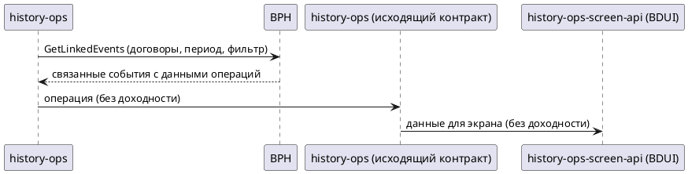

# bph-linked-events-yield

## 1. Бизнес-требования

### 1.1. Цель

#### Анализ требований — Доходность операции в интеграции BPH GetLinkedEvents

**Источник требования:**

| Параметр | Значение |
|----------|----------|
| Фича | Новый параметр «доходность» (`yield`) в интеграции `history-ops` ↔ BPH по `GetLinkedEvents` |
| Источник | Product request (бриф фичи) |
| Инициатор | Владелец продукта истории операций |
| Дата / версия | Draft 2026-06 |

**Стейкхолдеры:**

| Стейкхолдер | Роль | Интерес / ожидание | Влияние / ответственность |
|-------------|------|--------------------|---------------------------|
| Клиент мобильного банка | Основной пользователь | Видит доходность по связанным операциям на экране истории | Использует результат фичи |
| Владелец продукта истории операций | Заказчик фичи | Добавить отображение доходности в историю операций | Принимает функциональный результат |
| Команда BPH | Поставщик данных | Передавать значение доходности в ответе `GetLinkedEvents` | Отвечает за наличие и корректность поля в контракте `bph.yml` и в ответе |
| Команда `history-ops` (backend) | Владелец агрегации | Прочитать поле из ответа BPH и пробросить его в исходящий контракт | Реализует чтение, маппинг и проброс поля сквозь слои |
| Команда `history-ops-screen-api` (BDUI) | Владелец экранного сервиса | Учесть доходность в композите экрана | Формирует экран из данных `history-ops` |
| Владельцы контрактов BPH и screen-api | Владельцы интеграционных контрактов | Согласовать финальное имя и формат поля | Утверждают изменения контрактов |

**Бизнес-правила и ограничения:**

| ID | Тип | Описание | Источник / обоснование |
|----|-----|----------|------------------------|
| BR-01 | Бизнес-правило | Доходность связанной операции читается из ответа BPH `GetLinkedEvents` и пробрасывается до фронта через исходящий контракт `history-ops` и композит BDUI | Бриф фичи; контекст-документ `Feature-context/bph-linked-events-yield.md` |
| BR-02 | Бизнес-правило | Новое поле добавляется через контракты (`bph.yml`, `history.yml`), а не хардкодится в коде; DTO регенерируются из OpenAPI | Контекст-документ, раздел «Что учесть при написании фичи» |
| BR-03 | Бизнес-правило | Поле проходит сквозной путь: BPH `OperationData` → wrapper → leaf-конвертер → operation creator/merger → исходящий `history.yml` → screen-api composite; пропуск любого слоя означает, что поле не дойдёт до фронта | Контекст-документ, раздел «Ограничения и риски текущего состояния» |
| CN-01 | Ограничение | Новое поле ответа BPH должно быть `nullable`/опциональным, чтобы не сломать обратную совместимость с текущими ответами BPH | Контекст-документ, раздел «Ограничения и риски» |
| CN-02 | Ограничение | Запрос linked events управляется фиче-флагом `app-config-dynamic...bphGetLinkedEvents.active` и `ExecutionProcess.isBphLinked...Enabled()`; без активного запроса доходность не запрашивается | Контекст-документ; `OriginalInstrumentWithItsVersionsRequestsConfigMapTest.java` |
| CN-03 | Ограничение | Конвертеры устойчивы к ошибкам (`ErrorCollector`, `tryConvert`, дроп сущности при несоответствии статуса); добавление поля не должно ломать существующую фильтрацию (`EXECUTED`/`COMPLETED`) | Контекст-документ, раздел «Ограничения и риски» |

**Цель фичи:**

| Вопрос | Ответ |
|--------|-------|
| Какую бизнес-проблему решает? | Сейчас в истории связанных операций (BPH `GetLinkedEvents`) нет показателя доходности, и пользователь не видит этот показатель на экране |
| Какую ценность приносит пользователю? | Пользователь видит доходность по связанным операциям непосредственно в истории операций без перехода в другие сервисы |
| Какие метрики улучшает? | [GAP-GOAL-01] |

**SMART-проверка цели:**

| Критерий | Описание | Значение |
|----------|----------|----------|
| Specific | Конкретная | Добавить параметр запроса и поле ответа «доходность» в интеграцию `history-ops` ↔ BPH `GetLinkedEvents`, прочитать поле, пробросить через исходящий контракт `history-ops` и учесть в композите BDUI `history-ops-screen-api` |
| Measurable | Измеримая | Доходность присутствует в ответе исходящего контракта `history-ops` и отображается в композите экрана при её наличии в ответе BPH |
| Achievable | Достижимая | Достижимо: точки расширения известны (контракты `bph.yml`/`history.yml`, gateway, wrapper, конвертеры, creator/merger, composite); требуется ребилд DTO из контрактов |
| Relevant | Релевантная | Напрямую расширяет пользовательский экран истории операций новым показателем |
| Time-bound | Ограниченная по времени | [GAP-GOAL-02] |

**Противоречия и решения:**

| Требование 1 | Требование 2 | Источник 1 | Источник 2 | Решение | Обоснование |
|--------------|--------------|------------|------------|---------|-------------|
| Противоречия не выявлены | - | Бриф фичи | - | - | На текущем уровне постановки конфликтующих требований нет |

**Gaps и допущения:**

| ID | Тип | Где обнаружено | Что не хватает / что предполагается | Как закрыть |
|----|-----|----------------|-------------------------------------|-------------|
| GAP-GOAL-01 | Gap | Цель фичи, метрики | Не зафиксированы метрики, которые улучшает отображение доходности | Согласовать целевую метрику с владельцем продукта истории операций |
| GAP-GOAL-02 | Gap | SMART, Time-bound | Не задан срок/релиз фичи | Уточнить целевой релиз у владельца продукта |
| GAP-GOAL-03 | Gap | Q-01 контекст-документа | Не утверждено финальное имя поля «доходность» в каждом контракте (`yield`, `profitability` или иное) | Согласовать с владельцами контрактов BPH и screen-api |

### 1.2. Процесс/Сервис AS IS

**Как работает сейчас:**

> `history-ops` запрашивает у BPH связанные операции через `GetLinkedEvents` (`POST /api/v1/incoming-gateway/operations/linked-events`). В запросе передаются договоры (`agreements`), период поиска (`startSearchDate`, `endSearchDate`), поле фильтрации по дате (`dateForFilter`) и постраничные параметры (`page`, `pageSize`). В ответе BPH возвращает связанные события с данными операций (`OperationData`), `history-ops` обрабатывает их, формирует операции и отдаёт результат наружу через исходящий контракт `history-ops`, который использует экранный сервис BDUI. Показателя «доходность» в этом потоке сейчас нет.

**Use Case AS IS:**

| Элемент | Значение |
|---------|----------|
| Название | Получить связанные операции BPH для истории |
| Актор(ы) | Команда `history-ops` (backend), BPH (поставщик данных) |
| Триггер | Запрос истории операций, для которого активен запрос linked events |
| Предусловия | См. таблицу предусловий ниже |
| Постусловия | См. таблицу постусловий ниже |
| Бизнес-правила | BR-03, CN-02, CN-03 (см. раздел 1.1) |

**Предусловия AS IS:**

| № | Предусловие | Проверяемое условие |
|---|-------------|---------------------|
| 1 | Запрос связанных операций включён | Фиче-флаг `bphGetLinkedEvents.active` активен |
| 2 | Известны договоры клиента | Передан непустой список договоров (`agreements`) |
| 3 | Заданы параметры периода/фильтра | Заданы поле фильтрации по дате (`dateForFilter`) и размер страницы (`pageSize`) |

**Постусловия AS IS:**

| Исход | Постусловие |
|-------|-------------|
| Успех | Связанные операции получены из ответа BPH, обработаны и доступны в исходящем контракте `history-ops`; доходность отсутствует |
| Неуспех (бизнес) | Операции с неподходящим статусом отфильтрованы и не попадают в результат |
| Неуспех (техн.) | Ошибка по отдельной операции не валит весь поток: проблемная операция пропускается, остальные обрабатываются |

**Основной сценарий AS IS:**

```
Шаг 1:  history-ops: формирует запрос связанных операций (договоры, период поиска, поле фильтрации по дате, постраничные параметры)
Шаг 2:  history-ops: вызывает GetLinkedEvents у BPH
Шаг 3:  BPH: возвращает связанные события с данными операций (OperationData)
Шаг 4:  history-ops: обрабатывает ответ и формирует операции на основе полей операций (статус, цена, количество и др.)
Шаг 5:  history-ops: отдаёт операции через исходящий контракт history-ops (цена и другие показатели операции; доходности нет)
Шаг 6:  history-ops-screen-api: формирует экран истории операций из данных history-ops
```

**Альтернативные сценарии AS IS:**

```
2a. Запрос связанных операций выключен (Тип: Бизнес-ошибки):
  2a.1. Фиче-флаг запроса связанных операций не активен
  2a.2. Запрос к BPH не выполняется; связанные операции не запрашиваются
  2a.3. Сценарий завершается неуспешно

4a. Статус операции не соответствует фильтру (Тип: Бизнес-ошибки):
  4a.1. Статус операции не входит в допустимые для истории
  4a.2. Операция исключается из результата
  4a.3. Возврат к шагу 4 для следующей операции

4b. Ошибка обработки отдельной операции (Тип: Технические ошибки):
  4b.1. Обработка операции завершается ошибкой
  4b.2. Операция пропускается, поток продолжается
  4b.3. Возврат к шагу 4 для следующей операции
```

**Таблица проблем AS IS:**

| Проблема | Влияние на бизнес | Частота | Стоимость проблемы | Приоритет |
|----------|-------------------|---------|-------------------|-----------|
| В истории связанных операций нет показателя доходности | Пользователь не видит доходность по операциям на экране | Постоянно для всех связанных операций | [GAP-UCAS-01] | Высокий |

**Диаграмма AS IS (желательно):**



**Gaps и допущения:**

| ID | Тип | Где обнаружено | Что не хватает / что предполагается | Как закрыть |
|----|-----|----------------|-------------------------------------|-------------|
| GAP-UCAS-01 | Gap | Таблица проблем AS IS | Не оценена стоимость отсутствия доходности | Уточнить у владельца продукта истории операций |

### 1.3. Процесс/Сервис TO BE

**Как будет работать:**

> В запрос связанных операций добавляется новый параметр интеграции, а в данные операции ответа BPH (`OperationData`) — новое опциональное поле «доходность» (рабочее имя `yield`). `history-ops` читает доходность из ответа BPH, переносит её в формируемую операцию и отдаёт через исходящий контракт `history-ops`; экранный сервис BDUI учитывает доходность при формировании экрана. При отсутствии поля в ответе BPH поведение остаётся прежним.

**Use Case TO BE:**

| Элемент | Значение |
|---------|----------|
| Название | Получить связанные операции BPH с доходностью |
| Актор(ы) | Команда `history-ops` (backend), BPH (поставщик данных), `history-ops-screen-api` (BDUI) |
| Триггер | Запрос истории операций, для которого активен запрос linked events |
| Предусловия | См. таблицу предусловий ниже |
| Постусловия | См. таблицу постусловий ниже |
| Бизнес-правила | BR-01, BR-02, BR-03, CN-01, CN-02, CN-03 (см. раздел 1.1) |

**Предусловия TO BE:**

| № | Предусловие | Проверяемое условие |
|---|-------------|---------------------|
| 1 | Запрос связанных операций включён | Фиче-флаг `bphGetLinkedEvents.active` активен |
| 2 | Контракты обновлены | В контракте BPH есть новый параметр запроса и поле доходности в данных операции; в исходящем контракте `history-ops` есть поле доходности |
| 3 | BPH поддерживает возврат доходности | Ответ BPH содержит доходность (опционально) |

**Постусловия TO BE:**

| Исход | Постусловие |
|-------|-------------|
| Успех | Доходность получена из ответа BPH, перенесена в операцию, отдана в исходящем контракте `history-ops` и учтена на экране BDUI |
| Неуспех (бизнес) | Доходность отсутствует в ответе BPH — операция формируется без доходности, остальное поведение без изменений |
| Неуспех (техн.) | Ошибка по доходности отдельной операции не валит весь поток: операция обрабатывается по текущей логике пропуска |

**Основной сценарий TO BE:**

```
Шаг 1:  history-ops: формирует запрос связанных операций и устанавливает новый параметр интеграции
        ЕСЛИ запрос связанных операций выключен ТО ПЕРЕЙТИ К альтернативному сценарию 1a
Шаг 2:  history-ops: вызывает GetLinkedEvents у BPH
Шаг 3:  BPH: возвращает связанные события с данными операций, включая доходность
        ЕСЛИ доходность отсутствует в ответе ТО ПЕРЕЙТИ К альтернативному сценарию 3a
        ИНАЧЕ сценарий продолжается с шага 4
Шаг 4:  history-ops: читает доходность из данных операции и переносит её в формируемую операцию
Шаг 5:  history-ops: отдаёт операцию с доходностью через исходящий контракт history-ops
Шаг 6:  history-ops-screen-api: учитывает доходность при формировании экрана
```

**Альтернативные сценарии TO BE:**

```
1a. Запрос связанных операций выключен (Тип: Бизнес-ошибки):
  1a.1. Фиче-флаг запроса связанных операций не активен
  1a.2. Запрос к BPH не выполняется, доходность не запрашивается
  1a.3. Сценарий завершается неуспешно

3a. Доходность отсутствует в ответе BPH (Тип: Бизнес-ошибки):
  3a.1. В данных операции нет значения доходности
  3a.2. Операция формируется без доходности (поле остаётся пустым)
  3a.3. Сценарий продолжается с шага 5 без доходности

4a. Ошибка по доходности отдельной операции (Тип: Технические ошибки):
  4a.1. Обработка доходности операции завершается ошибкой
  4a.2. Операция обрабатывается по текущей логике пропуска
  4a.3. Возврат к шагу 4 для следующей операции
```

**Изменения относительно AS IS:**

| Что меняется | AS IS | TO BE |
|--------------|-------|-------|
| Параметр запроса BPH | Запрос связанных операций без параметра доходности | Добавлен новый параметр интеграции в запрос связанных операций |
| Поле ответа BPH | Данные операции без доходности | Добавлено опциональное поле доходности в данные операции |
| Обработка в history-ops | Доходность не читается и не переносится | Доходность читается из ответа и переносится в операцию |
| Исходящий контракт | `history-ops` без доходности | Добавлено поле доходности в исходящий контракт `history-ops` |
| Экран BDUI | Экран без доходности | Экран учитывает доходность |

**Gaps и допущения:**

| ID | Тип | Где обнаружено | Что не хватает / что предполагается | Как закрыть |
|----|-----|----------------|-------------------------------------|-------------|
| GAP-UCTB-01 | Gap | Шаг 1, новый параметр запроса (Q-02) | Не определено, что именно «добавить в интеграцию»: флаг `withYield` или иной фильтр; возвращает ли BPH `yield` безусловно | Уточнить у команды BPH; проверить `RequestLinkedData` в `bph.yml` |
| GAP-UCTB-02 | Gap | Шаг 3/5, уровень поля (Q-03) | Не подтверждено, на каком уровне лежит доходность: `OperationData` (lead) или `DetailData`/уровень сделки — от этого зависят конвертеры | Проверить схемы `OperationData`/`DetailData` в `bph.yml`; уточнить у команды BPH |
| GAP-UCTB-03 | Gap | Шаг 8, отображение BDUI (Q-04) | Не определены композит/секция и формат отображения (валюта/проценты) | Проверить `history-ops-screen-api/.../composite`, `.../services/screen/composite` |

## 2. Ограничения и допущения

| Ограничение/допущение | Тип | Описание | Обоснование |
|----------------------|-----|----------|-------------|
| Поле добавляется через контракты, не в коде | Техническое | Новый параметр запроса и поле `yield` добавляются в `bph.yml` и `history.yml`; DTO (`RequestLinkedData`, `OperationData`, `LinkedEventsDataLinkedEventsInner` и др.) регенерируются из OpenAPI, отдельных Java-классов нет | Контекст-документ; DTO генерируются из контрактов, правка идёт через контракт + ребилд |
| Поле ответа BPH опционально/`nullable` | Техническое | `yield` в `OperationData` должно быть необязательным, чтобы текущие ответы BPH без поля не ломали обработку | CN-01; обратная совместимость с текущими ответами BPH |
| Сквозной проброс через все слои | Техническое | Поле должно пройти `OperationData` → wrapper → leaf-конвертер → creator/merger → `history.yml` → screen-api composite; пропуск слоя означает, что поле не дойдёт до фронта | BR-03; контекст-документ, раздел «Ограничения и риски» |
| Сохранение текущей фильтрации операций | Техническое | Добавление поля не должно ломать фильтрацию по статусу (`EXECUTED`/`COMPLETED`, `GENERAL_STATUS_MAP`) и устойчивость конвертеров (`ErrorCollector`, `tryConvert`, дроп сущности) | CN-03; контекст-документ |
| Управление фиче-флагом | Бизнес-ограничение | Запрос linked events включается флагом `app-config-dynamic...bphGetLinkedEvents.active` и `ExecutionProcess.isBphLinked...Enabled()`; без активного запроса доходность не запрашивается | CN-02; `OriginalInstrumentWithItsVersionsRequestsConfigMapTest.java` |
| Доходность — транзитное поле ответа | Допущение | По текущим данным отдельной таблицы/колонки для доходности в БД `history-ops` нет: `yield` приходит из ответа BPH, а не из строки БД | Контекст-документ, раздел «Данные»; требует подтверждения (Q-05) |
| Обновление фикстур и матрицы полей | Техническое | Под новое поле обновляются тестовые фикстуры BPH (`json/response/bph/*`, `json/response/feed/bph_linked_events/*`) и матрица `05-Data/field-matrix/source-to-operation-fields.md` | Контекст-документ, раздел «Что учесть» |

**Gaps и допущения:**

| ID | Тип | Где обнаружено | Что не хватает / что предполагается | Как закрыть |
|----|-----|----------------|-------------------------------------|-------------|
| GAP-CONS-01 | Допущение | Доходность — транзитное поле (Q-05) | Не подтверждено, нужно ли сохранять/маппить `yield` в БД `history-ops` или это только транзитное поле ответа | Проверить `05-Data/entities/source-config.md`, `OperationDAO`/модель `Operation` |

## 4. Функциональные требования

#### 4.1.1. Сервис BPH GetLinkedEvents (запрос связанных операций)

**Общая информация:**

| Параметр | Значение |
|----------|----------|
| Назначение | Запрос связанных операций у BPH («Получение связанных сущностей»); в рамках фичи — запрос и чтение доходности (`yield`) |
| Система-источник | `history-ops` (вызывает `bphClient.getLinkedEvents(...)`) |
| Система-получатель | BPH (`exSystem="BPH"`, `eventType="GET_LINKED_EVENTS"`) |
| Тип интеграции | Синхронная |
| Протокол | REST (HTTPS) |
| Направление | Однонаправленная (запрос-ответ) |
| Версия API | `v1` (`/api/v1/incoming-gateway/...`) |
| Аутентификация | В `bph.yml` для эндпоинта security scheme не объявлена (см. GAP-INT-01) |
| Формат данных | JSON (`application/json`) |
| Rate Limit | [GAP-INT-02] |
| Timeout | [GAP-INT-02] |
| Retry Policy | [GAP-INT-02] |

**Метод:** `POST /api/v1/incoming-gateway/operations/linked-events` (`bph.yml:924`)

**Request Headers (`bph.yml:973`, `bph.yml:982`):**

| Заголовок | Обязат. | Описание | Пример |
|-----------|---------|----------|--------|
| rqUID | Да | Сквозной идентификатор запроса (`format: uuid`); соответствует `requestId` в `bphClient.getLinkedEvents(requestId, request)` | c4a5dccd-0fe2-4aa1-823e-a5a5d9ee04a4 |
| systemName | Да | Идентификатор системы-инициатора | si2-ops |

**Входящие параметры (`RequestLinkedData`, `bph.yml:1053`):**

| Параметр | Тип | Формат | Обязательность | Описание | Валидация | По умолч. | Пример |
|----------|-----|--------|----------------|----------|-----------|-----------|--------|
| agreements | array | string | Обязательно | Массив с номерами договоров | maxItems: 100; pattern `^[A-Za-z\d]{1,16}$` | — | KJ28438H394L |
| startSearchDate | string | date-time | Опционально | Начало периода поиска | — | — | 2026-01-01T00:00:00Z |
| endSearchDate | string | date-time | Опционально | Конец периода поиска | — | — | 2026-06-01T00:00:00Z |
| dateForFilter | string | enum `FilterDateEnum` | Обязательно | Поле для фильтрации по дате | enum: `EVENT_DATE`, `FORMATION_DATE` | — | EVENT_DATE |
| page | integer | int32 | Опционально | Номер возвращаемой страницы | minimum: 0, maximum: 1000 | — | 0 |
| pageSize | integer | int32 | Обязательно | Количество возвращаемых записей | minimum: 1, maximum: 4000 | — | 100 |
| `<новый параметр интеграции>` | [GAP-INT-04] | [GAP-INT-04] | [GAP-INT-04] | Новый параметр интеграции для доходности (флаг включения возврата `yield` или иной фильтр); в текущем `RequestLinkedData` такого параметра нет | [GAP-INT-04] | [GAP-INT-04] | [GAP-INT-04] |

**Условия обязательности (при наличии):**

| Параметр | Условие обязательности |
|----------|------------------------|
| `<новый параметр интеграции>` | Зависит от природы параметра (Q-02): безусловный возврат `yield` vs управляемый флагом |

**Пример запроса:**

```json
{
  "agreements": ["KJ28438H394L"],
  "startSearchDate": "2026-01-01T00:00:00Z",
  "endSearchDate": "2026-06-01T00:00:00Z",
  "dateForFilter": "EVENT_DATE",
  "page": 0,
  "pageSize": 100
}
```

> Пример соответствует текущей структуре `RequestLinkedData`; новый параметр интеграции уточняется (GAP-INT-04).

**Исходящие параметры — верхний уровень (ответ `200`: `{ status, data[] }`, `data` → `LinkedEventsData`, `bph.yml:944/991`):**

| Параметр | Тип | Формат | Nullable | Описание | Валидация | По умолч. | Пример |
|----------|-----|--------|----------|----------|-----------|-----------|--------|
| status | object | `ResponseStatusData` | Нет | Информация о статусе запроса (`code` integer, `message` string) | — | — | {"code": 0, "message": "OK"} |
| data | array | `LinkedEventsData` | Нет | Список связанных событий по договорам | — | [] | [] |
| LinkedEventsData.agreement | string | — | Да | Номер договора | maxLength: 255 | — | 420012W |
| LinkedEventsData.linkedEvents | array | object | Да | Связанные события договора; каждый элемент содержит до трёх веток: `condTradeOrder`, `tradeOrder`, `dealsWithCommissions` | maxItems: 1000 | — | [] |

**Структура одного элемента `linkedEvents[]` (три ветки, `bph.yml:1003`):**

| Ветка | Тип | Описание | Состав |
|-------|-----|----------|--------|
| condTradeOrder | object | Условная заявка | `lead` (`OperationData`) + `details[]` (`DetailData`, maxItems 1000) |
| tradeOrder | object | Заявка | `lead` (`OperationData`) + `details[]` (`DetailData`, maxItems 1000) |
| dealsWithCommissions | array (maxItems 1000) | Сделки с комиссиями | каждый элемент: `deal` (`lead` + `details[]`) и `commissions[]` (maxItems 1000; каждая — `lead` + `details[]`) |

**Поля `lead` (`OperationData`, `bph.yml:1088`) — применимы к каждой ветке:**

| Параметр | Тип | Формат | Nullable | Описание | Пример |
|----------|-----|--------|----------|----------|--------|
| type | string | — | Да | Тип операции | — |
| subType | string | — | Да | Подтип операции | — |
| subtype | string | — | Да | Подтип операции (дублирующее поле в нижнем регистре) | — |
| additionalType | string | — | Да | Дополнительный тип события | SPEC_SWAP |
| externalSystemVersion | number | — | Да | Версия события | 5 |
| formationDate | string | date-time | Да | Дата формирования | — |
| eventDate | string | date-time | Да | Дата события | — |
| externalSystemId | string | — | Да | Идентификатор операции во внешней системе | KU2309848 |
| price | object | `PriceData` (`value` big_decimal + `currency`) | Да | Цена | {"value": "4.0123", "currency": "RUB"} |
| totalPrice | object | `PriceData` (`value` big_decimal + `currency`) | Да | Итоговая цена | {"value": "4.0123", "currency": "RUB"} |
| quantity | string | big_decimal | Да | Количество | 100.000000 |
| quantityFact | string | big_decimal | Да | Фактическое количество | 0.000000 |
| tradingSection | string | — | Да | Торговая секция | — |
| account | string | — | Да | Счёт | — |
| status | string | — | Да | Статус операции | DONE |
| instrument | object | — | Да | Данные инструмента (`isin`, `tickers[]` (`secCode`, `classCode`), `currency`, `type`) | — |
| ucpId | integer | int64 | Да | Идентификатор ЕПК | 23984692648 |
| agreement | string | — | Да | Номер договора | kk44r-drgdtb-4354rvd-5drfv |
| parent | string | — | Да | Идентификатор родительской операции | KU2309848 |
| isFact | boolean | — | Да | Признак факта события | — |
| parentIds | object | — | Да | Идентификаторы связанных сущностей (`selfIdTs`, `orderIdTs`, `dealIdTs`, `dealIdMaster`, `corporateActionId`, `uidIdTs`, `isFact`, `batchId`, `orderId`) | — |
| yield | object/string | по образцу `PriceData` (`value` big_decimal + `currency`) или `big_decimal` (Q-06) | Да | Доходность операции — **новое поле**, опциональное | {"value": "1.0250", "currency": "RUB"} |

**Поля `details[]` (`DetailData`, `bph.yml:1246`):**

| Параметр | Тип | Nullable | Описание | Пример |
|----------|-----|----------|----------|--------|
| key | string | Да | Ключ детали | couponNumber |
| value | string | Да | Значение детали | 5 |

**Пример ответа:**

```json
{
  "status": {
    "code": 0,
    "message": "OK"
  },
  "data": [
    {
      "agreement": "420012W",
      "linkedEvents": [
        {
          "condTradeOrder": {
            "lead": {
              "type": "TRADE",
              "subType": "CONDITIONAL_ORDER",
              "additionalType": "SPEC_SWAP",
              "externalSystemVersion": 5,
              "formationDate": "2026-05-30T10:15:00Z",
              "eventDate": "2026-05-30T10:16:00Z",
              "externalSystemId": "KU2309848",
              "price": {
                "value": "4.0123",
                "currency": "RUB"
              },
              "totalPrice": {
                "value": "401.23",
                "currency": "RUB"
              },
              "quantity": "100.000000",
              "quantityFact": "0.000000",
              "tradingSection": "TQCB",
              "account": "L01-00000F00",
              "status": "ACTIVE",
              "instrument": {
                "isin": "RU000A103YM3",
                "tickers": [
                  {
                    "secCode": "RU000A103YM3",
                    "classCode": "TQCB"
                  }
                ],
                "currency": "RUB",
                "type": "BOND"
              },
              "ucpId": 23984692648,
              "agreement": "420012W",
              "parent": "KU2309800",
              "isFact": false,
              "parentIds": {
                "selfIdTs": "kk44r-drgdtb-4354rvd-5drfv",
                "orderIdTs": "kk44r-drgdtb-4354rvd-5drfv",
                "uidIdTs": "5"
              },
              "yield": {
                "value": "1.0250",
                "currency": "RUB"
              }
            },
            "details": [
              {
                "key": "couponNumber",
                "value": "5"
              }
            ]
          },
          "tradeOrder": {
            "lead": {
              "type": "TRADE",
              "subType": "ORDER",
              "externalSystemId": "KU2309849",
              "price": {
                "value": "4.0123",
                "currency": "RUB"
              },
              "quantity": "100.000000",
              "quantityFact": "100.000000",
              "status": "DONE",
              "instrument": {
                "isin": "RU000A103YM3",
                "currency": "RUB",
                "type": "BOND"
              },
              "agreement": "420012W",
              "isFact": true,
              "yield": {
                "value": "1.0310",
                "currency": "RUB"
              }
            },
            "details": [
              {
                "key": "orderType",
                "value": "LIMIT"
              }
            ]
          },
          "dealsWithCommissions": [
            {
              "deal": {
                "lead": {
                  "type": "TRADE",
                  "subType": "DEAL",
                  "externalSystemId": "KU2309850",
                  "price": {
                    "value": "4.0123",
                    "currency": "RUB"
                  },
                  "totalPrice": {
                    "value": "401.23",
                    "currency": "RUB"
                  },
                  "quantity": "100.000000",
                  "status": "DONE",
                  "agreement": "420012W",
                  "isFact": true,
                  "yield": {
                    "value": "1.0298",
                    "currency": "RUB"
                  }
                },
                "details": [
                  {
                    "key": "dealNumber",
                    "value": "778812"
                  }
                ]
              },
              "commissions": [
                {
                  "lead": {
                    "type": "COMMISSION",
                    "subType": "BROKER_COMMISSION",
                    "externalSystemId": "KU2309851",
                    "price": {
                      "value": "0.40",
                      "currency": "RUB"
                    },
                    "status": "DONE",
                    "agreement": "420012W",
                    "isFact": true
                  },
                  "details": [
                    {
                      "key": "commissionType",
                      "value": "BROKER"
                    }
                  ]
                }
              ]
            }
          ]
        }
      ]
    }
  ]
}
```

> Имя, тип и уровень поля `yield` (`OperationData` lead vs `DetailData`) уточняются (GAP-INT-05, GAP-UCTB-02); пример показывает поле по образцу `PriceData`. Доходность показана на уровне `lead` каждой ветки; на комиссиях она опущена как неприменимая.

**Пограничный случай: поле `yield` отсутствует в ответе:**

```json
{
  "status": {
    "code": 0,
    "message": "OK"
  },
  "data": [
    {
      "agreement": "420012W",
      "linkedEvents": [
        {
          "tradeOrder": {
            "lead": {
              "type": "TRADE",
              "subType": "ORDER",
              "externalSystemId": "KU2309849",
              "price": {
                "value": "4.0123",
                "currency": "RUB"
              },
              "quantity": "100.000000",
              "quantityFact": "100.000000",
              "status": "DONE",
              "instrument": {
                "isin": "RU000A103YM3",
                "currency": "RUB",
                "type": "BOND"
              },
              "agreement": "420012W",
              "isFact": true
            },
            "details": [
              {
                "key": "orderType",
                "value": "LIMIT"
              }
            ]
          }
        }
      ]
    }
  ]
}
```

**Коды ошибок (`bph.yml:938`):**

| Код HTTP | Схема | Описание | Условие возникновения |
|----------|-------|----------|-----------------------|
| 200 | `{ status: ResponseStatusData, data: LinkedEventsData[] }` | OK | Успешный ответ |
| 400 | `ErrorData` | Bad Request | Невалидный запрос |
| 500 | `{ status: Response500Data, data: [] }` | Internal Server Error | Внутренняя ошибка BPH |

> На стороне `history-ops` ошибки конвертации отдельных сущностей фиксируются в `ErrorCollector`, проблемные сущности дропаются/пропускаются.

#### 4.1.1.1. Исходящий контракт history-ops (проброс на фронт)

**Общая информация:**

| Параметр | Значение |
|----------|----------|
| Назначение | Проброс доходности наружу для screen-api/фронта |
| Система-источник | `history-ops` (контракт `history.yml`, пакет `api.ws`) |
| Система-получатель | `history-ops-screen-api` (BDUI composite) / фронт |
| Тип интеграции | Синхронная |
| Протокол | REST (HTTPS) |
| Формат данных | JSON |

**Исходящие параметры — операционный lead `HistoryOperationLead` (`history.yml:456`, целевая схема для доходности операции):**

| Параметр | Тип | Формат | Обязательность | Описание | Источник |
|----------|-----|--------|----------------|----------|----------|
| id | string | — | Обязательно | Идентификатор операции | существующее |
| itemtype | string | — | Обязательно | Тип элемента | существующее |
| type | string | enum `PortfolioOperationType` | Обязательно | Тип операции | существующее |
| general_status | string | enum `GeneralOperationStatus` | Обязательно | Общий статус операции | существующее |
| time_happened | string | date-time | Обязательно | Время события операции | существующее |
| time_closed | string | date-time | Опционально | Время завершения операции | существующее |
| currency | string | — | Опционально | Валюта операции | существующее |
| value_by_instrument_item | number | — | Опционально | Стоимость по инструменту | существующее |
| instrument_count | integer | int64 | Опционально | Количество инструментов | существующее |
| total_sum | number | string (`@JsonFormat` STRING) | Опционально | Итоговая сумма | существующее |
| total_deals_volume | integer | int64 | Опционально | Суммарный объём сделок | существующее |
| total_deals_avg_price | number | — | Опционально | Средняя цена по сделкам | существующее |
| comment | string | — | Опционально | Комментарий | существующее |
| operationDisplayName | string | — | Опционально | Отображаемое имя операции | существующее |
| available_cancellation | boolean | — | Опционально | Доступность отмены | существующее |
| cancellation_comment | string | — | Опционально | Комментарий отмены | существующее |
| channel | string | — | Опционально | Канал | существующее |
| `<поле доходности>` | number | по образцу существующих числовых полей операции (`number`) | Да | Новое поле доходности операции | **новое поле** (доходность из ответа BPH → исходящий контракт `history-ops` → экран BDUI) |

> Уровень размещения доходности уточняется (GAP-INT-07): операционный lead `HistoryOperationLead` — наиболее вероятная цель для доходности операции. Поля цены отдельных типов операций лежат в схемах деталей, а не в lead: `price` (`decimal`) — в `DepoPriceInfoDto` (`history.yml:249`), `cancellation_price` (`number`) — в `DepoCorpSecTransferDetails` (`history.yml:199`); если доходность относится к конкретному типу операции, её добавляют в соответствующую схему деталей.
>
> Финальное имя поля доходности согласуется с владельцами контракта (Q-01, GAP-GOAL-03).

**Gaps и допущения:**

| ID | Тип | Где обнаружено | Что не хватает / что предполагается | Как закрыть |
|----|-----|----------------|-------------------------------------|-------------|
| GAP-INT-01 | Gap | Общая информация / Аутентификация | В `bph.yml` для эндпоинта `linked-events` security scheme не объявлена; способ аутентификации вызова к BPH не зафиксирован в контракте | Проверить конфигурацию `bphClient` в `history-ops` (gateway/security на уровне инфраструктуры) |
| GAP-INT-02 | Gap | Общая информация | Не подтверждены rate limit, timeout, retry policy для вызова BPH | Проверить конфигурацию клиента BPH в `history-ops` |
| GAP-INT-04 | Gap | Новый параметр запроса (Q-02) | В текущем `RequestLinkedData` нет параметра доходности; не определены имя, тип и обязательность нового параметра; безусловен ли возврат `yield` | Уточнить у команды BPH; обновить `RequestLinkedData` в `bph.yml` |
| GAP-INT-05 | Gap | Поле `yield` ответа (Q-03, Q-06) | Подтверждён образец `PriceData` (`value` big_decimal + `currency`), но не утверждены финальные имя, тип и уровень поля (`OperationData` lead vs `DetailData`) | Согласовать с командой BPH; обновить схему в `bph.yml` |
| GAP-INT-07 | Gap | Исходящий контракт | Не утверждены имя, тип и уровень размещения поля доходности: операционный lead `HistoryOperationLead` (для доходности операции) vs схема деталей конкретного типа операции (как `price` в `DepoPriceInfoDto`) | Согласовать с владельцами контракта `history-ops`/screen-api |

## 5. Нефункциональные требования

### 5.4. Требования к настройкам

#### NFR — Доходность в интеграции BPH GetLinkedEvents (Конфигурация)

### Настройки и конфигурация

Классификация:
- Уровень безопасности: `internal`
- Частота изменения: `dynamic`
- Область: `environment-specific`

| Параметр | Тип | Уровень | Частота | Область | Хранение | По умолчанию | Описание | Валидация | Влияние при изменении | Процедура отката |
|----------|-----|---------|---------|---------|----------|-------------|----------|-----------|----------------------|------------------|
| `app-config-dynamic.instrument-filter-requests-dynamic.bphGetLinkedEvents.active` | boolean | internal | dynamic | environment-specific | app-config-dynamic (ConfigMap, внешний) | `true` в `application-test.yml`; prod-default — см. GAP-NFR-01 | Фиче-флаг активности запроса связанных операций BPH; при `false` запрос не выполняется и доходность не запрашивается | true/false | Включает/выключает запрос linked events (и, как следствие, получение доходности) | Вернуть прежнее значение флага |
| `app-config-dynamic.instrument-filter-requests-dynamic.bphGetLinkedEvents.inactive` | boolean | internal | dynamic | environment-specific | app-config-dynamic (ConfigMap, внешний) | `true` в `application-test.yml`; prod-default — см. GAP-NFR-01 | Парный ключ к `active` для запроса связанных операций BPH | true/false | Влияет на признак выполнения запроса linked events | Вернуть прежнее значение |
| `<новый параметр интеграции>` | [GAP-NFR-02] | [GAP-NFR-02] | [GAP-NFR-02] | [GAP-NFR-02] | [GAP-NFR-02] | [GAP-NFR-02] | Если возврат доходности управляется параметром запроса/настройкой (Q-02) — её ключ и значения | [GAP-NFR-02] | Управляет возвратом доходности в ответе BPH | [GAP-NFR-02] |

Способы хранения:

| Способ | Когда использовать | Примеры |
|--------|-------------------|---------|
| app-config-dynamic (ConfigMap) | Динамические флаги активности запросов источников | `bphGetLinkedEvents.active` |

Процедура изменения:

| Тип параметра | Процедура изменения | Кто изменяет | Требуется согласование |
|---------------|---------------------|--------------|------------------------|
| dynamic | Изменение значения в app-config-dynamic без передеплоя | Команда `history-ops` / эксплуатация | [GAP-NFR-03] |

> Связанное программное условие: `ExecutionProcess.isBphLinked...Enabled()` и `RpcNamesForRequestCondition.BPH_GET_LINKED_EVENTS` определяют выполнение запроса; учитывается в тестах (`OriginalInstrumentWithItsVersionsRequestsConfigMapTest.java`).

**Gaps и допущения:**

| ID | Тип | Где обнаружено | Что не хватает / что предполагается | Как закрыть |
|----|-----|----------------|-------------------------------------|-------------|
| GAP-NFR-01 | Gap | Таблица настроек | В репозитории нет main-конфига с default флага: `bphGetLinkedEvents.active`/`inactive` приходят из внешнего app-config-dynamic ConfigMap (в `application-test.yml` оба `true`); прод-значение по умолчанию не зафиксировано | Уточнить значение в app-config-dynamic ConfigMap эксплуатации |
| GAP-NFR-02 | Gap | Новый параметр интеграции (Q-02) | Не определено, существует ли отдельная настройка/параметр для управления возвратом доходности | Уточнить у команды BPH; проверить `RequestLinkedData` в `bph.yml` |
| GAP-NFR-03 | Gap | Процедура изменения | Не подтверждено требование согласования при изменении флага | Уточнить регламент эксплуатации `history-ops` |
