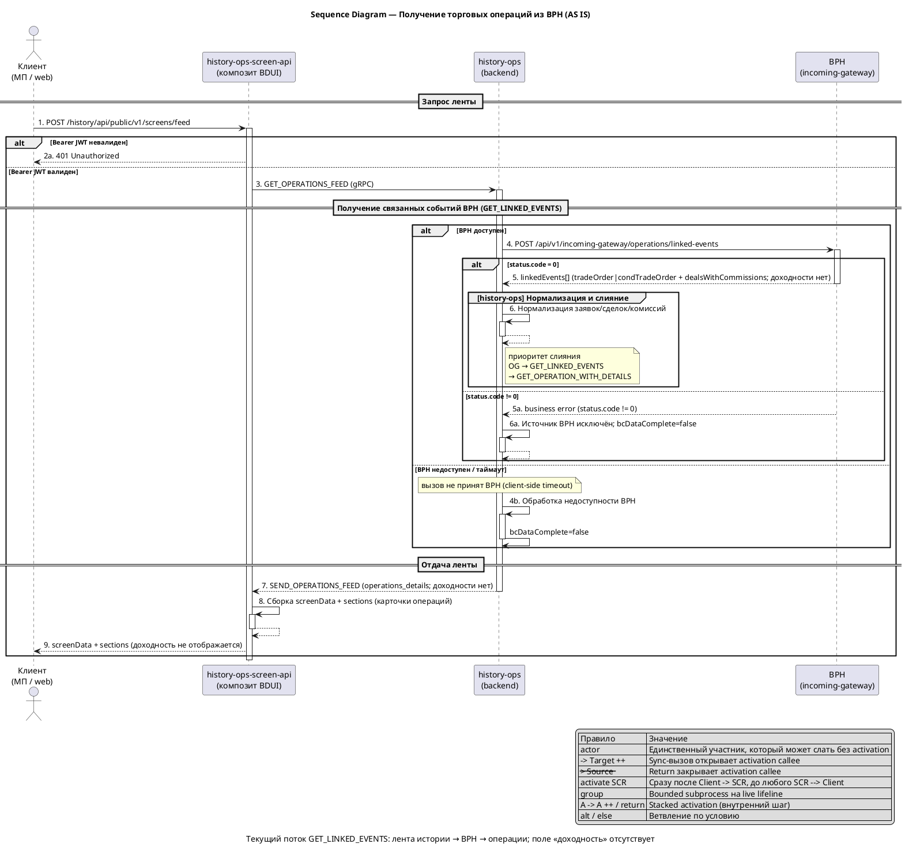
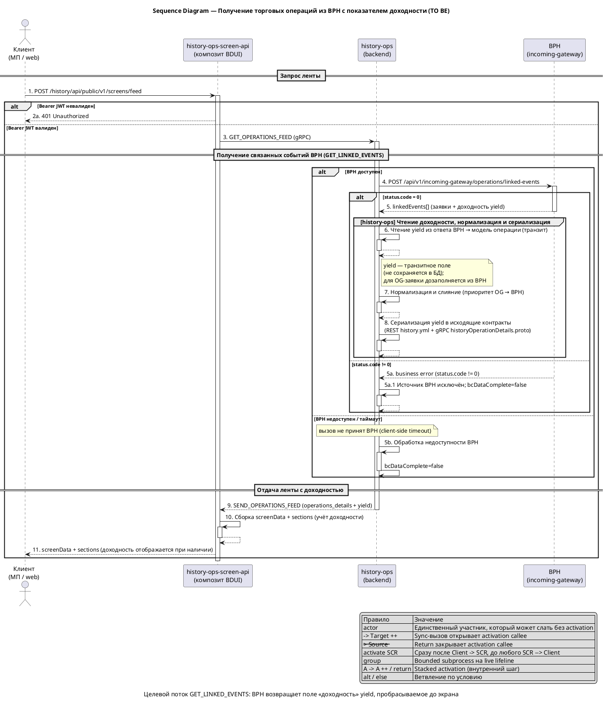

# bph-linked-events-yield

## 1. Бизнес-требования

#### Use Case — Получить торговые операции клиента из BPH по обмену GET_LINKED_EVENTS

**Структура Use Case:**

| Элемент | Значение |
|---------|----------|
| Название | Получить торговые операции клиента из BPH по обмену GET_LINKED_EVENTS |
| Актор(ы) | Клиент (пользователь МП/web, авторизован) |
| Триггер | Клиент запрашивает ленту истории операций (`POST /history/api/public/v1/screens/feed`), в набор типов операций которого входят `transaction_buy` и/или `transaction_sell` |
| Предусловия | См. таблицу предусловий ниже |
| Постусловия | См. таблицу постусловий ниже |
| Бизнес-правила | BR-01…BR-04 (см. ниже) |

**Предусловия:**

| № | Предусловие | Проверяемое условие |
|---|-------------|---------------------|
| 1 | Клиент авторизован | Bearer JWT валиден; при невалидном токене композит возвращает HTTP 401 |
| 2 | В наборе типов операции запрошены торговые типы | В `filters[operation_type].codes` (или в полном наборе без фильтра) присутствуют `transaction_buy` / `transaction_sell` |
| 3 | Интеграция BPH для торговых заявок включена | Признак включения обмена `GET_LINKED_EVENTS` для торговых операций активен |
| 4 | Канал к BPH доступен | `bph-incoming-gateway` отвечает на вызов `GET_LINKED_EVENTS` |

**Постусловия:**

| Исход | Постусловие |
|-------|-------------|
| Успех | Торговые операции (заявки, сделки, комиссии) получены из BPH по `GET_LINKED_EVENTS`, нормализованы и отображены в ленте истории операций; показатель «доходность» отсутствует — поля `yield` нет ни в ответе BPH, ни в исходящих контрактах, ни на экране |
| Неуспех (бизнес) | BPH вернул `status.code ≠ 0`: операции источника BPH не включаются в результат; `bcDataComplete=false`, типы операций источника попадают в `failOperationTypes` |
| Неуспех (техн.) | BPH недоступен или вызов завершился таймаутом: операции источника BPH исключаются; лента формируется из других источников (OG, BC) с признаком неполноты (`bcDataComplete=false`) |

**Бизнес-правила:**

| ID | Правило | Применяется на шаге |
|----|---------|---------------------|
| BR-01 | Обмен `GET_LINKED_EVENTS` вызывается только для типов операций `transaction_buy` / `transaction_sell` (при активном признаке включения интеграции BPH) | Шаг 4 |
| BR-02 | Приоритет слияния торговых заявок: OG (`GetTradeOrders`) → BPH `GET_LINKED_EVENTS` → BPH `GET_OPERATION_WITH_DETAILS` | Шаг 6 |
| BR-03 | При ошибке BPH (`status.code ≠ 0`) операции из этого источника не включаются в результат; `bcDataComplete=false` | Шаг 5 |
| BR-04 | Завершённая заявка без сделок отфильтровывается и не попадает в результат | Шаг 6 |

**Основной сценарий — Happy Path:**

```
Шаг 1:  Клиент: запрашивает ленту истории операций (POST /history/api/public/v1/screens/feed)
Шаг 2:  history-ops-screen-api: проверяет Bearer JWT клиента
          ЕСЛИ токен валиден
            ТО сценарий продолжается с шага 3
          ИНАЧЕ
            ПЕРЕЙТИ К альтернативному сценарию 2a
Шаг 3:  history-ops-screen-api: маппит фильтры ленты в descriptor и вызывает history-ops (gRPC GET_OPERATIONS_FEED)
Шаг 4:  history-ops: формирует и отправляет запрос к BPH по обмену GET_LINKED_EVENTS
          ЕСЛИ [BR-01] в запросе есть типы transaction_buy / transaction_sell
            ТО сценарий продолжается с шага 5
          ИНАЧЕ
            ПЕРЕЙТИ К альтернативному сценарию 4a
Шаг 5:  BPH: обрабатывает GET_LINKED_EVENTS и возвращает связанные сущности
          ЕСЛИ [BR-03] status.code = 0
            ТО сценарий продолжается с шага 6
          ИНАЧЕ
            ПЕРЕЙТИ К альтернативному сценарию 5a
Шаг 6:  history-ops: нормализует связанные сущности (заявки tradeOrder|condTradeOrder, сделки, комиссии) и сливает с другими источниками
          ЕСЛИ [BR-02] заявка присутствует в OG
            ТО использовать заявку OG (приоритет выше BPH)
          ИНАЧЕ ЕСЛИ заявка есть в GET_LINKED_EVENTS
            ТО использовать заявку BPH
          ИНАЧЕ
            ПЕРЕЙТИ К альтернативному сценарию 6a
          ЕСЛИ [BR-04] заявка завершена, но сделок нет
            ТО заявка отфильтровывается
          ИНАЧЕ
            сценарий продолжается
Шаг 7:  history-ops: отдаёт операции ленты (SEND_OPERATIONS_FEED; поле «доходность» отсутствует)
Шаг 8:  history-ops-screen-api: собирает screenData и sections (карточки операций) и отдаёт результат клиенту
          Клиент видит операции без показателя «доходность»
```

**Альтернативные сценарии:**

```
2a. Невалидный Bearer JWT (Ошибки валидации):
  2a.1. history-ops-screen-api возвращает HTTP 401 Unauthorized
  2a.2. Сценарий завершается неуспешно

4a. В запросе нет торговых типов операций [BR-01] (Пограничные случаи):
  4a.1. Обмен GET_LINKED_EVENTS не вызывается
  4a.2. Лента формируется из других источников (OG, BC, BPH GET_OPERATION_WITH_DETAILS)
  4a.3. Возврат к шагу 6

5a. BPH вернул business error (status.code ≠ 0) [BR-03] (Бизнес-ошибки):
  5a.1. Операции источника BPH исключаются из результата
  5a.2. bcDataComplete=false; типы операций источника попадают в failOperationTypes
  5a.3. Возврат к шагу 6 для обработки других источников

5b. BPH недоступен / таймаут (Технические ошибки):
  5b.1. Вызов GET_LINKED_EVENTS завершается ошибкой или таймаутом
  5b.2. Операции источника BPH исключаются; bcDataComplete=false
  5b.3. Возврат к шагу 6 для обработки других источников

6a. Заявка не проходит отбор в историю (Бизнес-ошибки):
  6a.1. Заявка не подходит по статусу/типу для истории операций
  6a.2. Заявка исключается из результата
  6a.3. Возврат к шагу 6 для следующей заявки
```

**Связи между Use Cases:**

| Связь | Связанный Use Case | Шаг / Extension Point | Условие |
|-------|--------------------|-----------------------|---------|
| include | Собрать ленту истории операций (feed assembly) | Шаг 3 основного сценария | Всегда — обмен GET_LINKED_EVENTS выполняется как обязательный подпроцесс сборки ленты при наличии типов transaction_buy/transaction_sell |

#### Sequence Diagram — Получение торговых операций из BPH (AS IS)

**Назначение:**

Диаграмма показывает текущий сценарий получения торговых операций по обмену `GET_LINKED_EVENTS`: клиент запрашивает ленту, композит `history-ops-screen-api` вызывает `history-ops` по gRPC, `history-ops` обращается к BPH за связанными сущностями (заявки, сделки, комиссии), нормализует и сливает их, после чего лента возвращается на экран. Показатель «доходность» в этом потоке отсутствует: поля `yield` нет ни в ответе BPH, ни в исходящих контрактах, ни на экране.

**Участники:**

| Участник | Тип | Роль |
|---|---|---|
| `Клиент` | actor | Пользователь МП/web, инициирует запрос ленты истории операций |
| `history-ops-screen-api` | participant | Композит BDUI (BFF): авторизует клиента, маппит фильтры, собирает экран |
| `history-ops` | participant | Backend агрегации истории операций; вызывает BPH, нормализует и сливает источники |
| `BPH` | participant | Внешняя система (Brokerage Controller, `bph-incoming-gateway`), источник связанных событий |

**PlantUML:**



**Легенда:**

| Обозначение | Значение |
|---|---|
| `->` | Синхронный вызов (между participant только с `++` на callee) |
| `-->` | Ответ / return (с `--` при закрытии callee) |
| `++` / `--` | Activation start / end на callee |
| `activate` / `deactivate` | Явное открытие/закрытие lifeline композита на scope обработки |
| `actor` | Может инициировать сообщение без activation bar |
| `participant` | Должен быть live на каждой исходящей/входящей sync-стрелке |
| `alt` / `else` | Ветвление: валидность токена, доступность BPH, status.code ответа |
| `group` | Bounded subprocess внутри live lifeline (нормализация и слияние) |
| `A -> A ++ / return` | Stacked activation — внутренний шаг обработки |

**Соответствие тексту:**

| Элемент на диаграмме | Номер | Описание в тексте |
|---|---|---|
| `POST /history/api/public/v1/screens/feed` | 1 | Шаг 1 основного сценария — запрос ленты клиентом |
| `401 Unauthorized` | 2a | Альтернативный сценарий 2a — невалидный Bearer JWT |
| `GET_OPERATIONS_FEED (gRPC)` | 3 | Шаг 3 основного сценария — вызов history-ops композитом |
| `POST /api/v1/incoming-gateway/operations/linked-events` | 4 | Шаг 4 основного сценария — обмен GET_LINKED_EVENTS |
| `linkedEvents[] (…; доходности нет)` | 5 | Шаг 5 основного сценария — ответ BPH без поля доходности |
| Нормализация и слияние | 6 | Шаг 6 основного сценария — приоритет OG → GET_LINKED_EVENTS → GET_OPERATION_WITH_DETAILS |
| `SEND_OPERATIONS_FEED (…; доходности нет)` | 7 | Шаг 7 основного сценария — отдача ленты history-ops |
| Сборка screenData + sections | 8, 9 | Шаг 8 основного сценария — формирование экрана, доходность не отображается |

#### Use Case — Получить торговые операции клиента из BPH по обмену GET_LINKED_EVENTS с показателем доходности

**Структура Use Case:**

| Элемент | Значение |
|---------|----------|
| Название | Получить торговые операции клиента из BPH по обмену GET_LINKED_EVENTS с показателем доходности |
| Актор(ы) | Клиент (пользователь МП/web, авторизован) |
| Триггер | Клиент запрашивает ленту истории операций (`POST /history/api/public/v1/screens/feed`), в набор типов операций которого входят `transaction_buy` и/или `transaction_sell` |
| Предусловия | См. таблицу предусловий ниже |
| Постусловия | См. таблицу постусловий ниже |
| Бизнес-правила | BR-05…BR-08 (новые, TO BE); BR-01…BR-04 (AS IS) действуют без изменений |

**Предусловия:**

| № | Предусловие | Проверяемое условие |
|---|-------------|---------------------|
| 1 | Клиент авторизован | Bearer JWT валиден; при невалидном токене композит возвращает HTTP 401 |
| 2 | В наборе типов операции запрошены торговые типы | В фильтре присутствуют `transaction_buy` / `transaction_sell` |
| 3 | Интеграция BPH для торговых заявок включена | Признак включения обмена `GET_LINKED_EVENTS` активен |
| 4 | Канал к BPH доступен | `bph-incoming-gateway` отвечает на вызов `GET_LINKED_EVENTS` |
| 5 | Входящий контракт BPH расширен полем доходности | В ответе `GET_LINKED_EVENTS` присутствует новое поле `yield` (объект `PriceData {value, currency}`, опциональное) на уровне `OperationData` (lead) безусловной заявки `tradeOrder` |
| 6 | Фича-тогл доходности BPH активен | Тогл BPH-ветки доходности включён (ON); при OFF показатель `yield` не читается и не пробрасывается сквозь слои [CN-14] |

**Постусловия:**

| Исход | Постусловие |
|-------|-------------|
| Успех | Торговые операции получены из BPH и нормализованы; показатель доходности `yield` (объект `PriceData {value, currency}`) прочитан из ответа BPH, проброшен сквозь исходящие контракты history-ops (REST + gRPC) и отображён композитом BDUI на экране (там, где поле присутствует) |
| Неуспех (бизнес) | BPH вернул `status.code ≠ 0`: операции источника BPH не включаются; `bcDataComplete=false`, типы попадают в `failOperationTypes`; доходность не пробрасывается |
| Неуспех (техн.) | BPH недоступен/таймаут: операции источника BPH исключаются; лента формируется из других источников с `bcDataComplete=false`; доходность BPH-only заявок отсутствует |

**Бизнес-правила:**

| ID | Правило | Применяется на шаге |
|----|---------|---------------------|
| BR-05 | Показатель доходности `yield` пробрасывается сквозь все слои: ответ BPH → модель операции HO → исходящие контракты (REST `history.yml` + gRPC `historyOperationDetails.proto`) → композит BDUI (фронт); пропуск любого слоя означает, что поле не дойдёт до экрана | Шаг 6–9 |
| BR-06 | Доходность — транзитное поле: переносится из ответа BPH в исходящие контракты без сохранения в БД HO и без пересчёта значения | Шаг 6 |
| BR-07 | Поле доходности опциональное: отсутствие поля или пустое `value` ≠ нулевое значение — показатель не отображается; значения `0` и отрицательные допустимы | Шаг 6 |
| BR-08 | Для заявки, присутствующей и в OG, и в BPH, доходность берётся из OG; при отсутствии в OG — дозаполняется из BPH; для BPH-only заявки — только из BPH | Шаг 7 |

**Основной сценарий — Happy Path:**

```
Шаг 1:  Клиент: запрашивает ленту истории операций (POST /history/api/public/v1/screens/feed)
Шаг 2:  history-ops-screen-api: проверяет Bearer JWT клиента
          ЕСЛИ токен валиден
            ТО сценарий продолжается с шага 3
          ИНАЧЕ
            ПЕРЕЙТИ К альтернативному сценарию 2a
Шаг 3:  history-ops-screen-api: маппит фильтры ленты в descriptor и вызывает history-ops (gRPC GET_OPERATIONS_FEED)
Шаг 4:  history-ops: формирует и отправляет запрос к BPH по обмену GET_LINKED_EVENTS
          ЕСЛИ [BR-01] в запросе есть типы transaction_buy / transaction_sell
            ТО сценарий продолжается с шага 5
          ИНАЧЕ
            ПЕРЕЙТИ К альтернативному сценарию 4a
Шаг 5:  BPH: обрабатывает GET_LINKED_EVENTS и возвращает связанные сущности, включая показатель доходности `yield`
          ЕСЛИ [BR-03] status.code = 0
            ТО сценарий продолжается с шага 6
          ИНАЧЕ
            ПЕРЕЙТИ К альтернативному сценарию 5a
Шаг 6:  history-ops: читает показатель доходности из ответа BPH и переносит его в модель операции
          ЕСЛИ [BR-06] поле доходности присутствует и имеет значение
            ТО перенести доходность в модель операции (транзитно, без сохранения в БД)
          ИНАЧЕ
            ПЕРЕЙТИ К альтернативному сценарию 6b
Шаг 7:  history-ops: нормализует связанные сущности (заявки, сделки, комиссии) и сливает с другими источниками
          ЕСЛИ [BR-02] заявка присутствует в OG
            ТО использовать заявку OG (приоритет выше BPH)
          ИНАЧЕ ЕСЛИ заявка есть в GET_LINKED_EVENTS
            ТО использовать заявку BPH
          ИНАЧЕ
            ПЕРЕЙТИ К альтернативному сценарию 7a
          ЕСЛИ [BR-08] используется заявка OG и её доходность отсутствует
            ТО дозаполнить доходность из BPH
          ИНАЧЕ
            сценарий продолжается
          ЕСЛИ [BR-04] заявка завершена, но сделок нет
            ТО заявка отфильтровывается
          ИНАЧЕ
            сценарий продолжается
Шаг 8:  history-ops: включает показатель доходности в исходящие контракты (REST history.yml + gRPC historyOperationDetails.proto)
Шаг 9:  history-ops: отдаёт операции ленты с показателем доходности (SEND_OPERATIONS_FEED)
Шаг 10: history-ops-screen-api: собирает screenData и sections, учитывая показатель доходности, и отдаёт результат клиенту
          Клиент видит показатель «доходность» в деталке операции (где поле присутствует); в компактной карточке ленты показатель не отображается [CN-11]
```

**Альтернативные сценарии:**

```
2a. Невалидный Bearer JWT (Ошибки валидации):
  2a.1. history-ops-screen-api возвращает HTTP 401 Unauthorized
  2a.2. Сценарий завершается неуспешно

4a. В запросе нет торговых типов операций [BR-01] (Пограничные случаи):
  4a.1. Обмен GET_LINKED_EVENTS не вызывается
  4a.2. Лента формируется из других источников (OG, BC, BPH GET_OPERATION_WITH_DETAILS)
  4a.3. Возврат к шагу 7

5a. BPH вернул business error (status.code ≠ 0) [BR-03] (Бизнес-ошибки):
  5a.1. Операции источника BPH исключаются из результата
  5a.2. bcDataComplete=false; типы операций источника попадают в failOperationTypes
  5a.3. Возврат к шагу 7 для обработки других источников

5b. BPH недоступен / таймаут (Технические ошибки):
  5b.1. Вызов GET_LINKED_EVENTS завершается ошибкой или таймаутом
  5b.2. Операции источника BPH исключаются; bcDataComplete=false
  5b.3. Возврат к шагу 7 для обработки других источников

6b. В ответе BPH отсутствует поле доходности или его значение пустое [BR-07] (Пограничные случаи):
  6b.1. Показатель доходности не заполняется в модели операции
  6b.2. Операция отображается без показателя «доходность»
  6b.3. Возврат к шагу 7

7a. Заявка не проходит отбор в историю (Бизнес-ошибки):
  7a.1. Заявка не подходит по статусу/типу для истории операций
  7a.2. Заявка исключается из результата
  7a.3. Возврат к шагу 7 для следующей заявки
```

**Связи между Use Cases:**

| Связь | Связанный Use Case | Шаг / Extension Point | Условие |
|-------|--------------------|-----------------------|---------|
| include | Собрать ленту истории операций (feed assembly) | Шаг 3 основного сценария | Всегда — обмен GET_LINKED_EVENTS выполняется как обязательный подпроцесс сборки ленты при наличии типов transaction_buy/transaction_sell |

#### Sequence Diagram — Получение торговых операций из BPH с показателем доходности (TO BE)

**Назначение:**

Диаграмма показывает целевой сценарий получения торговых операций по обмену `GET_LINKED_EVENTS`: клиент запрашивает ленту, композит `history-ops-screen-api` вызывает `history-ops` по gRPC, `history-ops` обращается к BPH за связанными сущностями. В отличие от AS IS ответ BPH теперь содержит показатель доходности `yield`, который `history-ops` читает, пробрасывает сквозь исходящие контракты (REST `history.yml` + gRPC `historyOperationDetails.proto`), а композит отображает на экране.

**Участники:**

| Участник | Тип | Роль |
|---|---|---|
| `Клиент` | actor | Пользователь МП/web, инициирует запрос ленты истории операций |
| `history-ops-screen-api` | participant | Композит BDUI (BFF): авторизует клиента, маппит фильтры, собирает экран, отображает доходность |
| `history-ops` | participant | Backend агрегации истории операций; вызывает BPH, читает доходность, нормализует и сливает источники, сериализует поле в исходящие контракты |
| `BPH` | participant | Внешняя система (Brokerage Controller, `bph-incoming-gateway`), источник связанных событий и показателя доходности |

**PlantUML:**



**Легенда:**

| Обозначение | Значение |
|---|---|
| `->` | Синхронный вызов (между participant только с `++` на callee) |
| `-->` | Ответ / return (с `--` при закрытии callee) |
| `++` / `--` | Activation start / end на callee |
| `activate` / `deactivate` | Явное открытие/закрытие lifeline композита на scope обработки |
| `actor` | Может инициировать сообщение без activation bar |
| `participant` | Должен быть live на каждой исходящей/входящей sync-стрелке |
| `alt` / `else` | Ветвление: валидность токена, доступность BPH, status.code ответа |
| `group` | Bounded subprocess внутри live lifeline (чтение доходности, нормализация, сериализация) |
| `A -> A ++ / return` | Stacked activation — внутренний шаг обработки |

**Соответствие тексту:**

| Элемент на диаграмме | Номер | Описание в тексте |
|---|---|---|
| `POST /history/api/public/v1/screens/feed` | 1 | Шаг 1 основного сценария — запрос ленты клиентом |
| `401 Unauthorized` | 2a | Альтернативный сценарий 2a — невалидный Bearer JWT |
| `GET_OPERATIONS_FEED (gRPC)` | 3 | Шаг 3 основного сценария — вызов history-ops композитом |
| `POST /api/v1/incoming-gateway/operations/linked-events` | 4 | Шаг 4 основного сценария — обмен GET_LINKED_EVENTS |
| `linkedEvents[] (… + доходность)` | 5 | Шаг 5 основного сценария — ответ BPH с показателем доходности |
| `business error (status.code != 0)` | 5a | Альтернативный сценарий 5a — исключение источника BPH |
| `Обработка недоступности BPH` | 5b | Альтернативный сценарий 5b — BPH недоступен/таймаут |
| `Чтение yield → модель операции` | 6 | Шаг 6 основного сценария — чтение доходности из ответа BPH |
| `Нормализация и слияние` | 7 | Шаг 7 основного сценария — приоритет OG → GET_LINKED_EVENTS → GET_OPERATION_WITH_DETAILS |
| `Сериализация yield в контракты` | 8 | Шаг 8 основного сценария — включение поля в REST + gRPC |
| `SEND_OPERATIONS_FEED (+ yield)` | 9 | Шаг 9 основного сценария — отдача ленты history-ops |
| `Сборка screenData + sections` | 10, 11 | Шаг 10 основного сценария — формирование экрана, доходность отображается при наличии |

## 2. Ограничения и допущения

**Ограничения и допущения:**

| ID | Тип | Описание | Источник / обоснование |
|----|-----|----------|------------------------|
| CN-01 | Зависимость | Входящий контракт BPH `GET_LINKED_EVENTS` — **внешний** (REST/JSON, OpenAPI-схема `bph-incoming-gateway`, endpoint `POST /api/v1/incoming-gateway/operations/linked-events`). Схема принадлежит команде BPH: правку нового поля (имя, тип, уровень размещения) выполняет команда BPH, а `history-ops` лишь пересобирает DTO/стабы из схемы. Согласованное поле `yield` (`PriceData {value, currency}`, опциональное) размещается в `OperationData` (lead) безусловной заявки `tradeOrder` и приходит в ответе безусловно (без нового параметра запроса). До готовности контракта BPH доходность не может быть прочитана — блокирующая зависимость от внешней команды | CONTEXT_DOC § «Ограничения и риски текущего состояния» п.1; § «Интеграции и контракты» п.1; аналог OG-фичи CN-02; DECISIONS D-01, D-05, D-06, D-09 |
| CN-02 | Зависимость | Исходящие контракты `history-ops` — **общие** для путей OG и BPH: REST `history.yml` (`HistoryOperationLead`) и gRPC `historyOperationDetails.proto` (`GetDetailsResponse`). OG-фича `og-trading-order-yield` уже зафиксировала поле `yield` = `PriceData {value, currency}` на уровне lead и зарезервировала свободное proto-поле 99. Для BPH-пути зафиксированы те же имя `yield` и формат `PriceData {value, currency}`: в REST вводится схема `PriceData` в `components.schemas`, в gRPC — инлайн `message PriceData`, поле `optional PriceData yield = 99` | CONTEXT_DOC § «Интеграции и контракты» п.2–3; OG D-01/D-11/C-04; DECISIONS D-02, D-03 |
| CN-03 | Ограничение | Расхождение формата поля `yield` между OG и BPH устранено: обе спеки используют единый `PriceData {value, currency}` (optional, уровень lead). Ранее BPH-спека описывалась как `number` (обязательное) — приведена к единому формату OG (закрыт риск D-26 OG-фичи) | CONTEXT_DOC § «Ограничения и риски текущего состояния» п.2, Q-12; OG D-26/CN-15; DECISIONS D-12 |
| CN-04 | Ограничение | Сквозной проброс поля через 4 слоя обязателен: ответ BPH → модель операции HO → исходящие контракты (REST `history.yml` + gRPC `historyOperationDetails.proto`) → композит BDUI (`history-ops-screen-api`). Пропуск любого слоя означает, что поле не дойдёт до фронта | CONTEXT_DOC § «Что учесть при написании фичи» п.1; аналог OG BR-04 |
| CN-05 | Ограничение | Взаимодействие с BPH — синхронный REST/JSON; «доходность» — не отдельный канал, а новое поле существующего ответа `GET_LINKED_EVENTS`. Вызов уже гейтится признаком `isBphLinkedTradingOpsEnabled()` и выполняется только для типов `transaction_buy`/`transaction_sell` (BR-01) | CONTEXT_DOC § «Релевантный код» (`BphLinkedOperationsGateway`); BR-01 |
| CN-06 | Ограничение | Типа `PriceData` в исходящих контрактах `history-ops` нет — ни в `history.yml` (в `components.schemas`), ни в `historyOperationDetails.proto`. Его необходимо ввести: в `history.yml` — схема `PriceData {value, currency}` в `components.schemas`, в `historyOperationDetails.proto` — инлайн `message PriceData`. Канонический владелец типа `PriceData` в общем proto — **инлайн** `message PriceData` в `historyOperationDetails.proto` (единый тип для путей OG и BPH, без импорта из общего пакета и без дублирования объявления); симметричная OG-спека приводится к тому же инлайну | CONTEXT_DOC § «Ограничения и риски текущего состояния» п.3, Q-03; DECISIONS D-02, D-03, D-13 |
| CN-07 | Ограничение | Уровень размещения поля в модели HO — lead (`HistoryOperationLead`), а не `ReportOrderOperationDetails` (единая семантика с OG-фичей, зафиксировавшей lead) | CONTEXT_DOC § «Что учесть при написании фичи» п.3, Q-07; OG C-07/C-08 |
| CN-08 | Ограничение | Поле опциональное (presence): отсутствие поля или пустой `value` ≠ нулевое значение; значение `0` и отрицательные значения допустимы и отображаются как есть | CONTEXT_DOC § «Что учесть при написании фичи» п.6; BR-07; OG BR-05/BR-06 |
| CN-09 | Ограничение | Приоритет слияния заявок: OG-заявка приоритетна; доходность OG-заявки берётся из ОГ, при отсутствии значения дозаполняется из BPH linked events; для BPH-only заявки доходность — только из BPH. «Отсутствие значения» включает пустой `value` (CN-08, D-08): если в OG-заявке `yield.value` пустой, доходность считается отсутствующей и дозаполняется из BPH | CONTEXT_DOC § «Что учесть при написании фичи» п.7; BR-08; CN-08 |
| CN-10 | Допущение | Доходность — **транзитное** поле: не сохраняется в БД `history-ops` и не пересчитывается; схема БД не меняется, миграции не требуются (колонки/чанджесета под доходность нет; аналог OG-фичи D-01/AC-15) | CONTEXT_DOC § «Данные (БД, выгрузки)», § «Что учесть при написании фичи» п.9 |
| CN-11 | Ограничение | Композит `history-ops-screen-api` потребляет `GetDetailsResponse` (gRPC `history-ops-grpc-client`) напрямую; для отображения доходности потребуется отдельный кастомайзер (по образцу `CommissionCustomizer`). Поле на экране — «Доходность» (формат `{value} {currency}`), отображается только в деталке операции | CONTEXT_DOC § «Ограничения и риски текущего состояния» п.6, Q-04; DECISIONS D-04 |
| CN-12 | Ограничение | Релиз синхронизируется с симметричной OG-фичей `og-trading-order-yield` — единая семантика признака «доходность» на обоих путях заявок (ОГ и BPH) | CONTEXT_DOC § «Что учесть при написании фичи» п.10; OG D-06 |
| CN-13 | Ограничение | Слияние заявок OG↔BPH и «дозаполнение доходности из BPH» (BR-08) выполняется по общему ключу `exchange_order_id` (код `OrderMerger`/`TradeMerger` дедуплицирует по `exchangeOrderId`; аналог OG CN-14). Каждый источник отбирается по владельцу: BPH linked events запрашиваются по соглашениям клиента (`RequestLinkedData.agreements`), OG — по счетам/`ucpId`; слияние — в рамках одного execution-процесса клиента. Показ доходности чужой заявки исключён: заявки склеиваются только по `exchange_order_id` внутри данных одного клиента | `repositories/ИО/history-ops/.../service/conversion/operation/merger/OrderMerger.java`; OG CN-14 |
| CN-14 | Ограничение | Для BPH-ветки доходности вводится **фича-тогл** — OFF до готовности контракта BPH, он же kill-switch (механизм отката/отключения доходности BPH-пути). При OFF поле `yield` не читается из ответа BPH и не пробрасывается сквозь слои; при ON — штатный проброс по §4.2.2 | DECISIONS D-10; аналог OG-фичи `precalc_commission` |
| CN-15 | Ограничение | Наблюдаемость нечитаемого/отсутствующего `yield` BPH-пути зеркальна OG: при systematic-missing/unreadable `yield` пишется WARN-лог существующей схемы и инкрементируется метрика `history_ops_integration` (`comment=parse_error`, `ex_system=BPH`, `event_type=GET_LINKED_EVENTS`); отдельный счётчик/поле не вводится | DECISIONS D-17; аналог OG-фичи (`history_ops_integration`, `comment=parse_error`) |
| CN-16 | Ограничение (out of scope) | Доходность пробрасывается только для заявок из `GET_LINKED_EVENTS`. Для заявок из третьего источника приоритета `GET_OPERATION_WITH_DETAILS` (тот же BPH) доходность не читается и не пробрасывается — осознанный out of scope, зафиксированный явно (не потеря покрытия) | DECISIONS D-21; BR-02 |
| CN-17 | Допущение | REST-поле `HistoryOperationLead.yield` оставляется для симметрии/полноты контракта (единая семантика с OG D-02): явных REST-потребителей поля на момент фиксации не выявлено, но поле присутствует в `HistoryOperationLead` наравне с OG-путём | DECISIONS D-22; OG D-02 |
| CN-18 | Ограничение | Формат отображения доходности на экране — `{value} {currency}` со значением, округлённым до 2 знаков после запятой (арифметическое округление, half-up); знак «как есть», валюта — ISO-код из `PriceData.currency` без сверки с валютой операции; форматирование/локализация — на стороне композита BDUI | DECISIONS D-20 |

## 4. Функциональные требования

### 4.1.1. Синхронный контракт: BPH `GET_LINKED_EVENTS` и исходящие контракты `history-ops`

> Раздел описывает **входящий** REST/JSON-контракт BPH
> `POST /api/v1/incoming-gateway/operations/linked-events` (обмен `GET_LINKED_EVENTS`),
> где появляется новое поле доходности `yield`, и **исходящие** контракты
> `history-ops`, через которые доходность доходит до композита BDUI: gRPC
> `GetDetailsResponse` (`historyOperationDetails.proto`) и REST `history.yml`
> (`HistoryOperationLead`), а также композит `history-ops-screen-api`, который
> отображает поле на экране. Форма раздела — по gate `integration-review`,
> `rest-review` и `grpc-review`. Новое поле доходности помечено **новое поле**;
> существующие поля перечислены полностью (антипаттерн «partial contract tables»).
> Поле проходит 4 слоя: ответ BPH → модель HO → исходящие контракты (REST + gRPC) →
> композит; пропуск любого слоя означает, что поле не дойдёт до фронта [BR-05].

**Назначение:**

Получить связанные сущности торговой заявки (заявка, сделки, комиссии) из BPH по обмену
`GET_LINKED_EVENTS`, прочитать из ответа новый показатель доходности `yield`,
пробросить его сквозь исходящие контракты `history-ops` и учесть в композите BDUI
`history-ops-screen-api` при формировании экрана истории операций.

**Кратко:**

| Параметр | Значение |
|----------|----------|
| Тип интеграции | Синхронная (request/response) |
| Входящий протокол | REST HTTPS, JSON (BPH `GET_LINKED_EVENTS`) |
| Исходящие протоколы | gRPC (`historyOperationDetails.proto`) + REST (`history.yml`) |
| Направление | HO → BPH (входящий); композит → HO (исходящие) |
| Producer (доходности) | BPH (`bph-incoming-gateway`, модуль Brokerage Controller) |
| Consumer (доходности) | `history-ops` → `history-ops-screen-api` (композит BDUI) → фронт |
| Новых контрактов | Не создаётся — расширяются существующие контракты новым полем `yield` |

**Текущее поведение (AS IS):**

> Поля `yield`/«доходность» нет ни в ответе BPH `GET_LINKED_EVENTS` (схема
> `OperationData`/`details[]`), ни в исходящих контрактах `history-ops`
> (`history.yml` `HistoryOperationLead`, `historyOperationDetails.proto`
> `GetDetailsResponse`), ни на экране композита. Вызов `GET_LINKED_EVENTS` уже
> выполняется для типов `transaction_buy`/`transaction_sell` и гейтится признаком
> включения `isBphLinkedTradingOpsEnabled()` [BR-01], [CN-05].

**Участники интеграции:**

| Система | Роль | Что передаёт | Что получает |
|---------|------|--------------|--------------|
| BPH (`bph-incoming-gateway`) | producer (источник) | Связанные сущности заявки `linkedEvents[]` (`tradeOrder`/`condTradeOrder` с `lead` = `OperationData` + `details[]`, `dealsWithCommissions[]`) и новый показатель доходности `yield` | Статус обработки (`status.code`) |
| `history-ops` (ИО) | consumer → producer (агрегатор) | Запрос `RequestLinkedData` к BPH; далее отдаёт операцию с доходностью в исходящие контракты | Ответ BPH; запрос композита (gRPC `getOperationDetails`/`getOperationsFeed`) |
| `history-ops-screen-api` (композит BDUI) | consumer | Запрос деталей операции (gRPC `GetDetailsResponse`) | Данные для экрана, включая доходность |
| Фронт (МП/web) | consumer | Запрос ленты (`POST /history/api/public/v1/screens/feed`) | `screenData` + `sections` с отображением доходности |

**Цепочка проброса доходности (TO BE):**

```
BPH GET_LINKED_EVENTS (REST JSON; ответ + yield)
  → BphLinkedOperationsGateway (bphClient.getLinkedEvents)
  → BphLinkedEventsRawConverter → BphRawLinkedEventsWrapper
  → BphLinkedEventsConverterForTrades → BphLinkedOperationsWrapperForTrades
  → BphLinkedTradeOrderBaseConverterForTrades → BphLinkedMainTradeOrderWrapperForTrades
  → BphLinkedTradeOperationCreator → HistoryOperationBase (HistoryOperationLead + ReportOrderOperationDetails)
  → [сериализация: REST history.yml (HistoryOperationLead.yield) + gRPC historyOperationDetails.proto (GetDetailsResponse.yield)]
  → DetailsResponseMapper.convert(JsonNode) → GetDetailsResponse (gRPC)
  → history-ops-screen-api (композит; кастомайзер отображения) → фронт
```

Источник цепочки — `CONTEXT_DOC` § «Цепочка проброса (AS IS)»; пункт сериализации
`yield` в исходящие контракты добавлен фичей.

---

#### 4.1.1.1. Входящий REST BPH `GET_LINKED_EVENTS` (доходность)

**Общая информация:**

| Параметр | Значение |
|----------|----------|
| Назначение | Получение связанных сущностей заявки (заявка, сделки, комиссии) для торговых операций `transaction_buy`/`transaction_sell`; в рамках фичи — чтение нового поля доходности `yield` |
| Система-источник | BPH (Brokerage Portfolio History, модуль Brokerage Controller; `bph-incoming-gateway`) |
| Система-получатель | `history-ops` (ИО) |
| Тип интеграции | Синхронная (request/response) |
| Протокол | REST HTTPS, JSON |
| Направление | HO → BPH (HO — инициатор) |
| Версия API | Не версионируется явно в analytics |
| Аутентификация | Заголовки `rqUID`, `systemName` = `si2-ops` (аналог `composite-active-order-commission` §4.1.1.2, тот же контракт) |
| Формат данных | JSON |
| Timeout | Не описано в analytics (задаётся runtime-конфигом HO, `WebClientBphConfiguration`) |
| Retry Policy | Не описано в analytics |

**Метод:** `POST /api/v1/incoming-gateway/operations/linked-events` (обмен `GET_LINKED_EVENTS`)

**Request headers:**

| Заголовок | Обязат. | Описание | Пример |
|-----------|---------|----------|--------|
| rqUID | Да | Сквозной UUID запроса | `b7e6…` |
| systemName | Да | Идентификатор инициатора | `si2-ops` |

Источник — `analytics/02-Modules/MOD-001-history-ops/integrations/bph.md` (раздел
«Request headers»), аналог `composite-active-order-commission` §4.1.1.2.

**Request body — существующие поля `RequestLinkedData` (фичей не меняются):**

| Параметр | Тип | Обязательность | Описание | Валидация | Пример |
|----------|-----|----------------|----------|-----------|--------|
| agreements | array<string> | обязательное | JSON-массив номеров договоров | — | `["KJ28438H394L"]` |
| startSearchDate | string | опциональное | Начало периода (ISO 8601) | — | `"2023-12-26T14:06:34.543Z"` |
| endSearchDate | string | опциональное | Конец периода | — | `"2024-03-25T14:06:34.543Z"` |
| dateForFilter | string | обязательное | `EVENT_DATE` / `FORMATION_DATE` / `ADDITIONAL_DATE` | — | `"FORMATION_DATE"` |
| page | integer | опциональное | Номер страницы | — | `0` |
| pageSize | integer | обязательное | Лимит записей на страницу | — | `200` |

Источник — `analytics/02-Modules/MOD-001-history-ops/integrations/bph.md` (раздел
«Request body»); якорь схемы
`repositories/ИО/history-ops/sowa/sigma_alpha/to_bph_rq_http/history_get_linked_events/schemes/json/POST_api_v1_incoming-gateway_operations_linked-events_request.json`.

> Обязательность и тип приведены по OpenAPI-схеме `RequestLinkedData`
> (`required: [agreements, dateForFilter, pageSize]`; `agreements` — массив строк).
> В аналитике `endSearchDate`/`page` помечены кратностью `[1]`, но в схеме они
> опциональны (HO при этом всегда шлёт `page=0`, `pageSize=200`).

> Поле `yield` приходит в ответе BPH **безусловно** — новый параметр запроса `RequestLinkedData`
> не требуется. Для BPH-ветки доходности вводится **фича-тогл** (OFF до готовности BPH, он же
> kill-switch) [CN-14]: при OFF поле `yield` не читается из ответа BPH и не пробрасывается сквозь
> слои; при ON — штатный проброс.

**Response body — существующие поля (структура `linkedEvents`):**

| Параметр | Тип | Обязательность | Описание | Статус |
|----------|-----|----------------|----------|--------|
| data[].linkedEvents[].tradeOrder | object | [0-1] | Безусловная заявка (объект заявки) | существующее |
| data[].linkedEvents[].condTradeOrder | object | [0-1] | Условная заявка | существующее |
| data[].linkedEvents[].dealsWithCommissions[] | array | [0-1] | Сделки с комиссиями | существующее |

Источник — `analytics/02-Modules/MOD-001-history-ops/integrations/bph.md` (раздел
«Response body»); якорь схемы
`.../history_get_linked_events/schemes/json/POST_api_v1_incoming-gateway_operations_linked-events_response_200.json`.

**Response body — поля `OperationData` (lead) существующие:**

| Параметр | Тип | Обязательность | Описание | Статус |
|----------|-----|----------------|----------|--------|
| type | string | обязательное | Тип сущности | существующее |
| subType | string | — | Подтип | существующее |
| subtype | string | — | Подтип (`ORDINARY_BUY`/`ORDINARY_SELL`) | существующее |
| additionalType | string | — | Дополнительный тип | существующее |
| externalSystemVersion | number | — | Версия внешней системы | существующее |
| formationDate | string | — | Дата формирования | существующее |
| eventDate | string | — | Дата события | существующее |
| additionalDate | string | — | Дополнительная дата | существующее |
| externalSystemId | string | — | ID во внешней системе | существующее |
| price | `PriceData` | — | Цена (`{value: string, currency: string}`) | существующее |
| totalPrice | `PriceData` | — | Итоговая цена (`{value: string, currency: string}`) | существующее |
| quantity | number | — | Количество | существующее |
| quantityFact | number | — | Фактическое количество | существующее |
| tradingSection | string | — | Торговая секция | существующее |
| account | string | — | Счёт | существующее |
| status | string | — | Статус (`SUBMITTED`/`COMPLETED`/`CANCELLED`) | существующее |
| instrument | object | — | Инструмент | существующее |
| ucpId | integer | — | ID клиента | существующее |
| agreement | string | — | Договор | существующее |
| parent | string | — | ID родительской заявки | существующее |
| parentIds | object | — | ID родительских заявок (`ParentIds`) | существующее |
| batchId | string | — | ID пакета | существующее |
| isFact | boolean | — | Признак факта | существующее |

> Поля `OperationData` (lead) перечислены по `CONTEXT_DOC` § «Интеграции и контракты»
> п.1; типы сверены по OpenAPI-схеме ответа
> `POST_api_v1_incoming-gateway_operations_linked-events_response_200.json`
> (definitions `OperationData`). **Поля `yield` в `OperationData` нет** — новое поле
> добавляется только сюда (`OperationData`, lead; вариант размещения в `details[]`
> отклонён решением D-05). Тип
> `PriceData {value: string, currency: string}` в BPH-схеме уже используется
> (`price`, `totalPrice`) — это существующая форма «значение + валюта», совместимая
> с формой доходности OG-фичи.

**Response body — `details[]` (расширенные поля):**

| Параметр | Тип | Обязательность | Описание | Статус |
|----------|-----|----------------|----------|--------|
| data[].linkedEvents[].tradeOrder.details[] | array | [0-1] | Расширенные поля заявки (key/value) | существующее |
| details[].key | string | — | Ключ расширенного поля | существующее |
| details[].value | string | — | Значение расширенного поля | существующее |

Источник — `CONTEXT_DOC` § «Интеграции и контракты» п.1 (`DetailData {key, value}`);
чтение в коде через `bphConverter.deserializeDetails(...)`
(`BphLinkedTradeOrderBaseConverterForTrades`).

**Response body — новое поле доходности (ожидается к реализации на стороне BPH):**

| Параметр | Тип | Обязательность | Описание | Статус |
|----------|-----|----------------|----------|--------|
| `OperationData.yield` (lead) | `PriceData {value, currency}` | опциональное | **Доходность безусловной заявки `tradeOrder` — новое поле** | **новое** |

> Новое поле доходности в ответе BPH зафиксировано:
> - **имя** — `yield`;
> - **уровень** — поле `OperationData` (lead), читается напрямую (не запись `details[] {key, value}`);
> - **сущность-носитель** — только безусловная заявка `tradeOrder`;
> - **формат** — `PriceData {value, currency}` (единый с OG; расхождение OG/BPH устранено).
>
> Входящий контракт BPH — **внешний**: правку поля выполняет команда BPH, `history-ops`
> лишь пересобирает DTO/стабы из OpenAPI-схемы [CN-01].

> **Acceptance-критерий места поля (без fallback в `details[]`).** Чтение зафиксировано
> как lead-only (`OperationData`, напрямую; fallback-чтение из `details[]` не
> предусматривается). Перед приёмкой фичи по реальному ответу BPH `GET_LINKED_EVENTS`
> верифицируется, что поле `yield` фактически приходит в `OperationData` (lead); если
> поле окажется в `details[]` как запись `{key, value}`, точка чтения возвращается к
> команде BPH/контракту [CN-01] до приёмки [D-18].

**Валидация нового поля (нормативно, по аналогу OG-фичи):**

| Условие входа | Поведение | Обоснование |
|---------------|-----------|-------------|
| `yield` отсутствует / пустой `value` | Значение считается отсутствующим, поле не заполняется и не отображается | [BR-07] (presence-семантика) |
| `yield = 0` / отрицательное значение | Допустимо, отображается как есть | [BR-07], [CN-08] |
| Частично заполненный объект (`value` без `currency` или наоборот) | Значение считается отсутствующим, не передаётся | аналог OG CN-11/CN-12 |
| `yield` структурно несовместим (скаляр `"2.35"` / число `123` / массив `[]` вместо объекта `{value, currency}`) | Защищённое чтение (JsonNode/try-catch): поле `yield` = `null`, заявка и источник BPH не отбрасываются, операция передаётся без доходности | DECISIONS D-14; [BR-07] |
| `value` нечисловая строка (`{value:"abc", currency:"RUB"}`) | Passthrough без валидации `value`: объект валиден по структуре, значение передаётся «как есть» («abc RUB»); числовая валидация не выполняется | DECISIONS D-15 |

> Чтение `yield` выполняется **защищённо** (JsonNode/try-catch): структурное несоответствие
> (скаляр, число, массив вместо объекта `{value, currency}`) не роняет десериализацию всего
> ответа BPH и не исключает источник — поле `yield` становится `null`, заявка передаётся без
> доходности [D-14]. Числовая валидация `value` **не** выполняется: структурно валидный объект
> передаётся «как есть» (passthrough), в т.ч. `{value:"abc"}` → «abc RUB» [D-15].

**Коды ошибок / статусы (по BPH):**

| Условие | HTTP / code | Поведение HO | Evidence |
|---------|-------------|--------------|----------|
| BPH `status.code ≠ 0` | 200 + business error | Операции источника BPH исключаются; `bcDataComplete=false`, типы попадают в `failOperationTypes` | `analytics/.../integrations/bph.md` (раздел «Ошибки»); [BR-03] |
| HTTP 400 / 500 от BPH | 400 / 500 | Источник помечается failed; partial failure | `analytics/.../integrations/bph.md` (раздел «Ошибки») |

---

#### 4.1.1.2. Исходящий gRPC `history-ops` → `history-ops-screen-api`: `GetDetailsResponse` (доходность)

**Общая информация:**

| Параметр | Значение |
|----------|----------|
| Назначение | Отдача деталей операции композиту BDUI (в т.ч. доходности) для формирования карточки операции |
| Система-источник | `history-ops` (ИО) |
| Система-получатель | композит `history-ops-screen-api` |
| Тип интеграции | Синхронная (request/response) |
| Протокол | gRPC |
| Направление | композит → HO (композит — инициатор) |
| Сервис / метод | `HistoryOperationDetailsService` / `getOperationDetails`, `getOperationsFeed` (proto `historyOperationDetails.proto`) |
| Package | `com.sberbank.si20.history.ops.details` (`java_package`; `option java_multiple_files = true`) |
| Версия API | Не версионируется явно в proto |
| Формат данных | Protobuf |

> Метод `getOperationsFeed` возвращает `GetOperationsFeedResponse`, поле
> `operations_details` которого — `repeated GetDetailsResponse`. Поэтому новое поле
> `yield` (добавляемое в `GetDetailsResponse`) физически присутствует **и** в ответе
> ленты (`getOperationsFeed`), **и** в ответе деталей (`getOperationDetails`). Это
> транспорт данных: доходность доезжает до композита в обоих случаях, а отображается
> только в деталке операции [D-04], [CN-11]. Противоречия с «только в деталке» нет:
> ограничение относится к отображению, а не к наличию поля в контракте.

**Proto Definition (фрагмент нового поля `GetDetailsResponse`):**

```protobuf
// Исходящий gRPC-контракт history-ops: единое сообщение GetDetailsResponse
// (плоское: InstrumentDetails 1–12, AgreementDetails 13–16,
//  HistoryOperationLead 17–33, details 34–64, REPORT ORDER OPERATION 65–98).
// Новое поле семантически относится к уровню lead (HistoryOperationLead, CN-07),
// физически размещается как поле 99 — свободное (последний занятый — auto_follow = 98).

message GetDetailsResponse {
  // ... существующие поля (instrument/agreement/lead/details) без изменений ...

  // НОВОЕ ПОЛЕ — доходность торговой заявки (уровень lead)
  optional PriceData yield = 99;
}

// Тип PriceData { value, currency } — инлайн message в этом же proto:
message PriceData {
  string value = 1;
  string currency = 2;
}
```

> Состав `GetDetailsResponse` подтверждён по
> `repositories/ИО/history-ops-grpc-client/history-ops-grpc-client-api/src/main/proto/historyOperationDetails.proto`
> (message `GetDetailsResponse`; `commission_value = 65`, последнее занятое поле
> `auto_follow = 98`). Свободный номер **99** подтверждён в
> `og-trading-order-yield-code-alignment.md` (finding C-04). OG-фича уже зафиксировала
> `optional PriceData yield = 99;` (решение D-01/D-11); контракт **общий** для путей OG
> и BPH [CN-02], [CN-07]. Тип `PriceData` в proto — **инлайн** `message PriceData` в
> этом же файле (канонический владелец; без импорта из общего пакета и без дублирования
> объявления) [CN-06]; симметричная OG-спека приводится к тому же инлайну [D-13].

**Параметры ответа `GetDetailsResponse` (доходность — новое поле):**

| Параметр | Тип (proto) | Номер поля | Обязательность | Описание | Статус |
|----------|-------------|-----------:|----------------|----------|--------|
| … (поля `InstrumentDetails` 1–12) | — | 1–12 | — | Блок инструмента | существующее |
| … (поля `AgreementDetails` 13–16) | — | 13–16 | — | Блок договора | существующее |
| … (поля `HistoryOperationLead` 17–33) | — | 17–33 | — | Блок lead | существующее |
| … (поля `details` 34–64) | — | 34–64 | — | Блок деталей | существующее |
| … (поля `REPORT ORDER OPERATION` 65–98) | — | 65–98 | — | Блок деталей заявки (до `auto_follow = 98`) | существующее |
| **yield** | `PriceData` | **99** | optional (`optional`) | **Доходность — новое поле; уровень lead** | **новое** |

> Доходность размещается на уровне **lead** (`HistoryOperationLead`, аналог OG-фичи
> C-07/C-08), а **не** в блоке `REPORT ORDER OPERATION` (детали). Тип `PriceData` в
> proto **отсутствует** и вводится **инлайн** `message PriceData { string value = 1; string currency = 2; }`.

**Что меняет фича в этом контракте:** добавляется **одно** новое поле `yield` (`optional
PriceData yield = 99`). Остальные поля `GetDetailsResponse` не меняются. Поле
опциональное (presence): отсутствие объекта = отсутствие значения; `0` — валидное
значение; отрицательное допустимо [BR-07], [CN-08]. Поле объявлено `optional` — старые
потребители, не знающие о поле, игнорируют неизвестное поле (proto3-семантика) и
продолжают работать (аналог OG D-22).

**Коды ошибок / gRPC-статусы (`getOperationDetails`):**

| gRPC код | Название | Условие |
|----------|----------|---------|
| — | `INVALID_ARGUMENT` | «Incorrect request» (`MissingRequestRequiredFieldException`) |
| — | `NOT_FOUND` | «Didn't manage to find operation from cache» (`IgniteOperationNotFoundException`) |
| — | `INVALID_ARGUMENT` | «Didn't manage to fill required fields» / «Didn't manage to create response» |
| — | `UNAVAILABLE` | «Didn't manage to get data from cache» (`ClientException`) |

Источник — `repositories/ИО/history-ops/src/main/java/com/sberbank/si20/history/ops/service/HistoryOpsGrpcService.java`
(метод `getOperationDetails`). Отсутствие значения `yield` ошибкой не является (поле
опциональное) [BR-07].

---

#### 4.1.1.3. Исходящий REST `history-ops`: `history.yml` `HistoryOperationLead` (доходность)

**Общая информация:**

| Параметр | Значение |
|----------|----------|
| Назначение | Отдача деталей торговой операции (`HistoryOperationLead`) по REST-контракту HO |
| Система-источник | `history-ops` (ИО) |
| Система-получатель | композит / иные REST-потребители HO |
| Тип интеграции | Синхронная (request/response) |
| Протокол | REST HTTPS, JSON (OpenAPI 3.0.1, `history.yml`) |
| Направление | потребитель → HO |
| Спецификация | `repositories/ИО/history-ops/src/main/swagger/history/history.yml` (`info.title: history-ops`, `info.version: "1.0"`) |
| Формат данных | JSON |

**Schema `HistoryOperationLead` (уровень lead — здесь размещается доходность):**

| Параметр | Тип | Обязательность | Описание | Статус |
|----------|-----|----------------|----------|--------|
| id | string | required | ID операции | существующее |
| itemtype | string | required | Тип элемента | существующее |
| type | `PortfolioOperationType` | required | Тип операции (`transaction_buy`/`transaction_sell`) | существующее |
| general_status | `GeneralOperationStatus` | required | Статус | существующее |
| time_happened | string (date-time) | required | Время операции | существующее |
| time_closed | string (date-time) | optional | Время закрытия | существующее |
| currency | string | optional | Валюта | существующее |
| value_by_instrument_item | number | optional | Цена за единицу | существующее |
| instrument_count | int64 | optional | Количество | существующее |
| total_sum | number | optional | Итоговая сумма | существующее |
| total_deals_volume | int64 | optional | Объём сделок | существующее |
| total_deals_avg_price | number | optional | Средняя цена | существующее |
| comment | string | optional | Комментарий | существующее |
| operationDisplayName | string | optional | Отображаемое имя | существующее |
| available_cancellation | boolean | optional | Доступность отмены | существующее |
| cancellation_comment | string | optional | Комментарий отмены | существующее |
| channel | string | optional | Канал | существующее |
| **yield** | `PriceData` | optional | **Доходность — новое поле; уровень lead** | **новое** |

> Состав `HistoryOperationLead` подтверждён по `history.yml` (схема `HistoryOperationLead`,
> поля `id`…`channel`). Поля `yield` нет; схемы `PriceData` в `components.schemas` нет
> (проверено grep по `PriceData|yield`). OG-фича зафиксировала размещение `yield` на
> уровне **lead** (`HistoryOperationLead`), а не в `ReportOrderOperationDetails`
> (finding C-07/C-08) [CN-07].

**Что меняет фича в этом контракте:** добавляется **одно** новое поле `yield` типа
`PriceData {value, currency}` в schema `HistoryOperationLead` (уровень lead), а также
схема `PriceData` в `components.schemas` (в REST её сейчас нет). Схема
`ReportOrderOperationDetails` (блок деталей) **не меняется** — доходность в деталях не
передаётся (аналог OG D-02). Поле опциональное (presence) [BR-07], [CN-08].

> **Допущение (REST-симметрия).** Явных REST-потребителей поля
> `HistoryOperationLead.yield` на момент фиксации не выявлено: композит отображает
> доходность, читая gRPC `GetDetailsResponse` напрямую (§4.1.1.4). REST-поле оставляется
> для симметрии/полноты контракта с OG-путём (единая семантика, аналог OG D-02) [CN-17].

**Пример ответа (REST; доходность — новое поле на уровне lead):**

```json
{
  "id": "bph_1234",
  "type": "transaction_buy",
  "general_status": "COMPLETED",
  "time_happened": "2024-03-25T14:06:34Z",
  "currency": "RUB",
  "instrument_count": 321,
  "total_sum": "1797.6",
  "yield": { "value": "1.0250", "currency": "RUB" },
  "details": {
    "order_type": "limit",
    "agreement_number": "403YHCP"
  }
}
```

---

#### 4.1.1.4. Композит BDUI `history-ops-screen-api` → фронт (доходность)

**Общая информация:**

| Параметр | Значение |
|----------|----------|
| Назначение | Отображение доходности торговой операции на экране истории операций (лента/деталка) |
| Система-источник | композит `history-ops-screen-api` |
| Система-получатель | фронт ленты операций ИО |
| Тип интеграции | Синхронная (композит отдаёт `screenData` + `sections`) |
| Входная точка | `POST /history/api/public/v1/screens/feed` (REST-фасад композита) |
| Источник данных | gRPC `GetDetailsResponse` (`history-ops-grpc-client`) |
| Формат данных | JSON |

> Композит потребляет `GetDetailsResponse` (proto) **напрямую** и формирует
> `screenData` + `sections`. Для отображения нового поля потребуется **отдельный
> кастомайзер** (по образцу `CommissionCustomizer`, читающего
> `operation.hasCommissionValue()`/`getCommissionValue()` из proto) [CN-11].

**Что меняет фича в композите:** добавляется чтение поля `yield` из `GetDetailsResponse`
и его отображение на экране. Поле на экране — **«Доходность»**, отображается
**только в деталке** операции. Формат отображения — `{value} {currency}` со значением,
округлённым до 2 знаков после запятой (арифметическое округление, half-up); знак «как
есть», валюта — ISO-код из `PriceData.currency` **без сверки** с валютой операции [CN-18],
[D-19]. Доходность отображается только при наличии значения; отсутствие/пустой `value` →
поле не отображается [BR-07].

Источник — `repositories/ИО/history-ops-screen-api/src/main/java/com/sberbank/si20/history/ops/composite/screen/details/operation/sections/customizers/CommissionCustomizer.java`
(образец кастомайзера); `analytics/02-Modules/MOD-002-history-ops-screen-api/behavior/composite-feed-backend.md`.

---

**Данные и маппинг (сквозной проброс `yield`):**

| Источник | Поле источника | Получатель | Поле получателя | Правило | Статус |
|----------|----------------|------------|-----------------|---------|--------|
| BPH `GET_LINKED_EVENTS` (ответ) | `yield` (`OperationData`, lead, `tradeOrder`) | модель операции HO (lead) | `yield` | перенос без арифметики/пересчёта; готовое значение от BPH (passthrough) | **новое** |
| модель операции HO (lead) | `yield` | REST `history.yml` `HistoryOperationLead` | `yield` (`PriceData`) | перенос значения + валюты | **новое** |
| модель операции HO (lead) | `yield` | gRPC `GetDetailsResponse` | `yield` (`PriceData`, поле 99) | `DetailsResponseMapper.setYield(...)` | **новое** |
| gRPC `GetDetailsResponse` | `yield` | композит BDUI (экран) | «Доходность» (только в деталке) | кастомайзер отображения, формат `{value} {currency}` | **новое** |

> Доходность — **транзитное** поле: не сохраняется в БД HO и не пересчитывается [BR-06],
> [CN-10]. Источник значения — готовое значение от BPH (passthrough, без пересчёта);
> нечитаемый формат → поле `null`, поток не прерывается. При слиянии заявок OG-заявка
> приоритетна; доходность OG-заявки берётся из ОГ, при отсутствии — дозаполняется из BPH;
> для BPH-only заявки — только из BPH [BR-08].

**Ошибки и исключения:**

| Условие | Ответ / статус | Поведение системы | Evidence |
|---------|----------------|-------------------|----------|
| BPH `status.code ≠ 0` | 200 + business error | Операции источника BPH исключаются; `bcDataComplete=false`, типы в `failOperationTypes` | `analytics/.../integrations/bph.md`; [BR-03] |
| BPH недоступен / таймаут | 400 / 500 / transport | Операции источника BPH исключаются; `bcDataComplete=false` | `analytics/.../integrations/bph.md` |
| Отсутствие поля `yield` / пустой `value` | — | Поле не заполняется, не отображается (не ошибка) | [BR-07] |
| Нечитаемое / структурно несовместимое `yield` | — | Защищённое чтение (JsonNode/try-catch): поле `yield` = `null`, заявка не отбрасывается, источник BPH не исключается; операция передаётся без доходности; пишется WARN-лог существующей схемы + метрика `history_ops_integration` (`comment=parse_error`, `ex_system=BPH`, `event_type=GET_LINKED_EVENTS`) [CN-15] | DECISIONS D-14, D-17; аналог OG-фичи |

**Таймауты, retry и fallback:**

Timeout/retry вызова BPH `GET_LINKED_EVENTS` в analytics **не описаны** (задаются
runtime-конфигом HO, `WebClientBphConfiguration`). Фича новых значений
timeout/retry/fallback не задаёт: вызов BPH и его повторные попытки — существующая
политика HO, фичей не меняется. Fallback при недоступности BPH — частичный отказ
источника (`bcDataComplete=false`), лента формируется из других источников [BR-03].

**Связанные разделы:**

- §1.2 Use Case AS IS (получение торговых операций из BPH по `GET_LINKED_EVENTS`);
- §1.3 Use Case TO BE (та же цепочка + проброс доходности) [BR-05…BR-08];
- §2 Ограничения и допущения [CN-01…CN-18];
- §4.2.2 Алгоритм обработки (чтение `yield` в `BphLinkedTradeOrderBaseConverterForTrades`);
- §4.2.3-mapping Маппинг полей (field lineage `yield`);
- Симметричная фича `Feature-writing/og-trading-order-yield/og-trading-order-yield.md`
  (общие исходящие контракты `history.yml` / `historyOperationDetails.proto`, тип
  `PriceData`, поле 99);
- Аналог паттерна `Feature-writing/composite-active-order-commission/...` (сквозной путь
  нового BPH-параметра).

### 4.2.2. Алгоритм обработки показателя доходности (yield) по цепочке BPH → history-ops → композит BDUI

> Раздел описывает алгоритм обработки нового показателя доходности `yield`: шаги
> преобразования, где поле считывается из ответа BPH
> `GET_LINKED_EVENTS`, маппится в модель операции `history-ops`, пробрасывается сквозь
> исходящие контракты (REST `history.yml` + gRPC `historyOperationDetails.proto`) и
> учитывается композитом BDUI `history-ops-screen-api` при формировании экрана.
> Форма раздела — Use Case по kit `use-case-standard-kit`. Сценарий описан на уровне
> обработки данных; имена классов/конвертеров приведены как реализация (в §4.2.x
> допустимы).
> Правила сквозного проброса [BR-05], транзитности [BR-06], опциональности [BR-07] и
> приоритета слияния [BR-08] определены в §1.3 Use Case TO BE.

**Цепочка обработки доходности (TO BE):**

```
BPH GET_LINKED_EVENTS (REST JSON; ответ + yield)
  → BphLinkedOperationsGateway (bphClient.getLinkedEvents)
  → BphLinkedEventsRawConverter → BphRawLinkedEventsWrapper
  → BphLinkedEventsConverterForTrades → BphLinkedOperationsWrapperForTrades
  → BphLinkedTradeOrderBaseConverterForTrades → BphLinkedMainTradeOrderWrapperForTrades
  → BphLinkedTradeOperationCreator → HistoryOperationBase (HistoryOperationLead + ReportOrderOperationDetails)
  → [сериализация: REST history.yml (HistoryOperationLead.yield) + gRPC historyOperationDetails.proto (GetDetailsResponse.yield = 99)]
  → DetailsResponseMapper.convert(JsonNode) → GetDetailsResponse (gRPC)
  → history-ops-screen-api (композит; кастомайзер отображения) → фронт
```

Источник цепочки — `CONTEXT_DOC` § «Цепочка проброса (AS IS)»; пункты сериализации
`yield` в исходящие контракты и отображение композитом добавлены фичей.

---

#### Use Case — Обработать показатель доходности торговой заявки из ответа BPH до экрана композита BDUI

**Структура Use Case:**

| Элемент | Значение |
|---------|----------|
| Название | Обработать показатель доходности торговой заявки из ответа BPH до экрана композита BDUI |
| Актор(ы) | `history-ops` (адаптер BPH, backend агрегации) — читает и пробрасывает поле; `history-ops-screen-api` (композит BDUI) — отображает поле на экране |
| Триггер | `history-ops` получает ответ BPH `GET_LINKED_EVENTS` (REST JSON) с `status.code = 0`, в котором для безусловной торговой заявки `tradeOrder` присутствует показатель доходности `yield` |
| Предусловия | См. таблицу предусловий ниже |
| Постусловия | См. таблицу постусловий ниже |
| Бизнес-правила | BR-05…BR-08 (см. ниже; определены в §1.3 Use Case TO BE) |

**Предусловия:**

| № | Предусловие | Проверяемое условие |
|---|-------------|---------------------|
| 1 | Ответ BPH получен успешно | `GET_LINKED_EVENTS` вернул ответ со `status.code = 0` |
| 2 | Обмен BPH для торговых заявок активен | Признак включения `isBphLinkedTradingOpsEnabled()` активен; вызвано для типов `transaction_buy`/`transaction_sell` [BR-01] |
| 3 | Входящий контракт BPH расширен полем доходности | В ответе `GET_LINKED_EVENTS` присутствует новое поле `yield` (`PriceData {value, currency}`, опциональное) на уровне `OperationData` (lead) безусловной заявки `tradeOrder` |
| 4 | Заявка прошла отбор в историю | Заявка не отфильтрована как завершённая без сделок [BR-04] |
| 5 | Фича-тогл доходности BPH активен | Тогл BPH-ветки доходности включён (ON); при OFF показатель `yield` не читается и не пробрасывается сквозь слои [CN-14] |

**Постусловия:**

| Исход | Постусловие |
|-------|-------------|
| Успех | Показатель доходности прочитан из ответа BPH, перенесён транзитно (без сохранения в БД и без пересчёта) в модель операции HO, проброшен сквозь исходящие контракты (REST `history.yml` + gRPC `historyOperationDetails.proto`) и отображён композитом BDUI на экране (там, где поле присутствует) |
| Неуспех (бизнес) | Поле доходности отсутствует или пустое (`value` пустой): поле не заполняется и не отображается; операция отображается без показателя доходности (не является ошибкой) [BR-07] |
| Неуспех (техн.) | Значение доходности невалидное/нечитаемое: поле пропускается, обработка заявки продолжается без доходности; исключение по доходности не выбрасывается (аналог OG-фичи) |

**Бизнес-правила:**

| ID | Правило | Применяется на шаге |
|----|---------|---------------------|
| BR-05 | Показатель доходности `yield` пробрасывается сквозь все слои: ответ BPH → модель операции HO → исходящие контракты (REST `history.yml` + gRPC `historyOperationDetails.proto`) → композит BDUI; пропуск любого слоя означает, что поле не дойдёт до экрана | Шаг 4–8 |
| BR-06 | Доходность — транзитное поле: переносится из ответа BPH в исходящие контракты без сохранения в БД HO и без пересчёта значения | Шаг 4–5 |
| BR-07 | Поле доходности опциональное: отсутствие поля или пустое `value` ≠ нулевое значение — показатель не отображается; значения `0` и отрицательные допустимы | Шаг 4 |
| BR-08 | Для заявки, присутствующей и в OG, и в BPH, доходность берётся из OG; при отсутствии в OG — дозаполняется из BPH; для BPH-only заявки — только из BPH | Шаг 5 |

**Основной сценарий — Happy Path:**

```
Шаг 1:  history-ops: получает ответ BPH GET_LINKED_EVENTS (REST JSON) через
          BphLinkedOperationsGateway (bphClient.getLinkedEvents)
Шаг 2:  history-ops: оборачивает сырой ответ в BphRawLinkedEventsWrapper
          (BphLinkedEventsRawConverter)
Шаг 3:  history-ops: собирает заявки, сделки и комиссии в BphLinkedOperationsWrapperForTrades
          (BphLinkedEventsConverterForTrades)
Шаг 4:  history-ops: читает показатель доходности из заявки в BphLinkedMainTradeOrderWrapperForTrades
          (BphLinkedTradeOrderBaseConverterForTrades; точка чтения — lead `OperationData`,
          читается напрямую)
          ЕСЛИ [BR-07] поле доходности присутствует и его `value` непустое
            ТО перенести доходность в wrapper заявки (значение без пересчёта)
          ИНАЧЕ
            ПЕРЕЙТИ К альтернативному сценарию 4a
          ЕСЛИ [BR-07] `value` пустой или объект заполнен частично
            ТО считать доходность отсутствующей
          ИНАЧЕ
            сценарий продолжается
Шаг 5:  history-ops: переносит доходность в модель операции
          (BphLinkedTradeOperationCreator → HistoryOperationBase, уровень lead `HistoryOperationLead`)
          ЕСЛИ [BR-06] доходность переносится транзитно (без записи в БД HO, без арифметики)
            ТО сценарий продолжается с шага 6
          ИНАЧЕ
            ПЕРЕЙТИ К альтернативному сценарию 5a
          ЕСЛИ [BR-08] заявка присутствует в OG и её доходность отсутствует
            ТО дозаполнить доходность из BPH
          ИНАЧЕ
            сценарий продолжается
Шаг 6:  history-ops: сериализует доходность в исходящие контракты:
          6.1. REST history.yml — HistoryOperationLead.yield (тип PriceData, уровень lead)
          6.2. gRPC historyOperationDetails.proto — GetDetailsResponse.yield = 99
          (DetailsResponseMapper.convert(JsonNode) → setYield(...) для gRPC)
          ЕСЛИ [BR-05] доходность включена в оба исходящих контракта
            ТО сценарий продолжается с шага 7
          ИНАЧЕ
            ПЕРЕЙТИ К альтернативному сценарию 6a
Шаг 7:  history-ops-screen-api: читает доходность из GetDetailsResponse (gRPC) и формирует
          параметр отображения ContentParameter (кастомайзер по образцу CommissionCustomizer)
Шаг 8:  history-ops-screen-api: отдаёт screenData + sections на экран
          Показатель доходности отображается на экране (там, где поле присутствует)
```

**Альтернативные сценарии:**

```
4a. Поле доходности отсутствует или value пустое [BR-07] (Пограничные случаи):
  4a.1. Доходность не заполняется в wrapper заявки
  4a.2. Операция обрабатывается без показателя доходности
  4a.3. Возврат к шагу 5

4b. Доходность равна 0 или отрицательная [BR-07] (Пограничные случаи):
  4b.1. Значение считается валидным, переносится как есть
  4b.2. Возврат к шагу 5

4c. Объект доходности заполнен частично (value без currency или наоборот) (Ошибки валидации):
  4c.1. Значение считается отсутствующим, не передаётся в исходящие контракты
  4c.2. Возврат к шагу 5

5a. Значение доходности нечитаемое / структурно несовместимое (Технические ошибки):
  5a.1. Поле `yield` читается защищённо (JsonNode/try-catch): структурное несоответствие
        (скаляр/число/массив вместо объекта `{value, currency}`) даёт `null` поля;
        заявка и источник BPH не отбрасываются
  5a.2. Пишется WARN-лог существующей схемы и инкрементируется метрика
        `history_ops_integration` (`comment=parse_error`, `ex_system=BPH`,
        `event_type=GET_LINKED_EVENTS`) [CN-15]
  5a.3. Операция обрабатывается без показателя доходности; исключение по доходности
        не выбрасывается
  5a.4. Возврат к шагу 6

6a. Поле доходности не включено в один из исходящих контрактов [BR-05] (Пограничные случаи):
  6a.1. Доходность не доходит до слоя, где контракт не расширен (поле не дойдёт до экрана)
  6a.2. Сценарий завершается неуспешно (фича не выполнена до устранения пробела в контракте)
```

**Связи между Use Cases:**

| Связь | Связанный Use Case | Шаг / Extension Point | Условие |
|-------|--------------------|-----------------------|---------|
| include | Получить торговые операции клиента из BPH по обмену GET_LINKED_EVENTS с показателем доходности (§1.3 Use Case TO BE) | Шаг 6–8 основного сценария | Всегда — обработка доходности выполняется как обязательный подпроцесс при чтении/нормализации/сериализации ответа BPH |

#### Маппинг данных — Доходность (`yield`) в интеграции BPH `GET_LINKED_EVENTS` (field lineage)

**Контекст маппинга:**

| Элемент | Значение |
|---|---|
| Фича | Доходность (`yield`) в интеграции `history-ops` ↔ BPH `GetLinkedEvents` (`bph-linked-events-yield`) |
| Назначение маппинга | Integration — сквозной проброс «доходности» от контракта-источника BPH `GET_LINKED_EVENTS` до экранного композита BDUI |
| Связанные артефакты | §1.3 (BR-05…BR-08), §2 (CN-01…CN-18), §4.1.1 (входящий `GET_LINKED_EVENTS`, исходящие `history.yml` + `historyOperationDetails.proto`), §4.2.2 (алгоритм); симметричная фича `Feature-writing/og-trading-order-yield/og-trading-order-yield.md` (раздел «Маппинг данных») |
| Статус | draft |

**Source и Target:**

| Сторона | Система / модель | Контракт / версия | Owner |
|---|---|---|---|
| Source | BPH incoming-gateway — `OperationData` (lead; только lead, не `details[]` — D-05) | REST/JSON `POST /api/v1/incoming-gateway/operations/linked-events`; OpenAPI-схема `history_get_linked_events/schemes/json/POST_api_v1_incoming-gateway_operations_linked-events_response_200.json` | Команда BPH (владелец `bph-incoming-gateway`) |
| Intermediate | `history-ops` — модель операции `HistoryOperationLead` (уровень lead) | внутренняя модель: wrapper `BphLinkedMainTradeOrderWrapperForTrades` → `BphLinkedTradeOperationCreator` → `HistoryOperationBase` | Команда `history-ops` |
| Target (REST) | `history-ops` — схема `HistoryOperationLead` | `history-ops/src/main/swagger/history/history.yml` | Команда `history-ops` |
| Target (gRPC) | `history-ops` — `GetDetailsResponse` | `history-ops-grpc-client/history-ops-grpc-client-api/src/main/proto/historyOperationDetails.proto` | Команда `history-ops` |
| Final | BDUI `history-ops-screen-api` — экранная карточка торговой заявки | gRPC `GetDetailsResponse` → кастомайзер композита (`customizers/*`) | Команда `history-ops-screen-api` |

> Source-контракт — **внешний** (правку поля выполняет команда BPH, `history-ops` пересобирает DTO/стабы из OpenAPI-схемы; CN-01). Промежуточная модель и оба исходящих контракта принадлежат `history-ops`; `history.yml` и `historyOperationDetails.proto` — общие для путей OG и BPH (CN-02). Поле транзитное: в БД `history-ops` не сохраняется (BR-06, CN-10).

**Field mapping (по целевому полю — доходность; один хоп = одна строка):**

| Target field | Source path | Transformation | Required / nullable / default | Validation | Example | Статус |
|---|---|---|---|---|---|---|
| «доходность» в ответе BPH — `OperationData.yield` (lead, `tradeOrder`) | — (первичный источник; значение формирует BPH) | нет (источник) | `optional PriceData {value, currency}` | не входит в обязательный набор заявки (обязательны `agreements` и прочие поля запроса, не `yield`) | `{ "value": "2.35", "currency": "RUB" }` | новое (TO BE) |
| `BphLinkedMainTradeOrderWrapperForTrades.yield` (поля `yield` сейчас нет) | BPH-ответ `OperationData.yield` (lead) | чтение в `BphLinkedTradeOrderBaseConverterForTrades.convert()` из `lead` (`OperationData`) напрямую | optional / nullable; отсутствие ≠ 0, `0` и отрицательные допустимы (BR-07, CN-08) | passthrough, без арифметики/пересчёта (BR-06) | `yield = {value: "2.35", currency: "RUB"}` | новое (TO BE) |
| `HistoryOperationLead.yield` (модель HO; уровень lead, **не** `ReportOrderOperationDetails`) | `BphLinkedMainTradeOrderWrapperForTrades.yield` | `BphLinkedTradeOperationCreator.createOperation()` → `HistoryOperationBase` (`HistoryOperationLead.builder()`); транзитный перенос значения | optional / nullable; default отсутствует (при отсутствии источника поле не заполняется) | passthrough, без сохранения в БД (BR-06, CN-10) | lead `yield = {value, currency}` | новое (TO BE) |
| `HistoryOperationLead.yield` (REST `history.yml`, схема `HistoryOperationLead`) | модель HO `HistoryOperationLead` | сериализация на уровне lead; схема `PriceData` в `components.schemas` введена | optional / nullable | не входит в обязательный набор схемы | `{ "value": "2.35", "currency": "RUB" }` | новое (TO BE) |
| `GetDetailsResponse.yield = 99` (gRPC `historyOperationDetails.proto`) | snake_case JSON `HistoryOperationLead` (сериализация `history.yml`) | `DetailsResponseMapper.convert(JsonNode source)` → `setYield(...)`; тип `PriceData` — инлайн `message`; номер 99 свободен после `auto_follow = 98` | `optional PriceData` (аналог OG) | не входит в обязательный набор сообщения | `yield: {value: "2.35", currency: "RUB"}` | новое (TO BE) |
| поле доходности в секции карточки BDUI (экран, только деталка) | `GetDetailsResponse.yield` (gRPC screen-api) | отдельный кастомайзер композита (образец `CommissionCustomizer`, читающий `getCommissionValue()`); имя «Доходность», формат `{value} {currency}`, значение округляется до 2 знаков после запятой (half-up), знак «как есть», валюта — ISO-код без сверки с валютой операции [CN-18] | — (отображение; при `null` секция скрыта) | — | `1.03 RUB` | новое (TO BE) |

> Цепочка состоит из **5 хопов + источник**: ответ BPH → wrapper HO → модель `HistoryOperationLead` → исходящий контракт (одно поле, две реализации: REST `history.yml` + gRPC `historyOperationDetails.proto`) → секция BDUI. Пропуск любого хопа = доходность не дойдёт до фронта (BR-05). Все target-поля имеют `Source path`, кроме первичного источника (помечен явно). Обязательных source-полей, требующих rejection, нет — доходность опциональна (BR-07).

**Enum / status mapping:**

| Source value | Target value | Условие / комментарий | Unknown behavior | Статус |
|---|---|---|---|---|
| — | — | Enum-маппинг **не применяется**: доходность — числовое/денежное поле (объект `PriceData {value, currency}`), а не перечислимое поле | — | Не требуется |

> Доходность не является enum/status-полем; отдельной таблицы значений не формируется. Статусные поля заявки BPH (`status`, `subType`, `additionalType`, `type`) описаны в §4.1.1 и фичей не меняются.

**Validation и rejection:**

| Условие | Поведение | Ошибка / событие | Статус |
|---|---|---|---|
| Доходность отсутствует в ответе BPH | Заявка обрабатывается по текущей логике; поле остаётся `null`; экран формируется без доходности | не выбрасывается (тихий пропуск) | Подтверждено BR-07, CN-08; §4.2.2 |
| Значение доходности структурно несовместимо (скаляр/число/массив вместо объекта) | Защищённое чтение (JsonNode/try-catch): поле `yield` = `null`, заявка и источник BPH не отбрасываются | WARN-лог + метрика `history_ops_integration` (`comment=parse_error`) [CN-15] | DECISIONS D-14, D-17 |
| `yield.value` нечисловая строка (`{value:"abc"}`) | Passthrough без валидации `value`: отображается «как есть» («abc RUB») | — | DECISIONS D-15 |
| `yield.currency` отличается от валюты операции | Passthrough без сверки валюты: отображается `{value} {currency}` из `PriceData` (валюта не сверяется с валютой операции) | — | DECISIONS D-19; аналог OG |
| Доходность = 0 | Отображается как значение (`0` — валидное значение) | — | Подтверждено BR-07, CN-08 |
| Отрицательная доходность | Допускается, отображается со знаком «как есть» | — | Подтверждено BR-07, CN-08 |
| Доходность приходит и из OG, и из BPH-linked-events | Приоритет доходности заявки OG; при отсутствии значения в OG — дозаполняется из BPH; при отсутствии в обоих — поле опускается | — | BR-08, CN-09; OG BR-05 |

> Rejection (отсечение заявки из-за доходности) не предусмотрено: поле опционально и не входит в обязательную валидацию заявки. Единственное транзитное правило — «значение есть → пробросить, значения нет → не заполнять».

**Примеры:**

```json
{
  "source": {
    "layer": "BPH GET_LINKED_EVENTS — OperationData (lead)",
    "operation": {
      "subType": "TRADE_ORDER",
      "additionalType": null,
      "price": { "value": "100.50", "currency": "RUB" },
      "totalPrice": { "value": "10100.00", "currency": "RUB" },
      "yield": { "value": "2.35", "currency": "RUB" }
    }
  },
  "target": {
    "layer": "history-ops исходящий контракт (REST history.yml / gRPC GetDetailsResponse.yield=99)",
    "operation": {
      "orderType": "trade_order",
      "price": "100.50",
      "yield": { "value": "2.35", "currency": "RUB" }
    }
  }
}
```

```json
{
  "source": {
    "layer": "BPH GET_LINKED_EVENTS — доходность отсутствует",
    "operation": {
      "subType": "TRADE_ORDER",
      "additionalType": null,
      "price": { "value": "100.50", "currency": "RUB" }
    }
  },
  "target": {
    "layer": "history-ops исходящий контракт — поле не заполнено",
    "operation": {
      "orderType": "trade_order",
      "price": "100.50",
      "yield": null
    }
  }
}
```
