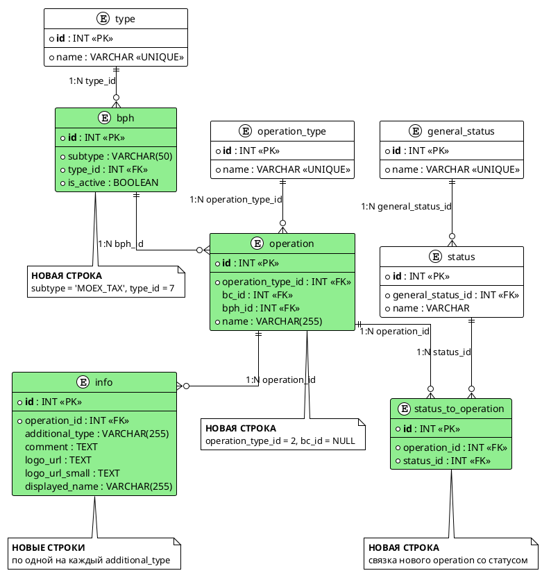

# bph-moex-tax

## 1. Бизнес-требования

#### Анализ требований — Налог MOEX_TAX из BPH

**Источник требования:**

| Параметр | Значение |
|----------|----------|
| Фича | Налог MOEX_TAX из BPH (`bph-moex-tax`) |
| Источник | Product request |
| Инициатор | Владелец интеграции `history-ops` ↔ BPH (бизнес-заказчик налога MOEX) |
| Дата / версия | Draft 2026-09 |

**Стейкхолдеры:**

| Стейкхолдер | Роль | Интерес / ожидание | Влияние / ответственность |
|-------------|------|--------------------|---------------------------|
| Клиент Сбербанк Инвестиции | Пользователь истории операций | Видит начисленный/удержанный налог MOEX отдельной операцией с корректным комментарием | Использует результат фичи |
| Владелец интеграции `history-ops` ↔ BPH | Заказчик изменения маппинга | Новый налог от BPH отображается без правок Java-кода, data-driven через БД | Принимает функциональный результат |
| Команда backend history-ops | Владелец интеграции | Обработать новый BPH subtype тем же путём, что существующие налоги | Реализует изменения в данных/миграции, отвечает за приемку |
| Команда BPH | Поставщик данных | Передавать операцию с `type=TAXES`, `subtype=MOEX_TAX` в согласованном контракте `GET_OPERATIONS_WITH_DETAILS` | Отвечает за состав и статус передаваемых операций |
| Бизнес-аналитик / Product Owner | Владелец текстов UI | Согласовать текст комментария налога и заголовок деталки | Утверждает текст `comment` |

**Бизнес-правила и ограничения:**

| ID | Тип | Описание | Источник / обоснование |
|----|-----|----------|------------------------|
| BR-01 | Бизнес-правило | Новый налог приходит от BPH в `GET_OPERATIONS_WITH_DETAILS` с `type = TAXES`, `subtype = MOEX_TAX` | Бриф фичи; D-01 (`DECISIONS`) |
| BR-02 | Бизнес-правило | Операция `MOEX_TAX` маппится в тот же исходящий тип `operation_type = tax`, что и существующий налог `TAX_RETAIN`; новый фронтовый тип не вводится | Бриф фичи; `analytics/.../operation-type-catalog.md:141-149` |
| BR-03 | Бизнес-правило | Логика обработки `MOEX_TAX` идентична существующим налогам `TAX_RETAIN`; специфика выражается только данными в БД | Бриф фичи |
| BR-04 | Бизнес-правило | `additionalType` для `MOEX_TAX` — тот же набор, что у `TAX_RETAIN`: `OUT_MONEY`, `OUT_SECURITIES`, `TAX_PERIOD_END`, `INCENTIVE_PAYMENT`; в таблице `info` создаётся несколько строк — по одной на `additional_type` | D-01 (`DECISIONS`) |
| BR-05 | Бизнес-правило | Для каждого `additionalType` налога `comment` в исходящем объекте берётся из `info.comment` по соответствующему `additional_type` (с подстановкой параметров; механизм — BR-09) | Бриф фичи; D-03, D-31 (`DECISIONS`); `analytics/.../operation-type-catalog.md:141-149` |
| BR-06 | Бизнес-правило | Новый BPH subtype требует отдельной записи `operation` (`bph.type + bph.subtype` → `operation_type`), даже при том же `operation_type = tax` | `analytics/.../bc-bph-mapping-db.md`; `BphConverter.getTypesMap()` |
| BR-07 | Бизнес-правило | `bc_id` новой записи `operation` = `NULL`: операция существует только со стороны BPH | D-02 (`DECISIONS`) |
| BR-08 | Бизнес-правило | Заголовок деталки налога остаётся «Удержание налога» и не различается по subtype. Различение пользователем обеспечивается **комментарием** операции, который берётся из таблицы `info` по `type`/`subtype`/`additionalType` (BR-09) | D-03, D-29 (`DECISIONS`) |
| BR-09 | Бизнес-правило | Комментарий налога всегда берётся из таблицы `info`, определяемой по `type`/`subtype`/`additionalType`, с подстановкой параметров; `accComment` из ответа BPH применяется только когда соответствующее значение в таблице `null`. Пустой комментарий — не ожидаемое поведение налога | `BphCommonClientConverter.convert()`; D-31 (`DECISIONS`) |
| CN-01 | Ограничение | Java-код `history-ops` не изменяется; вся специфика налога задаётся data-driven через БД | Бриф фичи; D-03 (`DECISIONS`) |
| CN-02 | Ограничение | Изменения данных проливаются новым Liquibase changeset в `history-ops/liquibase/changesets/` | D-04 (`DECISIONS`) |
| CN-03 | Ограничение | Контракт обмена — `GET_OPERATIONS_WITH_DETAILS` (`POST /api/v1/incoming-gateway/operations-with-details`), состав полей не меняется | `bph.yml:216,1093-1100` |
| CN-04 | Ограничение | Значение `type` в ответе BPH должно оставаться `TAXES` (константа в Java), иначе не сработает fallback комментария | `BphCommonClientConverter.java:40` |
| CN-05 | Ограничение | Композит / МП не меняются: деталка налога и её секции переиспользуются без правок | `HistoryOperationTaxDetailsScreen.java`; D-03 (`DECISIONS`) |

**Цель фичи:**

| Вопрос | Ответ |
|--------|-------|
| Какую бизнес-проблему решает? | BPH начал присылать налог MOEX (`TAXES/MOEX_TAX`), который `history-ops` сейчас не обрабатывает: без записи маппинга операция не попадает в историю с корректным типом и комментарием |
| Какую ценность приносит пользователю? | Клиент видит налог MOEX в истории операций как обычный налог — с понятным комментарием по виду начисления, без пропусков и «пустых» операций |
| Какие метрики улучшает? | Доля успешно отображённых операций налога `MOEX_TAX` от BPH; отсутствие операций с пустым комментарием; число правок Java-кода при добавлении нового налога (цель — 0). Отдельные числовые целевые значения метрик не вводятся — наблюдаемость ведётся существующими средствами HO (D-18) |

**SMART-проверка цели:**

| Критерий | Описание | Значение |
|----------|----------|----------|
| Specific | Конкретная | Добавить данные маппинга для `TAXES/MOEX_TAX`: запись `operation` (`operation_type = tax`, `bc_id = NULL`), строки `info` по каждому `additional_type`, связку статуса; Java-код не меняется |
| Measurable | Измеримая | Операция `MOEX_TAX` от BPH появляется в истории с типом `tax` и комментарием из `info.comment` по `additionalType`; правок Java-кода при реализации — 0. Отдельные числовые целевые значения метрик не вводятся (D-18) |
| Achievable | Достижимая | Механизм маппинга и подстановки комментария уже data-driven (кэш `operation`/`info`, `BphConverter.getTypesMap`), новый subtype подхватывается после INSERT — см. PRECEDENT-01 |
| Relevant | Релевантная | Без маппинга новый налог от BPH не отображается пользователю; фича закрывает функциональный разрыв интеграции |
| Time-bound | Ограниченная по времени | Фиксированная дата/релиз в брифе не заданы; релиз привязывается к штатному проливу changeset и не выделяется отдельным сроком (D-18, как у существующих налогов) |

**Противоречия и решения:**

| Требование 1 | Требование 2 | Источник 1 | Источник 2 | Решение | Обоснование |
|--------------|--------------|------------|------------|---------|-------------|
| `bc_id = NULL` (операция только со стороны BPH) | У `TAX_RETAIN` `bc_id = 110 (TAX_WITHHOLDING)`, есть BC-сторона | D-02 (`DECISIONS`) | `db-export/БД ИО.md:476-477` | `bc_id = NULL` для `MOEX_TAX` | Решение заказчика D-02 (как у соседней фичи `bph-portfolio-size-tax`); при `bc_id = NULL` ветка `isActualBphOperation()` возвращает `true` досрочно и водораздел по `additionalType` не применяется |

#### Use Case — Получить налог TAXES/TAX_RETAIN из BPH в истории операций

**Структура Use Case:**

| Элемент | Значение |
|---------|----------|
| Название | Получить налог TAXES/TAX_RETAIN из BPH в истории операций |
| Актор(ы) | Клиент Сбербанк Инвестиции (просматривает историю операций); система `history-ops` (обрабатывает ответ BPH); система BPH (поставщик операции налога) |
| Триггер | Клиент открывает историю операций (МП) с фильтром, включающим тип налога `tax`; `history-ops` отправляет `GET_OPERATIONS_WITH_DETAILS` |
| Предусловия | См. таблицу предусловий ниже |
| Постусловия | См. таблицу постусловий ниже |
| Бизнес-правила | BR-02, BR-04, BR-05, BR-06, BR-08, BR-09 (см. §1.1); поведенческие правила шагов — UC-ASIS-R01…UC-ASIS-R04 (см. ниже), производные от §1.1 |

**Предусловия:**

| № | Предусловие | Проверяемое условие |
|---|-------------|---------------------|
| 1 | В кэше маппинга есть активная запись для `TAXES`/`TAX_RETAIN` с `bph_active = true` | `operation.bph_active = true` и `operation.bph_type = "TAXES"` и `operation.bph_subtype = "TAX_RETAIN"` |
| 2 | Фильтр запроса содержит фронтовый тип налога | `operationTypes` содержит `tax` |
| 3 | Для записи задан маппинг статусов | `operation.status_and_general_status` непустой (например `COMPLETE → executed`) |
| 4 | В таблице `info` есть хотя бы строка для `operation` | существует `info` с `operation_id` активной записи |

**Постусловия:**

| Исход | Постусловие |
|-------|-------------|
| Успех | Операция налога включена в ответ истории с фронтовым типом `tax`, идентификатором `bph_tax_<externalSystemId>` и комментарием из `info.comment` по совпавшему `additionalType`; клиент открывает деталку налога |
| Неуспех (бизнес) | Операция налога не отображается: нет активной записи маппинга, статус не входит в маппинг либо не совпал `additionalType` (после водораздела) |
| Неуспех (техн.) | При ошибке обмена с BPH операции BPH исключены из выдачи, флаг полноты данных сброшен; состояние кэша маппинга не изменяется |

**Бизнес-правила:**

| ID | Правило | Применяется на шаге |
|----|---------|---------------------|
| BR-02 | Операция `TAXES`/`TAX_RETAIN` маппится в исходящий тип `operation_type = tax`; новый фронтовый тип не вводится (см. §1.1) | Шаг 7 |
| BR-04 | `additionalType` налога — набор `OUT_MONEY`, `OUT_SECURITIES`, `TAX_PERIOD_END`, `INCENTIVE_PAYMENT`; в таблице `info` строки заданы по одной на `additional_type` (см. §1.1) | Шаг 3 |
| BR-05 | `comment` берётся из `info.comment` по совпавшему `additional_type` (см. §1.1) | Шаг 8 |
| BR-06 | Новый subtype требует отдельной записи `operation`; ключ маппинга — `bph.type + bph.subtype` (см. §1.1). Источник: `BphConverter.getTypesMap()`, `repositories/ИО/history-ops/src/main/java/com/sberbank/si20/history/ops/adapter/bph/BphConverter.java:52-77,141-152` | Шаг 7 |
| BR-08 | Заголовок деталки налога — «Удержание налога», не различается по subtype (см. §1.1). Источник: `repositories/ИО/history-ops-screen-api/.../HistoryOperationTaxDetailsHeaderSection.java` | Шаг 10 |
| BR-09 | Комментарий берётся из таблицы `info` (по `type`/`subtype`/`additionalType`, с подстановкой параметров); `accComment` применяется только когда значение в таблице `null` (см. §1.1). Источник: `repositories/ИО/history-ops/src/main/java/com/sberbank/si20/history/ops/service/conversion/BphCommonClientConverter.java:121-137` | Шаг 8 |
| UC-ASIS-R01 | Запись маппинга включается в запрос к BPH, только если активна её BPH- или BC-сторона. Производное от §1.1 [BR-07]. Источник: `.../service/filter/BphBcFilterService.java:161-250` (`isSupportedOperationType`, ранний `return true` при отсутствии одной из сторон) | Шаг 2 |
| UC-ASIS-R02 | Членство статуса проверяется всегда, независимо от `bc_id`: `lead.status` должен присутствовать в `status_and_general_status` активной записи. Источник: `.../service/filter/BphBcFilterService.java:69-86` (`isCommonOperationByBphContext`) | Шаг 5 |
| UC-ASIS-R03 | Водораздел по `formationDate` и проверка `additionalType` применяются, только когда у записи есть обе стороны (BPH и BC); при `bc_id = NULL` запись признаётся актуальной досрочно. Производное от §1.1 [BR-07]. Источник: `.../service/filter/BphBcFilterService.java:161-250` (`isActualBphOperation`) | Шаг 6 |
| UC-ASIS-R04 | Исходящий идентификатор операции налога формируется как `bph_tax_<externalSystemId>`. Источник: `.../service/conversion/BphCommonClientConverter.java:168-189` (`getId`) | Шаг 9 |

**Основной сценарий — Happy Path:**

```
Шаг 1:  Клиент открывает историю операций с фильтром, включающим тип налога
Шаг 2:  Система history-ops определяет по кэшу маппинга записи, активные для запроса
          ЕСЛИ [UC-ASIS-R01] у записи активна BPH- или BC-сторона и её тип входит в запрошенные operationTypes
            ТО сценарий продолжается с шага 3
          ИНАЧЕ
            ПЕРЕЙТИ К альтернативному сценарию 2a
Шаг 3:  Система формирует элемент запроса GET_OPERATIONS_WITH_DETAILS:
          type = TAXES, subtype = TAX_RETAIN, statuses из маппинга статусов
          ЕСЛИ [BR-04] у записи в таблице info задан хотя бы один additional_type
            ТО выполнить добавление additionalTypes[] в элемент запроса
          ИНАЧЕ
            сценарий продолжается без additionalTypes
Шаг 4:  Система отправляет GET_OPERATIONS_WITH_DETAILS и получает ответ BPH
          ЕСЛИ обмен завершился успешно
            ТО сценарий продолжается с шага 5
          ИНАЧЕ
            ПЕРЕЙТИ К альтернативному сценарию 4a
Шаг 5:  Система фильтрует операцию налога из ответа BPH по статусу
          ЕСЛИ [UC-ASIS-R02] статус операции входит в status_and_general_status активной записи
            ТО сценарий продолжается с шага 6
          ИНАЧЕ
            ПЕРЕЙТИ К альтернативному сценарию 5a
Шаг 6:  Система проверяет актуальность операции (водораздел и additionalType)
          ЕСЛИ [UC-ASIS-R03] у записи нет BC-стороны (bc_id = NULL)
            ТО сценарий продолжается с шага 7
          ИНАЧЕ ЕСЛИ formationDate не раньше historyStart и additionalType совпадает со значением info
            ТО сценарий продолжается с шага 7
          ИНАЧЕ
            ПЕРЕЙТИ К альтернативному сценарию 6a
Шаг 7:  Система определяет фронтовый тип операции по ключу type|subtype из кэша маппинга [BR-02][BR-06]
Шаг 8:  Система подбирает комментарий операции налога
          ЕСЛИ [BR-05] найдена строка info с additional_type, равным additionalType операции
            ТО выполнить подстановку info.comment в комментарий
          ИНАЧЕ ЕСЛИ [BR-09] комментарий в таблице info отсутствует (значение null)
            ТО выполнить подстановку fallback-значения accComment
          ИНАЧЕ
            ПЕРЕЙТИ К альтернативному сценарию 8a
Шаг 9:  Система формирует исходящий объект: type = tax, id = bph_tax_<externalSystemId> [UC-ASIS-R04], комментарий из шага 8
Шаг 10: Система отдаёт операцию в историю; клиент открывает деталку налога [BR-08]
```

**Альтернативные сценарии:**

```
2a. Нет активной записи маппинга для типа/подтипа (Бизнес-ошибки):
  2a.1. Система не включает подтип налога в запрос к BPH
  2a.2. Сценарий завершается неуспешно — операция налога в историю не попадает

4a. Ошибка обмена с BPH по запросу операций (Технические ошибки):
  4a.1. Система исключает операции BPH из выдачи и сбрасывает флаг полноты данных
  4a.2. Сценарий завершается неуспешно — операции налога за этот запрос не отображаются

5a. Статус операции не входит в маппинг статусов записи (Пограничные случаи):
  5a.1. Система исключает операцию налога из выдачи
  5a.2. Сценарий завершается неуспешно — операция в историю не попадает

6a. Операция не прошла водораздел или не совпал additionalType (Бизнес-ошибки):
  6a.1. Система исключает операцию налога из выдачи и фиксирует лог и метрику о неожиданном additionalType
  6a.2. Сценарий завершается неуспешно — операция в историю не попадает

8a. Нет подходящей строки info и значение таблицы null (Пограничные случаи):
  8a.1. Система применяет fallback `accComment`; если тот тоже пуст — комментарий не подставляется
  8a.2. Сценарий продолжается с шага 9 без цикла и без возврата к предыдущим шагам
```

**Связи между Use Cases:**

| Связь | Связанный Use Case | Шаг / Extension Point | Условие |
|-------|--------------------|-----------------------|---------|
| include | Получить историю операций | Шаг 1 | Всегда — налог отображается в общем списке истории |
| include | Запросить операции у BPH (GET_OPERATIONS_WITH_DETAILS) | Шаг 4 | Всегда — данные налога приходят только из BPH |
| extend | Открыть деталку налога | Extension point: Шаг 10 | Клиент выбирает операцию налога в списке истории |

> Поведение водораздела по `formationDate` и проверки `additionalType` для
> существующего `TAXES/TAX_RETAIN` фичей не изменяется: это существующее
> поведение соседнего налога, имеющего BC-сторону (`bc_id = 110`), и вне scope
> изменения фичи. Фича добавляет новый subtype `MOEX_TAX` без BC-стороны
> (`bc_id = NULL`, D-11), для которого ветка водораздела не применяется.

#### Use Case — Получить в ленте операций налог по сделкам на Мосбирже (MOEX_TAX)

**Структура Use Case:**

| Элемент | Значение |
|---------|----------|
| Название | Получить в ленте операций налог по сделкам на Мосбирже (MOEX_TAX) |
| Актор(ы) | Клиент (авторизован в мобильном приложении) |
| Триггер | BPH присылает в ответе `GET_OPERATIONS_WITH_DETAILS` операцию с `type = TAXES`, `subtype = MOEX_TAX` |
| Предусловия | См. таблицу предусловий ниже |
| Постусловия | См. таблицу постусловий ниже |
| Бизнес-правила | BR-02, BR-04, BR-05, BR-06, BR-08, BR-09 (см. §1.1) |

**Предусловия:**

| № | Предусловие | Проверяемое условие |
|---|-------------|---------------------|
| 1 | В БД маппинга HO заведён subtype `MOEX_TAX` семейства `TAXES` | `bph.subtype = 'MOEX_TAX'`, `bph.type_id = 7`, `bph.is_active = true` |
| 2 | Выполнена миграция Liquibase с записями `MOEX_TAX` | Changeset из `history-ops/liquibase/changesets/` применён, `databasechangelog` содержит его id |
| 3 | Для `MOEX_TAX` заведена запись `operation` с `bc_id = NULL` | `operation.bph_id` ссылается на `bph` из п. 1, `operation.operation_type_id = 2` (`tax`), `operation.bc_id IS NULL` |
| 4 | Для каждого `additional_type` заведена строка `info` с комментарием | `info.operation_id` соответствует `operation` из п. 3; `additional_type ∈ {OUT_MONEY, OUT_SECURITIES, TAX_PERIOD_END, INCENTIVE_PAYMENT}` |
| 5 | Заведена связка статуса операции | `status_to_operation.operation_id` из п. 3 содержит статус, приходящий от BPH в `status` |
| 6 | Клиент авторизован, лента операций доступна | `PortfolioOperationType` содержит `tax` (`OperationTypeNameResolver`: `case TAX -> "Налог"`) |
| 7 | Интеграция `history-ops` ↔ BPH включена | Feature toggle интеграции BPH активен |

**Постусловия:**

| Исход | Постусловие |
|-------|-------------|
| Успех | Операция `TAXES/MOEX_TAX` возвращается клиенту с `type = tax`, `id = bph_tax_<externalSystemId>`, `comment` из `info` по совпавшему `additionalType` (при `null` в таблице — `accComment`). В ленте отображается как налог, деталка открывается на `HISTORY_OPS_TAX_DETAILS_SCREEN` с заголовком «Удержание налога» |
| Неуспех (бизнес) | Операция от BPH не отображается в ленте: `operation` не найдена по `type+subtype`, либо `bph_active = false`, либо статус не входит в `status_to_operation`. Отсутствие `totalPrice` **не** приводит к отбрасыванию: операция отображается, `total_sum = null` (CN-16) |
| Неуспех (техн.) | Операция отсутствует в кэше (маппинг не пролит / кэш не перечитан), `comment` не подставляется. При недоступности BPH операции BPH исключаются из выдачи со сбросом флага полноты данных (пустой/частичный ответ) — поведение как у существующих налогов, отдельных retry-требований нет (D-15) |

**Бизнес-правила:**

| ID | Правило | Применяется на шаге |
|----|---------|---------------------|
| UC-TOBE-R01 | Строка `operation` в кэше определяется парой `bph.type + bph.subtype`; для нового subtype нужна отдельная запись `operation`. Производное от §1.1 [BR-06] | Шаг 2 |
| UC-TOBE-R02 | Для `bc_id = NULL` фильтр `isActualBphOperation()` возвращает `true` досрочно (только BPH-контекст), водораздел по `additionalType` не применяется. Производное от §1.1 [BR-07] | Шаг 3 |
| UC-TOBE-R03 | Статус-членство проверяется всегда: `statusMap` должен содержать пришедший от BPH статус, иначе операция отсеивается | Шаг 4 |
| UC-TOBE-R04 | Маппинг `type+subtype → operation_type` берётся из кэша БД (`type = tax`), не хардкодится в Java. Производное от §1.1 [BR-06] | Шаг 5 |
| UC-TOBE-R05 | `comment` всегда берётся из таблицы `info`, определяемой по `type`/`subtype`/`additionalType`, с подстановкой параметров; `accComment` из ответа BPH применяется только когда значение в таблице `null`. `id = bph_tax_<externalSystemId>` — уникален между налогами (`externalSystemId` глобально уникален). Производное от §1.1 [BR-05] | Шаг 6, Шаг 7 |
| UC-TOBE-R06 | Комментарий налога не остаётся пустым: при отсутствии значения в таблице `info` применяется `accComment` из ответа BPH. Производное от §1.1 [BR-09] | Шаг 6 |

**Основной сценарий — Happy Path:**

```
Шаг 1:  BPH присылает в ответе GET_OPERATIONS_WITH_DETAILS операцию:
          type = TAXES, subtype = MOEX_TAX, additionalType = <значение>,
          status = <статус>, externalSystemId = <id>, totalPrice, formationDate, eventDate
          (при отсутствии totalPrice операция НЕ отбрасывается: отображается с total_sum = null, CN-16)
Шаг 2:  Система ищет операцию в кэше БД по ключу type|subtype [UC-TOBE-R01]
          ЕСЛИ найдена активная запись bph для пары TAXES|MOEX_TAX
            ТО сценарий продолжается с шага 3
          ИНАЧЕ
            ПЕРЕЙТИ К альтернативному сценарию 2a
Шаг 3:  Система проверяет фактичность операции [UC-TOBE-R02]
          ЕСЛИ operation.bc_id IS NULL (только BPH-контекст)
            ТО операция признаётся фактической, сценарий продолжается с шага 4
          ИНАЧЕ
            ПЕРЕЙТИ К альтернативному сценарию 3a
Шаг 4:  Система проверяет членство статуса операции [UC-TOBE-R03]
          ЕСЛИ status_to_operation для этой operation содержит статус из ответа BPH
            ТО сценарий продолжается с шага 5
          ИНАЧЕ
            ПЕРЕЙТИ К альтернативному сценарию 4a
Шаг 5:  Система берёт тип операции из кэша БД [UC-TOBE-R04]
          ЕСЛИ для type|subtype определён operation_type = tax
            ТО сценарий продолжается с шага 6
          ИНАЧЕ
            ПЕРЕЙТИ К альтернативному сценарию 5a
Шаг 6:  Система выбирает комментарий по additionalType [UC-TOBE-R05, UC-TOBE-R06]:
          6.1. Ищет строку info, где info.additional_type = additionalType из ответа
          6.2. Комментарий берётся из таблицы info (по type/subtype/additionalType,
               с подстановкой параметров)
               ЕСЛИ значение в таблице задано (не null)
                 ТО comment = info.comment
               ИНАЧЕ
                 ТО comment = accComment из ответа BPH (значение таблицы null)
               Сценарий продолжается с шага 7 (пустой комментарий не ожидается)
Шаг 7:  Система формирует исходящую операцию:
          7.1. type = tax (из кэша БД)
          7.2. comment = значение из шага 6
          7.3. id = bph_tax_<externalSystemId>
Шаг 8:  Система отдаёт операцию клиенту в ленте
Шаг 9:  Клиент открывает операцию, система отображает деталку
          ЕСЛИ операция относится к типу tax
            ТО отображается деталка HISTORY_OPS_TAX_DETAILS_SCREEN с заголовком «Удержание налога»
          ИНАЧЕ
            сценарий продолжается без изменений
```

**Альтернативные сценарии:**

```
2a. Запись operation для пары TAXES|MOEX_TAX не найдена или неактивна (Бизнес-ошибки):
  2a.1. Система не сопоставляет операцию с заведённым маппингом
  2a.2. Операция не попадает в ленту клиента
  2a.3. Сценарий завершается неуспешно

3a. Ветка водораздела для MOEX_TAX не применяется (Пограничные случаи):
  3a.1. Для MOEX_TAX заявлен bc_id = NULL (D-02) — полная ветка isActualBphOperation()
        (водораздел по historyStart и сопоставление additionalType) не срабатывает;
        BC-аналога нет, поэтому сценарий на этом налоге не воспроизводится
  3a.2. Условие ветки сохраняется только как регресс-тест: при ошибочно не-NULL bc_id
        поведение должно соответствовать полной ветке (отдельный сценарий фичи не вводится)

4a. Статус BPH отсутствует в status_to_operation (Бизнес-ошибки):
  4a.1. Система отсеивает операцию на проверке статус-членства
  4a.2. Операция не отображается в ленте; для разбора нужна строка status_to_operation
  4a.3. Сценарий завершается неуспешно; отдельный лог/счётчик «статус не сматчен» не вводится
        (поведение как у существующих налогов, D-09/D-18)

5a. Для пары type|subtype не определён operation_type (Бизнес-ошибки):
  5a.1. Система не может отобразить тип операции в UI
  5a.2. Отсутствует маппинг type|subtype → operation_type
  5a.3. Сценарий завершается неуспешно

6a. Строка info для additionalType отсутствует — комментарий берётся из accComment (Бизнес-ошибки):
  6a.1. Система не находит строку info с совпадающим additional_type (или additionalType пуст/не совпал)
  6a.2. Значение комментария в таблице отсутствует (null) → система подставляет comment = accComment (D-31)
  6a.3. Fallback → шаг 7: сценарий продолжается с шага 7 без цикла и без возврата к шагу 6

6c. Диспетчер по неизвестному subtype семейства TAXES (Пограничные случаи):
  6c.1. Система не находит запись operation для пары TAXES|<неизвестный subtype>
  6c.2. Операция не попадает в ленту клиента
  6c.3. Незарегистрированный subtype не отображается (операция отфильтрована
        из-за отсутствия строки operation в кэше); отдельный лог/метрика не требуются
  6c.4. Сценарий завершается неуспешно
```

**Связи между Use Cases:**

| Связь | Связанный Use Case | Шаг / Extension Point | Условие |
|-------|--------------------|-----------------------|---------|
| include | Сформировать запрос к BPH по GET_OPERATIONS_WITH_DETAILS | Шаг 1 основного сценария | Всегда: новый subtype попадает в запрос после заведения маппинга |
| extend | Открыть деталку операции типа «Налог» | Extension point: Шаг 9 | Клиент открывает операцию `tax` в ленте |

### Ограничения и допущения

**Ограничения:**

| ID | Тип | Описание | Источник / обоснование |
|----|-----|----------|------------------------|
| CN-06 | Ограничение | Изменения выполняются только в данных маппинга БД `history_ops`; Java-код `history-ops` не правится. Ограничение продолжает `CN-01` и уточняет его техническую границу: константа `private static final String TAXES = "TAXES"` остаётся в коде, менять её не требуется, потому что `type` нового налога остаётся `TAXES` | Бриф фичи; D-03 (`DECISIONS`); `repositories/ИО/history-ops/src/main/java/com/sberbank/si20/history/ops/service/conversion/BphCommonClientConverter.java:40` |
| CN-07 | Ограничение | Контракт BPH `GET_OPERATIONS_WITH_DETAILS` не меняется: состав полей запроса и ответа остаётся прежним, `type` нового налога остаётся `TAXES` (меняется только значение `subtype`) | `repositories/ИО/history-ops/src/main/swagger/bph/bph.yml:216,1093-1100,1292-1326`; CN-03 |
| CN-08 | Ограничение | Маппинг `bph.type + bph.subtype → operation_type` читается из кэша БД (`app-config.operation-cache`), который наполняется планировщиком `OperationCacheLoader` c периодичностью `updateDelayMs` (значение по умолчанию — `app-config.operation-cache.updateDelayMs`, конфигурируется в `application.yml`; конкретное значение на среде — по конфигу сервиса, `OperationCacheLoaderProperties.java:7-8`). Новый subtype становится обрабатываемым после штатного периодического обновления кэша; окно рассинхрона мало и приемлемо, поведение — как у существующих налогов (D-15, D-18, D-26). Отдельного принудительного механизма refresh по строке БД фича не вводит | `repositories/ИО/history-ops/src/main/java/com/sberbank/si20/history/ops/configuration/properties/OperationCacheLoaderProperties.java:7-8`; `.../cache/OperationCacheLoader.java`; `.../adapter/bph/BphConverter.java:35,51`; D-15, D-18 (`DECISIONS`) |
| CN-09 | Ограничение | Запись `operation` для `MOEX_TAX` создаётся с `bc_id = NULL` (операция существует только со стороны BPH). Следствие: в `isActualBphOperation()` срабатывает досрочный `return true` для записи без BC-стороны, поэтому водораздел по `formationDate` и контроль соответствия `additionalType` для этого налога не применяются | D-02 (`DECISIONS`); `repositories/ИО/history-ops/src/main/java/com/sberbank/si20/history/ops/service/filter/BphBcFilterService.java:161-250` |
| CN-10 | Ограничение | Для нового `operation` обязательна строка связи `status_to_operation` со статусом BPH `COMPLETE` (`status_id=19`), иначе операция не пройдёт фильтр: членство статуса проверяется всегда (`statusMap.containsKey(status)`), независимо от `bc_id`. Набор статусов — как у `TAX_RETAIN` | `repositories/ИО/history-ops/src/main/java/com/sberbank/si20/history/ops/service/filter/BphBcFilterService.java:69-86`; D-05 (`DECISIONS`) |
| CN-11 | Ограничение | Одна запись `operation` в кэше соответствует одной паре `bph.type + bph.subtype`; для нового `subtype` нужна отдельная строка `operation` даже при том же `operation_type = tax` | `analytics/02-Modules/MOD-001-history-ops/data/bc-bph-mapping-db.md`; `repositories/ИО/history-ops/src/main/java/com/sberbank/si20/history/ops/adapter/bph/BphConverter.java:52-77,141-152`; BR-06 |
| CN-12 | Ограничение | Композит / МП не меняются: деталка налога `HISTORY_OPS_TAX_DETAILS_SCREEN`, её секции и заголовок «Удержание налога» переиспользуются без правок и не различаются по subtype | `repositories/ИО/history-ops-screen-api/.../composite/screens/details/HistoryOperationTaxDetailsScreen.java:10`; `.../composite/sections/details/tax/HistoryOperationTaxDetailsHeaderSection.java`; D-03 (`DECISIONS`); CN-05 |
| CN-13 | Зависимость | Текст `comment` для каждого `additional_type` (русскоязычная формулировка для UI) предоставляет аналитик / Product Owner; `history-ops` только подставляет строку `info.comment` по совпавшему `additional_type`. Формулировки — вне Java-кода | Бриф фичи; D-03 (`DECISIONS`); `repositories/ИО/history-ops/src/main/java/com/sberbank/si20/history/ops/service/conversion/BphCommonClientConverter.java:220-262` (`getAdditionalInfoFromCache`, `isCorrectAdditionalType`) |
| CN-14 | Допущение | Значение `additionalType`, присылаемое BPH для `MOEX_TAX`, совпадает с одним из значений набора `additional_type` в таблице `info` (`OUT_MONEY`, `OUT_SECURITIES`, `TAX_PERIOD_END`, `INCENTIVE_PAYMENT`). При несовпадении строка `info` не будет найдена, и комментарий берётся из `accComment` ответа BPH (значение таблицы `null`) — пустой комментарий не ожидается (BR-09, D-31) | D-01 (`DECISIONS`); `BphCommonClientConverter.java:133-135,220-262`; BR-04, BR-09 |
| CN-15 | Допущение | `externalSystemId` глобально уникален между налогами (`TAX_RETAIN`, `MOEX_TAX`): коллизия `id = bph_tax_<externalSystemId>` в ленте невозможна. Значение `lead.id` различает налоги через уникальный `externalSystemId`, префикс `bph_tax_` общий для всего семейства `tax` | D-25 (`DECISIONS`); `BphCommonClientConverter.getId()` (`:168-189`) |
| CN-16 | Ограничение | Налог может отображаться **без суммы**: при `totalPrice = null` от BPH операция **не отбрасывается**, `lead.total_sum = null` — так же, как у существующего `TAX_RETAIN`. Поведение осознанно принято по факту конвертера: `totalSum = Optional.ofNullable(operation.totalPrice()).map(BigDecimal::abs).orElse(null)` (`BphCommonClientConverter.convert()`); отдельного механизма отбрасывания операции при отсутствии суммы нет | D-40 (`DECISIONS`); `repositories/ИО/history-ops/src/main/java/com/sberbank/si20/history/ops/service/conversion/BphCommonClientConverter.java` (`convert()`) |

## 4. Функциональные требования

#### 4.1.1 Синхронный контракт `GET_OPERATIONS_WITH_DETAILS` (REST)

Раздел описывает существующий синхронный обмен `history-ops` ↔ BPH по операции
`GET_OPERATIONS_WITH_DETAILS`, через который в HO попадает новый налог
`TAXES / MOEX_TAX`. **Контракт обмена не меняется**: состав полей запроса и
ответа остаётся прежним, добавляется только новое значение `subtype` в данных
маппинга БД (§4.2). Направление — двунаправленный request/response в рамках
одного вызова: запрос инициирует HO, ответ отдаёт BPH.

**Источник фактов о контракте:** Swagger BPH incoming-gateway
`repositories/ИО/history-ops/src/main/swagger/bph/bph.yml`
(endpoint — строки 216–261; `OperationData` — 1093–1166; `DetailsData` — 1238–1243;
`subtypesAndStatuses` — 1292–1326); аналитика
`analytics/02-Modules/MOD-001-history-ops/integrations/bph.md` (§GET_OPERATIONS_WITH_DETAILS);
сборка запроса — `BphBcFilterService.buildBphRequestEntityByBphParams()`
(`repositories/ИО/history-ops/src/main/java/com/sberbank/si20/history/ops/service/filter/BphBcFilterService.java:102-121`);
разбор ответа — `BphCommonClientConverter.convert()` / `getId()` / `getAdditionalInfoFromCache()`
(`.../service/conversion/BphCommonClientConverter.java:56-190,220-262`).

##### Общая информация

| Параметр | Значение |
|---|---|
| Назначение | Получение истории операций клиента с детализацией (legacy-трейды и типовые простые операции, включая налоги семейства `TAXES`); для фичи — доставка операций налога `TAXES / MOEX_TAX` |
| Система-источник (для ответа на запрос) | BPH (Brokerage Portfolio History, Brokerage Controller) |
| Система-получатель (инициатор запроса) | history-ops (ИО) |
| Тип интеграции | Синхронная (request/response) |
| Протокол | REST (HTTPS), JSON |
| Направление | HO → BPH (запрос); BPH → HO (ответ); в рамках одного вызова |
| Операция обмена | `GET_OPERATIONS_WITH_DETAILS` |
| Endpoint | `POST /api/v1/incoming-gateway/operations-with-details` (`bph.yml:216`) |
| Версия API | `1.0` (`bph.yml:5`) |
| Аутентификация | Заголовки запроса `rqUID`, `systemName` = `si2-ops` (`bph.yml:221-238`) |
| Формат данных | JSON |
| Timeout / Retry Policy | Как у существующих налогов: отдельная retry/timeout-политика для налога не вводится; поведение задаётся существующей конфигурацией WebClient HO (`WebClientBphConfiguration`) — при недоступности BPH пустой/частичный ответ (D-15) |

##### Request headers (HO → BPH)

| Заголовок | Обязат. | Описание | Пример |
|---|---|---|---|
| `rqUID` | Да | Сквозной идентификатор запроса | `c4a5dccd-0fe2-4aa1-823e-a5a5d9ee04a4` |
| `systemName` | Да | Идентификатор системы инициатора; для HO — `si2-ops` | `si2-ops` |
| `Content-Type` | Да (неявно) | Тело запроса передаётся как `application/json` (`bph.yml:239-242`) | `application/json` |

> `rqUID` и `systemName` объявлены `required: true` в `bph.yml:221-238`. Отдельная
> security-scheme в Swagger не описана; дополнительных требований ИБ для нового
> налога не вводится — аутентификация и канал те же, что у существующих налогов
> (D-16).

##### Path parameters

Не применимо: параметров пути у endpoint нет.

##### Query parameters

Не применимо: все параметры передаются в теле запроса (`requestBody`, `bph.yml:239-246`).

##### Request body (HO → BPH)

Тело запроса — `RequestParamsData` (`bph.yml:1254-1291`). Фича использует подмножество
полей для выборки операций налога; ниже перечислены все поля схемы, из них помечены
используемые для `MOEX_TAX`.

| Поле | Тип | Формат | Nullable | Описание | Валидация | Пример | Маппинг (что делает HO) | Новое / используемое |
|---|---|---|---|---|---|---|---|---|
| `agreements` | array<string> | — | Да | Массив номеров договоров клиента | — | `["S200B0J", "S200B0K"]` | Подставляется из запроса клиента к HO | Используемое |
| `startSearchDate` | string | date-time | Да | Начало периода поиска | `format: date-time` | `2023-12-26T14:06:34.543Z` | Из периода запроса | Используемое |
| `endSearchDate` | string | date-time | Да | Конец периода поиска | `format: date-time` | `2024-01-17T10:23:30.413Z` | Из периода запроса | Используемое |
| `dateForFilter` | string (enum) | — | Да | Поле, по которому фильтруется период; HO использует `FORMATION_DATE` | `enum: FilterDateEnum` (`bph.yml:~1337`) | `FORMATION_DATE` | Константа HO | Используемое |
| `page` | integer | — | Да | Номер страницы | `example: 2` | `0` | HO всегда `0` | Используемое |
| `pageSize` | integer | — | Да | Количество записей на страницу | — | `1000` | `history_ops.reporting.maxRecords` | Используемое |
| `types` | array<string> | — | Да | Типы операций для фильтрации | — | `["TAXES"]` | Не используется фичей напрямую | Не используется |
| `subtypes` | array<string> | — | Да | Подтипы операций для фильтрации | — | `["MOEX_TAX"]` | Не используется фичей напрямую | Не используется |
| `statuses` | array<string> | — | Да | Статусы для фильтрации | — | `["COMPLETE"]` | Не используется фичей напрямую | Не используется |
| `subtypesAndStatuses` | array<object> | — | Нет (required) | Массив объектов «тип + подтип + статусы» — основной фильтр запроса | `maxItems: 1000`; элемент `required: [type, subtype, statuses]` | см. ниже | Собирается из кэша БД: по одной строке на пару `bph.type + bph.subtype` | Используемое (ключевое) |
| ├─ `type` | string | — | Нет | Тип операции BPH | `maxLength: 225` | `TAXES` | `operation.bphType` | Используемое; для `MOEX_TAX` = `TAXES` |
| ├─ `subtype` | string | — | Нет | Подтип операции BPH | `maxLength: 225` | `MOEX_TAX` | `operation.bphSubtype` | Используемое; **новое значение** `MOEX_TAX` |
| ├─ `additionalTypes` | array<string> | — | Да | Дополнительный тип события | элемент `maxLength: 225` | `["OUT_MONEY"]` | Не-null значения `info.additional_type` записи `operation` | Используемое (заполняется из §4.2 строк `info`) |
| └─ `statuses` | array<string> | — | Нет | Статусы для подтипа | элемент `maxLength: 225` | `["COMPLETE"]` | Ключи `status_and_general_status`, отфильтрованные по запрошенным статусам | Используемое |
| `tradingSections` | array<string> | — | Да | Торговые секции | — | `["FOND"]` | Не используется фичей | Не используется |
| `isin` | string | — | Да | ISIN бумаги для фильтрации | — | `RU000A103YM3` | Не используется фичей | Не используется |
| `instrumentCurrency` | string | — | Да | Валюта инструмента | — | `RUB` | Не используется фичей | Не используется |
| `tickers` | array<string> | — | Да | Список тикеров | — | `["RU000A103YM3"]` | Не используется фичей | Не используется |
| `selfIdTs` | array<string> | — | Да | Собственный идентификатор в торговой системе | элемент `example: '23984692648'` | `["23984692648"]` | Не используется фичей | Не используется |

> Полная схема `RequestParamsData` — `bph.yml:1254-1291` (начало) и далее до
> `subtypesAndStatuses` (`bph.yml:1292-1326`). Элемент `subtypesAndStatuses`
> собирается в `BphBcFilterService.buildBphRequestEntityByBphParams()`
> (`BphBcFilterService.java:102-121`): `type` = `operation.getBphType()`,
> `subtype` = `operation.getBphSubtype()`, `statuses` = ключи
> `status_and_general_status`; `additionalTypes` добавляются только когда список
> не-null значений `info.additional_type` непустой.

**ENUM: `subtypesAndStatuses[].type` (значимые для налога):**

| Значение | Описание |
|---|---|
| `TAXES` | Семейство налогов BPH; новый налог сохраняет этот `type` |

**ENUM: `subtypesAndStatuses[].subtype` (семейство `TAXES`):**

| Значение | Описание | Состояние |
|---|---|---|
| `TAX_RETAIN` | Удержание налога (существующий налог) | Есть в БД |
| `TAX_REFUND_BROK_ACCOUNT` | Возврат излишне удержанного налога | Есть в БД |
| `MOEX_TAX` | Новый налог MOEX | **Новое значение — добавляется строкой БД (§4.2)** |

**ENUM: `subtypesAndStatuses[].additionalTypes` (для `MOEX_TAX`):**

| Значение | Описание |
|---|---|
| `OUT_MONEY` | Удержание налога при выводе денежных средств |
| `OUT_SECURITIES` | Удержание налога при выводе ценных бумаг |
| `TAX_PERIOD_END` | Удержание налога по итогам периода |
| `INCENTIVE_PAYMENT` | Удержание налога с поощрительной выплаты |

> Набор `additionalTypes` для `MOEX_TAX` совпадает с набором у `TAX_RETAIN`
> (D-01). Источник значений — строки `info` новой записи `operation`; формулировка
> `comment` для всех значений `additional_type` — «биржевой налог» (§4.2).

##### Response headers (BPH → HO)

Swagger контракта `GET_OPERATIONS_WITH_DETAILS` объявляет только тело ответа
(`bph.yml:242-261`); response headers в нём не описаны. HO не завязывается на
response headers этого запроса — обработка опирается только на тело ответа, и
текущее поведение для `MOEX_TAX` сохраняется без дополнительных действий.

##### Response body 200 OK (BPH → HO)

Ответ — массив `data[]` элементов `DetailsData` (`bph.yml:242-254,1238-1243`), где
каждый элемент содержит `lead` типа `OperationData` (`bph.yml:1093-1166`).
Ниже перечислены все поля `OperationData`; для фичи помечено, какие используются
при разборе налога `MOEX_TAX`. **Контракт не меняется** — новое только значение
`subtype` в данных.

| Поле (`lead.`) | Тип | Формат | Nullable | Описание | Валидация | Пример | Использование для `MOEX_TAX` | Новое / используемое |
|---|---|---|---|---|---|---|---|---|
| `type` | string | — | Да | Тип операции BPH | — | `TAXES` | **Используется**: матч `type + subtype` → `operation` в кэше; для `MOEX_TAX` = `TAXES` | Используемое (значение прежнее) |
| `subType` | string | — | Да | Дублирующее поле подтипа (вариант написания) | — | — | Не используется при разборе | Не используется |
| `subtype` | string | — | Да | Подтип операции BPH | — | `MOEX_TAX` | **Используется**: матч `type + subtype` → `operation` в кэше | Используемое; **новое значение** `MOEX_TAX` |
| `additionalType` | string | — | Да | Дополнительный тип события | — | `OUT_MONEY` | **Используется**: выбор строки `info` по `info.additional_type == additionalType` | Используемое; значения — набор из D-01 |
| `externalSystemVersion` | number | — | Да | Версия события | — | `1749655450` | Не используется фичей | Не используется |
| `formationDate` | string | date-time | Да | Дата формирования | `format: date-time` | `2025-06-11T15:24:07.434239` | **Используется**: `lead.time_happened`; при `bc_id = NULL` водораздел не применяется (D-02) | Используемое |
| `eventDate` | string | date-time | Да | Дата события | `format: date-time` | `2025-06-11T15:24:10.947448` | **Используется**: `lead.time_closed` | Используемое |
| `externalSystemId` | string | — | Да | Идентификатор операции во внешней системе | — | `512224d9-ceda-4866-a014-dc7ed9bb8df4` | **Используется**: входит в `lead.id` = `bph_tax_<externalSystemId>` | Используемое |
| `price` | object (`PriceData`) | — | Да | Данные цены | `{value, currency}` | — | Не используется фичей | Не используется |
| `totalPrice` | object (`PriceData`) | — | Да | Сумма операции | `{value, currency}` | `{"value":"11.36","currency":"RUB"}` | **Используется**: `lead.total_sum` = `abs(totalPrice.value)`; валюта не переносится — сумма берётся как есть (D-38). При `totalPrice = null` операция **не отбрасывается**, `lead.total_sum = null` — значение проставляется как `Optional.ofNullable(...).orElse(null)` (`BphCommonClientConverter.convert()`) (CN-16, D-40) | Используемое |
| `quantity` | string | big_decimal | Да | Количество | — | `100.000000` | Не используется фичей | Не используется |
| `quantityFact` | string | big_decimal | Да | Фактическое количество | — | `0.000000` | Не используется фичей | Не используется |
| `tradingSection` | string | — | Да | Торговая секция | — | `UCAF` | Не используется фичей | Не используется |
| `account` | string | — | Да | Счёт | — | `BROKER` | **Используется** косвенно: `account_type` = `BROKER`/`BANK` | Используемое |
| `status` | string | — | Да | Статус операции BPH | — | `COMPLETE` | **Используется**: проверка членства в `status_and_general_status` записи `operation` | Используемое |
| `instrument` | object | — | Да | Данные инструмента | `{isin, tickers, currency, type}` | — | Не используется фичей | Не используется |
| `ucpId` | integer | int64 | Да | Идентификатор ЕПК | — | `23984692648` | Не используется фичей | Не используется |
| `agreement` | string | — | Да | Номер договора | — | `kk44r-drgdtb-4354rvd-5drfv` | **Используется** косвенно: `agreementDetails` ответа HO | Используемое |
| `parent` | string | — | Да | Идентификатор родительской операции | — | `KU2309848` | Не используется фичей | Не используется |
| `isFact` | boolean | — | Да | Признак факта события | — | `true` | Не используется фичей | Не используется |
| `parentIds` | object | — | Да | Идентификаторы связанных сущностей | — | — | Не используется фичей | Не используется |

> Значения `comment` и `accComment` **не приходят от BPH отдельными полями
> `OperationData`** — они извлекаются из блока `details` (`DetailData`, key/value,
> `bph.yml:1244-1253`) и/или из таблицы `info` HO; итоговый комментарий налога
> формируется на стороне HO (§4.2.2 Алгоритм обработки; §4.2.3 Маппинг данных).
> Перечень поддерживаемых ключей
> `details` — константа `SUPPORTED_DETAILS_KEY` в
> `BphConverter.java:200-250` (`comment`, `accComment` присутствуют).

> Разбор подтипа ведётся по полю `subtype` (текущая реализация); дублирующее поле
> `subType` при разборе не используется и дополнительных действий не требует.

**ENUM: `subtypesAndStatuses[].type` — значимые для налога значения описаны выше;
ENUM статусов BPH (`status`) приводится к общему статусу HO через кэш
`status_and_general_status` / `getGeneralStatusMap()`.**

| Значение статуса BPH | Общий статус HO (кэш / fallback) | Примечание |
|---|---|---|
| `COMPLETE` | `executed` | Статус `MOEX_TAX` (D-05); строка `status_to_operation` — `status_id=19` |
| `CANCELLED` | `canceled` | Fallback-мапа `getGeneralStatusMap()` |
| `REJECTED` | `canceled` | Fallback-мапа `getGeneralStatusMap()` |

##### Исходящий объект history-ops (HO → фронт / МП)

Ответ HO формируется в общую модель `HistoryOperationBase` / `HistoryOperationLead`
(`repositories/ИО/history-ops/src/main/swagger/history/history.yml:456-531`).
Для налога `MOEX_TAX` используется **тот же** исходящий объект, что и для обычного
налога; отличаются только источник значения `type`, текст `comment` и `id`.

| Поле HO | Тип | Источник | Значение для `MOEX_TAX` | Новое / используемое |
|---|---|---|---|---|
| `lead.id` | string | `BphCommonClientConverter.getId()` (`:168-189`) | `bph_tax_<externalSystemId>` (формат `bph_%s_%s`, `operationType.getValue()` = `tax`); `externalSystemId` глобально уникален между налогами → коллизии `id` между `TAX_RETAIN` и `MOEX_TAX` нет (D-25) | Используемое (значение новое по `externalSystemId`) |
| `lead.type` | string (`PortfolioOperationType`) | `operation.type()` из кэша `operationsMap` (`BphConverter.getTypesMap()`) | `tax` (из записи `operation.operation_type_id = 2`) | Используемое (значение прежнее) |
| `lead.itemtype` | string | Константа конвертера | `""` (пустая строка) | Используемое |
| `lead.general_status` | string (`GeneralOperationStatus`) | `operation.status()` (маппинг статусов BPH) | `executed` при `COMPLETE` (D-05) | Используемое |
| `lead.time_happened` | string | `operation.formationDate()` | из ответа BPH | Используемое |
| `lead.time_closed` | string | `operation.eventDate()` | из ответа BPH | Используемое |
| `lead.total_sum` | number (string-shape) | `abs(totalPrice.value)` | сумму налога; валюта не переносится — сумма как есть (D-38). При `totalPrice = null` операция **не отбрасывается** — показывается с `total_sum = null`, как у `TAX_RETAIN` (CN-16, D-40) | Используемое |
| `lead.comment` | string | `info.comment` по `type`/`subtype`/`additionalType` (с подстановкой параметров); `accComment` — только когда значение таблицы `null` | **Отличие фичи**: текст из строки `info` новой записи `operation`; пустой комментарий не ожидается (D-31) | Используемое (значение новое) |
| `lead.operationDisplayName` | string | `info.displayed_name` | из строки `info` | Используемое |
| `details.*` / `agreementDetails` / `instrumentDetails` | object | Конвертеры HO | без изменений | Используемое |

> Формирование `comment`: `getAdditionalInfoFromCache()` → `enrichComment(info.comment)`
> (`BphCommonClientConverter.java:121-137,220-262`); комментарий **всегда** берётся из
> таблицы `info` по `type`/`subtype`/`additionalType`; `accComment` применяется только
> когда значение в таблице `null` —
> `if (TAXES.equals(bphType) && commentFromTable.isBlank()) lead.setComment(operation.accComment())`
> (`:133-135`). Формат `id` — `"bph_%s_%s".formatted(operationType.getValue(), externalSystemId)`
> (`:168-189`).

##### Пример запроса и ответа

Пример запроса HO → BPH (фрагмент `subtypesAndStatuses` с новым налогом):

```http
POST /api/v1/incoming-gateway/operations-with-details
rqUID: c4a5dccd-0fe2-4aa1-823e-a5a5d9ee04a4
systemName: si2-ops
Content-Type: application/json
```

```json
{
  "agreements": ["S200B0J"],
  "dateForFilter": "FORMATION_DATE",
  "startSearchDate": "2025-06-01T00:00:00.000Z",
  "endSearchDate": "2025-06-30T00:00:00.000Z",
  "page": 0,
  "pageSize": 200,
  "subtypesAndStatuses": [
    {
      "type": "TAXES",
      "subtype": "MOEX_TAX",
      "additionalTypes": ["OUT_MONEY", "OUT_SECURITIES", "TAX_PERIOD_END", "INCENTIVE_PAYMENT"],
      "statuses": ["COMPLETE"]
    }
  ]
}
```

Пример ответа BPH → HO с операцией налога `MOEX_TAX`:

```json
{
  "status": {
    "code": 0,
    "message": null
  },
  "data": [
    {
      "lead": {
        "type": "TAXES",
        "subtype": "MOEX_TAX",
        "additionalType": "OUT_MONEY",
        "externalSystemVersion": 1749655450,
        "formationDate": "2025-06-11T15:24:07.434239",
        "eventDate": "2025-06-11T15:24:10.947448",
        "externalSystemId": "512224d9-ceda-4866-a014-dc7ed9bb8df4",
        "totalPrice": {
          "value": "11.36",
          "currency": "RUB"
        },
        "status": "COMPLETE",
        "account": "BROKER",
        "agreement": "421K2WR",
        "isFact": true
      },
      "details": []
    }
  ]
}
```

##### Пограничный случай: пустой результат и неизвестный `additionalType`

- **Пустой результат.** Если у клиента нет операций `TAXES / MOEX_TAX` за период,
  BPH возвращает `200` с `data: []` (пустой массив). Налог в ленту HO не попадает;
  поведение других типов операций не меняется.
- **Неизвестный / пустой `additionalType`.** Если `additionalType` в ответе не
  совпадёт ни с одной строкой `info` (или придёт пустым), строка `info` не будет
  найдена (`isCorrectAdditionalType` сравнивает `info.additional_type` с
  `additionalType`, null → `""`), значение комментария в таблице отсутствует
  (`null`), и для `type = TAXES` сработает `accComment` из ответа BPH
  (`BphCommonClientConverter.java:133-135,220-262`) — комментарий **всегда** берётся
  из таблицы `info`, а `accComment` применяется только при `null` в таблице (D-31,
  BR-09). Пустой комментарий — не ожидаемое поведение налога (D-31).
  Детализация fallback-поведения — §1.3, альтернативные сценарии.
- **Операция `operation` для `subtype` не заведена в БД** — запись не попадёт в
  `subtypesAndStatuses` (собирается только по строкам кэша), налог не запрашивается
  у BPH и в ленту не попадает — §1.3.

##### Коды ошибок

| HTTP код | Код ошибки | Описание | Источник |
|---|---|---|---|
| 200 | — (в теле `status.code`) | Успешный ответ; бизнес-ошибка передаётся в `status.code` | `bph.yml:242-254` |
| 400 | `ErrorData` | Bad Request — невалидное тело запроса | `bph.yml:255-260` |
| 500 | `ErrorData` | Internal Server Error — ошибка на стороне BPH | `bph.yml:257-261` |

> Контракт объявляет только `400` и `500` (`bph.yml:255-261`), помимо `200`.
> Поведение HO при `400`/`500` — лог `integration.log`, источник помечается
> failed (`analytics/02-Modules/MOD-001-history-ops/integrations/bph.md`, §Ошибки).
> Для не описанных в контракте кодов `401` / `403` / `429` (rate-limit) действует
> штатная обработка ошибок транспорта — как у существующих интеграций HO; отдельная
> логика (спец. retry для `429`) фичей не вводится.

##### Влияние фичи на контракт

| Аспект контракта | Изменение |
|---|---|
| Endpoint, метод, заголовки | **Не меняется** |
| Схема запроса `RequestParamsData` | **Не меняется** |
| Схема ответа `OperationData` / `DetailsData` | **Не меняется** |
| Значения в данных | **Новое значение** `subtype = MOEX_TAX` (семейство `TAXES`); `additionalTypes` — набор из D-01 |
| Маппинг на стороне HO | **Data-driven** через БД: строка `operation` (`operation_type = tax`) + строки `info`; Java-код не правится (D-03) |

### 4.2.2 Алгоритм обработки операции `TAXES/MOEX_TAX`

Раздел описывает пошаговый алгоритм обработки операции BPH с
`type = TAXES`, `subtype = MOEX_TAX` в сервисе `history-ops` **после** того, как
данные маппинга появились в БД (см. §4.2.3). Алгоритм идентичен обработке
существующих налогов `TAX_RETAIN`; новый подтип включается в обработку
data-driven, без изменений Java-кода (`[D-03]`).

Обозначения:

- `bphType` — исходный тип BPH (`TAXES`), `bphSubtype` — подтип BPH
  (`MOEX_TAX`), `status` — статус BPH из ответа, `additionalType` — уточняющий
  тип из ответа BPH;
- `operation` — запись кэша операций (`app-config.operation-cache`),
  совпавшая по паре `bphType|bphSubtype`;
- `info` — строки таблицы `info` записи `operation`.

**Шаги алгоритма**

1. **Приём ответа BPH.** Сервис получает от BPH ответ на
   `GET_OPERATIONS_WITH_DETAILS` (`POST /api/v1/incoming-gateway/operations-with-details`);
   в `data[].lead` приходит операция с `type = TAXES`, `subtype = MOEX_TAX`,
   `status`, `additionalType`, `externalSystemId`, `formationDate`, `eventDate`,
   `totalPrice`.
   *Результат:* операция доступна обработке.
   `repositories/ИО/history-ops/src/main/swagger/bph/bph.yml:216`,
   `.../bph.yml:1093-1166`.

2. **Фильтрация по BPH-контексту и актуальности.** Система проверяет, что
   операция относится к актуальным BPH-операциям.
   ЕСЛИ у записи `operation` (найденной по `bphType|bphSubtype`) **нет
   BC-контекста** — `bc_id = NULL` (`[D-02]`), то есть отсутствует пара
   `bcType|bcSubtype`, — ТО `isActualBphOperation()` возвращает `true` досрочно
   (ветка «только BPH»), водораздел `historyStart` и проверка `additionalType`
   через `unexpected_additional_type_for_common_operation` **не выполняются**.
   ИНАЧЕ (если появится BC-аналог, `bc_id != NULL`) — ТО применяется ветка
   водораздела: `getStartDateWithDB()` + сравнение `additionalType` с набора
   `info.additional_type`, при расхождении — лог и метрика
   `unexpected_additional_type_for_common_operation`.
   *Результат:* операция признана актуальной либо отфильтрована.
   `.../service/filter/BphBcFilterService.java:161-250`,
   `.../service/filter/BphBcFilterService.java:69-86`.

3. **Проверка статуса (status-членство).** Система проверяет, что `status`
   пришедшей операции содержится в карте статусов записи `operation`.
   ЕСЛИ `operation.bphActive() && bphType == operation.bphType &&
   bphSubtype == operation.bphSubtype && statusMap.containsKey(status)` —
   ТО операция признаётся «общей» BPH-операцией (`isBphCommonOperation`), шаг
   завершается успешно.
   ИНАЧЕ — ТО операция не проходит фильтр и не обрабатывается как налог.
   *Результат:* статус-членство подтверждено; статус `COMPLETE` имеет строку в
   `status_to_operation` (`status_id=19`) — D-05.
   `.../service/filter/BphBcFilterService.java:69-86`,
   `.../service/filter/BphBcFilterService.java:161-250`.

4. **Матч `type|subtype → operation` и определение `operation_type`.**
   Система ищет запись кэша по ключу `bphType|bphSubtype`.
   ЕСЛИ запись найдена и `bphActive == true` — ТО тип исходящей операции берётся
   из кэша: `operationsMap → PortfolioOperationType.fromValue(operationsKey)`,
   для `TAXES/MOEX_TAX` — `tax`.
   ИНАЧЕ — ТО операция без маппинга (тип не определён): незарегистрированный
   subtype не отображается пользователю.
   *Результат:* `operation_type = tax` (тот же, что у обычного налога).
   `.../adapter/bph/BphConverter.java:52-77,141-152`.

5. **Выбор `comment` из `info` по `additionalType`.** Система ищет строку
   `info` записи `operation`.
   ЕСЛИ `info.additional_type` (null → `""`) равен `additionalType` операции
   (null → `""`) — ТО `comment` берётся из `info.comment`
   (`getAdditionalInfoFromCache()`), далее применяется шаблонизация
   `enrichComment()` (подстановка `$атрибут$`).
   ИНАЧЕ — ТО строка `info` не найдена, `comment` остаётся пустым.
   *Результат:* `comment` заполнен из `info` по `additionalType` либо пуст.
   `.../service/conversion/BphCommonClientConverter.java:220-262`,
   `.../service/conversion/BphCommonClientConverter.java:121-137`.

6. **Fallback `accComment` для `TAXES` при пустом `comment`.**
   ЕСЛИ `TAXES.equals(bphType)` (`type` строго `TAXES`) **и** итоговый `comment`
   пуст (`isBlank()`) — ТО в `comment` подставляется `accComment` из ответа BPH.
   ИНАЧЕ — ТО значение `comment`, полученное на шаге 5, сохраняется без изменений.
   *Результат:* для `MOEX_TAX` при отсутствии строки `info` подставляется
   `accComment`; при наличии неправильного `additionalType` — `comment` не теряется.
   `.../service/conversion/BphCommonClientConverter.java:40`,
   `.../service/conversion/BphCommonClientConverter.java:121-137`.

7. **Формирование исходящего объекта.** Система собирает исходящий объект
   `HistoryOperationLead`:
   - `type = tax` (шаг 4);
   - `comment` — из `info` либо `accComment` (шаги 5–6);
   - `id = bph_tax_<externalSystemId>` (`getId()`, формат `bph_%s_%s` с
     `operationType.getValue() = tax`);
   - `generalStatus` — из статуса BPH через карту статусов;
   - `totalSum`, `timeHappened`, `timeClosed`, реквизиты договора — как у налога.
   *Результат:* операция отдана фронту как налог (`operation_type = tax`).
   `.../service/conversion/BphCommonClientConverter.java:40-118,168-189`.

8. **Отображение в композите/МП.** Операция отображается существующей деталкой
   налога `HISTORY_OPS_TAX_DETAILS_SCREEN`; заголовок остаётся «Удержание налога»
   для всех налогов, включая `MOEX_TAX` (`[D-03]`).
   *Результат:* заголовок деталки не различает `MOEX_TAX` и `TAX_RETAIN`; различение
   пользователем обеспечивается **комментарием** операции, который берётся из таблицы
   `info` по `type`/`subtype`/`additionalType` (для `MOEX_TAX` — значение комментария
   в таблице `info`, см. §4.1.1/§1.1 BR-09/D-29/D-31).
   `.../composite/screens/details/HistoryOperationTaxDetailsScreen.java:10`,
   `.../composite/sections/details/tax/HistoryOperationTaxDetailsHeaderSection.java`.

**Условие → результат (развилки алгоритма)**

| № шага | Условие | Результат |
|--------|---------|-----------|
| 2 | `operation.bc_id = NULL` (нет BC-контекста) | `isActualBphOperation() == true` досрочно; водораздел и проверка `additionalType` не выполняются. Для `MOEX_TAX` ветка водораздела не применяется (D-28); условие сохраняется как регресс-тест для операций с BC-стороной |
| 2 | Есть BC-аналог (`bc_id != NULL`) | Применяется водораздел `historyStart`; при расхождении `additionalType` — лог + метрика `unexpected_additional_type_for_common_operation`. Для `MOEX_TAX` ветка недостижима (D-28) |
| 3 | `status` входит в `statusMap` записи `operation` | Операция признана общей BPH-операцией, обработка продолжается |
| 3 | `status` отсутствует в `statusMap` | Операция не проходит фильтр, налог не формируется. Отдельный лог/счётчик «статус не сматчен» не вводится — поведение как у существующих налогов (D-36) |
| 4 | Запись кэша по `bphType\|bphSubtype` найдена и `bphActive` | `operation_type = tax` (из кэша БД) |
| 4 | Запись кэша не найдена / `bphActive == false` | Тип не определён, операция не маппится, не отображается |
| 5 | `info.additional_type == additionalType` | `comment = info.comment` (значение из таблицы) |
| 5 | Строка `info` не найдена (несовпадение `additional_type`) | Значение комментария в таблице отсутствует (`null`) |
| 6 | `bphType = TAXES` и значение в таблице `null` | `comment = accComment` (fallback только при `null` в таблице, D-31); далее сценарий продолжается с шага 7 |
| 6 | Значение в таблице задано (не `null`) | `comment = info.comment`, без fallback |

#### 4.2.3 Модель данных — Налог `TAXES/MOEX_TAX`

**Контекст изменения:**

| Элемент | Значение |
|---------|----------|
| Фича / изменение | Налог `MOEX_TAX` (семейство BPH `TAXES`) — data-driven INSERT строк маппинга в БД ИО, без правок Java (`[D-03]`) |
| Тип хранилища | Реляционное |
| СУБД / движок | PostgreSQL |
| Тип изменения | Изменение данных (INSERT строк в 4 существующие таблицы); структура таблиц (DDL) не меняется |
| Связанные артефакты | §4.2.2 Алгоритм обработки `TAXES/MOEX_TAX`; §4.1.1 Синхронный контракт `GET_OPERATIONS_WITH_DETAILS`; §1.3 Use Case TO BE |

**Схема затронутых таблиц:**

Все таблицы уже существуют в схеме `history_ops`; фича добавляет только строки.
DDL создан changeset-ами `20241029_SIHIST-2774_2_create_bph.xml`,
`..._3_create_info.xml`, `..._7_create_operation.xml`,
`..._4_create_status_to_operation.xml`
(`repositories/ИО/history-ops/liquibase/changesets/`) и соответствует
`repositories/ИО/history-ops/src/test/resources/db/init/create_schema.sql:9-71`.



**Новые и изменённые сущности:**

Структурных изменений (DDL) нет. Ниже — используемые колонки каждой таблицы,
участвующей в маппинге налога, и значения, добавляемые фичей.

Таблица: **`history_ops.type`** — семейство (тип) операции BPH/BC. Фича не
добавляет строк: используется существующая строка `id = 7` (`TAXES`).
Колонки по `create_schema.sql:45-47`.

| Атрибут | Тип | Nullable | Описание | Ограничения |
|---------|-----|----------|----------|-------------|
| id | INT | NOT NULL | Идентификатор типа | PK |
| name | TEXT | NOT NULL | Код семейства | UNIQUE |

Используемое значение: `(7, 'TAXES')` — `db-export/БД ИО.md:1512-1527`
(строка `7 | TAXES`); заведено changeset
`20250606_SIHIST-3321_added_tax_data.sql` и переименовано `..._modify_type.sql`
(там же `create_schema.sql`, блок `20250611_SIHIST-3321_modify_type.sql`).

Таблица: **`history_ops.operation_type`** — внутренний тип операции ИО,
отдаваемый фронту. Фича не добавляет строк: используется существующая строка
`id = 2` (`tax`). Колонки по `create_schema.sql:4-7`.

| Атрибут | Тип | Nullable | Описание | Ограничения |
|---------|-----|----------|----------|-------------|
| id | INT | NOT NULL | Идентификатор типа операции | PK |
| name | TEXT | NOT NULL | Код типа операции | UNIQUE |

Используемое значение: `(2, 'tax')` — `db-export/БД ИО.md:1529-1551`
(строка `2 | tax`).

Таблица: **`history_ops.bph`** — справочник связок `type/subtype` для операций
BPH и признак активности. **Фича добавляет одну строку.** Колонки по
`20241029_SIHIST-2774_2_create_bph.xml`.

| Атрибут | Тип | Nullable | Описание | Ограничения |
|---------|-----|----------|----------|-------------|
| id | INT | NOT NULL | Идентификатор связки | PK (id назначается вручную из конфига; в тестовой схеме `SERIAL`) |
| subtype | VARCHAR(50) | NOT NULL | Подтип операции BPH | — |
| type_id | INT | NOT NULL | Ссылка на `type.id` (семейство) | FK → `type.id` |
| is_active | BOOLEAN | NOT NULL | Признак активности связки в кэше | — |

Существующие значения семейства `TAXES`: `id=19 TAX_RETAIN (type_id=7, true)`,
`id=20 TAX_REFUND_BROK_ACCOUNT (type_id=7, true)` —
`db-export/БД ИО.md:425,428,1655-1656`.

Добавляемая строка:

| id | subtype | type_id | is_active |
|----|---------|---------|-----------|
| новый | `MOEX_TAX` | `7` (`TAXES`) | `true` |

Таблица: **`history_ops.operation`** — основная таблица маппинга: связывает
внутренний тип операции ИО с BPH/BC-источником и отображаемым названием.
**Фича добавляет одну строку.** Колонки по
`20241029_SIHIST-2774_7_create_operation.xml`.

| Атрибут | Тип | Nullable | Описание | Ограничения |
|---------|-----|----------|----------|-------------|
| id | INT | NOT NULL | Идентификатор операции | PK (id назначается вручную из конфига; в тестовой схеме `SERIAL`) |
| operation_type_id | INT | NOT NULL | Ссылка на `operation_type.id` | FK → `operation_type.id` |
| bc_id | INT | NULL | Ссылка на BC-источник (`bph_bc.id`); `NULL` — только BPH-сторона | FK → `bc.id`/`bph_bc.id`; UNIQUE |
| bph_id | INT | NULL | Ссылка на BPH-связку | FK → `bph.id` |
| name | VARCHAR(255) | NOT NULL | Отображаемое название операции | — |

Существующие операции налога: `id=2` → `operation_type_id=2 (tax)`,
`bc_id=110 (TAX_WITHHOLDING)`, `bph_id=19 (TAX_RETAIN)`, name «Удержание суммы
налога»; `id=23` → `operation_type_id=20 (tax_input)`, `bc_id=NULL`,
`bph_id=20 (TAX_REFUND_BROK_ACCOUNT)`, name «Возврат излишне удержанного
налога» — `db-export/БД ИО.md:1689-1730,1692,1713`.

Добавляемая строка:

| id | operation_type_id | bc_id | bph_id | name |
|----|-------------------|-------|--------|------|
| новый | `2` (`tax`) | `NULL` (`[D-02]`) | `<id строки MOEX_TAX>` | «Удержание суммы налога» |

Таблица: **`history_ops.info`** — дополнительная информация для операции
(`additional_type`, комментарий, логотипы, отображаемое имя). Комментарий
подбирается в рантайме по `additional_type` (`[D-01]`, `[D-03]`).
**Фича добавляет несколько строк.** Колонки по
`20241029_SIHIST-2774_3_create_info.xml`.

| Атрибут | Тип | Nullable | Описание | Ограничения |
|---------|-----|----------|----------|-------------|
| id | INT | NOT NULL | Идентификатор строки `info` | PK (id назначается вручную из конфига; в тестовой схеме `SERIAL`) |
| operation_id | INT | NOT NULL | Ссылка на `operation.id` (новую строку) | FK → `operation.id` |
| additional_type | VARCHAR(255) | NULL | Уточняющий тип от BPH; ключ подбора `comment` | — |
| comment | TEXT | NULL | Текст комментария для UI | — |
| logo_url | TEXT | NULL | URL логотипа | — |
| logo_url_small | TEXT | NULL | URL уменьшенного логотипа | — |
| displayed_name | VARCHAR(255) | NULL | Отображаемое имя | — |

Существующие строки налога `operation_id=2`: `additional_type=OUT_MONEY`
(comment «Удержание налога при выводе денежных средств»), `OUT_SECURITIES`
(«…при выводе ценных бумаг»), `TAX_PERIOD_END` («…при закрытии налогового
периода»), `INCENTIVE_PAYMENT` («…при зачислении подарков/поощрений»);
`id=49 operation_id=23 additional_type=NULL` («Возврат излишне удержанного
налога») — `db-export/БД ИО.md:1726,1760-1763` (строки 2, 46, 47, 48, 49);
дублирующая object-выгрузка — `db-export/БД ИО.md:527-531`.

Добавляемые строки — по одной на каждый `additional_type` из набора
`TAX_RETAIN` (`[D-01]`):

| operation_id | additional_type | comment |
|--------------|-----------------|---------|
| новая строка `operation` | `OUT_MONEY` | «биржевой налог» |
| новая строка `operation` | `OUT_SECURITIES` | «биржевой налог» |
| новая строка `operation` | `TAX_PERIOD_END` | «биржевой налог» |
| новая строка `operation` | `INCENTIVE_PAYMENT` | «биржевой налог» |

Таблица: **`history_ops.status`** — статусы мастер-систем с привязкой к
`general_status`. Фича не добавляет строк: переиспользуется существующий
статус `id=19 COMPLETE → general_status_id=1 (executed)`
(`db-export/БД ИО.md:1569-1602`, строка `19 | 1 (executed) | COMPLETE`).
Для `MOEX_TAX` используется тот же статус `COMPLETE` (`status_id=19`) — D-05.

Таблица: **`history_ops.status_to_operation`** — связка операций с BPH-статусами,
участвующими в кэше маппинга и в проверке статус-членства
(`isBphCommonOperation` → `statusMap.containsKey(status)`; см. §4.2.2).
**Фича добавляет строку(и).** Колонки по
`20241029_SIHIST-2774_4_create_status_to_operation.xml`.

| Атрибут | Тип | Nullable | Описание | Ограничения |
|---------|-----|----------|----------|-------------|
| id | INT | NOT NULL | Идентификатор связки | PK (id назначается вручную из конфига; в тестовой схеме `SERIAL`) |
| operation_id | INT | NOT NULL | Ссылка на новую строку `operation` | FK → `operation.id` |
| status_id | INT | NOT NULL | Ссылка на `status.id` (`19`) | FK → `status.id` |

Существующие связки налога: `id=28 operation_id=2 status_id=19`,
`id=29 operation_id=23 status_id=19` — `db-export/БД ИО.md:1827-1828`
(строки 28 и 29 в `status_to_operation`); object-выгрузка —
`db-export/БД ИО.md:586-587`.

Добавляемая строка:

| id | operation_id | status_id |
|----|--------------|-----------|
| новый | новая строка `operation` | `19` (`COMPLETE`) |

**Связи между сущностями:**

| Сущность 1 | Сущность 2 | Тип связи | FK / Reference | Описание |
|------------|------------|-----------|----------------|----------|
| `type` | `bph` | 1:N | `bph.type_id → type.id` | Семейство объединяет подтипы BPH; `MOEX_TAX` ссылается на `type.id=7 (TAXES)` |
| `operation_type` | `operation` | 1:N | `operation.operation_type_id → operation_type.id` | Новая операция ссылается на `operation_type.id=2 (tax)` |
| `bph` | `operation` | 1:N | `operation.bph_id → bph.id` | Новая операция ссылается на новую строку `bph` (`MOEX_TAX`) |
| `operation` | `info` | 1:N | `info.operation_id → operation.id` | Комментарии по `additional_type` для новой операции |
| `operation` | `status_to_operation` | 1:N | `status_to_operation.operation_id → operation.id` | Статус-членство новой операции |
| `status` | `status_to_operation` | 1:N | `status_to_operation.status_id → status.id` | Статус `COMPLETE` привязан к новой операции |
| `general_status` | `status` | 1:N | `status.general_status_id → general_status.id` | `COMPLETE → executed` (переиспользуется) |

Кардинальности и FK подтверждены ERD `db-export/БД ИО.md:278-288` и
`create_schema.sql:9-71`.

**Сводные таблицы (junction):**

Бизнес-связи «многие ко многим» в фиче нет. Таблица
`history_ops.status_to_operation` — техническая связка
`operation ↔ status` (ассоциативная сущность), уже существует; фича добавляет в
неё строку, см. выше. Отдельная junction-таблица не вводится.

**Как заполняется кэш `app-config.operation-cache`:**

Кэш маппинга (`OperationCacheLoader` → `operationsMap`) наполняется одним
SQL-запросом `repositories/ИО/history-ops/src/main/resources/db/find_all_operations_v2.sql`.
Кэш читается **одним SQL-снапшотом** (`find_all_operations_v2.sql` выполняется как
единый запрос): промежуточное частично залитое состояние БД (например, `operation`
создана, а строки `info` ещё нет) в одном снапшоте не наблюдается — состояние
кэша консистентно в пределах одной сборки (D-33). Для новой строки `operation`
запрос собирает:

| Поле кэша | Источник в БД | Значение для `MOEX_TAX` |
|-----------|---------------|--------------------------|
| `operation_type` | `operation_type.name` | `tax` |
| `type` | `type.name` по `bph.type_id` | `TAXES` |
| `bph_subtype` | `bph.subtype` | `MOEX_TAX` |
| `bph_active` | `bph.is_active` | `true` |
| `bc_subtype` / `bc_type` | `bph_bc.bph_subtype` / `type.name` | `NULL` (при `bc_id IS NULL`) |
| `bc_active` | `bph_bc.is_active` | `false` (при `bc_id IS NULL`) |
| `operation_name` | `operation.name` | значение `name` новой строки |
| `status_and_general_status` | `status_to_operation` ⋈ `status` ⋈ `general_status` | `{"COMPLETE": "executed"}` (D-05) |
| `info` | `info.additional_type`, `info.comment`, `info.logo_url`, `info.displayed_name`, `info.logo_url_small` | массив из 4 строк по `additional_type` |
| `bc_status_and_general_status` | `bc_status_to_operation` | `NULL` (строк для новой операции нет) |

Запрос собирает `info` в JSON-массив через `jsonb_build_object` и
`status_and_general_status` через `json_object_agg`; при `o.bph_id IS NOT NULL`
`type` и `bph_active` берутся из `bph` (`find_all_operations_v2.sql`, поля
`operation_type`, `type`, `bph_subtype`, `bph_active`, `status_and_general_status`,
`info`). Фактическое наполнение для `TAX_RETAIN` — образец структуры:
`db-export/БД ИО.md:3309-3350`.

**Итоговый набор данных для `MOEX_TAX` (образец кэша):**

```json
{
  "operation_type": "tax",
  "bc_subtype": null,
  "bc_type": null,
  "operation_name": "<name новой operation>",
  "bph_subtype": "MOEX_TAX",
  "type": "TAXES",
  "bph_active": true,
  "bc_active": false,
  "status_and_general_status": ["COMPLETE:executed"],
  "bc_status_and_general_status": null,
  "info": [
    { "comment": "<текст>", "logo_url": null, "displayed_name": null, "logo_url_small": null, "additional_type": "OUT_MONEY" },
    { "comment": "<текст>", "logo_url": null, "displayed_name": null, "logo_url_small": null, "additional_type": "OUT_SECURITIES" },
    { "comment": "<текст>", "logo_url": null, "displayed_name": null, "logo_url_small": null, "additional_type": "TAX_PERIOD_END" },
    { "comment": "<текст>", "logo_url": null, "displayed_name": null, "logo_url_small": null, "additional_type": "INCENTIVE_PAYMENT" }
  ]
}
```

Структура полей соответствует существующей записи `tax`/`TAX_RETAIN` в кэше
(`db-export/БД ИО.md:3309-3350`).

**Область изменения:**

| Категория | Элементы |
|-----------|----------|
| Новые сущности | — (структура БД не меняется) |
| Изменённые сущности (данные) | `bph` — 1 строка (`MOEX_TAX`, `type_id=7`, `is_active=true`); `operation` — 1 строка (`operation_type_id=2`, `bc_id=NULL`, новый `bph_id`); `info` — 4 строки (по одной на `additional_type`); `status_to_operation` — 1 строка (новая `operation` ↔ `status_id=19`) |
| Затронутые существующие сущности (без изменений строк) | `type` (`id=7 TAXES`), `operation_type` (`id=2 tax`), `status` (`id=19 COMPLETE`), `general_status` (`id=1 executed`) |
| Удалённые / deprecated сущности | — |
| Затронутые связи | `type → bph` (новая строка), `operation_type → operation` (новая строка), `bph → operation` (новая строка), `operation → info` (4 новые строки), `operation → status_to_operation` (новая строка) |
| Индексы и ограничения | Новые не вводятся. Действуют существующие: PK на `bph.id`, `operation.id`, `info.id`, `status_to_operation.id`; FK `bph.type_id → type.id`, `operation.operation_type_id → operation_type.id`, `operation.bc_id → bc.id` (UNIQUE), `operation.bph_id → bph.id`, `info.operation_id → operation.id`, `status_to_operation.operation_id → operation.id`, `status_to_operation.status_id → status.id` |
| Объём (INSERT) | `bph` +1, `operation` +1, `info` +4, `status_to_operation` +1 (итого 7 строк); `type`/`operation_type`/`status`/`general_status` — 0 |

Занятые id в проде (для выбора свободных) — `db-export/БД ИО.md:16-24`:
`bph` rows = 24, `operation` rows = 26, `info` rows = 67, `status_to_operation`
rows = 56. Штатный для history-ops способ задания `id` — **ручное назначение**
значения из конфига (`${moexTax.*}`) при INSERT: продуктовые DDL-changeset
объявляют колонку `id` как `INT` + `primaryKey=true` **без** `SERIAL` и без
создания sequence
(`repositories/ИО/history-ops/liquibase/changesets/20241029_SIHIST-2774_2_create_bph.xml`,
`..._3_create_info.xml`, `..._4_create_status_to_operation.xml`,
`..._7_create_operation.xml`); `SERIAL` встречается только в тестовой схеме
`repositories/ИО/history-ops/src/test/resources/db/init/create_schema.sql`
(там `id` также проставляются вручную в seed-INSERT). Поэтому новые строки
миграции **не** полагаются на автоинкремент: свободные `id` берутся штатным
pre-check миграции `SELECT max(id)` по таблицам (см. Pre-checks ниже), а сами
`id` задаются явно в changeset. Синхронизация каких-либо последовательностей
после INSERT **не требуется** (sequence для этих таблиц не создаётся).

### 4.2.3 Маппинг данных — налог `TAXES/MOEX_TAX`

Маппинг строится по паттерну существующего налога `TAXES/TAX_RETAIN`
(`analytics/02-Modules/MOD-001-history-ops/behavior/operation-type-catalog.md:141-149`).
Java-код не меняется (`[D-03]`); специфика задаётся строками БД ИО. Поля — по
`repositories/ИО/history-ops/src/main/swagger/bph/bph.yml:1093-1166` (ответ BPH),
`.../history.yml:456-531` (исходящий объект HO), `model/Operation.java` и
`model/AdditionalInfo.java` (кэш), `resources/db/find_all_operations_v2.sql` (сборка кэша).

**Контекст маппинга:**

| Элемент | Значение |
|---|---|
| Фича / изменение | Налог `MOEX_TAX` (семейство BPH `TAXES`) — data-driven INSERT строк маппинга в БД ИО, без правок Java (`[D-03]`) |
| Назначение маппинга | Integration (обработка ответа BPH → исходящий объект истории операций; сборка запроса к BPH) |
| Протокол | REST |
| Связанные артефакты | §4.2.3 Модель данных — налог `TAXES/MOEX_TAX`; §4.2.2 Алгоритм обработки `TAXES/MOEX_TAX`; §4.1.1 Синхронный контракт `GET_OPERATIONS_WITH_DETAILS`; §1.1 (BR-01…BR-04) |
| Статус | draft |

**Source и Target:**

| Сторона | Система / модель | Контракт / версия | Owner |
|---|---|---|---|
| Source (вход) | BPH, ответ `GET_OPERATIONS_WITH_DETAILS` (`OperationData`, элемент `data[].lead`) | `bph.yml:1093-1166` | Команда BPH |
| Промежуточное хранилище (БД HO) | `history_ops.bph`, `history_ops.operation`, `history_ops.info`, `history_ops.status_to_operation`, `history_ops.type`, `history_ops.operation_type`, `history_ops.status`, `history_ops.general_status` | `db-export/БД ИО.md`; DDL `history-ops/liquibase/changesets/` | Сопровождение БД HO |
| Intermediate (кэш сервиса) | `app-config.operation-cache` — JSON-массив `Operation[]` (`Operation.java`, `AdditionalInfo.java`); сборка — `find_all_operations_v2.sql` | `application-test.yml:125` (fixture) | `history-ops` |
| Target (исходящий объект HO) | `HistoryOperationLead` / `HistoryOperationBase` (`data[].lead`) | `history.yml:456-531` | `history-ops` |

**Field mapping:**

Вход BPH → БД HO (INSERT строк маппинга; фактические значения и типы — §4.2.3 Модель данных):

| Target field | Source path | Transformation | Required / nullable / default | Validation | Example | Статус |
|---|---|---|---|---|---|---|
| `bph.type_id` | (значение фиксировано) | `TAXES` → `type.id = 7`; при INSERT проставляется константой | required | `type` c `id=7` существует (`db-export/БД ИО.md:1512-1527`) | `7` | существующее (`type`) |
| `bph.subtype` | `data[].lead.subtype` (сравнение) | Берётся из ответа BPH; в БД хранится литерал для матча пары `type|subtype` | required | Строка должна точно совпасть с приходящим `subtype` (`BphConverter.java:141-152`) | `'MOEX_TAX'` | новое |
| `bph.is_active` | — | Константа `true` (иначе запись невидима: `Operation.bphActive` → фильтр `isSupportedOperationType`) | required | `true` (`find_all_operations_v2.sql`: `bph_active`) | `true` | новое |
| `operation.operation_type_id` | — | Тип исходящего объекта; в БД ссылка на `operation_type.id = 2` | required | `operation_type` c `id=2` существует (`db-export/БД ИО.md:1529-1551`) | `2` (`tax`) | новое (`operation`) |
| `operation.bc_id` | — | `NULL` — BC-сторона отсутствует (`[D-02]`); при этом `bc_active=false` (`find_all_operations_v2.sql`) | nullable | `NULL` | `NULL` | новое (`operation`) |
| `operation.bph_id` | — | Ссылка на новую строку `bph` из первой строки таблицы | required | FK на `bph.id` | `<id строки MOEX_TAX>` | новое (`operation`) |
| `operation.name` | — | Текст из аналитики/PO; в кэше — `operation_name` | required | `NOT NULL` (DDL `..._7_create_operation.xml`) | «Удержание суммы налога» | новое (`operation`) |
| `info.operation_id` | — | Ссылка на новую `operation` | required | FK `fk_operation_to_info` | `<id новой operation>` | новое (`info`) |
| `info.additional_type` | `data[].lead.additionalType` (сравнение) | Перечисление значений, ожидаемых от BPH (`[D-01]`): `OUT_MONEY`, `OUT_SECURITIES`, `TAX_PERIOD_END`, `INCENTIVE_PAYMENT` — по одной строке `info` на значение | required | Совпадение с приходящим `additionalType` (`BphCommonClientConverter.isCorrectAdditionalType()`, `:220-262`; `BphBcFilterService.buildBphRequestEntityByBphParams()`, `:102-121`) | `'OUT_MONEY'` | новое (`info`) |
| `info.comment` | — | Текст комментария для UI, «биржевой налог» для всех `additional_type` | required | Подставляется в `lead.comment` при совпадении `additional_type` (`[D-03]`) | «биржевой налог» | новое (`info`) |
| `status_to_operation.operation_id` | — | Ссылка на новую `operation` | required | FK на `operation.id` | `<id новой operation>` | новое (`status_to_operation`) |
| `status_to_operation.status_id` | `data[].lead.status` (сравнение) | Статус BPH → `status.id`; нужен для `isCommonOperationByBphContext` → `statusMap.containsKey(status)` | required | `status.id=19` (`COMPLETE`) существует (`db-export/БД ИО.md:1569-1602`) | `19` (`COMPLETE`) | новое (`status_to_operation`) |

БД HO → кэш сервиса (сборка `find_all_operations_v2.sql`; полная схема — §4.2.3 Модель данных):

| Target field (кэш) | Source path | Transformation | Required / nullable / default | Validation | Example | Статус |
|---|---|---|---|---|---|---|
| `type` | `history_ops.type.name` | `bph.type_id → type.name` | required | — | `TAXES` | существующее |
| `bph_subtype` | `history_ops.bph.subtype` | `operation.bph_id → bph.subtype` | required | — | `MOEX_TAX` | новое |
| `bph_active` | `history_ops.bph.is_active` | `o.bph_id IS NOT NULL → COALESCE(b.is_active,false)` | required | — | `true` | новое |
| `operation_type` | `history_ops.operation_type.name` | `operation.operation_type_id → operation_type.name` | required | — | `tax` | существующее |
| `operation_name` | `history_ops.operation.name` | `o.name` | required | — | «Удержание суммы налога» | новое |
| `bc_type` / `bc_subtype` / `bc_active` | `history_ops.bph_bc` | `CASE WHEN o.bc_id IS NOT NULL … ELSE NULL/false` | nullable | при `bc_id=NULL` → `NULL`/`NULL`/`false` | `NULL` | новое |
| `status_and_general_status` | `status_to_operation` → `status` → `general_status` | `json_object_agg(status.name, general_status.name)` | required | непустой, иначе `statusMap.containsKey(status)=false` | `{"COMPLETE":"executed"}` | новое |
| `info[].additional_type` | `history_ops.info.additional_type` | `i.additional_type` | required | — | `OUT_MONEY` | новое |
| `info[].comment` | `history_ops.info.comment` | `i.comment` | required | — | «биржевой налог» | новое |

Кэш сервиса → исходящий объект HO (`BphCommonClientConverter.convert()/getId()`):

| Target field (исходящий объект) | Source path | Transformation | Required / nullable / default | Validation | Example | Статус |
|---|---|---|---|---|---|---|
| `lead.id` | `data[].lead.externalSystemId` + тип из кэша | `BphCommonClientConverter.getId()` → `"bph_%s_%s".formatted(operationType.getValue(), externalSystemId)` (`:168-189`) | required | ветки `CASH_FLOW/TRANSFER` и `NON_TRADE_ORDERS` не применяются к `TAXES` | `bph_tax_123456` | существующее |
| `lead.type` | `operation.operation_type` (кэш) | `PortfolioOperationType.fromValue(operationsKey)` → enum; сериализуется в `tax` (`BphConverter.getTypesMap()`, `:52-77,141-152`) | required | ключ `type|subtype` = `TAXES|MOEX_TAX` (см. Enum/status mapping) | `tax` | существующее |
| `lead.comment` | `info.comment` (кэш) / fallback `data[].lead.accComment` | `getAdditionalInfoFromCache()` → `enrichComment(info.comment)`; комментарий **всегда** из таблицы `info`; `accComment` только когда значение таблицы `null` (`:121-137,220-262`, D-31) | nullable | `info.additional_type == lead.additionalType` (null → `""`) | «биржевой налог» / `accComment` (при `null` в таблице) | новое (значение `info`) |
| `lead.generalStatus` | `status_and_general_status` (кэш) | `cacheOperation.statusAndGeneralStatus` → `GeneralOperationStatus` | required | `statusMap.containsKey(status)` при отборе | `executed` | существующее |
| `lead.totalSum` | `data[].lead.totalPrice` | `.abs()` (`BigDecimal::abs`) | nullable | — | `1000` | существующее |
| `lead.currency` | `data[].lead.currency` | `CurrencyConverterUtil.convert(operation.currency().getValue())`; при `currency == null` → `null` (`BphCommonClientConverter.java:69-70`). Поле **не** связано с `total_sum`: «валюта не переносится» (D-38) относится к сумме, `lead.currency` заполняется штатно из ответа BPH | nullable | код валюты ISO | `RUB` | существующее |
| `lead.timeHappened` | `data[].lead.formationDate` | `LocalDateTime.parse(ISO_DATE_TIME)` | nullable | ISO date-time | `2026-06-01T10:00:00Z` | существующее |
| `lead.timeClosed` | `data[].lead.eventDate` | — | nullable | ISO date-time | `2026-06-01T10:00:00Z` | существующее |

**Enum / status mapping:**

| Source value | Target value | Условие / комментарий | Unknown behavior | Статус |
|---|---|---|---|---|
| `type = TAXES` + `subtypes[].subtype = MOEX_TAX` | `operation_type = tax` (кэш `type=tax`) | Пара ищется в кэше по ключу `type|subtype` = `TAXES|MOEX_TAX` (`BphConverter.getTypesMap()`; `BphConverter.java:141-152`; `Operation.concatTypeAndSubtype()`) | Пары нет в кэше → операция не отфильтрована как BPH-контекст (`hasOperationByBphContext`); в историю не попадает | новое (пары `TAXES|MOEX_TAX`) |
| `subtype = MOEX_TAX` (в БД `bph.subtype`) | `bph_subtype = MOEX_TAX` (кэш) | Матч `bphType+bphSubtype && bphActive` (`BphCommonClientConverter.getOperationFromCache()`) | `bph_active=false` → `Optional.empty` → строка `info` не найдена | новое |
| `status = COMPLETE` | `general_status = executed` | `status=COMPLETE` → `"executed"`: явная константа `COMPLETED→EXECUTED` (`BphConverter.getGeneralStatusMap()`) или строка `status_to_operation` при `status.id=19` | Статус не в `statusMap` → `isCommonOperationByBphContext=false`, операция отфильтрована | новое (строка `status_to_operation`) |
| Прочие известные статусы | `canceled` | `CANCELLED`/`REJECTED`/`NOT_COMPLETED`/`DELETE` → `CANCELED` (`BphConverter.getGeneralStatusMap()`) — поддержаны без строки БД | Не запрошены для `MOEX_TAX` — набор `status_to_operation` уточняется | существующее |
| `additionalType = OUT_MONEY` | `comment` из строки `info` с `additional_type=OUT_MONEY` | Совпадение `info.additional_type == lead.additionalType` (`isCorrectAdditionalType()`) | Нет строки `info` под `additionalType` (значение таблицы `null`) → `getAdditionalInfoFromCache()` = empty → срабатывает fallback `accComment` (D-31) | новое (строка `info`) |
| `additionalType = OUT_SECURITIES` | `comment` из строки `info` с `additional_type=OUT_SECURITIES` | То же | То же | новое (строка `info`) |
| `additionalType = TAX_PERIOD_END` | `comment` из строки `info` с `additional_type=TAX_PERIOD_END` | То же | То же | новое (строка `info`) |
| `additionalType = INCENTIVE_PAYMENT` | `comment` из строки `info` с `additional_type=INCENTIVE_PAYMENT` | То же | То же | новое (строка `info`) |
| `additionalType` отсутствует/пуст (значение таблицы `null`) | `comment = accComment` (fallback) | `TAXES.equals(bphType) && commentFromTable.isBlank()` → `lead.setComment(operation.accComment())` (`BphCommonClientConverter.java:121-137`, D-31) | Если `accComment` тоже пуст → comment пуст (пустой комментарий не ожидается, D-31) | существующее (fallback) |
| `additionalType` неизвестен (не из набора) | — | `TAXES` + значение таблицы `null` → fallback `accComment`; при `bc_id=NULL` лог+метрика `unexpected_additional_type_for_common_operation` **не** инкрементятся (ранний `return true`, `BphBcFilterService.isActualBphOperation()`) | Не сматчен → comment из `info` не подставлен, срабатывает fallback (значение таблицы `null`) | существующее |

Обратный маппинг (HO → запрос к BPH; сборка `BphBcFilterService.buildBphRequestEntityByBphParams()`, `:102-121`):

| Target field (запрос `subtypesAndStatuses[]`) | Source path | Transformation | Required / nullable / default | Validation | Example | Статус |
|---|---|---|---|---|---|---|
| `[].type` | `operation.bph_type` (кэш `type`) | `operation.getBphType()` | required | `isCorrectRequestEntity`: непустой | `TAXES` | существующее |
| `[].subtype` | `operation.bph_subtype` (кэш) | `operation.getBphSubtype()` | required | `isCorrectRequestEntity`: непустой | `MOEX_TAX` | новое |
| `[].additionalTypes[]` | `operation.info[].additional_type` (кэш `info.additional_type`) | `info` → `map(AdditionalInfo::getAdditionalType).filter(Objects::nonNull)`; если пусто — поле не выставляется | nullable (опционально) | `bph.yml:1292-1326` — `required: [type, subtype, statuses]` | `["OUT_MONEY","OUT_SECURITIES","TAX_PERIOD_END","INCENTIVE_PAYMENT"]` | новое (значения) |
| `[].statuses[]` | `operation.status_and_general_status` (кэш) | Отбор статусов, чей `general_status` попал в `statusFilter`; `.map(Map.Entry::getKey)` | required | `isCorrectRequestEntity`: непустой | `["COMPLETE"]` | новое |

**Отдельно: цепочка `comment`**

Комментарий **всегда** строится из таблицы `info`, определяемой по `type`/`subtype`/`additionalType`; `accComment` — только при `null` в таблице (D-31):

| Приоритет | Условие | Источник | Итоговое поле | Якорь |
|---|---|---|---|---|
| 1 | `getAdditionalInfoFromCache()` вернул строку (`info.additional_type == lead.additionalType`) и значение `info.comment` задано (не `null`) | `info.comment` | `lead.comment` через `enrichComment()` | `BphCommonClientConverter.java:121-137,220-262` |
| 2 (fallback) | Тип `TAXES` и значение комментария в таблице `null` (`commentFromTable.isBlank()`) | `data[].lead.accComment` | `lead.comment` через `lead.setComment(accComment)` | `BphCommonClientConverter.java:40,121-137` |

- Шаблонная подстановка `$attr$` в `enrichComment()` для `MOEX_TAX` не предполагается: шаг срабатывает только при двух маркерах `$` в тексте (`BphCommonClientConverter.enrichComment()`). Текст — «биржевой налог».
- `bc_id = NULL` (`[D-02]`) не влияет на выбор `comment`: логика `getAdditionalInfoFromCache()` одинакова для `tax`-операций независимо от BC-стороны.

Сравнение с `TAX_RETAIN` (общее / отличное):

| Аспект | `TAXES/TAX_RETAIN` | `TAXES/MOEX_TAX` | Общее / отличие |
|---|---|---|---|
| BPH `type` | `TAXES` | `TAXES` | Общее |
| BPH `subtype` | `TAX_RETAIN` | `MOEX_TAX` | **Отличие (значение)** |
| `operation_type` (исходящий `type`) | `tax` | `tax` | Общее (`[BR-02]`) |
| `bc_id` | `110 (TAX_WITHHOLDING)` | `NULL` (`[D-02]`) | **Отличие (значение)** |
| Набор `additionalType` | `OUT_MONEY`, `OUT_SECURITIES`, `TAX_PERIOD_END`, `INCENTIVE_PAYMENT` | тот же набор (`[D-01]`) | Общее |
| Источник `comment` | `info.comment` по `type`/`subtype`/`additionalType`; fallback `accComment` только при `null` в таблице | тот же механизм (D-31) | Общее |
| Тексты `info.comment` | конкретные русские тексты (`db-export/БД ИО.md:527-531`) | «биржевой налог» для всех `additional_type` (`[D-07]`, D-31) | **Отличие (значение)** |
| `id` во фронте | `bph_tax_<externalSystemId>` | `bph_tax_<externalSystemId>`; `externalSystemId` глобально уникален → коллизии нет (D-25) | Общее |
| Сумма (`total_sum`) | `abs(totalPrice.value)`, валюта не переносится | то же; валюта не переносится (D-38) | Общее |
| Ветка `isActualBphOperation()` | обе стороны → водораздел + match `additionalType` | только BPH → ранний `return true`, без водораздела | **Отличие (значение `bc_id`)** |
| Деталка / заголовок | `HISTORY_OPS_TAX_DETAILS_SCREEN` / «Удержание налога» | то же (`[D-03]`) | Общее |

**Validation и rejection:**

| Условие | Поведение | Ошибка / событие | Статус |
|---|---|---|---|
| Пары `TAXES|MOEX_TAX` нет в кэше / `bph_active=false` | Операция не определяется как BPH-операция (`hasOperationByBphContext`), в историю не попадает | — (отбрасывается фильтром) | новое |
| `status` BPH отсутствует в `status_and_general_status` | Операция отфильтрована: `isCommonOperationByBphContext=false` | — | новое |
| `additionalType` не совпал ни с одной строкой `info` | `info`-строка не найдена → значение комментария в таблице `null`; для `TAXES` → fallback `accComment` (D-31) | При `bc_id=NULL` метрика `unexpected_additional_type_for_common_operation` не инкрементится | новое |
| `additionalType` отсутствует/пуст, значение таблицы `null` | fallback `accComment` (D-31) | — | существующее |
| `subtypesAndStatuses[]` без `type`/`subtype`/`statuses` | Запрос к BPH не собран для записи (`isCorrectRequestEntity`) | — | существующее |
| `additionalTypes[]` пуст (все `info.additional_type` = null) | Поле не выставляется; запрос без фильтра `additionalTypes` | — | существующее |

**Примеры:**

Вход BPH (фрагмент `data[].lead`, `bph.yml:1093-1166`):

```json
{
  "type": "TAXES",
  "subtype": "MOEX_TAX",
  "additionalType": "OUT_MONEY",
  "status": "COMPLETE",
  "externalSystemId": "123456",
  "totalPrice": -1000.00,
  "formationDate": "2026-06-01T10:00:00Z",
  "eventDate": "2026-06-01T10:00:00Z",
  "accComment": "<текст>"
}
```

Исходящий объект HO (фрагмент `data[].lead`, `history.yml:456-531`):

```json
{
  "id": "bph_tax_123456",
  "type": "tax",
  "generalStatus": "executed",
  "comment": "биржевой налог",
  "totalSum": 1000.00,
  "timeHappened": "2026-06-01T10:00:00Z",
  "timeClosed": "2026-06-01T10:00:00Z"
}
```

Запрос к BPH (фрагмент `subtypesAndStatuses[]`, `bph.yml:1292-1326`):

```json
{
  "type": "TAXES",
  "subtype": "MOEX_TAX",
  "additionalTypes": ["OUT_MONEY", "OUT_SECURITIES", "TAX_PERIOD_END", "INCENTIVE_PAYMENT"],
  "statuses": ["COMPLETE"]
}
```

**Допущение по набору статусов:**

Для `MOEX_TAX` заводится только статус `COMPLETE`; поддержка иных статусов
(`CANCELLED` / `REJECTED` / `NOT_COMPLETED` / `DELETE`) фичей не заявляется и
новых строк `status_to_operation` не требует.

#### Миграция — Налог `TAXES/MOEX_TAX` (Liquibase INSERT в БД HO)

**Контекст миграции:**

| Элемент | Значение |
|---|---|
| Фича | Обработка BPH-налога `type=TAXES`, `subtype=MOEX_TAX` в `history-ops` через `GET_OPERATIONS_WITH_DETAILS`; `operation_type=tax`, `comment` из `info` по `additionalType`; Java не меняется (D-03) |
| Тип изменения | DML только (INSERT данных маппинга). Структура (DDL) не меняется |
| Тип хранилища / СУБД | PostgreSQL, схема `history_ops` БД HO (`db-export/БД ИО.md`) |
| Инструмент миграции | Liquibase; changelog `<includeAll path="changesets" relativeToChangelogFile="true"/>` (`repositories/ИО/history-ops/liquibase/user_data-history_ops-changelog.xml`); changeset кладётся в `repositories/ИО/history-ops/liquibase/changesets/` (D-04) |
| Целевые таблицы | `bph` (+1 строка), `operation` (+1), `info` (+4), `status_to_operation` (+1). Переиспользуются без INSERT: `type` (id=7 `TAXES`), `operation_type` (id=2 `tax`), `status` (id=19 `COMPLETE`), `general_status` (id=1 `executed`) — см. §4.2.3 «Модель данных» |
| Образцы оформления changeset | `repositories/ИО/history-ops/liquibase/changesets/20241029_SIHIST-2774_2_create_bph.xml`, `..._3_create_info.xml`, `..._4_create_status_to_operation.xml`, `..._7_create_operation.xml` |
| Прецедент пролива данных налогов | `db-export/БД ИО.md:778-779` (`20250606_SIHIST-3321_added_tax_data.sql`, `20250611_SIHIST-3321_modify_type.sql`, `databasechangelog`, id 72/73, `EXECUTED`, автор `Dvnikonorov@sberbank.ru`) |
| Связанные артефакты | Data model artifact `§4.2.3 Модель данных — налог TAXES/MOEX_TAX`; field mapping `§4.2.3 Маппинг данных — налог TAXES/MOEX_TAX` |
| Downstream-эффект | Кэш `app-config.operation-cache` (refresh/перезапуск) — см. п. Pre-checks и Validation |

**Scope и зависимости:**

| Объект | Изменение | Зависимости | Статус |
|---|---|---|---|
| `history_ops.bph` | INSERT 1 строки: `subtype='MOEX_TAX'`, `type_id=7` (`TAXES`), `is_active=true` | `type.id=7` существует (`db-export/БД ИО.md:1512-1527`) | confirmed (D-01) |
| `history_ops.operation` | INSERT 1 строки: `operation_type_id=2` (`tax`), `bph_id=<новый bph.id>`, `bc_id=NULL`, `name='Удержание суммы налога'` | новая строка `bph` (FK `operation.bph_id → bph.id` неявный); `operation_type.id=2` существует | подтверждено (D-07) |
| `history_ops.info` | INSERT 4 строк по одной на `additional_type`: `OUT_MONEY`, `OUT_SECURITIES`, `TAX_PERIOD_END`, `INCENTIVE_PAYMENT` + `comment='биржевой налог'` | новая строка `operation` (FK `fk_operation_to_info`: `info.operation_id → operation.id`) | confirmed (D-01, D-07) |
| `history_ops.status_to_operation` | INSERT 1 строки: `<новая operation.id>` ↔ `status_id=19` (`COMPLETE`) | новая строка `operation` (FK `fk_operation_to_status_to_operation`: `status_to_operation.operation_id → operation.id`); `status.id=19` существует (`db-export/БД ИО.md:1569-1602`) | confirmed (D-05) |
| `history_ops.bph_bc` | Не затрагивается: `bc_id=NULL` → BC-сторона отсутствует (D-02) | — | confirmed (D-02, D-11) |
| Кэш `app-config.operation-cache` | Строка `tax/TAXES/MOEX_TAX` появляется после перечитки кэша; INSERT сам кэш не обновляет | `OperationCacheLoader` (планировщик `updateDelayMs`) | confirmed (D-18) |
| Test fixtures | `repositories/ИО/history-ops/src/test/resources/application-test.yml:125` — fixture `operation-cache`; JSON ответа BPH | — | вне пролива (тесты), упомянуто для полноты |

FK проверены по DDL: `fk_operation_to_info` (`info.operation_id → operation.id`) и
`fk_operation_to_status_to_operation` (`status_to_operation.operation_id → operation.id`) —
`repositories/ИО/history-ops/liquibase/changesets/20241029_SIHIST-2774_7_create_operation.xml:27-46`.
Важно: FK определён **на колонке `info.operation_id`**, поэтому строка `info` не может
существовать без предшествующей строки `operation`.

**Pre-checks:**

| Проверка | Метод | Ожидаемый результат | Blocking |
|---|---|---|---|
| `type_id=7` (`TAXES`) существует | `SELECT id, name FROM history_ops.type WHERE id = 7;` | 1 строка `TAXES` | yes |
| `operation_type_id=2` (`tax`) существует | `SELECT id, name FROM history_ops.operation_type WHERE id = 2;` | 1 строка `tax` | yes |
| `status_id=19` (`COMPLETE`) существует и активен | `SELECT id, name, general_status_id FROM history_ops.status WHERE id = 19;` | 1 строка `COMPLETE → general_status_id=1` | yes |
| Свободный `bph.id` | `SELECT COALESCE(MAX(id),0) FROM history_ops.bph;` | Значение известно до пролива; занятость сверена (prod max = 24, `db-export/БД ИО.md:16-24`) | yes |
| Свободный `operation.id` | `SELECT COALESCE(MAX(id),0) FROM history_ops.operation;` | Значение известно (prod max = 26) | yes |
| Свободный `info.id` | `SELECT COALESCE(MAX(id),0) FROM history_ops.info;` | Значение известно (prod max = 78; выгрузка даёт 67 строк, `db-export/БД ИО.md:16-24`) | yes |
| Свободный `status_to_operation.id` | `SELECT COALESCE(MAX(id),0) FROM history_ops.status_to_operation;` | Значение известно (prod max = 56) | yes |
| `subtype='MOEX_TAX'` ещё не заведён | `SELECT count(*) FROM history_ops.bph WHERE subtype = 'MOEX_TAX';` | `0` (на всех средах) | yes |
| Уникальность `operation.bc_id` не нарушается | `SELECT count(*) FROM history_ops.operation WHERE bc_id IS NULL;` | `bc_id=NULL` разрешён (UNIQUE-констрейнт на `bc_id` допускает несколько NULL в PostgreSQL) | no |
| Известен фактический статус BPH для `MOEX_TAX` | договорённость с командой BPH / контракт | `COMPLETE` → `executed`; строка `status_to_operation` с `status_id=19` (D-05) | yes (D-05) |
| Известен `bph` subtype и `type` в ответе BPH | договорённость с командой BPH | `type=TAXES`, `subtype=MOEX_TAX` подтверждены (D-01) | yes (D-12) |
| Согласованы тексты `comment` и `operation.name` | PO / бизнес-аналитик | `comment` = «биржевой налог» (все `additional_type`); `operation.name` = «Удержание суммы налога» (D-07) | yes (D-07) |

**План миграции:**

| Фаза | Действие | Тип | Совместимость | Owner | Статус |
|---|---|---|---|---|---|
| 1. Pre-check | Выполнить все `Blocking=yes` проверки из таблицы Pre-checks на целевой среде | SQL (read-only) | Нет влияния на работающую систему | Сопровождение БД HO | planned |
| 2. Expand (данные) | Пролить changeset 1/3: INSERT в `bph`, `operation`, `info`, `status_to_operation` (см. SQL ниже) в порядке FK | DML (INSERT) | Аддитивно: существующие строки налога (`TAX_RETAIN`, `TAX_REFUND_BROK_ACCOUNT`) не меняются; новый `subtype` не виден кэшу до перечитки | Сопровождение БД HO | planned |
| 3. Кэш | Обновить провайдер `app-config.operation-cache` (refresh или перезапуск `history-ops`) | Операция сопровождения | Пока кэш не обновлён — новый subtype не обрабатывается; до INSERT кэш не содержит строки | Сопровождение HO | planned |
| 4. Validation | Прогнать проверки из раздела Validation | SQL (read-only) | — | Сопровождение БД HO | planned |
| 5. Contract / cleanup | Не требуется: единый additive changeset, откат — `rollback` (DELETE) | — | Повторный прогон идемпотентен (Guard-условие ниже) | Сопровождение БД HO | planned |

Owner по фазам — роль «Сопровождение БД HO» (по образцу существующих налогов,
D-18).

**Изменения (Liquibase changeset, SQL):**

Файл (создать): `repositories/ИО/history-ops/liquibase/changesets/20260912_SIHIST-XXXX_add_moex_tax_data.xml`.
Префикс даты/номера задачи `SIHIST-XXXX` заполняется по номеру задачи в Jira; конвенция имени файла и автор changeset — по образцу существующих налогов
(`20241029_SIHIST-2774_2_create_bph.xml`) (D-18).

> Плейсхолдеры в угловых скобках (`${moexTax.*}` / `<author>`) заполняются из
> текущего max `id` целевой среды и по конвенции авторства существующих changeset
> (D-18). Порядок `changeSet` внутри файла обеспечивает
> соблюдение FK (`operation` до `info`/`status_to_operation`).

```xml
<databaseChangeLog xmlns:xsi="http://www.w3.org/2001/XMLSchema-instance"
                   xmlns="http://www.liquibase.org/xml/ns/dbchangelog"
                   logicalFilePath="changesets/20260912_SIHIST-XXXX_add_moex_tax_data.xml"
                   xsi:schemaLocation="http://www.liquibase.org/xml/ns/dbchangelog http://www.liquibase.org/xml/ns/dbchangelog/dbchangelog-4.0.xsd">

    <!-- CS1: bph (FK-target для operation.bph_id) -->
    <changeSet id="20260912_SIHIST-XXXX_add_moex_tax_data_bph" author="<author>@sberbank.ru">
        <preConditions onFail="MARK_RAN">
            <sqlCheck expectedResult="0">
                SELECT count(*) FROM history_ops.bph WHERE subtype = 'MOEX_TAX' AND type_id = 7
            </sqlCheck>
        </preConditions>
        <insert tableName="bph" schemaName="history_ops">
            <column name="id" valueNumeric="${moexTax.bphId}"/>
            <column name="subtype" value="MOEX_TAX"/>
            <column name="type_id" valueNumeric="7"/>
            <column name="is_active" valueBoolean="true"/>
        </insert>
        <rollback>
            <delete tableName="bph" schemaName="history_ops">
                <where>id = ${moexTax.bphId}</where>
            </delete>
        </rollback>
    </changeSet>

    <!-- CS2: operation (operation_type_id=2 tax, bc_id=NULL, bph_id=<новый>) -->
    <changeSet id="20260912_SIHIST-XXXX_add_moex_tax_data_operation" author="<author>@sberbank.ru">
        <preConditions onFail="MARK_RAN">
            <sqlCheck expectedResult="0">
                SELECT count(*) FROM history_ops.operation
                WHERE operation_type_id = 2 AND bph_id = ${moexTax.bphId}
            </sqlCheck>
        </preConditions>
        <insert tableName="operation" schemaName="history_ops">
            <column name="id" valueNumeric="${moexTax.operationId}"/>
            <column name="operation_type_id" valueNumeric="2"/>
            <column name="bc_id" valueComputed="NULL"/>
            <column name="bph_id" valueNumeric="${moexTax.bphId}"/>
            <column name="name" value="<operation.name>"/>
        </insert>
        <rollback>
            <delete tableName="operation" schemaName="history_ops">
                <where>id = ${moexTax.operationId}</where>
            </delete>
        </rollback>
    </changeSet>

    <!-- CS3: info — 4 строки по одной на additional_type (комментарии для UI) -->
    <changeSet id="20260912_SIHIST-XXXX_add_moex_tax_data_info" author="<author>@sberbank.ru">
        <preConditions onFail="MARK_RAN">
            <sqlCheck expectedResult="0">
                SELECT count(*) FROM history_ops.info
                WHERE operation_id = ${moexTax.operationId}
                  AND additional_type IN ('OUT_MONEY','OUT_SECURITIES','TAX_PERIOD_END','INCENTIVE_PAYMENT')
            </sqlCheck>
        </preConditions>
        <insert tableName="info" schemaName="history_ops">
            <column name="id" valueNumeric="${moexTax.infoId.outMoney}"/>
            <column name="operation_id" valueNumeric="${moexTax.operationId}"/>
            <column name="additional_type" value="OUT_MONEY"/>
            <column name="comment" value="<comment.OUT_MONEY>"/>
        </insert>
        <insert tableName="info" schemaName="history_ops">
            <column name="id" valueNumeric="${moexTax.infoId.outSecurities}"/>
            <column name="operation_id" valueNumeric="${moexTax.operationId}"/>
            <column name="additional_type" value="OUT_SECURITIES"/>
            <column name="comment" value="<comment.OUT_SECURITIES>"/>
        </insert>
        <insert tableName="info" schemaName="history_ops">
            <column name="id" valueNumeric="${moexTax.infoId.taxPeriodEnd}"/>
            <column name="operation_id" valueNumeric="${moexTax.operationId}"/>
            <column name="additional_type" value="TAX_PERIOD_END"/>
            <column name="comment" value="<comment.TAX_PERIOD_END>"/>
        </insert>
        <insert tableName="info" schemaName="history_ops">
            <column name="id" valueNumeric="${moexTax.infoId.incentivePayment}"/>
            <column name="operation_id" valueNumeric="${moexTax.operationId}"/>
            <column name="additional_type" value="INCENTIVE_PAYMENT"/>
            <column name="comment" value="<comment.INCENTIVE_PAYMENT>"/>
        </insert>
        <rollback>
            <delete tableName="info" schemaName="history_ops">
                <where>id IN (${moexTax.infoId.outMoney}, ${moexTax.infoId.outSecurities}, ${moexTax.infoId.taxPeriodEnd}, ${moexTax.infoId.incentivePayment})</where>
            </delete>
        </rollback>
    </changeSet>

    <!-- CS4: status_to_operation — новая operation ↔ status_id=19 (COMPLETE) -->
    <changeSet id="20260912_SIHIST-XXXX_add_moex_tax_data_status_to_operation" author="<author>@sberbank.ru">
        <preConditions onFail="MARK_RAN">
            <sqlCheck expectedResult="0">
                SELECT count(*) FROM history_ops.status_to_operation
                WHERE operation_id = ${moexTax.operationId} AND status_id = 19
            </sqlCheck>
        </preConditions>
        <insert tableName="status_to_operation" schemaName="history_ops">
            <column name="id" valueNumeric="${moexTax.statusToOperationId}"/>
            <column name="operation_id" valueNumeric="${moexTax.operationId}"/>
            <column name="status_id" valueNumeric="19"/>
        </insert>
        <rollback>
            <delete tableName="status_to_operation" schemaName="history_ops">
                <where>id = ${moexTax.statusToOperationId}</where>
            </delete>
        </rollback>
    </changeSet>

    <!-- CS5: отсутствует. Штатный для history-ops способ задания id —
         ручное назначение из конфига (${moexTax.*}) при INSERT; sequence для
         этих таблиц не создаётся (DDL объявляет id INT PK без SERIAL),
         синхронизация последовательностей после INSERT не требуется.
         Свободные id берутся штатным pre-check SELECT max(id). -->

</databaseChangeLog>
```

Эквивалент «сырым» SQL (для сверки / ручных прогонов на стендах), с тем же порядком:

```sql
-- идемпотентный блок (один прогон; см. Guard-условие)
INSERT INTO history_ops.bph (id, subtype, type_id, is_active)
VALUES (<bph.id>, 'MOEX_TAX', 7, true);

INSERT INTO history_ops.operation (id, operation_type_id, bc_id, bph_id, name)
VALUES (<operation.id>, 2, NULL, <bph.id>, '<operation.name>');

INSERT INTO history_ops.info (id, operation_id, additional_type, comment) VALUES
  (<info.id.1>, <operation.id>, 'OUT_MONEY',         '<comment.OUT_MONEY>'),
  (<info.id.2>, <operation.id>, 'OUT_SECURITIES',    '<comment.OUT_SECURITIES>'),
  (<info.id.3>, <operation.id>, 'TAX_PERIOD_END',    '<comment.TAX_PERIOD_END>'),
  (<info.id.4>, <operation.id>, 'INCENTIVE_PAYMENT', '<comment.INCENTIVE_PAYMENT>');

INSERT INTO history_ops.status_to_operation (id, operation_id, status_id)
VALUES (<status_to_operation.id>, <operation.id>, 19);
```

Порядок применения (FK): `bph` → `operation` → `info`; `bph` → `operation` →
`status_to_operation`. Отдельная синхронизация последовательностей не требуется:
`id` назначаются вручную из конфига, sequence для этих таблиц не создаётся
(DDL объявляет `id INT PK` без `SERIAL`). FK подтверждены:
`fk_operation_to_info` (`info.operation_id → operation.id`) и
`fk_operation_to_status_to_operation` (`status_to_operation.operation_id → operation.id`)
(`repositories/ИО/history-ops/liquibase/changesets/20241029_SIHIST-2774_7_create_operation.xml:27-46`).
`operation.bc_id` имеет UNIQUE-констрейнт (`..._7_create_operation.xml:22-25`) —
`bc_id=NULL` допустим и не конфликтует (D-02).

**Backfill:**

| Элемент | Значение |
|---|---|
| Источник данных | Нет массового backfill: это добавление **справочных** строк маппинга (`bph`/`operation`/`info`/`status_to_operation`), а не перенос существующих данных. Существующие операции `TAXES/MOEX_TAX` от BPH обрабатываются на общем регулярном цикле запроса `GET_OPERATIONS_WITH_DETAILS` (кэш → `BphBcFilterService.buildBphRequestEntityByBphParams()`), ручного backfill не требуется |
| Объём | 1 `bph` + 1 `operation` + 4 `info` + 1 `status_to_operation` = 7 INSERT |
| Порядок пролива (D-34) | Штатный порядок history-ops: набор INSERT делится на `changeSet` по обычной практике (один шаг на таблицу: `bph` → `operation` → `info` → `status_to_operation`), без специальных требований к атомарности. Промежуточное «половинчатое» состояние исключено: кэш читается одним SQL-снапшотом `find_all_operations_v2.sql` (D-33), поэтому частично залитые строки в одном снапшоте не наблюдаются |
| Batching | Не применимо (7 строк по таблицам `changeSet`) — по образцу существующих налогов; при локировании на проде объём настолько мал, что одного пакета достаточно (D-18) |
| Идемпотентность | `<preCondition onFail="MARK_RAN">` + `sqlCheck expectedResult="0"` по каждому `changeSet` (Guard-условие). Повторный прогон → `MARK_RAN`, повторных INSERT нет. Liquibase дополнительно ведёт `databasechangelog` (прецедент: `db-export/БД ИО.md:778-779`, `20250606_SIHIST-3321_added_tax_data.sql` — `EXECUTED`) |
| Retry | Ручной: повторный запуск `liquibase update` безопасен благодаря Guard-условию |
| Throttling | Не применимо (7 строк) — по образцу существующих налогов; при проливе в общем окне сопровождения объём пренебрежимо мал (D-18) |

**Validation:**

| Проверка | Метод | Ожидаемый результат | Blocking |
|---|---|---|---|
| Строка `bph` создана | `SELECT id, subtype, type_id, is_active FROM history_ops.bph WHERE subtype = 'MOEX_TAX';` | ровно 1 строка: `type_id=7`, `is_active=true` | yes |
| Строка `operation` создана и ссылается на новую `bph` | `SELECT o.id, o.operation_type_id, o.bc_id, o.bph_id FROM history_ops.operation o JOIN history_ops.bph b ON b.id = o.bph_id WHERE b.subtype = 'MOEX_TAX';` | ровно 1 строка: `operation_type_id=2`, `bc_id IS NULL` | yes |
| Строки `info` созданы (4 шт.) | `SELECT additional_type, comment FROM history_ops.info WHERE operation_id = <operation.id> ORDER BY additional_type;` | 4 строки: `OUT_MONEY`, `OUT_SECURITIES`, `TAX_PERIOD_END`, `INCENTIVE_PAYMENT`; `comment` не пустой | yes |
| Нет «висячих» `info` (FK) | `SELECT count(*) FROM history_ops.info i LEFT JOIN history_ops.operation o ON o.id = i.operation_id WHERE o.id IS NULL;` | `0` строк | yes |
| Строка `status_to_operation` создана | `SELECT operation_id, status_id FROM history_ops.status_to_operation WHERE operation_id = <operation.id>;` | 1 строка: `status_id=19` (`COMPLETE → executed`) | yes |
| Реконсиляция числа строк на среду (нет коллизий id) | `SELECT (SELECT count(*) FROM history_ops.bph WHERE subtype='MOEX_TAX'), (SELECT count(*) FROM history_ops.operation o JOIN history_ops.bph b ON b.id=o.bph_id WHERE b.subtype='MOEX_TAX'), (SELECT count(*) FROM history_ops.info WHERE operation_id=<operation.id>), (SELECT count(*) FROM history_ops.status_to_operation WHERE operation_id=<operation.id>);` | `1, 1, 4, 1` | yes |
| Нет коллизий id с существующими строками | `SELECT count(*) FROM history_ops.bph WHERE id = <bph.id>;` и аналогично для `operation`/`info`/`status_to_operation` **до** INSERT (см. Pre-checks) | `0` до пролива; `1` после | yes |
| Строка `operation` видна кэшу | проверить логи обновления `OperationCacheLoader` / `app-config.operation-cache` после refresh; JSON содержит `type=tax`, `bph_subtype=MOEX_TAX`, `bph_active=true`, `bc_active=false`, `info[]` из 4 элементов; образец структуры — `db-export/БД ИО.md:3309-3350` | Кэш содержит новую строку `tax/TAXES/MOEX_TAX` | yes |
| Регресс существующих налогов не затронут | `SELECT count(*) FROM history_ops.bph WHERE subtype IN ('TAX_RETAIN','TAX_REFUND_BROK_ACCOUNT');` | значения не изменились (2+) | yes |
| Сквозной smoke после перечитки кэша | ответ `GET_OPERATIONS_WITH_DETAILS` с `TAXES/MOEX_TAX` → `lead.type=tax`, `lead.id=bph_tax_<externalSystemId>`, `comment` из `info` | Соответствует ожиданиям §4.1.1 | no |

> **Приёмка (D-37).** Отдельные acceptance-критерии и фикстуры для `MOEX_TAX`
> не вводятся: приёмка ведётся по **общим правилам history-ops** (Validation-таблица
> выше + штатный smoke соседних налогов); новый разрез по `subtype` для целей
> приёмки/детекции не вводится (поведение как у существующих налогов, D-35).

**Откат (rollback):**

| Сценарий | Потеря данных | Ограничения |
|---|---|---|
| Ошибка до INSERT (pre-check / Liquibase не запустился) | Нет | Изменений не применено; повторный запуск после устранения причины |
| Ошибка на этапе INSERT (частично применено) | Нет (данные аддитивные) | Откат по `rollback`-блокам changeset — DELETE **по конкретным `id`** из `${moexTax.*}` (`bph.id`, `operation.id`, `info.id` ×4, `status_to_operation.id`), без бизнес-предикатов (D-32); порядок — обратный FK: `status_to_operation`/`info` → `operation` → `bph`. Liquibase `rollback` доступен только для уже закоммиченных changeset (`databasechangelog`) |
| Ошибка после успешного INSERT (обнаружен неверный текст/статус) | Нет | Откатить changeset и пролить исправленный; `bc_id=NULL` не блокирует откат; проверить, что перечитка кэша не закрепила строку до отката |
| Повторный прогон на том же стенде | Нет | Guard-условие (`preConditions onFail="MARK_RAN"`) → INSERT не повторяются (прецедент повторного пролива: `20250606_SIHIST-3321_added_tax_data.sql`, `db-export/БД ИО.md:778`) |

**Среды и владелец пролива:**

| Среда | Кто проливает | Комментарий |
|---|---|---|
| dev | Сопровождение БД HO / разработка | Сначала dev, затем тест |
| test | Сопровождение БД HO | Прогон pre-check + validation |
| preprod | Сопровождение БД HO | Прогон на «боевой» структуре, сверка занятости id |
| prod | Сопровождение БД HO | Только после preprod-валидации; сверка max id (`bph=24`, `operation=26`, `info=78`, `status_to_operation=56`, `db-export/БД ИО.md:16-24`) |

Канал фактического пролива (`SIHIST-3321` в каталоге `changesets/` репозитория **не
найден**, `databasechangelog` показывает путь `changesets/20250606_SIHIST-3321_tax_bph/…`)
— пролив выполняется штатным Liquibase changeset (D-13); каталог прошлого пролива
уточняется у сопровождения.

**Риски и ограничения:**

| Риск | Влияние | Митигация | Статус |
|---|---|---|---|
| Коллизия `id` при проливе на среде с сильно опережающими средами id (автоинкремент/ручные вставки) | Падение INSERT по PK | Обязательный pre-check занятости id + реконсиляция; не хардкодить id из prod, брать из текущего max среды | confirmed |
| Неверный `additional_type` от BPH (отличается от набора `TAX_RETAIN`) | `isCorrectAdditionalType()` не находит `info`-строку → значение комментария в таблице `null` → для `TAXES` срабатывает fallback `accComment` (D-31), UI показывает не тот текст | Сверить фактический `additionalType` с BPH перед проливом (D-08); при расхождении — добавить/поправить строки `info` со значением комментария «биржевой налог» (D-07, D-31) | D-08 |
| Статус BPH отличается от `COMPLETE` | `isBphCommonOperation()` → `statusMap.containsKey(status)` не проходит → операция не матчится | Сверить набор статусов BPH, добавить строки `status_to_operation` при необходимости (D-05) | D-05 |
| Кэш не обновился (refresh не произошёл / нет перезапуска) | Новый subtype не обрабатывается, хотя данные пролиты | Явный refresh/перезапуск провайдера `app-config.operation-cache` в окне пролива | confirmed |
| Появление BC-аналога (`bc_id != NULL`) | Меняется ветка `isActualBphOperation()`, нужен водораздел/`historyStart` и строка `bph_bc` | BC-аналога нет (D-11); при появлении — отдельная фича | D-11 |
| Тексты `comment`/`name` не согласованы | UI-текст налога неверен | Согласовано: `comment` = «биржевой налог», `name` = «Удержание суммы налога» (D-07) | D-07 |
| Изменения не воспроизводимы на «пустой» БД (тестовая схема) | Тесты не воспроизводят новые строки | Дополнить fixture `application-test.yml:125` в рамках фичи (вне Liquibase-пролива) | confirmed |

## 5. Нефункциональные требования

#### NFR — Налог MOEX_TAX из BPH (Безопасность)

### Требования к безопасности

Аутентификация:
| Сценарий / Операция | Механизм аутентификации | Требование | Условие / порог |
|---------------------|-------------------------|------------|-----------------|
| Приём ответа BPH `GET_OPERATIONS_WITH_DETAILS` | `rqUID` (UUID запроса) + `systemName=si2-ops` (заголовки gateway-запроса) | Заголовки обязательны для каждого вызова; новый subtype не вводит отдельной аутентификации | Каждый вызов `POST /api/v1/incoming-gateway/operations-with-details`; новый проверяемый субъект не появляется (блок `integration` — `bph.yml:216-261`, D-16) |
| INSERT строк маппинга `MOEX_TAX` (`bph`, `operation`, `info`, `status_to_operation`) | — (миграция БД, не рантайм-операция) | Выполняется проливом Liquibase changeset под служебной учётной записью миграций | Только при проливе changeset (D-04); рантайм-доступа нет |

Авторизация:
| Роль / Субъект | Ресурс / Операция | Разрешение | Условие |
|----------------|-------------------|------------|---------|
| Владелец БД HO / DBA-роль миграций | Таблицы маппинга `bph`, `operation`, `info`, `status_to_operation` (INSERT строк `MOEX_TAX`) | allow (INSERT) | Пролив штатной миграцией (D-04); эквивалент существующего канала `SIHIST-3321` (`db-export/БД ИО.md:778-779`); никаких новых прав сверх стандартного канала миграций HO (D-16) |
| Сервис HO (`history-ops`) | Кэш операций (`app-config.operation-cache`, собирается `find_all_operations_v2.sql`) | allow (read) | Только чтение при сборке кэша; новых прав не требуется |
| Сервис HO | Таблица `info` (`comment`, `additional_type`) | allow (read через SQL сборки кэша) | Чтение при формировании json-массива `info` в кэше |
| Фронт / клиент ИО | Деталка `HISTORY_OPS_TAX_DETAILS_SCREEN`, лента операций | allow (просмотр через существующий экран налога) | UI не меняется (D-03) |

Транспорт и API:
| Граница | Требование | Реализация / политика |
|---------|------------|----------------------|
| BPH → HO (`operations-with-details`) | Защищённый транспорт gateway-вызова | Требование не меняется фичей; используется существующий защищённый gateway-канал (`rqUID`/`systemName`), новых мер фича не вводит (D-16, блок `integration`) |
| HO → БД (`find_all_operations_v2.sql`, чтение `info`) | Внутреннее соединение сервиса с БД HO | Существующая схема доступа, фичей не изменяется |
| Миграция → БД HO (INSERT маппинга) | Пролив Liquibase changeset | Штатный канал миграций HO (`user_data-history_ops-changelog.xml:10`, `<includeAll path="changesets"/>`); канал и владелец — стандартные для миграций HO (D-16) |

Аудит и логирование (без утечки секретов):
| Событие | Что логировать | Маскирование / исключения |
|---------|----------------|---------------------------|
| Обработка операции `TAXES/MOEX_TAX` | Обработка идёт существующим путём налога; отдельного лог-события фича не вводит | Секретов в полях маппинга нет; новых полей логирования не добавляется |
| Отсутствующая строка `info` для `additionalType` (для `TAXES`) | Fallback `accComment` — существующее поведение (`BphCommonClientConverter.java:121-137`); для `bc_id=NULL` лог+метрика `unexpected_additional_type_for_common_operation` не выполняются (D-02) | PII в `comment`/`accComment` отсутствует: это текст операции налога, не персональные данные (D-16) |

---

### Чувствительные данные и защита

| Данные / Поле | Класс чувствительности | Хранение | Передача | Отображение (UI/API) | Шифрование / маскирование | Срок хранения / удаление |
|---------------|------------------------|----------|----------|----------------------|---------------------------|--------------------------|
| `info.comment` (текст налога для UI) | Не PII (текст операции налога) | Таблица `info` БД HO (`comment TEXT NULL`, `20241029_SIHIST-2774_3_create_info.xml`) | В кэш `operation-cache` → исходящий объект `lead.comment` → UI | Отображается в деталке/ленте налога (существующий экран) | Механизмы те же, что для существующих налогов `TAX_RETAIN`; новых не вводится | Не изменяется фичей — как у существующих налогов (D-16) |
| `info.additional_type` (`OUT_MONEY`/`OUT_SECURITIES`/`TAX_PERIOD_END`/`INCENTIVE_PAYMENT` — D-01) | Не PII (технический признак) | Таблица `info` БД HO (`additional_type VARCHAR(255) NULL`) | В кэш → используется для выбора `comment`, в UI не выводится | Служебное поле маппинга | Не применяется | Не изменяется фичей — как у существующих налогов (D-16) |
| `externalSystemId` операции BPH | Идентификатор внешней системы (не PII); в UI входит в `id = bph_tax_<externalSystemId>` (`BphCommonClientConverter.java:168-189`) | Не хранится в новых таблицах фичи | BPH → HO в ответе | Входит в `id` исходящего объекта | Существующее поведение; новых мер не вводится | Не изменяется фичей |
| Финансовые суммы операции (`totalPrice`) | Финансовые данные | Существующее хранение операции налога | BPH → HO → UI деталки налога | Отображение сумм в деталке налога (существующий экран) | Существующие механизмы HO; фича новых не вводит | Не изменяется фичей |

**Новые внешние точки:** фича не добавляет новых внешних точек доступа — используется существующий gateway-endpoint `GET_OPERATIONS_WITH_DETAILS` (`bph.yml:216`) и существующий экран `HISTORY_OPS_TAX_DETAILS_SCREEN` (`HistoryOperationTaxDetailsScreen.java:10`). Источник: D-03 (Java/UI не меняются), D-04 (только INSERT в БД).

---

#### NFR — Налог MOEX_TAX из BPH (Производительность)

> **Примечание (D-14).** Отдельные числовые SLO/нагрузочные цели для `MOEX_TAX` не задаются: фича не меняет код Java (D-03) и добавляет только строки данных (D-04), поэтому новых нагрузочных сценариев не появляется. Действуют те же лимиты, что и для соседних BPH-налогов (`TAX_RETAIN`, `TAX_REFUND_BROK_ACCOUNT`). Таблицы ниже перечисляют операции в scope и подтверждённое поведение.

### 7.1.1. ВРЕМЯ ОТКЛИКА

| Endpoint / Операция | p85 | Условия измерения | Критичность |
|---------------------|-----|-------------------|-------------|
| `POST /api/v1/incoming-gateway/operations-with-details` (приём ответа с операцией `TAXES/MOEX_TAX`) | Как у соседних BPH-налогов (D-14); в ответе +1 операция | Те же условия, что для существующих налогов | High — влияет на ленту/деталку налога |
| Сборка кэша `find_all_operations_v2.sql` с учётом +1 строки `operation` и +4 строк `info` | Как у соседних BPH-налогов (D-14) | Те же условия | Medium — офлайн/планировщик `OperationCacheLoader` |
| Формирование исходящего объекта налога из кэша (`BphCommonClientConverter.convert()`) | Как у соседних BPH-налогов (D-14); алгоритм не меняется (D-03) | Те же условия | Medium |

Классификация:
| Endpoint | Категория |
|----------|-----------|
| `GET_OPERATIONS_WITH_DETAILS` (налог) | Та же категория, что у соседних BPH-налогов (D-14) |
| Деталка налога `HISTORY_OPS_TAX_DETAILS_SCREEN` | Та же, что для существующего налога `TAX_RETAIN`; UI и заголовок не меняются (D-03) |

---

### 7.1.2. ПРОПУСКНАЯ СПОСОБНОСТЬ

| Endpoint / Очередь | Штатная (RPS) | Пиковая (RPS) | Множитель | Продолжительность пика |
|---------------------|---------------|---------------|-----------|------------------------|
| `POST /api/v1/incoming-gateway/operations-with-details` | Как у соседних BPH-налогов (D-14) | Как у соседних BPH-налогов (D-14) | Как у соседних BPH-налогов (D-14) | Как у соседних BPH-налогов (D-14) |
| Сборка кэша (`find_all_operations_v2.sql`, планировщик) | Как у соседних BPH-налогов (D-14) | Как у соседних BPH-налогов (D-14) | — | Как у соседних BPH-налогов (D-14) |

Профиль нагрузки:
| Параметр | Значение |
|----------|----------|
| Средний RPS (штатный режим) | Как у соседних BPH-налогов (D-14) |
| Пиковый RPS | Как у соседних BPH-налогов (D-14) |
| Время пиковой нагрузки | Как у соседних BPH-налогов (D-14) |

**Влияние фичи (подтверждено):** +1 строка `operation` и +4 строки `info` в БД HO (D-01, D-04) — влияние на **объём данных** кэша, а не на частоту вызовов. `subtypesAndStatuses[]` запроса к BPH пополняется одним элементом `TAXES/MOEX_TAX` (`bph.yml:1292-1326`, `BphBcFilterService.buildBphRequestEntityByBphParams()`, `:102-121`); лимит контракта `maxItems: 1000` даёт многократный запас по росту.

---

### 7.1.3. ВРЕМЯ ОБРАБОТКИ ТРАНЗАКЦИЙ

| Транзакция | SLA (85-й перцентиль) | Включает (ожидаемое время шага) | Таймаут клиента / HTTP |
|------------|----------------------|--------------------------------|------------------------|
| Обработка операции налога `TAXES/MOEX_TAX` (приём → маппинг → отдача в ленте) | Как у соседних BPH-налогов (D-14) | Цепочка шагов не меняется (D-03): фильтрация по BPH-контексту → проверка статуса → матч `type|subtype → operation` → выбор `comment` → формирование исходящего объекта | Как у соседних BPH-налогов (D-14) |

Распределённая транзакция: не применяется — синхронный REST-вызов, saga/оркестрация отсутствует (protocol REST; `integration-standard-kit`). Step/global timeout и компенсация фичей не вводятся.

---

### 7.1.4. ВРЕМЯ ЗАГРУЗКИ СТРАНИЦ

| Экран | LCP | FID | CLS | TTI |
|-------|-----|-----|-----|-----|
| Деталка налога (`HISTORY_OPS_TAX_DETAILS_SCREEN`) для `MOEX_TAX` | Как у соседних BPH-налогов (D-14) | Как у соседних BPH-налогов (D-14) | Как у соседних BPH-налогов (D-14) | Как у соседних BPH-налогов (D-14) |

Стратегия загрузки:
| Элемент | Стратегия | Обоснование |
|---------|-----------|-------------|
| Экран/секции деталки налога | Не изменяется фичей (D-03) | UI и структура экрана те же, что для `TAX_RETAIN` (`HistoryOperationTaxDetailsHeaderSection`, «Удержание налога») |
| Строка налога в ленте | Не изменяется фичей | `type = tax`, тот же рендер, что у существующих налогов |

Числовые цели Web Vitals для экрана деталки — те же, что для существующих налогов `TAX_RETAIN` (D-14; UI фичей не правится).

---

### 7.1.5. ОДНОВРЕМЕННЫЕ ПОЛЬЗОВАТЕЛИ

| Параметр | Значение |
|----------|----------|
| Максимум CCU | Как у соседних BPH-налогов (D-14) |
| Максимум сессий на пользователя | Как у соседних BPH-налогов (D-14) |
| Штатное количество активных | Как у соседних BPH-налогов (D-14) |
| Поведение при превышении лимита | Как у соседних BPH-налогов (D-14) |

Управление нагрузкой (обязательные для performance вопросы Rate Limit / Throttling / Circuit Breaker):
| Механизм | Описание | Параметры | Применение | Ответ |
|----------|----------|-----------|------------|-------|
| Ограничение частоты запросов (Rate Limiting) | Как у соседних BPH-налогов (D-14) | Как у соседних BPH-налогов (D-14) | Как у соседних BPH-налогов (D-14) | механизм не вводится фичей |
| Ограничение одновременных операций (Throttling) | Как у соседних BPH-налогов (D-14) | Как у соседних BPH-налогов (D-14) | Как у соседних BPH-налогов (D-14) | механизм не вводится фичей |
| Автоматический предохранитель (Circuit Breaker) | Как у соседних BPH-налогов (D-14) | Как у соседних BPH-налогов (D-14) | Как у соседних BPH-налогов (D-14) | механизм не вводится фичей |
| Bulkhead / Backpressure | Как у соседних BPH-налогов (D-14) | Как у соседних BPH-налогов (D-14) | Как у соседних BPH-налогов (D-14) | механизм не вводится фичей |

Факт фичи: новых механизмов управления нагрузкой фича не вводит (D-03, D-14) — действуют существующие механизмы HO/gateway, те же, что для соседних налогов.

---

### 7.1.6. ПРОИЗВОДИТЕЛЬНОСТЬ БД

| Запрос / Операция | Тип | Макс. время | Объём данных | Требуемые индексы |
|-------------------|-----|-------------|-------------|-------------------|
| Сборка кэша `find_all_operations_v2.sql` (+1 `operation`, +4 `info`) | read | Как у соседних BPH-налогов (D-14) | Текущий объём кэша + влияние 1 операции и 4 строк `info` | Существующие индексы/PK (`info.operation_id` FK `fk_operation_to_info`); новых индексов фича не вводит |
| INSERT строк маппинга `bph`/`operation`/`info`/`status_to_operation` (7 строк, single changeset) | write | Как у соседних BPH-налогов (D-14); 7 строк — пренебрежимо малый объём | 1 `bph` + 1 `operation` + 4 `info` + 1 `status_to_operation` | PK таблиц; FK `fk_operation_to_info`, `fk_operation_to_status_to_operation` (`20241029_SIHIST-2774_7_create_operation.xml`) |

Пул соединений:
| Параметр | Значение | Обоснование |
|----------|----------|-------------|
| Pool size | Как у соседних BPH-налогов (D-14) | Фича пул не меняет |
| Таймаут получения соединения | Как у соседних BPH-налогов (D-14) | Фича пул не меняет |
| Max idle connections | Как у соседних BPH-налогов (D-14) | Фича пул не меняет |

---

### 7.1.7. КЭШИРОВАНИЕ

| Ресурс / Ключ кэша | Уровень | TTL | Инвалидация | Макс. размер | При промахе |
|---------------------|---------|-----|-------------|-------------|-------------|
| `app-config.operation-cache` (массив `Operation`, включая строку `tax`/`MOEX_TAX` с `info[]`) | In-process, планировщик `OperationCacheLoader` (`OperationCacheLoaderProperties.java:7-8`) | TTL/интервал — `updateDelayMs`, как у соседних BPH-налогов (D-14, D-18) | Периодическое обновление планировщиком (`operationsMap.putAll`); принудительного refresh по строке БД нет (D-18) | Как у соседних BPH-налогов (D-14) | До перечитки кэша строка `MOEX_TAX` не попадает в `operationsMap` → `getOperationFromCache()` не находит `operation` → операция отфильтруется; устраняется периодической перечиткой (D-18) |
| `info` внутри `operation-cache` (по `additional_type`) | In-process (часть `Operation.info`) | Как у `operation-cache` | Обновляется вместе с кэшем | Как у соседних BPH-налогов (D-14) | `comment` пуст → для `TAXES` fallback `accComment` (`BphCommonClientConverter.java:121-137`) |

**Запас по росту `subtypesAndStatuses`:** контракт запроса допускает до `maxItems: 1000` (`bph.yml:1292-1326`); добавление одного subtype к лимиту не приближает.

---

#### NFR — Налог MOEX_TAX из BPH (Надёжность)

### 7.2. НАДЁЖНОСТЬ

SLA/SLO:
| Метрика | SLO | Описание |
|---------|-----|----------|
| Availability | Как у соседних BPH-налогов (D-14) | Действует тот же целевой SLO и окно измерения, что для существующих налогов |
| Error rate | Как у соседних BPH-налогов (D-14) | Действует тот же целевой SLO, что для событий существующих налогов |
| Latency p85 | Как у соседних BPH-налогов (D-14) | Тот же целевой p85, что для обработки существующих налогов |

Graceful Degradation:
| Зависимость | Поведение при отказе | Fallback |
|-------------|---------------------|----------|
| Строка `info` для пришедшего `additionalType` отсутствует | `isCorrectAdditionalType()` не находит совпадение (`info.additional_type` vs `operation.additionalType`, null → `""`) → значение комментария в таблице `null` | Для `type=TAXES` и значения таблицы `null` → fallback `accComment` (`BphCommonClientConverter.java:121-137`, D-31). **Подтверждено — evidence** |
| `operation` для `TAXES/MOEX_TAX` отсутствует в кэше | `getOperationFromCache()` не находит `operation` (требуется `bphActive`) → операция не матчится | Операция **отфильтруется** (не попадёт в ленту). **Подтверждено — evidence** (D-18) |
| Строка `status_to_operation` отсутствует для статуса BPH, отличного от `COMPLETE` | `isCommonOperationByBphContext()` → `statusMap.containsKey(status)` = false | Операция не проходит проверку статуса → отфильтруется. **Подтверждено — evidence** (`BphBcFilterService.java:69-86`); для `MOEX_TAX` заведён `COMPLETE` (D-05) |
| Кэш операций не содержит `MOEX_TAX` (не обновлён после пролива) | `operationsMap` не содержит ключ `type|subtype` → `operation` не найден | Операция отфильтруется до обновления кэша; принудительного refresh по строке БД нет — достаточно штатной периодической перечитки (`OperationCacheLoader`, D-18) |
| BPH недоступен / ответ не получен | Обработка операций от BPH не выполняется (интеграция вызывается по флагу `enableServiceBPH`); ожидается пустой/частичный ответ, как у существующих налогов (D-15) | Специальный retry/degradation для налога не вводится; поведение — как у соседних BPH-налогов (D-15) |
| Circuit Breaker (если настроен на BPH-вызове) | Механизм не вводится фичей | Как у соседних BPH-налогов (D-14) |

**Идемпотентность пролива (подтверждено — evidence):** changeset блока `migration` §4.2.3 оформлен с `preConditions onFail="MARK_RAN"` + `sqlCheck expectedResult="0"` и `rollback` = DELETE, что обеспечивает повторный прогон без дублей (D-04). Применимость `preConditions` на каждой среде и достаточность refresh кэша — стандартные для существующих налогов (D-15, D-18).

---

#### NFR — Налог MOEX_TAX из BPH (Конфигурация)

### Настройки и конфигурация

Классификация (справочно):
- Уровень безопасности: `public` / `internal` / `secret`
- Частота изменения: `static` / `dynamic` / `runtime`
- Область: `global` / `environment-specific` / `instance-specific`

| Параметр | Тип | Уровень | Частота | Область | Хранение | По умолчанию | Описание | Валидация | Влияние при изменении | Процедура отката |
|----------|-----|---------|---------|---------|----------|-------------|----------|-----------|----------------------|------------------|
| `app-config.operation-cache` | структурированный массив `Operation` (поля `operation_type`, `bph_subtype`, `bph_active`, `bc_active`, `status_and_general_status`, `info[]`) | internal | dynamic | instance-specific | `application.yml` (`application-test.yml:125`) + наполнение из БД (`OperationCacheLoader`) | Как у соседних BPH-налогов (D-17) | Кэш операций; после INSERT строк `MOEX_TAX` строка `tax`/`MOEX_TAX` появляется в кэше автоматически (data-driven, D-03) | Структура/тип — JSON; значения не валидируются схемой | Обновление влияет на распознавание `TAXES/MOEX_TAX` и выбор `comment` | Периодический refresh планировщиком (`updateDelayMs`); принудительного refresh по строке БД не требуется (D-17) |
| `app-config.operation-cache.updateDelayMs` | integer (мс) | internal | dynamic | instance-specific | `application.yml` (`OperationCacheLoaderProperties.java:7-8`) | Как у соседних BPH-налогов (D-17) | Интервал обновления кэша операций | Положительное число мс (стандартная валидация) | Уменьшение → чаще сборка `find_all_operations_v2.sql`; увеличение → дольше задержка появления нового subtype | Изменение значения в конфиге + перезапуск/перечитка конфига |
| `grpc.auth.*` (`target`, `deadline`, `retry_count`, `retry_pause`) | string / integer | internal | static | environment-specific | Config | `target=localhost:9090`, `deadline=5000 ms`, `retry_count=3`, `retry_pause=1000 ms` (`analytics/.../feature-toggle.md`) | Параметры gRPC-вызова `getSession` (получение toggles, включая `enableServiceBPH`) | Известны из аналитики | Не меняются фичей | Возврат прежних значений конфига |
| Набор feature-toggle `history_ops` (включая `enableServiceBPH`) | toggle map (`toggleName` + `isActive`) | internal | runtime | global | client-coordinator DB (key `history_ops`) | Отсутствующий toggle → `false` (`analytics/.../feature-toggle.md`) | Управляет вызовом BPH и ветками логики | — | Влияет на то, обрабатывается ли лента через BPH-интеграцию | Смена значений в client-coordinator / getSession |

Структура параметра `app-config.operation-cache` (что меняется фичей):
| Элемент структуры | Меняется ли | Источник |
|-------------------|-------------|----------|
| Набор строк `Operation` | Да — появляется новая строка `tax`/`MOEX_TAX` (data-driven после INSERT, D-03/D-04) | `application-test.yml:125`, `find_all_operations_v2.sql` |
| Схема/поля элемента (`operation_type`, `bph_subtype`, `bph_active`, `bc_active`, `status_and_general_status`, `info[]`) | Нет — структура не меняется | `Operation.java` (record), `find_all_operations_v2.sql` |
| Новый ключ конфигурации | Не требуется — фича использует существующий `operation-cache` | Бриф; D-03/D-04 |

**Feature-конфиги BPH-интеграции (подтверждено):** интеграция управляется runtime-флагами, получаемыми из Sber Auth `getSession` (key `history_ops` в client-coordinator) — см. `analytics/02-Modules/MOD-001-history-ops/integrations/feature-toggle.md`. Среди перечисленных toggles нет флага на семейство `TAXES` или на subtype; вызов BPH управляется `enableServiceBPH`.

Способы хранения:
| Способ | Когда использовать | Примеры |
|--------|-------------------|---------|
| `application.yml` | Значения по умолчанию для `operation-cache`, `updateDelayMs` | `application-test.yml:125` |
| Наполнение из БД | Актуальный набор операций кэша | `find_all_operations_v2.sql`, `OperationCacheLoader` |
| client-coordinator DB (через getSession) | Runtime feature toggles | `enableServiceBPH`, `shouldCacheOperations` (`analytics/.../feature-toggle.md`) |

Процедура изменения:
| Тип параметра | Процедура изменения | Кто изменяет | Требуется согласование |
|---------------|---------------------|--------------|------------------------|
| Данные маппинга `MOEX_TAX` (`operation-cache` наполняется из БД) | INSERT через Liquibase changeset (D-04), далее refresh кэша | Сопровождение БД HO (пролив), DBA — стандартная процедура миграций HO (D-17) | Да (пролив на prod) — стандартный процесс сопровождения HO (D-17) |
| `updateDelayMs` | Изменение конфига приложения | DevOps / сопровождение сервиса (стандартная процедура) | Стандартная процедура изменения конфига (D-17) |
| Feature toggle `enableServiceBPH` | Изменение в client-coordinator | Владелец toggles (`analytics/.../feature-toggle.md`) | Согласовано вне фичи |

---

#### NFR — Налог MOEX_TAX из BPH (Toggles)

### current-state functionality Toggles

**Источник toggles (подтверждено):** runtime feature-флаги HO получаются из Sber Auth `getSession` (gRPC), хранилище значений — client-coordinator DB по ключу `history_ops`. Набор запрашивается после аутентификации и хранится в `ExecutionProcess` на время обработки запроса. Отсутствующий в ответе toggle → `false` + INFO log «Missing feature toggles: …». Источник: `analytics/02-Modules/MOD-001-history-ops/integrations/feature-toggle.md`.

**Вывод по фиче (подтверждено evidence):** отдельного feature toggle на семейство `TAXES` или на subtype `MOEX_TAX` **не существует** и **не требуется**. Новый налог обрабатывается той же веткой, что и существующий `TAX_RETAIN`, data-driven через БД, без правок Java-кода (D-03). Наличие/отсутствие обработки `MOEX_TAX` определяется не тоглом, а наличем соответствующих строк в кэше операций (таблицы `bph`, `operation`, `info`, `status_to_operation`; `operation-cache`). Единственный релевантный тогл BPH-интеграции — `enableServiceBPH` («Вызов BPH»), но он управляет интеграцией в целом, а не новым налоговым subtype.

**Инвентарь тоглов (релевантных фиче):**

| Тогл (getSession) | Назначение в HO | Тип | Default | Владелец | План удаления | Отношение к фиче |
|-------------------|-----------------|-----|---------|----------|---------------|------------------|
| `enableServiceBPH` | Вызов BPH | Ops | `false` (при отсутствии в ответе) | Владелец toggles HO | Вне scope фичи (существующий тогл, D-17) | Управляет BPH-интеграцией в целом; не специфичен для `MOEX_TAX` |
| Тогл на `TAXES` / subtype `MOEX_TAX` | — | — | — | — | — | **Отсутствует; не требуется** (см. вывод выше) |

**Поведение при ON / OFF (`enableServiceBPH`) — общий контекст интеграции:**

| Состояние | Поведение системы | UI / API | Источник |
|-----------|-------------------|----------|----------|
| ON | Лента операций обрабатывается через BPH-интеграцию, включая распознавание `TAXES/MOEX_TAX` при наличии строк кэша | Операция `tax` с соответствующим `comment` попадает в `GET_OPERATIONS_WITH_DETAILS` | `analytics/.../feature-toggle.md`; бриф |
| OFF | Вызов BPH не выполняется; операции BPH (включая `TAXES/MOEX_TAX`) не попадают в ленту | — | `analytics/.../feature-toggle.md` |

> ON/OFF-поведение специфично для `enableServiceBPH`; отдельного переключателя для нового налога нет. Механизм снижения риска при выкатке нового subtype — не тогл, а data-driven управление строками кэша (INSERT/откат changeset).

**Зависимости между тоглами:**

| Тогл | requires | conflicts | includes | Что если зависимый выключен |
|------|----------|-----------|----------|------------------------------|
| `enableServiceBPH` | Для видимости `MOEX_TAX` — `true` (иначе операция недоступна) | — | `enableTradesFromBph`, `enableBphLinkedCommissions`, `enableBphTradingOperations` (`analytics/.../feature-toggle.md`) | Строки кэша `MOEX_TAX` существуют, но операция не попадает в ленту, т.к. BPH не вызывается |
| Тогл на `TAXES`/subtype | — | — | — | Не применимо — тогла нет |

**Стратегия раскатки:** отдельного тогла/канареечной раскатки для `MOEX_TAX` не предусмотрено и не требуется (D-17). Управление выкаткой — пролив Liquibase changeset (D-04) и обновление кэша; откат — откат changeset.

**Verification checklist (общая, для `enableServiceBPH`):**

| Проверка | Как проверить | Период наблюдения |
|----------|---------------|-------------------|
| ON: `MOEX_TAX` обрабатывается | Включить `enableServiceBPH`, пролить строки кэша, запросить `GET_OPERATIONS_WITH_DETAILS` для пользователя с налогом | Стандартный период наблюдения для существующих налогов (D-17) |
| OFF: `MOEX_TAX` не в ленте | Выключить `enableServiceBPH`, повторить запрос — операция отсутствует | Стандартный период наблюдения для существующих налогов (D-17) |
| Отсутствует тогл на subtype | Проверить ответ `getSession` — тогла на `TAXES`/`MOEX_TAX` нет; INFO log о missing toggles не относится к фиче | Стандартный период наблюдения для существующих налогов (D-17) |

---

#### Логирование — Налог `TAXES/MOEX_TAX` из BPH

### Общие требования к логированию

#### Уровни логирования

| Уровень | Когда использовать | Обязательные поля |
|---------|-------------------|-------------------|
| ERROR | Сбой обмена с BPH (не получен / не разобран ответ `GET_OPERATIONS_WITH_DETAILS`); ошибка загрузки кэша операций из БД | `timestamp`, `callid`, `service`, `system`, `environment`, `level`, `logger`, `message`, `exception` |
| WARN | Деградация обработки: BPH вернул операцию, для которой нет согласованного `additionalType` (водораздел по `additionalType` не совпал) — фактически фиксируется как ERROR в системный журнал (см. событие `unexpected_additional_type_for_common_operation`) | `timestamp`, `callid`, `service`, `system`, `environment`, `level`, `logger`, `message` |
| INFO | Интеграционные вызовы (запрос/ответ BPH), загрузка кэша операций | `timestamp`, `callid`, `sessionId`, `ucpid`, `requestId`, `eventType`, `callType`, `exSystem`, `rqStr`/`rsStr`, `duration`, `service`, `system`, `environment` |
| DEBUG | Отладка на dev/staging (в проде выключен) | `timestamp`, `callid`, `level`, `logger`, `message` |

#### Таблица событий для логирования

| Журнал | Уровень | Логируемые параметры | Правила инициализации события | Статус |
|--------|---------|---------------------|-------------------------------|--------|
| Интеграционный журнал (`IntegrationLogger`) | INFO | `eventType` = `GET_OPERATIONS_WITH_DETAILS`<br>`callType` = OUT<br>`exSystem` = BPH<br>`rqStr` = тело запроса (типы/подтипы, `additionalTypes[]`, `statuses[]`, период, договоры)<br>`requestId` = сгенерированный ID вызова | При исходящем запросе HO → BPH (`BphGateway.eventType()`, `RequestService.execute`) | Подтверждено |
| Интеграционный журнал (`IntegrationLogger`) | INFO | `eventType` = `GET_OPERATIONS_WITH_DETAILS`<br>`callType` = IN<br>`exSystem` = BPH<br>`rsStr` = тело ответа (массив `data[].lead`, включая `TAXES/MOEX_TAX`)<br>`requestId` = тот же ID вызова<br>`duration` = время обработки | При получении ответа BPH (`RequestService.execute` → `logResponse`) | Подтверждено |
| Интеграционный журнал (`IntegrationLogger`) | INFO | `eventType` = `DB_REQUEST`<br>`callType` = OUT<br>`exSystem` = DB<br>`rqStr` = `"-"` (запрос без тела) | Перед вычиткой кэша операций из БД (`OperationCacheLoader` → `CacheLoader.logDbRequest`) | Подтверждено |
| Интеграционный журнал (`IntegrationLogger`) | INFO | `eventType` = `DB_RESPONSE`<br>`callType` = IN<br>`exSystem` = DB<br>`rsStr` = JSON-массив операций кэша (включая строку `tax`/`MOEX_TAX`)<br>`duration` = время вычитки | После успешной вычитки операций из БД (`OperationCacheLoader` → `CacheLoader.logDbResponse`) | Подтверждено |
| Интеграционный журнал (`IntegrationLogger`) | ERROR | `eventType` = `DB_RESPONSE`<br>`callType` = IN<br>`exSystem` = DB<br>`rsStr` = текст ошибки (обрезается по `app-config.integration-log.bodyMaxBytes`) | При ошибке вычитки кэша операций из БД (`BphBcFilterService`/`CacheLoader.logErrorResponse`) | Подтверждено |
| Системный журнал (`systemLogService` → `log.info`) | ERROR (по уровню логгера) | Шаблон: `Unexpected additional type for common BPH operation id=%s type=%s subType=%s additionalType=%s`<br>`callid` / `sessionId` / `ucpid` скидываются из контекста обработки | Только для операции, у которой есть обе стороны (BPH и BC) и водораздел признал её актуальной, но `additionalType` не совпал с `info.additional_type` (`BphBcFilterService.isActualBphOperation`) | Подтверждено |
| Бизнес-журнал | — | — | BPH-налог не порождает отдельного бизнес-события; бизнес-события клиента обслуживает `SEND_OPERATIONS` (МП), вне scope фичи; как у существующего `TAX_RETAIN` (D-18) | Подтверждено |

#### Структура полей лога (автоматические)

| Атрибут | Описание | Обязательность | Пример | Источник | Статус |
|---------|----------|----------------|--------|----------|--------|
| `@timestamp` | Дата-время события. В JSON добавляется провайдером в формате `yyyy-MM-dd HH:mm:ss.SSS` | Да | `2026-09-12 11:20:05.123` | `SystemLogJsonProvider` (logback) | Подтверждено |
| `callid` | ID трассировки (в коде — `traceId`) | Да | `B870E7E2-83E8-4BBB-B84C-5C47B2B1FCE3` | `ReactorLogger` (MDC `callid`) | Подтверждено |
| `requestId` | ID конкретного запроса/ответа, связывает пару вызов-ответ | Да (для ответов) | `c7bf5745-e9ab-4e77-8003-dc67d7ac1a84` | `RequestIdGenerator`, MDC `requestId` | Подтверждено |
| `sessionId` | Клиентская сессия | Да | `91b8d75d42be78c6b0891aafc15eff10` | MDC `sessionId` | Подтверждено |
| `ucpid` | ID клиента в ЕПК | Да (после auth) | `1129388786934915284` | MDC `ucpid` | Подтверждено |
| `service` | Имя сервиса | Да | `history-ops` | logback-конфигурация | Подтверждено |
| `system` | Код автоматизированной системы | Да | `SI` | `SystemLogJsonProvider` (константа `"SI"`) | Подтверждено |
| `environment` | Среда исполнения | Да | `prom` | logback-конфигурация | Подтверждено |

#### Структура полей лога (прикладные)

| Атрибут | Описание | Обязательность | Пример | Источник | Статус |
|---------|----------|----------------|--------|----------|--------|
| `eventType` | Код события (индекс в Elastic, партиционирование по `eventType`) | Да | `GET_OPERATIONS_WITH_DETAILS` | `BphGateway.eventType()`, `OperationCacheLoader.getIncomingEventType()/getOutgoingEventType()` | Подтверждено |
| `callType` | Тип вызова: `IN` (входящий ответ) / `OUT` (исходящий запрос) | Да | `OUT` | `IntegrationLogService`, `CacheLoader` | Подтверждено |
| `exSystem` | Внешняя система | Да | `BPH`, `DB` | `BphGateway.exSystem()`, `CacheLoader` | Подтверждено |
| `level` | Уровень логирования | Да | `INFO` | logback | Подтверждено |
| `logger` | Имя логгера | Да | `IntegrationLogger` | `IntegrationLogService`, `CacheLoader` | Подтверждено |
| `message` | Описание | Да | `Integration log entry` | `IntegrationLogService` | Подтверждено |
| `rqStr` | Тело запроса (для вызовов). JWT/token не логируется | Да (для вызовов) | `{"subtypesAndStatuses":[{"type":"TAXES","subtype":"MOEX_TAX","additionalTypes":["OUT_MONEY","OUT_SECURITIES","TAX_PERIOD_END","INCENTIVE_PAYMENT"],"statuses":["COMPLETE"]}]}` | `IntegrationLogService.logRequest`, `IntegrationLogProperties.bodyMaxBytes` | Подтверждено |
| `rsStr` | Тело ответа (для ответов), обрезается по `bodyMaxBytes` (`1_000_000` в тестовом профиле) | Да (для ответов) | `{"data":[{"lead":{"type":"TAXES","subtype":"MOEX_TAX","additionalType":"OUT_MONEY","status":"COMPLETE","externalSystemId":"…","totalPrice":…}}]}` | `IntegrationLogService.logResponse` | Подтверждено |
| `duration` | Время обработки вызова, мс | Нет | `390` | `ReactorLogger`, `Timer`/`MeterService.recordPercentile` | Подтверждено |

**Примечание.** Набор полей и их имена (`callid`, `sessionId`, `ucpid`, `requestId`, `eventType`, `callType`, `exSystem`, `rqStr`, `rsStr`, `duration`) задаются классом `ReactorLogger` через MDC; `timestamp` и `system` — кастомным провайдером `SystemLogJsonProvider`. Логика фичи **не меняет** состав и имена полей логирования — новый subtype `MOEX_TAX` проходит через тот же `RequestService.execute` и тот же журнал `IntegrationLogger`, что и `TAX_RETAIN` (D-18).

---

#### Метрики — Налог `TAXES/MOEX_TAX` из BPH

### Технические метрики

| Название метрики (Prometheus) | Тип | Описание | Labels | Статус |
|-------------------------------|-----|----------|--------|--------|
| `history_ops_time` | Timer/Histogram | Длительность обработки интеграционного вызова; публикует перцентили `0.5, 0.75, 0.85, 0.95, 0.99` (`MeterService.recordPercentile`) | `ex_system`, `event_type` (для налога: `ex_system=BPH`, `event_type=GET_OPERATIONS_WITH_DETAILS`) | Подтверждено |
| `history_ops_integration` | Counter | Счётчик интеграционных вызовов (успех/ошибка), инкремент по `MeterService.countIntegration` / `countIntegrationError` | `ex_system`, `event_type`, `comment`, `status` (`""` — успех, `error` — ошибка) | Подтверждено |
| `history_ops_integration` (через `MeterService.addIntegrationMetric`) | Counter (reactor `.name()`) | Счётчик исходящих вызовов с тегами (`ex_system`, `event_type`, `comment=""`) | `ex_system`, `event_type`, `comment` | Подтверждено |

### Метрики ошибок

| Название метрики (Prometheus) | Тип | Описание | Статус |
|-------------------------------|-----|----------|--------|
| `history_ops_general{comment="unexpected_additional_type_for_common_operation",status="error"}` | Counter | Счётчик случаев, когда BPH-операция с обеими сторонами получила `additionalType`, не совпавший с `info.additional_type` (`BphBcFilterService` → `meterService.countGeneralError("unexpected_additional_type_for_common_operation", 1)`) | Подтверждено |
| `history_ops_general{comment="dataCompleteFalse",status="error"}` | Counter | Счётчик ответов BPH с `dataComplete=false` (`MeterService.countIntegrationDataCompleteFalse`) | Подтверждено |
| `history_ops_general{comment="<прочее>",status="error"}` | Counter | Прочие системные ошибки обработки ленты (напр. `error_during_doOnData`, `handshake_error`); для налога изменений нет | Подтверждено |

### Бизнес-метрики

| Название метрики (Prometheus) | Тип | Описание | Формула расчёта | Статус |
|-------------------------------|-----|----------|-----------------|--------|
| `history_ops_absent_operation_types{operation_type="tax"}` | Counter | Счётчик ответов ленты, в которых тип `tax` не встретился (`WebSocketController.countAbsentOperationTypesFromResponse` → `MeterService.countOperationTypes`) | инкремент на каждый ответ ленты, где `tax` отсутствует среди типов операций | Подтверждено |
| `history_ops_general{comment="is_active:…,is_instrument:…"}` | Counter | Разрез запросов ленты по фильтрам (косвенно покрывает и налог) | инкремент на запрос | Подтверждено |

### Фронтовые метрики

| № | Название события | Параметры | Описание события | Статус |
|---|-----------------|-----------|-----------------|--------|
| 1 | — | — | Отдельных UI-событий для налога `MOEX_TAX` не вводится: деталка `HISTORY_OPS_TAX_DETAILS_SCREEN` и заголовок «Удержание налога» не меняются (D-03), новый фронтовый тип не вводится (`PortfolioOperationType.tax` переиспользуется), UI фичей не правится (D-18) | Подтверждено |
