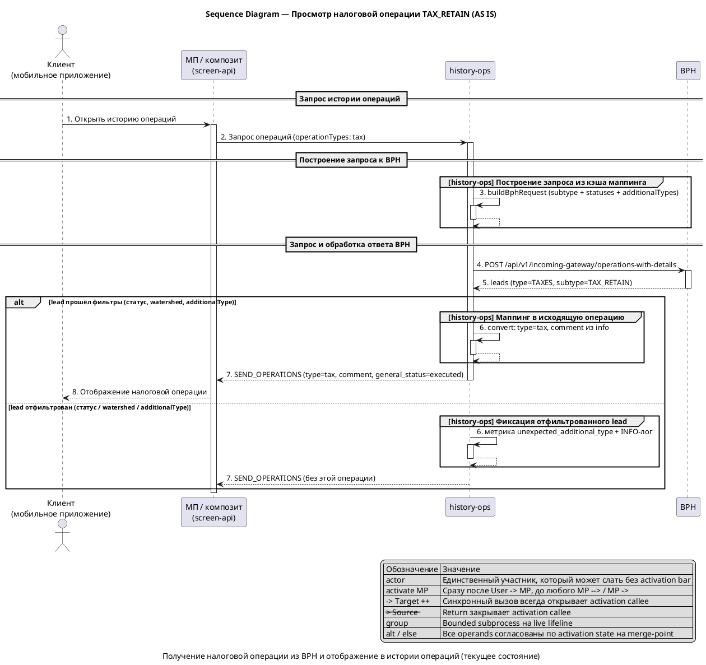
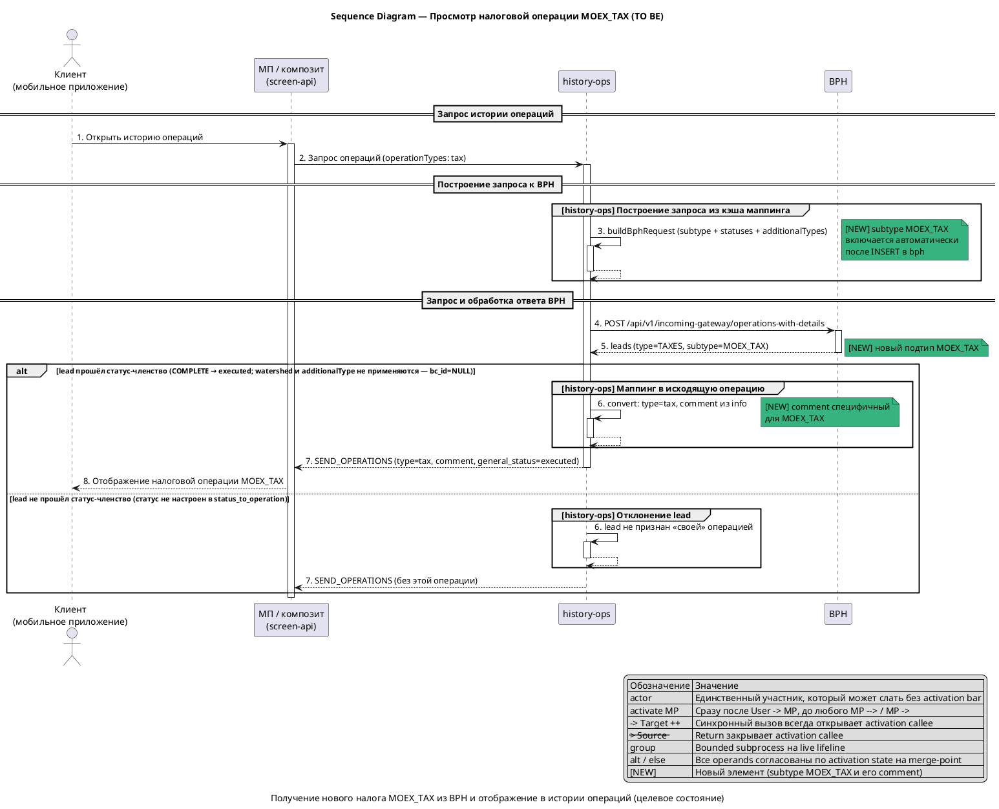
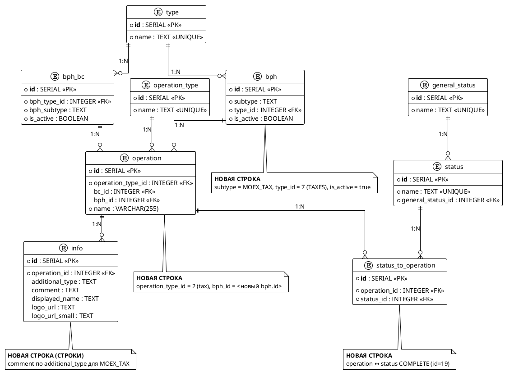

# bph-moex-tax

## 1. Бизнес-требования

#### Анализ требований — Обработка налога MOEX_TAX (bph-moex-tax)

**Источник требования:**

| Параметр | Значение |
|----------|----------|
| Фича | bph-moex-tax — обработка нового налога `MOEX_TAX` в интеграции history-ops ↔ BPH по `GET_OPERATIONS_WITH_DETAILS` |
| Источник | Product request (бриф) |
| Инициатор | — |
| Дата / версия | — |

**Стейкхолдеры:**

| Стейкхолдер | Роль | Интерес / ожидание | Влияние / ответственность |
|-------------|------|--------------------|---------------------------|
| Пользователь истории операций | Основной пользователь | Видит корректно отображаемый налог `MOEX_TAX` в истории операций с верным текстом | Использует результат фичи |
| Команда history-ops | Владелец интеграции и обработки | Добавить налог data-driven (INSERT в БД маппинга), не трогая Java-код | Реализует миграцию БД и пролив |
| Команда BPH | Поставщик данных | Начать отдавать `type=TAXES`, `subtype=MOEX_TAX` в `GET_OPERATIONS_WITH_DETAILS` | Отвечает за контракт источника (написание subtype, `additionalType`, статус) |
| Product Owner / бизнес-аналитик | Владелец бизнес-требования | Утвердить текст `comment`/название операции для UI | Принимает функциональный результат и закрывает вопросы по тексту |
| DBA / сопровождение БД | Владелец схемы маппинга HO | Согласовать id строк в Liquibase без пересечения с sibling-фичей `bph-portfolio-size-tax` | Отвечает за корректность пролива и PK |

**Бизнес-правила и ограничения:**

| ID | Тип | Описание | Источник / обоснование |
|----|-----|----------|------------------------|
| BR-01 | Бизнес-правило | BPH присылает операцию `type = TAXES`, `subtype = MOEX_TAX` (новый подтип семейства `TAXES`); в текущих выгрузках и коде этот subtype отсутствует | Бриф; `CONTEXT_DOC` §«Данные (БД, выгрузки)» — в семействе `TAXES` активны только `TAX_RETAIN` и `TAX_REFUND_BROK_ACCOUNT` |
| BR-02 | Бизнес-правило | Операция `MOEX_TAX` маппится в тот же исходящий объект, что и обычный налог — `operation_type = tax`; новый фронтовый тип не вводится | Бриф; swagger enum `PortfolioOperationType` уже содержит `tax` (`history.yml:71`) |
| BR-03 | Бизнес-правило | Отличие от `TAX_RETAIN` — только текст для UI (`comment`), который берётся из таблицы `info` по `additional_type`; fallback на `details.accComment` — только при пустом `info.comment` | Бриф; `CONTEXT_DOC` §«Релевантный код» (SIHIST-3476, `BphCommonClientConverter.enrichComment()`) |
| BR-04 | Бизнес-правило | Логика обработки идентична существующему налогу `TAX_RETAIN` (тот же конвейер «таблицы маппинга БД HO → кэш → запрос/обработка BPH», образец SIHIST-3321) | Бриф; `CONTEXT_DOC` §«Релевантная аналитика и спеки» |
| BR-05 | Бизнес-правило | Изменения data-driven через БД: INSERT в таблицы маппинга БД HO (`bph`, `operation`, `info`, `status_to_operation`); Java-код `history-ops` не меняется | Бриф; `CONTEXT_DOC` §«Затронутые области» |
| CN-01 | Ограничение | `subtype MOEX_TAX` — новый подтип семейства `TAXES`; в текущих выгрузках (`db-export/`) и репозитории (`repositories/`) отсутствует (0 совпадений по grep). Точное написание `MOEX_TAX` подтверждено контрактом BPH (D-01) | `CONTEXT_DOC` §«Ограничения и риски»; DECISIONS D-01 |
| CN-02 | Зависимость | BPH должен начать отдавать `MOEX_TAX`; до этого HO не запрашивает и не показывает налог (no-op без сигнала от BPH) | `CONTEXT_DOC` §«Интеграции и контракты» |
| CN-03 | Ограничение | Координация id строк в Liquibase (`create_schema.sql`) с sibling-фичей `bph-portfolio-size-tax`, вставляющей в те же таблицы (`bph`/`operation`/`info`/`status_to_operation`), чтобы не пересечься по PK. Зафиксировано: bph-moex-tax владеет test 22/24/52/37, prod 25/27/79/57 (D-06) | `CONTEXT_DOC` §«Ограничения и риски»; DECISIONS D-06 |

**Цель фичи:**

| Вопрос | Ответ |
|--------|-------|
| Какую бизнес-проблему решает? | Пользователь не видит новый налог `MOEX_TAX`, который начинает приходить от BPH, в истории операций — он не настроен в таблицах маппинга HO и молча отфильтровывается |
| Какую ценность приносит пользователю? | Пользователь видит операцию `MOEX_TAX` в истории операций как налог (`tax`) с корректным текстом (`comment`) |
| Какие метрики улучшает? | Полнота отображения операций семейства `TAXES` в истории операций; целевые значения/способ измерения в брифе не заданы |

**SMART-проверка цели:**

| Критерий | Описание | Значение |
|----------|----------|----------|
| Specific | Конкретная | Добавить data-driven обработку нового налога `MOEX_TAX`: INSERT в таблицы маппинга БД HO (`bph`, `operation`, `info`, `status_to_operation`) так, чтобы операция попадала в `GET_OPERATIONS_WITH_DETAILS` и маппилась в `operation_type = tax` с `comment` из `info` |
| Measurable | Измеримая | Налог `MOEX_TAX` отображается в истории операций как `tax`; целевые метрики/способ измерения не заданы в брифе |
| Achievable | Достижимая | Достижимо без правок Java-кода (data-driven, образец SIHIST-3321); зависит от готовности BPH отдавать `MOEX_TAX` (CN-02); значения `additionalType = NULL` и `bc_id = NULL` зафиксированы решениями D-02/D-03 |
| Relevant | Релевантная | Прямо влияет на полноту отображения налоговых операций пользователя в истории операций |
| Time-bound | Ограниченная по времени | Срок/релиз в брифе не указан |

**Противоречия и решения:**

| Требование 1 | Требование 2 | Источник 1 | Источник 2 | Решение | Обоснование |
|--------------|--------------|------------|------------|---------|-------------|
| Бриф: `comment` берётся из `info` по `additionalType` (намекает на непустой `additionalType` для `MOEX_TAX`) | Sibling-спека `bph-portfolio-size-tax` предполагала для `MOEX_TAX` `additionalType = NULL` | Бриф | `Feature-writing/bph-portfolio-size-tax` | `additionalType = NULL` — одна строка `info` с `additional_type = NULL` (как `TAX_REFUND_BROK_ACCOUNT`) | Decision D-02 (решение пользователя, вариант B); первичный SPEC `bph-moex-tax` отсутствовал; значение принято допущением — контракт BPH его не подтверждает |

#### Use Case — Просмотреть налоговую операцию TAX_RETAIN в истории операций

**Структура Use Case:**

| Элемент | Значение |
|---------|----------|
| Название | Просмотреть налоговую операцию `TAX_RETAIN` в истории операций |
| Актор(ы) | Клиент (пользователь истории операций, авторизован в мобильном приложении) |
| Триггер | Клиент открывает раздел «История операций»; МП/композит (screen-api) запрашивает у history-ops операции с типом `tax` |
| Предусловия | См. таблицу предусловий ниже |
| Постусловия | См. таблицу постусловий ниже |
| Бизнес-правила | BR-03, BR-05, BR-06…BR-11 (см. ниже) |

**Предусловия:**

| № | Предусловие | Проверяемое условие |
|---|-------------|---------------------|
| 1 | Клиент авторизован в мобильном приложении | Активная сессия клиента |
| 2 | Налог `TAX_RETAIN` настроен в таблицах маппинга БД HO | `bph.subtype = TAX_RETAIN` (`type_id = 7`), строка `operation` (`operation_type_id = 2`), строки `info`, связка `status_to_operation` (`COMPLETE`) |
| 3 | Кэш маппинга загружен | `operation-cache` содержит запись `TAXES|TAX_RETAIN → tax` |
| 4 | BPH доступен и обрабатывает запрос | BPH отвечает на `GET_OPERATIONS_WITH_DETAILS` |
| 5 | BPH отдаёт операции семейства `TAXES` | В ответе BPH есть lead с `type = TAXES`, `subtype = TAX_RETAIN` |

**Постусловия:**

| Исход | Постусловие |
|-------|-------------|
| Успех | Налоговая операция отображается в истории операций как `tax` с `comment` из `info`; `general_status = executed`, `id = bph_tax_<externalSystemId>` |
| Неуспех (бизнес) | Операция отфильтрована (статус / watershed / `additionalType`) и не попадает в ответ — налог не отображается в истории |
| Неуспех (техн.) | Операция не отображается в истории (BPH недоступен или вернул ошибку). При недоступности BPH history-ops возвращает операции из других источников (OG, BC) с признаком неполноты `bcDataComplete=false` |

**Бизнес-правила:**

| ID | Правило | Применяется на шаге |
|----|---------|---------------------|
| BR-03 | `comment` налога берётся из `info` по `additional_type`; при пустом — fallback на `details.accComment` (SIHIST-3476) | Шаг 6 |
| BR-05 | Обработка data-driven: запрос и маппинг строятся из кэша БД HO, Java-код не меняется | Шаги 3, 6 |
| BR-06 | Запрос к BPH строится из кэша маппинга: перечень `subtype` + `statuses` + `additionalTypes` (только non-null `info.additional_type`) | Шаг 3 |
| BR-07 | Статус-членство: lead проходит, только если его `status` настроен в `status_to_operation` (для налогов `COMPLETE` → `executed`) | Шаг 5 |
| BR-08 | Watershed-фильтр (при `bc_id` не null): lead принимается, если `formationDate` не раньше `historyStart` по ключу `type|subtype` | Шаг 5 |
| BR-09 | `additionalType`-фильтр (при `bc_id` не null): lead принимается, если `additionalType` ∈ `info.additional_type`; иначе отфильтровывается | Шаг 5 |
| BR-10 | Маппинг `type|subtype` → `operation_type` из кэша: `TAXES|TAX_RETAIN` → `tax` | Шаг 6 |
| BR-11 | Идентификатор исходящей операции: `bph_<operationType>_<externalSystemId>` = `bph_tax_<externalSystemId>` | Шаг 6 |

**Основной сценарий — Happy Path:**

```
Шаг 1:  Клиент открывает раздел «История операций» в мобильном приложении
Шаг 2:  МП/композит (screen-api) запрашивает операции у history-ops (operationTypes содержит tax)
Шаг 3:  history-ops строит запрос к BPH из кэша маппинга [BR-05, BR-06]
Шаг 4:  history-ops вызывает BPH: POST /api/v1/incoming-gateway/operations-with-details
Шаг 5:  BPH возвращает операции; history-ops фильтрует каждый lead (TAXES/TAX_RETAIN)
          ЕСЛИ [BR-07] статус lead настроен в status_to_operation (COMPLETE)
            ТО перейти к проверке BR-08 (watershed)
          ИНАЧЕ
            ПЕРЕЙТИ К альтернативному сценарию 5a
          ЕСЛИ [BR-08] formationDate не раньше historyStart (при bc_id не null)
            ТО перейти к проверке BR-09 (additionalType)
          ИНАЧЕ
            ПЕРЕЙТИ К альтернативному сценарию 5b
          ЕСЛИ [BR-09] additionalType ∈ info.additional_type (при bc_id не null)
            ТО сценарий продолжается с шага 6
          ИНАЧЕ
            ПЕРЕЙТИ К альтернативному сценарию 5c
Шаг 6:  history-ops маппит lead в исходящую операцию: type = tax [BR-10], id = bph_tax_<externalSystemId> [BR-11]
          ЕСЛИ [BR-03] comment в info непустой
            ТО подставить comment из info по additional_type
          ИНАЧЕ
            подставить fallback details.accComment (сценарий продолжается)
Шаг 7:  history-ops возвращает ответ SEND_OPERATIONS в МП/композит (type = tax, comment, general_status = executed)
Шаг 8:  МП/композит отображает налоговую операцию в ленте истории операций (деталка HISTORY_OPS_TAX_DETAILS_SCREEN)
```

**Альтернативные сценарии:**

```
5a. Статус lead не настроен в status_to_operation [BR-07] (Бизнес-ошибки):
  5a.1. history-ops не считает lead «своей» операцией и не включает его в ответ
  5a.2. Налоговая операция не отображается в истории операций
  5a.3. Сценарий для данного lead завершается неуспешно; обработка остальных lead продолжается

5b. Watershed не пройден [BR-08] (Бизнес-ошибки):
  5b.1. history-ops отфильтровывает lead (formationDate раньше historyStart)
  5b.2. Налоговая операция не отображается в истории операций
  5b.3. Сценарий для данного lead завершается неуспешно; обработка остальных lead продолжается

5c. additionalType не совпадает с info.additional_type [BR-09] (Бизнес-ошибки):
  5c.1. history-ops фиксирует INFO-лог и метрику unexpected_additional_type_for_common_operation
  5c.2. history-ops отфильтровывает lead
  5c.3. Налоговая операция не отображается в истории операций
  5c.4. Сценарий для данного lead завершается неуспешно; обработка остальных lead продолжается
```

**Связи между Use Cases:**

| Связь | Связанный Use Case | Шаг / Extension Point | Условие |
|-------|--------------------|-----------------------|---------|
| — | — | — | — |

Связей с другими Use Cases не выявлено: сценарий самодостаточный (backend-обработка одной операции семейства `TAXES`).

#### Sequence Diagram — Просмотр налоговой операции TAX_RETAIN (AS IS)

**Назначение:**

Диаграмма показывает текущее (AS IS) взаимодействие при получении налоговой операции `TAX_RETAIN` из BPH: клиент открывает историю операций, МП/композит запрашивает операции у history-ops, history-ops строит data-driven запрос к BPH из кэша маппинга, фильтрует ответ и возвращает операцию `tax` с `comment` из `info`.

**Участники:**

| Участник | Тип | Роль |
|---|---|---|
| `Клиент` | actor | Пользователь истории операций в мобильном приложении |
| `МП / композит (screen-api)` | participant | Фронтовый композит, запрашивающий операции у history-ops и отображающий ленту |
| `history-ops` | participant | Сервис истории операций: строит запрос к BPH, фильтрует и маппит ответ |
| `BPH` | participant | Внешний источник операций по `GET_OPERATIONS_WITH_DETAILS` |

**PlantUML:**



**Легенда:**

| Обозначение | Значение |
|---|---|
| `->` | Синхронный вызов (между participant только с `++` на callee) |
| `-->` | Ответ / return (с `--` при закрытии callee) |
| `++` / `--` | Activation start / end на callee |
| `activate` / `deactivate` | Явное открытие/закрытие lifeline Frontend на scope обработки |
| `actor` | Может инициировать сообщение без activation bar |
| `group` | Bounded subprocess внутри live lifeline |
| `alt` / `else` | Ветвление; все operands согласованы по activation state на merge-point |

**Соответствие тексту:**

| Элемент на диаграмме | Номер | Описание в тексте |
|---|---|---|
| `Открыть историю операций` | 1 | Шаг 1 основного сценария |
| `Запрос операций (operationTypes: tax)` | 2 | Шаг 2 основного сценария |
| `buildBphRequest (subtype + statuses + additionalTypes)` | 3 | Шаг 3 основного сценария [BR-05, BR-06] |
| `POST /api/v1/incoming-gateway/operations-with-details` | 4 | Шаг 4 основного сценария |
| `leads (type=TAXES, subtype=TAX_RETAIN)` | 5 | Шаг 5 основного сценария |
| `convert: type=tax, comment из info` | 6 | Шаг 6 основного сценария [BR-03, BR-10, BR-11] |
| `SEND_OPERATIONS` | 7 | Шаг 7 основного сценария |
| `Отображение налоговой операции` | 8 | Шаг 8 основного сценария |

#### Use Case — Просмотреть налоговую операцию MOEX_TAX в истории операций

**Структура Use Case:**

| Элемент | Значение |
|---------|----------|
| Название | Просмотреть налоговую операцию `MOEX_TAX` в истории операций |
| Актор(ы) | Клиент (пользователь истории операций, авторизован в мобильном приложении) |
| Триггер | Клиент открывает раздел «История операций»; МП/композит (screen-api) запрашивает у history-ops операции с типом `tax` |
| Предусловия | См. таблицу предусловий ниже |
| Постусловия | См. таблицу постусловий ниже |
| Бизнес-правила | BR-03, BR-05, BR-06…BR-12, BR-14 (см. ниже) |

**Предусловия:**

| № | Предусловие | Проверяемое условие |
|---|-------------|---------------------|
| 1 | Клиент авторизован в мобильном приложении | Активная сессия клиента |
| 2 | Налог `MOEX_TAX` настроен в таблицах маппинга БД HO (INSERT выполнен) | `bph.subtype = MOEX_TAX` (`type_id = 7`), строка `operation` (`operation_type_id = 2`), строки `info` (comment), связка `status_to_operation` (`COMPLETE`) |
| 3 | Кэш маппинга загружен | `operation-cache` содержит запись `TAXES|MOEX_TAX → tax` |
| 4 | BPH доступен и обрабатывает запрос | BPH отвечает на `GET_OPERATIONS_WITH_DETAILS` |
| 5 | BPH отдаёт операции семейства `TAXES` с новым подтипом | В ответе BPH есть lead с `type = TAXES`, `subtype = MOEX_TAX` |

**Постусловия:**

| Исход | Постусловие |
|-------|-------------|
| Успех | Налоговая операция `MOEX_TAX` отображается в истории операций как `tax` с `comment` из `info`; `general_status = executed`, `id = bph_tax_<externalSystemId>` |
| Неуспех (бизнес) | Операция отфильтрована (статус не настроен в `status_to_operation`) и не попадает в ответ — налог не отображается в истории. Watershed и `additionalType`-фильтр для `MOEX_TAX` не применяются (`bc_id = NULL`) |
| Неуспех (техн.) | Операция не отображается в истории (BPH недоступен или вернул ошибку). При недоступности BPH history-ops возвращает операции из других источников (OG, BC) с признаком неполноты `bcDataComplete=false` |

**Бизнес-правила:**

| ID | Правило | Применяется на шаге |
|----|---------|---------------------|
| BR-03 | `comment` налога берётся из `info` по `additional_type`; при пустом — fallback на `details.accComment` (SIHIST-3476) | Шаг 6 |
| BR-05 | Обработка data-driven: запрос и маппинг строятся из кэша БД HO, Java-код не меняется | Шаги 3, 6 |
| BR-06 | Запрос к BPH строится из кэша маппинга: перечень `subtype` + `statuses` + `additionalTypes` (только non-null `info.additional_type`) | Шаг 3 |
| BR-07 | Статус-членство: lead проходит, только если его `status` настроен в `status_to_operation` (для налогов `COMPLETE` → `executed`) | Шаг 5 |
| BR-08 | Watershed-фильтр (при `bc_id` не null): lead принимается, если `formationDate` не раньше `historyStart` по ключу `type|subtype`. Для `MOEX_TAX` не применяется (`bc_id = NULL`) | Шаг 5 |
| BR-09 | `additionalType`-фильтр (при `bc_id` не null): lead принимается, если `additionalType` ∈ `info.additional_type`; иначе отфильтровывается. Для `MOEX_TAX` не применяется (`bc_id = NULL`) | Шаг 5 |
| BR-10 | Маппинг `type|subtype` → `operation_type` из кэша: `TAXES|MOEX_TAX` → `tax` | Шаг 6 |
| BR-11 | Идентификатор исходящей операции: `bph_<operationType>_<externalSystemId>` = `bph_tax_<externalSystemId>` | Шаг 6 |
| BR-12 | Для `MOEX_TAX` заводится отдельная строка `operation` в кэше (одна строка = одна пара `bph.type + bph.subtype`), даже при том же `operation_type = tax` | Шаг 3 |
| BR-14 | Идентификатор и уникальность: HO не дедуплицирует операции по `externalSystemId`; формат id `bph_tax_<externalSystemId>` не содержит subtype, поэтому уникальность `externalSystemId` поперёк subtype (`TAX_RETAIN` vs `MOEX_TAX`) — ответственность BPH (глобальная уникальность) | Шаг 6 |

**Основной сценарий — Happy Path:**

```
Шаг 1:  Клиент открывает раздел «История операций» в мобильном приложении
Шаг 2:  МП/композит (screen-api) запрашивает операции у history-ops (operationTypes содержит tax)
Шаг 3:  history-ops строит запрос к BPH из кэша маппинга [BR-05, BR-06]; перечень subtype включает MOEX_TAX (отдельная строка operation [BR-12])
Шаг 4:  history-ops вызывает BPH: POST /api/v1/incoming-gateway/operations-with-details
Шаг 5:  BPH возвращает операции; history-ops фильтрует каждый lead (TAXES/MOEX_TAX)
          ЕСЛИ [BR-07] статус lead настроен в status_to_operation (COMPLETE)
            ТО перейти к шагу 6 (для MOEX_TAX `bc_id = NULL` — watershed и `additionalType`-фильтр пропускаются)
          ИНАЧЕ
            ПЕРЕЙТИ К альтернативному сценарию 5a
Шаг 6:  history-ops маппит lead в исходящую операцию: type = tax [BR-10], id = bph_tax_<externalSystemId> [BR-11]
          ЕСЛИ [BR-03] comment в info по additional_type (NULL → «») непустой
            ТО подставить comment из info («НАЛОГ МОСКОВСКОЙ БИРЖИ»)
          ИНАЧЕ
            подставить fallback details.accComment (сценарий продолжается)
Шаг 7:  history-ops возвращает ответ SEND_OPERATIONS в МП/композит (type = tax, comment, general_status = executed)
Шаг 8:  МП/композит отображает налоговую операцию MOEX_TAX в ленте истории операций (деталка HISTORY_OPS_TAX_DETAILS_SCREEN)
```

**Альтернативные сценарии:**

```
5a. Статус lead не настроен в status_to_operation [BR-07] (Бизнес-ошибки):
  5a.1. history-ops не считает lead «своей» операцией и не включает его в ответ
  5a.2. Налоговая операция MOEX_TAX не отображается в истории операций
  5a.3. Сценарий для данного lead завершается неуспешно; обработка остальных lead продолжается

6a. BPH прислал non-null additionalType (нарушение контрактного требования CN-08) [BR-03, CN-08] (Edge-сценарий):
  6a.1. additionalType-фильтр (BR-09) для MOEX_TAX не применяется (bc_id = NULL), поэтому lead не отфильтровывается
  6a.2. history-ops не находит строку info по additional_type = <non-null> (заведена только строка с additional_type = NULL)
  6a.3. Подставляется fallback details.accComment вместо «НАЛОГ МОСКОВСКОЙ БИРЖИ» (silent wrong data)
  6a.4. Сценарий для данного lead продолжается с неверным comment
```

> Watershed (BR-08) и `additionalType`-фильтр (BR-09) для `MOEX_TAX` не применяются (`bc_id = NULL`), поэтому отдельных альтернативных сценариев для них нет. Единственный edge-сценарий по `additionalType` — non-null `additionalType` от BPH (нарушение контрактного требования CN-08), приводящий к fallback `details.accComment` (сценарий 6a).

**Связи между Use Cases:**

| Связь | Связанный Use Case | Шаг / Extension Point | Условие |
|-------|--------------------|-----------------------|---------|
| — | — | — | — |

Связей с другими Use Cases не выявлено: сценарий самодостаточный (backend-обработка одной операции семейства `TAXES`, data-driven по образцу `TAX_RETAIN`).

#### Sequence Diagram — Просмотр налоговой операции MOEX_TAX (TO BE)

**Назначение:**

Диаграмма показывает целевое (TO BE) взаимодействие при получении нового налога `MOEX_TAX` из BPH: клиент открывает историю операций, МП/композит запрашивает операции у history-ops, history-ops строит data-driven запрос к BPH из кэша маппинга (который после INSERT уже содержит `TAXES|MOEX_TAX → tax`), фильтрует ответ и возвращает операцию `tax` с `comment` из `info` по `additional_type`. Отличие от AS IS — новый подтип `MOEX_TAX` и специфичный для него `comment`.

**Участники:**

| Участник | Тип | Роль |
|---|---|---|
| `Клиент` | actor | Пользователь истории операций в мобильном приложении |
| `МП / композит (screen-api)` | participant | Фронтовый композит, запрашивающий операции у history-ops и отображающий ленту |
| `history-ops` | participant | Сервис истории операций: строит запрос к BPH, фильтрует и маппит ответ |
| `BPH` | participant | Внешний источник операций по `GET_OPERATIONS_WITH_DETAILS` |

**PlantUML:**



**Легенда:**

| Обозначение | Значение |
|---|---|
| `->` | Синхронный вызов (между participant только с `++` на callee) |
| `-->` | Ответ / return (с `--` при закрытии callee) |
| `++` / `--` | Activation start / end на callee |
| `activate` / `deactivate` | Явное открытие/закрытие lifeline Frontend на scope обработки |
| `actor` | Может инициировать сообщение без activation bar |
| `group` | Bounded subprocess внутри live lifeline |
| `alt` / `else` | Ветвление; все operands согласованы по activation state на merge-point |
| `[NEW]` | Новый элемент (subtype `MOEX_TAX` и его `comment`) |

**Соответствие тексту:**

| Элемент на диаграмме | Номер | Описание в тексте |
|---|---|---|
| `Открыть историю операций` | 1 | Шаг 1 основного сценария |
| `Запрос операций (operationTypes: tax)` | 2 | Шаг 2 основного сценария |
| `buildBphRequest (subtype + statuses + additionalTypes)` + `[NEW] MOEX_TAX` | 3 | Шаг 3 основного сценария [BR-05, BR-06, BR-12] |
| `POST /api/v1/incoming-gateway/operations-with-details` | 4 | Шаг 4 основного сценария |
| `leads (type=TAXES, subtype=MOEX_TAX)` | 5 | Шаг 5 основного сценария |
| `convert: type=tax, comment из info` + `[NEW] comment MOEX_TAX` | 6 | Шаг 6 основного сценария [BR-03, BR-10, BR-11] |
| `SEND_OPERATIONS` | 7 | Шаг 7 основного сценария |
| `Отображение налоговой операции MOEX_TAX` | 8 | Шаг 8 основного сценария |

## 2. Ограничения и допущения

**Ограничения:**

| ID | Тип | Описание | Источник / обоснование |
|----|-----|----------|------------------------|
| CN-01 | Ограничение | `subtype MOEX_TAX` — новый подтип семейства `TAXES`; в текущих выгрузках (`db-export/`) и репозитории (`repositories/`) отсутствует (0 совпадений по grep); в семействе `TAXES` сейчас активны только `TAX_RETAIN` и `TAX_REFUND_BROK_ACCOUNT`. Точное написание `MOEX_TAX` подтверждено контрактом BPH (D-01). Ошибка в написании → запросный фильтр вернёт пусто, налог молча не отобразится | `CONTEXT_DOC` §«Ограничения и риски текущего состояния»; DECISIONS D-01 |
| CN-02 | Зависимость | BPH должен начать отдавать `type=TAXES`, `subtype=MOEX_TAX` через `GET_OPERATIONS_WITH_DETAILS`; до включения на стороне BPH HO не запрашивает и не показывает налог (no-op без сигнала от источника) | `CONTEXT_DOC` §«Интеграции и контракты, которые нужно учесть»; бриф |
| CN-03 | Ограничение | Координация id строк в Liquibase (`create_schema.sql`) с sibling-фичей `bph-portfolio-size-tax`, вставляющей в те же таблицы (`bph`/`operation`/`info`/`status_to_operation`): при совпадении черновых id второй changeset упадёт по PK. Зафиксировано: bph-moex-tax владеет test 22/24/52/37, prod 25/27/79/57 (D-06) | `CONTEXT_DOC` §«Ограничения и риски текущего состояния»; DECISIONS D-06 |
| CN-04 | Архитектурное | Java-код `history-ops` не изменяется — фича реализуется data-driven: INSERT в таблицы маппинга БД HO, обновление bootstrap-кэша и тестовых фикстур; алгоритм формирования запроса и обработки ответа BPH не меняется | Бриф; `CONTEXT_DOC` §«Затронутые области»; BR-05 (§1.1) |
| CN-05 | Архитектурное | МП и композит (screen-api) не изменяются — тот же `operation_type=tax`, та же деталка `HISTORY_OPS_TAX_DETAILS_SCREEN`, заголовок карточки/деталки «Удержание налога» фиксирован без различия по subtype | `CONTEXT_DOC` §«Затронутые области» |
| CN-06 | Архитектурное | Новый тип во фронтовый enum `PortfolioOperationType` не вводится — `tax` уже присутствует (L71) | `src/main/swagger/history/history.yml:71` |
| CN-07 | Данные | Один `operation` в кэше = одна пара `bph.type + bph.subtype`; для `MOEX_TAX` нужна **отдельная** строка `operation` (нельзя «дописать» subtype к существующему `operation` id=2), даже при том же `operation_type=tax` | `CONTEXT_DOC` §«Ограничения и риски текущего состояния» |
| CN-08 | Данные | `additionalType` для `MOEX_TAX` = `NULL`: заводится **одна** строка `info` с `additional_type = NULL` (как у `TAX_REFUND_BROK_ACCOUNT`); `additionalTypes[]` в запросе для этого подтипа не заполняется. **Контрактное требование к BPH**: `GET_OPERATIONS_WITH_DETAILS` должен отдавать `lead.additionalType = NULL` для `MOEX_TAX`. При non-null `additionalType` (нарушение контракта) `additionalType`-фильтр не применяется (`bc_id = NULL`), строка `info` по non-null `additional_type` не найдена → `comment` подставится fallback `details.accComment` (неверный текст, silent wrong data) | DECISIONS D-02, D-14 |
| CN-09 | Данные | `bc_id` для `MOEX_TAX` = `NULL` (только BPH-контекст): watershed и `additionalType`-фильтр пропускаются (ранний `return true`), остаётся только статус-членство | DECISIONS D-03 |
| CN-10 | Данные | Watershed для `MOEX_TAX` не задаётся: ключ `TAXES\|MOEX_TAX` в конфиг `bph_dynamic` не добавляется (неактуально при `bc_id = NULL`). Следствие: у `MOEX_TAX` нет даты отсечения — исторические `MOEX_TAX` любой давности (в т.ч. ретро-выгрузка BPH при старте) попадают в ленту; backfill данных BPH датой не ограничивается (ожидаемое поведение) | DECISIONS D-05, D-16 |
| CN-11 | Данные | Статус BPH для `MOEX_TAX` = `COMPLETE` (id=19 → `general_status=executed`), переиспользуется как у налогов; новая строка `status` не добавляется, добавляется `status_to_operation` | DECISIONS D-07 |
| CN-12 | Архитектурное | Поведение при сбое BPH: history-ops возвращает операции из других источников (OG, BC) с признаком неполноты `bcDataComplete=false`; значения timeout/retry задаются runtime-конфигом `WebClientBphConfiguration` и находятся вне scope фичи (не влияют на data-driven добавление `MOEX_TAX`). Degraded-поведение полностью описано постусловием «Неуспех (техн.)» (§1.3) и настоящим CN-12 — отдельного alt-потока и acceptance-теста degraded-пути не требуется | DECISIONS D-09, D-17 |
| CN-13 | Архитектурное | Диаграмма последовательности: МП и композит (screen-api) объединены в одного участника `МП / композит (screen-api)`; имя сообщения запроса МП → history-ops — описательное («Запрос операций (operationTypes: tax)»). Принято как зафиксированное упрощение | DECISIONS D-08 |
| CN-14 | Данные | `MOEX_TAX` поступает только из BPH; OG/BC этот налог не отдают (BC-аналог `TAX_WITHHOLDING`/`bc_id` для `MOEX_TAX` отсутствует, `bc_id = NULL`), поэтому дедупликация BPH↔BC для этого подтипа не требуется | DECISIONS D-15 |
| CN-15 | Зависимость | Порядок rollout обязателен: INSERT строк маппинга → перезагрузка кэша `operation-cache` → go-live BPH (начало отдачи `MOEX_TAX`). Кэш должен быть готов **до** включения BPH; иначе lead придёт, но пары `TAXES\|MOEX_TAX` в кэше нет → lead не маппится и не попадает в ответ (налог потерян); при полностью отсутствующем subtype `BphOperationConverter` бросает `IllegalArgumentException` → WARN-лог + метрика `parse_error` | DECISIONS D-21 |

## 4. Функциональные требования

#### Интеграция history-ops ↔ BPH: GET_OPERATIONS_WITH_DETAILS

**Назначение:**

Получение из BPH истории торговых и простых операций клиента (в т.ч. налоговых) по синхронному обмену `GET_OPERATIONS_WITH_DETAILS`; history-ops нормализует полученные leads в общую модель операций и отдаёт клиенту через `SEND_OPERATIONS`. В рамках фичи добавляется обработка нового налогового подтипа `MOEX_TAX` (семейство `TAXES`), который маппится в уже существующий фронтовый тип `tax` с `comment`, взятым из таблицы `info` по `additional_type`.

**Кратко:**

| Параметр | Значение |
|---|---|
| Тип | Синхронная (request → response) |
| Протокол | REST (HTTPS), JSON |
| Направление | Однонаправленная: history-ops (инициатор) → BPH incoming-gateway (провайдер) |
| Producer | BPH (Brokerage Portfolio History) |
| Consumer | history-ops (ИО) |
| Операция | `GET_OPERATIONS_WITH_DETAILS` (`POST /api/v1/incoming-gateway/operations-with-details`) |

**Общая информация:**

| Параметр | Значение |
|----------|----------|
| Назначение | Получение истории торговых и простых операций клиента (включая налоги) |
| Система-источник | BPH (Brokerage Portfolio History) |
| Система-получатель | history-ops (ИО) |
| Тип интеграции | Синхронная |
| Протокол | REST (HTTPS) |
| Направление | Однонаправленная (history-ops → BPH request, BPH → history-ops response) |
| Версия API | `/api/v1` |
| Аутентификация | Заголовки `rqUID` (сквозной UUID запроса), `systemName` (`si2-ops`) |
| Формат данных | JSON |

**Текущее поведение:**

history-ops формирует запрос `GET_OPERATIONS_WITH_DETAILS` по кэшу маппинга БД HO (`operation` / `bph` / `info` / `status_to_operation`): для каждой активной строки (`bph_active`) строится элемент `subtypesAndStatuses[]` с `type`, `subtype` и `statuses` из `status_and_general_status`; при наличии строк `info` с непустым `additional_type` дополнительно заполняется `additionalTypes[]`. BPH возвращает `data[].lead` с детализацией операции; history-ops фильтрует leads (`BphBcFilterService`), маппит `type + subtype → operation_type` через кэш (`BphConverter.getTypesMap()`), подставляет `comment` из `info` по `additional_type` (`BphCommonClientConverter.enrichComment()`), и отдаёт в `SEND_OPERATIONS`.

В семействе `TAXES` на текущий момент активны подтипы `TAX_RETAIN` (→ `tax`) и `TAX_REFUND_BROK_ACCOUNT` (→ `tax_input`). Подтип `MOEX_TAX` в выгрузках (`db-export/`) и коде (`repositories/`) **отсутствует** — он добавляется фичей data-driven (INSERT в таблицы маппинга БД HO) без правок Java-кода.

**Участники интеграции:**

| Система | Роль | Что передаёт | Что получает |
|---|---|---|---|
| history-ops | Consumer / orchestrator | REST-запрос с договорами, периодом и фильтром `subtypesAndStatuses[]` (в т.ч. `TAXES|MOEX_TAX` после настройки) | Массивы `data[].lead` операций (в т.ч. налогов) |
| BPH incoming-gateway | Provider | JSON-ответы операций `GET_OPERATIONS_WITH_DETAILS` | Параметры периода, `subtypesAndStatuses[]`, статусы |
| PostgreSQL HO | Локальный маппинг (данные) | Кэш типов BPH ↔ operationTypes, строки `info` (comment/display_name) | Правила запроса и маппинга |

**Контракт:**

| Метод / операция | Назначение | Producer | Consumer |
|---|---|---|---|
| `GET_OPERATIONS_WITH_DETAILS` | Legacy-трейды + типовые простые операции (включая налоги `TAXES`) | BPH | history-ops |

**Endpoint:**

| Параметр | Значение |
|---|---|
| Метод | `POST` |
| Path | `/api/v1/incoming-gateway/operations-with-details` |

**Request headers:**

| Заголовок | Обязат. | Описание | Пример |
|---|---|---|---|
| `rqUID` | Да | Сквозной идентификатор запроса | `c4a5dccd-0fe2-4aa1-823e-a5a5d9ee04a4` |
| `systemName` | Да | Идентификатор системы-инициатора | `si2-ops` |

**Request body (запрос history-ops → BPH):**

| Параметр | Тип | Кратность | Описание |
|---|---|---|---|
| `agreements` | array[string] | [1] | JSON-массив номеров договоров |
| `startSearchDate` | string (date-time) | [0-1] | Начало периода поиска |
| `endSearchDate` | string (date-time) | [1] | Конец периода поиска |
| `dateForFilter` | string (enum `EVENT_DATE` \| `FORMATION_DATE`) | [1] | Поле фильтрации по дате; history-ops использует `FORMATION_DATE` по умолчанию, при включённом тоггле `ENABLE_SORTING_BY_EXECUTION_TIME` — `EVENT_DATE` (`BphGateway.resolveSortingType()`) |
| `subtypesAndStatuses` | array | [1] | Фильтр type/subtype/statuses (maxItems 1000) |
| ├─ `.[].type` | string (maxLength 225) | [1] | BPH-тип операции. Для налога — `TAXES`. **required** |
| ├─ `.[].subtype` | string (maxLength 225) | [1] | BPH-подтип операции. Для фичи — `MOEX_TAX` **`[NEW]`**. **required** |
| ├─ `.[].additionalTypes` | array[string] (maxLength 225) | [0-1] | Дополнительные типы события; собирается из non-null `info.additional_type` строки маппинга. Для `MOEX_TAX` `additional_type = NULL` → поле не заполняется (опускается) |
| └─ `.[].statuses` | array[string] (maxLength 225) | [1] | Статусы для подтипа. Для налога — `["COMPLETE"]`. **required** |
| `page` | integer | [0-1] | Номер страницы (в history-ops — 0) |
| `pageSize` | integer | [1] | Лимит записей (`app-config-dynamic.bph-dynamic.max-records-from-bph`, метод `BphDynamicProperties.getMaxRecordsFromBph()`) |
| `types` / `subtypes` / `statuses` | array[string] | [0-1] | Упрощённые фильтры (не используются для налогов — фильтрация идёт через `subtypesAndStatuses`) |
| `tradingSections` / `isin` / `instrumentCurrency` / `tickers` / `selfIdTs` | — | [0-1] | Опциональные фильтры инструмента/секции (к налогу неприменимы) |

**Элемент `subtypesAndStatuses[]` для нового налога `MOEX_TAX` `[NEW]`:**

| Поле | Значение |
|---|---|
| `type` | `TAXES` |
| `subtype` | `MOEX_TAX` |
| `additionalTypes` | опускается (`additional_type = NULL`) |
| `statuses` | `["COMPLETE"]` |

**Response body (ответ BPH → history-ops):**

| Параметр | Тип | Кратность | Описание |
|---|---|---|---|
| `status` | object | [1] | Метаданные результата |
| ├─ `status.code` | integer | [1] | Код ответа (0 = успех) |
| └─ `status.message` | string | [0-1] | Сообщение (текст ошибки при `code ≠ 0`) |
| `data` | array | [1] | Массив операций (`DetailsData[]`) |
| ├─ `.[].lead` | object (`OperationData`) | [1] | Lead операции |
| │ ├─ `lead.type` | string | [1] | BPH-тип. Для налога — `TAXES` |
| │ ├─ `lead.subtype` | string | [1] | BPH-подтип. Для фичи — `MOEX_TAX` **`[NEW]`** |
| │ ├─ `lead.subType` | string | [0-1] | Альтернативное поле подтипа (BPH может присылать `subType` вместо `subtype`) |
| │ ├─ `lead.additionalType` | string | [0-1] | Дополнительный тип события; для `MOEX_TAX` — `NULL` |
| │ ├─ `lead.externalSystemVersion` | number | [0-1] | Версия события |
| │ ├─ `lead.formationDate` | string (date-time) | [1] | Дата формирования (watershed по ней) |
| │ ├─ `lead.eventDate` | string (date-time) | [0-1] | Дата события |
| │ ├─ `lead.externalSystemId` | string | [1] | Идентификатор операции во внешней системе (входит в id исходящей операции) |
| │ ├─ `lead.totalPrice` | object (`PriceData`) | [0-1] | Сумма операции (`value` + `currency`) |
| │ ├─ `lead.status` | string | [1] | Статус операции; для налога — `COMPLETE` |
| │ ├─ `lead.agreement` | string | [1] | Номер договора |
| │ ├─ `lead.tradingSection` | string | [0-1] | Торговая секция |
| │ ├─ `lead.account` | string | [0-1] | Счёт |
| │ ├─ `lead.instrument` | object | [0-1] | Инструмент (isin / tickers / currency / type) |
| │ ├─ `lead.quantity` / `lead.quantityFact` | string (big_decimal) | [0-1] | Количество (фактическое) |
| │ ├─ `lead.price` | object (`PriceData`) | [0-1] | Цена |
| │ ├─ `lead.ucpId` | integer | [0-1] | Идентификатор ЕПК |
| │ ├─ `lead.parent` | string | [0-1] | Идентификатор родительской операции |
| │ ├─ `lead.isFact` | boolean | [0-1] | Признак факта события |
| │ └─ `lead.parentIds` | object | [0-1] | Идентификаторы связанных сущностей |
| └─ `.[].details` | array (`DetailData[]`) | [1] | Детали key/value (например `couponNumber`, расширенные поля налога) |

**Данные и маппинг (BPH lead → HO / МП):**

| Источник | Поле источника | Получатель | Поле получателя | Правило |
|---|---|---|---|---|
| BPH | `lead.type` + `lead.subtype` = `TAXES` \| `TAX_RETAIN` | HO / МП | `operation_type` = `tax` | Существующий маппинг (SIHIST-3321); через кэш `BphConverter.getTypesMap()` |
| BPH | `lead.type` + `lead.subtype` = `TAXES` \| `MOEX_TAX` **`[NEW]`** | HO / МП | `operation_type` = `tax` | Новый подтип семейства `TAXES`, тот же `operation_type`; появится data-driven после INSERT в `bph`/`operation` |
| BPH | `lead.type` + `lead.subtype` = `TAXES` \| `TAX_REFUND_BROK_ACCOUNT` | HO / МП | `operation_type` = `tax_input` | Существующий маппинг (SIHIST-3321) |
| BPH | `lead.additionalType` = `NULL` | HO / МП | `comment` (и `displayed_name`) | Берётся из `info` по совпадению `additional_type = NULL` (`BphCommonClientConverter.enrichComment()`); для `MOEX_TAX` `info.comment` = «НАЛОГ МОСКОВСКОЙ БИРЖИ»; при пустом `info.comment` — fallback `lead.setComment(operation.accComment())` |
| BPH | `lead.status` = `COMPLETE` | HO / МП | `general_status` = `executed` | Через `status_to_operation` → `status_and_general_status` |
| BPH | `lead.externalSystemId` | HO / МП | `id` = `bph_<operation_type>_<externalSystemId>` | Формат `bph_tax_<externalSystemId>` (`BphCommonClientConverter.getId()`) |
| BPH | `lead.totalPrice.value` / `lead.totalPrice.currency` | HO / МП | `total_sum` / `currency` | Прямой маппинг суммы |
| BPH | `lead.formationDate` / `lead.eventDate` | HO / МП | `time_happened` / `time_closed` | Даты операции |

**Ошибки и исключения:**

| Условие | Ответ / статус | Поведение системы | Evidence |
|---|---|---|---|
| BPH `status.code ≠ 0` | HTTP 200 + business error | Операции из источника не включаются в `SEND_OPERATIONS`; partial failure | `analytics/.../integrations/bph.md` (SIHIST-3502) |
| HTTP 400 / 500 от BPH | 400 / 500 (`ErrorData`: timestamp/status/error/path) | Лог `integration.log`; источник помечается failed | `bph.yml` swagger |
| Неизвестный `additionalType` (при `bc_id=110`) | — | Операция отфильтровывается (`unexpected_additional_type_for_common_operation` + INFO-лог + метрика), налог не отображается | `CONTEXT_DOC` §«Релевантный код» (`BphBcFilterService.isActualBphOperation`) |
| Статус `MOEX_TAX` не настроен в `status_to_operation` | — | Операция не проходит статус-членство (`isBphCommonOperation`) и не отображается | `CONTEXT_DOC` §«Релевантный код» |

**Таймауты, retry и fallback:**

Production timeout/retry для обмена с BPH задаётся runtime-конфигурацией `WebClient` history-ops (`WebClientBphConfiguration`); конкретные значения находятся вне scope фичи и не влияют на data-driven добавление `MOEX_TAX` (CN-12). При недоступности BPH history-ops возвращает операции из других источников (OG, BC) с признаком неполноты (`bcDataComplete=false`).

**Связанные разделы:**

- Use Case TO BE — «Просмотреть налоговую операцию `MOEX_TAX` в истории операций» (§1.3)
- Алгоритм обработки ответа BPH (формирование `subtypesAndStatuses`/`additionalTypes`, фильтрация leads, watershed) — §4.2.2 «Обработать налоговую операцию MOEX_TAX из ответа BPH»
- Модель данных маппинга БД HO (`bph`, `operation`, `info`, `status_to_operation`) — §4.2.3
- `analytics/02-Modules/MOD-001-history-ops/integrations/bph.md` — контракт источника
- `analytics/02-Modules/MOD-001-history-ops/behavior/operation-type-catalog.md` — таблица маппинга налогов (`TAXES/TAX_RETAIN → tax`)
- `analytics/02-Modules/MOD-001-history-ops/api/send-operations.md` — исходящий контракт `SEND_OPERATIONS`

#### Use Case — Обработать налоговую операцию MOEX_TAX из ответа BPH

**Структура Use Case:**

| Элемент | Значение |
|---------|----------|
| Название | Обработать налоговую операцию `MOEX_TAX` из ответа BPH |
| Актор(ы) | Система history-ops (сервис истории операций) |
| Триггер | history-ops получает ответ `GET_OPERATIONS_WITH_DETAILS` от BPH с lead `type = TAXES`, `subtype = MOEX_TAX` |
| Предусловия | См. таблицу предусловий ниже |
| Постусловия | См. таблицу постусловий ниже |
| Бизнес-правила | BR-03, BR-05, BR-07…BR-14 (см. ниже) |

**Предусловия:**

| № | Предусловие | Проверяемое условие |
|---|-------------|---------------------|
| 1 | Налог `MOEX_TAX` настроен в таблицах маппинга БД HO (INSERT выполнен) | `bph.subtype = MOEX_TAX` (`type_id = 7`), строка `operation` (`operation_type_id = 2`), строки `info` (comment), связка `status_to_operation` (`COMPLETE`) |
| 2 | Кэш маппинга загружен и содержит запись для пары `TAXES|MOEX_TAX` | `operation-cache` содержит `operation` (`bph_active = true`, `operation_type = tax`) |
| 3 | BPH вернул lead нового подтипа | В ответе BPH есть lead с `type = TAXES`, `subtype = MOEX_TAX` |

**Постусловия:**

| Исход | Постусловие |
|-------|-------------|
| Успех | lead преобразован в исходящую операцию `type = tax` с `comment` из `info`, `id = bph_tax_<externalSystemId>`, `general_status = executed`; операция включена в ответ `SEND_OPERATIONS` |
| Неуспех (бизнес) | lead отфильтрован по статус-членству (статус не настроен в `status_to_operation`) и не включён в ответ `SEND_OPERATIONS`. Watershed и `additionalType`-фильтр для `MOEX_TAX` не применяются (`bc_id = NULL`) |
| Неуспех (техн.) | В кэше маппинга отсутствует конфигурация для пары `TAXES|MOEX_TAX` (INSERT не выполнен / кэш не загружен) — lead не маппится в операцию и не попадает в ответ |

**Бизнес-правила:**

| ID | Правило | Применяется на шаге |
|----|---------|---------------------|
| BR-03 | `comment` налога берётся из `info` по `additional_type`; при пустом — fallback на `details.accComment` (SIHIST-3476) | Шаг 8 |
| BR-05 | Обработка data-driven: операция и маппинг определяются из кэша БД HO, Java-код не меняется | Шаг 2 |
| BR-07 | Статус-членство: lead проходит, только если его `status` настроен в `status_to_operation` (для налогов `COMPLETE` → `executed`) | Шаг 3 |
| BR-08 | Watershed-фильтр (при `bc_id` не null): lead принимается, если `formationDate` не раньше `historyStart` по ключу `type|subtype` | Шаг 5 |
| BR-09 | `additionalType`-фильтр (при `bc_id` не null): lead принимается, если `additionalType` ∈ `info.additional_type`; иначе отфильтровывается + метрика `unexpected_additional_type_for_common_operation` | Шаг 6 |
| BR-10 | Маппинг `type|subtype` → `operation_type` из кэша: `TAXES|MOEX_TAX` → `tax` | Шаг 7 |
| BR-11 | Идентификатор исходящей операции: `bph_<operationType>_<externalSystemId>` = `bph_tax_<externalSystemId>` | Шаг 7 |
| BR-12 | Для `MOEX_TAX` заводится отдельная строка `operation` в кэше (одна строка = одна пара `bph.type + bph.subtype`), даже при том же `operation_type = tax` | Шаг 2 |
| BR-13 | Ветвление по `bc_id`: при `bc_id = NULL` (только BPH-контекст) watershed и `additionalType`-фильтр пропускаются (ранний return), остаётся только статус-членство; при `bc_id` не null применяются оба фильтра | Шаг 4 |
| BR-14 | Идентификатор и уникальность: HO не дедуплицирует операции по `externalSystemId`; формат id `bph_tax_<externalSystemId>` не содержит subtype, поэтому уникальность `externalSystemId` поперёк subtype (`TAX_RETAIN` vs `MOEX_TAX`) — ответственность BPH (глобальная уникальность) | Шаг 7 |

**Основной сценарий — Happy Path:**

```
Шаг 1:  history-ops получает из ответа BPH lead: type=TAXES, subtype=MOEX_TAX, additionalType, status, formationDate, externalSystemId
Шаг 2:  history-ops ищет операцию в кэше маппинга по паре type+subtype [BR-05, BR-12]
          ЕСЛИ [BR-12] в кэше есть отдельная строка operation для TAXES|MOEX_TAX (bph_active=true)
            ТО перейти к шагу 3
          ИНАЧЕ
            ПЕРЕЙТИ К альтернативному сценарию 2a
Шаг 3:  history-ops проверяет статус-членство [BR-07]
          ЕСЛИ [BR-07] lead.status настроен в status_to_operation (COMPLETE)
            ТО перейти к шагу 4
          ИНАЧЕ
            ПЕРЕЙТИ К альтернативному сценарию 3a
Шаг 4:  history-ops ветвится по bc_id [BR-13]
          ЕСЛИ [BR-13] bc_id = NULL (только BPH-контекст)
            ТО пропустить watershed и additionalType-фильтр, сценарий продолжается с шага 7
          ИНАЧЕ
            сценарий продолжается с шага 5 (проверка watershed)
Шаг 5:  history-ops проверяет watershed [BR-08]
          ЕСЛИ [BR-08] formationDate не раньше historyStart (по ключу type|subtype)
            ТО перейти к шагу 6
          ИНАЧЕ
            ПЕРЕЙТИ К альтернативному сценарию 5a
Шаг 6:  history-ops проверяет additionalType [BR-09]
          ЕСЛИ [BR-09] additionalType ∈ info.additional_type
            ТО перейти к шагу 7
          ИНАЧЕ
            ПЕРЕЙТИ К альтернативному сценарию 6a
Шаг 7:  history-ops маппит lead в исходящую операцию: type=tax из кэша [BR-10], id=bph_tax_<externalSystemId> [BR-11]
Шаг 8:  history-ops подставляет comment [BR-03]
          ЕСЛИ [BR-03] comment в info по additional_type непустой
            ТО подставить comment из info (специфичный для MOEX_TAX текст)
          ИНАЧЕ
            подставить fallback details.accComment (сценарий продолжается)
Шаг 9:  history-ops формирует исходящую операцию (type=tax, comment, general_status=executed) и включает её в ответ SEND_OPERATIONS
```

**Альтернативные сценарии:**

```
2a. В кэше нет конфигурации для пары TAXES|MOEX_TAX [BR-12] (Технические ошибки):
  2a.1. history-ops не находит `operation` для пары type+subtype; при полностью отсутствующем subtype (`BphTypesHolder` не знает `MOEX_TAX`) `BphOperationConverter.convert()` бросает `IllegalArgumentException`
  2a.2. Исключение ловится в `ListRequestService.convertEntry()`: WARN-лог «Failed to convert operations» + метрика `parse_error`
  2a.3. lead не попадает в ответ SEND_OPERATIONS
  2a.4. Сценарий для данного lead завершается неуспешно; обработка остальных lead продолжается

3a. Статус lead не настроен в status_to_operation [BR-07] (Бизнес-ошибки):
  3a.1. history-ops не считает lead «своей» операцией и не включает его в ответ
  3a.2. Сценарий для данного lead завершается неуспешно; обработка остальных lead продолжается

5a. Watershed не пройден [BR-08] (Бизнес-ошибки):
  5a.1. history-ops отфильтровывает lead (formationDate раньше historyStart)
  5a.2. lead не попадает в ответ SEND_OPERATIONS
  5a.3. Сценарий для данного lead завершается неуспешно; обработка остальных lead продолжается

6a. additionalType не совпадает с info.additional_type [BR-09] (Бизнес-ошибки):
  6a.1. history-ops фиксирует INFO-лог и метрику unexpected_additional_type_for_common_operation
  6a.2. history-ops отфильтровывает lead
  6a.3. lead не попадает в ответ SEND_OPERATIONS
  6a.4. Сценарий для данного lead завершается неуспешно; обработка остальных lead продолжается
```

**Связи между Use Cases:**

| Связь | Связанный Use Case | Шаг / Extension Point | Условие |
|-------|--------------------|-----------------------|---------|
| include | Просмотреть налоговую операцию MOEX_TAX в истории операций (§1.3) | Шаг 5 основного сценария TO BE | Всегда (обязательная обработка каждого lead семейства `TAXES`) |

#### Модель данных — Обработка налога MOEX_TAX в history-ops

**Контекст изменения:**

| Элемент | Значение |
|---------|----------|
| Фича / изменение | Добавление обработки нового налога BPH `type=TAXES`, `subtype=MOEX_TAX` → `operation_type=tax` (data-driven через таблицы маппинга БД HO) |
| Тип хранилища | Реляционное |
| СУБД / движок | PostgreSQL (`user_data.history_ops`) |
| Тип изменения | Изменение данных: новые строки в существующих таблицах маппинга `bph`, `operation`, `info`, `status_to_operation`; схема (таблицы/колонки/индексы) и Java-код не меняются |
| Связанные артефакты | §1.1 «Цель и бизнес-требования», §1.3 «Use Case TO BE», §4.1.1 «GET_OPERATIONS_WITH_DETAILS», §4.2.2 «Обработать налоговую операцию MOEX_TAX из ответа BPH» |

**ER-диаграмма:**



**Новые и изменённые сущности:**

Новых таблиц и колонок не добавляется. Изменяются (получают новые записи) четыре таблицы маппинга. Ниже для каждой приведена подтверждённая схема и целевое содержимое новой строки. Справочники `type` (id=7 `TAXES`), `operation_type` (id=2 `tax`), `bph_bc` (id=110 `TAX_WITHHOLDING`), `status` (id=19 `COMPLETE`) и `general_status` (id=1 `executed`) переиспользуются без изменений.

**Таблица: bph**

| Атрибут | Тип | Nullable | Описание | Ограничения |
|---------|-----|----------|----------|-------------|
| id | SERIAL | NOT NULL | Уникальный идентификатор связки type/subtype | PK |
| subtype | TEXT | NOT NULL | BPH subtype из `GET_OPERATIONS_WITH_DETAILS` | — |
| type_id | INTEGER | NOT NULL | Ссылка на BPH `type` | FK → type.id |
| is_active | BOOLEAN | NOT NULL | Флаг активности (bph_active в кэше) | — |

Новая строка для `MOEX_TAX`:

| Атрибут | Значение |
|---------|----------|
| subtype | `MOEX_TAX` |
| type_id | `7` (`TAXES`) |
| is_active | `true` |
| id | `22` (test) / `25` (prod) |

**Таблица: operation**

| Атрибут | Тип | Nullable | Описание | Ограничения |
|---------|-----|----------|----------|-------------|
| id | SERIAL | NOT NULL | Уникальный идентификатор строки маппинга | PK |
| operation_type_id | INTEGER | NOT NULL | Внутренний тип операции ИО (МП `operationTypes`) | FK → operation_type.id |
| bc_id | INTEGER | NULL | BC-контекст (LikeBC) операции | FK → bph_bc.id |
| bph_id | INTEGER | NULL | BPH-контекст операции | FK → bph.id |
| name | VARCHAR(255) | NOT NULL | Отображаемое название операции | — |

Новая строка для `MOEX_TAX`:

| Атрибут | Значение |
|---------|----------|
| operation_type_id | `2` (`tax`) |
| bph_id | `22` (test) / `25` (prod) |
| bc_id | `NULL` (только BPH-контекст) |
| name | «Удержание налога MOEX» |
| id | `24` (test) / `27` (prod) |

> Примечание (роль `operation.name`): поле `operation.name` (`operation_name` в кэше, `Operation.java`) в UI не рендерится. Отображаемое имя операции берётся из `info.displayed_name` через `BphCommonClientConverter.enrichOperationDisplayName()`; для `MOEX_TAX` `displayed_name = NULL`, поэтому заголовок карточки/деталки остаётся фиксированным «Удержание налога» (CN-05) без различия по subtype. `operation.name = «Удержание налога MOEX»` заводится для консистентности справочника, но является «мёртвыми данными» для отображения.

**Таблица: info**

| Атрибут | Тип | Nullable | Описание | Ограничения |
|---------|-----|----------|----------|-------------|
| id | SERIAL | NOT NULL | Уникальный идентификатор строки доп. информации | PK |
| operation_id | INTEGER | NOT NULL | Ссылка на операцию | FK → operation.id |
| additional_type | TEXT | NULL | BPH `additionalType` (фильтр запроса/ответа) | — |
| comment | TEXT | NULL | Текст для UI (`comment`) | — |
| displayed_name | TEXT | NULL | Переопределение отображаемого имени | — |
| logo_url | TEXT | NULL | Путь к логотипу | — |
| logo_url_small | TEXT | NULL | Путь к малому логотипу | — |

Новая строка (строки) для `MOEX_TAX`:

| Атрибут | Значение |
|---------|----------|
| operation_id | `24` (test) / `27` (prod) |
| additional_type | `NULL` |
| comment | «НАЛОГ МОСКОВСКОЙ БИРЖИ» |
| displayed_name | `NULL` |
| logo_url / logo_url_small | `NULL` |
| id | `52` (test) / `79` (prod) |

**Таблица: status_to_operation**

| Атрибут | Тип | Nullable | Описание | Ограничения |
|---------|-----|----------|----------|-------------|
| id | SERIAL | NOT NULL | Уникальный идентификатор связки операция↔статус | PK |
| operation_id | INTEGER | NOT NULL | Ссылка на операцию | FK → operation.id |
| status_id | INTEGER | NOT NULL | BPH-статус, участвующий в кэше маппинга | FK → status.id |

Новая строка для `MOEX_TAX`:

| Атрибут | Значение |
|---------|----------|
| operation_id | `24` (test) / `27` (prod) |
| status_id | `19` (`COMPLETE` → general_status `executed`) |
| id | `37` (test) / `57` (prod) |

**Связи между сущностями:**

| Сущность 1 | Сущность 2 | Тип связи | FK / Reference | Описание |
|------------|------------|-----------|----------------|----------|
| type | bph | 1:N | bph.type_id → type.id | BPH `type` (`TAXES`) объединяет подтипы (`TAX_RETAIN`, `TAX_REFUND_BROK_ACCOUNT`, `MOEX_TAX`) |
| operation_type | operation | 1:N | operation.operation_type_id → operation_type.id | МП `operation_type` (`tax`) у строки операции |
| bph | operation | 1:N | operation.bph_id → bph.id | Новый подтип `MOEX_TAX` привязан к своей строке `operation` |
| bph_bc | operation | 1:N | operation.bc_id → bph_bc.id | BC-контекст `TAX_WITHHOLDING`; для `MOEX_TAX` не используется (`bc_id = NULL`) |
| operation | info | 1:N | info.operation_id → operation.id | `comment`/`displayed_name` по `additional_type` |
| operation | status_to_operation | 1:N | status_to_operation.operation_id → operation.id | Статус-членство операции |
| status | status_to_operation | 1:N | status_to_operation.status_id → status.id | BPH-статус `COMPLETE` участвует в кэше |
| general_status | status | 1:N | status.general_status_id → general_status.id | `COMPLETE` → `executed` |

**Сводные таблицы (junction):**

Не требуются: в данной фиче бизнес-связи «многие ко многим» отсутствуют.

**Область изменения:**

| Категория | Элементы |
|-----------|----------|
| Новые сущности | — (новых таблиц/колонок нет) |
| Изменённые сущности | `bph` (+1 строка `MOEX_TAX`), `operation` (+1 строка), `info` (+1 строка, `additional_type = NULL`), `status_to_operation` (+1 строка `COMPLETE`) — только записи, схема без изменений |
| Удалённые / deprecated сущности | — |
| Затронутые связи | `type→bph`, `operation_type→operation`, `bph→operation`, `operation→info`, `operation→status_to_operation` |
| Индексы и ограничения | — (новых индексов/ограничений нет; переиспользуются существующие PK и FK) |

#### Маппинг данных — BPH `GET_OPERATIONS_WITH_DETAILS` (lead) → Исходящая операция history-ops

**Контекст маппинга:**

| Элемент | Значение |
|---|---|
| Фича | bph-moex-tax |
| Назначение маппинга | Integration |
| Связанные артефакты | §4.1.1 «Синхронный контракт», §4.2.2 «Обработать налоговую операцию MOEX_TAX из ответа BPH», §4.2.3 «Модель данных» |
| Статус | draft |

**Source и Target:**

| Сторона | Система / модель | Контракт / версия | Owner |
|---|---|---|---|
| Source | BPH | `GET_OPERATIONS_WITH_DETAILS` → `OperationData` (`bph.yml:1088`) + `DetailData` (`details[]`, `bph.yml:1246`); поля lead `type`, `subType`/`subtype`, `additionalType`, `status`, `totalPrice`, `formationDate`, `eventDate`, `externalSystemId`, `agreement`; `accComment` — ключ массива `details[]` (`DetailData.key`) | Команда BPH |
| Target | history-ops | Исходящая операция `HistoryOperationLead` (`SEND_OPERATIONS`); конвертер `BphCommonClientConverter` | history-ops |

**Field mapping:**

| Target field | Source path | Transformation | Required / nullable / default | Validation | Example | Статус |
|---|---|---|---|---|---|---|
| `type` | `lead.type` + (`lead.subtype` \| `lead.subType`) → кэш `operation.operation_type` | Пара `type\|subtype` → поиск `operation` (только `bph_active`) → `operation.operation_type` (строка) → `PortfolioOperationType.fromValue`. Поле подтипа читается из `lead.subtype` (приоритет) либо `lead.subType` (camelCase, fallback) — `BphOperationConverter.getSubType()` (`BphOperationConverter.java:181-190`) | required | Пары нет в кэше → операция не маппится; при полностью отсутствующем subtype — `IllegalArgumentException` → WARN + `parse_error` (см. «Validation и rejection») | `TAXES\|MOEX_TAX` → `tax` | Новая пара (значение `tax` существует) |
| `id` | `lead.externalSystemId` | `"bph_%s_%s".formatted(type.getValue(), externalSystemId)` | required | — | `bph_tax_12345` | Без изменений |
| `comment` | `lead.additionalType` → `info.comment`; fallback `details.accComment` | Совпадение `info.additional_type == additionalType` (null → `""`) → `info.comment` (шаблон `$attr$` подставляется значением атрибута из lead, иначе как есть); при пустом для `TAXES` → `operation.accComment()` | nullable (fallback на `accComment`) | `additionalType` не найден в `info` (при `bc_id`≠NULL) → операция отфильтрована | «НАЛОГ МОСКОВСКОЙ БИРЖИ» | Изменён (новая строка `info`) |
| `operationDisplayName` | `info.displayed_name` | Copy из найденной строки `info` | nullable | — | `NULL` (не задан) | Изменён (новая строка `info`) |
| `generalStatus` | `lead.status` → `status_to_operation.general_status` | BPH-статус `COMPLETE` → `general_status` `executed` (через `status_to_operation`: status id=19 → general_status id=1) | required | Статус не настроен в `status_to_operation` → операция не проходит статус-членство | `COMPLETE` → `executed` | Без изменений (переиспользуется) |
| `totalSum` | `lead.totalPrice.value` | `abs(totalPrice)` | nullable | — | `12.50` | Без изменений |
| `timeHappened` | `lead.formationDate` | Copy | required | — | `2026-06-01T10:00:00Z` | Без изменений |
| `timeClosed` | `lead.eventDate` | Copy | nullable | — | `2026-06-01T10:00:00Z` | Без изменений |
| `currency` | `lead.totalPrice.currency` | `CurrencyConverterUtil.convert(value)` | nullable | — | `RUB` | Без изменений |

> Примечание (`id` и уникальность): формат id `bph_tax_<externalSystemId>` не содержит subtype; HO не дедуплицирует операции по `externalSystemId`. Уникальность `externalSystemId` поперёк subtype (`TAX_RETAIN` vs `MOEX_TAX`) — ответственность BPH (BR-14).

**Enum / status mapping:**

| Source value | Target value | Условие / комментарий | Unknown behavior | Статус |
|---|---|---|---|---|
| `type=TAXES`, `subtype=MOEX_TAX` | `tax` | Пара из кэша (`bph` + `operation`); новый INSERT в БД маппинга | Нет `operation` в кэше → операция не маппится | Новая пара |
| `type=TAXES`, `subtype=TAX_RETAIN` | `tax` | Существующая (SIHIST-3321) | — | Существующая |
| `type=TAXES`, `subtype=TAX_REFUND_BROK_ACCOUNT` | `tax_input` | Существующая (SIHIST-3321) | — | Существующая |
| `status=COMPLETE` | `general_status=executed` | `status_to_operation` (status 19 → general_status 1) | Статус отсутствует в `status_to_operation` → операция отфильтрована | Переиспользуется |

**Validation и rejection:**

| Условие | Поведение | Ошибка / событие | Статус |
|---|---|---|---|
| `subtype` известен в кэше, но нет `operation` с `bph_active` (пара не активна) | Операция не маппится в исходящую | Без события (no-op) | Подтверждено кодом |
| `subtype` полностью отсутствует в кэше (`BphTypesHolder` не знает `MOEX_TAX` — CN-15, INSERT не выполнен) | `BphOperationConverter.convert()` бросает `IllegalArgumentException("Unexpected subtype value …")` | WARN-лог «Failed to convert operations» + метрика `parse_error` (`ListRequestService.convertEntry`) | Подтверждено кодом |
| BPH-статус не настроен в `status_to_operation` | Операция не проходит статус-членство | Без события | Подтверждено кодом |
| `additionalType` не совпадает ни с одной `info.additional_type` (при `bc_id`≠NULL) | Операция отфильтрована | INFO-лог + метрика `unexpected_additional_type_for_common_operation` | Подтверждено кодом |
| `info.comment` пустой (для `TAXES`) | Fallback на `operation.accComment()` | — | Подтверждено кодом |

> Observability (уточнено по коду): при `bc_id = NULL` фильтр `additionalType` и метрика `unexpected_additional_type_for_common_operation` не срабатывают (ранний return, BR-13). Молчаливым no-op без события являются только под-случаи «subtype известен в кэше, но нет `operation` с `bph_active`» и «статус не настроен в `status_to_operation`». Для под-случая «subtype полностью отсутствует в кэше» (CN-15, INSERT не выполнен) `BphOperationConverter.convert()` бросает `IllegalArgumentException`, который ловится в `ListRequestService.convertEntry()` → WARN-лог «Failed to convert operations» + метрика `parse_error` (это НЕ молчаливый no-op). Java-код не меняется (CN-04). Рекомендация по операционному мониторингу: smoke-проверка появления операций `MOEX_TAX` в проде после go-live BPH и сверка кэша/БД (Validation-проверка в §4.2.5 «Миграция»).

**Примеры:**

```json
{
  "source": {
    "lead": {
      "type": "TAXES",
      "subtype": "MOEX_TAX",
      "additionalType": null,
      "status": "COMPLETE",
      "totalPrice": {
        "value": "12.50",
        "currency": "RUB"
      },
      "formationDate": "2026-06-01T10:00:00Z",
      "eventDate": "2026-06-01T10:00:00Z",
      "externalSystemId": "bph-123"
    }
  },
  "target": {
    "type": "tax",
    "comment": "НАЛОГ МОСКОВСКОЙ БИРЖИ",
    "operationDisplayName": null,
    "generalStatus": "executed",
    "id": "bph_tax_bph-123",
    "totalSum": "12.50",
    "currency": "RUB",
    "timeHappened": "2026-06-01T10:00:00Z",
    "timeClosed": "2026-06-01T10:00:00Z"
  }
}
```

#### Миграция — Налог MOEX_TAX в history-ops (data-driven INSERT строк маппинга)

**Контекст миграции:**

| Элемент | Значение |
|---|---|
| Фича | bph-moex-tax: обработка нового налога `TAXES/MOEX_TAX` в history-ops |
| Data model artifact | §4.2.3 «Модель данных» |
| Тип миграции | DML (INSERT строк маппинга), **без DDL** — новые таблицы/колонки не создаются |
| Инструмент миграции | Liquibase (образец — changeset SIHIST-3321 в `src/test/resources/db/init/create_schema.sql`) |
| БД | PostgreSQL `user_data.history_ops` (версия не фиксируется) |
| Downtime | Не требуется — additive DML (INSERT единичных строк) |
| Объём данных | Единичные строки — по одной в 4 таблицах (`bph`/`operation`/`info`/`status_to_operation`) |

**Scope и зависимости:**

| Объект | Изменение | Зависимости | Статус |
|---|---|---|---|
| `history_ops.bph` | INSERT строка `subtype='MOEX_TAX'`, `type_id=7`, `is_active=true`, `id=22` (test) / `25` (prod) | написание subtype подтверждено (D-01) | confirmed |
| `history_ops.operation` | INSERT строка `operation_type_id=2` (`tax`), `bph_id=22/25`, `bc_id=NULL`, `name='Удержание налога MOEX'`, `id=24` (test) / `27` (prod) | `bc_id=NULL` (D-03), текст (D-04) | confirmed |
| `history_ops.info` | INSERT одна строка: `additional_type=NULL`, `comment='НАЛОГ МОСКОВСКОЙ БИРЖИ'`, `displayed_name=NULL`, `id=52` (test) / `79` (prod) | `additionalType=NULL` (D-02), текст (D-04) | confirmed |
| `history_ops.status_to_operation` | INSERT связка `operation_id=24/27 ↔ status_id=19` (COMPLETE), `id=37` (test) / `57` (prod) | статус `COMPLETE` (D-07) | confirmed |
| Bootstrap кэш `app-config.operation-cache.default-value` | Дополнить JSON записью `TAXES\|MOEX_TAX → tax` (`bc_active=false`, `status: COMPLETE→executed`, `info[]` с `additional_type=null`) | `bc_id=NULL` (D-03), `additional_type=NULL` (D-02) | confirmed |
| Java `history-ops` | **Без изменений** (data-driven) | — | confirmed |

**Pre-checks:**

| Проверка | Метод | Ожидаемый результат | Blocking |
|---|---|---|---|
| `MOEX_TAX` отсутствует в `history_ops.bph` | `SELECT id FROM history_ops.bph WHERE subtype = 'MOEX_TAX'` | 0 строк (иначе — дубль/конфликт) | yes |
| `type_id=7` (TAXES) существует | `SELECT id FROM history_ops.type WHERE id = 7` | 1 строка `name='TAXES'` | yes |
| `operation_type_id=2` (`tax`) существует | `SELECT id FROM history_ops.operation_type WHERE id = 2` | 1 строка `tax` | yes |
| `status_id=19` (COMPLETE) существует | `SELECT id FROM history_ops.status WHERE id = 19` | 1 строка `COMPLETE` | yes |
| id новых строк не пересекаются с sibling `bph-portfolio-size-tax` | Сверка зафиксированных id (test 22/24/52/37, prod 25/27/79/57) против черновиков sibling (test 23/25/53/38, prod 26/28/80/58) | нет пересечения PK по `bph`/`operation`/`info`/`status_to_operation` | yes |

**План миграции:**

| Фаза | Действие | Тип | Совместимость | Owner | Статус |
|---|---|---|---|---|---|
| Pre-checks | Выполнить проверки выше на целевом стенде | — | — | DBA | planned |
| Expand | Liquibase changeset: INSERT строк `bph`/`operation`/`info`/`status_to_operation` (по образцу SIHIST-3321) | DML | additive (обратная совместимость — новые строки не влияют на `TAX_RETAIN`/`TAX_REFUND_BROK_ACCOUNT`) | DBA | planned |
| Application compatibility | Дополнить bootstrap JSON `operation-cache.default-value` (`TAXES\|MOEX_TAX → tax`); Java/МП не меняются | config | обратная совместимость (новый ключ subtype, старый кэш не ломается) | history-ops | planned |
| Backfill | **Не применим** — backfill существующих строк не требуется | — | — | — | — |
| Validation | Сверка строк + smoke-проверка кэша (см. Validation) | — | — | DBA / history-ops | planned |
| Cleanup | **Не применим** — временных объектов/колонок нет | — | — | — | — |

> Порядок rollout (обязательный, CN-15): INSERT строк маппинга (Expand) → перезагрузка кэша `operation-cache` (Application compatibility) → go-live BPH. Кэш маппинга должен быть готов **до** того, как BPH начнёт отдавать `MOEX_TAX`; иначе lead придёт, но пары `TAXES|MOEX_TAX` в кэше нет → lead не маппится и не попадает в ответ (налог потерян); при полностью отсутствующем subtype `BphOperationConverter` бросает `IllegalArgumentException` → WARN-лог + метрика `parse_error`.

**Backfill:**

| Элемент | Значение |
|---|---|
| Источник данных | Н/П — backfill существующих строк не требуется (только новые строки маппинга) |
| Идемпотентность | Уникальность `bph.subtype` в схеме **не задана** (нет UNIQUE-ограничения); идемпотентность обеспечивается однократным прогоном Liquibase changeset (`DATABASECHANGELOG`) и явными `id` PK в INSERT (по образцу SIHIST-3321); повторный прогон того же changeset Liquibase не выполняет |
| Retry | Повтор changeset после устранения PK-конфликта id |
| Throttling | Н/П — единичные строки, не массовая загрузка |

> Данные BPH (не строки БД): watershed для `MOEX_TAX` отсутствует (CN-10), поэтому при включении BPH или ретро-выгрузке исторические `MOEX_TAX` любой давности попадают в ленту — backfill данных BPH датой не ограничивается (ожидаемое поведение).

**Validation:**

| Проверка | Метод | Ожидаемый результат | Blocking |
|---|---|---|---|
| Строка `bph` для `MOEX_TAX` существует | `SELECT` по `bph` | 1 строка: `subtype='MOEX_TAX'`, `type_id=7`, `is_active=true` | yes |
| Строка `operation` ссылается на новый `bph` + `operation_type_id=2` | `SELECT` по `operation` | 1 строка с корректным `bph_id` (22/25) и `bc_id = NULL` | yes |
| Строки `info` с `comment` для `MOEX_TAX` | `SELECT` по `info` | `additional_type = NULL`, `comment` = «НАЛОГ МОСКОВСКОЙ БИРЖИ» (не пуст) | yes |
| Связка `status_to_operation` (COMPLETE) | `SELECT` по `status_to_operation` | 1 строка: `operation_id=<новая>`, `status_id=19` | yes |
| Кэш содержит `TAXES\|MOEX_TAX → tax` | лог загрузки кэша / `find_all_operations_v2.sql` | запись в кэше после перезагрузки | yes |
| Консистентность bootstrap `operation-cache.default-value` | сверка JSON `default-value` с вставленными строками БД (`TAXES\|MOEX_TAX → tax`, `bc_active=false`, `additional_type=null`) | bootstrap JSON и строки БД согласованы; иначе кэш поведёт себя по-разному при загрузке из БД vs fallback на `default-value` | yes |
| Reconciliation: количество строк | reconciliation query по 4 таблицам | расхождение 0 (число вставленных строк = ожидаемому) | yes |

**Rollback:**

| Сценарий | Действие | Влияние на данные | Примечание |
|---|---|---|---|
| Ошибка до пролива (changeset падает на INSERT/PK) | Откатить/patch changeset, устранить конфликт id, повторить | Нет | Зависит от Liquibase tag/rollback |
| Ошибка после пролива (строки записаны, validation не прошла) | DELETE вставленных строк по PK в порядке `info` → `status_to_operation` → `operation` → `bph` (дочерние строки удаляются раньше родительских); перезагрузить кэш | Нет (новые строки не используются существующими налогами) | FK заданы **без `ON DELETE CASCADE`** — дочерние строки удаляются до родительских (`info` → `status_to_operation` → `operation` → `bph`) |

**Риски и ограничения:**

| Риск | Влияние | Митигация | Статус |
|---|---|---|---|
| Пересечение id с sibling `bph-portfolio-size-tax` | PK-конфликт, changeset упадёт | Зафиксированные id (test 22/24/52/37, prod 25/27/79/57); pre-check сверки | resolved |
| Неверное написание `MOEX_TAX` | фильтр пуст, налог молча не отображается | Написание подтверждено контрактом BPH (D-01); validation `bph` | resolved |
| `additionalType` не совпадает со строкой `info` | операция отфильтруется (при `bc_id≠NULL`) | `additional_type = NULL` (D-02), одна строка `info`; для `MOEX_TAX` фильтр не применяется (`bc_id=NULL`) | resolved |
| Неверный `bc_id` | watershed/additionalType-фильтр применяются неверно | `bc_id = NULL` (D-03) — фильтры пропускаются | resolved |
| Пустой/неверный `comment` | fallback `accComment` вместо нужного текста | `info.comment` = «НАЛОГ МОСКОВСКОЙ БИРЖИ» (D-04) | resolved |

## 6. Ссылки и приёмка

#### Acceptance Tests — Обработка налога MOEX_TAX в history-ops

**Контекст тестирования:**

| Элемент | Значение |
|---|---|
| Фича | bph-moex-tax — обработка нового налога `type=TAXES`, `subtype=MOEX_TAX` в интеграции history-ops ↔ BPH по `GET_OPERATIONS_WITH_DETAILS`; маппинг в существующий фронтовый тип `tax` с `comment` из таблицы `info` по `additional_type` |
| Source requirements | SPEC §1.1 (BR-01…BR-05), §1.2 (BR-06…BR-11), §1.3 (BR-12, BR-14), §4.2.2 (BR-13, BR-14); `CONTEXT_DOC` §«Закрытые вопросы» (Q-01…Q-07) |
| Приёмочный владелец | — (не определён в брифе; задаётся на этапе релиза) |
| Окружения (стенды) | — (не определены в брифе; задаются на этапе релиза) |

**Coverage matrix:**

| Requirement / rule | Covered by scenarios | Gap |
|---|---|---|
| BR-02 `MOEX_TAX` → `operation_type = tax`, новый фронтовый тип не вводится | ACC-001 | — |
| BR-10 маппинг `TAXES\|MOEX_TAX` → `tax` из кэша | ACC-001 | — |
| BR-03 `comment` из `info` по `additional_type` (fallback `accComment` при пустом/non-null `additionalType`) | ACC-002, ACC-N04, ACC-E04 | — |
| BR-11 формат id `bph_tax_<externalSystemId>`, `general_status = executed` | ACC-003 | — |
| BR-07 статус-членство (`COMPLETE` → `executed`) | ACC-005, ACC-N02 | — |
| BR-05 data-driven, без правок Java-кода | ACC-004, ACC-E05 | — |
| BR-12 отдельная строка `operation` для пары `TAXES\|MOEX_TAX` | ACC-004 | — |
| BR-06 запрос к BPH строится из кэша (`subtypesAndStatuses[]` с `MOEX_TAX`, `additionalTypes` опускается при `additional_type=NULL`) | ACC-006 | — |
| BR-09 `additionalType`-фильтр (при `bc_id` не null) | ACC-N01 | не применимо для `MOEX_TAX` (`bc_id = NULL`) |
| BR-08 watershed-фильтр (при `bc_id` не null) | ACC-E03 | не применимо для `MOEX_TAX` (`bc_id = NULL`) |
| BR-13 ветвление по `bc_id` (ранний return при `bc_id = NULL`) | ACC-E02 | — |
| BR-14 уникальность `externalSystemId` поперёк subtype — ответственность BPH (HO не дедуплицирует) | — | вне зоны тестирования HO (внешняя гарантия BPH) |

**Acceptance scenarios:**

| ID | Requirement / Use Case | Given | When | Then | Тип | Статус |
|---|---|---|---|---|---|---|
| ACC-001 | BR-02, BR-10 | В БД маппинга HO настроена строка `operation` для пары `TAXES\|MOEX_TAX` с `operation_type_id = 2` (`tax`); кэш маппинга загружен; BPH отдаёт lead `type = TAXES`, `subtype = MOEX_TAX`, `status = COMPLETE` | history-ops обрабатывает lead в ответе `GET_OPERATIONS_WITH_DETAILS` | Исходящая операция имеет `type = tax` (фронтовый тип `PortfolioOperationType.tax`); новый фронтовый тип не вводится | Позитивный | Черновик |
| ACC-002 | BR-03 | В таблице `info` настроена строка с `additional_type = NULL` и `comment = «НАЛОГ МОСКОВСКОЙ БИРЖИ»` | lead `MOEX_TAX` прошёл статус-членство (watershed и `additionalType` не применяются, `bc_id = NULL`) | `comment` исходящей операции равен значению `info.comment` (`«НАЛОГ МОСКОВСКОЙ БИРЖИ»`), а не fallback `details.accComment` | Позитивный | Черновик |
| ACC-003 | BR-11 | lead `MOEX_TAX` с `externalSystemId = <id>` прошёл статус-членство | history-ops маппит lead в исходящую операцию | `id = bph_tax_<externalSystemId>`, `general_status = executed` | Позитивный | Черновик |
| ACC-004 | BR-05, BR-12 | Применён changeset INSERT (`bph`/`operation`/`info`/`status_to_operation`) и перезагружен кэш; Java-код `history-ops` не перекомпилировался | history-ops обрабатывает lead `MOEX_TAX` | Операция попадает в `SEND_OPERATIONS` и отображается — фича работает data-driven, без правок Java | Позитивный | Черновик |
| ACC-005 | BR-07 | lead `MOEX_TAX` со `status = COMPLETE`; в `status_to_operation` есть связка `operation ↔ COMPLETE` | history-ops проверяет статус-членство | lead признаётся «своей» операцией и продолжает маппинг | Позитивный | Черновик |
| ACC-006 | BR-06, CN-08 | В БД маппинга настроена строка `operation` для `TAXES\|MOEX_TAX` (кэш содержит `additional_type = NULL`); `operationTypes` содержит `tax` | history-ops строит запрос к BPH из кэша | Элемент `subtypesAndStatuses[]` содержит `{type=TAXES, subtype=MOEX_TAX, statuses=[COMPLETE]}` и **опускает** `additionalTypes` (CN-08 — `additional_type = NULL`); в запросе присутствуют остальные налоговые подтипы (`TAX_RETAIN`, `TAX_REFUND_BROK_ACCOUNT`) | Позитивный | Черновик |

**Negative и edge cases:**

| ID | Requirement / Use Case | Given | When | Then | Тип | Статус |
|---|---|---|---|---|---|---|
| ACC-N01 | BR-09 | Не применимо для `MOEX_TAX` (`bc_id = NULL` — `additionalType`-фильтр пропускается) | — | `additionalType`-фильтр не применяется к `MOEX_TAX` | Негативный | — |
| ACC-N02 | BR-07 | lead `MOEX_TAX` со `status ≠ COMPLETE` (не настроен в `status_to_operation`) | history-ops проверяет статус-членство | lead отфильтрован и не попадает в ответ; налог не отображается | Негативный | Черновик |
| ACC-N03 | BR-05, BR-06, BR-10 | `MOEX_TAX` не настроен в БД маппинга (нет строк `operation`/`info`) | history-ops обрабатывает lead `MOEX_TAX` | `BphOperationConverter` бросает `IllegalArgumentException` → WARN-лог «Failed to convert operations» + метрика `parse_error`; налог не отображается в истории | Негативный | Черновик |
| ACC-N04 | BR-03 | В `info` для `MOEX_TAX` `comment` пустой (`NULL`/«») | history-ops маппит `comment` | Подставляется fallback `details.accComment` | Граничный | Черновик |
| ACC-E01 | BR-03, CN-08 | `additionalType` в lead = `NULL` (подтверждено) | history-ops маппит `comment` из `info` по `additional_type = NULL` | Одна строка `info` с `additional_type = NULL`; `comment` = «НАЛОГ МОСКОВСКОЙ БИРЖИ» | Граничный | Черновик |
| ACC-E02 | BR-13, CN-09 | `bc_id = NULL` (подтверждено) | history-ops ветвится по `bc_id` | Ранний `return true`: watershed и `additionalType`-фильтр пропускаются, остаётся только статус-членство | Граничный | Черновик |
| ACC-E03 | BR-08 | Не применимо для `MOEX_TAX` (`bc_id = NULL` — watershed-фильтр пропускается) | — | watershed-фильтр не применяется к `MOEX_TAX` | Граничный | — |
| ACC-E04 | BR-03, CN-08 | lead `MOEX_TAX` с `additionalType` = non-null (нарушение контрактного требования CN-08) | history-ops маппит `comment` из `info` | Строка `info` по non-null `additional_type` не найдена → подставляется fallback `details.accComment` (не «НАЛОГ МОСКОВСКОЙ БИРЖИ») | Граничный (негативный) | Черновик |
| ACC-E05 | CN-02, BR-05 | Налог `MOEX_TAX` настроен в БД маппинга и кэш перезагружен, но за период нет ни одного lead `MOEX_TAX` (BPH его не прислал) | history-ops обрабатывает ответ BPH за период | Операция `MOEX_TAX` не появляется в истории; негативного события/ошибки нет (ожидаемый no-op) | Граничный (негативный) | Черновик |

**Test data:**

| Data item | Значение / правило | Источник | Статус |
|---|---|---|---|
| lead BPH (`OperationData`) | `type = TAXES`, `subtype = MOEX_TAX`, `status = COMPLETE`, `additionalType = NULL`, `totalPrice`, `formationDate`, `eventDate`, `externalSystemId`, `agreement` | Контракт BPH (`bph.yml:1088`); фикстура `json/response/bph/` | Черновик |
| Строка `bph` | `subtype = MOEX_TAX`, `type_id = 7`, `is_active = true`, `id = 22` (test) / `25` (prod) | INSERT по образцу SIHIST-3321 (`create_schema.sql`) | Черновик |
| Строка `operation` | `operation_type_id = 2` (`tax`), `bph_id = 22/25`, `bc_id = NULL`, `name = «Удержание налога MOEX»`, `id = 24` (test) / `27` (prod) | INSERT; `db-export/БД ИО.md` | Черновик |
| Строка `info` | `additional_type = NULL`, `comment = «НАЛОГ МОСКОВСКОЙ БИРЖИ»`, `displayed_name = NULL`, `id = 52` (test) / `79` (prod) | INSERT; `create_schema.sql:620-624` | Черновик |
| Строка `status_to_operation` | `operation_id = 24/27 ↔ status_id = 19` (`COMPLETE`), `id = 37` (test) / `57` (prod) | INSERT; `db-export/БД ИО.md` | Черновик |
| Кэш `operation-cache` (default-value) | `TAXES\|MOEX_TAX → tax`, `bc_active = false`, `status_and_general_status: {COMPLETE: executed}`, `info[]` с `additional_type = null` | `application-test.yml` (bootstrap JSON) | Черновик |

**Regression scope:**

| Область | Что проверить | Причина |
|---|---|---|
| Обработка `TAX_RETAIN` | `TAXES\|TAX_RETAIN → tax` с прежним `comment` работает без изменений | BR-04 — логика идентична, образец SIHIST-3321 |
| Обработка `TAX_REFUND_BROK_ACCOUNT` | `TAXES\|TAX_REFUND_BROK_ACCOUNT → tax_input` работает без изменений | те же таблицы `bph`/`operation`, соседняя строка |
| Фронт (лента/деталка) | Тот же `type = tax`, деталка `HISTORY_OPS_TAX_DETAILS_SCREEN`, заголовок «Удержание налога» без различия по subtype | CN-05 — МП/композит не меняется |
| Enum `PortfolioOperationType` | `tax` остаётся единственным типом налога, новое enum-значение не вводится | CN-06 — `history.yml:71` |
| Прочие операции (non-`TAXES`) | Обработка других типов операций не затронута | INSERT добавляет только налоговые строки маппинга |
| Кэш маппинга | После перезагрузки кэш содержит валидные `operation`-строки (старые + новая `MOEX_TAX`) | BR-05 — data-driven, кэш — единственный источник маппинга |
