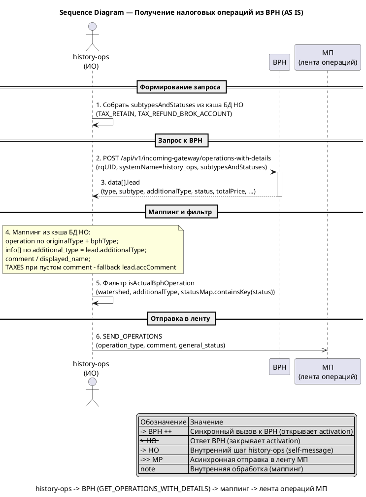
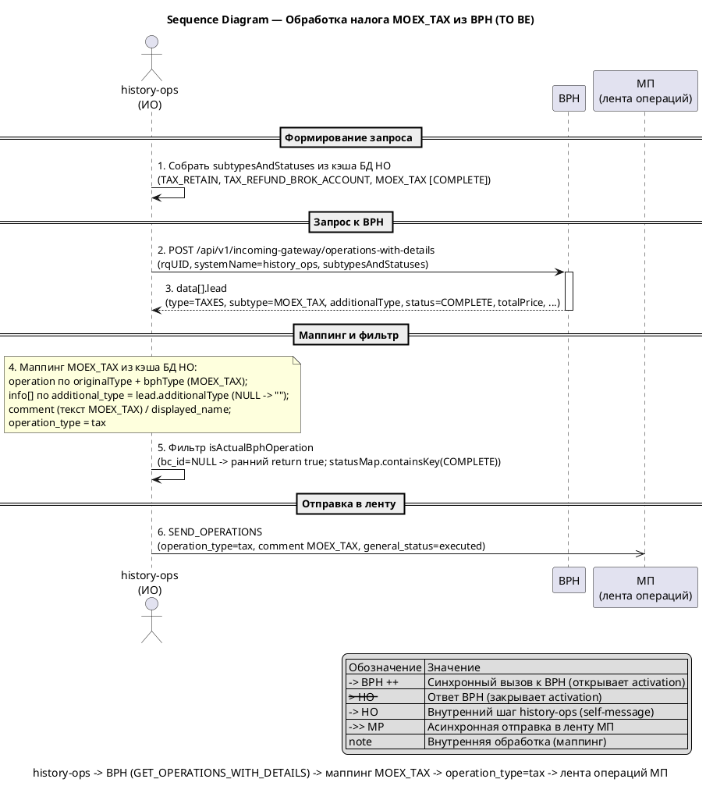
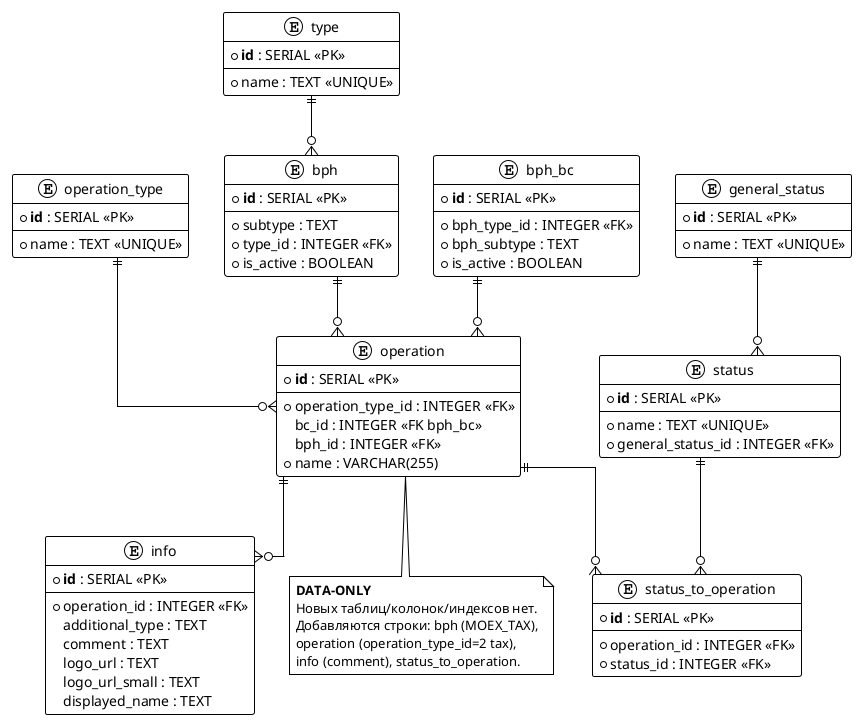

# bph-moex-tax

## 1. Бизнес-требования

### 1.1. Цель

**Источник требования:**

| Параметр | Значение |
|----------|----------|
| Фича | Налог MOEX_TAX из BPH (`bph-moex-tax`) |
| Источник | Бриф (первичный) |
| Инициатор | Команда history-ops (ИО) |
| Дата / версия | Draft 2026-10 |

**Стейкхолдеры:**

| Стейкхолдер | Роль | Интерес / ожидание | Влияние / ответственность |
|-------------|------|--------------------|---------------------------|
| Клиент мобильного банка (МП) | Пользователь | Видит удержание налога `MOEX_TAX` в ленте операций с корректным комментарием | Использует результат фичи |
| Product Owner / бизнес-аналитик | Владелец продукта | Принимает решения по целям/метрикам фичи; текст `comment` зафиксирован решением D-02, `name`/`displayed_name` — по паттерну `TAX_RETAIN` (§4.2.3) | Принимает функциональный результат, закрывает решения |
| Команда BPH | Поставщик данных | Отдаёт новый subtype `MOEX_TAX` в `GET_OPERATIONS_WITH_DETAILS` | Отвечает за контракт и корректность данных источника |
| Команда history-ops (ИО) | Владелец агрегации | Добавить новый налог data-driven через таблицы маппинга БД HO | Реализует Liquibase-миграцию и данные маппинга |
| Сопровождение ИО | Эксплуатация | Пролив changeset и обновление кэша `operation-cache` | Отвечает за деплой и конфигурацию кэша (Q-08) |

**Бизнес-правила и ограничения:**

| ID | Тип | Описание | Источник / обоснование |
|----|-----|----------|------------------------|
| BR-01 | Бизнес-правило | Новый BPH subtype `TAXES/MOEX_TAX` маппится в существующий `operation_type = tax` (тот же исходящий объект, что обычный налог) | Бриф; трактовка; `db-export/БД ИО.md` (operation_type id=2) |
| BR-02 | Бизнес-правило | `comment` для UI берётся из таблицы `info` по `additionalType`; для `MOEX_TAX` `additional_type = NULL`, значение `comment` = «Удержание суммы налога» (переиспользована формулировка `TAX_RETAIN`) | Бриф; решение D-02 |
| BR-03 | Бизнес-правило | Логика обработки идентична существующим налогам `TAX_RETAIN`; фича data-driven через БД, без правок Java-кода | Бриф; трактовка |
| CN-01 | Ограничение | Контракт `GET_OPERATIONS_WITH_DETAILS` не меняется — меняются только данные маппинга в таблицах БД HO | Контекст; `analytics/.../integrations/bph.md`; `bph.yml` |
| CN-02 | Ограничение | Кэш маппинга обновляется cron-ом — новые строки появятся в рантайме только после обновления кэша (временной лаг между проливом и фактическим поведением) | Контекст; `app-config.operation-cache` (`updateDelayMs`) |
| CN-03 | Ограничение | Статус-членство `status_to_operation` — жёсткий фильтр: без связки с фактическим BPH-статусом операция отфильтруется | Контекст; `BphBcFilterService.java` (`statusMap.containsKey`) |
| CN-04 | Ограничение | Написание подтипа `MOEX_TAX` подтверждено (значение, как в брифе); в локальных источниках `analytics/`/`repositories/`/`db-export/` совпадений нет (данные маппинга ещё не пролиты) | Q-01 (решение D-01) |

**Цель фичи:**

| Вопрос | Ответ |
|--------|-------|
| Какую бизнес-проблему решает? | BPH начнёт присылать новый subtype `TAXES/MOEX_TAX`; без строк в таблицах маппинга БД HO налог не включается в `subtypesAndStatuses` и не отображается в истории операций клиента |
| Какую ценность приносит пользователю? | Клиент видит удержание налога `MOEX_TAX` в ленте операций МП с корректным комментарием (текстом для UI) без ручного разбора |
| Какие метрики улучшает? | Полнота налоговой ленты — наличие операций `MOEX_TAX` в SEND_OPERATIONS; количественная метрика не задаётся — полноту обеспечивает существующая метрика интеграции `history_ops_integration_total` |

**SMART-проверка цели:**

| Критерий | Описание | Значение |
|----------|----------|----------|
| Specific | Конкретная | Добавить маппинг `TAXES/MOEX_TAX` → `operation_type = tax` через INSERT в таблицы `bph`/`operation`/`info`/`status_to_operation` (data-driven, без правок Java-кода) |
| Measurable | Измеримая | Операция появляется в SEND_OPERATIONS с `type=tax`, новым `comment` из `info`, `general_status=executed`; количественная метрика не задаётся — полноту обеспечивает существующая метрика `history_ops_integration_total` (non-SMART, D-07/D-15); подтверждение в проде — data-level приёмка: SQL-сверка строк маппинга + проверка shape кэша + позитивный интеграционный тест (D-25) |
| Achievable | Достижимая | Паттерн уже существует: `TAX_RETAIN` → `tax` (bc_id=110) и `TAX_REFUND_BROK_ACCOUNT` → `tax_input` (BPH-only, `additional_type=NULL`); Java-код не меняется |
| Relevant | Релевантная | Прямо влияет на полноту и корректность налоговой ленты клиента в истории операций |
| Time-bound | Ограниченная по времени | Draft — релиз/срок не зафиксирован; срок задаётся общим планом релизов ИО |

**Противоречия и решения:**

| Требование 1 | Требование 2 | Источник 1 | Источник 2 | Решение | Обоснование |
|--------------|--------------|------------|------------|---------|-------------|
| Противоречия не выявлены | - | Бриф | - | - | Маппинг `MOEX_TAX` → существующий `tax` и «`comment` из `info`» не конфликтуют: различие только в тексте UI |

### 1.2. Use Case AS IS

#### Use Case — Получить историю налоговых операций из BPH

**Структура Use Case:**

| Элемент | Значение |
|---------|----------|
| Название | Получить историю налоговых операций из BPH |
| Актор(ы) | `history-ops` (ИО, модуль Истории Операций) — инициатор; `BPH` (внешняя система-источник); Клиент МП (потребитель ленты операций) |
| Триггер | `history-ops` инициирует синхронизацию операций с BPH по запросу клиента МП (в ходе формирования `SEND_OPERATIONS` / `GET_OPERATIONS`) — формирует запрос `GET_OPERATIONS_WITH_DETAILS`; отдельной cron-синхронизации нет (cron — только обновление кэша маппинга) |
| Предусловия | См. таблицу предусловий ниже |
| Постусловия | См. таблицу постусловий ниже |
| Бизнес-правила | BR-04…BR-07 (см. ниже) |

**Предусловия:**

| № | Предусловие | Проверяемое условие |
|---|-------------|---------------------|
| 1 | `history-ops` имеет доступ к BPH | Доступен endpoint `POST /api/v1/incoming-gateway/operations-with-details` |
| 2 | Кэш маппинга БД HO загружен и актуален | `operation-cache` содержит активные строки маппинга (`operation`, `info`, `status_to_operation`) |
| 3 | В таблицах маппинга БД HO есть активные записи семейства `TAXES` | `bph.is_active = true` для `TAX_RETAIN` (bph_id=19) и `TAX_REFUND_BROK_ACCOUNT` (bph_id=20), `type_id = 7` |

**Постусловия:**

| Исход | Постусловие |
|-------|-------------|
| Успех | В ленту операций МП включены налоговые операции `TAX_RETAIN` (`operation_type = tax`) и `TAX_REFUND_BROK_ACCOUNT` (`operation_type = tax_input`) с `comment`/`displayed_name` из `info` и `general_status = executed`. Новый подтип `MOEX_TAX` в маппинге отсутствует — не запрашивается у BPH и не возвращается |
| Неуспех (бизнес) | Subtype без активной записи в кэше маппинга не включается в `subtypesAndStatuses` и не попадает в ответ; операция, не прошедшая статус-членство (`statusMap.containsKey(status)`), отфильтровывается и не попадает в ленту |
| Неуспех (техн.) | BPH недоступен или вернул ошибку — налоговые операции из BPH не возвращаются; HO возвращает операции из других источников (OG, BC) с признаком неполноты (partial failure); timeout/retry задаются конфигурацией WebClient HO (`WebClientBphConfiguration`) |

**Бизнес-правила:**

| ID | Правило | Применяется на шаге |
|----|---------|---------------------|
| BR-04 | Запрос к BPH формируется из кэша маппинга БД HO (`subtypesAndStatuses`); алгоритм формирования запроса и обработки ответа не меняется (data-driven) | Шаг 1, Шаг 4 |
| BR-05 | `additionalTypes[]` добавляется в `subtypesAndStatuses` только для непустых (`non-NULL`) значений `info.additional_type` | Шаг 1 |
| BR-06 | `comment` и `displayed_name` подбираются из `info[]` по совпадению `additional_type == lead.additionalType` (NULL трактуется как `""`); для `TAXES` при пустом `comment` — fallback `lead.accComment` | Шаг 4 |
| BR-07 | Операция включается в результат только при статус-членстве (`statusMap.containsKey(status)`); при `bc_id = NULL` watershed и additionalType-фильтр не блокируют (ранний `return true`) | Шаг 5 |

**Основной сценарий — Happy Path:**

```
Шаг 1:  history-ops формирует фильтр subtypesAndStatuses по кэшу маппинга БД HO:
        для семейства TAXES (type_id=7) — TAX_RETAIN (statuses: [COMPLETE],
        additionalTypes: OUT_MONEY / OUT_SECURITIES / TAX_PERIOD_END / INCENTIVE_PAYMENT)
        и TAX_REFUND_BROK_ACCOUNT (statuses: [COMPLETE], без additionalTypes)
          ЕСЛИ [BR-04] в кэше есть активная запись маппинга (bph_active=true)
            ТО сценарий продолжается с шага 2
          ИНАЧЕ
            ПЕРЕЙТИ К альтернативному сценарию 1a
Шаг 2:  history-ops вызывает BPH: POST /api/v1/incoming-gateway/operations-with-details
        (headers rqUID, systemName=history_ops; body subtypesAndStatuses)
Шаг 3:  BPH возвращает операции data[].lead с type=TAXES,
        subtype ∈ {TAX_RETAIN, TAX_REFUND_BROK_ACCOUNT}, полями additionalType, status,
        totalPrice, formationDate/eventDate
          ЕСЛИ BPH вернул операции
            ТО сценарий продолжается с шага 4
          ИНАЧЕ ЕСЛИ BPH недоступен или вернул ошибку
            ПЕРЕЙТИ К альтернативному сценарию 3a
Шаг 4:  history-ops маппит каждую операцию: находит operation в кэше по
        originalType+bphType, подбирает строку info[] по additional_type == additionalType [BR-06]
          ЕСЛИ [BR-06] найдена строка info с совпадающим additional_type
            ТО применить comment и displayed_name, сценарий продолжается с шага 5
          ИНАЧЕ ЕСЛИ для TAXES comment пустой
            ПЕРЕЙТИ К альтернативному сценарию 4a
Шаг 5:  history-ops проверяет фильтр операции isActualBphOperation [BR-07]
        (watershed, additionalType, статус-членство statusMap.containsKey(status))
          ЕСЛИ операция прошла фильтр
            ТО сценарий продолжается с шага 6
          ИНАЧЕ
            ПЕРЕЙТИ К альтернативному сценарию 5a
Шаг 6:  history-ops формирует исходящую операцию МП: operation_type=tax (TAX_RETAIN) /
        tax_input (TAX_REFUND_BROK_ACCOUNT), comment из info, general_status=executed
        и включает её в ленту операций МП (gRPC `SEND_OPERATIONS`, `HistoryOpsGrpcService`)
```

**Альтернативные сценарии:**

```
1a. В кэше нет активной записи маппинга для семейства TAXES (Бизнес-ошибки):
  1a.1. history-ops не включает subtype в subtypesAndStatuses
  1a.2. Налоговые операции не запрашиваются у BPH
  1a.3. Сценарий завершается без налоговых операций в ленте

3a. BPH недоступен или вернул ошибку (Технические ошибки):
  3a.1. Налоговые операции из BPH не возвращаются (partial failure)
  3a.2. HO возвращает операции из других источников (OG, BC) с признаком неполноты

4a. Для TAXES info.comment пустой [BR-06] (Пограничные случаи):
  4a.1. history-ops подставляет fallback lead.accComment
  4a.2. Возврат к шагу 5

5a. Операция не прошла фильтр isActualBphOperation [BR-07] (Бизнес-ошибки):
  5a.1. Операция отфильтрована (статус не в status_to_operation, watershed или additionalType)
  5a.2. Операция не включается в ленту операций МП
  5a.3. Сценарий завершается для данной операции (без включения в ленту)
```

**Связи между Use Cases:**

Связи не выявлены — Use Case автономен в рамках фичи (маппинг налогов из BPH — часть формирования ленты операций клиента; отдельный Use Case в данной spec не определён).

#### Sequence Diagram — Получение налоговых операций из BPH (AS IS)

**Назначение:**

Диаграмма показывает текущий сценарий интеграции `history-ops` ↔ BPH по `GET_OPERATIONS_WITH_DETAILS`: history-ops формирует фильтр из кэша маппинга БД HO, запрашивает операции у BPH, сопоставляет их с операциями МП и отдаёт в ленту операций. Моделирует happy path; ветка ошибки (недоступность BPH) — partial failure: операции источника не включаются, возвращаются операции остальных источников (OG, BC) с признаком неполноты.

**Участники:**

| Участник | Тип | Роль |
|---|---|---|
| `history-ops` | actor | ИО — инициатор синхронизации; формирует запрос, маппит и фильтрует операции |
| `BPH` | participant | Внешняя система-источник операций (`GET_OPERATIONS_WITH_DETAILS`) |
| `МП` | participant | Лента операций мобильного приложения (потребитель результата) |

**PlantUML:**



**Легенда:**

| Обозначение | Значение |
|---|---|
| `->` | Синхронный вызов |
| `-->` | Ответ / return |
| `->>` | Асинхронная отправка |
| `++` / `--` | Открытие / закрытие activation |
| `HO -> HO` | Внутренний шаг history-ops (self-message) |
| `note` | Внутренняя обработка (маппинг) без отдельного вызова |

**Соответствие тексту:**

| Элемент на диаграмме | Номер | Описание в тексте |
|---|---|---|
| `Собрать subtypesAndStatuses` | 1 | Шаг 1 основного сценария |
| `POST /api/v1/incoming-gateway/operations-with-details` | 2 | Шаг 2 основного сценария |
| `data[].lead` | 3 | Шаг 3 основного сценария |
| `Маппинг из кэша БД HO` | 4 | Шаг 4 основного сценария |
| `Фильтр isActualBphOperation` | 5 | Шаг 5 основного сценария |
| `SEND_OPERATIONS` | 6 | Шаг 6 основного сценария |

### 1.3. Use Case TO BE

#### Use Case — Обработать налог MOEX_TAX из BPH в ленте операций

**Структура Use Case:**

| Элемент | Значение |
|---------|----------|
| Название | Обработать налог MOEX_TAX из BPH в ленте операций |
| Актор(ы) | `history-ops` (ИО, модуль Истории Операций) — инициатор; `BPH` (внешняя система-источник); Клиент МП (потребитель ленты операций) |
| Триггер | BPH начинает присылать новый subtype `TAXES/MOEX_TAX` в `GET_OPERATIONS_WITH_DETAILS`; `history-ops` после пролива данных маппинга и обновления кэша включает `MOEX_TAX` в запрос (по запросу клиента МП в ходе `SEND_OPERATIONS` / `GET_OPERATIONS`) |
| Предусловия | См. таблицу предусловий ниже |
| Постусловия | См. таблицу постусловий ниже |
| Бизнес-правила | BR-04…BR-07 (механика, не меняется) + BR-08…BR-11 (новые, см. ниже) |

**Предусловия:**

| № | Предусловие | Проверяемое условие |
|---|-------------|---------------------|
| 1 | `history-ops` имеет доступ к BPH | Доступен endpoint `POST /api/v1/incoming-gateway/operations-with-details` |
| 2 | Кэш маппинга БД HO загружен и содержит новые строки `MOEX_TAX` | `operation-cache` содержит `operation` + `info` + `status_to_operation` для `MOEX_TAX` (после пролива changeset и обновления кэша) |
| 3 | В БД HO пролиты данные маппинга `MOEX_TAX` | `bph(subtype=MOEX_TAX, type_id=7, is_active=true)`; `operation(operation_type_id=2, bph_id=<MOEX_TAX>, bc_id=NULL)`; `info(additional_type=NULL, comment=«Удержание суммы налога»)`; `status_to_operation(operation↔status COMPLETE)` |
| 4 | Механика маппинга налогов из BPH не меняется | Java-код `BphBcFilterService` / `BphCommonClientConverter` без изменений (data-driven) |

**Постусловия:**

| Исход | Постусловие |
|-------|-------------|
| Успех | В ленту операций МП включены операции `MOEX_TAX` как `operation_type = tax` (тот же исходящий объект, что обычный налог) с `comment` из `info` = «Удержание суммы налога» и `general_status = executed` |
| Неуспех (бизнес) | `MOEX_TAX` без активной записи в кэше маппинга не включается в `subtypesAndStatuses` и не попадает в ленту; операция, не прошедшая статус-членство `statusMap.containsKey(status)`, отфильтровывается; при non-null `lead.additionalType`, не совпавшем с `info.additional_type`, `comment` не подставляется |
| Неуспех (техн.) | BPH недоступен или вернул ошибку — операции `MOEX_TAX` из BPH не возвращаются; HO возвращает операции из других источников (OG, BC) с признаком неполноты (partial failure); timeout/retry задаются конфигурацией WebClient HO (`WebClientBphConfiguration`) |

**Бизнес-правила:**

| ID | Правило | Применяется на шаге |
|----|---------|---------------------|
| BR-08 | Подтип `MOEX_TAX` включается в `subtypesAndStatuses` запроса к BPH (type=TAXES, subtype=MOEX_TAX, statuses=[COMPLETE]); `additionalTypes[]` для него не добавляется, т.к. `info.additional_type=NULL` (filter `Objects::nonNull` отбрасывает NULL) | Шаг 1 |
| BR-09 | Ответ BPH `subtype=MOEX_TAX` маппится в существующий `operation_type = tax`; `comment` подбирается из `info` по `additional_type == lead.additionalType` (NULL ↔ `""`), значение = «Удержание суммы налога» (переиспользована формулировка `TAX_RETAIN`) | Шаг 4 |
| BR-10 | Для `MOEX_TAX` обязательно статус-членство `status_to_operation` (status=COMPLETE → executed): без связки операция отфильтруется `statusMap.containsKey(status)`, несмотря на ранний `return true` при `bc_id=NULL` | Шаг 5 |
| BR-11 | Дедупликация операций `MOEX_TAX` — как у прочих операций `GET_OPERATIONS_WITH_DETAILS`: по `id = bph_{operation_type}_{externalSystemId}` через Ignite-кэш (постранично); уникальность `externalSystemId` — ответственность BPH. Повторная отдача/коррекция с одинаковым `externalSystemId` не создаёт дубль в `SEND_OPERATIONS` | Шаг 6 |

**Основной сценарий — Happy Path:**

```
Шаг 1:  history-ops формирует фильтр subtypesAndStatuses по кэшу маппинга БД HO:
        семейство TAXES (type_id=7) — TAX_RETAIN (additionalTypes: OUT_MONEY / OUT_SECURITIES /
        TAX_PERIOD_END / INCENTIVE_PAYMENT), TAX_REFUND_BROK_ACCOUNT (без additionalTypes)
        и новый MOEX_TAX (statuses: [COMPLETE], без additionalTypes) [BR-08]
          ЕСЛИ [BR-08] в кэше есть активная запись маппинга MOEX_TAX
            ТО сценарий продолжается с шага 2
          ИНАЧЕ
            ПЕРЕЙТИ К альтернативному сценарию 1a
Шаг 2:  history-ops вызывает BPH: POST /api/v1/incoming-gateway/operations-with-details
        (headers rqUID, systemName=history_ops; body subtypesAndStatuses с MOEX_TAX)
Шаг 3:  BPH возвращает операции data[].lead, в т.ч. type=TAXES, subtype=MOEX_TAX,
        additionalType (null/отсутствует), status=COMPLETE,
        totalPrice, formationDate/eventDate
          ЕСЛИ BPH вернул операции MOEX_TAX
            ТО сценарий продолжается с шага 4
          ИНАЧЕ ЕСЛИ BPH недоступен или вернул ошибку
            ПЕРЕЙТИ К альтернативному сценарию 3a
Шаг 4:  history-ops маппит операцию MOEX_TAX: находит operation в кэше по
        originalType+bphType (MOEX_TAX), подбирает строку info[] по
        additional_type == additionalType [BR-09] (info.additional_type=NULL ↔ "" )
          ЕСЛИ [BR-09] найдена строка info (additional_type=NULL) для MOEX_TAX
            ТО применить comment (текст MOEX_TAX) и displayed_name, сценарий продолжается с шага 5
          ИНАЧЕ ЕСЛИ lead.additionalType non-null и не совпадает с info.additional_type=NULL
            ПЕРЕЙТИ К альтернативному сценарию 4a
Шаг 5:  history-ops проверяет фильтр isActualBphOperation [BR-07]:
        при bc_id=NULL — ранний return true (watershed и additionalType-фильтр не блокируют),
        статус-членство statusMap.containsKey(status=COMPLETE) [BR-10]
          ЕСЛИ [BR-10] статус COMPLETE есть в status_to_operation для операции MOEX_TAX
            ТО сценарий продолжается с шага 6
          ИНАЧЕ
            ПЕРЕЙТИ К альтернативному сценарию 5a
Шаг 6:  history-ops формирует исходящую операцию МП: operation_type=tax (MOEX_TAX),
        comment из info («Удержание суммы налога»), general_status=executed,
        включает в ленту операций МП (gRPC `SEND_OPERATIONS`, `HistoryOpsGrpcService`)
```

**Альтернативные сценарии:**

```
1a. В кэше нет активной записи маппинга MOEX_TAX (Бизнес-ошибки):
  1a.1. history-ops не включает MOEX_TAX в subtypesAndStatuses
  1a.2. Налог MOEX_TAX не запрашивается у BPH и не отображается в ленте
  1a.3. Сценарий завершается без операций MOEX_TAX в ленте

3a. BPH недоступен или вернул ошибку (Технические ошибки):
  3a.1. Операции MOEX_TAX из BPH не возвращаются (partial failure)
  3a.2. HO возвращает операции из других источников (OG, BC) с признаком неполноты

4a. lead.additionalType для MOEX_TAX пришёл non-null и не совпадает с info.additional_type=NULL (Пограничные случаи):
  4a.1. Строка info для MOEX_TAX не подбирается (NULL ↔ "" не совпадает с non-null значением)
  4a.2. comment не подставляется (налог может отобразиться без текста MOEX_TAX)
  4a.3. Возврат к шагу 5

5a. Операция MOEX_TAX не прошла статус-членство [BR-10] (Бизнес-ошибки):
  5a.1. Статус не найден в status_to_operation → операция отфильтрована statusMap.containsKey(status)
  5a.2. Операция MOEX_TAX не включается в ленту операций МП
  5a.3. Сценарий завершается для данной операции (без включения в ленту)
```

**Связи между Use Cases:**

Связи не выявлены — Use Case автономен в рамках фичи (маппинг налога `MOEX_TAX` из BPH — часть формирования ленты операций клиента; отдельный Use Case в данной spec не определён). Отличия от Use Case AS IS — только появление нового подтипа `MOEX_TAX` в тех же шагах сценария; механика (BR-04…BR-07) не меняется.

#### Sequence Diagram — Обработка налога MOEX_TAX из BPH (TO BE)

**Назначение:**

Диаграмма показывает целевой сценарий интеграции `history-ops` ↔ BPH по `GET_OPERATIONS_WITH_DETAILS` с новым подтипом `MOEX_TAX`: history-ops включает `MOEX_TAX` в фильтр из кэша маппинга БД HO, запрашивает операции у BPH, маппит их в существующий `operation_type = tax` (с новым `comment` из `info`) и отдаёт в ленту операций. Java-код и контракт не меняются — изменение data-driven через БД.

**Участники:**

| Участник | Тип | Роль |
|---|---|---|
| `history-ops` | actor | ИО — инициатор синхронизации; формирует запрос (включая `MOEX_TAX`), маппит и фильтрует операции |
| `BPH` | participant | Внешняя система-источник операций (`GET_OPERATIONS_WITH_DETAILS`) |
| `МП` | participant | Лента операций мобильного приложения (потребитель результата) |

**PlantUML:**



**Легенда:**

| Обозначение | Значение |
|---|---|
| `->` | Синхронный вызов |
| `-->` | Ответ / return |
| `->>` | Асинхронная отправка |
| `++` / `--` | Открытие / закрытие activation |
| `HO -> HO` | Внутренний шаг history-ops (self-message) |
| `note` | Внутренняя обработка (маппинг) без отдельного вызова |

**Соответствие тексту:**

| Элемент на диаграмме | Номер | Описание в тексте |
|---|---|---|
| `Собрать subtypesAndStatuses` (с MOEX_TAX) | 1 | Шаг 1 основного сценария |
| `POST /api/v1/incoming-gateway/operations-with-details` | 2 | Шаг 2 основного сценария |
| `data[].lead` (subtype=MOEX_TAX) | 3 | Шаг 3 основного сценария |
| `Маппинг MOEX_TAX из кэша БД HO` | 4 | Шаг 4 основного сценария |
| `Фильтр isActualBphOperation` | 5 | Шаг 5 основного сценария |
| `SEND_OPERATIONS` (operation_type=tax) | 6 | Шаг 6 основного сценария |

## 2. Ограничения и допущения

**Бизнес-правила и ограничения:**

| ID | Тип | Описание | Источник / обоснование |
|----|-----|----------|------------------------|
| CN-05 | Ограничение | Фича целиком data-driven: изменения — только INSERT строк в существующие таблицы маппинга БД `history_ops` (`bph`, `operation`, `info`, `status_to_operation`). Новые справочные значения заводить не нужно: `type` (семейство `TAXES`, id=7), `operation_type` (`tax`, id=2) и `status` (`COMPLETE`, id=19) уже существуют | CONTEXT_DOC §«Что учесть»; `db-export/БД ИО.md` (type id=7, operation_type id=2, status id=19) |
| CN-06 | Ограничение | id строк (`bph`, `operation`, `info`, `status_to_operation`) для `MOEX_TAX` назначаются SERIAL/sequence автоматически (INSERT без явного id) — коллизий с sibling-фичей `bph-portfolio-size-tax` нет (тот же механизм `TAXES` → `tax`, общая зона id-пространства таблиц маппинга) | CONTEXT_DOC §«Ограничения и риски»; `Feature-writing/bph-portfolio-size-tax/bph-portfolio-size-tax.md`; решение D-20 |
| CN-07 | Ограничение | `MOEX_TAX` — «BPH-only» налог по паттерну `TAX_REFUND_BROK_ACCOUNT` (`info.additional_type = NULL`, `operation.bc_id = NULL`), в отличие от `TAX_RETAIN` (у которого `bc_id = 110` `TAX_WITHHOLDING` и 4 `info`-строки с непустыми `additional_type`). При `bc_id = NULL` в `isActualBphOperation()` срабатывает ранний `return true` — watershed- и additionalType-фильтры не блокируют, блокирующим остаётся только статус-членство | CONTEXT_DOC §«Ограничения и риски»; `db-export/БД ИО.md:3984-4004`; `BphBcFilterService.java`; решение D-03 |
| CN-08 | Ограничение | `additionalTypes[]` в запросе `subtypesAndStatuses` формируется только из непустых `info[].additional_type` (`filter(Objects::nonNull)`). При `additional_type = NULL` сужение не добавляется — запрос к BPH идёт по `type + subtype + statuses` без additionalType-фильтра | CONTEXT_DOC §«Интеграции»; `BphBcFilterService.buildBphRequestEntityByBphParams()` |
| CN-09 | Ограничение | `comment`/`displayedName` подбираются из `info[]` по совпадению `info.additional_type == lead.additionalType` (NULL трактуется как `""`, `"" == ""` → true). Если BPH пришлёт для `MOEX_TAX` непустой `additionalType`, матчинг со строкой `info(additional_type = NULL)` не сработает и `comment` не подставится (для `TAXES` при пустом `comment` действует fallback на `lead.accComment`) | CONTEXT_DOC §«Интеграции»; `BphCommonClientConverter.isCorrectAdditionalType()`; Q-07 |
| CN-10 | Ограничение | Изменение данных оформляется как SQL-changeset (Liquibase) по шаблону миграций SIHIST-3321 (`..._added_tax_data.sql`), без правок Java-кода `history-ops` | CONTEXT_DOC §«Данные»; `db-export/БД ИО.md:778-779,2046-2047` |
| CN-11 | Ограничение | `MOEX_TAX` осознанно визуально неотличим от `TAX_RETAIN` в ленте МП: `comment` = `name` = «Удержание суммы налога», `operation_type` = `tax` — все три значения идентичны `TAX_RETAIN`. «Другой comment» из брифа осознанно не вводится; отличие — только source-субтип `MOEX_TAX` в кэше маппинга, в исходящей операции неотличимо | Решение D-13 (CH-01) |
| CN-12 | Допущение | BPH игнорирует нераспознанные `subtype`/`type` внутри массива `subtypesAndStatuses` (не отклоняет весь запрос 400/500) — подтверждено договорённостью с командой BPH; фиксируется как допущение и проверяется pre-check до пролива | Решение D-14 (CH-04) |
| CN-13 | Ограничение | Значения `operation.name`/`info.comment` для `MOEX_TAX` = «Удержание суммы налога» — **authoritative** для всех фич; sibling `bph-portfolio-size-tax` должна выровнять свои значения (`operation.name`, `info.comment`) по этой spec | Решение D-16 (CH-02) |

**Gaps и допущения:**

| ID | Тип | Где обнаружено | Что не хватает / что предполагается | Как закрыть |
|----|-----|----------------|-------------------------------------|-------------|
| GAP-CONS-08 | Допущение | Кэш маппинга — обновление (Q-08) | Предполагается, что cron-обновления кэша маппинга достаточно для появления новых строк в рантайме; возможна необходимость ручного прогрева/рестарта | отложено — D-09 (конфиг `app-config.operation-cache` `updateDelayMs` / сопровождение ИО) |

## 4. Функциональные требования

#### 4.1.1. Сервис BPH — GET_OPERATIONS_WITH_DETAILS

**Назначение**

Интеграционный контракт `history-ops` (ИО) ↔ `BPH` (Brokerage Portfolio History) для получения ленты операций с детализацией по неторговым операциям (`GET_OPERATIONS_WITH_DETAILS`). Фича добавляет в этот контракт **новый подтип налоговой операции** `TAXES / MOEX_TAX`, который маппится в существующий исходящий тип `operation_type = tax` (тот же, что и обычный налог `TAX_RETAIN`), с `comment` = «Удержание суммы налога» (переиспользована формулировка `TAX_RETAIN`), подбираемым из таблицы `info`. Сам контракт (поля, алгоритм запроса/ответа, Java-код) **не меняется** — меняются только **данные** таблиц маппинга БД HO, из которых запрос и маппинг ответа формируются data-driven [BR-04, CN-05].

**Общая информация (endpoint):**

| Параметр | Значение |
|----------|----------|
| Назначение | Получение истории неторговых операций с детализацией (`GET_OPERATIONS_WITH_DETAILS`) |
| Метод | `POST` |
| Path | `/api/v1/incoming-gateway/operations-with-details` |
| Система-источник (инициатор запроса) | history-ops (модуль Истории Операций, ИО) |
| Система-получатель (провайдер данных) | BPH (Brokerage Portfolio History) — incoming-gateway |
| Тип интеграции | Синхронная |
| Протокол | REST (HTTPS) |
| Направление | Однонаправленная (history-ops → BPH: Request → Response) |
| Версия API | v1 |
| Аутентификация | Внутренний контур; идентификация системы инициатора заголовком `systemName`. Пользовательских/сессионных токенов в контракте нет |
| Формат данных | `JSON` |
| Ссылка на контракт | `repositories/ИО/history-ops/src/main/swagger/bph/bph.yml:216-265`; вызов — `BphClient.getOperations()` (`BphClient.java:16-34`) |

**Request Headers:**

| Заголовок | Обязат. | Описание | Пример |
|-----------|---------|----------|--------|
| `rqUID` | Да | Сквозной идентификатор запроса (UUID, генерируется history-ops) | `c4a5dccd-0fe2-4aa1-823e-a5a5d9ee04a4` |
| `systemName` | Да | Идентификатор системы инициатора. Фактическое значение, отправляемое кодом, — `history_ops` (константа `BphClient.HISTORY_OPS`) | `history_ops` |

Источник: `bph.yml:222-234`; заполнение — `BphClient.getOperations()` (`BphClient.java:19-33`: `SYSTEM_NAME = "systemName"`, `HISTORY_OPS = "history_ops"`, `REQUEST_ID = "rqUID"`). Примечание: в OpenAPI `bph.yml` у ряда endpoint в поле `example` указан `si2-ops`; это только пример в схеме, код отправляет `history_ops`.

**Request body (`RequestParamsData`):**

Полный перечень полей (существующий контракт; фича не меняет структуру, а добавляет новый элемент в `subtypesAndStatuses`). Источник: `bph.yml:1254-1350` и `analytics/.../integrations/bph.md`.

| Поле | Тип | Описание | Ограничение | Заполняется history-ops | Пример |
|------|-----|----------|-------------|-------------------------|--------|
| `agreements` | array[string] | Массив номеров договоров клиента | — | Да — из договоров клиента | `["KJ28438H394L"]` |
| `startSearchDate` | string (date-time) | Начало периода поиска | — | Опционально | `2026-01-01T00:00:00` |
| `endSearchDate` | string (date-time) | Конец периода поиска | — | Да | `2026-01-31T23:59:59` |
| `page` | integer | Номер возвращаемой страницы | — | Нет — не заполняется (default 0) | `0` |
| `pageSize` | integer | Количество возвращаемых записей | — | Да — `app-config-dynamic.bph-dynamic.maxRecordsFromBph` | `1000` |
| `types` | array[string] | Типы операций (legacy-фильтр) | — | Нет — не используется | — |
| `subtypes` | array[string] | Подтипы операций (legacy-фильтр) | — | Нет — не используется | — |
| `statuses` | array[string] | Статусы (legacy-фильтр) | — | Нет — не используется | — |
| `subtypesAndStatuses` | array[object] | Типы/подтипы/статусы для поиска (см. ниже) | maxItems: 1000 | Да — строится из кэша маппинга БД HO | см. ниже |
| `dateForFilter` | enum | Поле фильтрации по дате | `FORMATION_DATE` \| `EVENT_DATE` | Да — `FORMATION_DATE` | `FORMATION_DATE` |
| `tradingSections` | array[string] | Торговые секции | — | Нет — не используется | — |
| `isin` | string | ISIN бумаги | — | Нет — не используется | — |
| `instrumentCurrency` | string | Валюта инструмента | — | Нет — не используется | — |
| `tickers` | array[string] | Список тикеров (карточка инструмента) | — | Нет — не используется | — |
| `selfIdTs` | array[string] | Собственный идентификатор в торговой системе | — | Нет — не используется | — |

**`subtypesAndStatuses[]` — структура и новый элемент:**

Структура элемента (`bph.yml:1292-1326`):

| Поле | Тип | Обязат. | Описание | Ограничение |
|------|-----|---------|----------|-------------|
| `type` | string | Да | Тип операции (family) | maxLength: 225 |
| `subtype` | string | Да | Подтип операции | maxLength: 225 |
| `additionalTypes` | array[string] | Нет | Дополнительный тип события (non-null `additional_type` из `info`) | maxLength: 225 |
| `statuses` | array[string] | Да | Статусы для подтипа | maxLength: 225 |

Заполнение history-ops: `BphBcFilterService.buildBphRequestEntityByBphParams()` — `type`/`subtype`/`statuses` из записи `operation` кэша, `additionalTypes` — из non-null `info.additional_type` (если пусто — поле не передаётся, `filter(Objects::nonNull)`). Для `MOEX_TAX` (`info.additional_type = NULL`) поле `additionalTypes` **не добавляется** [CN-08].

Элементы семейства `TAXES` (type_id=7) — существующие + новый:

| type | subtype | additionalTypes | statuses | operation_type | Комментарий |
|------|---------|-----------------|----------|----------------|-------------|
| `TAXES` | `TAX_RETAIN` | `OUT_MONEY`, `OUT_SECURITIES`, `TAX_PERIOD_END`, `INCENTIVE_PAYMENT` | `COMPLETE` | `tax` | Удержание налога (существующее) |
| `TAXES` | `TAX_REFUND_BROK_ACCOUNT` | `NULL` (не передаётся) | `COMPLETE` | `tax_input` | Возврат излишне удержанного налога (существующее) |
| `TAXES` | **`MOEX_TAX`** | **`NULL` (не передаётся)** | `COMPLETE` | `tax` | **Новый налог (новое)** |

**Response body 200 OK:**

```
{ "status": ResponseStatusData, "data": [ DetailsData ] }
```

`ResponseStatusData` (`bph.yml:1436-1440`): `code` (integer), `message` (string). `DetailsData` (`bph.yml:1238-1245`): `lead` → `OperationData`, `details` → массив `DetailData` (`{ key: string, value: string }` — JSON-детали; HO использует ключи из `BphConverter.SUPPORTED_DETAILS_KEY`, в т.ч. `comment`, `accComment`, `errorCode`, `statusErrorCode`).

`OperationData` (`lead`) — перечень полей (`bph.yml:1088-1216`):

| Поле | Тип | Nullable | Описание | Пример |
|------|-----|----------|----------|--------|
| `type` | string | Нет | Тип события (family) | `TAXES` |
| `subType` | string | Да | Подтип события (вариант имени) | `MOEX_TAX` |
| `subtype` | string | Да | Подтип события (вариант имени) | `MOEX_TAX` |
| `additionalType` | string | Да | Дополнительный тип события | `null` |
| `externalSystemVersion` | number | Да | Версия события во внешней системе | `5` |
| `formationDate` | string (date-time) | Нет | Дата формирования (код требует: `validateSimpleAttributes()` → `checkNotNull`) | `2026-01-15T10:30:00` |
| `eventDate` | string (date-time) | Нет | Дата события | `2026-01-15T10:30:00` |
| `externalSystemId` | string | Нет | Идентификатор операции во внешней системе | `KU2309848` |
| `price` | object | Да | Цена (`{ value, currency }`) | — |
| `totalPrice` | object | Да | Сумма (`{ value, currency }`) | `{ "value": "-12000.00", "currency": "RUB" }` |
| `quantity` | string (big_decimal) | Да | Количество | — |
| `quantityFact` | string (big_decimal) | Да | Фактическое количество | — |
| `tradingSection` | string | Да | Торговая секция | `FOND` |
| `account` | string | Да | Счет | `BROKER` |
| `status` | string | Да | Статус операции | `COMPLETE` |
| `instrument` | object | Да | Данные инструмента (`isin`, `tickers[]`, `currency`, `type`) | — |
| `ucpId` | integer | Да | Идентификатор клиента в ЕПК | `23984692648` |
| `agreement` | string | Нет | Номер договора | `KJ28438H394L` |
| `parent` | string | Да | Идентификатор родительской операции | — |
| `isFact` | boolean | Нет | Признак факта события | `true` |
| `parentIds` | object | Да | Идентификаторы связанных сущностей | — |

Примечание: у поля подтипа в контракте два имени — `subType` и `subtype`; HO читает оба — сначала `subtype`, при его отсутствии — `subType` (`BphOperationConverter.getSubType()`). Разрешённое значение используется как `bphType` и в ключе lookup `operation` (`originalType + bphType`), т.е. чтение обоих имён относится и к ключу lookup. Для нового налога передаётся `subtype = MOEX_TAX`.

**Маппинг `lead` (OperationData) → исходящая операция (`operation_type = tax`):**

Источник: `BphCommonClientConverter.convert()` и `BphConverter.getGeneralStatusMap()`; логика не меняется фичей [BR-04]. Для `MOEX_TAX` существенно поднятие `comment`/`displayedName` из `info` по совпадению `additional_type == additionalType` (NULL трактуется как `""`).

| Источник (ответ BPH) | Поле | Получатель (HO / МП) | Поле | Правило |
|----------------------|------|----------------------|------|---------|
| `lead.type` + `lead.subtype` (`TAXES` / `MOEX_TAX`) | ключ маппинга | operation (кэш БД HO) | `operation_type` | Поиск `operation` по `originalType` + `bphType`; `operation_type_id = 2` → `tax` |
| `lead.status` (`COMPLETE`) | статус BPH | general_status | `executed` | `status_and_general_status` из кэша (`COMPLETE → executed`) |
| `lead.additionalType` (`null`/отсутствует) | доп. тип события | info (кэш БД HO) | `additional_type` | Матч `info.additional_type == lead.additionalType` (NULL ↔ `""`) |
| `info.comment` (по `additional_type`) | текст из `info` | SEND_OPERATIONS | `comment` | `info.comment`; при пустом для `TAXES` — fallback на `lead.accComment` |
| `info.displayed_name` (по `additional_type`) | имя из `info` | SEND_OPERATIONS | `operation_display_name` | `info.displayed_name` |

**Коды ответов:**

| HTTP код | Код ошибки | Структура ответа | Описание |
|----------|------------|------------------|----------|
| 200 | — | `{ status: { code, message }, data: [DetailsData] }` | Успешный ответ |
| 400 | — | `ErrorData` | Bad Request |
| 500 | — | `ErrorData` | Internal Server Error |

`ErrorData` (`bph.yml:1443-1474`): `timestamp` (string, nullable), `status` (string, enum `400` \| `500`), `error` (string, enum `Bad Request` \| `Internal Server Error`), `path` (string, nullable). HO **не ветвится по полю `status.code`**: из 200-ответа извлекается массив `data`, элементы конвертируются по отдельности (ошибки конвертации отдельной записи фиксируются метрикой `parse_error` и не роняют остальные операции). При HTTP 400/500 (или иной ошибке вызова) источник помечается failed и инкрементится метрика `dataCompleteFalse` (`AbstractOperationGateway.getOperationsSafe` → `onErrorResume`), лог — `integration.log`.

**Пример запроса** (запрос history-ops к BPH за операциями нового налога):

```http
POST /api/v1/incoming-gateway/operations-with-details
rqUID: c4a5dccd-0fe2-4aa1-823e-a5a5d9ee04a4
systemName: history_ops
Content-Type: application/json
```

```json
{
  "agreements": ["KJ28438H394L"],
  "startSearchDate": "2026-01-01T00:00:00",
  "endSearchDate": "2026-01-31T23:59:59",
  "pageSize": 1000,
  "dateForFilter": "FORMATION_DATE",
  "subtypesAndStatuses": [
    {
      "type": "TAXES",
      "subtype": "MOEX_TAX",
      "statuses": ["COMPLETE"]
    }
  ]
}
```

Примечание: для `MOEX_TAX` поле `additionalTypes` в элементе `subtypesAndStatuses` **отсутствует** (не `null`, а не передаётся), т.к. `info.additional_type = NULL` [CN-08].

**Пример ответа** (операция нового налога):

```json
{
  "status": { "code": 0, "message": null },
  "data": [
    {
      "lead": {
        "type": "TAXES",
        "subtype": "MOEX_TAX",
        "additionalType": null,
        "externalSystemVersion": 5,
        "formationDate": "2026-01-15T10:30:00",
        "eventDate": "2026-01-15T10:30:00",
        "externalSystemId": "KU2309848",
        "totalPrice": { "value": "-12000.00", "currency": "RUB" },
        "status": "COMPLETE",
        "tradingSection": "FOND",
        "account": "BROKER",
        "agreement": "KJ28438H394L",
        "isFact": true
      },
      "details": []
    }
  ]
}
```

Результат маппинга — исходящая операция МП: `type = tax` (тот же объект, что и обычный налог), `general_status = executed`, `comment` = «Удержание суммы налога» из `info.comment` (переиспользована формулировка `TAX_RETAIN`).

**Пограничный случай — пустой результат:** при отсутствии операций BPH возвращает `data: []` (пустой массив) со `status.code = 0`; HO не добавляет операций в SEND_OPERATIONS. Негативный сценарий несовпадения `additionalType` (если BPH пришлёт для `MOEX_TAX` непустой `additionalType`, не совпавший с `info.additional_type = NULL`) описывается в §4.2.2.

**Пограничный случай — нераспознанный `subtype` до включения на стороне BPH:** запрос `subtypesAndStatuses` содержит `MOEX_TAX` вместе с существующими налогами. Подтверждено договорённостью с командой BPH, что BPH игнорирует нераспознанные `subtype`/`type` внутри массива (не отклоняет весь запрос 400/500) — существующие налоги `TAX_RETAIN`/`TAX_REFUND_BROK_ACCOUNT` продолжают обрабатываться [CN-12, D-14]; допущение проверяется pre-check (см. раздел «Миграция»).

**Таймауты, retry и fallback:**

Production timeout/retry для BPH **не описан** в `analytics/`; поведение задаётся конфигурацией WebClient HO (`WebClientBphConfiguration`). При недоступности BPH HO возвращает операции из других источников (OG, BC) с признаком неполноты, если они доступны.

#### 4.2.2. Алгоритм обработки запроса GET_OPERATIONS_WITH_DETAILS

Алгоритм обработки ответа BPH на запрос `GET_OPERATIONS_WITH_DETAILS` (`POST /api/v1/incoming-gateway/operations-with-details`, §4.1.1) состоит из трёх этапов: формирование запроса к BPH (`subtypesAndStatuses` из кэша маппинга БД HO), фильтрация операций из ответа BPH и маппинг операций в исходящий объект `operation_type = tax` для ленты операций МП. Фича data-driven [BR-04, CN-05]: Java-код history-ops не меняется — новый подтип `MOEX_TAX` попадает в запрос, проходит фильтрацию и маппится автоматически после INSERT строк в таблицы маппинга БД HO (§4.2.3).

#### Use Case — Обработать операцию MOEX_TAX по алгоритму маппинга из BPH

**Структура Use Case:**

| Элемент | Значение |
|---------|----------|
| Название | Обработать операцию MOEX_TAX по алгоритму маппинга из BPH |
| Актор(ы) | `history-ops` (ИО) — система-обработчик алгоритма; `BPH` (источник операций); Клиент МП (потребитель результата в ленте операций) |
| Триггер | `history-ops` получает ответ BPH `data[].lead` с `type=TAXES`, `subtype=MOEX_TAX` и обрабатывает его по алгоритму data-driven маппинга (после пролива данных маппинга и обновления кэша) |
| Предусловия | См. таблицу предусловий ниже |
| Постусловия | См. таблицу постусловий ниже |
| Бизнес-правила | BR-04…BR-10 (см. ниже) |

**Предусловия:**

| № | Предусловие | Проверяемое условие |
|---|-------------|---------------------|
| 1 | Кэш маппинга БД HO загружен и содержит строки `MOEX_TAX` | `operation-cache` содержит `operation` (`operation_type_id=2`), `info` и `status_to_operation` для `MOEX_TAX` (после пролива changeset и обновления кэша) [CN-02] |
| 2 | `history-ops` сформировал запрос к BPH с `MOEX_TAX` | `subtypesAndStatuses` содержит элемент `{type=TAXES, subtype=MOEX_TAX, statuses=[COMPLETE]}`, без `additionalTypes` (т.к. `info.additional_type=NULL`) |
| 3 | BPH вернул операцию `MOEX_TAX` | `lead.type=TAXES`, `lead.subtype=MOEX_TAX`, `lead.status=COMPLETE` |
| 4 | В `info` есть строка для `MOEX_TAX` с `additional_type=NULL` | `info.additional_type IS NULL` (при матчинге трактуется как `""`) |

**Постусловия:**

| Исход | Постусловие |
|-------|-------------|
| Успех | Операция `MOEX_TAX` включена в ленту операций МП как `operation_type=tax` (тот же исходящий объект, что обычный налог) с `comment` из `info` = «Удержание суммы налога», `displayed_name` из `info` и `general_status=executed` |
| Неуспех (бизнес) | Операция, не прошедшая статус-членство (`status` не настроен в `status_to_operation`), отфильтровывается и не попадает в ленту; при non-null `lead.additionalType`, не совпавшем с `info.additional_type=NULL`, `comment`/`displayed_name` не подставляются (но при `bc_id=NULL` операция не отфильтровывается) |
| Неуспех (техн.) | BPH недоступен или вернул ошибку — операции `MOEX_TAX` не возвращаются и не маппятся; HO возвращает операции из других источников (OG, BC) с признаком неполноты (partial failure); timeout/retry задаются конфигурацией WebClient HO (`WebClientBphConfiguration`) |

**Бизнес-правила:**

| ID | Правило | Применяется на шаге |
|----|---------|---------------------|
| BR-04 | Запрос к BPH формируется из кэша маппинга БД HO; алгоритм формирования запроса и обработки ответа не меняется (data-driven) | Шаг 1 |
| BR-05 | `additionalTypes[]` добавляется в `subtypesAndStatuses` только для непустых (`non-NULL`) значений `info.additional_type` | Шаг 1 |
| BR-08 | Подтип `MOEX_TAX` включается в `subtypesAndStatuses` (type=TAXES, subtype=MOEX_TAX, statuses=[COMPLETE]); `additionalTypes[]` для него не добавляется, т.к. `info.additional_type=NULL` | Шаг 1 |
| BR-07 | Операция включается в результат только при статус-членстве; при `bc_id=NULL` фильтры водораздела и `additionalType` не блокируют (ранний `return true`) | Шаг 3 |
| BR-10 | Для `MOEX_TAX` обязательно статус-членство `status_to_operation` (status=COMPLETE → executed): без связки операция отфильтруется статус-членством, несмотря на ранний `return true` при `bc_id=NULL` | Шаг 3 |
| BR-06 | `comment` и `displayed_name` подбираются из `info[]` по совпадению `additional_type == lead.additionalType` (NULL трактуется как `""`); для `TAXES` при пустом `comment` — fallback `lead.accComment` | Шаг 4 |
| BR-09 | Ответ BPH `subtype=MOEX_TAX` маппится в существующий `operation_type=tax`; `comment` подбирается из `info` по `additional_type == lead.additionalType` (NULL ↔ `""`), значение = «Удержание суммы налога» (переиспользована формулировка `TAX_RETAIN`) | Шаг 4 |

**Основной сценарий — Happy Path:**

```
Шаг 1:  history-ops формирует subtypesAndStatuses по кэшу маппинга БД HO: для MOEX_TAX
        элемент {type=TAXES, subtype=MOEX_TAX, statuses=[COMPLETE]}, без additionalTypes
        (info.additional_type=NULL — фильтр отбрасывает NULL) [BR-04, BR-05, BR-08]
          ЕСЛИ [BR-04] в кэше есть активная запись маппинга MOEX_TAX (bph_active=true)
            ТО сценарий продолжается с шага 2
          ИНАЧЕ
            ПЕРЕЙТИ К альтернативному сценарию 1a
Шаг 2:  history-ops вызывает BPH: POST /api/v1/incoming-gateway/operations-with-details
        (headers rqUID, systemName; body subtypesAndStatuses с MOEX_TAX)
Шаг 3:  history-ops фильтрует операции из ответа data[].lead:
        статус-членство (status=COMPLETE) и фильтр актуальности
        (водораздел + additionalType; при bc_id=NULL не блокирует) [BR-07, BR-10]
          ЕСЛИ [BR-10] статус COMPLETE есть в status_to_operation для операции MOEX_TAX
            ТО сценарий продолжается с шага 4
          ИНАЧЕ
            ПЕРЕЙТИ К альтернативному сценарию 3a
Шаг 4:  history-ops маппит операцию MOEX_TAX: находит operation в кэше по
        originalType+bphType (MOEX_TAX), подбирает строку info[] по
        additional_type == additionalType (info.additional_type=NULL ↔ "") [BR-06, BR-09]
          ЕСЛИ [BR-09] найдена строка info (additional_type=NULL) для MOEX_TAX
            ТО применить comment (текст MOEX_TAX) и displayed_name, сценарий продолжается с шага 5
          ИНАЧЕ ЕСЛИ lead.additionalType non-null и не совпадает с info.additional_type=NULL
            ПЕРЕЙТИ К альтернативному сценарию 4a
          ИНАЧЕ ЕСЛИ info.comment пустой
            ПЕРЕЙТИ К альтернативному сценарию 4b
Шаг 5:  history-ops формирует исходящую операцию МП: operation_type=tax (MOEX_TAX),
        comment из info («Удержание суммы налога»), displayed_name из info,
        general_status=executed и включает её в ленту операций МП (gRPC `SEND_OPERATIONS`, `HistoryOpsGrpcService`)
```

**Альтернативные сценарии:**

```
1a. В кэше нет активной записи маппинга MOEX_TAX (Бизнес-ошибки):
  1a.1. history-ops не включает MOEX_TAX в subtypesAndStatuses
  1a.2. Налог MOEX_TAX не запрашивается у BPH и не отображается в ленте
  1a.3. Сценарий завершается без операций MOEX_TAX в ленте

3a. Операция MOEX_TAX не прошла статус-членство [BR-10] (Бизнес-ошибки):
  3a.1. Статус не найден в status_to_operation → операция отфильтрована статус-членством
  3a.2. Операция MOEX_TAX не включается в ленту операций МП
  3a.3. Сценарий завершается для данной операции (без включения в ленту)

4a. lead.additionalType для MOEX_TAX пришёл non-null и не совпадает с info.additional_type=NULL (Пограничные случаи):
  4a.1. Строка info для MOEX_TAX не подбирается (NULL ↔ "" не совпадает с non-null значением)
  4a.2. comment/displayed_name не подставляются (налог может отобразиться без текста MOEX_TAX)
  4a.3. Возврат к шагу 5

4b. info.comment пустой для MOEX_TAX [BR-06] (Пограничные случаи):
  4b.1. history-ops подставляет fallback lead.accComment
  4b.2. Возврат к шагу 5
```

**Связи между Use Cases:**

Связи не выявлены — Use Case описывает алгоритм как техническую детализацию Use Case TO BE «Обработать налог MOEX_TAX из BPH в ленте операций» (§1.3); отдельный включаемый/расширяющий Use Case в данной spec не выделяется.

#### Модель данных — Налог MOEX_TAX из BPH (data-only)

**Контекст изменения:**

| Элемент | Значение |
|---------|----------|
| Фича / изменение | Добавление обработки налога `MOEX_TAX` (семейство BPH `TAXES`) → `operation_type = tax` |
| Тип хранилища | Реляционное |
| СУБД / движок | PostgreSQL, база `history_ops` |
| Тип изменения | Data-only: новые строки в существующих таблицах маппинга; DDL-изменений (новых таблиц/колонок/индексов) нет |
| Связанные артефакты | Use Case TO BE (§1.3), Интеграция BPH `GET_OPERATIONS_WITH_DETAILS` (§4.1.1), Алгоритм (§4.2.2), `Feature-context/bph-moex-tax.md`, `db-export/БД ИО.md`, `analytics/02-Modules/MOD-001-history-ops/data/bc-bph-mapping-db.md` |

Изменение целиком data-driven: Java-код `history-ops` не меняется, алгоритм маппинга не меняется — в рантайм-кэш попадают новые строки таблиц маппинга после их пролива. Модель данных здесь описывает **какие строки** добавляются в существующие таблицы `bph`, `operation`, `info`, `status_to_operation`; новые справочники `type`, `operation_type`, `status` не вводятся.

**ER-диаграмма:**



**Новые и изменённые сущности:**

Новых сущностей (таблиц) и новых колонок нет. Затрагиваются четыре существующие таблицы маппинга — «изменение» заключается только в добавлении строк. Ниже — их текущая структура и добавляемая строка.

**Таблица: bph**

| Атрибут | Тип | Nullable | Описание | Ограничения |
|---------|-----|----------|----------|-------------|
| id | SERIAL | NOT NULL | Идентификатор BPH subtype | PK |
| subtype | TEXT | NOT NULL | Код subtype из `GET_OPERATIONS_WITH_DETAILS` (напр. `TAX_RETAIN`) | — |
| type_id | INTEGER | NOT NULL | Ссылка на семейство BPH-типа | FK → type.id |
| is_active | BOOLEAN | NOT NULL | Флаг активности (`bph_active` в кэше) | — |

Добавляемая строка: `subtype = MOEX_TAX`, `type_id = 7` (`TAXES`), `is_active = true`. Существующие аналоги: `TAX_RETAIN` (id 19, type_id 7), `TAX_REFUND_BROK_ACCOUNT` (id 20, type_id 7); max id 24 (`db-export/БД ИО.md:425,1655,2896`).

**Таблица: operation**

| Атрибут | Тип | Nullable | Описание | Ограничения |
|---------|-----|----------|----------|-------------|
| id | SERIAL | NOT NULL | Идентификатор строки маппинга | PK |
| operation_type_id | INTEGER | NOT NULL | Тип операции МП | FK → operation_type.id |
| bc_id | INTEGER | NULL | Источник BC/LikeBC | FK → bph_bc.id |
| bph_id | INTEGER | NULL | Источник BPH | FK → bph.id |
| name | VARCHAR(255) | NOT NULL | Display name seed | — |

Добавляемая строка: `operation_type_id = 2` (`tax`), `bc_id` = NULL (BPH-only, по паттерну `TAX_REFUND_BROK_ACCOUNT`; решение D-03), `bph_id` = id новой строки `bph` (`MOEX_TAX`), `name` = «Удержание суммы налога» (переиспользована формулировка `TAX_RETAIN`, согласуется с решением D-02). Существующие аналоги: operation id 2 = `tax` (bc_id 110 `TAX_WITHHOLDING`, bph_id 19 `TAX_RETAIN`, `name` = «Удержание суммы налога»), id 23 = `tax_input` (bc_id NULL, bph_id 20); max id 26 (`db-export/БД ИО.md:476-477,1692,1713,2944`).

**Таблица: info**

| Атрибут | Тип | Nullable | Описание | Ограничения |
|---------|-----|----------|----------|-------------|
| id | SERIAL | NOT NULL | Идентификатор строки UI-метаданных | PK |
| operation_id | INTEGER | NOT NULL | Ссылка на операцию | FK → operation.id |
| additional_type | TEXT | NULL | Сужающий фильтр BPH `additionalType` | — |
| comment | TEXT | NULL | Шаблон текста для UI | — |
| logo_url | TEXT | NULL | Путь к логотипу | — |
| logo_url_small | TEXT | NULL | Путь к малому логотипу | — |
| displayed_name | TEXT | NULL | Переопределение имени операции | — |

Добавляемая строка: `operation_id` = id новой строки `operation`, `additional_type` — NULL (по брифу/трактовке «additional_type отсутствует»; одна info-строка, как у `TAX_REFUND_BROK_ACCOUNT`), `comment` = «Удержание суммы налога» (решение D-02), `displayed_name` = NULL (универсальный паттерн: у всех существующих операций `info.displayed_name` = NULL, колонка «Переопределение имени операции» не заполняется), `logo_url` / `logo_url_small` = NULL. Аналог: operation 23 (`tax_input`) — одна строка с `additional_type=NULL`, `comment='Возврат излишне удержанного налога'`, `displayed_name=NULL`; operation 2 (`tax`) — 4 строки с непустыми `additional_type` (`OUT_MONEY`/`OUT_SECURITIES`/`TAX_PERIOD_END`/`INCENTIVE_PAYMENT`); max id 77 (`db-export/БД ИО.md:1726,1760-1763,2989`).

`additional_type` должен быть **именно NULL, не пустой строкой `''`**: `filter(Objects::nonNull)` пропускает `''`, и в запрос уйдёт `additionalTypes: [""]`, а матчинг `"" == ""` даст ложное поведение. Требование «`info.additional_type IS NULL` (не `''`)» фиксируется и проверяется pre-check (см. раздел «Миграция», без DDL) [D-18].

**Таблица: status_to_operation**

| Атрибут | Тип | Nullable | Описание | Ограничения |
|---------|-----|----------|----------|-------------|
| id | SERIAL | NOT NULL | Идентификатор связки | PK |
| operation_id | INTEGER | NOT NULL | Ссылка на операцию | FK → operation.id |
| status_id | INTEGER | NOT NULL | Допустимый BPH-статус | FK → status.id |

Добавляемая строка: `operation_id` = id новой строки `operation`, `status_id` = 19 (`COMPLETE`; решение D-04). Существующие аналоги: operation 2 ↔ status 19, operation 23 ↔ status 19; max id 56 (`db-export/БД ИО.md:601-602,1828`). Без этой связки операция отфильтруется статус-членством (`statusMap.containsKey(status)`).

**Связи между сущностями:**

| Сущность 1 | Сущность 2 | Тип связи | FK / Reference | Описание |
|------------|------------|-----------|----------------|----------|
| type | bph | 1:N | bph.type_id → type.id | Семейство BPH-типа (`TAXES` id=7) |
| operation_type | operation | 1:N | operation.operation_type_id → operation_type.id | Тип операции МП (`tax` id=2) |
| bph | operation | 1:N | operation.bph_id → bph.id | BPH subtype → строка маппинга |
| bph_bc | operation | 1:N | operation.bc_id → bph_bc.id | BC/LikeBC источник; для `MOEX_TAX` не используется (`bc_id=NULL`) |
| operation | info | 1:N | info.operation_id → operation.id | UI-метаданные (`additional_type`, `comment`) |
| operation | status_to_operation | 1:N | status_to_operation.operation_id → operation.id | Допустимые BPH-статусы операции |
| status | status_to_operation | 1:N | status_to_operation.status_id → status.id | BPH-статус (`COMPLETE` id=19) |

**Сводные таблицы (junction):**

Не требуются — связи «многие ко многим» в рамках фичи отсутствуют.

**Область изменения:**

| Категория | Элементы |
|-----------|----------|
| Новые сущности | — (таблицы/колонки не создаются) |
| Изменённые сущности | `bph` (+1 строка `MOEX_TAX`), `operation` (+1 строка), `info` (+1 строка), `status_to_operation` (+1 строка) — только данные, схема не меняется |
| Удалённые / deprecated сущности | — |
| Затронутые связи | `bph` → `operation`, `operation` → `info`, `operation` → `status_to_operation` (новые строки) |
| Индексы и ограничения | Новых нет; используются существующие PK/FK. id новых строк назначаются SERIAL/sequence автоматически (INSERT без явного id) — пересечение с sibling `bph-portfolio-size-tax` исключено (CN-06, D-20). UNIQUE на `bph.subtype` не добавляется — идемпотентность держится на pre-check «0 строк» (D-24). Прецедент data-driven пролива — Liquibase changeset `20250606_SIHIST-3321_added_tax_data.sql` (`db-export/БД ИО.md:778-779`) |

**Gaps и допущения:**

| ID | Где найдено | Что неизвестно / что предположено | Как закрыть / подтвердить |
|----|-------------|-----------------------------------|---------------------------|
| GAP-DM-08 | Кэш маппинга (Q-08) | Достаточно ли cron-обновления кэша (`app-config.operation-cache.updateDelayMs`) после пролива, или нужен ручной прогрев/рестарт; новые строки появляются в рантайме с временным лагом | отложено — D-09 (конфиг `operation-cache` / сопровождение ИО) |
| GAP-DM-09 | id новых строк (CN-06) | Конкретные значения id для новых строк `bph`/`operation`/`info`/`status_to_operation`; не должны пересекаться с sibling-фичей `bph-portfolio-size-tax` | отложено — D-10 (DBA при проливе Liquibase changeset) |

#### Маппинг данных — Налог MOEX_TAX из BPH (field lineage)

**Контекст маппинга:**

| Элемент | Значение |
|---|---|
| Фича | Налог `MOEX_TAX` (семейство BPH `TAXES`) → `operation_type = tax` |
| Назначение маппинга | Integration (маппинг ответа BPH `GET_OPERATIONS_WITH_DETAILS` → исходящая операция МП) |
| Связанные артефакты | §1.3 Use Case TO BE, §4.1.1 Интеграция BPH, §4.2.2 Алгоритм, §4.2.3 Модель данных; `Feature-context/bph-moex-tax.md`; `analytics/02-Modules/MOD-001-history-ops/behavior/bph-response-processing.md`; `repositories/ИО/history-ops/.../conversion/BphCommonClientConverter.java`, `.../filter/BphBcFilterService.java`; `db-export/БД ИО.md` |
| Статус | draft |

Фича целиком data-driven: Java-код конвертера `BphCommonClientConverter` и фильтра `BphBcFilterService` **не меняется**. Маппинг ниже описывает результирующий runtime-переход полей после пролива новых строк `bph`/`operation`/`info`/`status_to_operation`; единственное отличие нового `MOEX_TAX` от существующего `TAX_RETAIN` — подбираемая из `info` строка `comment`/`displayed_name` по `additional_type` (у `MOEX_TAX` по брифу `additional_type` отсутствует → NULL).

**Source и Target:**

| Сторона | Система / модель | Контракт / версия | Owner |
|---|---|---|---|
| Source | BPH (VRN) — ответ `GET_OPERATIONS_WITH_DETAILS`, элемент `data[].lead` (`OperationData` / `BphCommonWrapper`) | `POST /api/v1/incoming-gateway/operations-with-details`, `bph.yml` (OpenAPI), v1 | Команда BPH |
| Target | history-ops → МП (лента операций), исходящий объект `HistoryOperationLead` / `HistoryOperationBase` | Внутренняя модель HO: `operation_type`, `general_status`, `comment`, `displayed_name` | Команда history-ops (ИО) |

**Field mapping:**

| Target field | Source path | Transformation | Required / nullable / default | Validation | Example | Статус |
|---|---|---|---|---|---|---|
| `type` (`PortfolioOperationType`) | `lead.type` + `lead.subtype` → `operation_type.name` (через кэш `operation`) | Lookup строки `operation` в кэше (`bph_active=true`, `originalType` + `bphType` совпадают) → `operation.type()` = значение `operation_type` | Required | Нет активной строки → операция исключается (см. Validation и rejection) | `tax` | Подтверждено (код `getOperationFromCache`) |
| `id` | `lead.externalSystemId` + `type` | `bph_{operation_type}_{externalSystemId}` | Required | — | `bph_tax_123456` | Подтверждено (код `getId`); дедупликация по `id` через Ignite-кэш постранично, уникальность `externalSystemId` — ответственность BPH (D-17) |
| `generalStatus` | `lead.status` → `status.general_status` (через `status_and_general_status`) | Маппинг BPH-статус → общий статус из кэша | Required | Статус не в `status_to_operation` → операция исключается (статус-членство) | `COMPLETE` → `executed` | Подтверждено механикой (код/данные); статус `MOEX_TAX` = `COMPLETE` подтверждён |
| `comment` | `info.comment` (шаблон) — строка `info`, где `info.additional_type == lead.additionalType` | Подбор строки `info` по матчингу `additional_type` (NULL трактуется как `""`); подстановка плейсхолдеров `$attribute$` из полей объекта; для `TAXES` при пустом результате — fallback `lead.accComment` | Nullable (fallback `accComment` для `TAXES`) | `additionalType` не совпадает → `comment` не подставится; при non-null `additionalType` в ответе и `info.additional_type=NULL` матчинг `"" == ""` не срабатывает | «Удержание суммы налога» (переиспользована формулировка `TAX_RETAIN`) | Подтверждено (код `enrichComment`, `isCorrectAdditionalType`); `info.comment` для `MOEX_TAX` всегда задан → сценарий «налог без текста» не возникает, деградация допустима (D-21) |
| `operationDisplayName` | `info.displayed_name` | Прямое присваивание из подобранной строки `info`; при `info.displayed_name = NULL` заголовок карточки/деталки берётся fallback на `operation.name` (= «Удержание суммы налога», тождественно `TAX_RETAIN`) | Nullable | — | NULL (как у всех существующих операций: `info.displayed_name` = NULL) | Подтверждено (код `enrichOperationDisplayName`; `db-export/БД ИО.md`); fallback на `operation.name` при `displayed_name=NULL` — D-19 |
| `timeHappened` | `lead.formationDate` | Прямое присваивание | Required | — | `2026-06-01T10:00:00Z` | Подтверждено (код); без изменений |
| `timeClosed` | `lead.eventDate` | Прямое присваивание | Nullable | — | `2026-06-01T10:00:00Z` | Подтверждено (код); без изменений |
| `totalSum` | `lead.totalPrice` | `abs(totalPrice)` | Nullable | — | `15.00` | Подтверждено (код); без изменений |
| `instrumentCount` | `lead.quantity` | `BigDecimal.longValue()` | Nullable | — | `null` (для налога) | Подтверждено (код); без изменений |
| `currency` | `lead.totalPrice.currency` (`PriceData.currency`) | `PriceData.currency` → `CurrencyEnum.fromValue` → `CurrencyConverterUtil.convert` (верхнего поля `currency` в `OperationData` нет) | Nullable | — | `RUB` | Подтверждено (код `BphOperationConverter` → `BphCommonWrapper.currency` → `BphCommonClientConverter`) |

**Enum / status mapping:**

| Source value | Target value | Условие / комментарий | Unknown behavior | Статус |
|---|---|---|---|---|
| `type=TAXES`, `subtype=MOEX_TAX` | `operation_type=tax` (id 2) | Новая строка `bph` + `operation` (`bph_active=true`, `operation_type_id=2`) | Если `MOEX_TAX` отсутствует в `bph` (или `bph_active=false`) → операция не матчится и исключается | Подтверждено механикой; написание `MOEX_TAX` подтверждено |
| `type=TAXES`, `subtype=TAX_RETAIN` | `operation_type=tax` | Существующий аналог (для справки); additionalTypes `OUT_MONEY`/`OUT_SECURITIES`/`TAX_PERIOD_END`/`INCENTIVE_PAYMENT` | — | Подтверждено (данные `db-export/БД ИО.md`) |
| `type=TAXES`, `subtype=TAX_REFUND_BROK_ACCOUNT` | `operation_type=tax_input` | Существующий аналог BPH-only (`additional_type=NULL`) | — | Подтверждено (данные `db-export/БД ИО.md`) |
| `status=COMPLETE` | `general_status=executed` | Через `status.general_status_id=1` и членство `status_to_operation` | Статус не в `statusMap` → операция исключается (статус-членство) | Подтверждено; статус `MOEX_TAX` = `COMPLETE` |
| `additionalType=null` (отсутствует) | `info.additional_type=NULL` | Матчинг NULL↔`""` (`equals`); для `MOEX_TAX` одна строка `info` | При non-null `additionalType` в ответе матчинг не сработает → `comment` не подставится (fallback `accComment`) | Подтверждено (код); `additionalType` в ответе = null/отсутствует |

**Validation и rejection:**

| Условие | Поведение | Ошибка / событие | Статус |
|---|---|---|---|
| Нет активной строки `operation` для `MOEX_TAX` (`bph_active=false` или subtype отсутствует) | Операция исключается, не попадает в ленту | — (метрика/событие не определено) | Подтверждено механикой (`filter Operation::bphActive`) |
| `lead.status` не в `status_to_operation` для новой `operation` | Операция отфильтровывается статус-членством (`statusMap.containsKey(status)`) | — | Подтверждено (код `BphBcFilterService`); статус `MOEX_TAX` = `COMPLETE` |
| `lead.additionalType` non-null при `info.additional_type=NULL` | `comment`/`displayed_name` не подбираются; для `TAXES` fallback `lead.accComment` | — | Подтверждено (код); в ответе BPH `additionalType` = null/отсутствует |
| Пустой `info.comment` для `TAXES` | Fallback на `lead.accComment` | — | Подтверждено (код `BphCommonClientConverter`) |
| `operation.bc_id=NULL` (MOEX_TAX по паттерну BPH-only) | Watershed и additionalType-фильтр не блокируют (ранний `return true` в `isActualBphOperation`) | — | Подтверждено (код); `bc_id` = NULL |
| `info.additional_type=NULL` при формировании запроса | `additionalTypes[]` не передаётся в `subtypesAndStatuses` (`filter(Objects::nonNull)`) | — | Подтверждено (код `BphBcFilterService.buildBphRequestEntityByBphParams`) |

**Примеры:**

```json
{
  "source": {
    "type": "TAXES",
    "subtype": "MOEX_TAX",
    "additionalType": null,
    "status": "COMPLETE",
    "externalSystemId": "123456",
    "formationDate": "2026-06-01T10:00:00Z",
    "eventDate": "2026-06-01T10:00:00Z",
    "totalPrice": "-15.00",
    "currency": "RUB",
    "accComment": "Удержание налога"
  },
  "target": {
    "id": "bph_tax_123456",
    "type": "tax",
    "generalStatus": "executed",
    "comment": "Удержание суммы налога",
    "operationDisplayName": null,
    "timeHappened": "2026-06-01T10:00:00Z",
    "timeClosed": "2026-06-01T10:00:00Z",
    "totalSum": "15.00",
    "currency": "RUB"
  }
}
```

> `target.comment` = «Удержание суммы налога» (подтверждено, переиспользована формулировка `TAX_RETAIN`); `target.operationDisplayName` = `null`, поскольку `info.displayed_name` = NULL у всех существующих операций (универсальный паттерн, см. §4.2.3).

#### Миграция — Налог MOEX_TAX из BPH (data-only INSERT)

**Контекст миграции:**

| Элемент | Значение |
|---|---|
| Фича | Налог `MOEX_TAX` (семейство BPH `TAXES`) → `operation_type = tax` |
| Data model artifact | §4.2.3 Модель данных (эта спека) |
| СУБД / движок | PostgreSQL, база `history_ops` |
| Тип миграции | DML (data-only): INSERT новых строк в существующие таблицы маппинга; DDL (новых таблиц/колонок/индексов) нет |
| Инструмент миграции | Liquibase SQL-changeset — прецедент `20250606_SIHIST-3321_added_tax_data.sql`, `20250611_SIHIST-3321_modify_type.sql` (`db-export/БД ИО.md:778-779,2046-2047`) |
| Совместимость приложения | Полная: Java-код `history-ops` не меняется; изменения data-driven через таблицы маппинга и кэш |

Миграция сводится к добавлению строк конфигурации маппинга, по паттерну уже существующего «BPH-only налога» `TAX_REFUND_BROK_ACCOUNT` (operation id 23, `bc_id=NULL`, `info.additional_type=NULL`, статус `COMPLETE`), с отличием `operation_type = tax` (id 2) вместо `tax_input`. Новые справочники `type`, `operation_type`, `status` не вводятся — все нужные значения уже существуют.

**Scope и зависимости:**

| Объект | Изменение | Зависимости | Статус |
|---|---|---|---|
| `bph` | INSERT 1 строка: `subtype = MOEX_TAX`, `type_id = 7` (`TAXES`), `is_active = true` | `type` id 7 (`TAXES`) уже существует (`db-export/БД ИО.md:314,1655`) | confirmed; написание `MOEX_TAX` подтверждено |
| `operation` | INSERT 1 строка: `operation_type_id = 2` (`tax`), `bc_id` = NULL, `bph_id` = id новой строки `bph`, `name` = «Удержание суммы налога» | `operation_type` id 2 (`tax`) уже существует (`db-export/БД ИО.md:335,1555`); новая строка `bph` | confirmed; `bc_id` = NULL; `name` = «Удержание суммы налога» |
| `info` | INSERT 1 строка: `operation_id` = id новой строки `operation`, `additional_type` = NULL, `comment` = «Удержание суммы налога», `displayed_name` = NULL, `logo_url`/`logo_url_small` = NULL | новая строка `operation` | confirmed; `comment` = «Удержание суммы налога»; `displayed_name` = NULL |
| `status_to_operation` | INSERT 1 строка: `operation_id` = id новой строки `operation`, `status_id` = 19 (`COMPLETE`) | `status` id 19 (`COMPLETE`) уже существует (`db-export/БД ИО.md:375,1594`); новая строка `operation` | confirmed; `status_id` = 19 (`COMPLETE`) |

Порядок применения строк задаётся зависимостями внешних ключей: `bph` → `operation` → `info` и `status_to_operation`.

**Pre-checks:**

| Проверка | Метод | Ожидаемый результат | Blocking |
|---|---|---|---|
| Подтвердить написание `MOEX_TAX` | Запрос к BPH (`GET_OPERATION_TYPES`) / сверка с контрактом (Q-01) | Значение совпадает с брифом; 0 расхождений по написанию | yes |
| Подтвердить игнорирование BPH нераспознанного `subtype` | Сверка с командой BPH (договорённость) | BPH игнорирует нераспознанный `subtype` внутри `subtypesAndStatuses` (не отклоняет весь запрос 400/500) [CN-12, D-14] | yes |
| Проверить отсутствие `bph` с `subtype = MOEX_TAX` | SQL lookup по `bph.subtype` | 0 строк (нет дубля, пролив идемпотентен); UNIQUE на `bph.subtype` не добавляется [D-24] | yes |
| Проверить `info.additional_type` именно NULL (не `''`) | SQL lookup по `info` (для новой строки) | `info.additional_type IS NULL`, а не пустая строка `''` [D-18] | yes |
| Проверить существование справочников | SQL lookup по `type` id 7, `operation_type` id 2, `status` id 19 | Все три значения существуют | yes |
| Проверить непересечение id с sibling-фичей | Не требуется при SERIAL авто: id назначаются автоматически (INSERT без явного id), коллизий нет [CN-06, D-20] | — | no |

**План миграции:**

| Фаза | Действие | Тип | Совместимость | Owner | Статус |
|---|---|---|---|---|---|
| Pre-checks | Проверки из таблицы выше | DML-check | — | Команда history-ops (ИО) | draft |
| Expand (Apply) | Liquibase SQL-changeset: INSERT в порядке FK `bph` → `operation` → `info` → `status_to_operation` | DML | backward-compatible (Java не меняется, data-driven) | DBA / ИО | draft |
| Application compatibility | Не требуется отдельно: приложение читает кэш маппинга, новые строки подхватываются после обновления кэша без деплоя кода | — | backward-compatible | Сопровождение ИО | draft |
| Backfill | Не применимо: исторических данных для backfill нет — только новые строки маппинга | — | — | — | draft |
| Validation | Проверка кэш-строки `MOEX_TAX`, статус-членства, матчинга `comment` (см. Validation) | query | — | ИО | draft |
| Contract / cleanup | Не применимо: старая структура/данные не удаляются | — | — | — | draft |

**Backfill:**

| Элемент | Значение |
|---|---|
| Источник данных | Backfill исторических данных не требуется; добавляются только 4 новые строки маппинга (`bph`, `operation`, `info`, `status_to_operation`) |
| Идемпотентность | Обеспечивается pre-check «0 строк с `subtype = MOEX_TAX`»; повторный пролив без отката приведёт к дублям — требуется предварительная проверка |
| Retry | При отказе changeset — откатить (Liquibase rollback) и повторить после устранения причины |
| Throttling | Не применимо (объём 4 строки) |

**Validation:**

| Проверка | Метод | Ожидаемый результат | Blocking |
|---|---|---|---|
| Строка `bph` `MOEX_TAX` активна | SQL lookup по `bph.subtype` | 1 строка, `is_active=true`, `type_id=7` | yes |
| Строка `operation` связана с `tax` | SQL lookup по `operation` | `operation_type_id=2` (`tax`), `bph_id` = id `MOEX_TAX` | yes |
| Строка `info` с `comment` | SQL lookup по `info` | 1 строка, `comment` непустой, `additional_type` = NULL | yes |
| Связка `status_to_operation` | SQL lookup по `status_to_operation` | 1 строка (`operation_id=<new>`, `status_id=19` `COMPLETE`) | yes |
| Кэш-строка `MOEX_TAX` | Проверка кэша `operation-cache` после обновления | shape как у `TAX_REFUND_BROK_ACCOUNT`: `bph_subtype=MOEX_TAX`, `type=TAXES`, `bph_active=true`, `info[].additional_type=null` | yes |
| Матчинг `comment` при `additionalType=null` | Прогон образца ответа BPH (Q-07) | `comment` подставился из `info` (fallback `accComment` не сработал) | yes |

Приёмка — **data-level** (SQL-сверка строк маппинга + проверка shape кэша), согласуется с non-SMART D-07 [D-25]. **Негативные тестовые фикстуры вне scope** (data-only): покрытие — позитивный интеграционный тест + SQL-валидация; негативные сценарии alt 4a/4b/5a описаны в use case, но не переводятся в отдельные тест-кейсы [D-23].

| Сценарий | Действие | Потеря данных | Ограничения |
|---|---|---|---|
| Ошибка до пролива (pre-check fail) | Не применять changeset | Нет | — |
| Ошибка INSERT при проливе | Откатить changeset (Liquibase rollback) | Нет (только новые строки) | Зависит от конфигурации rollback Liquibase |
| Ошибка после пролива, до обновления кэша | Откатить INSERT; кэш ещё не содержит `MOEX_TAX` | Нет | — |
| Ошибка после пролива и обновления кэша | Удалить новые строки (или `is_active=false`) и пересоздать кэш | Могут пропасть операции `MOEX_TAX` из ленты | Требует обратного SQL и перезапуска/прогрева кэша |

**Риски и ограничения:**

| Риск | Влияние | Митигация | Статус |
|---|---|---|---|
| Написание `MOEX_TAX` не совпадает с контрактом BPH (Q-01) | Налог не матчится, «молча» не отображается | Pre-check против контракта BPH | resolved как допущение (D-01); pre-check «сверить с контрактом BPH» остаётся Blocking (yes) до пролива |
| Неверный текст `comment` (Q-02) | Неверный UI-текст | Зафиксировано D-02: «Удержание суммы налога» | resolved |
| `operation.bc_id` неверен (Q-04) | Изменится watershed / ранний `return true` в `isActualBphOperation()` | Зафиксировано D-03: `bc_id` = NULL | resolved |
| `status_to_operation` не настроен / неверный статус (Q-05) | Статус-членство (`statusMap.containsKey(status)`) отфильтрует операцию | Зафиксировано D-04: `COMPLETE` (id=19); pre-check + validation | resolved |
| `lead.additionalType` non-null в ответе (Q-07) | `comment` не подставится (fallback `accComment`) | Зафиксировано D-05: `additionalType` = null; образец ответа BPH до пролива | resolved |
| id-пересечение с `bph-portfolio-size-tax` (CN-06) | Конфликт строк маппинга | id назначаются SERIAL/sequence автоматически (INSERT без явного id) — коллизий нет [D-20] | resolved |
| Лаг обновления кэша (Q-08) | Налог не виден до обновления кэша (`app-config.operation-cache.updateDelayMs`) | Учесть cron / ручной прогрев | отложено — D-09 |

**Gaps и допущения:**

| ID | Где найдено | Что неизвестно / что предположено / что спроектировано | Как закрыть |
|---|---|---|---|
| GAP-MIG-08 | Кэш маппинга (Q-08) | cron-обновление (`app-config.operation-cache.updateDelayMs`) vs ручной прогрев/рестарт | отложено — D-09 (конфиг `operation-cache` / сопровождение ИО) |
| GAP-MIG-09 | id новых строк (CN-06) | Конкретные id новых строк `bph`/`operation`/`info`/`status_to_operation`; непересечение с `bph-portfolio-size-tax` | отложено — D-10 (DBA при проливе Liquibase changeset) |
| GAP-MIG-10 | Downtime / rollout (миграция) | Downtime allowance, compatibility window, online migration requirements — не подтверждены источниками | отложено — D-11 (команда ИО / DBA) |

## 5. Нефункциональные требования

#### 5.3.1. Логирование — Налог MOEX_TAX из BPH

**Назначение**

Фича `bph-moex-tax` — data-only: новый BPH-подтип `TAXES / MOEX_TAX` маппится в существующий `operation_type = tax` через INSERT строк в таблицы маппинга БД HO, **без правок Java-кода** [CN-05]. Поэтому **новые события логирования не вводятся и существующие не меняются**: обмен `GET_OPERATIONS_WITH_DETAILS` между `history-ops` (ИО) и `BPH` продолжает логироваться парой событий (запрос + ответ) в унифицированный `integration.log`, который теперь покрывает и операции `MOEX_TAX` (в `rqStr`/`rsStr` появляется значение `subtype = MOEX_TAX`).

Единственная наблюдаемая особенность фичи — поведение системного лога «Unexpected additional type for common BPH operation» и связанной с ним метрики: для `MOEX_TAX` с `bc_id = NULL` watershed-проверка `isActualBphOperation()` завершается ранним `return true` до проверки `additionalType`, поэтому данный лог/метрика **не срабатывают** (подробнее — §5.3.2).

### Общие требования к логированию

Унифицированный `integration.log` для всех внешних вызовов history-ops (источник: `analytics/02-Modules/MOD-001-history-ops/README.md:59-61`, `analytics/05-Cross-Cutting/observability-baseline.md`). Модель: **два события на вызов** — запрос (`rqStr`) и ответ (`rsStr`); `callid`/`traceId` сквозной; токены авторизации **не** пишутся в лог (475). Логгер — `IntegrationLogger` → Elastic (partition by `eventType`).

#### Уровни логирования

| Уровень | Когда использовать | Обязательные поля |
|---------|-------------------|-------------------|
| ERROR | Критические ошибки/сбои интеграции (`IntegrationLogService.logFailureIntegration`), в т.ч. HTTP 400/500 от BPH — источник помечается failed | `@timestamp`, `level`, `message`, `logger`, `callid`/`traceId`, `eventType`, `callType`, `exSystem`, `sessionId`, `ucpId`, `requestId` |
| WARN | Деградация/ошибки шлюза BPH, ошибки конвертации ответа (`IntegrationLogService.logWarn`) | `@timestamp`, `level`, `message`, `logger`, `callid`/`traceId`, `eventType`, `callType`, `exSystem`, `sessionId`, `ucpId`, `exception` |
| INFO | Интеграционные вызовы (запрос/ответ BPH), успешное cron-обновление кэша маппинга, системный лог «Unexpected additional type…» (`log.info` в `BphBcFilterService`) | `@timestamp`, `level`, `message`, `logger`, `callid`/`traceId`, `eventType`, `callType`, `exSystem`, `sessionId`, `ucpId`, `rqStr`/`rsStr` (для запроса/ответа), `duration` (ответ) |
| DEBUG | Отладка (только dev/staging) | `@timestamp`, `level`, `message`, контекст |

#### Таблица событий для логирования

| Журнал | Уровень | Логируемые параметры | Правила инициализации события | Статус |
|--------|---------|---------------------|-------------------------------|--------|
| Интеграционный журнал | INFO | `eventType` = `GET_OPERATIONS_WITH_DETAILS`<br>`callType` = `OUT`<br>`exSystem` = `BPH`<br>`rqStr` = тело запроса (JSON)<br>`message` = `"Integration log entry"` | При формировании/отправке запроса к BPH (`IntegrationLogService.logRequest`, `initiatedByHistoryOps=true`) | Существующее, без изменений для фичи |
| Интеграционный журнал | INFO | `eventType` = `GET_OPERATIONS_WITH_DETAILS`<br>`callType` = `OUT`<br>`exSystem` = `BPH`<br>`rsStr` = тело ответа (JSON)<br>`duration` = время обработки (мс)<br>`message` = `"Integration log entry"` | При получении ответа BPH (`IntegrationLogService.logResponse`); при ошибке вызова `rsStr` = текст исключения, `duration` = null | Существующее, без изменений для фичи |
| Интеграционный журнал | WARN | `eventType` = `GET_OPERATIONS_WITH_DETAILS`<br>`callType` = `OUT`<br>`exSystem` = `BPH`<br>`exception` (опционально)<br>`message` = `exceptionMessage` | При ошибке шлюза BPH (`IntegrationLogService.logWarn`) | Существующее |
| Интеграционный журнал | ERROR | `eventType` = `GET_OPERATIONS_WITH_DETAILS`<br>`callType` = `OUT`<br>`exSystem` = `BPH`<br>`message` = `"Integration log entry"` | При сбое интеграции (`IntegrationLogService.logFailureIntegration`) — HTTP 400/500 от BPH, источник failed | Существующее |
| Системный журнал | INFO | `message` = `"Unexpected additional type for common BPH operation id=%s type=%s subType=%s additionalType=%s"` | При `isActualOperationByWatershed == true` и несовпадении `additionalType` (`BphBcFilterService.isActualBphOperation` → `systemLogService.log` → `log.info`) | Существующее; для `MOEX_TAX` с `bc_id=NULL` **не срабатывает** (ранний `return true`) |
| Системный журнал | INFO | полное JSON-тело результата обновления кэша маппинга | При успешном cron-обновлении кэша маппинга БД HO (обновление кэша маппинга, ключ `app-config.operation-cache.updateDelayMs`) | Существующее; релевантно фиче — новые строки `MOEX_TAX` попадают в лог после пролива. Механизм обнаружения рассинхрона БД↔кэш: INFO-лог успешного обновления кэша (cron каждый час) + операционная процедура сопровождения ИО; рассинхрон БД↔кэш допустим [D-22] |

#### Структура полей лога (автоматические)

| Атрибут | Описание | Обязательность | Пример | Источник | Статус |
|---------|----------|----------------|--------|----------|--------|
| `@timestamp` | Дата-время возникновения события | Да | `2026-01-15T10:30:05.000Z` | Фреймворк | Существующее |
| `callid` | Сквозной ID трассировки (в коде — `traceId` из `ExecutionProcess`) | Да | `b870e7e2-83e8-4bbb-b84c-5c47b2b1fce3` | Генерируется при входящем запросе | Существующее |
| `requestId` | ID конкретного запроса/ответа (связь request↔response) | Да (для ответов) | `c7bf5745-e9ab-4e77-8003-dc67d7ac1a84` | `IntegrationLogService.logResponse(..., requestId, ...)` | Существующее |
| `sessionId` | Клиентская сессия | Да | `91b8d75d42be78c6b0891aafc15eff10` | Из `ExecutionProcess` | Существующее |
| `ucpId` | ID клиента в ЕПК | Да (после auth) | `1129388786934915284` | Из `ExecutionProcess` | Существующее |
| `service` | Имя сервиса | Да | `history-ops` | Конфигурация | Существующее |
| `system` | Код автоматизированной системы | Да | `SI` | Конфигурация | Существующее |
| `environment` | Среда | Да | `prom` | Конфигурация | Существующее |

#### Структура полей лога (прикладные)

| Атрибут | Описание | Обязательность | Пример | Источник | Статус |
|---------|----------|----------------|--------|----------|--------|
| `eventType` | Код события (индекс Elastic) | Да | `GET_OPERATIONS_WITH_DETAILS` | `BphGateway.eventType()` (код сервиса) | Существующее |
| `callType` | Тип вызова (`IN` / `OUT`) | Да | `OUT` | `IntegrationLogService` → `initiatedByHistoryOps ? "OUT" : "IN"` | Существующее |
| `exSystem` | Внешняя система | Да | `BPH` | `BphGateway.exSystem()` (код сервиса) | Существующее |
| `level` | Уровень логирования | Да | `INFO` / `WARN` / `ERROR` | SLF4J логгер `IntegrationLogger` | Существующее |
| `logger` | Имя логгера | Да | `IntegrationLogger` | `getLogger("IntegrationLogger")` | Существующее |
| `message` | Описание события | Да | `"Integration log entry"` / `exceptionMessage` | Код сервиса | Существующее |
| `rqStr` | Тело запроса (JSON, без токена) | Да (для вызовов) | `{"subtypesAndStatuses":[{"type":"TAXES","subtype":"MOEX_TAX","statuses":["COMPLETE"]}],...}` | `IntegrationLogService.logRequest(..., request)` | Существующее |
| `rsStr` | Тело ответа (JSON, без токена) | Да (для ответов) | `{"status":{"code":0,...},"data":[...]}` | `IntegrationLogService.logResponse(..., response)` | Существующее |
| `duration` | Время обработки (мс) | Нет | `390` | `IntegrationLogService.logResponse(..., duration)` | Существующее |

Примечание: тело `rqStr`/`rsStr` сериализуется `ObjectMapper` (`integrationLogObjectMapper`) и обрезается до лимита `IntegrationLogProperties.bodyMaxBytes`; при превышении подставляется `"Oops.. content is too long"`. Маскирование чувствительных полей задаётся правилом `log_masking_rules` для `history_get_operations_with_details` (`sowa/sigma_alpha/to_bph_rq_http/history_get_operations_with_details/log_masking_rules.yml`); токены авторизации в лог не пишутся.

**Gaps и допущения:**

| ID | Тип | Где обнаружено | Что не хватает / что предполагается | Как закрыть |
|----|-----|----------------|-------------------------------------|-------------|
| GAP-OBS-04 | Gap | Маскирование PII в `integration.log` | Точный перечень маскируемых полей (object/header/cookie/expression) для `GET_OPERATIONS_WITH_DETAILS` задаётся шаблоном `log_masking_rules.yml` (Jinja) и в `analytics/` не перечислен; подтверждено только правило «токены не пишутся» | отложено — D-12 (сопровождение ИО / конфиг `to_bph_rq_http` (SOWA)) |

#### 5.3.2. Метрики — Налог MOEX_TAX из BPH

**Назначение**

Фича `bph-moex-tax` **не добавляет** новых метрик Prometheus и не меняет существующие: новый подтип `TAXES / MOEX_TAX` автоматически учитывается существующими метриками интеграции с BPH (`event_type=GET_OPERATIONS_WITH_DETAILS`, `ex_system=BPH`) [CN-05]. Ключевая особенность для фичи: метрика `unexpected_additional_type_for_common_operation` **не инкрементится** для `bc_id = NULL` (ранний `return true` в `isActualBphOperation()`), т.е. при «BPH-only»-варианте `MOEX_TAX` этот счётчик ошибок остаётся нулевым для данного подтипа.

Источник подтверждения метрик: `repositories/ИО/history-ops/src/main/java/.../service/meter/service/MeterService.java` и тестовые выгрузки `src/test/resources/.../prometheus_metrics/*.txt`; baseline — `analytics/05-Cross-Cutting/observability-baseline.md`.

### Технические метрики

| Название метрики (Prometheus) | Тип | Описание | Labels | Статус |
|-------------------------------|-----|----------|--------|--------|
| `history_ops_integration_total` | Counter | Количество интеграционных событий с разбивкой по `comment` (`response_size`, …) | `ex_system`, `event_type`, `comment`, `status` | Существующее (`MeterService.countIntegration`) |
| `history_ops_integration_flow_duration_seconds` | Timer (Histogram) | Длительность интеграционного вызова (реактивный поток `Mono`) | `ex_system`, `event_type`, `comment`, `exception`, `status`, `type` | Существующее (`MeterService.addIntegrationMetric`) |
| `history_ops_time` | Timer (Histogram, перцентили `0.5/0.75/0.85/0.95/0.99`) | Длительность обработки вызова | `ex_system`, `event_type` | Существующее (`MeterService.recordPercentile`) |

Для BPH значения labels: `ex_system=BPH`, `event_type=GET_OPERATIONS_WITH_DETAILS` (подтверждено тестовыми выгрузками `prometheus_metrics`).

### Метрики ошибок

| Название метрики (Prometheus) | Тип | Описание | Статус |
|-------------------------------|-----|----------|--------|
| `history_ops_integration_total{comment="parse_error", status="error"}` | Counter | Количество ошибок конвертации элементов ответа BPH (`ListRequestService` → `MeterService.countIntegrationError(..., "parse_error", ...)`) | Существующее |
| `history_ops_integration_total{comment="dataCompleteFalse", status="error"}` | Counter | Неполнота данных источника (`MeterService.countIntegrationDataCompleteFalse`) — инкрементится при HTTP-ошибке/исключении вызова BPH (не при `status.code ≠ 0`: HO не ветвится по `status.code`) | Существующее |
| `history_ops_general_total{comment="unexpected_additional_type_for_common_operation", status="error"}` | Counter | Неожиданный `additionalType` у common-операции BPH (`BphBcFilterService` → `MeterService.countGeneralError`) | Существующее; для `MOEX_TAX` с `bc_id=NULL` **не инкрементится** |

### Бизнес-метрики

| Название метрики (Prometheus) | Тип | Описание | Формула расчёта | Статус |
|-------------------------------|-----|----------|-----------------|--------|
| — (нет отдельной бизнес-метрики) | — | Полнота налоговой ленты (появление `MOEX_TAX` в `SEND_OPERATIONS`) не инструментирована отдельной Prometheus-метрикой; полноту обеспечивает существующая метрика интеграции `history_ops_integration_total`. Подтверждение в проде — SQL-сверка строк маппинга + проверка shape кэша + позитивный интеграционный тест (data-level приёмка) | — | Не требуется для фичи: отдельные бизнес-метрики/алерты не вводятся [D-15, D-25] |

### Фронтовые метрики

| № | Название события | Параметры | Описание события | Статус |
|---|-----------------|-----------|-----------------|--------|
| — | — | — | Новые фронтовые метрики не добавляются: МП/композит BDUI не меняются [CN-05]; налог отображается существующей карточкой `type=tax`, UI-события аналитики для `MOEX_TAX` не вводятся | Вне scope фичи |
