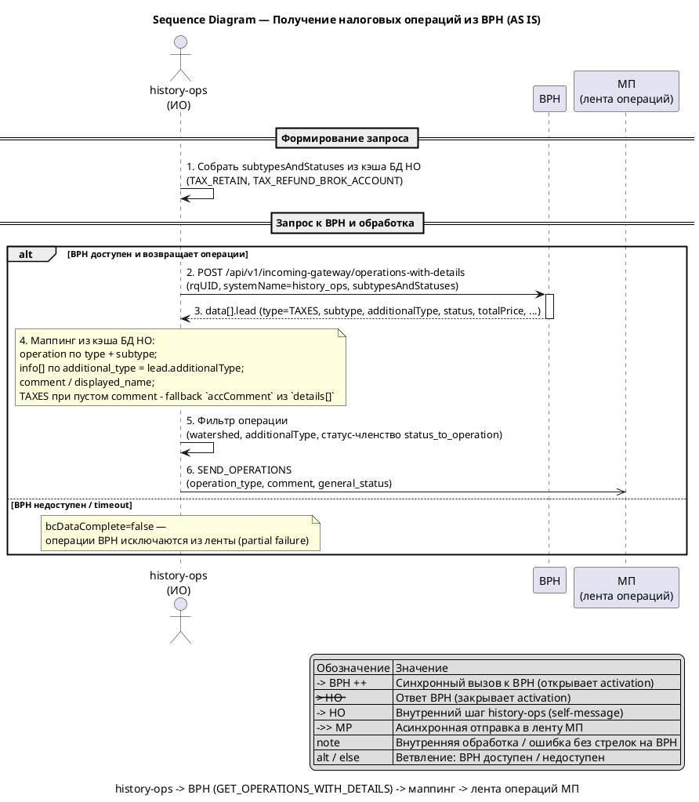
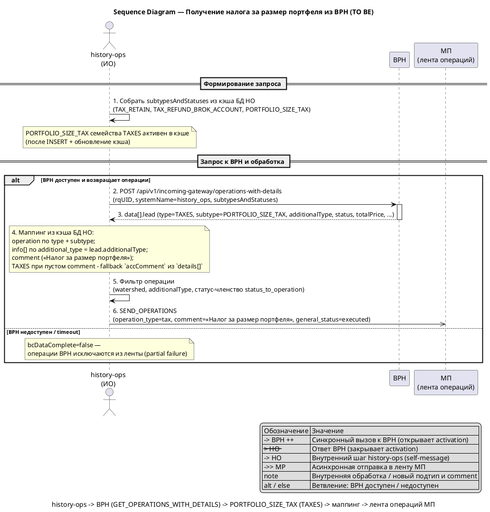
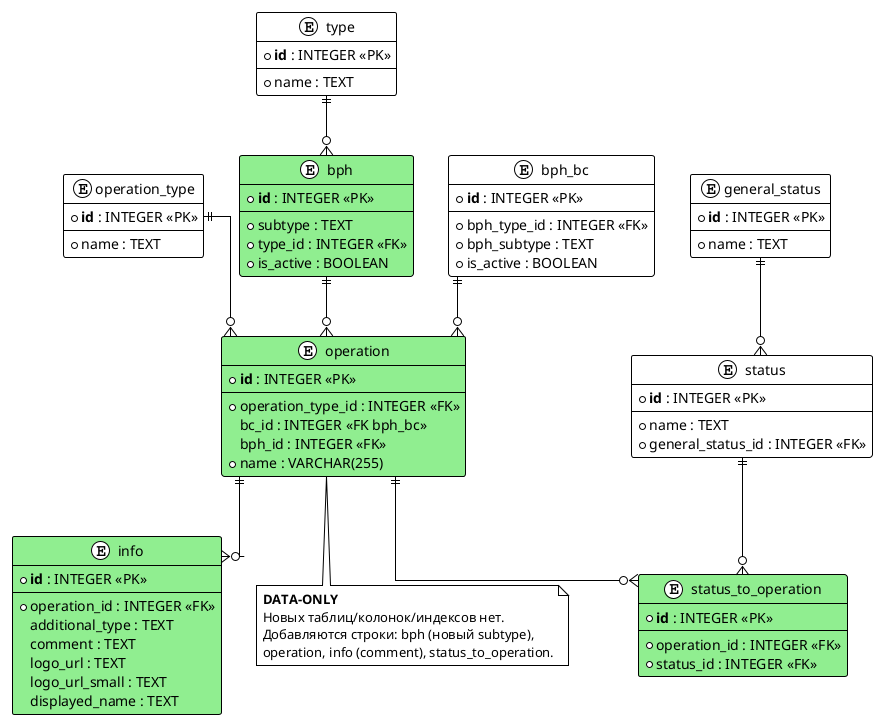

# bph-portfolio-size-tax

## 1. Бизнес-требования

### 1.1. Цель и бизнес-требования

#### Анализ требований — Налог за размер портфеля из BPH

**Источник требования:**

| Параметр | Значение |
|----------|----------|
| Фича | Налог за размер портфеля из BPH (`bph-portfolio-size-tax`) |
| Источник | Бриф (первичный) |
| Инициатор | Не зафиксирован — часть брифа оборвана; для data-only фичи инициатор/роль не критичны |
| Дата / версия | Не зафиксирована — SIHIST-тикет под фичу не найден; срок задаётся общим планом релизов ИО |

**Стейкхолдеры:**

| Стейкхолдер | Роль | Интерес / ожидание | Влияние / ответственность |
|-------------|------|--------------------|---------------------------|
| Клиент мобильного банка (МП) | Пользователь | Видит налог за размер портфеля в ленте операций с корректным комментарием | Использует результат фичи |
| Product Owner / бизнес-аналитик | Владелец продукта | Зафиксировать цель, текст `comment` и значения маппинга для нового налога | Принимает функциональный результат, закрывает решения |
| Команда BPH | Поставщик данных | Отдаёт новый подтип налоговой операции в `GET_OPERATIONS_WITH_DETAILS` | Отвечает за контракт и корректность данных источника |
| Команда history-ops (ИО) | Владелец агрегации | Добавить новый налог data-driven через таблицы маппинга БД HO, без правок Java-кода | Реализует Liquibase-миграцию и данные маппинга |
| Сопровождение ИО | Эксплуатация | Пролив changeset и обновление кэша `operation-cache` | Отвечает за деплой и конфигурацию кэша |

**Бизнес-правила и ограничения:**

| ID | Тип | Описание | Источник / обоснование |
|----|-----|----------|------------------------|
| BR-01 | Бизнес-правило | Добавляется новый подтип налоговой операции семейства `TAXES` (BPH `type.id=7`) из источника BPH — `PORTFOLIO_SIZE_TAX`; он маппится в существующий `operation_type` налога `tax` (id=2), как `TAX_RETAIN`/`MOEX_TAX` | Бриф; трактовка; `db-export/БД ИО.md` (object `type` id=7; `operation_type` id=2 `tax`, id=20 `tax_input`) |
| BR-02 | Бизнес-правило | Налог — **разовая неторговая операция** на каждое удержание BPH; «отдельно по каждой операции» = одна исходящая операция МП на одну операцию BPH без агрегации (порог/периодичность — на стороне BPH). Приёмка BR-02 — data-level (SQL + позитивный тест) | Бриф; решение D-16 |
| BR-03 | Бизнес-правило | Операция **неторговая (non-trading)** из источника BPH | Бриф |
| BR-04 | Бизнес-правило | Механика data-driven: добавление строк в таблицы маппинга БД HO (`bph`/`operation`/`info`/`status_to_operation`), без правок Java-кода; аналогична существующим налогам `TAX_RETAIN`/`MOEX_TAX` | Бриф; трактовка; `analytics/.../data/bc-bph-mapping-db.md` |
| BR-05 | Бизнес-правило | `comment` для UI берётся из таблицы `info` по `additionalType` (для `TAXES` при пустом `comment` — fallback `accComment` из `details[]`); текст `comment` для нового налога — «Налог за размер портфеля» | Бриф; трактовка; решение D-02; `BphCommonClientConverter.java` (подбор `info` по `additional_type`) |
| CN-01 | Ограничение | Контракт `GET_OPERATIONS_WITH_DETAILS` не меняется — меняются только данные маппинга в таблицах БД HO | Контекст; `analytics/.../integrations/bph.md`; `bph.yml` |
| CN-02 | Ограничение | Кэш маппинга обновляется cron-ом (`operation-cache`) — новые строки появятся в рантайме только после обновления кэша (временной лаг между проливом и фактическим поведением) | Контекст; `app-config.operation-cache` (`updateDelayMs`) |
| CN-03 | Ограничение | Статус-членство `status_to_operation` — жёсткий фильтр: без связки с фактическим BPH-статусом операция отфильтруется (`statusMap.containsKey(status)`) | Контекст; `BphBcFilterService.java` |
| CN-04 | Ограничение | Порог «от 5 000 000 ₽» — бизнес-условие начисления налога; в HO фильтр по порогу не реализуется (решение о начислении принимает BPH, HO маппит пришедшую операцию) | Бриф; трактовка; решение D-07 |

**Цель фичи:**

| Вопрос | Ответ |
|--------|-------|
| Какую бизнес-проблему решает? | BPH начнёт присылать новый подтип налоговой операции (налог за размер портфеля); без строк в таблицах маппинга БД HO налог не включается в `subtypesAndStatuses` и не отображается в истории операций клиента |
| Какую ценность приносит пользователю? | Клиент видит налог за размер портфеля в ленте операций МП с корректным комментарием (текстом для UI) без ручного разбора |
| Какие метрики улучшает? | Полнота налоговой ленты — наличие операций нового налога в `SEND_OPERATIONS`. Полнота обеспечивается существующей метрикой интеграции `history_ops_integration_total` + SQL-сверкой + интеграционным тестом (non-SMART, аналог sibling `bph-moex-tax`); отдельная продуктовая метрика с целевым значением не вводится |

**SMART-проверка цели:**

| Критерий | Описание | Значение |
|----------|----------|----------|
| Specific | Конкретная | Добавить маппинг нового подтипа `TAXES` (`PORTFOLIO_SIZE_TAX`) → `operation_type` налога `tax` (id=2) через INSERT в таблицы `bph`/`operation`/`info`/`status_to_operation` (data-driven, без правок Java-кода) |
| Measurable | Измеримая | Операция появляется в `SEND_OPERATIONS` с `type=tax`, `comment` из `info`, `general_status=executed`; полнота проверяется существующей метрикой `history_ops_integration_total` + SQL-сверкой + интеграционным тестом (non-SMART, без отдельной количественной продуктовой метрики) |
| Achievable | Достижимая | Паттерн уже существует: `TAX_RETAIN` → `tax` и `TAX_REFUND_BROK_ACCOUNT` → `tax_input`; Java-код не меняется |
| Relevant | Релевантная | Прямо влияет на полноту и корректность налоговой ленты клиента в истории операций |
| Time-bound | Ограниченная по времени | Релиз/срок задаётся общим планом релизов ИО |

**Противоречия и решения:**

| Требование 1 | Требование 2 | Источник 1 | Источник 2 | Решение | Обоснование |
|--------------|--------------|------------|------------|---------|-------------|
| Противоречия не выявлены | - | Бриф | - | - | Маппинг нового налога по паттерну существующих налогов и «иной `comment` из `info`» не конфликтуют: различие только в значениях данных |

### 1.2. Use Case AS IS

#### Use Case — Получить историю налоговых операций из BPH

**Структура Use Case:**

| Элемент | Значение |
|---------|----------|
| Название | Получить историю налоговых операций из BPH |
| Актор(ы) | `history-ops` (ИО, модуль Истории Операций) — инициатор; `BPH` (внешняя система-источник); Клиент МП (потребитель ленты операций) |
| Триггер | `history-ops` инициирует синхронизацию операций с BPH по запросу клиента МП (в ходе формирования `SEND_OPERATIONS` / `GET_OPERATIONS`) — формирует запрос `GET_OPERATIONS_WITH_DETAILS`; отдельной cron-синхронизации операций нет (cron — только обновление кэша маппинга) |
| Предусловия | См. таблицу предусловий ниже |
| Постусловия | См. таблицу постусловий ниже |
| Бизнес-правила | BR-04…BR-07 (см. ниже) |

**Предусловия:**

| № | Предусловие | Проверяемое условие |
|---|-------------|---------------------|
| 1 | `history-ops` имеет доступ к BPH | Доступен endpoint `POST /api/v1/incoming-gateway/operations-with-details` |
| 2 | Кэш маппинга БД HO загружен и актуален | `operation-cache` содержит активные строки маппинга (`operation`, `info`, `status_to_operation`) |
| 3 | В таблицах маппинга БД HO есть активные записи семейства `TAXES` | `bph.is_active = true` для `TAX_RETAIN` (bph_id=19) и `TAX_REFUND_BROK_ACCOUNT` (bph_id=20), `type_id = 7` |

**Постусловия:**

| Исход | Постусловие |
|-------|-------------|
| Успех | В ленту операций МП включены налоговые операции `TAX_RETAIN` (`operation_type = tax`) и `TAX_REFUND_BROK_ACCOUNT` (`operation_type = tax_input`) с `comment`/`displayed_name` из `info` и `general_status = executed`. Новый подтип налога за размер портфеля в маппинге отсутствует — не запрашивается у BPH и не возвращается |
| Неуспех (бизнес) | Subtype без активной записи в кэше маппинга не включается в `subtypesAndStatuses` и не попадает в ответ; операция, не прошедшая статус-членство через `status_to_operation`, отфильтровывается и не попадает в ленту |
| Неуспех (техн.) | BPH недоступен или вернул ошибку — налоговые операции из BPH не возвращаются (`bcDataComplete = false`); HO возвращает операции из других источников (OG, BC) с признаком неполноты (partial failure); timeout/retry задаются конфигурацией HTTP-клиента HO |

**Бизнес-правила:**

| ID | Правило | Применяется на шаге |
|----|---------|---------------------|
| BR-04 | Запрос к BPH формируется из кэша маппинга БД HO (`subtypesAndStatuses`); алгоритм формирования запроса и обработки ответа не меняется (data-driven, без правок Java-кода) | Шаг 1, Шаг 4 |
| BR-05 | `comment` и `displayed_name` подбираются из `info[]` по совпадению `additional_type == lead.additionalType` (NULL трактуется как `""`); для `TAXES` при пустом `comment` — fallback `accComment` из `details[]` | Шаг 4 |
| BR-06 | `additionalTypes[]` добавляется в `subtypesAndStatuses` только для непустых (non-NULL) значений `info.additional_type` | Шаг 1 |
| BR-07 | Операция включается в результат только при статус-членстве через `status_to_operation`; при `bc_id = NULL` watershed и фильтр по `additionalType` не блокируют операцию | Шаг 5 |

**Основной сценарий — Happy Path:**

```
Шаг 1:  history-ops формирует фильтр subtypesAndStatuses по кэшу маппинга БД HO:
        для семейства TAXES (type_id=7) — TAX_RETAIN (statuses: [COMPLETE],
        additionalTypes: OUT_MONEY / OUT_SECURITIES / TAX_PERIOD_END / INCENTIVE_PAYMENT)
        и TAX_REFUND_BROK_ACCOUNT (statuses: [COMPLETE], без additionalTypes)
          ЕСЛИ [BR-04] в кэше есть активная запись маппинга (bph_active = true)
            ТО сценарий продолжается с шага 2
          ИНАЧЕ
            ПЕРЕЙТИ К альтернативному сценарию 1a
Шаг 2:  history-ops вызывает BPH: POST /api/v1/incoming-gateway/operations-with-details
        (headers rqUID, systemName=history_ops; body subtypesAndStatuses)
Шаг 3:  BPH возвращает операции data[].lead с type=TAXES,
        subtype ∈ {TAX_RETAIN, TAX_REFUND_BROK_ACCOUNT}, полями additionalType, status,
        totalPrice, formationDate/eventDate
          ЕСЛИ BPH вернул операции
            ТО сценарий продолжается с шага 4
          ИНАЧЕ ЕСЛИ BPH недоступен или вернул ошибку
            ПЕРЕЙТИ К альтернативному сценарию 3a
Шаг 4:  history-ops маппит каждую операцию: находит строку маппинга в кэше по
        type+subtype источника, подбирает строку info[] по additional_type == additionalType [BR-05]
          ЕСЛИ [BR-05] найдена строка info с совпадающим additional_type
            ТО применить comment и displayed_name, сценарий продолжается с шага 5
          ИНАЧЕ ЕСЛИ для TAXES comment пустой
            ПЕРЕЙТИ К альтернативному сценарию 4a
Шаг 5:  history-ops проверяет фильтр операции [BR-07]
        (watershed, additionalType, статус-членство через status_to_operation)
          ЕСЛИ операция прошла фильтр
            ТО сценарий продолжается с шага 6
          ИНАЧЕ
            ПЕРЕЙТИ К альтернативному сценарию 5a
Шаг 6:  history-ops формирует исходящую операцию МП: operation_type=tax (TAX_RETAIN) /
        tax_input (TAX_REFUND_BROK_ACCOUNT), comment из info, general_status=executed
        и включает её в ленту операций МП (gRPC SEND_OPERATIONS)
```

**Альтернативные сценарии:**

```
1a. В кэше нет активной записи маппинга для семейства TAXES (Бизнес-ошибки):
  1a.1. history-ops не включает subtype в subtypesAndStatuses
  1a.2. Налоговые операции не запрашиваются у BPH
  1a.3. Сценарий завершается без налоговых операций в ленте

3a. BPH недоступен или вернул ошибку (Технические ошибки):
  3a.1. Налоговые операции из BPH не возвращаются (bcDataComplete = false)
  3a.2. HO возвращает операции из других источников (OG, BC) с признаком неполноты (partial failure)

4a. Для TAXES info.comment пустой [BR-05] (Пограничные случаи):
  4a.1. history-ops подставляет fallback `accComment` из `details[]`
  4a.2. Возврат к шагу 5

5a. Операция не прошла фильтр [BR-07] (Бизнес-ошибки):
  5a.1. Операция отфильтрована (статус отсутствует в status_to_operation, watershed или additionalType)
  5a.2. Операция не включается в ленту операций МП
  5a.3. Сценарий завершается для данной операции (без включения в ленту)
```

**Связи между Use Cases:**

Связи не выявлены — Use Case автономен в рамках фичи (маппинг налогов из BPH — часть формирования ленты операций клиента; отдельный Use Case в данной spec не определён).

#### Sequence Diagram — Получение налоговых операций из BPH (AS IS)

**Назначение:**

Диаграмма показывает текущий сценарий интеграции `history-ops` ↔ BPH по `GET_OPERATIONS_WITH_DETAILS`: history-ops формирует фильтр из кэша маппинга БД HO, запрашивает операции у BPH, сопоставляет их с операциями МП и отдаёт в ленту операций. Моделирует happy path и ветку ошибки (недоступность BPH): при сбое источника операции BPH не включаются, HO возвращает ленту с признаком неполноты (partial failure, `bcDataComplete = false`).

**Участники:**

| Участник | Тип | Роль |
|---|---|---|
| `history-ops` | actor | ИО — инициатор синхронизации; формирует запрос, маппит и фильтрует операции |
| `BPH` | participant | Внешняя система-источник операций (`GET_OPERATIONS_WITH_DETAILS`) |
| `МП` | participant | Лента операций мобильного приложения (потребитель результата) |

**PlantUML:**



**Легенда:**

| Обозначение | Значение |
|---|---|
| `->` | Синхронный вызов (между participant только с `++` на callee) |
| `-->` | Ответ / return (с `--` при закрытии callee) |
| `->>` | Асинхронная отправка |
| `++` / `--` | Открытие / закрытие activation |
| `HO -> HO` | Внутренний шаг history-ops (self-message) |
| `note` | Внутренняя обработка (маппинг) / ошибка без стрелок на пустой BPH |
| `alt` / `else` | Ветвление: BPH доступен / недоступен |

**Соответствие тексту:**

| Элемент на диаграмме | Номер | Описание в тексте |
|---|---|---|
| `Собрать subtypesAndStatuses` | 1 | Шаг 1 основного сценария |
| `POST /api/v1/incoming-gateway/operations-with-details` | 2 | Шаг 2 основного сценария |
| `data[].lead` | 3 | Шаг 3 основного сценария |
| `Маппинг из кэша БД HO` | 4 | Шаг 4 основного сценария |
| `Фильтр операции` | 5 | Шаг 5 основного сценария |
| `SEND_OPERATIONS` | 6 | Шаг 6 основного сценария |
| `bcDataComplete=false` | else | Альтернативный сценарий 3a |

### 1.3. Use Case TO BE

#### Use Case — Отобразить налог за размер портфеля в истории операций

**Структура Use Case:**

| Элемент | Значение |
|---------|----------|
| Название | Отобразить налог за размер портфеля в истории операций |
| Актор(ы) | `history-ops` (ИО, модуль Истории Операций) — инициатор; `BPH` (внешняя система-источник); Клиент МП (потребитель ленты операций) |
| Триггер | Клиент МП запрашивает историю операций → `history-ops` формирует запрос `GET_OPERATIONS_WITH_DETAILS` к BPH, включающий новый подтип налога за размер портфеля из обновлённого кэша маппинга БД HO |
| Предусловия | См. таблицу предусловий ниже |
| Постусловия | См. таблицу постусловий ниже |
| Бизнес-правила | BR-01…BR-09 (см. ниже) |

**Предусловия:**

| № | Предусловие | Проверяемое условие |
|---|-------------|---------------------|
| 1 | В БД HO выполнены data-only INSERT для нового подтипа (строки в `bph`, `operation`, `info`, `status_to_operation`) | `bph.is_active = true`, `bph.type_id = 7` (семейство `TAXES`) |
| 2 | Кэш маппинга БД HO обновлён (cron) и содержит новый подтип | `operation-cache` содержит активные строки нового подтипа |
| 3 | `history-ops` имеет доступ к BPH | Доступен endpoint `POST /api/v1/incoming-gateway/operations-with-details` |
| 4 | BPH начислил налог за размер портфеля и возвращает его операцией | Порог начисления «от 5 000 000 ₽» — на стороне BPH (HO не фильтрует по порогу) |

**Постусловия:**

| Исход | Постусловие |
|-------|-------------|
| Успех | В ленту операций МП включена отдельная неторговая операция налога за размер портфеля: `operation_type = tax`, `comment` «Налог за размер портфеля» из `info`, `general_status = executed` |
| Неуспех (бизнес) | Новый подтип отсутствует в кэше маппинга (лаг обновления, CN-02) → не включается в `subtypesAndStatuses` → налог не запрашивается и не отображается; операция без статус-членства через `status_to_operation` отфильтровывается и не попадает в ленту |
| Неуспех (техн.) | BPH недоступен или вернул ошибку — операции BPH (включая налог за размер портфеля) не возвращаются (`bcDataComplete = false`); HO возвращает операции из других источников (OG, BC) с признаком неполноты (partial failure) |

**Бизнес-правила:**

| ID | Правило | Применяется на шаге |
|----|---------|---------------------|
| BR-01 | Новый подтип семейства `TAXES` (`PORTFOLIO_SIZE_TAX`) маппится в существующий `operation_type` налога `tax` (id=2) | Шаг 7 |
| BR-02 | Налог — **разовая неторговая операция** на каждое удержание BPH; «отдельно по каждой операции» = одна исходящая операция МП на одну операцию BPH без агрегации | Шаг 3 |
| BR-03 | Операция **неторговая (non-trading)**, источник BPH | Шаг 3 |
| BR-04 | Запрос к BPH формируется из кэша маппинга БД HO (`subtypesAndStatuses`); алгоритм формирования запроса и обработки ответа не меняется (data-driven, без правок Java-кода) | Шаг 1, Шаг 4 |
| BR-05 | `comment` и `displayed_name` подбираются из `info[]` по совпадению `additional_type == lead.additionalType` (NULL трактуется как `""`); для `TAXES` при пустом `comment` — fallback `accComment` из `details[]` | Шаг 5 |
| BR-06 | `additionalTypes[]` добавляется в `subtypesAndStatuses` только для непустых (non-NULL) значений `info.additional_type` | Шаг 1 |
| BR-07 | Операция включается в результат только при статус-членстве через `status_to_operation`; при `bc_id = NULL` watershed и фильтр по `additionalType` не блокируют операцию | Шаг 6 |
| BR-08 | Для нового подтипа `info.additional_type = NULL` (одна info-строка, паттерн `TAX_REFUND_BROK_ACCOUNT`) — в запрос `additionalTypes[]` не добавляется | Шаг 1 |
| BR-09 | Порог «от 5 000 000 ₽» — правило начисления на стороне BPH; HO не фильтрует по порогу и маппит пришедшую операцию как есть | Шаг 3 |

**Основной сценарий — Happy Path:**

```
Шаг 1:  history-ops формирует фильтр subtypesAndStatuses по кэшу маппинга БД HO:
        для семейства TAXES (type_id=7) добавляет новый подтип налога за размер портфеля
        (`PORTFOLIO_SIZE_TAX`, statuses: [COMPLETE], без additionalTypes — т.к. additional_type = NULL [BR-06][BR-08])
          ЕСЛИ [BR-04] в кэше есть активная запись маппинга нового подтипа (bph_active = true)
            ТО сценарий продолжается с шага 2
          ИНАЧЕ
            ПЕРЕЙТИ К альтернативному сценарию 1a
Шаг 2:  history-ops вызывает BPH: POST /api/v1/incoming-gateway/operations-with-details
        (headers rqUID, systemName=history_ops; body subtypesAndStatuses)
Шаг 3:  BPH возвращает операции data[].lead, среди которых — операция налога за размер
        портфеля (type=TAXES, subtype=PORTFOLIO_SIZE_TAX, неторговая [BR-03], отдельной
        операцией [BR-02])
          ЕСЛИ BPH вернул операцию нового подтипа
            ТО сценарий продолжается с шага 4
          ИНАЧЕ ЕСЛИ BPH недоступен или вернул ошибку
            ПЕРЕЙТИ К альтернативному сценарию 3a
Шаг 4:  history-ops находит строку маппинга в кэше по type+subtype источника [BR-04]
          ЕСЛИ найдена активная строка маппинга нового подтипа
            ТО сценарий продолжается с шага 5
          ИНАЧЕ
            ПЕРЕЙТИ К альтернативному сценарию 4a
Шаг 5:  history-ops подбирает строку info[] по additional_type == lead.additionalType
        и применяет comment и displayed_name [BR-05]
          ЕСЛИ [BR-05] найдена строка info с совпадающим additional_type
            ТО применить comment «Налог за размер портфеля», сценарий продолжается с шага 6
          ИНАЧЕ ЕСЛИ для TAXES comment пустой
            ПЕРЕЙТИ К альтернативному сценарию 5a
Шаг 6:  history-ops проверяет фильтр операции [BR-07]
        (watershed, additionalType, статус-членство через status_to_operation)
          ЕСЛИ операция прошла фильтр (в т.ч. статус-членство COMPLETE)
            ТО сценарий продолжается с шага 7
          ИНАЧЕ
            ПЕРЕЙТИ К альтернативному сценарию 6a
Шаг 7:  history-ops формирует исходящую операцию МП: operation_type=tax [BR-01],
        comment «Налог за размер портфеля» из info [BR-05], general_status=executed
        и включает её в ленту операций МП (gRPC SEND_OPERATIONS)
```

**Альтернативные сценарии:**

```
1a. Новый подтип отсутствует в кэше маппинга [BR-04] (Бизнес-ошибки):
  1a.1. history-ops не включает новый подтип в subtypesAndStatuses
  1a.2. Налог за размер портфеля не запрашивается у BPH и не отображается в ленте
  1a.3. Сценарий завершается без налога в ленте (лаг обновления кэша, CN-02)

3a. BPH недоступен или вернул ошибку (Технические ошибки):
  3a.1. Операции BPH (включая налог за размер портфеля) не возвращаются (bcDataComplete = false)
  3a.2. HO возвращает операции из других источников (OG, BC) с признаком неполноты (partial failure)

4a. Строка маппинга для нового подтипа не найдена (Бизнес-ошибки):
  4a.1. Операция не маппится и не включается в ленту
  4a.2. Сценарий завершается для данной операции

5a. Для TAXES info.comment пустой или additionalType не совпал [BR-05] (Пограничные случаи):
  5a.1. history-ops подставляет fallback `accComment` из `details[]`
  5a.2. Возврат к шагу 6

6a. Операция не прошла фильтр [BR-07] (Бизнес-ошибки):
  6a.1. Операция отфильтрована (статус отсутствует в status_to_operation, watershed или additionalType)
  6a.2. Налог за размер портфеля не включается в ленту
  6a.3. Сценарий завершается для данной операции

7a. Написание нового подтипа не совпало с контрактом BPH (Пограничные случаи):
  7a.1. BPH вернул пустой набор операций (subtype не распознан)
  7a.2. Налог за размер портфеля «молча» не отображается в ленте
  7a.3. Сценарий завершается без налога в ленте (риск снимается pre-check с командой BPH, CN-11)
```

**Связи между Use Cases:**

Связи не выявлены — Use Case автономен в рамках фичи (маппинг налога за размер портфеля из BPH — часть формирования ленты операций клиента; отдельный Use Case в данной spec не определён).

#### Sequence Diagram — Получение налога за размер портфеля из BPH (TO BE)

**Назначение:**

Диаграмма показывает целевой сценарий после добавления нового подтипа налога за размер портфеля: history-ops включает новый подтип семейства `TAXES` в фильтр `subtypesAndStatuses`, запрашивает операции у BPH, маппит операцию с новым `comment` и отдаёт её в ленту операций МП как `operation_type = tax`. Моделирует happy path и ветку ошибки (недоступность BPH): при сбое источника операции BPH не включаются, HO возвращает ленту с признаком неполноты (partial failure, `bcDataComplete = false`).

**Участники:**

| Участник | Тип | Роль |
|---|---|---|
| `history-ops` | actor | ИО — инициатор синхронизации; формирует запрос, маппит и фильтрует операции |
| `BPH` | participant | Внешняя система-источник операций (`GET_OPERATIONS_WITH_DETAILS`) |
| `МП` | participant | Лента операций мобильного приложения (потребитель результата) |

**PlantUML:**



**Легенда:**

| Обозначение | Значение |
|---|---|
| `->` | Синхронный вызов (между participant только с `++` на callee) |
| `-->` | Ответ / return (с `--` при закрытии callee) |
| `->>` | Асинхронная отправка |
| `++` / `--` | Открытие / закрытие activation |
| `HO -> HO` | Внутренний шаг history-ops (self-message) |
| `note` | Внутренняя обработка (маппинг) / новый подтип и comment / ошибка без стрелок на пустой BPH |
| `alt` / `else` | Ветвление: BPH доступен / недоступен |

**Соответствие тексту:**

| Элемент на диаграмме | Номер | Описание в тексте |
|---|---|---|
| `Собрать subtypesAndStatuses` | 1 | Шаг 1 основного сценария |
| `PORTFOLIO_SIZE_TAX` в `subtypesAndStatuses` | 1 | Шаг 1 основного сценария (BR-08: без `additionalTypes`) |
| `POST /api/v1/incoming-gateway/operations-with-details` | 2 | Шаг 2 основного сценария |
| `data[].lead` (subtype=PORTFOLIO_SIZE_TAX) | 3 | Шаг 3 основного сценария |
| `Маппинг из кэша БД HO` | 4 | Шаг 4–5 основного сценария (comment из `info`) |
| `Фильтр операции` | 5 | Шаг 6 основного сценария (статус-членство) |
| `SEND_OPERATIONS` (operation_type=tax) | 6 | Шаг 7 основного сценария |
| `bcDataComplete=false` | else | Альтернативный сценарий 3a |

## 2. Ограничения и допущения

**Бизнес-правила и ограничения:**

| ID | Тип | Описание | Источник / обоснование |
|----|-----|----------|------------------------|
| CN-05 | Ограничение | Фича целиком data-driven: изменения — только INSERT строк в существующие таблицы маппинга БД `history_ops` (`bph`, `operation`, `info`, `status_to_operation`). Новые справочные значения заводить не нужно: `type` (семейство `TAXES`, id=7), `status` (`COMPLETE`, id=19) и целевой `operation_type` (`tax`, id=2) уже существуют. Java-код `history-ops` не меняется | CONTEXT_DOC §«Что учесть при написании фичи»; `db-export/БД ИО.md` (`type` id=7, `status` id=19, `operation_type` id=2) |
| CN-06 | Ограничение | id новых строк (`bph`, `operation`, `info`, `status_to_operation`) назначаются SERIAL/sequence автоматически (INSERT без явного id). Общая sequence гарантирует непересечение id с sibling-фичей `bph-moex-tax` (тот же механизм `TAXES` → `tax`) — явные id и координация с DBA не требуются; pre-check подтверждает отсутствие дублей | CONTEXT_DOC §«Ограничения и риски текущего состояния»; `Feature-writing/bph-moex-tax/` (решения D-10, D-20); решение D-24 |
| CN-07 | Ограничение | Новый налог — «BPH-only» по паттерну `TAX_REFUND_BROK_ACCOUNT`: `operation.bc_id = NULL` и `info.additional_type = NULL`. При `bc_id = NULL` в `isActualBphOperation()` срабатывает ранний `return true` — watershed- и additionalType-фильтры не блокируют, блокирующим остаётся только статус-членство | CONTEXT_DOC §«Ограничения и риски текущего состояния»; `BphBcFilterService.java` |
| CN-08 | Ограничение | `additionalTypes[]` в `subtypesAndStatuses` формируется только из непустых `info[].additional_type` (`filter(Objects::nonNull)`). При `additional_type = NULL` сужение не добавляется — запрос к BPH идёт по `type + subtype + statuses` без additionalType-фильтра | CONTEXT_DOC §«Интеграции и контракты, которые нужно учесть»; `BphBcFilterService.buildBphRequestEntityByBphParams()` |
| CN-09 | Ограничение | `comment`/`displayedName` подбираются из `info[]` по совпадению `info.additional_type == lead.additionalType` (NULL трактуется как `""`). Если BPH пришлёт непустой `additionalType` для подтипа со строкой `info(additional_type = NULL)`, матчинг не сработает и `comment` не подставится (для `TAXES` при пустом `comment` действует fallback на `accComment` из `details[]`) | CONTEXT_DOC §«Интеграции и контракты, которые нужно учесть»; `BphCommonClientConverter.isCorrectAdditionalType()` |
| CN-10 | Ограничение | Изменение данных оформляется как SQL-changeset (Liquibase) по шаблону миграции SIHIST-3321 (`..._added_tax_data.sql`), без правок Java-кода `history-ops` | CONTEXT_DOC §«Данные (БД, выгрузки)»; `db-export/БД ИО.md` (`databasechangelog`, SIHIST-3321) |
| CN-11 | Допущение | BPH игнорирует нераспознанные `subtype`/`type` внутри массива `subtypesAndStatuses` (не отклоняет весь запрос 400/500). Для нового подтипа `PORTFOLIO_SIZE_TAX` расхождение написания ведёт к «молчаливому» отсутствию налога (запрос вернёт пусто), а не к отказу запроса. Pre-check с командой BPH до пролива: подтверждённый факт «BPH игнорирует неизвестный subtype в массиве, ответ 200 с пустым data» + включение нового subtype на стороне BPH до пролива HO | CONTEXT_DOC §«Ограничения и риски текущего состояния» (аналог — `Feature-writing/bph-moex-tax/` решение D-14); решение D-19 |
| CN-12 | Ограничение | `info.additional_type` для нового подтипа должен быть именно `NULL` (не пустая строка `''`): `filter(Objects::nonNull)` пропускает `''`, что исказит `additionalTypes[]` и матчинг. Требуется pre-check «`additional_type IS NULL` (не `''`)» без DDL | CONTEXT_DOC §«Ограничения и риски текущего состояния»; `Feature-writing/bph-moex-tax/` (решение D-18) |
| CN-13 | Ограничение | `bph.subtype` без UNIQUE-ограничения: идемпотентность держится на pre-check «0 строк по subtype» перед каждым проливом. Откат = `bph.is_active=false` (строка остаётся); повторный пролив не создаёт вторую активную строку — pre-check «0 строк по subtype» выполняется до каждого пролива. Pre-check без DDL (data-only сохраняется) | CONTEXT_DOC §«Что учесть при написании фичи»; `Feature-writing/bph-moex-tax/` (решение D-24); решение D-25 |
| CN-14 | Ограничение | Производительность и SLO/SLA наследуются от существующего механизма обработки `GET_OPERATIONS_WITH_DETAILS` **без новых целевых значений**: Java-код не меняется, новых endpoint'ов/экранов/SQL-запросов/кэш-уровней не появляется (data-only фича не вносит новых нагрузочных путей) | Решение D-10 |
| CN-15 | Ограничение | Числовые значения timeout/retry/deadline (`app-config.bph.deadline`), `app-config.operation-cache.update-delay-ms` и `app-config.bph.page-size-*`/`app-config-dynamic.bph-dynamic.max-records-from-bph` задаются внешним конфигом (Spring Cloud Config / SOWA-шаблоны) и в spec не фиксируются (в репозитории — только имена). При недоступности BPH операции данного источника отсутствуют в ленте (partial failure, `bcDataComplete=false`) — retry/обходного пути нет | Решение D-11 |
| CN-16 | Ограничение | Механизм аутентификации интеграции `history-ops`↔`BPH` (mTLS/API key/сетевая зона) и маскирование PII в `integration.log` — детали внешние (Vault/SOWA-шаблон, `log_masking_rules.yml`), в spec не раскрываются; срок хранения чувствительных данных наследуется от существующей политики хранения `history_ops`. Новые классы чувствительных данных фича **не вводит** (сумма налога и идентификаторы договора уже передаются существующими налогами) | Решение D-12 |
| CN-17 | Ограничение | Отдельный feature toggle не вводится; раскатка data-driven — пролив changeset с `bph.is_active=true` + ожидание перезагрузки кэша маппинга; допустимый временной лаг = `update-delay-ms` | Решение D-13 |
| CN-18 | Ограничение | Новый подтип маппится **только** для `status=COMPLETE` (id=19). Корректировки/сторно налога (возврат ошибочно удержанного, отмена при снижении портфеля ниже порога) приходят отдельными операциями иного subtype/источника и **вне scope** — строка маппинга для них не создаётся, data-only INSERT их не затрагивает | Решение D-18 |

## 4. Функциональные требования

#### 4.1.1. Сервис BPH — GET_OPERATIONS_WITH_DETAILS

**Назначение**

Интеграционный контракт `history-ops` (ИО) ↔ `BPH` (Brokerage Portfolio History) для получения ленты операций с детализацией по неторговым операциям (`GET_OPERATIONS_WITH_DETAILS`). Фича добавляет в этот контракт **новый подтип налоговой операции** семейства `TAXES` (налог за размер портфеля клиента, порог от 5 000 000 ₽), который маппится в исходящий тип операции МП с **иным `comment`** для UI. Сам контракт (поля, алгоритм запроса/ответа, Java-код) **не меняется** — меняются только **данные** таблиц маппинга БД HO, из которых запрос и маппинг ответа формируются data-driven [BR-04, CN-01].

**Общая информация (endpoint):**

| Параметр | Значение |
|----------|----------|
| Назначение | Получение истории неторговых операций с детализацией (`GET_OPERATIONS_WITH_DETAILS`) |
| Метод | `POST` |
| Path | `/api/v1/incoming-gateway/operations-with-details` |
| Система-источник (инициатор запроса) | history-ops (модуль Истории Операций, ИО) |
| Система-получатель (провайдер данных) | BPH (Brokerage Portfolio History) — incoming-gateway |
| Тип интеграции | Синхронная |
| Протокол | REST (HTTPS) |
| Направление | Однонаправленная (history-ops → BPH: Request → Response) |
| Версия API | v1 |
| Аутентификация | Внутренний контур; идентификация системы инициатора заголовком `systemName`. Пользовательских/сессионных токенов в контракте нет |
| Формат данных | `JSON` |
| Ссылка на контракт | `repositories/ИО/history-ops/src/main/swagger/bph/bph.yml:216-265`; вызов — `BphClient.getOperations()` (`BphClient.java:16-34`) |

**Request Headers:**

| Заголовок | Обязат. | Описание | Пример |
|-----------|---------|----------|--------|
| `rqUID` | Да | Сквозной идентификатор запроса (UUID, генерируется history-ops) | `c4a5dccd-0fe2-4aa1-823e-a5a5d9ee04a4` |
| `systemName` | Да | Идентификатор системы инициатора. Фактическое значение, отправляемое кодом, — `history_ops` (константа `BphClient.HISTORY_OPS`) | `history_ops` |

Источник: `bph.yml:222-234`; заполнение — `BphClient.getOperations()` (`BphClient.java:19-33`: `SYSTEM_NAME = "systemName"`, `HISTORY_OPS = "history_ops"`, `REQUEST_ID = "rqUID"`). Примечание: в OpenAPI `bph.yml` у ряда endpoint в поле `example` указан `si2-ops`; это только пример в схеме, код отправляет `history_ops`.

**Request body (`RequestParamsData`):**

Полный перечень полей (существующий контракт; фича не меняет структуру, а добавляет новый элемент в `subtypesAndStatuses`). Источник: `bph.yml:1254-1350` и `analytics/.../integrations/bph.md`.

| Поле | Тип | Описание | Ограничение | Заполняется history-ops | Пример |
|------|-----|----------|-------------|-------------------------|--------|
| `agreements` | array[string] | Массив номеров договоров клиента | — | Да — из договоров клиента | `["KJ28438H394L"]` |
| `startSearchDate` | string (date-time) | Начало периода поиска | — | Опционально | `2026-01-01T00:00:00` |
| `endSearchDate` | string (date-time) | Конец периода поиска | — | Да | `2026-01-31T23:59:59` |
| `page` | integer | Номер возвращаемой страницы | — | Нет — не заполняется (default 0) | `0` |
| `pageSize` | integer | Количество возвращаемых записей | — | Да — лимит из конфигурации HO | `1000` |
| `types` | array[string] | Типы операций (legacy-фильтр) | — | Нет — не используется | — |
| `subtypes` | array[string] | Подтипы операций (legacy-фильтр) | — | Нет — не используется | — |
| `statuses` | array[string] | Статусы (legacy-фильтр) | — | Нет — не используется | — |
| `subtypesAndStatuses` | array[object] | Типы/подтипы/статусы для поиска (см. ниже) | maxItems: 1000 | Да — строится из кэша маппинга БД HO | см. ниже |
| `dateForFilter` | enum | Поле фильтрации по дате | `FORMATION_DATE` \| `EVENT_DATE` | Да — `FORMATION_DATE` | `FORMATION_DATE` |
| `tradingSections` | array[string] | Торговые секции | — | Нет — не используется | — |
| `isin` | string | ISIN бумаги | — | Нет — не используется | — |
| `instrumentCurrency` | string | Валюта инструмента | — | Нет — не используется | — |
| `tickers` | array[string] | Список тикеров (карточка инструмента) | — | Нет — не используется | — |
| `selfIdTs` | array[string] | Собственный идентификатор в торговой системе | — | Нет — не используется | — |

**`subtypesAndStatuses[]` — структура и новый элемент:**

Структура элемента (`bph.yml:1292-1326`):

| Поле | Тип | Обязат. | Описание | Ограничение |
|------|-----|---------|----------|-------------|
| `type` | string | Да | Тип операции (family) | maxLength: 225 |
| `subtype` | string | Да | Подтип операции | maxLength: 225 |
| `additionalTypes` | array[string] | Нет | Дополнительный тип события (non-null `additional_type` из `info`) | maxLength: 225 |
| `statuses` | array[string] | Да | Статусы для подтипа | maxLength: 225 |

Заполнение history-ops: `BphBcFilterService.buildBphRequestEntityByBphParams()` — `type`/`subtype`/`statuses` из записи `operation` кэша, `additionalTypes` — из non-null `info.additional_type` (если пусто — поле не передаётся, `filter(Objects::nonNull)`). Для нового подтипа при `info.additional_type = NULL` поле `additionalTypes` **не добавляется** [CN-08].

Элементы семейства `TAXES` (type_id=7) — существующие + новый:

| type | subtype | additionalTypes | statuses | operation_type | Комментарий |
|------|---------|-----------------|----------|----------------|-------------|
| `TAXES` | `TAX_RETAIN` | `OUT_MONEY`, `OUT_SECURITIES`, `TAX_PERIOD_END`, `INCENTIVE_PAYMENT` | `COMPLETE` | `tax` | Удержание налога (существующее) |
| `TAXES` | `TAX_REFUND_BROK_ACCOUNT` | `NULL` (не передаётся) | `COMPLETE` | `tax_input` | Возврат излишне удержанного налога (существующее) |
| `TAXES` | **`PORTFOLIO_SIZE_TAX`** | **`NULL` (не передаётся)** | **`COMPLETE`** | **`tax`** | **Новый налог за размер портфеля (новое)** |

**Response body 200 OK:**

```
{ "status": ResponseStatusData, "data": [ DetailsData ] }
```

`ResponseStatusData` (`bph.yml:1436-1440`): `code` (integer), `message` (string). `DetailsData` (`bph.yml:1238-1245`): `lead` → `OperationData`, `details` → массив `DetailData` (`{ key: string, value: string }` — JSON-детали; HO использует ключи из `BphConverter.SUPPORTED_DETAILS_KEY`, в т.ч. `comment`, `accComment`, `errorCode`, `statusErrorCode`).

`OperationData` (`lead`) — перечень полей (`bph.yml:1088-1216`):

| Поле | Тип | Nullable | Описание | Пример |
|------|-----|----------|----------|--------|
| `type` | string | Нет | Тип события (family) | `TAXES` |
| `subType` | string | Да | Подтип события (вариант имени) | `PORTFOLIO_SIZE_TAX` |
| `subtype` | string | Да | Подтип события (вариант имени) | `PORTFOLIO_SIZE_TAX` |
| `additionalType` | string | Да | Дополнительный тип события | `null` |
| `externalSystemVersion` | number | Да | Версия события во внешней системе | `5` |
| `formationDate` | string (date-time) | Нет | Дата формирования (код требует: `validateSimpleAttributes()` → `checkNotNull`) | `2026-01-15T10:30:00` |
| `eventDate` | string (date-time) | Нет | Дата события | `2026-01-15T10:30:00` |
| `externalSystemId` | string | Нет | Идентификатор операции во внешней системе | `KU2309848` |
| `price` | object | Да | Цена (`{ value, currency }`) | — |
| `totalPrice` | object | Да | Сумма (`{ value, currency }`) | `{ "value": "-15000.00", "currency": "RUB" }` |
| `quantity` | string (big_decimal) | Да | Количество | — |
| `quantityFact` | string (big_decimal) | Да | Фактическое количество | — |
| `tradingSection` | string | Да | Торговая секция | `FOND` |
| `account` | string | Да | Счет | `BROKER` |
| `status` | string | Нет | Статус операции (код требует: `validateSimpleAttributes()` → `checkNotNull`) | `COMPLETE` |
| `instrument` | object | Да | Данные инструмента (`isin`, `tickers[]`, `currency`, `type`) | — |
| `ucpId` | integer | Да | Идентификатор клиента в ЕПК | `23984692648` |
| `agreement` | string | Нет | Номер договора | `KJ28438H394L` |
| `parent` | string | Да | Идентификатор родительской операции | — |
| `isFact` | boolean | Нет | Признак факта события | `true` |
| `parentIds` | object | Да | Идентификаторы связанных сущностей | — |

Примечание: у поля подтипа в контракте два имени — `subType` и `subtype`; HO читает оба — сначала `subtype`, при его отсутствии — `subType` (`BphOperationConverter.getSubType()`). Разрешённое значение используется как `bphType` и в ключе lookup `operation` (`originalType + bphType`), т.е. чтение обоих имён относится и к ключу lookup. Для нового налога передаётся `subtype = PORTFOLIO_SIZE_TAX`.

**Маппинг `lead` (OperationData) → исходящая операция МП:**

Источник: `BphCommonClientConverter.convert()` и `BphConverter.getGeneralStatusMap()`; логика не меняется фичей [BR-04]. Для нового налога существенно поднятие `comment`/`displayedName` из `info` по совпадению `additional_type == additionalType` (NULL трактуется как `""`) [CN-09].

| Источник (ответ BPH) | Поле | Получатель (HO / МП) | Поле | Правило |
|----------------------|------|----------------------|------|---------|
| `lead.type` + `lead.subtype` (`TAXES` / `PORTFOLIO_SIZE_TAX`) | ключ маппинга | operation (кэш БД HO) | `operation_type` | Поиск `operation` по `originalType` + `bphType`; `operation_type` = `tax` (id=2) |
| `lead.status` (`COMPLETE`) | статус BPH | general_status | `executed` | `status_and_general_status` из кэша (`COMPLETE → executed`) |
| `lead.additionalType` (`null`/отсутствует) | доп. тип события | info (кэш БД HO) | `additional_type` | Матч `info.additional_type == lead.additionalType` (NULL ↔ `""`) |
| `info.comment` (по `additional_type`) | текст из `info` | SEND_OPERATIONS | `comment` | `info.comment` = «Налог за размер портфеля»; при пустом для `TAXES` — fallback на `accComment` из `details[]` |

**Коды ответов:**

| HTTP код | Код ошибки | Структура ответа | Описание |
|----------|------------|------------------|----------|
| 200 | — | `{ status: { code, message }, data: [DetailsData] }` | Успешный ответ |
| 400 | — | `ErrorData` | Bad Request |
| 500 | — | `ErrorData` | Internal Server Error |

`ErrorData` (`bph.yml:1443-1474`): `timestamp` (string, nullable), `status` (string, enum `400` \| `500`), `error` (string, enum `Bad Request` \| `Internal Server Error`), `path` (string, nullable). HO **не ветвится по полю `status.code`**: из 200-ответа извлекается массив `data`, элементы конвертируются по отдельности (ошибки конвертации отдельной записи фиксируются метрикой `parse_error` и не роняют остальные операции). При HTTP 400/500 (или иной ошибке вызова) источник помечается failed и инкрементится метрика `dataCompleteFalse` (`AbstractOperationGateway.getOperationsSafe` → `onErrorResume`), лог — `integration.log`.

**Пример запроса** (запрос history-ops к BPH за операциями нового налога):

```http
POST /api/v1/incoming-gateway/operations-with-details
rqUID: c4a5dccd-0fe2-4aa1-823e-a5a5d9ee04a4
systemName: history_ops
Content-Type: application/json
```

```json
{
  "agreements": ["KJ28438H394L"],
  "startSearchDate": "2026-01-01T00:00:00",
  "endSearchDate": "2026-01-31T23:59:59",
  "pageSize": 1000,
  "dateForFilter": "FORMATION_DATE",
  "subtypesAndStatuses": [
    {
      "type": "TAXES",
      "subtype": "PORTFOLIO_SIZE_TAX",
      "statuses": ["COMPLETE"]
    }
  ]
}
```

Примечания: значение `subtype` = `PORTFOLIO_SIZE_TAX`; `statuses` = `COMPLETE`. Для нового налога поле `additionalTypes` в элементе `subtypesAndStatuses` **отсутствует** (не `null`, а не передаётся), т.к. `info.additional_type = NULL` [CN-08].

**Пример ответа** (операция нового налога):

```json
{
  "status": { "code": 0, "message": null },
  "data": [
    {
      "lead": {
        "type": "TAXES",
        "subtype": "PORTFOLIO_SIZE_TAX",
        "additionalType": null,
        "externalSystemVersion": 5,
        "formationDate": "2026-01-15T10:30:00",
        "eventDate": "2026-01-15T10:30:00",
        "externalSystemId": "KU2309848",
        "totalPrice": { "value": "-15000.00", "currency": "RUB" },
        "status": "COMPLETE",
        "tradingSection": "FOND",
        "account": "BROKER",
        "agreement": "KJ28438H394L",
        "isFact": true
      },
      "details": []
    }
  ]
}
```

Результат маппинга — исходящая операция МП с `comment` из `info.comment` (текст — «Налог за размер портфеля») и `operation_type` = `tax` (id=2).

**Пограничный случай — пустой результат:** при отсутствии операций BPH возвращает `data: []` (пустой массив) со `status.code = 0`; HO не добавляет операций в SEND_OPERATIONS.

**Пограничный случай — нераспознанный `subtype` до включения на стороне BPH:** запрос `subtypesAndStatuses` содержит новый подтип вместе с существующими налогами. Допущение: BPH игнорирует нераспознанные `subtype`/`type` внутри массива (не отклоняет весь запрос 400/500) — существующие налоги `TAX_RETAIN`/`TAX_REFUND_BROK_ACCOUNT` продолжают обрабатываться [CN-11]; допущение проверяется pre-check до пролива: команда BPH подтверждает факт «BPH игнорирует неизвестный subtype в массиве, ответ 200 с пустым data», а новый subtype включается на стороне BPH до пролива HO.

**Пограничный случай — расхождение написания `subtype`:** если фактическое значение подтипа в `subtypesAndStatuses` не совпадёт с тем, что BPH ожидает (или пришлёт в ответе), lookup `operation` по ключу `originalType + bphType` вернёт пусто и налог «молча» не отобразится в ленте [CN-11].

**Таймауты, retry и fallback:**

Production timeout/retry для BPH **не описан** в `analytics/`; поведение задаётся конфигурацией WebClient HO (`WebClientBphConfiguration`). При недоступности BPH HO возвращает операции из других источников (OG, BC) с признаком неполноты, если они доступны.

#### 4.2.2. Алгоритм обработки запроса GET_OPERATIONS_WITH_DETAILS

Алгоритм обработки ответа BPH на запрос `GET_OPERATIONS_WITH_DETAILS` (`POST /api/v1/incoming-gateway/operations-with-details`, §4.1.1) состоит из трёх этапов: формирование запроса к BPH (`subtypesAndStatuses` из кэша маппинга БД HO), фильтрация операций из ответа BPH и маппинг операций в исходящий объект ленты операций МП. Фича data-driven [BR-04, CN-05]: Java-код history-ops не меняется — новый подтип налога за размер портфеля попадает в запрос, проходит фильтрацию и маппится автоматически после INSERT строк в таблицы маппинга БД HO (§4.2.3). Реализующие классы: формирование запроса/фильтр — `BphBcFilterService` (`buildBphRequestEntityByBphParams()`, `isActualBphOperation()`); маппинг ответа — `BphCommonClientConverter` (`convert()`, `getAdditionalInfoFromCache()`, `isCorrectAdditionalType()`, `enrichComment()`); конвертация в исходящую операцию — `BphOperationConverter`.

#### Use Case — Обработать операцию налога за размер портфеля по алгоритму маппинга из BPH

**Структура Use Case:**

| Элемент | Значение |
|---------|----------|
| Название | Обработать операцию налога за размер портфеля по алгоритму маппинга из BPH |
| Актор(ы) | `history-ops` (ИО) — система-обработчик алгоритма; `BPH` (источник операций); Клиент МП (потребитель результата в ленте операций) |
| Триггер | `history-ops` получает ответ BPH `data[].lead` с `type=TAXES`, `subtype=PORTFOLIO_SIZE_TAX` и обрабатывает его по алгоритму data-driven маппинга (после пролива данных маппинга и обновления кэша) |
| Предусловия | См. таблицу предусловий ниже |
| Постусловия | См. таблицу постусловий ниже |
| Бизнес-правила | BR-01, BR-04…BR-10 (см. ниже) |

**Предусловия:**

| № | Предусловие | Проверяемое условие |
|---|-------------|---------------------|
| 1 | Кэш маппинга БД HO загружен и содержит строки нового подтипа | `operation-cache` содержит `operation` (активную), `info` и `status_to_operation` для нового подтипа (после пролива changeset и обновления кэша) [CN-02] |
| 2 | `history-ops` сформировал запрос к BPH с новым подтипом | `subtypesAndStatuses` содержит элемент `{type=TAXES, subtype=PORTFOLIO_SIZE_TAX, statuses=[COMPLETE]}`, без `additionalTypes` (т.к. `info.additional_type=NULL`) |
| 3 | BPH вернул операцию нового подтипа | `lead.type=TAXES`, `lead.subtype=PORTFOLIO_SIZE_TAX`, `lead.status=COMPLETE` |
| 4 | В `info` есть строка для нового подтипа с `additional_type=NULL` | `info.additional_type IS NULL` (при матчинге трактуется как `""`) |

**Постусловия:**

| Исход | Постусловие |
|-------|-------------|
| Успех | Операция налога за размер портфеля включена в ленту операций МП как `operation_type=tax` с `comment` «Налог за размер портфеля» из `info`, `displayed_name` из `info` и `general_status=executed` |
| Неуспех (бизнес) | Операция, не прошедшая статус-членство (`status` не настроен в `status_to_operation`), отфильтровывается и не попадает в ленту; при non-null `lead.additionalType`, не совпавшем с `info.additional_type=NULL`, `comment`/`displayed_name` не подставляются (но при `bc_id=NULL` операция не отфильтровывается) |
| Неуспех (техн.) | BPH недоступен или вернул ошибку — операции BPH (включая налог за размер портфеля) не возвращаются и не маппятся; HO возвращает операции из других источников (OG, BC) с признаком неполноты (partial failure, `bcDataComplete=false`); значения timeout/retry вызова BPH не зафиксированы (допущение) |

**Бизнес-правила:**

| ID | Правило | Применяется на шаге |
|----|---------|---------------------|
| BR-04 | Запрос к BPH формируется из кэша маппинга БД HO; алгоритм формирования запроса и обработки ответа не меняется (data-driven, без правок Java-кода) | Шаг 1 |
| BR-06 | `additionalTypes[]` добавляется в `subtypesAndStatuses` только для непустых (non-NULL) значений `info.additional_type` | Шаг 1 |
| BR-08 | Для нового подтипа `info.additional_type = NULL` (одна info-строка, паттерн `TAX_REFUND_BROK_ACCOUNT`) — `additionalTypes[]` не добавляется | Шаг 1 |
| BR-07 | Операция включается в результат только при статус-членстве через `status_to_operation`; при `bc_id = NULL` фильтры водораздела и `additionalType` не блокируют (ранний `return true` в `isActualBphOperation()`) | Шаг 3 |
| BR-10 | Для нового подтипа обязательно статус-членство `status_to_operation` (status=COMPLETE → executed): без связки операция отфильтруется статус-членством, несмотря на ранний `return true` при `bc_id=NULL` | Шаг 3 |
| BR-09 | Порог «от 5 000 000 ₽» — правило начисления на стороне BPH; HO не фильтрует по порогу и маппит пришедшую операцию как есть | Шаг 3 |
| BR-05 | `comment` и `displayed_name` подбираются из `info[]` по совпадению `additional_type == lead.additionalType` (NULL трактуется как `""`); для `TAXES` при пустом `comment` — fallback `accComment` из `details[]` | Шаг 4 |
| BR-01 | Новый подтип семейства `TAXES` (`PORTFOLIO_SIZE_TAX`) маппится в существующий `operation_type` налога `tax` (id=2) | Шаг 5 |

**Основной сценарий — Happy Path:**

```
Шаг 1:  history-ops формирует subtypesAndStatuses по кэшу маппинга БД HO: для нового
        подтипа элемент {type=TAXES, subtype=PORTFOLIO_SIZE_TAX, statuses=[COMPLETE]},
        без additionalTypes (info.additional_type=NULL — фильтр отбрасывает NULL)
        [BR-04, BR-06, BR-08]
          ЕСЛИ [BR-04] в кэше есть активная запись маппинга нового подтипа (bph_active=true)
            ТО сценарий продолжается с шага 2
          ИНАЧЕ
            ПЕРЕЙТИ К альтернативному сценарию 1a
Шаг 2:  history-ops вызывает BPH: POST /api/v1/incoming-gateway/operations-with-details
        (headers rqUID, systemName=history_ops; body subtypesAndStatuses с новым подтипом)
Шаг 3:  history-ops фильтрует операции из ответа data[].lead:
        статус-членство (statusMap.containsKey(status)) и фильтр актуальности
        (водораздел + additionalType; при bc_id=NULL не блокирует) [BR-07, BR-09, BR-10]
          ЕСЛИ [BR-10] статус COMPLETE есть в status_to_operation для операции нового подтипа
            ТО сценарий продолжается с шага 4
          ИНАЧЕ
            ПЕРЕЙТИ К альтернативному сценарию 3a
Шаг 4:  history-ops маппит операцию: находит operation в кэше по
        originalType+bphType (новый подтип), подбирает строку info[] по
        additional_type == additionalType (info.additional_type=NULL ↔ "") [BR-05]
          ЕСЛИ [BR-05] найдена строка info (additional_type=NULL) для нового подтипа
            ТО применить comment «Налог за размер портфеля» и displayed_name,
               сценарий продолжается с шага 5
          ИНАЧЕ ЕСЛИ lead.additionalType non-null и не совпадает с info.additional_type=NULL
            ПЕРЕЙТИ К альтернативному сценарию 4a
          ИНАЧЕ ЕСЛИ info.comment пустой
            ПЕРЕЙТИ К альтернативному сценарию 4b
Шаг 5:  history-ops формирует исходящую операцию МП: operation_type=tax [BR-01],
        comment «Налог за размер портфеля» из info, displayed_name из info,
        general_status=executed и включает её в ленту операций МП (gRPC SEND_OPERATIONS)
```

**Альтернативные сценарии:**

```
1a. В кэше нет активной записи маппинга нового подтипа [BR-04] (Бизнес-ошибки):
  1a.1. history-ops не включает новый подтип в subtypesAndStatuses
  1a.2. Налог за размер портфеля не запрашивается у BPH и не отображается в ленте
  1a.3. Сценарий завершается без операций налога в ленте (лаг обновления кэша, CN-02)

3a. Операция не прошла статус-членство [BR-10] (Бизнес-ошибки):
  3a.1. Статус не найден в status_to_operation (statusMap.containsKey(status)=false)
        → операция отфильтрована статус-членством
  3a.2. Операция налога за размер портфеля не включается в ленту операций МП
  3a.3. Сценарий завершается для данной операции (без включения в ленту)

4a. lead.additionalType пришёл non-null и не совпадает с info.additional_type=NULL (Пограничные случаи):
  4a.1. Строка info для нового подтипа не подбирается (NULL ↔ "" не совпадает с non-null значением)
  4a.2. comment/displayed_name не подставляются (налог может отобразиться без текста)
  4a.3. Возврат к шагу 5

4b. info.comment пустой для нового подтипа [BR-05] (Пограничные случаи):
  4b.1. history-ops подставляет fallback `accComment` из `details[]` (семейство TAXES)
  4b.2. Возврат к шагу 5
```

**Связи между Use Cases:**

Связи не выявлены — Use Case описывает алгоритм как техническую детализацию Use Case TO BE «Отобразить налог за размер портфеля в истории операций» (§1.3); отдельный включаемый/расширяющий Use Case в данной spec не выделяется.

#### Модель данных — Налог за размер портфеля из BPH (data-only)

**Контекст изменения:**

| Элемент | Значение |
|---------|----------|
| Фича / изменение | Добавление обработки неторгового налога за размер портфеля (семейство BPH `TAXES`) → `operation_type` налога `tax` (id=2) |
| Тип хранилища | Реляционное |
| СУБД / движок | PostgreSQL, база `history_ops` |
| Тип изменения | Data-only: новые строки в существующих таблицах маппинга; DDL-изменений (новых таблиц/колонок/индексов) нет |
| Связанные артефакты | Use Case TO BE (§1.3), Интеграция BPH `GET_OPERATIONS_WITH_DETAILS` (§4.1.1), Алгоритм (§4.2.2), `Feature-context/bph-portfolio-size-tax.md`, `db-export/БД ИО.md`, `analytics/02-Modules/MOD-001-history-ops/data/bc-bph-mapping-db.md` |

Изменение целиком data-driven: Java-код `history-ops` не меняется, алгоритм маппинга не меняется — в рантайм-кэш попадают новые строки таблиц маппинга после их пролива. Модель данных описывает **какие строки** добавляются в существующие таблицы `bph`, `operation`, `info`, `status_to_operation`; новые справочники `type`, `operation_type`, `status` не вводятся (они уже существуют). Порог «от 5 000 000 ₽» на уровне БД HO **не** реализуется — решение о начислении принимает BPH, HO лишь маппит пришедшую операцию [CN-04].

**ER-диаграмма:**



**Новые и изменённые сущности:**

Новых сущностей (таблиц) и новых колонок нет. Затрагиваются четыре существующие таблицы маппинга — «изменение» заключается только в добавлении строк. Справочные таблицы `type`, `operation_type`, `status` не меняются. Ниже — структура затрагиваемых таблиц и добавляемая строка, затем справочные таблицы без изменений.

**Таблица: bph**

| Атрибут | Тип | Nullable | Описание | Ограничения |
|---------|-----|----------|----------|-------------|
| id | INTEGER | NOT NULL | Идентификатор BPH subtype | PK |
| subtype | TEXT | NOT NULL | Код subtype из `GET_OPERATIONS_WITH_DETAILS` (напр. `TAX_RETAIN`) | — |
| type_id | INTEGER | NOT NULL | Ссылка на семейство BPH-типа | FK → type.id |
| is_active | BOOLEAN | NOT NULL | Флаг активности (`bph_active` в кэше) | — |

Добавляемая строка: `subtype = PORTFOLIO_SIZE_TAX`, `type_id = 7` (`TAXES`), `is_active = true`. Существующие аналоги: `TAX_RETAIN` (id 19, type_id 7), `TAX_REFUND_BROK_ACCOUNT` (id 20, type_id 7); max id 24 (`db-export/БД ИО.md:425,1655,2896`). Нового подтипа нет ни в одной из 24 строк — строка добавляется.

**Таблица: operation**

| Атрибут | Тип | Nullable | Описание | Ограничения |
|---------|-----|----------|----------|-------------|
| id | INTEGER | NOT NULL | Идентификатор строки маппинга | PK |
| operation_type_id | INTEGER | NOT NULL | Тип операции МП | FK → operation_type.id |
| bc_id | INTEGER | NULL | Источник BC/LikeBC | FK → bph_bc.id |
| bph_id | INTEGER | NULL | Источник BPH | FK → bph.id |
| name | VARCHAR(255) | NOT NULL | Display name seed | — |

Добавляемая строка: `operation_type_id` = 2 (`tax`), `bc_id` = NULL, `bph_id` = id новой строки `bph`, `name` = «Налог за размер портфеля». Существующие аналоги: operation id 2 = `tax` (bc_id 110 `TAX_WITHHOLDING`, bph_id 19 `TAX_RETAIN`, `name` = «Удержание суммы налога»), id 23 = `tax_input` (bc_id NULL, bph_id 20 `TAX_REFUND_BROK_ACCOUNT`); max id 26 (`db-export/БД ИО.md:476-477,1692,1713,2944`).

**Таблица: info**

| Атрибут | Тип | Nullable | Описание | Ограничения |
|---------|-----|----------|----------|-------------|
| id | INTEGER | NOT NULL | Идентификатор строки UI-метаданных | PK |
| operation_id | INTEGER | NOT NULL | Ссылка на операцию | FK → operation.id |
| additional_type | TEXT | NULL | Сужающий фильтр BPH `additionalType` | — |
| comment | TEXT | NULL | Шаблон текста для UI | — |
| logo_url | TEXT | NULL | Путь к логотипу | — |
| logo_url_small | TEXT | NULL | Путь к малому логотипу | — |
| displayed_name | TEXT | NULL | Переопределение имени операции | — |

Добавляемая строка: `operation_id` = id новой строки `operation`, `additional_type` = NULL, `comment` = «Налог за размер портфеля», `displayed_name` = NULL, `logo_url` / `logo_url_small` = NULL. Аналог: operation 23 (`tax_input`) — одна строка с `additional_type=NULL`, `comment='Возврат излишне удержанного налога'`; operation 2 (`tax`) — 4 строки с непустыми `additional_type` (`OUT_MONEY`/`OUT_SECURITIES`/`TAX_PERIOD_END`/`INCENTIVE_PAYMENT`); max id 78 (`db-export/БД ИО.md:1726,1760-1763,2989`).

Если `additional_type` пуст, он должен быть **именно NULL, не пустой строкой `''`**: `filter(Objects::nonNull)` пропускает `''`, и в запрос уйдёт `additionalTypes: [""]`, что исказит матчинг [CN-12].

**Таблица: status_to_operation**

| Атрибут | Тип | Nullable | Описание | Ограничения |
|---------|-----|----------|----------|-------------|
| id | INTEGER | NOT NULL | Идентификатор связки | PK |
| operation_id | INTEGER | NOT NULL | Ссылка на операцию | FK → operation.id |
| status_id | INTEGER | NOT NULL | Допустимый BPH-статус | FK → status.id |

Добавляемая строка: `operation_id` = id новой строки `operation`, `status_id` = 19 (`COMPLETE`). Существующие аналоги: operation 2 ↔ status 19, operation 23 ↔ status 19; max id 56 (`db-export/БД ИО.md:601-602,1828`). Без этой связки операция отфильтруется статус-членством (`statusMap.containsKey(status)`) [BR-10, CN-03].

**Справочные таблицы (без изменений):**

**Таблица: type**

| Атрибут | Тип | Nullable | Описание | Ограничения |
|---------|-----|----------|----------|-------------|
| id | INTEGER | NOT NULL | Идентификатор BPH-типа | PK |
| name | TEXT | NOT NULL | Название типа | — |

Семейство `TAXES` уже существует (id 7) — новая строка не добавляется (`db-export/БД ИО.md:23,2896`).

**Таблица: operation_type**

| Атрибут | Тип | Nullable | Описание | Ограничения |
|---------|-----|----------|----------|-------------|
| id | INTEGER | NOT NULL | Идентификатор типа операции МП | PK |
| name | TEXT | NOT NULL | Название типа операции | — |

Целевой тип налога уже существует (`tax` id=2) — новая строка не добавляется.

**Таблица: status**

| Атрибут | Тип | Nullable | Описание | Ограничения |
|---------|-----|----------|----------|-------------|
| id | INTEGER | NOT NULL | Идентификатор BPH-статуса | PK |
| name | TEXT | NOT NULL | Название статуса | — |
| general_status_id | INTEGER | NOT NULL | Ссылка на general_status | FK → general_status.id |

Используемый статус уже существует (`COMPLETE` id=19 → `general_status_id=1` `executed`) — новая строка не добавляется.

**Связи между сущностями:**

| Сущность 1 | Сущность 2 | Тип связи | FK / Reference | Описание |
|------------|------------|-----------|----------------|----------|
| type | bph | 1:N | bph.type_id → type.id | Семейство BPH-типа (`TAXES` id=7) |
| operation_type | operation | 1:N | operation.operation_type_id → operation_type.id | Тип операции МП (налог, `tax` id=2) |
| bph | operation | 1:N | operation.bph_id → bph.id | BPH subtype → строка маппинга |
| bph_bc | operation | 1:N | operation.bc_id → bph_bc.id | BC/LikeBC источник; для BPH-only `bc_id=NULL` |
| operation | info | 1:N | info.operation_id → operation.id | UI-метаданные (`additional_type`, `comment`) |
| operation | status_to_operation | 1:N | status_to_operation.operation_id → operation.id | Допустимые BPH-статусы операции |
| status | status_to_operation | 1:N | status_to_operation.status_id → status.id | BPH-статус (`COMPLETE` id=19) |

**Сводные таблицы (junction):**

Не требуются — связи «многие ко многим» в рамках фичи отсутствуют.

**Область изменения:**

| Категория | Элементы |
|-----------|----------|
| Новые сущности | — (таблицы/колонки не создаются) |
| Изменённые сущности | `bph` (+1 строка `PORTFOLIO_SIZE_TAX`), `operation` (+1 строка), `info` (+1 строка), `status_to_operation` (+1 строка) — только данные, схема не меняется |
| Удалённые / deprecated сущности | — |
| Затронутые связи | `bph` → `operation`, `operation` → `info`, `operation` → `status_to_operation` (новые строки) |
| Индексы и ограничения | Новых нет; используются существующие PK/FK. id новых строк назначаются sequence автоматически (INSERT без явного id) — конкретные значения не фиксируются, непересечение с sibling `bph-moex-tax` гарантируется sequence + pre-check [CN-06]. UNIQUE на `bph.subtype` не добавляется — идемпотентность держится на pre-check «0 строк» [CN-13]. Прецедент data-driven пролива — Liquibase changeset `20250606_SIHIST-3321_added_tax_data.sql` (`db-export/БД ИО.md:778-779`) |

#### Маппинг данных — Налог за размер портфеля из BPH (field lineage)

**Контекст маппинга:**

| Элемент | Значение |
|---|---|
| Фича | Неторговый налог за размер портфеля (семейство BPH `TAXES`, новый подтип) → `operation_type` налога |
| Назначение маппинга | Integration (маппинг ответа BPH `GET_OPERATIONS_WITH_DETAILS` → исходящая операция МП) |
| Связанные артефакты | §1.3 Use Case TO BE, §4.1.1 Интеграция BPH, §4.2.2 Алгоритм, §4.2.3 Модель данных; `Feature-context/bph-portfolio-size-tax.md`; `analytics/02-Modules/MOD-001-history-ops/behavior/bph-response-processing.md`, `operation-type-catalog.md`; `repositories/ИО/history-ops/.../conversion/BphCommonClientConverter.java`, `.../adapter/bph/BphOperationConverter.java`, `.../filter/BphBcFilterService.java`; `db-export/БД ИО.md` |
| Статус | draft |

Фича целиком data-driven: Java-код конвертера `BphCommonClientConverter` и фильтра `BphBcFilterService` **не меняется**. Маппинг ниже описывает результирующий runtime-переход полей после пролива новых строк `bph`/`operation`/`info`/`status_to_operation` (см. §4.2.3). Отличие нового подтипа от существующего `TAX_RETAIN` — подбираемая из `info` строка `comment`/`displayed_name` (иной `comment` для UI) по `additional_type`. Написание подтипа — `PORTFOLIO_SIZE_TAX`, текст `comment` — «Налог за размер портфеля», целевой `operation_type` — `tax` (id=2).

**Source и Target:**

| Сторона | Система / модель | Контракт / версия | Owner |
|---|---|---|---|
| Source | BPH (VRN) — ответ `GET_OPERATIONS_WITH_DETAILS`, элемент `data[].lead` (`OperationData` → `BphOperationWrapper` → `BphCommonWrapper`) | `POST /api/v1/incoming-gateway/operations-with-details`, `bph.yml` (OpenAPI), v1 | Команда BPH |
| Target | history-ops → МП (лента операций), исходящий объект `HistoryOperationLead` / `HistoryOperationBase` | Внутренняя модель HO: `type` (`PortfolioOperationType`), `generalStatus`, `comment`, `operationDisplayName`, `timeHappened`, `timeClosed`, `totalSum`, `instrumentCount`, `currency` | Команда history-ops (ИО) |

**Field mapping:**

| Target field | Source path | Transformation | Required / nullable / default | Validation | Example | Статус |
|---|---|---|---|---|---|---|
| `type` (`PortfolioOperationType`) | `lead.type` + `lead.subtype` (в `BphCommonWrapper`: `originalType` + `bphType`) → `operation_type.name` (через кэш `operation`) | Lookup строки `operation` в кэше по ключу `originalType` + `bphType` (`originalType` = `lead.type` = `TAXES`, `bphType` = `lead.subtype`; фильтр `bphActive`) → `operation.type()` | Required | Нет активной строки → операция исключается (см. Validation и rejection) | `tax` | Механика подтверждена (`getOperationFromCache`); `subtype = PORTFOLIO_SIZE_TAX`, `operation_type = tax` (id=2) |
| `id` | `lead.externalSystemId` + `type` | `bph_{operation_type}_{externalSystemId}` (для `TAXES` ветка `NON_TRADE_ORDERS`/`CASH_FLOW` не применяется) | Required | — | `bph_tax_123456` | Подтверждено (`getId`); дедупликация по `id` через Ignite-кэш; уникальность `externalSystemId` — **глобальная** (сквозной счётчик BPH), подтверждается pre-check с командой BPH; коллизий с `TAX_RETAIN`/`MOEX_TAX` нет (общее id-пространство `bph_tax_{externalSystemId}`, решение D-20) |
| `generalStatus` | `lead.status` → `status.general_status` (через `status_to_operation` / `status_and_general_status`) | Маппинг BPH-статус → общий статус из кэша | Required | Статус не в `status_to_operation` → операция исключается (статус-членство) | `COMPLETE` → `executed` | Механика подтверждена (код/данные); BPH-статус нового подтипа — `COMPLETE` (id=19) |
| `comment` | `info.comment` (шаблон) — строка `info`, где `info.additional_type == lead.additionalType` | Подбор строки `info` по матчингу `additional_type` (NULL трактуется как `""`); подстановка плейсхолдеров `$attribute$` из полей объекта; для `TAXES` при пустом результате — fallback `accComment` из `details[]` | Nullable (fallback `accComment` для `TAXES`) | `additionalType` не совпадает → `comment` не подставится; при non-null `additionalType` в ответе и `info.additional_type=NULL` матчинг `"" == ""` не срабатывает | «Налог за размер портфеля» | Механика подтверждена (`enrichComment`, `isCorrectAdditionalType`); текст `comment` = «Налог за размер портфеля» |
| `operationDisplayName` | `info.displayed_name` | Прямое присваивание из подобранной строки `info` (`enrichOperationDisplayName`). Fallback на `operation.name` при `displayed_name = NULL` в HO-конвертере отсутствует (прямое присваивание без fallback) | Nullable | — | NULL (паттерн существующих операций) | Прямое присваивание подтверждено (код `enrichOperationDisplayName`); HO-конвертер fallback на `operation.name` не делает, но `operation.name` используется consumer'ом (МП/деталка) как заголовок при пустом `displayed_name` → заголовок = «Налог за размер портфеля» (решение D-21) |
| `timeHappened` | `lead.formationDate` | Прямое присваивание (`LocalDateTime`) | Required | — | `2026-06-01T10:00:00Z` | Подтверждено (код); без изменений |
| `timeClosed` | `lead.eventDate` | Прямое присваивание | Required (на практике non-null: `eventDate` — `checkNotNull` в `validateSimpleAttributes`; ошибка формата даты кидает `DateTimeParseException` → `parse_error`, запись отбрасывается) | — | `2026-06-01T10:00:00Z` | Подтверждено (код `BphOperationConverter.validateSimpleAttributes` + `BphConverter.parseLocalDateTime`); без изменений |
| `totalSum` | `lead.totalPrice.value` (`PriceData.value`) | `abs(totalPrice)` | Nullable | — | `15.00` | Подтверждено (код); без изменений |
| `instrumentCount` | `lead.quantity` | `BigDecimal.longValue()` | Nullable | — | `null` (для налога) | Подтверждено (код); без изменений |
| `currency` | `lead.totalPrice.currency` (`PriceData.currency`) | `CurrencyEnum.fromValue` → `CurrencyConverterUtil.convert` (верхнего поля `currency` в `OperationData` нет) | Nullable | — | `RUB` | Подтверждено (код `BphOperationConverter` → `BphCommonWrapper.currency` → `BphCommonClientConverter`) |

**Lineage полей (BPH → таблицы БД HO → UI):**

| Поле BPH (source) | Таблица(ы) БД HO | Поле БД (промежуточное) | Поле UI (target) | Статус |
|---|---|---|---|---|
| `lead.type` + `lead.subtype` | `type`, `bph`, `operation`, `operation_type` | `bph.type_id` → `type.id` (`TAXES` id=7); `bph.subtype` = `PORTFOLIO_SIZE_TAX`; `operation.bph_id` → `operation.operation_type_id` → `operation_type.name` | `type` (`PortfolioOperationType`) | Механика существующая; `bph.subtype` = `PORTFOLIO_SIZE_TAX`; `operation_type.name` = `tax` |
| `lead.externalSystemId` + `type` | — (формируется в коде `getId`) | — | `id` = `bph_{operation_type}_{externalSystemId}` | Существующая (без изменений) |
| `lead.status` | `status`, `status_to_operation`, `general_status` | `status_to_operation.operation_id` ↔ `status.id`; `status.general_status_id` → `general_status.name` | `generalStatus` | Механика существующая; `status` = `COMPLETE` (id=19), связка `status_to_operation` |
| `lead.additionalType` (матчинг) + `info` | `info` | `info.additional_type` == `lead.additionalType` (NULL↔`""`) | выбор строки `info` (→ `comment`, `displayed_name`) | Механика существующая; `info.additional_type` = NULL |
| — (нет прямого поля BPH) | `info` | `info.comment` (новое значение) | `comment` | Новая строка `info.comment` = «Налог за размер портфеля» |
| — (нет прямого поля BPH) | `info` | `info.displayed_name` | `operationDisplayName` | Новая строка `info.displayed_name` = NULL |
| `lead.formationDate` | — | — | `timeHappened` | Существующая (без изменений) |
| `lead.eventDate` | — | — | `timeClosed` | Существующая (без изменений) |
| `lead.totalPrice.value` | — | — | `totalSum` (`abs`) | Существующая (без изменений) |
| `lead.quantity` | — | — | `instrumentCount` | Существующая (без изменений) |
| `lead.totalPrice.currency` | — | — | `currency` | Существующая (без изменений) |

Поля, помеченные «новая строка», — единственное data-изменение фичи (INSERT в `bph`, `operation`, `info`, `status_to_operation`, см. §4.2.3). Java-код и контракт не меняются: новые значения подхватываются кэшем маппинга после пролива.

**Enum / status mapping:**

| Source value | Target value | Условие / комментарий | Unknown behavior | Статус |
|---|---|---|---|---|
| `type=TAXES`, `subtype=PORTFOLIO_SIZE_TAX` | `operation_type=tax` (id 2) | Новая строка `bph` + `operation` (`bph_active=true`, `operation_type_id=2`) | Если новый подтип отсутствует в `bph` (или `bph_active=false`) → операция не матчится и исключается | Механика подтверждена |
| `type=TAXES`, `subtype=TAX_RETAIN` | `operation_type=tax` | Существующий аналог (для справки); additionalTypes `OUT_MONEY`/`OUT_SECURITIES`/`TAX_PERIOD_END`/`INCENTIVE_PAYMENT` | — | Подтверждено (данные `db-export/БД ИО.md`) |
| `type=TAXES`, `subtype=TAX_REFUND_BROK_ACCOUNT` | `operation_type=tax_input` | Существующий аналог BPH-only (`additional_type=NULL`) | — | Подтверждено (данные `db-export/БД ИО.md`) |
| `status=COMPLETE` | `general_status=executed` | Через `status.general_status_id=1` и членство `status_to_operation` | Статус не в `statusMap` → операция исключается (статус-членство) | Механика подтверждена |
| `additionalType=null` (отсутствует) | `info.additional_type=NULL` | Матчинг NULL↔`""` (`equals`); для нового подтипа одна строка `info` | При non-null `additionalType` в ответе матчинг не сработает → `comment` не подставится (fallback `accComment`) | Механика подтверждена (код) |

**Validation и rejection:**

| Условие | Поведение | Ошибка / событие | Статус |
|---|---|---|---|
| Нет активной строки `operation` для нового подтипа (`bph_active=false` или subtype отсутствует) | Операция исключается, не попадает в ленту | — (метрика/событие не определено) | Подтверждено механикой (`filter Operation::bphActive`) |
| `lead.status` не в `status_to_operation` для новой `operation` | Операция отфильтровывается статус-членством (`statusMap.containsKey(status)`) | — | Подтверждено (код `BphBcFilterService`); статус нового подтипа — `COMPLETE` (id=19) |
| `lead.additionalType` non-null при `info.additional_type=NULL` | `comment`/`displayed_name` не подбираются; для `TAXES` fallback `accComment` из `details[]` | — | Подтверждено (код `isCorrectAdditionalType`) |
| Пустой `info.comment` для `TAXES` | Fallback на `accComment` из `details[]` (`TAXES` && `commentFromTable.isBlank()`) | — | Подтверждено (код `BphCommonClientConverter`). Для нового подтипа `info.comment` всегда задан («Налог за размер портфеля», D-02) — сценарий «без текста» не возникает; при одновременно пустых `info.comment` и `accComment` налог отображается без текста — деградация допустима (решение D-17) |
| `operation.bc_id=NULL` (BPH-only паттерн) | Watershed и additionalType-фильтр не блокируют (ранний `return true` в `isActualBphOperation`) | — | Подтверждено (код) |
| `info.additional_type=NULL` при формировании запроса | `additionalTypes[]` не передаётся в `subtypesAndStatuses` (`filter(Objects::nonNull)` отбрасывает NULL) | — | Подтверждено (код `BphBcFilterService.buildBphRequestEntityByBphParams`) |

**Примеры:**

```json
{
  "source": {
    "type": "TAXES",
    "subtype": "PORTFOLIO_SIZE_TAX",
    "additionalType": null,
    "status": "COMPLETE",
    "externalSystemId": "123456",
    "formationDate": "2026-06-01T10:00:00Z",
    "eventDate": "2026-06-01T10:00:00Z",
    "totalPrice": { "value": "-15.00", "currency": "RUB" },
    "quantity": null
  },
  "details": [ { "key": "accComment", "value": "Удержание налога" } ],
  "target": {
    "id": "bph_tax_123456",
    "type": "tax",
    "generalStatus": "executed",
    "comment": "Налог за размер портфеля",
    "operationDisplayName": null,
    "timeHappened": "2026-06-01T10:00:00Z",
    "timeClosed": "2026-06-01T10:00:00Z",
    "totalSum": "15.00",
    "instrumentCount": null,
    "currency": "RUB"
  }
}
```

> `target.type` = `tax`, `target.generalStatus` = `executed`, `target.currency` = `RUB`, `target.totalSum` = `abs(-15.00)` — механика подтверждена кодом. Значения `subtype = PORTFOLIO_SIZE_TAX`, `comment` = «Налог за размер портфеля», `target.type` = `tax` (id=2) — зафиксированы решениями D-01/D-02/D-03.

## 5. Нефункциональные требования

#### NFR — Налог за размер портфеля из BPH (Безопасность)

Фича целиком **data-driven**: новый подтип семейства `TAXES` добавляется INSERT-строками в существующие таблицы маппинга БД `history_ops`; Java-код `history-ops`, новые endpoint'ы, роли и поверхности аутентификации **не меняются** [BR-04, CN-01]. Поэтому требования безопасности наследуются от существующего механизма интеграции `history-ops` ↔ BPH (сервис-сервис через SOWA-прокси `to_bph_rq_http`) и не вводят новых правил.

### Требования к безопасности

Аутентификация:
| Сценарий / Операция | Механизм аутентификации | Требование | Условие / порог | Статус |
|---------------------|-------------------------|------------|-----------------|--------|
| `GET_OPERATIONS_WITH_DETAILS` (history-ops → BPH) | Сетевая доверенная зона + TLS через SOWA-прокси; вызывающий идентифицируется заголовком `systemName=history_ops` и коррелируется `rqUID` | Вызов BPH доступен только из сервиса `history-ops`; точный механизм (mTLS / API key / сетевая зона) — деталь внешняя (Vault/SOWA-шаблон), в spec не раскрывается | — | Из постановки (CN-16) |
| Запрос ленты операций МП | Существующая аутентификация пользователя МП (вне scope фичи) | Не изменяется | — | Из постановки (CN-01) |

Авторизация:
| Роль / Субъект | Ресурс / Операция | Разрешение | Условие | Статус |
|----------------|-------------------|------------|---------|--------|
| `history-ops` (бэкенд) | BPH `POST /api/v1/incoming-gateway/operations-with-details` | allow | запрашивается только фиксированный перечень `subtypesAndStatuses` (семейство `TAXES` + новый подтип), без прав на новые ресурсы | Из постановки (CN-01) |
| Пользователь МП | Лента операций (просмотр собственных операций) | allow | существующая авторизация МП, не изменяется | Из постановки |

Транспорт и API:
| Граница | Требование | Реализация / политика | Статус |
|---------|------------|----------------------|--------|
| history-ops → SOWA-прокси (входящий) | TLS | `server_ssl.yml` (терминация TLS на прокси) | Подтверждено — evidence |
| SOWA-прокси → BPH (upstream) | TLS + верификация сертификата | `proxy_ssl.yml` (`ssl_verify`, `ssl_trusted_certificate`, `ssl_protocols`, `ssl_ciphers_str`); `upstream_ssl` | Подтверждено — evidence |
| Ответ клиенту | Security headers | `forced_ssl` (HSTS max-age 10368000), `referrer_policy: strict-origin-when-cross-origin` | Подтверждено — evidence |
| Валидация запроса/ответа | JSON-schema | `validators` в `history_get_operations_with_details/services.yml` (схемы 200/400/500) | Подтверждено — evidence |

Аудит и логирование (без утечки секретов):
| Событие | Что логировать | Маскирование / исключения | Статус |
|---------|----------------|---------------------------|--------|
| Запрос/ответ BPH | корреляция `rqUID`; тело по конфигурируемым правилам | `log_masking_rules.yml` (маскирование полей/заголовков/cookie по правилам) | Подтверждено — evidence |
| Секреты (TLS-сертификаты/ключи) | не логируются | хранятся в Vault (`vault.yml`), не в ConfigMap и не в логах | Подтверждено — evidence |

> Детальные правила логирования и события — блок observability (§5.3.x), здесь не дублируются.

### Чувствительные данные и защита

| Данные / Поле | Класс чувствительности | Хранение | Передача | Отображение (UI/API) | Шифрование / маскирование | Срок хранения / удаление |
|---------------|------------------------|----------|----------|----------------------|---------------------------|--------------------------|
| Сумма налога (`totalSum = abs(totalPrice.value)`, `totalPrice.currency`) | финансы (сумма операции клиента) | БД `history_ops` + исходящий объект ленты МП | HTTPS (через SOWA-прокси) | в ленте операций клиента (без изменений, только новый `comment`) | маскирование в логах через proxy-правила; передача по TLS | наследуется от существующей политики хранения `history_ops` (CN-16) |
| `externalSystemId`, `agreement` (идентификатор договора клиента) | идентификаторы клиента | исходящий объект ленты | HTTPS | в ленте операций клиента | маскирование в логах через proxy-правила | наследуется от существующей политики хранения `history_ops` (CN-16) |
| Новый `comment` / `displayed_name` | публичные (не чувствительные) | таблица `info` БД | — | текст в ленте | не требуется | не применимо |

Фича **не добавляет** новых классов чувствительных данных: сумма налога и идентификаторы договора уже передаются существующими налоговыми операциями (`TAX_RETAIN`, `MOEX_TAX`) и наследуют действующие механизмы защиты.

---

#### NFR — Налог за размер портфеля из BPH (Производительность)

Java-код не меняется, новых endpoint'ов, экранов, SQL-запросов и кэш-уровней не появляется. Производительность полностью наследуется от существующего механизма обработки `GET_OPERATIONS_WITH_DETAILS`; вносится только нагрузка на INSERT строк и на обновление кэша маппинга. Числовые целевые значения (latency, RPS, CCU) не задаются — наследуются от существующего механизма без новых target'ов [CN-14].

### 7.1.1. ВРЕМЯ ОТКЛИКА

| Endpoint / Операция | p85 | Условия измерения | Критичность | Статус |
|---------------------|-----|-------------------|-------------|--------|
| `POST /api/v1/incoming-gateway/operations-with-details` (существующий) | не задано — наследуется | не задано (нет load-test) | High | Из постановки (CN-14) |
| Выборка операций налога из кэша маппинга (`operationsMap.get`) | < 1 ms (in-memory `ConcurrentMap`) | L1 in-process | Low | Подтверждено — evidence |

Классификация:
| Endpoint | Категория |
|----------|-----------|
| `GET_OPERATIONS_WITH_DETAILS` (fetch + map) | Стандартная — синхронный вызов внешнего источника + маппинг; точное время не задано (наследуется, CN-14) |
| Чтение кэша маппинга | Мгновенная — in-memory lookup |

### 7.1.2. ПРОПУСКНАЯ СПОСОБНОСТЬ

| Endpoint / Очередь | Штатная (RPS) | Пиковая (RPS) | Множитель | Продолжительность пика | Статус |
|---------------------|---------------|---------------|-----------|------------------------|--------|
| `GET_OPERATIONS_WITH_DETAILS` | не задано — наследуется | не задано — наследуется | не задано — наследуется | не задано — наследуется | Из постановки (CN-14) |

Профиль нагрузки:
| Параметр | Значение | Статус |
|----------|----------|--------|
| Средний RPS (штатный режим) | не задано — наследуется | Из постановки (CN-14) |
| Пиковый RPS | не задано — наследуется | Из постановки (CN-14) |
| Время пиковой нагрузки | не задано — наследуется | Из постановки (CN-14) |

Фича не добавляет новых вызовов поверх существующего трафика ленты: новый подтип лишь расширяет `subtypesAndStatuses` на один элемент (maxItems 1000, maxLength 225 — лимиты контракта не нарушаются).

### 7.1.3. ВРЕМЯ ОБРАБОТКИ ТРАНЗАКЦИЙ

| Транзакция | SLA (85-й перцентиль) | Включает (ожидаемое время шага) | Таймаут клиента / HTTP | Статус |
|------------|----------------------|--------------------------------|------------------------|--------|
| Получение + маппинг налоговой операции из BPH | не задано — наследуется | Запрос к BPH → фильтрация (`statusMap.containsKey`) → маппинг (`convert()`/`enrichComment()`) | `app-config.bph.deadline` (значение внешнее, CN-15) | Из постановки (CN-14) |

Распределённая транзакция (Saga/оркестрация): отсутствует — один синхронный вызов к BPH без компенсационных шагов.

> **Примечание:** таймаут вызова BPH задаётся свойством `app-config.bph.deadline` (`BphProperties`); его числовое значение внешнее (Spring Cloud Config), в spec не фиксируется [CN-15].

### 7.1.4. ВРЕМЯ ЗАГРУЗКИ СТРАНИЦ

Новых экранов нет — новый налог отображается в существующей ленте операций МП с новым `comment`. Целевые Web Vitals не меняются (наследуются, CN-14).

| Экран | LCP | FID | CLS | TTI | Статус |
|-------|-----|-----|-----|-----|--------|
| Лента операций МП (существующий экран) | не задано — наследуется | не задано — наследуется | не задано — наследуется | не задано — наследуется | Из постановки (CN-14) |

Стратегия загрузки: не изменяется — новая операция попадает в ленту тем же путём, что существующие налоги.

### 7.1.5. ОДНОВРЕМЕННЫЕ ПОЛЬЗОВАТЕЛИ

| Параметр | Значение | Статус |
|----------|----------|--------|
| Максимум CCU | не задано — наследуется | Из постановки (CN-14) |
| Максимум сессий на пользователя | не задано — наследуется | Из постановки (CN-14) |
| Штатное количество активных | не задано — наследуется | Из постановки (CN-14) |
| Поведение при превышении лимита | не задано — наследуется | Из постановки (CN-14) |

Управление нагрузкой:
| Механизм | Описание | Параметры | Применение | Статус |
|----------|----------|-----------|------------|--------|
| Ограничение объёма ответа BPH | `download_size_limit` на прокси | `size: 3M`, `drop: off` | `GET_OPERATIONS_WITH_DETAILS` | Подтверждено — evidence |
| Ограничение числа записей от BPH | `app-config-dynamic.bph-dynamic.max-records-from-bph` | значение внешнее (CN-15) | пагинация выборки операций | Из постановки (CN-15) |
| Rate Limiting / Throttling / Circuit Breaker / Bulkhead | не подтверждены в коде для этой интеграции | — | — | Из постановки (CN-14) |

### 7.1.6. ПРОИЗВОДИТЕЛЬНОСТЬ БД

Фича — **data-only**: новые SELECT/UPDATE не появляются, только разовое добавление строк (`bph` +1, `operation` +1, `info` +1, `status_to_operation` +1) через Liquibase-changeset. Новых индексов нет (PK/FK существующие).

| Запрос / Операция | Тип | Макс. время | Объём данных | Требуемые индексы | Статус |
|-------------------|-----|-------------|-------------|-------------------|--------|
| `OperationDAO.findAll()` (перезагрузка кэша маппинга) | read | существующее (не меняется) | полный справочник операций (+1 строка) | существующие PK/FK | Подтверждено — evidence |
| INSERT строк маппинга (пролив changeset) | write | разовое | 4 строки | существующие PK/FK | Подтверждено — evidence |

Пул соединений: не изменяется (наследуется).

### 7.1.7. КЭШИРОВАНИЕ

| Ресурс / Ключ кэша | Уровень | TTL | Инвалидация | Макс. размер | При промахе | Статус |
|---------------------|---------|-----|-------------|-------------|-------------|--------|
| Кэш маппинга `operationsMap` (`ConcurrentMap<String, List<Operation>>`, ключ = `operationType`) | L1 — in-process | нет TTL (обновляется по расписанию) | периодическая перезагрузка из БД по `update-delay-ms` | не ограничен (справочник) | перезагрузка из `OperationDAO.findAll()` | Подтверждено — evidence |

Кэш обновляется фоновой scheduled-задачей (`OperationCacheLoader.loadDataTask(updateDelayMs)`, single-thread daemon). При ошибке SQL кэш не перезаписывается (остаётся последнее валидное состояние). Новые строки маппинга становятся видимыми в рантайме только после перезагрузки кэша [CN-02]. Рассинхрон БД↔кэш (не разовый лаг `update-delay-ms`, а сбой перезагрузки) обнаруживается существующим INFO-логом успешного cron-обновления кэша маппинга + операционной процедурой; отдельная метрика/алерт на рассинхрон не вводится (допустим, решение D-22).

---

#### NFR — Налог за размер портфеля из BPH (Надёжность)

### 7.2. НАДЁЖНОСТЬ

SLA/SLO:
| Метрика | SLO | Описание | Статус |
|---------|-----|----------|--------|
| Availability | не задано — наследуется | SLO сервиса history-ops / интеграции BPH не зафиксирован в доступных источниках | Из постановки (CN-14) |
| Error rate | не задано — наследуется | для событий ленты операций | Из постановки (CN-14) |
| Latency p85 | не задано — наследуется | `GET_OPERATIONS_WITH_DETAILS` | Из постановки (CN-14) |

Graceful Degradation:
| Зависимость | Поведение при отказе | Fallback | Статус |
|-------------|---------------------|----------|--------|
| BPH (источник операций) | Запрос ограничен таймаутом `app-config.bph.deadline`; при недоступности BPH операции данного источника отсутствуют в ленте (partial failure, ветка «BPH недоступен», §1.2/§1.3) | нет (retry/обходного пути нет) | Из постановки (CN-15) |
| БД `history_ops` (перезагрузка кэша маппинга) | При ошибке SQL кэш не перезаписывается — сохраняется последнее валидное состояние | работа продолжается на последнем кэше | Подтверждено — evidence |
| Кэш маппинга (in-memory `ConcurrentMap`) | — | — | не применимо (L1, перезагружается из БД) |

Критичная зависимость фичи — статус-членство `status_to_operation`: без корректной связки новый подтип отфильтруется `statusMap.containsKey(status)` и налог «молча» не отобразится (без ошибки и без retry) [CN-03, BR-10]. Это поведение наследуется и не меняется фичей.

---

#### NFR — Налог за размер портфеля из BPH (Конфигурация)

Изменение фичи — данные таблиц маппинга БД (INSERT), а не параметры приложения. Параметры приложения **не добавляются и не меняются**; ниже — существующие параметры, которые определяют поведение механизма, задействуемого фичей. Числовые значения по умолчанию задаются внешне (Spring Cloud Config / SOWA-шаблоны), в spec не фиксируются — зафиксированы только имена [CN-15].

| Параметр | Тип | Уровень | Частота | Область | Хранение | По умолчанию | Описание | Валидация | Влияние при изменении | Процедура отката | Статус |
|----------|-----|---------|---------|---------|----------|-------------|----------|-----------|----------------------|------------------|--------|
| `app-config.operation-cache.update-delay-ms` | long | internal | static | global | внешний конфиг | внешний (CN-15) | Интервал фоновой перезагрузки кэша маппинга из БД | — | определяет временной лаг между проливом данных и видимостью в рантайме [CN-02] | вернуть прежнее значение | Подтверждено — evidence (имя) |
| `app-config.operation-cache.default-value` | String (JSON) | internal | static | global | внешний конфиг | внешний (CN-15) | Стартовый справочник маппинга (fallback до первой загрузки из БД) | валидный JSON | при несоответствии БД — расхождение кэша и данных | вернуть прежнее значение | Подтверждено — evidence (имя) |
| `app-config.operation-cache.including-name-types` | Set\<String\> | internal | static | global | внешний конфиг | внешний (CN-15) | Фильтр `name`/`type`, попадающих в кэш | — | сужение/расширение набора маппируемых типов | вернуть прежнее значение | Подтверждено — evidence (имя) |
| `app-config.bph.deadline` | long | internal | static | global | внешний конфиг | внешний (CN-15) | Максимальное время ожидания ответа BPH | — | больше → рост задержки ленты при сбое BPH; меньше → частые таймауты | вернуть прежнее значение | Подтверждено — evidence (имя) |
| `app-config.bph.url` | String | internal | static | environment-specific | внешний конфиг | — | Базовый URL BPH | валидный URL | смена контура/адреса источника | вернуть прежнее значение | Подтверждено — evidence (имя) |
| `app-config.bph.page-size-for-linked-events` | int | internal | static | global | внешний конфиг | внешний (CN-15) | Размер страницы выборки связанных событий | — | объём пачки в запросе к BPH | вернуть прежнее значение | Подтверждено — evidence (имя) |
| `app-config.bph.page-size-for-trades` | int | internal | static | global | внешний конфиг | внешний (CN-15) | Размер страницы выборки сделок | — | объём пачки в запросе к BPH | вернуть прежнее значение | Подтверждено — evidence (имя) |
| `app-config-dynamic.bph-dynamic.max-records-from-bph` | int | internal | dynamic (`@RefreshScope`) | global | внешний конфиг | внешний (CN-15) | Максимум записей от BPH за один запрос | — | ограничивает объём ответа BPH | вернуть прежнее значение (без рестарта) | Подтверждено — evidence (имя) |
| `app-config-dynamic.bph-dynamic.linked-commission-start-date` | LocalDateTime | internal | dynamic (`@RefreshScope`) | global | внешний конфиг | — | Дата начала учёта связанных комиссий | валидная дата | порог историчности связанных событий | вернуть прежнее значение (без рестарта) | Подтверждено — evidence (имя) |

Способы хранения:
| Способ | Когда использовать | Примеры |
|--------|-------------------|---------|
| Spring Cloud Config (внешний конфиг) | параметры приложения `app-config.*` / `app-config-dynamic.*` | `app-config.bph.deadline`, `app-config.operation-cache.update-delay-ms` |
| Vault | секреты (TLS-сертификаты/ключи прокси) | `vault.yml` (`ssl_certificate`, `ssl_certificate_key`) |
| БД `history_ops` (таблицы маппинга) | data-driven содержание фичи | строки `bph`/`operation`/`info`/`status_to_operation` |

Процедура изменения:
| Тип параметра | Процедура изменения | Кто изменяет | Требуется согласование | Статус |
|---------------|---------------------|--------------|------------------------|--------|
| static (`app-config.*`) | изменение конфига + рестарт/пересоздание pod'а | DevOps / команда history-ops | да | Подтверждено — evidence |
| dynamic (`app-config-dynamic.*`, `@RefreshScope`) | обновление конфига с refresh без рестарта | DevOps / команда history-ops | да | Подтверждено — evidence |
| данные маппинга (INSERT строк) | Liquibase changeset (data-only) | DBA / разработчик (пролив) | да (pre-check непересечения id, CN-06) | Подтверждено — evidence |

---

#### NFR — Налог за размер портфеля из BPH (Тогглы)

Отдельного feature toggle (Release / Experiment / Ops / Permission) фича **не вводит** — изменение data-driven. Роль «включения» выполняет флаг данных `bph.is_active` (`bph_active` в кэше) и факт загрузки строки в кэш маппинга; динамические параметры `@RefreshScope` для этого не используются.

**Toggle 1: Активация нового подтипа через `bph.is_active` (данные, не runtime-тогл)**

| Параметр | Значение | Статус |
|----------|----------|--------|
| Название (ключ) | `bph.is_active` (колонка таблицы `bph`) | Подтверждено — evidence |
| Описание | Включает/выключает участие подтипа в маппинге (фильтр `bphActive` в `BphCommonClientConverter`) | Подтверждено — evidence |
| Тип | Ops (данные маппинга, не отдельный runtime-тогл) | Подтверждено — evidence |
| Владелец | команда history-ops / DBA | Подтверждено — evidence |
| Дата создания | — (существующий механизм) | Подтверждено — evidence |
| Планируемая дата удаления | — (данные остаются) | Подтверждено — evidence |
| Значение по умолчанию | `true` (для добавляемой строки) | Из постановки (data-model §4.2.3) |
| Стратегия раскатки | пролив changeset с `bph.is_active=true` + ожидание перезагрузки кэша; допустимый временной лаг = `update-delay-ms` | Из постановки (CN-17) |

Поведение:
| Состояние | Поведение | UI | API |
|-----------|----------|-----|-----|
| ON (`is_active = true`, строка в кэше) | подтип включается в `subtypesAndStatuses`, BPH возвращает операцию, HO маппит в `operation_type` налога | налог отображается в ленте с новым `comment` | исходящий объект операции с `operation_type` налога |
| OFF (`is_active = false` или строка отсутствует в кэше) | подтип не включается в запрос → операция не возвращается | налог не отображается | операции нет |

Зависимости:
| Тогл | Зависит от | Тип | Описание | Статус |
|------|-----------|-----|----------|--------|
| — | — | — | Отдельных runtime-тоглов нет; активация зависит только от `bph.is_active` + перезагрузки кэша маппинга (лаг = `update-delay-ms`) | Из постановки (CN-17) |

План удаления: не применимо — строки данных маппинга остаются (фича не использует release/experiment-тогл с датой удаления).

**Процедура отката:** откат = `bph.is_active=false` (строка `bph` остаётся в БД). Повторный пролив не создаёт вторую активную строку `bph`: перед каждым проливом выполняется pre-check «0 строк по subtype» (CN-13, решение D-25). Down-migration (DELETE) не требуется.

Чек-лист верификации после раскатки (подробные метрики — §5.3.x observability):
| Метрика | Порог (OK → продолжить) | Источник | Период наблюдения |
|---------|-------------------------|----------|-------------------|
| Наличие строки `bph`/`operation`/`info`/`status_to_operation` | 1 строка каждого типа (pre-check «0 строк» перед проливом) | БД `history_ops` | разово после пролива |
| Наличие подтипа в кэше маппинга | подтип присутствует в `operationsMap` после перезагрузки | кэш / лог `DB_RESPONSE` | до первого обновления кэша |
| Отображение налога в ленте | операция `operation_type` налога с новым `comment` | лента МП / аналитика | после перезагрузки кэша |

---

#### 5.3.1. Логирование — Налог за размер портфеля из BPH

**Назначение**

Фича `bph-portfolio-size-tax` — data-only: новый BPH-подтип семейства `TAXES` маппится в существующий `operation_type` налога через INSERT строк в таблицы маппинга БД HO, **без правок Java-кода** [BR-04/CN-05]. Поэтому **новые события логирования не вводятся и существующие не меняются**: обмен `GET_OPERATIONS_WITH_DETAILS` между `history-ops` (ИО) и `BPH` продолжает логироваться парой событий (запрос + ответ) в унифицированный `integration.log`, который теперь покрывает и операции нового подтипа (в `rqStr`/`rsStr` появляется значение `subtype = PORTFOLIO_SIZE_TAX`).

Логирование реализовано существующими компонентами: `IntegrationLogService` (интеграционный журнал, логгер `IntegrationLogger`) и `SystemLogService` (системный журнал) [CN-05]. Наблюдаемая особенность фичи — системный лог «Unexpected additional type for common BPH operation» и связанная с ним метрика: для нового подтипа с `bc_id = NULL` watershed-проверка `isActualBphOperation()` завершается ранним `return true` до проверки `additionalType`, поэтому данный лог/метрика **не срабатывают** (подробнее — §5.3.2).

### Общие требования к логированию

Унифицированный `integration.log` для всех внешних вызовов history-ops (источник: `analytics/05-Cross-Cutting/observability-baseline.md`). Модель: **два события на вызов** — запрос (`rqStr`) и ответ (`rsStr`); `callid`/`traceId` сквозной; токены авторизации **не** пишутся в лог. Логгер — `IntegrationLogger` → Elastic (partition by `eventType`).

#### Уровни логирования

| Уровень | Когда использовать | Обязательные поля |
|---------|-------------------|-------------------|
| ERROR | Критические ошибки/сбои интеграции (`IntegrationLogService.logFailureIntegration`), в т.ч. HTTP 400/500 от BPH — источник помечается failed | `@timestamp`, `level`, `message`, `logger`, `callid`/`traceId`, `eventType`, `callType`, `exSystem`, `sessionId`, `ucpId`, `requestId` |
| WARN | Деградация/ошибки шлюза BPH, ошибки конвертации ответа (`IntegrationLogService.logWarn`) | `@timestamp`, `level`, `message`, `logger`, `callid`/`traceId`, `eventType`, `callType`, `exSystem`, `sessionId`, `ucpId`, `exception` |
| INFO | Интеграционные вызовы (запрос/ответ BPH), успешное cron-обновление кэша маппинга, системный лог «Unexpected additional type…» (`log.info` в `BphBcFilterService`) | `@timestamp`, `level`, `message`, `logger`, `callid`/`traceId`, `eventType`, `callType`, `exSystem`, `sessionId`, `ucpId`, `rqStr`/`rsStr` (для запроса/ответа), `duration` (ответ) |
| DEBUG | Отладка (только dev/staging) | `@timestamp`, `level`, `message`, контекст |

#### Таблица событий для логирования

| Журнал | Уровень | Логируемые параметры | Правила инициализации события | Статус |
|--------|---------|---------------------|-------------------------------|--------|
| Интеграционный журнал | INFO | `eventType` = `GET_OPERATIONS_WITH_DETAILS`<br>`callType` = `OUT`<br>`exSystem` = `BPH`<br>`rqStr` = тело запроса (JSON)<br>`message` = `"Integration log entry"` | При формировании/отправке запроса к BPH (`IntegrationLogService.logRequest`, `initiatedByHistoryOps=true`) | Существующее, без изменений для фичи |
| Интеграционный журнал | INFO | `eventType` = `GET_OPERATIONS_WITH_DETAILS`<br>`callType` = `OUT`<br>`exSystem` = `BPH`<br>`rsStr` = тело ответа (JSON)<br>`duration` = время обработки (мс)<br>`message` = `"Integration log entry"` | При получении ответа BPH (`IntegrationLogService.logResponse`); при ошибке вызова `rsStr` = текст исключения, `duration` = null | Существующее, без изменений для фичи |
| Интеграционный журнал | WARN | `eventType` = `GET_OPERATIONS_WITH_DETAILS`<br>`callType` = `OUT`<br>`exSystem` = `BPH`<br>`exception` (опционально)<br>`message` = `exceptionMessage` | При ошибке шлюза BPH (`IntegrationLogService.logWarn`) | Существующее |
| Интеграционный журнал | ERROR | `eventType` = `GET_OPERATIONS_WITH_DETAILS`<br>`callType` = `OUT`<br>`exSystem` = `BPH`<br>`message` = `"Integration log entry"` | При сбое интеграции (`IntegrationLogService.logFailureIntegration`) — HTTP 400/500 от BPH, источник failed | Существующее |
| Системный журнал | INFO | `message` = `"Unexpected additional type for common BPH operation id=%s type=%s subType=%s additionalType=%s"` | При `isActualOperationByWatershed == true` и несовпадении `additionalType` (`BphBcFilterService.isActualBphOperation` → `systemLogService.log` → `log.info`) | Существующее; для нового подтипа с `bc_id=NULL` **не срабатывает** (ранний `return true`) |
| Системный журнал | INFO | полное JSON-тело результата обновления кэша маппинга | При успешном cron-обновлении кэша маппинга БД HO (обновление кэша маппинга, ключ `app-config.operation-cache.updateDelayMs`) | Существующее; релевантно фиче — новые строки подтипа попадают в лог после пролива |

#### Структура полей лога (автоматические)

| Атрибут | Описание | Обязательность | Пример | Источник | Статус |
|---------|----------|----------------|--------|----------|--------|
| `@timestamp` | Дата-время возникновения события | Да | `2026-01-15T10:30:05.000Z` | Фреймворк | Существующее |
| `callid` | Сквозной ID трассировки (в коде — `traceId` из `ExecutionProcess`) | Да | `b870e7e2-83e8-4bbb-b84c-5c47b2b1fce3` | Генерируется при входящем запросе | Существующее |
| `requestId` | ID конкретного запроса/ответа (связь request↔response) | Да (для ответов) | `c7bf5745-e9ab-4e77-8003-dc67d7ac1a84` | `IntegrationLogService.logResponse(..., requestId, ...)` | Существующее |
| `sessionId` | Клиентская сессия | Да | `91b8d75d42be78c6b0891aafc15eff10` | Из `ExecutionProcess` | Существующее |
| `ucpId` | ID клиента в ЕПК | Да (после auth) | `1129388786934915284` | Из `ExecutionProcess` | Существующее |
| `service` | Имя сервиса | Да | `history-ops` | Конфигурация | Существующее |
| `system` | Код автоматизированной системы | Да | `SI` | Конфигурация | Существующее |
| `environment` | Среда | Да | `prom` | Конфигурация | Существующее |

#### Структура полей лога (прикладные)

| Атрибут | Описание | Обязательность | Пример | Источник | Статус |
|---------|----------|----------------|--------|----------|--------|
| `eventType` | Код события (индекс Elastic) | Да | `GET_OPERATIONS_WITH_DETAILS` | `BphGateway.eventType()` (код сервиса) | Существующее |
| `callType` | Тип вызова (`IN` / `OUT`) | Да | `OUT` | `IntegrationLogService` → `initiatedByHistoryOps ? "OUT" : "IN"` | Существующее |
| `exSystem` | Внешняя система | Да | `BPH` | `BphGateway.exSystem()` (код сервиса) | Существующее |
| `level` | Уровень логирования | Да | `INFO` / `WARN` / `ERROR` | SLF4J логгер `IntegrationLogger` | Существующее |
| `logger` | Имя логгера | Да | `IntegrationLogger` | `getLogger("IntegrationLogger")` | Существующее |
| `message` | Описание события | Да | `"Integration log entry"` / `exceptionMessage` | Код сервиса | Существующее |
| `rqStr` | Тело запроса (JSON, без токена) | Да (для вызовов) | `{"subtypesAndStatuses":[{"type":"TAXES","subtype":"PORTFOLIO_SIZE_TAX","statuses":["COMPLETE"]}],...}` | `IntegrationLogService.logRequest(..., request)` | Существующее |
| `rsStr` | Тело ответа (JSON, без токена) | Да (для ответов) | `{"status":{"code":0,...},"data":[{"type":"TAXES","subtype":"PORTFOLIO_SIZE_TAX",...}]}` | `IntegrationLogService.logResponse(..., response)` | Существующее |
| `duration` | Время обработки (мс) | Нет | `390` | `IntegrationLogService.logResponse(..., duration)` | Существующее |

Примечание: тело `rqStr`/`rsStr` сериализуется `ObjectMapper` (`integrationLogObjectMapper`) и обрезается до лимита `IntegrationLogProperties.bodyMaxBytes`; при превышении подставляется `"Oops.. content is too long"`. Маскирование чувствительных полей задаётся правилом `log_masking_rules` для `history_get_operations_with_details` (`sowa/sigma_alpha/to_bph_rq_http/history_get_operations_with_details/log_masking_rules.yml`); токены авторизации в лог не пишутся. Символ маскирования — `LoggerConstants.HIDDEN_TEXT = "*****"`. Точный перечень маскируемых полей — деталь внешнего конфига `log_masking_rules.yml`, в spec не раскрывается [CN-16].

#### 5.3.2. Метрики — Налог за размер портфеля из BPH

**Назначение**

Фича `bph-portfolio-size-tax` **не добавляет** новых метрик Prometheus и не меняет существующие: новый подтип семейства `TAXES` автоматически учитывается существующими метриками интеграции с BPH (`event_type=GET_OPERATIONS_WITH_DETAILS`, `ex_system=BPH`) [CN-05]. Ключевая особенность для фичи: метрика `unexpected_additional_type_for_common_operation` **не инкрементится** при `bc_id = NULL` (ранний `return true` в `isActualBphOperation()`), т.е. при «BPH-only»-варианте нового подтипа (`bc_id = NULL`) этот счётчик ошибок остаётся нулевым для данного подтипа.

Источник подтверждения метрик: `repositories/ИО/history-ops/src/main/java/.../service/meter/service/MeterService.java` и тестовые выгрузки `src/test/resources/.../prometheus_metrics/*.txt`; baseline — `analytics/05-Cross-Cutting/observability-baseline.md`.

### Технические метрики

| Название метрики (Prometheus) | Тип | Описание | Labels | Статус |
|-------------------------------|-----|----------|--------|--------|
| `history_ops_integration_total` | Counter | Количество интеграционных событий с разбивкой по `comment` (`response_size`, …) | `ex_system`, `event_type`, `comment`, `status` | Существующее (`MeterService.countIntegration`) |
| `history_ops_integration_flow_duration_seconds` | Timer (Histogram) | Длительность интеграционного вызова (реактивный поток `Mono`) | `ex_system`, `event_type`, `comment`, `exception`, `status`, `type` | Существующее (`MeterService.addIntegrationMetric`) |
| `history_ops_time` | Timer (Histogram, перцентили `0.5/0.75/0.85/0.95/0.99`) | Длительность обработки вызова | `ex_system`, `event_type` | Существующее (`MeterService.recordPercentile`) |

Для BPH значения labels: `ex_system=BPH`, `event_type=GET_OPERATIONS_WITH_DETAILS` (подтверждено тестовыми выгрузками `prometheus_metrics`).

### Метрики ошибок

| Название метрики (Prometheus) | Тип | Описание | Статус |
|-------------------------------|-----|----------|--------|
| `history_ops_integration_total{comment="parse_error", status="error"}` | Counter | Количество ошибок конвертации элементов ответа BPH (`ListRequestService` → `MeterService.countIntegrationError(..., "parse_error", ...)`) | Существующее |
| `history_ops_integration_total{comment="dataCompleteFalse", status="error"}` | Counter | Неполнота данных источника (`MeterService.countIntegrationDataCompleteFalse`) — инкрементится при HTTP-ошибке/исключении вызова BPH (не при `status.code ≠ 0`: HO не ветвится по `status.code`) | Существующее |
| `history_ops_general_total{comment="unexpected_additional_type_for_common_operation", status="error"}` | Counter | Неожиданный `additionalType` у common-операции BPH (`BphBcFilterService` → `MeterService.countGeneralError`) | Существующее; для нового подтипа с `bc_id=NULL` **не инкрементится** |

### Бизнес-метрики

| Название метрики (Prometheus) | Тип | Описание | Формула расчёта | Статус |
|-------------------------------|-----|----------|-----------------|--------|
| — (отдельная метрика не вводится) | — | Полнота налоговой ленты обеспечивается существующей метрикой интеграции `history_ops_integration_total` (labels `ex_system=BPH`, `event_type=GET_OPERATIONS_WITH_DETAILS`) + SQL-сверкой числа строк маппинга + интеграционным тестом (non-SMART, аналог sibling `bph-moex-tax`) | — | Из постановки (CN-14) |

### Фронтовые метрики

| № | Название события | Параметры | Описание события | Статус |
|---|-----------------|-----------|-----------------|--------|
| — | — | — | Новые фронтовые метрики и UI-события аналитики не добавляются: МП/композит BDUI не меняются [CN-05]; налог отображается существующей карточкой `type=tax` с новым `comment` | Из постановки (вне scope) |

**Подтверждение работоспособности в проде (non-SMART):** per-subtype метрика/алерт не вводится. Подтверждение, что фича реально заработала, даёт SQL-сверка строк маппинга (`bph`/`operation`/`info`/`status_to_operation` по subtype `PORTFOLIO_SIZE_TAX`) + позитивный интеграционный тест + существующая метрика `history_ops_integration_total` (labels `ex_system=BPH`, `event_type=GET_OPERATIONS_WITH_DETAILS`) (решение D-15).

**Приёмка — data-level:** критерий «фича работает» = SQL-валидация строк маппинга + проверка shape кэш-строки; end-to-end assert `PORTFOLIO_SIZE_TAX` в `SEND_OPERATIONS` не требуется (согласуется с non-SMART D-09, решение D-26). Негативные тест-фикстуры (non-null `additionalType`, статус ≠ `COMPLETE`, отсутствие `status_to_operation`, пустой `comment`+`accComment`) **вне scope** — приёмка ограничена позитивным интеграционным тестом + SQL-валидацией (решение D-23).
