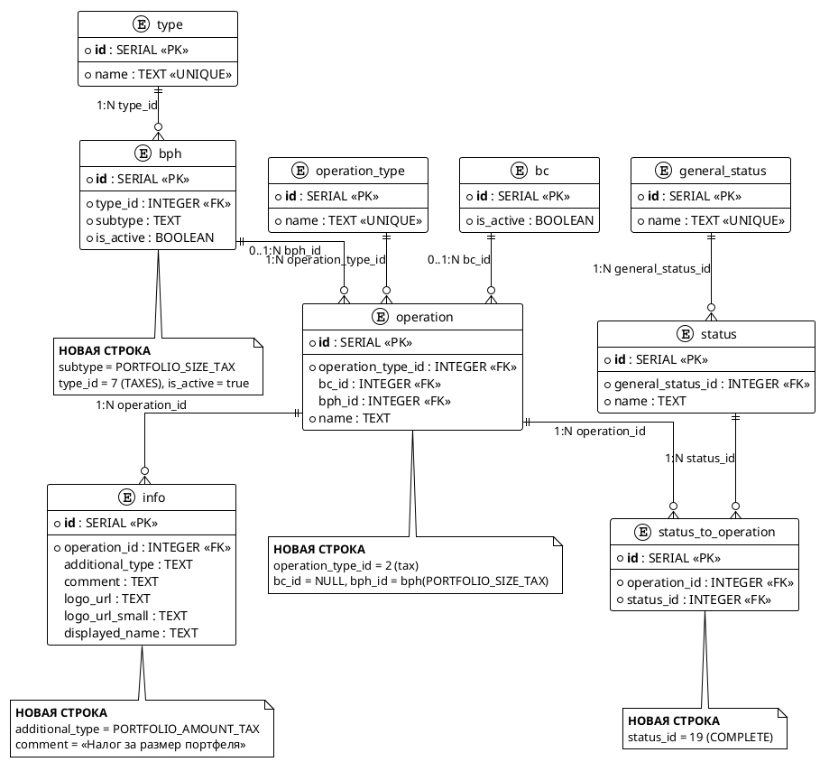

# bph-portfolio-size-tax

## 1. Бизнес-требования

### 1.1. Цель

**Источник требования:**

| Параметр | Значение |
|----------|----------|
| Фича | Налог за размер портфеля из BPH (`bph-portfolio-size-tax`) |
| Источник | Бриф (первичный); отдельного SIHIST-тикета под фичу в `analytics/` не найдено (Q-01) |
| Инициатор | `[GAP-GOAL-01]` |
| Дата / версия | Draft 2026-08 |

**Стейкхолдеры:**

| Стейкхолдер | Роль | Интерес / ожидание | Влияние / ответственность |
|-------------|------|--------------------|---------------------------|
| Клиент мобильного банка | Пользователь | Видит взимание налога за размер портфеля в ленте операций и на деталке налога | Использует результат фичи |
| Product Owner / бизнес-аналитик | Владелец продукта | Принимает решения по значениям subtype/additionalType/comment (Q-01–Q-10) | Принимает функциональный результат и закрывает решения |
| Команда BPH | Поставщик данных | Отдаёт новый subtype в `GET_OPERATIONS_WITH_DETAILS` | Отвечает за полноту и корректность данных источника и контракта |
| Команда history-ops (ИО) | Владелец агрегации | Добавить новый налог data-driven через таблицы маппинга БД HO | Реализует Liquibase-миграцию, тесты и пролив |
| Сопровождение ИО | Эксплуатация | Пролив Liquibase changeset на стенды | Отвечает за деплой и конфигурацию `operation-cache` |

**Бизнес-правила и ограничения:**

| ID | Тип | Описание | Источник / обоснование |
|----|-----|----------|------------------------|
| BR-01 | Бизнес-правило | Новый неторговый BPH subtype `TAXES/PORTFOLIO_SIZE_TAX` маппится в `operation_type = tax` через таблицы маппинга БД HO | Бриф; Q-01, Q-02, Q-03 |
| BR-02 | Бизнес-правило | Порог «от 5 000 000 ₽» — условие начисления на стороне BPH; HO порог не фильтрует и отображает взимание безусловно | Бриф; Q-09 |
| BR-03 | Бизнес-правило | Налог взимается отдельно по каждой операции (не агрегированно); HO не дедуплицирует типовые операции по `externalSystemId`; уникальность `externalSystemId` — ответственность BPH | Бриф; Q-10; SIHIST-3367 |
| BR-04 | Бизнес-правило | Операция добавляется data-driven через таблицы маппинга БД HO (`bph`/`operation`/`info`/`status_to_operation`); Java-код и алгоритм запроса/ответа BPH не меняются | Бриф; SIHIST-3367; SIHIST-2796 |
| BR-05 | Бизнес-правило | `comment` для UI берётся из `info` по `additional_type`; при пустом `info.comment` — fallback `details.accComment` | SIHIST-3476; SIHIST-2811 |

**Цель фичи:**

| Вопрос | Ответ |
|--------|-------|
| Какую бизнес-проблему решает? | Клиент не видит взимание «налога за размер портфеля» (порог от 5 000 000 ₽) из источника BPH — неторговая налоговая операция не отображается в истории операций |
| Какую ценность приносит пользователю? | Клиент видит взимание налога за размер портфеля в ленте операций с комментарием «Налог за размер портфеля» и на деталке налога |
| Какие метрики улучшает? | Полнота налоговой ленты — наличие операций `PORTFOLIO_SIZE_TAX` в SEND_OPERATIONS; целевое значение/порог — `[GAP-GOAL-02]` |

**SMART-проверка цели:**

| Критерий | Описание | Значение |
|----------|----------|----------|
| Specific | Конкретная | Добавить маппинг `TAXES/PORTFOLIO_SIZE_TAX` → `operation_type = tax` через Liquibase-миграцию таблиц `bph`/`operation`/`info`/`status_to_operation` (без правок Java-кода) |
| Measurable | Измеримая | Операция появляется в SEND_OPERATIONS с `type=tax`, `comment=«Налог за размер портфеля»`, `general_status=executed`; целевое значение метрики — `[GAP-GOAL-02]` |
| Achievable | Достижимая | Паттерн SIHIST-3321 / MOEX_TAX: data-driven через таблицы маппинга, Java-код не меняется |
| Relevant | Релевантная | Прямо влияет на полноту налоговой ленты клиента и корректность истории операций |
| Time-bound | Ограниченная по времени | `[GAP-GOAL-03]` — релиз/срок не зафиксирован |

**Противоречия и решения:**

| Требование 1 | Требование 2 | Источник 1 | Источник 2 | Решение | Обоснование |
|--------------|--------------|------------|------------|---------|-------------|
| Противоречия не выявлены | - | Бриф | - | - | Порог «от 5 млн ₽» (начисление на стороне BPH) и «HO отображает безусловно» не конфликтуют (Q-09) |

**Gaps и допущения:**

| ID | Тип | Где обнаружено | Что не хватает / что предполагается | Как закрыть |
|----|-----|----------------|-------------------------------------|-------------|
| GAP-GOAL-01 | Gap | Источник требования — инициатор | Имя/роль инициатора требования не указаны в брифе и контексте | Product Owner / команда истории операций |
| GAP-GOAL-02 | Gap | Цель фичи — метрики (SMART Measurable) | Целевое значение/порог метрики «полнота налоговой ленты» не задано | Product Owner / аналитика |
| GAP-GOAL-03 | Gap | SMART Time-bound | Релиз/срок не зафиксированы в брифе и контексте | Product Owner / план релизов |
| GAP-GOAL-04 | Допущение | Бизнес-правила BR-01/BR-05 (Q-01, Q-04, Q-05) | Точные значения `PORTFOLIO_SIZE_TAX`, `PORTFOLIO_AMOUNT_TAX`, comment «Налог за размер портфеля» взяты из брифа/решений пользователя; в `analytics/`/`repositories/`/`db-export/` 0 совпадений — контракт BPH не подтверждён | контракт BPH (`bph_config_*`) / команда BPH |

### 1.2. Процесс/Сервис AS IS

**Как работает сейчас:**

При запросе истории операций от МП с `operationTypes`, содержащим `tax`, модуль history-ops формирует запрос к BPH `GET_OPERATIONS_WITH_DETAILS` по кэшу маппинга БД HO. В семействе `TAXES` (type_id=7) в таблицах маппинга БД HO активны два subtype: `TAX_RETAIN` (маппится в `operation_type = tax`, `bc_id = 110`) и `TAX_REFUND_BROK_ACCOUNT` (маппится в `operation_type = tax_input`, `bc_id = NULL`). Subtype «налог за размер портфеля» в маппинге отсутствует — history-ops его не запрашивает у BPH и не возвращает в SEND_OPERATIONS.

**Use Case AS IS:**

| Элемент | Значение |
|---------|----------|
| Название | Получить историю налоговых операций из BPH |
| Актор(ы) | Клиент (через МП / мобильное приложение); history-ops (модуль Истории Операций); BPH (Brokerage Portfolio History) |
| Триггер | Запрос истории операций от МП (SEND_OPERATIONS) с `operationTypes`, содержащим `tax` |
| Предусловия | См. таблицу предусловий ниже |
| Постусловия | См. таблицу постусловий ниже |
| Бизнес-правила | BR-04, BR-05 (см. раздел 1.1) |

**Предусловия AS IS:**

| № | Предусловие | Проверяемое условие |
|---|-------------|---------------------|
| 1 | Клиент авторизован в мобильном банке | session.status = ACTIVE |
| 2 | Запрос истории содержит налоговый тип | `operationTypes` содержит `tax` (и/или `tax_input`) |
| 3 | В таблицах маппинга БД HO есть активные записи для семейства `TAXES` | `bph.is_active = true` для `TAX_RETAIN` (bph_id=19) и `TAX_REFUND_BROK_ACCOUNT` (bph_id=20) |
| 4 | history-ops имеет доступ к BPH | доступен endpoint `GET_OPERATIONS_WITH_DETAILS` |

**Постусловия AS IS:**

| Исход | Постусловие |
|-------|-------------|
| Успех | В SEND_OPERATIONS возвращены налоговые операции `TAX_RETAIN` (`type=tax`) и `TAX_REFUND_BROK_ACCOUNT` (`type=tax_input`) с `comment` из `info`, `general_status=executed`. Операция «налог за размер портфеля» отсутствует |
| Неуспех (бизнес) | Subtype без активной записи в кэше маппинга не включается в `subtypesAndStatuses` и не попадает в ответ |
| Неуспех (техн.) | BPH недоступен — налоговые операции из BPH не возвращаются |

**Бизнес-правила AS IS:**

| ID | Правило | Применяется на шаге |
|----|---------|---------------------|
| BR-04 | Операции добавляются data-driven через таблицы маппинга БД HO; алгоритм формирования запроса и обработки ответа BPH не меняется | Шаг 2, Шаг 5 |
| BR-05 | `comment` для UI берётся из `info` по `additional_type`; при пустом `info.comment` — fallback `details.accComment` | Шаг 5 |

**Основной сценарий AS IS:**

```
Шаг 1:  Клиент (через МП) запрашивает историю операций с operationTypes: ["tax", ...]
Шаг 2:  history-ops формирует subtypesAndStatuses по кэшу маппинга БД HO:
          TAX_RETAIN (statuses: [COMPLETE], additionalTypes: OUT_MONEY / OUT_SECURITIES /
          TAX_PERIOD_END / INCENTIVE_PAYMENT) и TAX_REFUND_BROK_ACCOUNT (statuses: [COMPLETE])
          ЕСЛИ [BR-04] для семейства TAXES есть активная запись в кэше (bph_active=true)
            ТО сценарий продолжается с шага 3
          ИНАЧЕ
            ПЕРЕЙТИ К альтернативному сценарию 2a
Шаг 3:  history-ops вызывает BPH GET_OPERATIONS_WITH_DETAILS
          (POST /api/v1/incoming-gateway/operations-with-details)
Шаг 4:  BPH возвращает операции с type=TAXES, subtype ∈ {TAX_RETAIN, TAX_REFUND_BROK_ACCOUNT}
          ЕСЛИ BPH вернул запрошенные операции
            ТО сценарий продолжается с шага 5
          ИНАЧЕ ЕСЛИ BPH вернул ошибку или недоступен
            ПЕРЕЙТИ К альтернативному сценарию 4a
Шаг 5:  history-ops маппит каждую операцию: находит operation в кэше по bph_type+bph_subtype,
          подбирает comment из info по additional_type [BR-05]
          ЕСЛИ [BR-05] в info найден comment для additional_type
            ТО подставить comment и продолжить с шага 6
          ИНАЧЕ ЕСЛИ info.comment пустой
            ПЕРЕЙТИ К альтернативному сценарию 5a
Шаг 6:  history-ops возвращает SEND_OPERATIONS: type=tax / tax_input, general_status=executed,
          comment из info
Шаг 7:  МП отображает налоговые операции в ленте; «налог за размер портфеля» не отображается
          (subtype отсутствует в маппинге)
```

**Альтернативные сценарии AS IS:**

```
2a. В кэше нет активной записи для семейства TAXES (Бизнес-ошибки):
  2a.1. history-ops не включает subtype в subtypesAndStatuses
  2a.2. Налоговые операции не запрашиваются у BPH
  2a.3. Сценарий завершается без налоговых операций в SEND_OPERATIONS

4a. BPH вернул ошибку или недоступен (Технические ошибки):
  4a.1. Налоговые операции из BPH не возвращаются в SEND_OPERATIONS
  4a.2. Сценарий завершается неуспешно для источника BPH

5a. info.comment пустой [BR-05] (Пограничные случаи):
  5a.1. history-ops подставляет fallback details.accComment
  5a.2. ЕСЛИ accComment также пустой — comment не передаётся
  5a.3. Возврат к шагу 6
```

**Связи между Use Cases:**

| Связь | Связанный Use Case | Шаг / Extension Point | Условие |
|-------|--------------------|-----------------------|---------|
| include | Получить историю операций из BPH (SEND_OPERATIONS) | Шаг 3 основного сценария | Всегда (обязательно при формировании ленты) |

**Таблица проблем AS IS:**

| Проблема | Влияние на бизнес | Частота | Стоимость проблемы | Приоритет |
|----------|-------------------|---------|-------------------|-----------|
| Клиент не видит взимание «налога за размер портфеля» из BPH (subtype `PORTFOLIO_SIZE_TAX` отсутствует в маппинге) | Неполнота налоговой ленты; клиент не информирован о взимании налога | Каждая операция subtype `PORTFOLIO_SIZE_TAX` | `[GAP-UCAS-02]` | `[GAP-UCAS-01]` |

**Gaps и допущения:**

| ID | Тип | Где обнаружено | Что не хватает / что предполагается | Как закрыть |
|----|-----|----------------|-------------------------------------|-------------|
| GAP-UCAS-01 | Gap | Таблица проблем — приоритет (Q-01) | Приоритет проблемы «Высокий» принят качественно из брифа; отдельного SIHIST-тикета с оценкой влияния отсутствия операции в `analytics/` не найдено | Product Owner / бизнес-аналитик |
| GAP-UCAS-02 | Gap | Таблица проблем — стоимость проблемы | Количественная оценка стоимости проблемы (влияние на бизнес в деньгах/метрике) не определена | Product Owner / аналитика |

### 1.3. Процесс/Сервис TO BE

**Целевое состояние:** при запросе истории с `operationTypes: tax` в запрос к BPH добавляется пара `TAXES / PORTFOLIO_SIZE_TAX` (`statuses: [COMPLETE]`, `additionalTypes: [PORTFOLIO_AMOUNT_TAX]`); ответ BPH маппится в SEND_OPERATIONS как `type=tax` с `comment` из `info` («Налог за размер портфеля»). Java-код history-ops не меняется — изменение только в таблицах маппинга БД HO (Liquibase), тестовых фикстурах и `operation-cache` [BR-04].

**Use Case TO BE:**

| Элемент | Значение |
|---------|----------|
| Название | Отобразить налог за размер портфеля из BPH |
| Актор(ы) | Клиент (через МП / мобильное приложение); history-ops (модуль Истории Операций); BPH (Brokerage Portfolio History) |
| Триггер | Запрос истории операций от МП (SEND_OPERATIONS) с `operationTypes`, содержащим `tax` |
| Предусловия | См. таблицу предусловий ниже |
| Постусловия | См. таблицу постусловий ниже |
| Бизнес-правила | BR-01, BR-02, BR-03, BR-04, BR-05 (см. раздел 1.1) |

**Предусловия:**

| № | Предусловие | Проверяемое условие |
|---|-------------|---------------------|
| 1 | Клиент авторизован в мобильном банке | session.status = ACTIVE |
| 2 | Запрос истории содержит налоговый тип | `operationTypes` содержит `tax` |
| 3 | Маппинг нового subtype пролит в БД HO | `bph.is_active = true` для `PORTFOLIO_SIZE_TAX` (type_id=7); есть `operation` (operation_type_id=2, bc_id=NULL), `info` (additional_type=`PORTFOLIO_AMOUNT_TAX`), `status_to_operation` (status_id=19 `COMPLETE`) |
| 4 | history-ops имеет доступ к BPH | доступен endpoint `GET_OPERATIONS_WITH_DETAILS` |

**Постусловия:**

| Исход | Постусловие |
|-------|-------------|
| Успех | Операция возвращена в SEND_OPERATIONS с `type=tax`, `comment=«Налог за размер портфеля»` (из `info`), `general_status=executed`, `total_sum` из `totalPrice`. МП отображает операцию в ленте и на деталке налога `HISTORY_OPS_TAX_DETAILS_SCREEN` |
| Неуспех (бизнес) | Если статус `COMPLETE` не настроен через `status_to_operation`, операция отфильтруется проверкой статус-членства (`statusMap.containsKey(status)`) и не попадёт в ответ. Фильтры `additionalType` и watershed для `bc_id=NULL` не выполняются (ранний `return true` в `isActualBphOperation()`), поэтому для нового налога не являются блокирующими |
| Неуспех (техн.) | BPH недоступен или вернул ошибку — операции нового subtype не возвращаются в SEND_OPERATIONS |

**Бизнес-правила:**

| ID | Правило | Применяется на шаге |
|----|---------|---------------------|
| BR-01 | Новый неторговый BPH subtype `TAXES/PORTFOLIO_SIZE_TAX` маппится в `operation_type = tax` через таблицы маппинга БД HO | Шаг 6 |
| BR-02 | Порог «от 5 000 000 ₽» — условие начисления на стороне BPH; HO порог не фильтрует и отображает взимание безусловно | Шаг 4 (внешнее условие BPH) |
| BR-03 | Налог взимается отдельно по каждой операции (без агрегации); HO не дедуплицирует типовые операции по `externalSystemId` в одном ответе | Шаг 6 |
| BR-04 | Операция добавляется data-driven через таблицы маппинга БД HO; Java-код и алгоритм запроса/ответа BPH не меняются | Шаг 2 |
| BR-05 | `comment` для UI берётся из `info` по `additional_type`; при пустом `info.comment` — fallback `details.accComment` | Шаг 5 |

**Основной сценарий — Happy Path:**

```
Шаг 1:  Клиент (через МП) запрашивает историю операций с operationTypes: ["tax", ...]
Шаг 2:  history-ops формирует subtypesAndStatuses по кэшу маппинга БД HO, добавляя пару
        TAXES/PORTFOLIO_SIZE_TAX со statuses: [COMPLETE] и additionalTypes: [PORTFOLIO_AMOUNT_TAX]
        ЕСЛИ [BR-04] в кэше маппинга есть operation с bph_active=true и bph_subtype=PORTFOLIO_SIZE_TAX
          ТО сценарий продолжается с шага 3
        ИНАЧЕ
          ПЕРЕЙТИ К альтернативному сценарию 2a
Шаг 3:  history-ops вызывает BPH GET_OPERATIONS_WITH_DETAILS
        (POST /api/v1/incoming-gateway/operations-with-details)
Шаг 4:  BPH возвращает операции type=TAXES, subtype=PORTFOLIO_SIZE_TAX со status=COMPLETE
        и additionalType=PORTFOLIO_AMOUNT_TAX; начисление порога «от 5 000 000 ₽» выполнено
        на стороне BPH [BR-02]
        ЕСЛИ BPH вернул запрошенные операции
          ТО сценарий продолжается с шага 5
        ИНАЧЕ ЕСЛИ BPH вернул ошибку или недоступен
          ПЕРЕЙТИ К альтернативному сценарию 4a
Шаг 5:  history-ops находит operation в кэше по bph_type+bph_subtype и подбирает comment
        из info по additional_type=PORTFOLIO_AMOUNT_TAX [BR-05]
        ЕСЛИ [BR-05] в info найден comment для additional_type=PORTFOLIO_AMOUNT_TAX
          ТО подставить comment «Налог за размер портфеля» и продолжить с шага 6
        ИНАЧЕ ЕСЛИ info.comment пустой
          ПЕРЕЙТИ К альтернативному сценарию 5a
Шаг 6:  history-ops формирует операцию SEND_OPERATIONS: type=tax [BR-01], comment из info,
        general_status=executed, total_sum из totalPrice; отдельная запись на каждую операцию,
        без агрегации [BR-03]
Шаг 7:  МП отображает операцию «Налог за размер портфеля» в ленте операций и на деталке
        налога (HISTORY_OPS_TAX_DETAILS_SCREEN)
```

**Альтернативные сценарии:**

```
2a. Subtype PORTFOLIO_SIZE_TAX отсутствует в кэше маппинга (Бизнес-ошибки):
  2a.1. history-ops не включает пару TAXES/PORTFOLIO_SIZE_TAX в subtypesAndStatuses
  2a.2. Операция не запрашивается у BPH и не попадает в SEND_OPERATIONS
  2a.3. Сценарий завершается для данного subtype (налог не отображается)

4a. BPH вернул ошибку или недоступен (Технические ошибки):
  4a.1. Операции нового subtype не возвращаются в SEND_OPERATIONS
  4a.2. Сценарий завершается неуспешно для источника BPH

5a. info.comment пустой для additional_type=PORTFOLIO_AMOUNT_TAX [BR-05] (Пограничные случаи):
  5a.1. history-ops подставляет fallback details.accComment
  5a.2. ЕСЛИ accComment также пустой — comment не передаётся
  5a.3. Возврат к шагу 6
```

**Связи между Use Cases:**

| Связь | Связанный Use Case | Шаг / Extension Point | Условие |
|-------|--------------------|-----------------------|---------|
| include | Получить историю операций из BPH (SEND_OPERATIONS) | Шаг 3 основного сценария | Всегда (вызов `GET_OPERATIONS_WITH_DETAILS` при формировании ленты) |

**Изменения относительно AS IS:**

| № | Элемент | AS IS | TO BE | Тип изменения |
|---|---------|-------|-------|---------------|
| 1 | Маппинг subtype в БД HO (семейство `TAXES`) | активны только `TAX_RETAIN` (→ `tax`) и `TAX_REFUND_BROK_ACCOUNT` (→ `tax_input`); `PORTFOLIO_SIZE_TAX` отсутствует | добавлен subtype `PORTFOLIO_SIZE_TAX` + `operation` (operation_type_id=2, bc_id=NULL) + `info` (additional_type=`PORTFOLIO_AMOUNT_TAX`) + `status_to_operation` (`COMPLETE`) | NEW |
| 2 | Шаг 2: формирование `subtypesAndStatuses` | пара `TAXES/PORTFOLIO_SIZE_TAX` не включается | добавляется пара `{type=TAXES, subtype=PORTFOLIO_SIZE_TAX, statuses=[COMPLETE], additionalTypes=[PORTFOLIO_AMOUNT_TAX]}` | CHG |
| 3 | Шаг 4–6: результат в SEND_OPERATIONS | операция «налог за размер портфеля» отсутствует | `type=tax`, `comment=«Налог за размер портфеля»`, `general_status=executed` | NEW |
| 4 | Java-код history-ops | без правок | без правок (data-driven) | без изменений |
| 5 | МП / композит | без изменений | без изменений (тот же `type=tax`, та же деталка налога) | без изменений |

**Преимущества:**

- Полнота налоговой ленты: клиент видит взимание «налога за размер портфеля» (порог от 5 000 000 ₽) в ленте операций и на деталке налога.
- Data-driven реализация: 0 изменённых Java-классов; scope = Liquibase changeset + тестовые фикстуры + пролив.
- Переиспользование фронта: существующий `type=tax` и деталка `HISTORY_OPS_TAX_DETAILS_SCREEN` без правок МП/композита.

**Gaps и допущения:**

| ID | Тип | Где обнаружено | Что не хватает / что предполагается | Как закрыть |
|----|-----|----------------|-------------------------------------|-------------|
| GAP-UCTB-01 | Допущение | Сценарий — значения subtype/additionalType/comment (Q-01, Q-04, Q-05) | Значения `PORTFOLIO_SIZE_TAX`, `PORTFOLIO_AMOUNT_TAX`, comment «Налог за размер портфеля» взяты из брифа/решений пользователя; в `analytics/`/`repositories/`/`db-export/` 0 совпадений — контракт BPH не подтверждён. При несовпадении написания фильтр `additionalTypes` вернёт пусто, налог молча не отобразится | Сверить с контрактом BPH (`bph_config_*`) / командой BPH до пролива |

## 2. Ограничения и допущения

**Ограничения:**

| ID | Тип | Описание | Источник / обоснование |
|----|-----|----------|------------------------|
| CN-01 | Архитектурное | Java-код `history-ops` не изменяется — фича реализуется data-driven через таблицы маппинга БД HO | Бриф; BR-04; паттерн SIHIST-3321 / `bph-moex-tax` (MOEX_TAX) |
| CN-02 | Архитектурное | МП и композит BDUI не изменяются — тот же `operation_type=tax`, та же деталка `HISTORY_OPS_TAX_DETAILS_SCREEN` | Контекст: `HistoryOperationTaxDetailsHeaderSection`, `TaxSectionCreator` |
| CN-03 | Архитектурное | Новый тип во фронтовый enum `PortfolioOperationType` не вводится — `tax` (71) и `tax_input` (93) уже присутствуют | `src/main/swagger/history/history.yml:60-93` |

**Допущения:**

| ID | Допущение | Источник | Пруф контракта |
|----|-----------|----------|----------------|
| AS-01 | Семейство операции — `TAXES` (`history_ops.type` id=7) | Q-02; `db-export/БД ИО.md:319` | Подтверждено (БД) |
| AS-02 | Статус BPH — `COMPLETE` (id=19) → `general_status_id=1 (executed)` | Q-07; `create_schema.sql:607-608`, `db-export/БД ИО.md:375` | Подтверждено (БД) |
| AS-03 | `bc_id` = `NULL` — операция только из BPH, без BC-аналога | Q-06; аналог `TAX_REFUND_BROK_ACCOUNT` (`operation` id=23, `bc_id=NULL`) | Решение (по аналогу) |
| AS-04 | `additionalType` = `PORTFOLIO_AMOUNT_TAX` (одно непустое, не `NULL`) | Q-04 | НЕТ контрактного пруфа — из брифа/решений пользователя, 0 совпадений в `analytics/`/`repositories/`/`db-export/` |
| AS-05 | BPH subtype = `PORTFOLIO_SIZE_TAX` | Q-01 | НЕТ контрактного пруфа — из брифа/решений пользователя, 0 совпадений |
| AS-06 | `comment`/`name` = «Налог за размер портфеля» | Q-05 | НЕТ контрактного пруфа — из брифа/решений пользователя, 0 совпадений |

**Watershed (`bc_id=NULL`):**

Для `bc_id=NULL` (нет BC-контекста: `bcType`/`bcSubtype` пусты) `historyStart` **не используется**: внутри `BphBcFilterService.isActualBphOperation()` срабатывает ранний `return true` (`BphBcFilterService.java:185-191`), поэтому пропускаются проверка водораздела (`formationDate` vs `historyStart`), фильтр `additionalType` и лог INFO + метрика `unexpected_additional_type_for_common_operation`. Статус-членство при этом проверяется отдельно и всегда — `isBphCommonOperation()` → `statusMap.containsKey(status)` (`BphBcFilterService.java:69-86`): для нового налога `status=COMPLETE` настроен через `status_to_operation`, поэтому операция проходит. Наличие ключа `TAXES|PORTFOLIO_SIZE_TAX` в ответе `GET_OPERATION_TYPES` не требуется; ручная настройка HO не нужна (Q-08, Q-08 уточн.).

**Зависимости и чекпойнты приёмки:**

1. **Зависимость:** BPH отдаёт операции нового subtype через `GET_OPERATIONS_WITH_DETAILS` (`POST /api/v1/incoming-gateway/operations-with-details`); до включения на стороне BPH допустимая деградация — «налог не показывается» (no-op без сигнала).
2. **Чекпойнт приёмки (не блокирующий):** до пролива сверить точное написание `PORTFOLIO_SIZE_TAX` / `PORTFOLIO_AMOUNT_TAX` с контрактом BPH (`bph_config` / команда BPH). Значения взяты из брифа/решений пользователя (Q-01, Q-04, Q-05), в `analytics/`/`repositories/`/`db-export/` 0 совпадений. При неверном написании запросный фильтр `additionalTypes` вернёт пусто — фича молча не покажет налог.
3. **Чекпойнт приёмки:** Liquibase changeset проливается на все стенды до включения; черновые id строк не пересекаются с sibling-спекой `bph-moex-tax` (§4.2.3).
4. **Чекпойнт приёмки:** обновить тестовые фикстуры (`application-test.yml` operation-cache, JSON-ответ BPH, `bph_request_all_completed.json`) — негативный сценарий «неизвестный `additionalType`» зафиксирован в §4.2.2.

**Gaps и допущения:**

| ID | Тип | Где обнаружено | Что не хватает / что предполагается | Как закрыть |
|----|-----|----------------|-------------------------------------|-------------|
| GAP-CONS-01 | Допущение | AS-04/AS-05/AS-06 (Q-01, Q-04, Q-05) | Точные значения BPH subtype `PORTFOLIO_SIZE_TAX`, `additionalType` `PORTFOLIO_AMOUNT_TAX` и comment «Налог за размер портфеля» взяты из брифа/решений пользователя; в `analytics/`/`repositories/`/`db-export/` 0 совпадений — контракт BPH не подтверждён | Контракт BPH (`bph_config` / `GET_OPERATION_TYPES`) / команда BPH |

## 4. Функциональные требования

#### 4.1.1. Сервис BPH — GET_OPERATIONS_WITH_DETAILS

**Назначение**

Интеграционный контракт `history-ops` ↔ BPH для получения ленты операций с
детализацией по неторговым операциям. Фича добавляет в этот контракт **новый
подтип налоговой операции** `TAXES / PORTFOLIO_SIZE_TAX` («Налог за размер
портфеля», порог начисления от 5 000 000 ₽ на стороне BPH). Контракт (поля,
алгоритм запроса/ответа) не меняется — меняются только **данные** таблиц
маппинга БД HO, из которых этот запрос и маппинг ответа формируются
data-driven [BR-01, BR-04].

**Общая информация (endpoint):**

| Параметр | Значение |
|----------|----------|
| Назначение | Получение истории неторговых операций с детализацией (eventType `GET_OPERATIONS_WITH_DETAILS`) |
| Метод | `POST` |
| Path | `/api/v1/incoming-gateway/operations-with-details` |
| Система-источник (consumer) | history-ops (модуль Истории Операций, ИО) |
| Система-получатель (producer) | BPH (Brokerage Portfolio History) |
| Тип интеграции | Синхронная |
| Протокол | REST (HTTPS) |
| Направление | Однонаправленная (Request → Response) |
| Версия API | v1 |
| Аутентификация | Внутренний контур; идентификация системы инициатора заголовком `systemName` (`history_ops`). Пользовательских/сессионных токенов в контракте нет |
| Формат данных | `JSON` |
| Ссылка на контракт | `src/main/swagger/bph/bph.yml:216-265`; SOWA-схема `sowa/.../history_get_operations_with_details/schemes/json/…`; вызов в `BphClient.java:15-36` |

**Request Headers:**

| Заголовок | Обязат. | Описание | Пример |
|-----------|---------|----------|--------|
| `rqUID` | Да | Сквозной идентификатор запроса (UUID, генерируется history-ops) | `c4a5dccd-0fe2-4aa1-823e-a5a5d9ee04a4` |
| `systemName` | Да | Идентификатор системы инициатора | `history_ops` |

Источник: `bph.yml:222-234`; заполнение — `BphClient.java:19-33` (`SYSTEM_NAME="systemName"`, `HISTORY_OPS="history_ops"`, `REQUEST_ID="rqUID"`).

**Request body (`RequestParamsData`):**

Полный перечень полей (существующий контракт; фича не меняет структуру, а добавляет новый элемент в `subtypesAndStatuses`). Источник: `bph.yml:1254-1350` и SOWA-схема запроса.

| Поле | Тип | Nullable | Описание | Ограничение | Заполняется history-ops | Пример |
|------|-----|----------|----------|-------------|-------------------------|--------|
| `agreements` | array[string] | Нет | Массив номеров договоров клиента | maxItems: 1000, maxLength: 255 | Да — из `portfolioAccountsDto.agreementNumberFilter()` | `["KJ28438H394L"]` |
| `startSearchDate` | string | Да | Начало периода поиска (local date-time в 0-м часовом поясе) | maxLength: 255 | Только при включённом period-фильтре (`isPeriodRequestEnabled`) | `2026-01-01T00:00:00` |
| `endSearchDate` | string | Да | Конец периода поиска (по умолчанию текущее время) | maxLength: 255 | Да — всегда (`timeInterval.endTime()`) | `2026-01-31T23:59:59` |
| `page` | integer | Да | Номер страницы (первая = 0) | min: 0, max: 1000 | Нет — не заполняется | `0` |
| `pageSize` | integer | Да | Количество возвращаемых записей | min: 0, max: 1000 | Да — из `bphDynamicProperties.getMaxRecordsFromBph()` | `1000` |
| `types` | array[string] | Да | Типы операций (legacy-фильтр) | maxItems: 100 | Нет — не используется | — |
| `subtypes` | array[string] | Да | Подтипы операций (legacy-фильтр) | maxItems: 100 | Нет — не используется | — |
| `statuses` | array[string] | Да | Статусы (legacy-фильтр) | maxItems: 100 | Нет — не используется | — |
| `subtypesAndStatuses` | array[object] | Нет | Типы/подтипы/статусы для поиска (см. ниже) | maxItems: 1000 | Да — строится из кэша маппинга БД HO | см. ниже |
| `dateForFilter` | enum | Да | Поле для фильтрации по дате | `EVENT_DATE` \| `FORMATION_DATE` | Да — `EVENT_DATE` при сортировке по времени исполнения, иначе `FORMATION_DATE` | `FORMATION_DATE` |
| `tradingSections` | array[string] | Да | Торговые секции | enum: `OTC`, `FOND`; maxItems: 10 | Нет — не заполняется | — |
| `isin` | string | Да | ISIN бумаги для фильтрации | maxLength: 255 | Нет — не заполняется | — |
| `instrumentCurrency` | enum | Да | Валюта инструмента | enum валют (`RUB`, `USD`, `EUR`, …) | Нет — не заполняется | — |
| `tickers` | array[string] | Да | Список тикеров для фильтрации (карточка инструмента) | maxItems: 100, maxLength: 255 | Только при запросе с карточки инструмента | `["RU000A103YM3"]` |
| `selfIdTs` | array[string] | Да | Собственный идентификатор в торговой системе | — | Нет — не заполняется (присутствует только в OpenAPI `bph.yml:1345-1350`, в SOWA-схеме отсутствует) | — |

**`subtypesAndStatuses[]` — структура и новый элемент:**

Структура элемента (`bph.yml:1292-1326`, SOWA `SubtypeAndStatus`):

| Поле | Тип | Обязат. | Описание | Ограничение |
|------|-----|---------|----------|-------------|
| `type` | string | Да | Тип операции (family) | maxLength: 225 |
| `subtype` | string | Да | Подтип операции | maxLength: 225 |
| `subtypes` | array[string] | Нет | Альтернативный список подтипов | maxItems: 100 |
| `additionalTypes` | array[string] | Нет | Дополнительные типы события (non-null `additional_type` из `info`) | maxItems: 100, maxLength: 255 |
| `statuses` | array[string] | Да | Статусы для подтипа | maxItems: 100 |

Заполнение history-ops: `BphBcFilterService.buildBphRequestEntityByBphParams()` (`BphBcFilterService.java:102-122`) — `type`/`subtype`/`statuses` из записи `operation` кэша, `additionalTypes` — из non-null `info.additional_type` (если пусто — поле не передаётся).

Элементы семейства `TAXES` (type_id=7) — существующие + новый:

| type | subtype | additionalTypes | statuses | operation_type | Комментарий |
|------|---------|-----------------|----------|----------------|-------------|
| `TAXES` | `TAX_RETAIN` | `OUT_MONEY`, `OUT_SECURITIES`, `TAX_PERIOD_END`, `INCENTIVE_PAYMENT` | `COMPLETE` | `tax` | Удержание налога (существующее) |
| `TAXES` | `TAX_REFUND_BROK_ACCOUNT` | `NULL` (не передаётся) | `COMPLETE` | `tax_input` | Возврат излишне удержанного налога (существующее) |
| `TAXES` | **`PORTFOLIO_SIZE_TAX`** | **`PORTFOLIO_AMOUNT_TAX`** | `COMPLETE` | `tax` | **Налог за размер портфеля (новое)** |

**Response body 200 OK:**

```
{ "status": ResponseStatusData, "data": [ DetailsData ] }
```

`DetailsData` (`bph.yml:1238-1245`, SOWA): `lead` → `OperationData`, `details` → массив `DetailData` (`{ key: string, value: string|null }` — JSON-детали, история HO использует ключи из `BphConverter.SUPPORTED_DETAILS_KEY`, в т.ч. `comment`, `accComment`, `errorCode`, `statusErrorCode`, `channel`).

`OperationData` (`lead`) — полный перечень полей (`bph.yml:1088-1216`, SOWA-схема ответа — канон):

| Поле | Тип | Nullable | Описание | Пример |
|------|-----|----------|----------|--------|
| `type` | string | Нет | Тип события (family) | `TAXES` |
| `subType` | string | Да | Подтип события (вариант имени) | `PORTFOLIO_SIZE_TAX` |
| `subtype` | string | Да | Подтип события (вариант имени) | `PORTFOLIO_SIZE_TAX` |
| `additionalType` | string | Да | Дополнительный тип события | `PORTFOLIO_AMOUNT_TAX` |
| `externalSystemVersion` | number | Да | Версия события во внешней системе | `5` |
| `formationDate` | string (date-time) | Да | Дата формирования | `2026-01-15T10:30:00` |
| `eventDate` | string (date-time) | Нет | Дата события | `2026-01-15T10:30:00` |
| `additionalDate` | string | Да | Дополнительная дата (для сделок) | — |
| `externalSystemId` | string | Нет | Идентификатор операции во внешней системе | `KU2309848` |
| `price` | object | Да | Цена (`{ value, currency }`) | — |
| `totalPrice` | object | Да | Сумма (`{ value, currency }`) | `{ "value": "-12000.00", "currency": "RUB" }` |
| `quantity` | number | Да | Количество | — |
| `quantityFact` | number | Да | Фактическое количество | — |
| `tradingSection` | string | Да | Торговая секция | `FOND` |
| `account` | string | Да | Счет зачисления/списания | `BROKER` |
| `status` | string | Да | Статус операции | `COMPLETE` |
| `instrument` | object | Да | Данные инструмента (`isin`, `tickers[]`, `currency`, `type`) | — |
| `ucpId` | integer | Да | Идентификатор клиента в ЕПК | `23984692648` |
| `agreement` | string | Нет | Номер договора брокерского обслуживания | `KJ28438H394L` |
| `parent` | string | Да | Идентификатор родительской операции | — |
| `parentIds` | object | Да | Идентификаторы связанных сущностей | — |
| `batchId` | string | Да | Связывающий идентификатор | — |
| `isFact` | boolean | Нет | Признак факта события | `true` |

Примечание: у поля подтипа в контракте два имени — `subType` и `subtype`; `BphOperationConverter.getSubType()` (`BphOperationConverter.java:181-192`) читает оба (приоритет `subtype`). Для нового налога передаётся `subtype = PORTFOLIO_SIZE_TAX`.

**Маппинг `OperationData` (lead) → SEND_OPERATIONS:**

Источник: `BphCommonClientConverter.convert()` (`BphCommonClientConverter.java:53-165`), `BphOperationConverter` (`BphOperationConverter.java`), `BphConverter.getGeneralStatusMap()` (`BphConverter.java:80-107`), SIHIST-3321 (таблица маппинга). Логика маппинга не меняется фичей [BR-04]; помечено **новое** только то, что добавляется для `PORTFOLIO_SIZE_TAX`.

| Поле SEND_OPERATIONS | Тип | Источник из ответа BPH | Логика заполнения | Для нового налога |
|----------------------|-----|------------------------|-------------------|-------------------|
| `id` | string | `externalSystemId` + `operation_type` из кэша | `"bph_%s_%s"` → `bph_tax_<externalSystemId>` (`getId()`, `BphCommonClientConverter.java:168-187`) | `bph_tax_KU2309848` |
| `itemtype` | string | — | пустая строка `""` | `""` |
| `type` | enum `PortfolioOperationType` | `bph_subtype` (кэш) | `operation_type` из кэша, где `bph_subtype` = `subType` из ответа | `tax` (**новое сопоставление** `PORTFOLIO_SIZE_TAX → tax`) |
| `general_status` | enum `GeneralOperationStatus` | `status` | `status_and_general_status` из кэша: `COMPLETE → executed` | `executed` |
| `time_happened` | datetime | `formationDate` | как есть | `2026-01-15T10:30:00` |
| `time_closed` | datetime | `eventDate` | как есть | `2026-01-15T10:30:00` |
| `currency` | string | `totalPrice.currency` | как есть | `RUB` |
| `total_sum` | decimal | `totalPrice.value` | `abs(value)` (`BphCommonClientConverter.java:73-75`) | `12000.00` |
| `comment` | string | `info.comment` по `additional_type` | `info.comment` (матч `info.additional_type == additionalType`); при пустом для `TAXES` — fallback `details.accComment` (`BphCommonClientConverter.java:130-136`) | **`«Налог за размер портфеля»` (новое)** |
| `operation_display_name` | string | `info.displayed_name` | `displayed_name` из `info` (матч по `additional_type`) | **`«Налог за размер портфеля»` (новое)** |
| `instrument_count` | long | `quantity` | `longValue(quantity)` | не заполняется (для налогов `quantity` отсутствует) |
| `channel` | string | `details.channel` | только для активных статусов (`ACTIVE_STATUSES`) | не заполняется |
| `available_cancellation` / `cancellation_comment` | bool / string | `cancellationMap` | по ключу `type|subtype` | не заполняется |
| `agreement_number` | string | `agreement` | как есть (`AgreementDetailsConverter`) | `KJ28438H394L` |
| `portfolio_account_id` | string | `agreement` → AG | `"SB_" + siId` (матч по `agreement` + `tradingSection`, приоритет секций FOND/FX/OTC/FORTS) | `SB_<siId>` |
| `display_name` | string | `agreement` → AG | `displayName` договора из AG | — |
| `account_type` | string | `account` | если `account` ∈ {`BROKER`,`BANK`} (`getAccountType()`, `BphCommonClientConverter.java:265-270`) | `BROKER` |
| `reject_reason_text` | string | `details.errorCode`/`statusErrorCode` | первый непустой (`resolveErrorCode()`, `BphOperationConverter.java:216-226`) | пусто |

**Коды ответов:**

| HTTP код | Код ошибки | Структура ответа | Описание |
|----------|------------|------------------|----------|
| 200 | — | `{ status: { code, message }, data: [DetailsData] }` | Успешный ответ (`code` 0..1000) |
| 400 | — | `ErrorData` | Bad Request |
| 500 | — | `{ status: { code (500..599), message }, data: null }` | Internal Server Error |

`ErrorData` (400, `bph.yml:1443-1474`, SOWA-схема 400): `timestamp` (string|null), `status` (integer 400..499), `error` (string|null), `path` (string|null, pattern `^/api/v1/`), `exception` (string|null). Структуры 400 и 500 различаются (в 500 — вложенный `status{code,message}` + `data`); зафиксировано по SOWA-схемам ответов.

**Пример запроса** (запрос history-ops к BPH за операциями нового налога):

```http
POST /api/v1/incoming-gateway/operations-with-details
rqUID: c4a5dccd-0fe2-4aa1-823e-a5a5d9ee04a4
systemName: history_ops
Content-Type: application/json
```

```json
{
  "agreements": ["KJ28438H394L"],
  "startSearchDate": "2026-01-01T00:00:00",
  "endSearchDate": "2026-01-31T23:59:59",
  "pageSize": 1000,
  "dateForFilter": "FORMATION_DATE",
  "subtypesAndStatuses": [
    {
      "type": "TAXES",
      "subtype": "PORTFOLIO_SIZE_TAX",
      "additionalTypes": ["PORTFOLIO_AMOUNT_TAX"],
      "statuses": ["COMPLETE"]
    }
  ]
}
```

**Пример ответа** (операция налога за размер портфеля):

```json
{
  "status": { "code": 0, "message": "OK" },
  "data": [
    {
      "lead": {
        "type": "TAXES",
        "subtype": "PORTFOLIO_SIZE_TAX",
        "additionalType": "PORTFOLIO_AMOUNT_TAX",
        "externalSystemVersion": 5,
        "formationDate": "2026-01-15T10:30:00",
        "eventDate": "2026-01-15T10:30:00",
        "externalSystemId": "KU2309848",
        "totalPrice": { "value": "-12000.00", "currency": "RUB" },
        "status": "COMPLETE",
        "tradingSection": "FOND",
        "account": "BROKER",
        "agreement": "KJ28438H394L",
        "isFact": true
      },
      "details": [
        { "key": "comment", "value": "Налог за размер портфеля" }
      ]
    }
  ]
}
```

Результирующий элемент SEND_OPERATIONS (`type=tax`):

```json
{
  "id": "bph_tax_KU2309848",
  "itemtype": "",
  "type": "tax",
  "general_status": "executed",
  "time_happened": 1736937000,
  "time_closed": 1736937000,
  "currency": "RUB",
  "total_sum": "12000.00",
  "comment": "Налог за размер портфеля",
  "operation_display_name": "Налог за размер портфеля"
}
```

**Пограничный случай — пустой результат:** при отсутствии операций BPH возвращает `data: []` (пустой массив, не `null`) с `status.code = 0`; history-ops в этом случае не добавляет операций в SEND_OPERATIONS. Негативный сценарий фильтрации (неизвестный `additionalType`) описывается в §4.2.2.

**Gaps и допущения:**

| ID | Тип | Где обнаружено | Что не хватает / что предполагается | Как закрыть |
|----|-----|----------------|-------------------------------------|-------------|
| GAP-INT-01 | Допущение | Новый subtype (Q-01) | BPH subtype `PORTFOLIO_SIZE_TAX` взят из брифа/решений пользователя; в `analytics/`/`repositories/`/`db-export/` 0 совпадений — контракт BPH не подтверждён. При неверном написании запрос вернёт пусто и налог молча не отобразится | Контракт BPH (`bph_config` / `GET_OPERATION_TYPES`) / команда BPH |
| GAP-INT-02 | Допущение | Новый `additionalType` (Q-04) | `additionalType = PORTFOLIO_AMOUNT_TAX` (одно непустое, не `NULL`) — из брифа/решений пользователя, без контрактного пруфа | Контракт BPH / команда BPH |
| GAP-INT-03 | Допущение | Новый `comment`/`displayed_name` (Q-05) | Текст «Налог за размер портфеля» для `info.comment` и `info.displayed_name` — из брифа/решений пользователя, без пруфа | Product Owner / бизнес-аналитик |

Примечание: точное значение `code` в успешном `status` (здесь показан иллюстративный `0`) не закреплено в контракте диапазоном 0..1000 (SOWA `ResponseStatusData`); конкретное значение на стенде — у команды BPH.

#### 4.2.2. Алгоритм обработки запроса GET_OPERATIONS_WITH_DETAILS

Обработка ответа BPH на запрос `GET_OPERATIONS_WITH_DETAILS` (`POST /api/v1/incoming-gateway/operations-with-details`, §4.1.1) состоит из трёх этапов: формирование запроса к BPH (§4.2.2.1), фильтрация операций из ответа (§4.2.2.2) и маппинг операций в `SEND_OPERATIONS` (§4.2.2.3). Фича data-driven ([BR-04]): Java-код history-ops не меняется — новый подтип попадает в запрос и проходит фильтрацию автоматически после INSERT в таблицы маппинга БД HO (§4.2.3).

##### 4.2.2.1. Формирование запроса к BPH

Вход: `ExecutionProcess` (в т.ч. статус-фильтр) и множество запрошенных фронтом `PortfolioOperationType` (МП/композит передаёт `operationTypes: ["tax", …]`, изменения фронта не требуются — enum уже содержит `tax`). Выход: список `subtypesAndStatuses[]` для тела запроса `GET_OPERATIONS_WITH_DETAILS`.

Шаг 1. `BphGateway` вызывает `BphBcFilterService.buildCommonEntitiesToRequest(executionProcess, requestedOperationTypes)`.

Шаг 2. Для каждой записи кэша `operationsMap` проверяется `isCorrectEntityToBuildBphRequest` → `isCorrectEntityByBphAttributes`:
   - `operation.hasBphContext()` (= `bphActive && type != null && statusAndGeneralStatus != null`) **И**
   - `requestedOperationTypes.contains(operation.toOperationTypeEnum())`.

Шаг 3. Для отобранной записи при `operation.bphActive()` вызывается `buildBphRequestEntityByBphParams(operation, statusFilter)`, который собирает элемент `subtypesAndStatuses[]`:
   - `type` = `operation.getBphType()` = `TAXES`;
   - `subtype` = `operation.getBphSubtype()` = `PORTFOLIO_SIZE_TAX`;
   - `statuses` = ключи `statusAndGeneralStatus`, чьё значение входит в `statusFilter` (для запроса `executed` → `[COMPLETE]`);
   - `additionalTypes` = `operation.info().map(AdditionalInfo::getAdditionalType).filter(nonNull)` → `[PORTFOLIO_AMOUNT_TAX]` (в запрос включаются только non-null значения `additional_type` из `info`; при пустом списке поле не выставляется).

Шаг 4. Элемент проходит проверку `isCorrectRequestEntity` (`statuses` не пуст **И** `type` не пуст **И** `subtype` не пуст) и добавляется в `subtypesAndStatuses`.

Итог для фичи: при `operationTypes` содержит `tax` и `bph_active = true` в запрос к BPH добавляется элемент `{ type: "TAXES", subtype: "PORTFOLIO_SIZE_TAX", additionalTypes: ["PORTFOLIO_AMOUNT_TAX"], statuses: ["COMPLETE"] }` ([BR-01], [BR-04]).

##### 4.2.2.2. Фильтрация операций из ответа BPH

Вход: список `BphOperationWrapper` из ответа BPH. Обработка — в `BphCommonListBuilder.buildList()` (фильтры применяются последовательно, оба обязательны).

**Шаг A — членство в кэше типовых операций (`isBphCommonOperation`, проверяется всегда).**
1. `BphBcFilterService.isBphCommonOperation(bphOperationWrapper)` → для каждой записи кэша `isCommonOperationByBphContext`:
   - `cacheOperation.bphActive()` **И** `bphType == cacheOperation.getBphType()` **И** `bphSubtype == cacheOperation.getBphSubtype()` **И** `statusMap.containsKey(status)`, где `statusMap = cacheOperation.getStatusAndGeneralStatus()`.
2. Для `TAXES/PORTFOLIO_SIZE_TAX` со статусом `COMPLETE`: `statusMap = {COMPLETE: executed}` → `statusMap.containsKey("COMPLETE") = true`; операция проходит статус-членство. Статус-членство — обязательное условие для **всех** операций (в т.ч. для `bc_id = NULL`).

**Шаг B — актуальность по водоразделу и `additionalType` (`isActualBphOperation`).**
1. Ищется запись кэша по BPH-контексту (`hasOperationByBphContext`: `bphType + bphSubtype + bphActive`) и по BC-контексту (`hasOperationByBcContext`: `bcType + bcSubtype + bcActive`).
2. Для `bc_id = NULL` (нет BC-аналога, [BR-01]/§4.2.3): `optionalOperationByBc` отсутствует; у записи `operationInternal` есть BPH-контекст (`type != null && bphSubtype != null`), но нет BC-контекста (`bcType == null || bcSubtype == null`). Условие `!hasBphContext || !hasBcContext` истинно → метод возвращает `true` досрочно (ранний return). Следствия:
   - водораздел (`formationDate` vs `historyStart` из `BphDynamicConfig.getStartDateWithDB`) **НЕ** проверяется;
   - `additionalType` **НЕ** валидируется в фильтре;
   - INFO-лог `Unexpected additional type for common BPH operation id=%s type=%s subType=%s additionalType=%s` и метрика `unexpected_additional_type_for_common_operation` **НЕ** выполняются; алерт не требуется.
3. Для операций **с BC-контекстом** (не применимо к `PORTFOLIO_SIZE_TAX`, дано для полноты): выполняются проверка водораздела и валидация `additionalType ∈ info.additional_type` (сравнение с `""` при null); при несовпадении операция отфильтровывается, пишется INFO-лог и инкрементится метрика `unexpected_additional_type_for_common_operation`.

Шаг C. `filterInvalidTransfer` (только для transfer-операций) на `PORTFOLIO_SIZE_TAX` не влияет.

Следствие для фичи: для `PORTFOLIO_SIZE_TAX` (`bc_id = NULL`) операция **не отфильтровывается** ни по водоразделу, ни по `additionalType`; расхождение `additionalType` не исключает операцию из ответа (влияет только на выбор comment, см. §4.2.2.3).

##### 4.2.2.3. Маппинг полей BPH → SEND_OPERATIONS и дедупликация

Отфильтрованные операции проходят `BphCommonClientConverter.convert()` → `HistoryOperationBase` (исходящий `SEND_OPERATIONS`).

Маппинг полей:

| Поле `SEND_OPERATIONS` | Источник | Правило |
|------------------------|----------|---------|
| `id` | `externalSystemId` + `operation_type` | `getId()`: для `TAXES` (не `CASH_FLOW/TRANSFER`, не `NON_TRADE_ORDERS`) → `"bph_%s_%s".formatted(operationType.getValue(), externalSystemId)` = `bph_tax_<externalSystemId>` |
| `type` | кэш `operation.operation_type` | `tax` ([BR-01]) |
| `general_status` | `statusAndGeneralStatus` | `COMPLETE` → `executed` |
| `total_sum` | `totalPrice` | `abs(totalPrice)` |
| `timeHappened` / `timeClosed` | `formationDate` / `eventDate` | без преобразования |
| `comment` | `info` по `additional_type` → fallback `accComment` | см. ниже ([BR-05]) |
| `operation_display_name` | `info.displayed_name` | при найденной строке `info` |

Правило comment ([BR-05]):
1. `getAdditionalInfoFromCache()` → `getOperationFromCache()` (матч `bphType + bphSubtype`, только `bphActive`) → среди `info` выбирается строка по `isCorrectAdditionalType` (`info.additional_type` и `additionalType` сравниваются как `""` при null).
2. Для `PORTFOLIO_SIZE_TAX`: `additionalType = PORTFOLIO_AMOUNT_TAX` = `info.additional_type` → берётся `info.comment = «Налог за размер портфеля»` (§4.2.3, Q-05).
3. Fallback: если `bphType == "TAXES"` и comment пустой → `lead.setComment(operation.accComment())`.
4. Для `bc_id = NULL` расхождение `additionalType` не исключает операцию: при отсутствии подходящей строки `info` comment берётся из fallback `accComment` (а не операция не попадает в ответ).

Дедупликация ([BR-03]): налог взимается отдельно по каждой операции; HO **не** дедуплицирует типовые операции по `externalSystemId` в пределах одного ответа BPH — каждая операция `PORTFOLIO_SIZE_TAX` даёт отдельную запись с уникальным `id = bph_tax_<externalSystemId>`. Уникальность `externalSystemId` — ответственность BPH. Глобальная дедупликация сборки `SEND_OPERATIONS` (торговые + типовые по окну `start/end` + сверка с кэшем Ignite по `id`) — существующее поведение, фичей не меняется.

**Gaps и допущения:**

| ID | Тип | Где обнаружено | Что не хватает / что предполагается | Как закрыть |
|----|-----|----------------|-------------------------------------|-------------|
| GAP-ALG-02 | Допущение | Значения subtype/additionalType/comment (Q-01, Q-04, Q-05) | `PORTFOLIO_SIZE_TAX`, `PORTFOLIO_AMOUNT_TAX`, «Налог за размер портфеля» взяты из брифа/решений пользователя; в `analytics/`/`repositories/`/`db-export/` контракт BPH не подтверждён (0 совпадений) | контракт BPH (`bph_config_*`) / команда BPH |

#### 4.2.3. Модель данных (при изменении БД)

**Контекст изменения:**

| Элемент | Значение |
|---------|----------|
| Фича / изменение | Налог за размер портфеля из BPH — новый неторговый subtype `TAXES/PORTFOLIO_SIZE_TAX`, маппинг в `operation_type = tax` через таблицы маппинга БД HO |
| Тип хранилища | Реляционное |
| СУБД / движок | PostgreSQL (schema `history_ops`) |
| Тип изменения | Новые строки в существующих таблицах `bph`, `operation`, `info`, `status_to_operation` (data-driven); новые таблицы и колонки не создаются |
| Связанные артефакты | §1.1 (BR-01, BR-04, BR-05), §1.3 Use Case TO BE, §4.1.1 интеграция, §4.2.2 алгоритм; Liquibase-миграция оформляется отдельным блоком |

**ER-диаграмма:**



**Новые и изменённые сущности:**

Новые таблицы/колонки не создаются — изменяются **данные** четырёх существующих
таблиц. Ниже — схема затрагиваемых таблиц (по `create_schema.sql`).

**Таблица: `history_ops.bph`**

| Атрибут | Тип | Nullable | Описание | Ограничения |
|---------|-----|----------|----------|-------------|
| id | SERIAL | NOT NULL | Идентификатор subtype BPH | PK |
| type_id | INTEGER | NOT NULL | Ссылка на семейство (type) | FK → type.id |
| subtype | TEXT | NOT NULL | Код subtype BPH | — |
| is_active | BOOLEAN | NOT NULL | Признак активности subtype | DEFAULT TRUE |

**Таблица: `history_ops.operation`**

| Атрибут | Тип | Nullable | Описание | Ограничения |
|---------|-----|----------|----------|-------------|
| id | SERIAL | NOT NULL | Идентификатор операции | PK |
| operation_type_id | INTEGER | NOT NULL | Фронтовый тип операции | FK → operation_type.id |
| bc_id | INTEGER | NULL | Ссылка на BC-активность | FK → bc.id |
| bph_id | INTEGER | NULL | Ссылка на subtype BPH | FK → bph.id |
| name | TEXT | NOT NULL | Название операции | — |

**Таблица: `history_ops.info`**

| Атрибут | Тип | Nullable | Описание | Ограничения |
|---------|-----|----------|----------|-------------|
| id | SERIAL | NOT NULL | Идентификатор строки info | PK |
| operation_id | INTEGER | NOT NULL | Ссылка на операцию | FK → operation.id |
| additional_type | TEXT | NULL | Доп. тип из BPH (`lead.additionalType`) | — |
| comment | TEXT | NULL | Комментарий для UI | — |
| logo_url | TEXT | NULL | URL логотипа | — |
| logo_url_small | TEXT | NULL | URL малого логотипа | — |
| displayed_name | TEXT | NULL | Отображаемое имя | — |

**Таблица: `history_ops.status_to_operation`**

| Атрибут | Тип | Nullable | Описание | Ограничения |
|---------|-----|----------|----------|-------------|
| id | SERIAL | NOT NULL | Идентификатор связки | PK |
| operation_id | INTEGER | NOT NULL | Ссылка на операцию | FK → operation.id |
| status_id | INTEGER | NOT NULL | Ссылка на статус | FK → status.id |

**Новые строки (data-driven маппинг):**

**Таблица `bph` — новый subtype:**

| id | type_id | subtype | is_active | Комментарий |
|----|---------|---------|-----------|-------------|
| 23 | 7 (TAXES) | PORTFOLIO_SIZE_TAX | true | **новая строка** (черновой id, test DB) |

**Таблица `operation` — новая запись маппинга:**

| id | operation_type_id | bc_id | bph_id | name | Комментарий |
|----|-------------------|-------|--------|------|-------------|
| 25 | 2 (tax) | NULL | 23 (PORTFOLIO_SIZE_TAX) | Налог за размер портфеля | **новая строка** (черновой id, test DB) |

> `bc_id = NULL` — у налога за размер портфеля нет BC-аналога (только BPH),
> в отличие от `TAX_RETAIN`/`MOEX_TAX` (`bc_id = 110`, TAX_WITHHOLDING). Аналог —
> `TAX_REFUND_BROK_ACCOUNT` (`operation` id=23, `bc_id = NULL`).

**Таблица `info` — comment по `additional_type`:**

| id | operation_id | additional_type | comment | logo_url | logo_url_small | displayed_name | Комментарий |
|----|--------------|-----------------|---------|----------|----------------|----------------|-------------|
| 53 | 25 | PORTFOLIO_AMOUNT_TAX | Налог за размер портфеля | NULL | NULL | NULL | **новая строка** (черновой id, test DB) |

> `additional_type = PORTFOLIO_AMOUNT_TAX` (одно непустое значение) — в отличие от
> `MOEX_TAX` (`additional_type = NULL`). Поэтому в запросе к BPH
> `subtypesAndStatuses[].additionalTypes` будет содержать `[PORTFOLIO_AMOUNT_TAX]`
> (формируется только из non-null `info.additional_type`, см. §4.2.2.1).

**Таблица `status_to_operation`:**

| id | operation_id | status_id | Комментарий |
|----|--------------|-----------|-------------|
| 38 | 25 | 19 (COMPLETE) | **новая строка** (черновой id, test DB) |

Статус `COMPLETE` (id=19) → `general_status_id = 1` (`executed`) — переиспользуется
из SIHIST-3321, новая строка `status` не требуется.

**Связи между сущностями:**

| Сущность 1 | Сущность 2 | Тип связи | FK / Reference | Описание |
|------------|------------|-----------|----------------|----------|
| type | bph | 1:N | bph.type_id → type.id | Семейство операций BPH (новая строка — TAXES, id=7) |
| operation_type | operation | 1:N | operation.operation_type_id → operation_type.id | Фронтовый тип (новая строка — tax, id=2) |
| bc | operation | 0..1:N | operation.bc_id → bc.id | BC-аналог (новая строка — NULL) |
| bph | operation | 0..1:N | operation.bph_id → bph.id | Связь subtype BPH с операцией (PORTFOLIO_SIZE_TAX, bph id=23) |
| operation | info | 1:N | info.operation_id → operation.id | Comment по additional_type (одна строка на операцию) |
| general_status | status | 1:N | status.general_status_id → general_status.id | Статус → общий статус (COMPLETE id=19 → executed id=1) |
| operation | status_to_operation | 1:N | status_to_operation.operation_id → operation.id | Допустимые статусы операции |
| status | status_to_operation | 1:N | status_to_operation.status_id → status.id | Статус в связке (COMPLETE id=19) |

**Сводные таблицы (junction):**

Не требуются: бизнес-связь «многие ко многим» в фиче отсутствует (одна пара
`bph.type + bph.subtype` ↔ одна `operation`).

**Идентификаторы строк (test / prod):**

Черновые id действительны только для test DB (`create_schema.sql`: max bph=21,
operation=23, info=51, status_to_operation=36). На prod эти id заняты — перед
миграцией брать `SELECT max(id)+1` либо вставку без явного id (SERIAL) с привязкой
FK по business key (`subtype`, пара `bph_type + bph_subtype`).

| Таблица | Черновой id (test) | След. id на prod (snapshot) | Занят черновой id на prod | Примечание |
|---------|--------------------|-----------------------------|---------------------------|------------|
| `bph` | 23 | 26 | id=23 → CONVERSION_DEBIT | sibling `bph-moex-tax` владеет test 22, prod-черновик 25 |
| `operation` | 25 | 28 | id=25 → Конвертация ЦБ Списание | sibling владеет test 24, prod-черновик 27 |
| `info` | 53 | 80 | id=53 → EXCHANGE_NON_TRADE_COMMISSION | sibling владеет test 52, prod-черновик 79 |
| `status_to_operation` | 38 | 58 | id=38 → operation_id=10, status_id=27 | sibling владеет test 37, prod-черновик 57 |

> Координация с `bph-moex-tax`: он уже занимает test-черновики 22/24/52/37 и
> prod-черновики 25/27/79/57. Для `bph-portfolio-size-tax` test-черновики —
> 23/25/53/38, prod-черновики (при деплое после `bph-moex-tax`) — 26/28/80/58.
> Итоговые prod-id определяются порядком пролива changeset'ов (см. GAP-DM-02).

**Область изменения:**

| Категория | Элементы |
|-----------|----------|
| Новые сущности | — (новые таблицы не создаются) |
| Изменённые сущности | `bph` (+1 строка), `operation` (+1 строка), `info` (+1 строка), `status_to_operation` (+1 строка) |
| Удалённые / deprecated сущности | — |
| Затронутые связи | type → bph (TAXES), operation_type → operation (tax), bph → operation (PORTFOLIO_SIZE_TAX), operation → info, operation/status → status_to_operation (COMPLETE) |
| Индексы и ограничения | — (новые индексы/ограничения не требуются; `status.name` UNIQUE-ограничение снято ранее — SIHIST-3330) |
| FK-цели | `type_id=7` (TAXES), `operation_type_id=2` (tax), `bc_id=NULL`, `bph_id=23`, `status_id=19` (COMPLETE) — существуют в test schema / SIHIST-3321 |

**Gaps и допущения:**

| ID | Где найдено | Что неизвестно / что предположено | Как закрыть / подтвердить |
|----|-------------|-----------------------------------|---------------------------|
| GAP-DM-01 | Новые строки §4.2.3 (Q-01, Q-04, Q-05) | Значения `subtype=PORTFOLIO_SIZE_TAX`, `additional_type=PORTFOLIO_AMOUNT_TAX`, comment/name «Налог за размер портфеля» взяты из брифа и закрытых Q-01/Q-04/Q-05 (решения пользователя); в `analytics/`, `repositories/`, `db-export/` подтверждений нет (0 совпадений) — контракт BPH не подтверждён | контракт BPH (`bph_config_*`) / команда BPH |
| GAP-DM-02 | Идентификаторы строк §4.2.3 | Черновые id 23/25/53/38 действительны только для test DB; на prod заняты. Prod-стратегия — `SELECT max(id)+1` или вставка без id + FK по business key. Координация с sibling `bph-moex-tax` (владеет test 22/24/52/37, prod-черновик 25/27/79/57); итоговые prod-id зависят от порядка деплоя | зафиксировать фактические prod-id при проливе; согласовать порядок с `bph-moex-tax` |

## 5. Нефункциональные требования

### 5.4. Требования к настройкам

#### Классификация параметров

**Уровень безопасности:**

| Уровень | Описание | Примеры | Способ хранения |
|---------|----------|---------|-----------------|
| public | Открытые параметры, безопасны для раскрытия | — | ConfigMap / application.yml |
| internal | Внутренние параметры сервиса, не публикуются наружу | `app-config.operation-cache.default-value`, `historyStart` (watershed `BphDynamicConfig`) | ConfigMap / application.yml / БД / in-memory |
| secret | Чувствительные данные | — | Secrets / Vault |

**Частота изменения:**

| Тип | Описание | Примеры | Требует перезапуска |
|-----|----------|---------|---------------------|
| static | Меняется при деплое/миграции, загружается на старте | `app-config.operation-cache.default-value` (seed кэша) | Да (перезагрузка конфигурации) |
| dynamic | Перечитывается из БД по расписанию | маппинг operation-cache из БД (`app-config.operation-cache.update-delay-ms`) | Нет (перечитывается автоматически) |
| runtime | Загружается/обновляется в памяти из внешнего ответа | `historyStart` (watershed из BPH `GET_OPERATION_TYPES`) | Нет (обновляется по `app-config.bph.cacheRefreshMs`) |

**Область:**

| Область | Описание | Примеры |
|---------|----------|---------|
| global | Единое значение для сервиса/инстанса | `historyStart` (watershed), `app-config.bph.cacheRefreshMs` |
| environment-specific | Различается по стендам | `app-config.operation-cache.default-value` (test-фикстура vs prod-БД) |
| instance-specific | Различается по инстансам | — |

#### Конфигурационные параметры

| Параметр | Тип | Уровень | Частота | Область | Хранение | По умолчанию | Описание | Валидация | Влияние при изменении | Процедура отката |
|----------|-----|---------|---------|---------|----------|-------------|----------|-----------|----------------------|------------------|
| `app-config.operation-cache.default-value` — новый элемент `TAXES`/`PORTFOLIO_SIZE_TAX` | String (JSON-массив объектов `Operation`) | internal | static (seed); перечитывание из БД — dynamic | environment-specific | ConfigMap / application.yml (seed `default-value`) + БД `history_ops` (Liquibase-миграция — prod-источник, `OperationDAO.findAll()`) | JSON-элемент: `operation_type="tax"`, `type="TAXES"`, `bph_subtype="PORTFOLIO_SIZE_TAX"`, `bph_active=true`, `bc_active=false`, `status_and_general_status={"COMPLETE":"executed"}`, `info[0].additional_type="PORTFOLIO_AMOUNT_TAX"`, `info[0].comment="Налог за размер портфеля"` | Маппинг BPH type/subtype → `operation_type=tax`. При `bph_active=true` и `operationTypes` содержит `tax` пара добавляется в `subtypesAndStatuses[]` запроса к BPH (`buildBphRequestEntityByBphParams`); по `additional_type` подбирается `comment` из `info` | `[GAP-NFR-01]` | `bph_active=true` → subtype попадает в запрос; `bc_active=false` → операция без BC-контекста (ранний `return true` в `isActualBphOperation`). Некорректный/отсутствующий `info.additional_type` → операция отфильтровывается (`unexpected_additional_type_for_common_operation`) | Откат Liquibase changeset (БД) + возврат прежнего `default-value` (ConfigMap) + рестарт |
| `historyStart` (`BphDynamicConfig.watershed`, ключ `type\|subtype` = `TAXES\|PORTFOLIO_SIZE_TAX`) | Map<String, LocalDateTime> | internal | runtime | global | In-memory (`AtomicReference<BphDynamicConfig>`); источник — ответ BPH `GET_OPERATION_TYPES` (`BphDynamicConfigService.convert`) | Пустая `Map` при старте (`new BphDynamicConfig(true, Map.of(), ...)`); заполняется из ответа BPH | Водораздел (watershed) для пары `type\|subtype`. Для нового subtype (`bc_id=NULL`) **не используется**: `isActualBphOperation()` возвращает `true` досрочно, водораздел/`additionalType`/статус и лог+метрика не выполняются (Q-08 уточн.); ручная настройка HO не требуется | Непустой `historyStart` в ответе `GET_OPERATION_TYPES` (`Preconditions.checkNotNull`) | Для `bc_id=NULL` не влияет; для `bc_id≠NULL` задаёт границу отсечения по `formationDate` | Автоматически: `clearCache()` по `app-config.bph.cacheRefreshMs` + повторная загрузка `GET_OPERATION_TYPES` |

#### Способы хранения

| Способ | Когда использовать | Примеры |
|--------|-------------------|---------|
| ConfigMap / application.yml | Статический seed кэша operation-cache на старте | `app-config.operation-cache.default-value` |
| БД (Liquibase-миграция) | Prod-источник маппинга операций, перечитывается по расписанию | таблицы `history_ops.bph` / `operation` / `info` / `status_to_operation` (загрузка `OperationDAO.findAll()` → `operationsMap`) |
| In-memory (runtime) | Динамические данные из внешнего ответа, не персистятся | `historyStart` (watershed `BphDynamicConfig` из BPH `GET_OPERATION_TYPES`) |

#### Процедура изменения параметров

| Тип параметра | Процедура изменения | Кто изменяет | Требуется согласование |
|---------------|---------------------|--------------|------------------------|
| static (`app-config.operation-cache.default-value`) | Обновить `default-value` в application.yml/test-фикстурах + Liquibase changeset строк БД; перезапуск/миграция | Сопровождение ИО / команда history-ops | Да (контракт BPH, PO) |
| dynamic (БД маппинг operation-cache) | Liquibase changeset на стенды; перечитывается автоматически по `app-config.operation-cache.update-delay-ms` | Сопровождение ИО | Да |
| runtime (`historyStart`) | Заполняется автоматически из BPH `GET_OPERATION_TYPES`; ручная настройка не требуется (Q-08) | BPH (источник данных) | Нет (для нового subtype не используется) |

**Gaps и допущения:**

| ID | Тип | Где обнаружено | Что не хватает / что предполагается | Как закрыть |
|----|-----|----------------|-------------------------------------|-------------|
| GAP-NFR-01 | Gap | Валидация `app-config.operation-cache.default-value` | Правила/схема валидации JSON (min/max/pattern) не документированы: `OperationCacheLoaderProperties` без `@Validated`, схемы валидации элементов `Operation` в конфигурации нет | Команда ИО / ревизия конфигурации |
| GAP-NFR-02 | Допущение | Значения полей нового элемента (Q-01, Q-04, Q-05, Q-06) | `PORTFOLIO_SIZE_TAX`, `PORTFOLIO_AMOUNT_TAX`, `comment`/`operation_name` = «Налог за размер портфеля», `bc_code` = null (т.к. `bc_id=NULL`) взяты из брифа/решений пользователя; контрактный пруф BPH отсутствует | Контракт BPH (`bph_config_*`) / команда BPH |

#### 5.3.1. Требования к логированию

Фича `bph-portfolio-size-tax` **не добавляет** новых событий логирования и не меняет существующие: интеграция history-ops ↔ BPH по `GET_OPERATIONS_WITH_DETAILS` уже покрыта интеграционным и системным журналами. Новый subtype `TAXES/PORTFOLIO_SIZE_TAX` автоматически логируется в составе тех же событий. Единственная особенность фичи — системный INFO-лог «Unexpected additional type…» и связанная с ним метрика **не выполняются** для `bc_id=NULL` (ранний `return true` в `isActualBphOperation()`), см. §4.2.2.2.

##### Уровни логирования

| Уровень | Когда использовать | Обязательные поля |
|---------|-------------------|-------------------|
| ERROR | Критические ошибки/сбои интеграции (`IntegrationLogService.logFailureIntegration`) | `timestamp`, `level`, `message`, `logger`, `system`, `callid`, `sessionId`, `ucpid`, `eventType`, `callType`, `exSystem`, `exception` |
| WARN | Потенциальные проблемы: ошибка шлюза BPH, ошибки конвертации ответа (`IntegrationLogService.logWarn`) | `timestamp`, `level`, `message`, `logger`, `system`, `exception`, `callid`, `ucpid`, `sessionId`, `eventType`, `callType`, `exSystem` |
| INFO | Бизнес-события и интеграционные вызовы (запрос/ответ BPH, системный лог фильтрации) | `timestamp`, `level`, `message`, `logger`, `system`, `callid`, `ucpid`, `eventType`, `callType`, `exSystem`, `rqStr`/`rsStr` (для запроса/ответа) |
| DEBUG | Отладка (только dev/staging) | `timestamp`, `level`, `message`, `logger` |

##### Таблица событий для логирования

| Журнал | Уровень | Логируемые параметры | Правила инициализации события | Статус |
|--------|---------|---------------------|-------------------------------|--------|
| Интеграционный | INFO | `eventType` = `GET_OPERATIONS_WITH_DETAILS`<br>`callType` = `OUT`<br>`exSystem` = `BPH`<br>`rqStr` = тело запроса (JSON)<br>`message` = `"Integration log entry"` | При формировании и отправке запроса к BPH (`RequestService.execute` → `IntegrationLogService.logRequest`) | Существующее, без изменений для фичи |
| Интеграционный | INFO | `eventType` = `GET_OPERATIONS_WITH_DETAILS`<br>`callType` = `OUT`<br>`exSystem` = `BPH`<br>`rsStr` = тело ответа (JSON)<br>`duration` = время обработки (мс)<br>`message` = `"Integration log entry"` | При получении ответа BPH (`IntegrationLogService.logResponse`); при ошибке вызова `rsStr` = текст исключения (`e.getMessage()`), `duration` = null | Существующее, без изменений для фичи |
| Интеграционный | WARN | `eventType` = `GET_OPERATIONS_WITH_DETAILS`<br>`callType` = `OUT`<br>`exSystem` = `BPH`<br>`exception` (опционально)<br>`message` = `"gateway error"` | При ошибке шлюза BPH (`IntegrationLogService.logWarn`) | Существующее |
| Интеграционный | WARN | `eventType` = `GET_OPERATIONS_WITH_DETAILS`<br>`exSystem` = `BPH`<br>`message` = `"Failed to convert operations: errors = …"` | При ошибках конвертации элементов ответа BPH (`ListRequestService.convert` → `logWarn` + метрика `parse_error`) | Существующее |
| Интеграционный | ERROR | `eventType` = `GET_OPERATIONS_WITH_DETAILS`<br>`callType` = `OUT`<br>`exSystem` = `BPH`<br>`message` = `"Integration log entry"` | При сбое интеграции (`IntegrationLogService.logFailureIntegration`) | Существующее |
| Системный | INFO | `message` = `"Unexpected additional type for common BPH operation id=%s type=%s subType=%s additionalType=%s"` (id=`externalSystemId`, type=`originalType`, subType=`type`, additionalType из ответа)<br>`logger` = `BphBcFilterService` | В `isActualBphOperation()` при прохождении водораздела и несовпадении `additionalType` с `info.additional_type` (только при валидации по BPH-контексту). Для нового налога `bc_id=NULL` **не выполняется** — ранний `return true` (`!hasBphContext \|\| !hasBcContext`), водораздел/`additionalType`/лог и метрика `unexpected_additional_type_for_common_operation` пропускаются (см. §4.2.2.2, Q-08 уточн.) | Существующее; для фичи не срабатывает |

##### Структура полей лога (автоматические)

| Атрибут | Описание | Обязательность | Пример | Источник | Статус |
|---------|----------|----------------|--------|----------|--------|
| `timestamp` | Дата-время возникновения события (формат `yyyy-MM-dd HH:mm:ss.SSS`) | Да | `2026-08-30 01:51:00.123` | `SystemLogJsonProvider` (logback) | Существующее |
| `level` | Уровень логирования | Да | `INFO` | logback | Существующее |
| `message` | Текст сообщения | Да | `Integration log entry` | logback | Существующее |
| `logger` | Имя логгера | Да | `IntegrationLogger` / имя класса (`BphBcFilterService`) | logback | Существующее |
| `system` | Код автоматизированной системы | Да | `SI` | `SystemLogJsonProvider` | Существующее |
| `callid` | ID трассировки запроса (MDC `traceId` → `callid`) | Да | `request-id-1` | `ReactorLogger` (MDC) | Существующее |
| `sessionId` | Клиентская сессия | Да (для клиентских запросов) | `111122222233333344444555559999` | `ReactorLogger` (MDC) | Существующее |
| `ucpid` | ID клиента в ЕПК (MDC `ucpId` → `ucpid`) | Да (для клиентских запросов) | `11111` | `ReactorLogger` (MDC) | Существующее |
| `requestId` | ID конкретного запроса/ответа | Да (для ответов) | `e8aed69a-13e7-4be0-a40d-9dd91cebcd40` | `ReactorLogger` (MDC) | Существующее |
| `exception` | Stacktrace исключения (если есть) | Нет | `io.grpc.StatusRuntimeException` | `SystemLogJsonProvider` | Существующее |

##### Структура полей лога (прикладные)

| Атрибут | Описание | Обязательность | Пример | Источник | Статус |
|---------|----------|----------------|--------|----------|--------|
| `eventType` | Код события | Да | `GET_OPERATIONS_WITH_DETAILS` | `BphGateway.eventType()` (код сервиса) | Существующее |
| `callType` | Тип вызова (IN / OUT) | Да | `OUT` (вызов инициирован history-ops) | `IntegrationLogService` (`initiatedByHistoryOps`) | Существующее |
| `exSystem` | Внешняя система | Да | `BPH` | `BphGateway.exSystem()` | Существующее |
| `rqStr` | Тело запроса (JSON) | Да (для запросов) | `{"agreements":["ABC"],"subtypesAndStatuses":[…]}…` | `IntegrationLogService.toJson(request)` | Существующее; при превышении `bodyMaxBytes` заменяется `"Oops.. content is too long"` (`[GAP-NFR-03]`) |
| `rsStr` | Тело ответа (JSON) | Да (для ответов) | `{"data":[…],"status":{"code":0,"message":"string"}}` | `IntegrationLogService.toJson(response)` | Существующее; при превышении `bodyMaxBytes` заменяется `"Oops.. content is too long"` (`[GAP-NFR-03]`) |
| `duration` | Время обработки вызова (мс) | Нет (для ответов) | `390` | `IntegrationLogService` (`timed.elapsed().toMillis()`) | Существующее |

---

#### 5.3.2. Требования к мониторингу

Фича `bph-portfolio-size-tax` **не добавляет** новых метрик Prometheus и не меняет существующие: новый subtype `TAXES/PORTFOLIO_SIZE_TAX` автоматически учитывается в существующих метриках интеграции с BPH (`event_type=GET_OPERATIONS_WITH_DETAILS`, `ex_system=BPH`). Особенность: метрика `unexpected_additional_type_for_common_operation` **не инкрементится** для `bc_id=NULL` (ранний `return true` в `isActualBphOperation()`).

### Технические метрики

| Название метрики (Prometheus) | Тип | Описание | Labels | Статус |
|-------------------------------|-----|----------|--------|--------|
| `history_ops_integration` | Counter + Timer (Micrometer tap) | Количество и длительность интеграционных вызовов; экспортируется как `history_ops_integration_total` (Counter) и `history_ops_integration_flow_duration_seconds` (Timer) | `ex_system` (напр. `BPH`), `event_type` (напр. `GET_OPERATIONS_WITH_DETAILS`), `comment` (`""`), + авто-теги Micrometer: `status` (`completed`/`error`/`canceled`), `exception`, `type` (`Mono`/`Flux`) | Существующее (`MeterService.addIntegrationMetric`; для BPH — `RequestService.execute`) |
| `history_ops_integration` | Counter | Счётчик интеграционных событий с произвольным `comment` и приращением | `ex_system`, `event_type`, `comment`, `status` (`""` или `error`) | Существующее (`MeterService.countIntegration`/`countIntegrationError`/`countIntegrationDataCompleteFalse`) |
| `history_ops_time` | Timer (percentiles) | Длительность обработки интеграционного вызова; публикуются перцентили `0.5, 0.75, 0.85, 0.95, 0.99` + `publishPercentileHistogram(true)` | `ex_system`, `event_type` | Существующее (`MeterService.recordPercentile`; для BPH — `RequestService.execute`) |
| `history_ops_general` | Counter | Счётчик общих служебных событий сервиса | `status` (`""` или `error`), `comment` | Существующее (`MeterService.countGeneral`/`countGeneralError`) |
| `history_ops_absent_operation_types` | Counter | Счётчик отсутствующих/неподдержанных `PortfolioOperationType` | `operation_type` | Существующее (`MeterService.countOperationTypes`); для фичи не задействуется |

### Метрики ошибок

| Название метрики (Prometheus) | Тип | Описание | Labels / comment | Статус |
|-------------------------------|-----|----------|------------------|--------|
| `history_ops_general` (status=`error`) | Counter | Неожиданный `additionalType` у типовой операции BPH после водораздела; инкремент на 1 за каждое несовпадение (`countGeneralError`) | `comment`=`unexpected_additional_type_for_common_operation`, `status`=`error` | Существующее; **для нового налога `bc_id=NULL` не инкрементится** — ранний `return true` в `isActualBphOperation()` (`:189-191`), водораздел/`additionalType`/лог+метрика не выполняются (см. §4.2.2.2, Q-08 уточн.) |
| `history_ops_integration` (status=`error`) | Counter | Ошибки парсинга/конвертации элементов ответа BPH; приращение на число ошибок (`countIntegrationError`) | `ex_system`=`BPH`, `event_type`=`GET_OPERATIONS_WITH_DETAILS`, `comment`=`parse_error`, `status`=`error` | Существующее (`ListRequestService.convert`) |
| `history_ops_integration` (status=`error`) | Counter | Ответ источника помечен неполным (`dataComplete=false`); инкремент 1 (`countIntegrationDataCompleteFalse`) | `ex_system`=`BPH`, `event_type`=`GET_OPERATIONS_WITH_DETAILS`, `comment`=`dataCompleteFalse`, `status`=`error` | Существующее (`AbstractOperationGateway`) |

### Бизнес-метрики

| Название метрики (Prometheus) | Тип | Описание | Формула расчёта | Статус |
|-------------------------------|-----|----------|-----------------|--------|
| — (нет отдельной бизнес-метрики) | — | Полнота налоговой ленты (появление `PORTFOLIO_SIZE_TAX` в SEND_OPERATIONS) не инструментирована отдельной Prometheus-метрикой; целевое значение/порог не задан (см. `[GAP-GOAL-02]` в §1.1) | — | Не требуется для фичи; при необходимости ввести — согласовать с PO (см. `[GAP-NFR-04]`) |

### Фронтовые метрики

| № | Название события | Параметры | Описание события | Статус |
|---|-----------------|-----------|-----------------|--------|
| — | — | — | Новые фронтовые метрики не добавляются: МП/композит BDUI не меняются (CN-02), деталка налога (`HISTORY_OPS_TAX_DETAILS_SCREEN`) и карточка налога в ленте уже существуют и используют `type=tax` | Вне scope фичи |

---

**Gaps и допущения:**

| ID | Тип | Где обнаружено | Что не хватает / что предполагается | Как закрыть |
|----|-----|----------------|-------------------------------------|-------------|
| GAP-NFR-03 | Gap | Структура полей лога — `rqStr`/`rsStr` | Точное значение лимита обрезки тела запроса/ответа `IntegrationLogProperties.bodyMaxBytes` (после которого лог заменяется на `"Oops.. content is too long"`) не зафиксировано в брифе/контексте | `IntegrationLogProperties` / `application.yml` / ревизия конфигурации |
| GAP-NFR-04 | Gap | Бизнес-метрики / алерты | Отдельная бизнес-метрика «полнота налоговой ленты» и пороги/алерты Prometheus для `history_ops_*` не заданы; целевое значение метрики не определено (см. `GAP-GOAL-02` в §1.1). Для самой фичи алерт/метрика не требуются (Q-08 уточн., Q-09), но общий алертинг отсутствует | PO / аналитика / команда ИО (согласовать пороги алертов) |
| GAP-NFR-05 | Допущение | Таблица событий / метрики (Q-01, Q-04) | В системном логе «Unexpected additional type…» фигурируют `type`/`subType`/`additionalType` из ответа BPH; точные значения `PORTFOLIO_SIZE_TAX`/`PORTFOLIO_AMOUNT_TAX` не подтверждены контрактом BPH (как и в §4.1.1/§4.2.3) | Контракт BPH (`bph_config_*`) / команда BPH |
