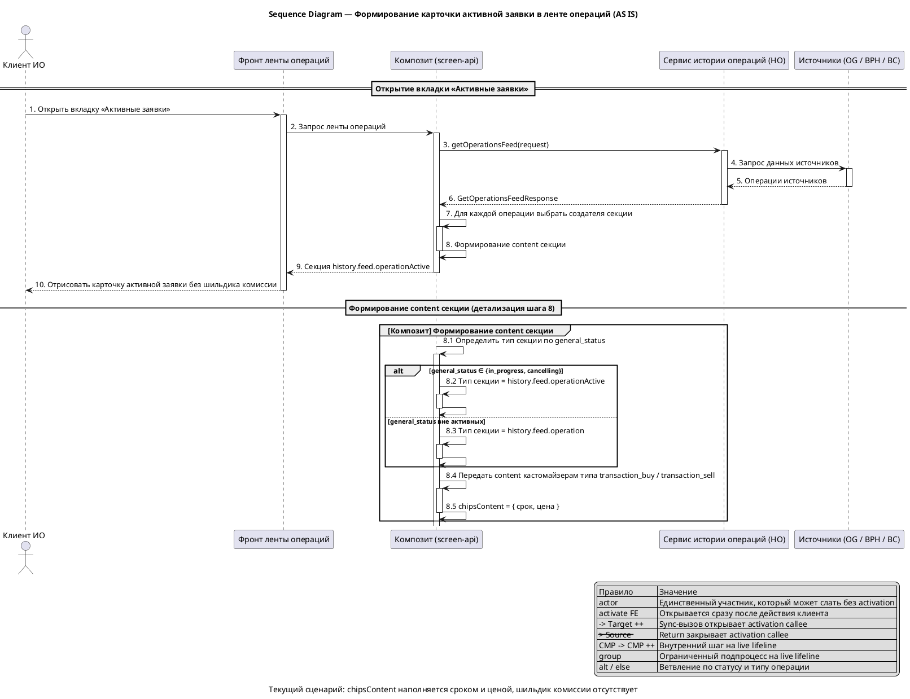
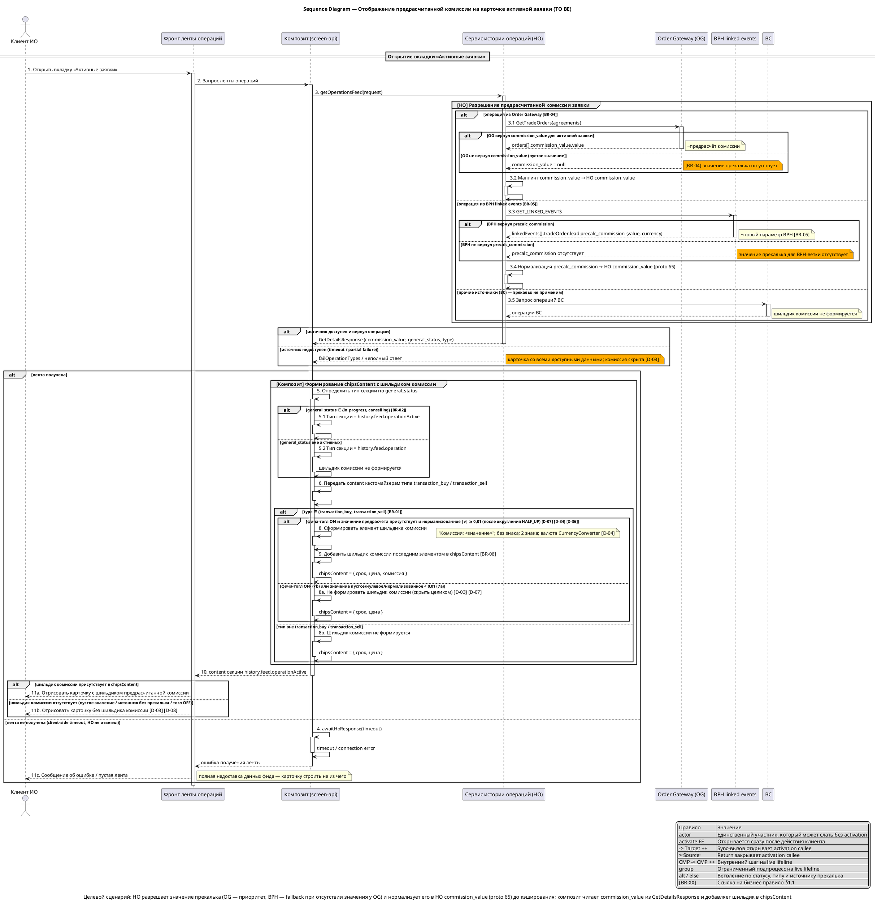
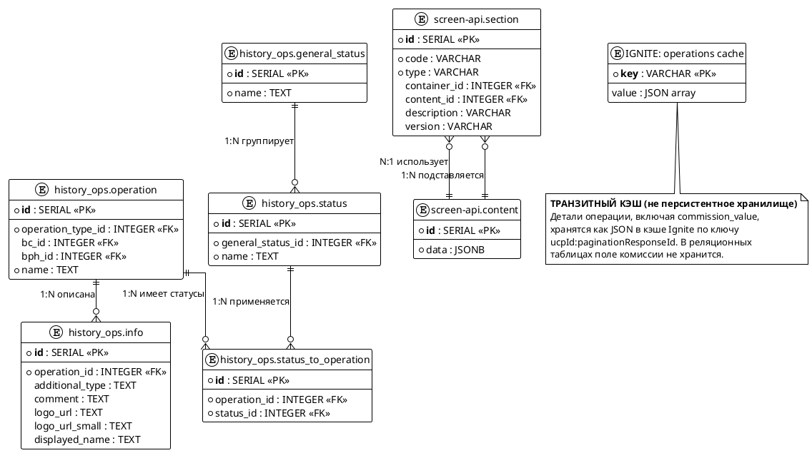

# composite-active-order-commission

## 1. Бизнес-требования

### 1.1. Цель и бизнес-требования

#### Анализ требований — Предрасчитанная комиссия на композите активной заявки

**Источник требования:**

| Параметр | Значение |
|----------|----------|
| Фича | Предрасчитанная комиссия на композите активной заявки (покупка и продажа) |
| Источник | Product request (бриф фичи) |
| Инициатор | Product Owner ленты операций ИО |
| Дата / версия | Draft 2026-09; срок поставки — из релизного плана (конкретная дата в спецификации не фиксируется) |

**Стейкхолдеры:**

| Стейкхолдер | Роль | Интерес / ожидание | Влияние / ответственность |
|-------------|------|--------------------|---------------------------|
| Клиент ИО (пользователь ленты операций) | Основной пользователь | Видит на карточке активной заявки предрасчитанную комиссию до её исполнения | Использует результат фичи |
| Product Owner ленты операций ИО | Владелец продукта | Показать прекальк комиссии на карточке активной заявки, не путая его с фактической комиссией по сделкам | Принимает функциональный результат |
| Команда композита (history-ops-screen-api) | Владелец экранного сервиса | Получить значение прекалька для формирования шильдика на feed-карточке | Формирует `chipsContent` и отдаёт экран фронту |
| Команда HO (history-ops) | Владелец агрегации и контракта деталей операции | Пробросить предрасчёт комиссии из источника до контракта деталей операции | Реализует маппинг и отдачу поля |
| Команда Order Gateway | Владелец источника по торговым заявкам | Передать предрасчитанную комиссию заявки | Отвечает за наличие и корректность `commission_value` в ответе по заявкам |
| Команда BPH | Владелец источника linked events | Добавить новый параметр прекалька (`precalc_commission`) и передать его в HO | Отвечает за контракт и полноту нового параметра |

**Бизнес-правила и ограничения:**

| ID | Тип | Описание | Источник / обоснование |
|----|-----|----------|------------------------|
| BR-01 | Бизнес-правило | Шильдик с комиссией показывается на feed-карточке активной заявки типов `transaction_buy` и `transaction_sell` | Бриф фичи; целевые типы подтверждены `TransactionChipsContentCustomizer.getSupportedTypes = {TRANSACTION_BUY, TRANSACTION_SELL}` (`repositories/ИО/history-ops-screen-api/.../feed/section/customizers/TransactionChipsContentCustomizer.java`) |
| BR-02 | Бизнес-правило | Шильдик с комиссией показывается только для активных статусов заявки `in_progress` и `cancelling` | Бриф фичи; `ACTIVE_STATUSES = {CANCELLING, IN_PROGRESS}` (`TransactionChipsContentCustomizer.java`); каталог статусов `analytics/05-Cross-Cutting/operation-status-catalog.md` |
| BR-03 | Бизнес-правило | На шильдике отображается предрасчитанная комиссия заявки (`commission_value`), а не фактическая комиссия по сделкам (`total_deals_commission`) | Бриф фичи; семантика полей в `analytics/02-Modules/MOD-001-history-ops/integrations/order-gateway.md` (строки 111–113: `commission_value` — «Предрасчитанная комиссия», `total_deals_commission` — «Фактическая комиссия по сделкам») |
| BR-04 | Бизнес-правило | Предрасчёт комиссии приходит из Order Gateway (поле `commission_value` ответа по торговым заявкам) и должен быть проброшен до композита без пересчёта | Бриф фичи; маппинг `GetTradeOrders commission_value → HO commission_value (decimal, предрасчёт из OG)` (`order-gateway.md`, строка 256) |
| BR-05 | Бизнес-правило | Для BPH linked events вводится новый параметр прекалька `precalc_commission`, который должен быть проброшен до композита | Бриф фичи; интеграция HO ↔ BPH — `analytics/02-Modules/MOD-001-history-ops/integrations/bph.md` |
| BR-06 | Бизнес-правило | Значение комиссии выводится в составе `chipsContent` feed-секции карточки активной заявки (тип секции `history.feed.operationActive`) | Бриф фичи; текущее устройство `chipsContent` — `TransactionChipsContentCustomizer` → `ChipsContent` |
| CN-01 | Ограничение | Проброс значения выполняется по gRPC-контракту деталей операции (`historyOperationDetails.proto`, `message GetDetailsResponse`), на котором уже присутствует поле `commission_value` | Бриф фичи (протокол интеграции — gRPC); `repositories/ИО/history-ops-grpc-client/history-ops-grpc-client-api/src/main/proto/historyOperationDetails.proto` (поле 65) |
| CN-02 | Ограничение | Новый параметр BPH `precalc_commission` нормируется как объект `{value: string, currency: string}` в `tradeOrder.lead` и нормализуется в HO в существующее поле `commission_value`; до готовности BPH фича поставляется веткой OG с фича-тоглом BPH по умолчанию OFF. Источниковая готовность BPH подтверждается отдельно | Решение D-01, D-07; `analytics/02-Modules/MOD-001-history-ops/integrations/bph.md`; Q-01 |
| CN-03 | Ограничение | Значение шильдика для операций ветки Order Gateway берётся из `commission_value` ответа `GetTradeOrders` (`TradeOrder.commission_value = 11`), заполняемого для активных заявок; метод `GetActiveOrders` (`ActiveOrder`) не используется | Решение D-02; Q-02; `repositories/ИО/history-ops/src/main/proto/order-gateway.proto` (`TradeOrder.commission_value = 11`) |

**Цель фичи:**

| Вопрос | Ответ |
|--------|-------|
| Какую бизнес-проблему решает? | Сейчас на композите активной заявки комиссия не отображается: `chipsContent` строится только из срока и ценовых полей (`ChipsContent.enrich*` рендерит только срок и ценовые тексты). Пользователь до исполнения заявки не видит, какую комиссию предполагает заявка |
| Какую ценность приносит пользователю? | Пользователь видит предрасчитанную комиссию заявки прямо на карточке активной заявки, без перехода в детали и без ожидания исполнения; значение однозначно трактуется как прекальк, а не как факт по сделкам |
| Какие метрики улучшает? | Продуктовая метрика и способ её измерения в брифе не заданы; измерение эффективности фичи требует отдельного определения Product Owner |

**SMART-проверка цели:**

| Критерий | Описание | Значение |
|----------|----------|----------|
| Specific | Конкретная | Добавить на feed-карточку активной заявки (`transaction_buy`/`transaction_sell`, статусы `in_progress`/`cancelling`) шильдик комиссии со значением прекалька (`commission_value`, для BPH — `precalc_commission`) вместо фактической комиссии по сделкам |
| Measurable | Измеримая | Продуктовая метрика эффективности (CTR/конверсия/удовлетворённость) в брифе **не задана** — критерий «Measurable» в продуктовом смысле **не выполняется**, требует отдельного определения Product Owner. **Критерии приёмки технической выполнимости** (измеримые и проверяемые, без продуктовой метрики): (1) шильдик присутствует в `params[]` на всех активных карточках подходящего типа при тогле ON и валидном ненулевом `commission_value`; (2) значение шильдика побайтово соответствует правилу форматирования (`DecimalFormatter`, `CurrencyConverter`, «Комиссия: <значение>») для тестового набора значений; (3) при тогле OFF / отсутствии / нулевом значении элемент в `params[]` отсутствует, карточка отдаётся как AS IS; (4) время отклика ленты не изменяется относительно AS IS (§5.2.1). Продуктовая метрика выносится в отдельный backlog ([D-11]) |
| Achievable | Достижимая | Достижимость зависит от двух внешних факторов: готовности источника Order Gateway отдавать `commission_value` для активных заявок и согласования нового параметра `precalc_commission` со стороны BPH. Для ветки BPH фича поставляется с фича-тоглом по умолчанию OFF до готовности источника |
| Relevant | Релевантная | Даёт пользователю прозрачность по комиссии активной заявки до её исполнения; согласуется с паттерном проброса нового параметра из источника до композита (соседние фичи `og-trading-order-yield`, `bph-linked-events-yield`) |
| Time-bound | Ограниченная по времени | Точная дата в спецификации не фиксируется; срок поставки — из релизного плана (см. CN-10) |

**Противоречия и решения:**

| Требование 1 | Требование 2 | Источник 1 | Источник 2 | Решение | Обоснование |
|--------------|--------------|------------|------------|---------|-------------|
| Противоречия не выявлены | - | Product request (бриф фичи) | - | - | На текущем уровне постановки конфликтующих требований нет; смешение семантики `commission_value` и `total_deals_commission` снято правилом BR-03 |

### 1.2. Сценарии использования

#### Use Case — Просмотреть карточку активной заявки в ленте операций (AS IS)

**Структура Use Case:**

| Элемент | Значение |
|---------|----------|
| Название | Просмотреть карточку активной заявки в ленте операций |
| Актор(ы) | Клиент ИО (пользователь вкладки «Активные заявки» ленты операций) |
| Триггер | Клиент открывает вкладку «Активные заявки» ленты операций либо обновляет (дозагружает) ленту |
| Предусловия | См. таблицу предусловий ниже |
| Постусловия | См. таблицу постусловий ниже |
| Бизнес-правила | BR-01…BR-06 (см. §1.1) |

**Предусловия:**

| № | Предусловие | Проверяемое условие |
|---|-------------|---------------------|
| 1 | Клиент авторизован в ИО и открыл ленту операций | Сессия клиента активна; запрос ленты содержит `ucp_id` |
| 2 | В ленте есть операции с общим статусом `in_progress` или `cancelling` | `GetDetailsResponse.general_status ∈ {IN_PROGRESS, CANCELLING}` (`ACTIVE_STATUSES` в `AbstractSectionCreator`), [BR-02] |
| 3 | Операция относится к типу `transaction_buy` или `transaction_sell` | `GetDetailsResponse.type ∈ {TRANSACTION_BUY, TRANSACTION_SELL}` (`PortfolioOperationType`, proto-поля 7/8), [BR-01] |

**Постусловия:**

| Исход | Постусловие |
|-------|-------------|
| Успех | На экране отрисована карточка активной заявки; композит вернул content секции типа `history.feed.operationActive`; для карточек `transaction_buy`/`transaction_sell` content содержит `chipsContent` с элементами срока и цены; шильдик комиссии **не** отрисован |
| Неуспех (бизнес) | Операция не является активной заявкой целевого типа либо лента пуста — карточка активной заявки не формируется, `chipsContent` не создаётся |
| Неуспех (техн.) | Полная недоставка данных ленты: композит не получил от HO какие-либо данные для построения карточек (ошибка источника или транспорта) — карточка/лента не отрисовывается, клиенту показывается ошибка или пустая лента. См. §1.3 «Обработка ошибок и недоставка данных» |

**Бизнес-правила:**

| ID | Правило | Применяется на шаге |
|----|---------|---------------------|
| BR-01 | Карточка активной заявки формируется для типов `transaction_buy` и `transaction_sell` | Шаг 4 |
| BR-02 | Карточка активной заявки формируется только для статусов `in_progress` и `cancelling` | Шаг 3 |
| BR-03 | На карточке активной заявки отображается предрасчитанная комиссия (`commission_value`), а не фактическая по сделкам (`total_deals_commission`) | — (не реализовано в AS IS) |
| BR-04 | Предрасчёт комиссии приходит из Order Gateway (`commission_value` в ответе по торговым заявкам) | — (не реализовано в AS IS) |
| BR-05 | Для BPH linked events вводится новый параметр прекалька `precalc_commission` | — (отсутствует в AS IS, см. Шаг 8) |
| BR-06 | Значение комиссии выводится в составе `chipsContent` feed-секции карточки активной заявки | — (не реализовано в AS IS) |

**Основной сценарий — Happy Path:**

```
Шаг 1:  Клиент открывает вкладку «Активные заявки» ленты операций
Шаг 2:  Система (композит) запрашивает у сервиса истории операций агрегированную ленту операций профиля
          ЕСЛИ запрос ленты принят и обработан
            ТО сценарий продолжается с шага 3
          ИНАЧЕ ЕСЛИ лента не получена (ошибка источника или транспорта)
            ПЕРЕЙТИ К альтернативному сценарию 2a
Шаг 3:  Система определяет общий статус операции
          ЕСЛИ [BR-02] general_status ∈ {in_progress, cancelling}
            ТО сценарий продолжается с шага 4
          ИНАЧЕ
            ПЕРЕЙТИ К альтернативному сценарию 3a
Шаг 4:  Система определяет, что операция относится к типу active-заявки
          ЕСЛИ [BR-01] type ∈ {transaction_buy, transaction_sell}
            ТО выполнить формирование карточки активной заявки
          ИНАЧЕ
            ПЕРЕЙТИ К альтернативному сценарию 4a
Шаг 5:  Система выбирает тип секции карточки
          ЕСЛИ статус операции активный
            ТО пометить секцию типом history.feed.operationActive
          ИНАЧЕ
            сценарий продолжается с типом history.feed.operation (вне scope активной карточки)
Шаг 6:  Система формирует content секции карточки и передаёт его кастомайзерам, поддерживающим тип transaction_buy / transaction_sell
Шаг 7:  Система наполняет chipsContent карточки активной заявки
          7.1. Добавляет элемент срока действия заявки
          7.2. Добавляет ценовой элемент по типу заявки (Стоп-цена / Цена не выше / Цена не ниже / Цена тейк-профит)
          7.3. Добавляет второй ценовой элемент для заявки типа take_profit_and_stop_limit
Шаг 8:  Система передаёт chipsContent в content feed-секции на фронт
Шаг 9:  Фронт отображает карточку активной заявки с элементами chipsContent
          ЕСЛИ операция относится к источнику BPH linked events
            ТО прекалька комиссии на карточке отсутствует — chipsContent содержит только срок и цену
          ИНАЧЕ
            прекалька комиссии на карточке также отсутствует — значение прекалька из Order Gateway до карточки не доводится
Шаг 10: Клиент видит карточку активной заявки без шильдика комиссии
```

**Альтернативные сценарии:**

```
2a. Лента операций не получена (Технические ошибки):
  2a.1. Система не получает агрегированную ленту от сервиса истории операций
  2a.2. Полная недоставка данных фида (данных нет вообще, карточку строить не из чего):
       карточка/лента не отрисовывается, клиенту показывается ошибка или пустая лента
       (см. §1.3 «Обработка ошибок и недоставка данных»)
  2a.3. Сценарий завершается неуспешно

3a. Общий статус операции не является активным (Бизнес-ошибки):
  3a.1. Система не относит операцию к активным заявкам
  3a.2. Секция отрисовывается как history.feed.operation, а не history.feed.operationActive
  3a.3. Сценарий завершается неуспешно (карточка активной заявки не формируется)

4a. Операция не относится к типам активной заявки (Бизнес-ошибки):
  4a.1. Система не находит кастомайзер chipsContent для типа операции (кастомайзеры объявлены только для transaction_buy / transaction_sell)
  4a.2. chipsContent для операции не формируется
  4a.3. Сценарий завершается неуспешно

7a. Ценовые поля заявки пусты (Пограничные случаи):
  7a.1. Система не добавляет ценовой элемент в chipsContent (значение по типу заявки не разрешается)
  7a.2. chipsContent содержит только элемент срока действия заявки
  7a.3. Возврат к шагу 8
```

**Связи между Use Cases:**

| Связь | Связанный Use Case | Шаг / Extension Point | Условие |
|-------|--------------------|-----------------------|---------|
| include | Получить агрегированную ленту операций | Шаг 2 | Шаг 2. Всегда: без агрегированной ленты операции карточка не формируется |
| Generalization | Просмотреть карточку исполненной заявки | — | Специализация: карточка активной заявки — частный случай карточки операции с активным статусом |

### 1.2.1. Диаграмма AS IS

#### Sequence Diagram — Формирование карточки активной заявки в ленте операций (AS IS)

**Назначение:**

Диаграмма показывает текущий сценарий получения клиентом карточки активной заявки: запрос ленты, формирование content секции типа `history.feed.operationActive` и наполнение `chipsContent` без шильдика комиссии.

**Контекст:**

| Параметр | Значение |
|----------|----------|
| Область (scope) | Карточка активной заявки (`transaction_buy` / `transaction_sell`, статусы `in_progress` / `cancelling`) во вкладке «Активные заявки» ленты операций |
| Что не входит | Источники данных HO (Order Gateway, BPH linked events), маппинг полей, процесс досчёта комиссии |
| Тип диаграммы | Sequence |
| Читатель | Аналитик, разработчик, тестировщик |
| Версия / дата | Draft 2026-09 |
| Формат хранения | PlantUML в тексте спецификации (`.puml`/`.svg` не создаются) |

**Участники:**

| Участник | Тип | Роль |
|----------|-----|------|
| `Клиент ИО` | actor | Пользователь вкладки «Активные заявки» |
| `Фронт ленты операций` | participant | Отрисовка ленты и карточки |
| `Композит (screen-api)` | participant | Формирует секции и content карточки, в том числе `chipsContent` |
| `Сервис истории операций (HO)` | participant | Отдаёт агрегированную ленту операций по gRPC; источники (OG, BPH, BC) — за рамками диаграммы |
| `Источники (OG / BPH / BC)` | participant | Поставщики данных HO; в AS IS дают ленту и детали, но прекалька комиссии до карточки не доходит |

**PlantUML:**



**Легенда:**

| Обозначение | Значение |
|---|---|
| `->` | Синхронный вызов |
| `->>` | Асинхронный вызов |
| `-->` | Ответ / return |
| `++` / `--` | Начало / конец activation callee |
| `activate` / `deactivate` | Явное открытие / закрытие lifeline фронта |
| `actor` | Может инициировать сообщение без activation |
| `participant` | Должен быть live на каждой исходящей и входящей sync-стрелке |
| `group` | Ограниченный подпроцесс на live lifeline |
| `alt` / `else` | Ветвление с согласованным состоянием activation на merge-point |

**Соответствие тексту:**

| Элемент на диаграмме | Номер | Описание в тексте |
|---|---|---|
| `Открыть вкладку «Активные заявки»` | 1 | Use Case AS IS, Шаг 1 |
| `Запрос ленты операций` | 2 | Use Case AS IS, Шаг 2 |
| `getOperationsFeed(request)` | 3 | Use Case AS IS, Шаг 2 (получение агрегированной ленты) |
| `Запрос данных источников` | 4 | Use Case AS IS, Шаг 2 (вне scope диаграммы) |
| `Определить тип секции по general_status` | 8.1 | Use Case AS IS, Шаг 3, Шаг 5, [BR-02] |
| `Передать content кастомайзерам типа transaction_buy / transaction_sell` | 8.4 | Use Case AS IS, Шаг 6, [BR-01] |
| `chipsContent = { срок, цена }` | 8.5 | Use Case AS IS, Шаг 7; шильдик комиссии отсутствует, [BR-06] |
| `Отрисовать карточку без шильдика комиссии` | 10 | Use Case AS IS, Шаг 10; [BR-03], [BR-04], [BR-05] не реализованы |

### 1.3. Сценарии использования (TO BE)

#### Use Case — Просмотреть карточку активной заявки с предрасчитанной комиссией (TO BE)

**Структура Use Case:**

| Элемент | Значение |
|---------|----------|
| Название | Просмотреть карточку активной заявки с предрасчитанной комиссией |
| Актор(ы) | Клиент ИО (пользователь вкладки «Активные заявки» ленты операций) |
| Триггер | Клиент открывает вкладку «Активные заявки» ленты операций либо обновляет (дозагружает) ленту |
| Предусловия | См. таблицу предусловий ниже |
| Постусловия | См. таблицу постусловий ниже |
| Бизнес-правила | BR-01…BR-06 (см. §1.1) |

**Предусловия:**

| № | Предусловие | Проверяемое условие |
|---|-------------|---------------------|
| 1 | Клиент авторизован в ИО и открыл ленту операций | Сессия клиента активна; запрос ленты содержит `ucp_id` |
| 2 | В ленте есть операции с общим статусом `in_progress` или `cancelling` | `GetDetailsResponse.general_status ∈ {IN_PROGRESS, CANCELLING}` (`ACTIVE_STATUSES`), [BR-02] |
| 3 | Операция относится к типу `transaction_buy` или `transaction_sell` | `GetDetailsResponse.type ∈ {TRANSACTION_BUY, TRANSACTION_SELL}`, [BR-01] |
| 4 | Источник операции передал предрасчёт комиссии | Для ветки OG: активные заявки приходят из `GetTradeOrders`, поле `TradeOrder.commission_value` заполняется (заполненность подтверждается тестовыми данными OG) [D-02]. Для ветки BPH: в linked events присутствует `tradeOrder.lead.precalc_commission` (`{value, currency}`), нормализуемый в HO в поле `commission_value` (proto 65) [D-01]. Для показа шильдика фича-тогл `enable_feed_precalc_commission` включён (default `false`) [D-07] |

**Постусловия:**

| Исход | Постусловие |
|-------|-------------|
| Успех | На экране отрисована карточка активной заявки (`transaction_buy` / `transaction_sell`, `in_progress` / `cancelling`); `chipsContent` секции типа `history.feed.operationActive` содержит срок заявки, ценовой элемент и шильдик с предрасчитанной комиссией (`commission_value` из OG либо `precalc_commission` из BPH), [BR-03], [BR-06] |
| Неуспех (бизнес) | Операция не является активной заявкой целевого типа либо статус вне `in_progress`/`cancelling` — карточка активной заявки и шильдик комиссии не формируются |
| Неуспех (техн.) | Значение прекалька не доставлено, пусто, нормализованное значение `< 0,01` или равно нулю (`0.0`, proto3 default) **либо фича-тогл выключен** — шильдик комиссии скрывается целиком, но карточка **отрисовывается** со всеми доступными данными ленты без чипа комиссии [D-03, D-07, D-08]. Полная недоставка данных фида (данных нет вообще, карточку строить не из чего) — карточка не отрисовывается, показывается ошибка/пустая лента. См. §1.3 «Обработка ошибок и недоставка данных» |

**Бизнес-правила:**

| ID | Правило | Применяется на шаге |
|----|---------|---------------------|
| BR-01 | Шильдик комиссии формируется для карточек типов `transaction_buy` и `transaction_sell` | Шаг 6 |
| BR-02 | Шильдик комиссии формируется только для активных статусов `in_progress` и `cancelling` | Шаг 4 |
| BR-03 | На шильдике отображается предрасчитанная комиссия (`commission_value`), не фактическая по сделкам (`total_deals_commission`) | Шаг 10 |
| BR-04 | Предрасчёт комиссии приходит из Order Gateway (`commission_value` ответа по торговым заявкам) и пробрасывается до композита без пересчёта | Шаг 3 |
| BR-05 | Для BPH linked events используется новый параметр прекалька `precalc_commission`, пробрасываемый до композита | Шаг 3 |
| BR-06 | Значение комиссии выводится в составе `chipsContent` секции типа `history.feed.operationActive` | Шаг 9 |

**Основной сценарий — Happy Path:**

```
Шаг 1:  Клиент открывает вкладку «Активные заявки» ленты операций
Шаг 2:  Система (композит) запрашивает у сервиса истории операций агрегированную ленту операций профиля
          ЕСЛИ запрос ленты принят и обработан
            ТО сценарий продолжается с шага 3
          ИНАЧЕ ЕСЛИ лента не получена (ошибка источника или транспорта)
            ПЕРЕЙТИ К альтернативному сценарию 2a
Шаг 3:  Система (сервис истории операций) разрешает значение предрасчитанной комиссии для операции
          ЕСЛИ [BR-04] операция относится к источнику Order Gateway
            ТО сценарий продолжается с шага 4
          ИНАЧЕ ЕСЛИ [BR-05] операция относится к источнику BPH linked events
            ТО сценарий продолжается с шага 4
          ИНАЧЕ
            ПЕРЕЙТИ К альтернативному сценарию 3a
Шаг 4:  Система определяет общий статус операции
          ЕСЛИ [BR-02] general_status ∈ {in_progress, cancelling}
            ТО сценарий продолжается с шага 5
               (для `cancelling` значение шильдика — «замороженное» на момент старта отмены: берётся значение, вошедшее в снапшот; пересчёт источника не выполняется [D-21])
          ИНАЧЕ
            ПЕРЕЙТИ К альтернативному сценарию 4a
Шаг 5:  Система определяет, что операция относится к типу активной заявки
          ЕСЛИ [BR-01] type ∈ {transaction_buy, transaction_sell}
            ТО сценарий продолжается с шага 6
          ИНАЧЕ
            ПЕРЕЙТИ К альтернативному сценарию 5a
Шаг 6:  Система формирует content секции карточки активной заявки и передаёт его кастомайзерам, поддерживающим типы `transaction_buy` / `transaction_sell`
Шаг 7:  Система проверяет наличие нормализованного значения предрасчитанной комиссии для карточки и включённость фича-тогла `enable_feed_precalc_commission` [D-07]
          Нормализация значения: взять модуль |v| → округлить HALF_UP до 2 знаков [D-34] (§4.2.3.6)
          ЕСЛИ фича-тогл включён И значение присутствует И |v| ≥ 0,01 И v ≠ 0
            ТО сценарий продолжается с шага 8
          ИНАЧЕ ЕСЛИ значение отсутствует, нормализованное значение < 0,01 или v = 0
            ПЕРЕЙТИ К альтернативному сценарию 7a
          ИНАЧЕ ЕСЛИ фича-тогл не включён
            ПЕРЕЙТИ К альтернативному сценарию 7b
Шаг 8:  Система формирует элемент шильдика комиссии с подписью `«Комиссия: <значение>»` и отформатированным значением предрасчёта (округление 2 знака, валюта через `CurrencyConverter`, знак не выводится) [D-04]
          ЕСЛИ валюту операции/инструмента получить не удалось (`CurrencyConverter` вернул пустую строку)
            ТО ПЕРЕЙТИ К альтернативному сценарию 8a (шильдик скрывается целиком)
          ИНАЧЕ ЕСЛИ код валюты неизвестен (`CurrencyConverter` вернул сырой код валюты)
            ТО значение выводится с сырым кодом валюты как есть (например, `«Комиссия: 12,50 RUR»`); символ валюты не подставляется [D-39]
Шаг 9:  Система добавляет шильдик комиссии последним элементом в `chipsContent` карточки активной заявки [BR-06] [D-04] [D-08]
Шаг 10: Система передаёт chipsContent в content feed-секции на фронт
          ЕСЛИ [BR-03] значение взято из предрасчёта (commission_value / precalc_commission)
            ТО сценарий продолжается с шага 11
          ИНАЧЕ
            ПЕРЕЙТИ К альтернативному сценарию 10a
Шаг 11: Фронт отображает карточку активной заявки с элементами chipsContent и шильдиком комиссии
Шаг 12: Клиент видит предрасчитанную комиссию заявки на карточке активной заявки
```

**Альтернативные сценарии:**

```
2a. Лента операций не получена (Технические ошибки):
  2a.1. Система не получает агрегированную ленту от сервиса истории операций
  2a.2. Полная недоставка данных фида: карточка активной заявки не отрисовывается —
        клиенту показывается ошибка или пустая лента
  2a.3. Сценарий завершается неуспешно

3a. Источник операции не передаёт предрасчёт комиссии (Бизнес-ошибки):
  3a.1. Система не находит значение предрасчёта ни в поле `commission_value` (OG), ни в `precalc_commission` (BPH, нормализуемом в то же поле `commission_value`)
       — сюда относится только ШТАТНОЕ отсутствие значения (поле не заполнено / пустая строка): карточка и остальная операция сохраняются, исчезает лишь шильдик
  3a.2. Система не формирует элемент шильдика комиссии
  3a.3. Возврат к шагу 4
  3a.4. ОТДЕЛЬНЫЙ случай (НЕ этот сценарий): значение источника присутствует, но НЕ является корректной десятичной строкой (`"126,7"`, `"1 234,56"`, `"126.7 RUB"`) —
       это ошибка конвертации на уровне адаптера источника (HO-адаптер OG/BPH): запись операции источника **не формируется**, операция отсекается до композита (карточка по ней не строится вовсе), см. §4.1.1.2 «Валидация нового параметра» [D-14]

4a. Общий статус операции не является активным (Бизнес-ошибки):
  4a.1. Система не относит операцию к активным заявкам; шильдик комиссии не формируется
  4a.2. Секция отрисовывается как history.feed.operation, а не history.feed.operationActive
  4a.3. Сценарий завершается неуспешно (карточка активной заявки с шильдиком не формируется)

5a. Операция не относится к типам активной заявки (Бизнес-ошибки):
  5a.1. Система не находит кастомайзер chipsContent для типа операции (кастомайзеры объявлены только для transaction_buy / transaction_sell)
  5a.2. Система не формирует шильдик комиссии
  5a.3. Сценарий завершается неуспешно

7a. Значение предрасчёта отсутствует либо нормализованное значение меньше порога (Пограничные случаи):
  7a.1. Условие нормализации: значение отсутствует / |v| < 0,01 после округления HALF_UP / v = 0 [D-34] (§4.2.3.6)
  7a.2. Система не формирует элемент шильдика комиссии
  7a.3. Шильдик комиссии скрывается целиком; карточка отрисовывается без чипа комиссии [D-03]
  7a.4. Возврат к шагу 10 (система передаёт chipsContent без чипа комиссии)

7b. Фича-тогл показа шильдика выключен (Технические ошибки / rollout):
  7b.1. Фича-тогл `enable_feed_precalc_commission` выключен (в том числе отсутствует значение) [D-07]
  7b.2. Шильдик комиссии не формируется; карточка отрисовывается без чипа комиссии
  7b.3. Возврат к шагу 10 (система передаёт chipsContent без чипа комиссии)

8a. Валюту операции/инструмента получить не удалось (Технические ошибки / пограничные случаи):
  8a.1. `CurrencyConverter.getCurrencyFrom` вернул пустую строку (`!hasCurrency()` — валютное поле операции не заполнено) [D-39]
  8a.2. Система не формирует элемент шильдика комиссии; подстановка символа `₽`, «прочерка» или иной валюты по умолчанию не выполняется
  8a.3. Шильдик комиссии скрывается целиком, карточка отрисовывается без чипа комиссии [D-03]
  8a.4. Возврат к шагу 10 (система передаёт chipsContent без чипа комиссии)

10a. Для операции доступна только фактическая комиссия по сделкам (Бизнес-ошибки):
  10a.1. Система не подставляет `total_deals_commission` в шильдик предрасчёта [BR-03]
  10a.2. Система не формирует значение шильдика предрасчитанной комиссии
  10a.3. Возврат к шагу 11 (фронт отрисовывает карточку без чипа комиссии)
```

**Связи между Use Cases:**

| Связь | Связанный Use Case | Шаг / Extension Point | Условие |
|-------|--------------------|-----------------------|---------|
| include | Получить агрегированную ленту операций | Шаг 2 | Шаг 2. Всегда: без агрегированной ленты карточка активной заявки не формируется |
| include | Разрешить предрасчитанную комиссию заявки | Шаг 3 | Шаг 3. Всегда для целевых типов и активных статусов; ветка OG — `commission_value`, ветка BPH — `precalc_commission` |
| Generalization | Просмотреть карточку активной заявки в ленте операций (AS IS) | — | Специализация: карточка активной заявки без шильдика комиссии — базовый сценарий, TO BE добавляет вывод прекалька |

#### Обработка ошибок и недоставка данных

Поведение при недоставке значения, при частичном отказе источников и при полной недоставке данных фида зафиксировано следующим образом:

**Разграничение областей:** шильдик комиссии — строго **опциональный** элемент карточки. Его отсутствие (нет значения / пусто / ноль / тогл выключен) карточку и ленту недоступными **не делает**. Карточка не отрисовывается только при **полной недоставке данных фида**, когда строить её не из чего.

| Ситуация | Поведение |
|----------|-----------|
| Значение прекалька пустое, равно нулю (`0.0`, proto3 default) либо нормализованное значение `< 0,01` (порог [D-19], [D-34]) | Шильдик комиссии **скрывается целиком**; карточка **отрисовывается** без чипа комиссии [D-03] |
| Фича-тогл `enable_feed_precalc_commission` выключен / значение отсутствует | Шильдик комиссии **не формируется**; карточка **отрисовывается** без чипа комиссии [D-07] |
| Новый элемент `params[]` отсутствует в `chipsContent` | Изменение строго аддитивное: элемент добавляется **последним**; при отсутствии значения не добавляется; потребители обязаны игнорировать неизвестные элементы, карточка при их отсутствии ломаться **не должна** [D-08] |
| Частичный отказ источника OG (`failOperationTypes` / неполный ответ) | Карточка показывается со всеми доступными данными, комиссия скрывается; признак неполноты (`failOperationTypes`) на отрисовку карточки не влияет |
| Полная недоставка данных фида (ошибка источника или транспорта; данных нет вообще, карточку строить не из чего) | **Карточка не отрисовывается** — показывается ошибка/пустая лента |

> **Итоговое правило:** отсутствие необязательного шильдика комиссии **не** является hard-fail фактором. Карточка и лента недоступны только при полной недоставке данных фида; во всех случаях наличия данных ленты карточка рендерится, а шильдик комиссии либо показывается (есть валидное значение и тогл ON), либо скрывается.

### 1.3.1. Диаграмма TO BE

#### Sequence Diagram — Отображение предрасчитанной комиссии на карточке активной заявки (TO BE)

**Назначение:**

Диаграмма показывает целевой сценарий: HO разрешает предрасчитанную комиссию активной заявки из источника (Order Gateway `commission_value` либо новый параметр BPH linked events `precalc_commission`), пробрасывает её до композита, а композит добавляет шильдик комиссии в `chipsContent` секции `history.feed.operationActive` для типов `transaction_buy` / `transaction_sell` в статусах `in_progress` / `cancelling`. Включает ветки ошибок и пограничные случаи.

**Контекст:**

| Параметр | Значение |
|----------|----------|
| Область (scope) | Карточка активной заявки (`transaction_buy` / `transaction_sell`, статусы `in_progress` / `cancelling`); разрешение прекалька комиссии и его вывод в `chipsContent` |
| Что не входит | Отдельные чипы по полям условных/стоп-заявок (`commission_value_stop_loss` 66, `commission_value_take_profit` 67 — не показываются), фактические комиссии по сделкам (`total_deals_commission`), процесс отмены/редактирования заявки, деталка операции. **Показ шильдика прекалька на условных/стоп-заявках входит** в scope: используется единое поле `commission_value` (proto 65) для всех заявок, включая условные ([CN-13]); при отсутствии значения до активации заявки шильдик скрывается по общему правилу [D-03] |
| Тип диаграммы | Sequence |
| Читатель | Аналитик, разработчик, тестировщик |
| Версия / дата | Draft 2026-09 |
| Формат хранения | PlantUML в тексте спецификации (`.puml`/`.svg` не создаются) |

**Участники:**

| Участник | Тип | Роль |
|----------|-----|------|
| `Клиент ИО` | actor | Пользователь вкладки «Активные заявки» |
| `Фронт ленты операций` | participant | Отрисовка ленты и карточки, в том числе шильдика комиссии |
| `Композит (screen-api)` | participant | Формирует секции и content карточки, добавляет шильдик комиссии в `chipsContent` |
| `Сервис истории операций (HO)` | participant | Агрегирует источники, разрешает предрасчёт комиссии, отдаёт по gRPC |
| `Order Gateway (OG)` | participant | Источник предрасчитанной комиссии `commission_value` |
| `BPH linked events` | participant | Источник нового параметра прекалька `precalc_commission` |
| `BC` | participant | Прочие операции ленты, для которых прекальк комиссии не применим (вне scope шильдика) |

**PlantUML:**



**Легенда:**

| Обозначение | Значение |
|---|---|
| `->` | Синхронный вызов |
| `->>` | Асинхронный вызов |
| `-->` | Ответ / return |
| `++` / `--` | Начало / конец activation callee |
| `activate` / `deactivate` | Явное открытие / закрытие lifeline фронта |
| `actor` | Может инициировать сообщение без activation |
| `participant` | Должен быть live на каждой исходящей и входящей sync-стрелке |
| `group` | Ограниченный подпроцесс на live lifeline |
| `alt` / `else` | Ветвление с согласованным состоянием activation на merge-point |
| `[BR-XX]` | Ссылка на бизнес-правило §1.1 |
| `#FFAB00` (note) | Ветвление негативного исхода: значение прекалька отсутствует — поведение определено [D-03], [D-05] |

**Соответствие тексту:**

| Элемент на диаграмме | Номер | Описание в тексте |
|---|---|---|
| `Открыть вкладку «Активные заявки»` | 1 | Use Case TO BE, Шаг 1 |
| `Запрос ленты операций` | 2 | Use Case TO BE, Шаг 2 |
| `getOperationsFeed(request)` | 3 | Use Case TO BE, Шаг 2 (получение агрегированной ленты) |
| `GetTradeOrders(agreements)` | 3.1 | Use Case TO BE, Шаг 3 (ветка OG, [BR-04]) |
| `GET_LINKED_EVENTS` | 3.3 | Use Case TO BE, Шаг 3 (ветка BPH, [BR-05]) |
| `Определить тип секции по general_status` | 5 | Use Case TO BE, Шаг 4, [BR-02] |
| `Передать content кастомайзерам типа transaction_buy / transaction_sell` | 6 | Use Case TO BE, Шаг 6, [BR-01] |
| `Сформировать элемент шильдика комиссии` | 8 | Use Case TO BE, Шаг 8 |
| `Добавить шильдик комиссии в chipsContent` | 9 | Use Case TO BE, Шаг 9, [BR-06] |
| `content секции history.feed.operationActive` | 10 | Use Case TO BE, Шаг 10, [BR-03] |
| `Отрисовать карточку с шильдиком предрасчитанной комиссии` | 11a | Use Case TO BE, Шаг 11, Шаг 12 |
| `Отрисовать карточку без шильдика комиссии` | 11b | Use Case TO BE, альтернативные сценарии 7a / 7b, [D-03] [D-07] [D-08] |
| `Сообщение об ошибке / пустая лента` | 11c | Use Case TO BE, альтернативный сценарий 2a (полная недоставка данных фида) |

## 2. Ограничения и допущения

#### Анализ ограничений — Предрасчитанная комиссия на композите активной заявки

**Источник требования:**

| Параметр | Значение |
|----------|----------|
| Фича | Предрасчитанная комиссия на композите активной заявки (покупка и продажа) |
| Источник | Product request (бриф фичи) + код `repositories/` |
| Инициатор | Product Owner ленты операций ИО |
| Дата / версия | Draft 2026-09 |

**Бизнес-правила и ограничения:**

| ID | Тип | Описание | Источник / обоснование |
|----|-----|----------|------------------------|
| CN-01 | Интеграционное ограничение | Проброс предрасчитанной комиссии выполняется по gRPC-контракту деталей операции (`historyOperationDetails.proto`, `message GetDetailsResponse`), на котором уже присутствует поле `commission_value` (поле 65) | Бриф фичи (протокол интеграции — gRPC); `repositories/ИО/history-ops-grpc-client/history-ops-grpc-client-api/src/main/proto/historyOperationDetails.proto`, поле 65 |
| CN-02 | Ограничение-зависимость | Значение шильдика для операций ветки BPH зависит от готовности источника: новый параметр BPH linked events `precalc_commission` (`tradeOrder.lead.precalc_commission`, объект `{value: string, currency: string}`) должен быть реализован на стороне BPH; до его появления прекальк для операций ветки BPH недоступен. Если BPH не готов к релизу — поставляется ветка OG, а BPH закрывается фича-тоглом `enable_feed_precalc_commission` (default `false`) | Бриф фичи (`BPH добавит новый параметр precalc_commission`); Q-01 в `Feature-context/composite-active-order-commission.md`; [D-01] |
| CN-03 | Ограничение-зависимость | Значение шильдика для операций ветки Order Gateway приходит из поля `commission_value` ответа `GetTradeOrders` (`TradeOrder.commission_value = 11`); активные заявки получаются через `GetTradeOrders`, поле `commission_value` для них заполняется (заполненность подтверждается тестовыми данными OG). Метод `GetActiveOrders` (`ActiveOrder`) не используется. Обеспечивается бизнес-правилом [BR-04] | Бриф фичи (`commission_value уже приходит в источнике`); Q-02 в `Feature-context/composite-active-order-commission.md`; [D-02], [CN-16] |
| CN-04 | Ограничение (семантика данных) | Запрещено использовать фактическую комиссию по сделкам (`total_deals_commission`, proto поле 72) в качестве значения шильдика предрасчёта; смешение полей `commission_value` и `total_deals_commission` недопустимо. Обеспечивается бизнес-правилом [BR-03] | Бриф фичи (`НЕ фактическая комиссия по сделкам`); семантика полей в `analytics/02-Modules/MOD-001-history-ops/integrations/order-gateway.md` (строки 111–113: `commission_value` — «Предрасчитанная комиссия», `total_deals_commission` — «Фактическая комиссия по сделкам») |
| CN-05 | Ограничение области (типы) | Показ шильдика ограничен типами операций `transaction_buy` и `transaction_sell`; для операций иных типов шильдик не формируется. Обеспечивается бизнес-правилом [BR-01] | Бриф фичи; `TransactionChipsContentCustomizer.getSupportedTypes = {TRANSACTION_BUY, TRANSACTION_SELL}` (`repositories/ИО/history-ops-screen-api/.../feed/section/customizers/TransactionChipsContentCustomizer.java`) |
| CN-06 | Ограничение области (статусы) | Показ шильдика ограничен активными статусами `in_progress` и `cancelling`; для прочих статусов карточка активной заявки и шильдик не формируются. Обеспечивается бизнес-правилом [BR-02] | Бриф фичи; `ACTIVE_STATUSES = {CANCELLING, IN_PROGRESS}` (`TransactionChipsContentCustomizer.java`); каталог статусов `analytics/05-Cross-Cutting/operation-status-catalog.md` |
| CN-07 | Ограничение обратной совместимости | `chipsContent` — контракт content feed-секции для фронта. Добавление шильдика комиссии выполняется как **строго аддитивное** изменение: новый элемент добавляется в `params[]` **последним**; при отсутствии значения элемент не добавляется; потребители обязаны игнорировать неизвестные элементы и не ломаться при их отсутствии. Существующие элементы (срок `expire_date_details`, ценовые элементы `stop_px`, `take_profit_px`, `value_by_instrument_item`) сохраняются | Текущее устройство `chipsContent` — `TransactionChipsContentCustomizer` → `ChipsContent` (`repositories/ИО/history-ops-screen-api/.../composite/sections/feed/ChipsContent.java`); [BR-06]; [D-08] |
| CN-08 | Ограничение места вывода | Значение комиссии выводится только в составе `chipsContent` feed-секции типа `history.feed.operationActive`; вывод в иных секциях/элементах карточки не входит в ограничения данного блока | Бриф фичи; [BR-06]; `AbstractSectionCreator.resolveType` (`history.feed.operationActive` для активных статусов) |
| CN-09 | Техническое ограничение (без пересчёта) | Значение предрасчитанной комиссии пробрасывается из источника до композита **без пересчёта**; композит не досчитывает комиссию самостоятельно | Бриф фичи; маппинг `GetTradeOrders commission_value → HO commission_value (decimal, предрасчёт из OG)` (`analytics/02-Modules/MOD-001-history-ops/integrations/order-gateway.md`, строка 256); [BR-04] |
| CN-10 | Временное ограничение | Целевая дата поставки фиксируется из релизного плана (конкретная дата в спеке не приводится); постановка помечена как Draft 2026-09 | Бриф фичи; [D-10] |
| CN-11 | Регуляторное ограничение | Специфических регуляторных требований к раскрытию предрасчитанной комиссии не выявлено; принято, что **регуляторные требования отсутствуют** — формат и обязательность отображения определяются продуктовыми решениями [D-10] | Бриф фичи (регуляторные требования не упомянуты); [D-10] |
| CN-12 | Ограничение форматирования | Формат вывода значения комиссии: подпись `«Комиссия: <значение>»`, знак не выводится, округление — 2 знака (`DecimalFormatter`), валюта — через `CurrencyConverter`; элемент имеет `key = "commission"` и добавляется без `logoIcon`. Валюту определить не удалось (пустая строка) → элемент не добавляется, чип скрыт; код валюты неизвестен → значение выводится с сырым кодом валюты как есть [D-39] | Q-03 в `Feature-context/composite-active-order-commission.md`; [D-04], [D-39] |
| CN-13 | Ограничение по условным/стоп-заявкам | Для условных/стоп-заявок используется **единый** `commission_value` (proto 65), как и для всех прочих заявок; отдельные поля `commission_value_stop_loss` (proto 66) и `commission_value_take_profit` (proto 67) для шильдика **не выводятся** [D-06] | proto `historyOperationDetails.proto`, поля 65–67; Q-04 в `Feature-context/composite-active-order-commission.md`; [D-06] |
| CN-14 | Ограничение-допущение (приоритет источников и различимость отсутствия) | При наличии значения прекалька из нескольких источников приоритетным является Order Gateway (`commission_value`); BPH (`precalc_commission`) используется как **fallback** только при отсутствии значения у OG — распространяется существующее правило слияния заявок OG → BPH [D-05]. **Ограничение различимости:** поле 65 объявлено как `optional double`, признак наличия значения в контракт композита **не передаётся** (`AbstractGrpcBuilderWrapper.enrichWithOptionalValue` выставляет поле только при `value != null`, далее значение читается как proto3-default `0.0`), поэтому OG-значение `0.0` и отсутствие значения на композите **неразличимы**. Следствие: BPH-fallback [D-05] фактически срабатывает только при **ненулевом** значении OG; при `0.0`/пустом значении шильдик скрывается целиком по [D-03] без обращения к BPH [D-17] | [D-05], [D-17]; Q-01 в `Feature-context/composite-active-order-commission.md`; `repositories/ИО/history-ops/src/main/java/.../AbstractGrpcBuilderWrapper.java` (`enrichWithOptionalValue`); `DetailsResponseMapper.convertDouble` |
| CN-15 | Ограничение-допущение (контракт проброса) | Значение BPH `precalc_commission` (`tradeOrder.lead.precalc_commission`, `{value, currency}`) **нормализуется в HO в существующее поле** `commission_value` (`GetDetailsResponse`, proto 65); новые поля proto не вводятся [D-01] | [D-01]; CN-01; [BR-05] |
| CN-16 | Ограничение области (метод OG) | Источником предрасчёта принимается поле `commission_value` ответа `GetTradeOrders` (`TradeOrder.commission_value = 11`); активные заявки получаются этим методом. Альтернативный rpc `OrdersService.GetActiveOrders` (`ActiveOrder`) полем комиссии **не располагает** — в `message ActiveOrder` (`order-gateway.proto`) поля `commission_value`/`total_deals_commission` отсутствуют, поэтому этот метод источником значения шильдика быть не может без доработки контракта OG | `repositories/ИО/history-ops/src/main/proto/order-gateway.proto` (`rpc GetActiveOrders` строка 17; `message ActiveOrder` строки 155–172 — полей комиссии нет); `TradeOrder.commission_value = 11` (строка 82); прецедент ограничения области по методам OG — `Feature-writing/og-trading-order-yield/og-trading-order-yield.md` (`CN-08`); [D-02] |

## 4. Функциональные требования

#### 4.1.1 Синхронные контракты — Предрасчитанная комиссия на композите активной заявки

Фича использует **два входящих для ИО синхронных контракта** (Order Gateway gRPC и BPH REST)
и **два выходящих** контракта (HO gRPC `GetDetailsResponse` в сторону композита и
`chipsContent` композита в сторону фронта). Новых контрактов фича не создаёт: на
стороне HO требование закрывается пробросом уже существующих полей, на стороне BPH
ожидается **новый параметр** `tradeOrder.lead.precalc_commission` (`{value, currency}`),
нормализуемый в HO в существующее поле `commission_value` (proto 65) [D-01].

---

##### 4.1.1.1 Order Gateway → HO: `GetTradeOrders` (комиссия предрасчёта)

**Общая информация:**

| Параметр | Значение |
|----------|----------|
| Назначение | Получение актуальных торговых заявок (`transaction_buy`/`transaction_sell`) с предрасчитанной комиссией для активных статусов |
| Система-источник | order-gateway (OG) |
| Система-получатель | history-ops (ИО) |
| Тип интеграции | Синхронная (request/response) |
| Протокол | gRPC (TLS 1.2+) |
| Направление | HO → OG (HO — инициатор) |
| Версия API | Не версионируется явно; сервис `OrdersService`, proto `order-gateway.proto` (trade-operations-commons) |
| Аутентификация | mTLS внутри кластера OpenShift СИ2 |
| Формат данных | Protobuf |
| Rate Limit | Не описано в analytics; фича новых значений не задаёт. Запрос заявок выполняется **батчем** на профиль (одна выборка `GetTradeOrders` на сборку ленты), а не по одной заявке; число активных заявок профиля на количество вызовов метода не влияет (число вызовов = число сборок ленты). Лимита на количество заявок в ответе фича не вводит |
| Timeout | Не описано для `GetTradeOrders` в analytics; фича новых значений не задаёт. Таймаут ограничен существующим вызовом OG в HO (`history-ops`) и не изменяется фичей; при недоставке OG действует частичный отказ HO (§5.3) |
| Retry Policy | Не описано в analytics; фича новых значений не задаёт. Повторные попытки — существующая политика вызова HO → OG, фичей не меняется |
| Feature toggles | `enableOrderGatewayRequestDates`, `enableOgNewActiveOrdersEndpoint` |

**Метод:** `OrdersService.GetTradeOrders` → `GetTradeOrdersResponse` (proto `order-gateway.proto`, trade-operations-commons)

**Используемые фичей поля ответа `GetTradeOrdersResponse`:**

| Параметр | Тип | Кратность | Обязательность | Описание | Валидация | Пример | Использует фича |
|----------|-----|-----------|----------------|----------|-----------|--------|-----------------|
| orders | array | [1] | обязательное | Список заявок | — | — | да |
| orders[].id | string | [1] | обязательное | ID заявки OG | — | `"1234"` | косвенно (identity) |
| orders[].direction | string | [1] | обязательное | Направление заявки | `BUY` / `SELL` | `"BUY"` | да (маппинг в `transaction_buy` / `transaction_sell`) [BR-01] |
| orders[].general_status | string | [1] | обязательное | Статус заявки | `canceled`, `in_progress`, `executed`, `cancelling`, … | `"in_progress"` | да (фильтр активных статусов) [BR-02] |
| orders[].commission_value | object | [0-1] | опциональное | **Предрасчитанная комиссия** заявки | — | `{ "value": "126.7" }` | **да — источник значения шильдика** [BR-03], [BR-04] |
| orders[].commission_value.value | string | [1] | обязательное (внутри объекта) | Decimal-значение предрасчёта | десятичная строка | `"126.7"` | да |
| orders[].total_deals_commission | object | [0-1] | опциональное | Фактическая комиссия по сделкам | — | `{ "value": "56.34" }` | **нет** — явно исключено [BR-03], [CN-04] |
| orders[].total_deals_commission.value | string | [1] | обязательное (внутри объекта) | Decimal-значение факта | десятичная строка | `"56.34"` | нет |

Источник таблицы — `analytics/02-Modules/MOD-001-history-ops/integrations/order-gateway.md`,
раздел «Response (GetTradeOrdersResponse)» (строки 111–113: `orders[].commission_value` —
«Предрасчитанная комиссия», `orders[].total_deals_commission` — «Фактическая комиссия по
сделкам»). Маппинг в HO: `GetTradeOrders orders[].commission_value → HO commission_value`
(`order-gateway.md`, раздел «Данные и маппинг», строка 256).

**Ограничения контракта:**

| ID | Ограничение | Источник |
|----|-------------|----------|
| — | `orders[].commission_value` объявлен как `[0-1]` (опциональное); для **активных** заявок (`in_progress`/`cancelling`) значение заполняется — заполненность подтверждается тестовыми данными OG [D-02] | `order-gateway.md` (строка 111); Q-02 в `Feature-context/composite-active-order-commission.md` |
| — | Значение `commission_value` не пересчитывается на стороне HO и композита — только пробрасывается | [CN-09], [BR-04]; `order-gateway.md`, строка 256 |
| — | При недоступности OG операции OG не попадают в ответ HO (partial failure); фича должна корректно обработать отсутствие значения | `order-gateway.md`, раздел «Ошибки» (OG unavailable → partial failure) |
| — | Источником предрасчёта принимается `commission_value` ответа `GetTradeOrders` (`TradeOrder.commission_value = 11`); альтернативный rpc `GetActiveOrders` (`ActiveOrder`) не используется — в `message ActiveOrder` (`order-gateway.proto`, строки 155–172) поля `commission_value`/`total_deals_commission` отсутствуют [D-02] | [CN-16]; `repositories/ИО/history-ops/src/main/proto/order-gateway.proto` (`message ActiveOrder`) |

**Коды ошибок / статусы (по OG):**

| Условие | gRPC / transport | Поведение HO | Evidence |
|---------|------------------|--------------|----------|
| Timeout `GetDeals` | `DEADLINE_EXCEEDED` | WARN «Failed to execute order gateway getDeals»; заявки без deals | `order-gateway.md`, раздел «Ошибки» (SIHIST-833) |
| OG unavailable | gRPC error | Операции OG не в ответе; partial failure | `order-gateway.md` (SIHIST-1232) |

---

##### 4.1.1.2 BPH → HO: `GET_LINKED_EVENTS` (комиссия предрасчёта)

**Общая информация:**

| Параметр | Значение |
|----------|----------|
| Назначение | Получение связанных сущностей заявки (заявка, сделки, комиссии) для торговых операций, отсутствующих в OG |
| Система-источник | BPH (Brokerage Portfolio History, модуль Brokerage Controller) |
| Система-получатель | history-ops (ИО) |
| Тип интеграции | Синхронная (request/response) |
| Протокол | REST HTTPS, JSON |
| Направление | HO → BPH (HO — инициатор) |
| Endpoint | POST `/api/v1/incoming-gateway/operations/linked-events` |
| Версия API | Не версионируется явно в analytics |
| Аутентификация | Заголовки `rqUID`, `systemName` = `si2-ops` |
| Формат данных | JSON |
| Rate Limit | Не описано в analytics |
| Timeout | Не описано в analytics (см. runtime config HO, `WebClientBphConfiguration`) |
| Retry Policy | Не описано в analytics |

**Метод:** `POST /api/v1/incoming-gateway/operations/linked-events` (обмен `GET_LINKED_EVENTS`)

**Request headers:**

| Заголовок | Тип | Обязат. | Описание | Пример |
|-----------|-----|---------|----------|--------|
| rqUID | string | да | Сквозной UUID запроса | `"b7e6…"` |
| systemName | string | да | Идентификатор инициатора | `"si2-ops"` |

**Request body (существующие поля, фичей не меняются):**

| Параметр | Тип | Кратность | Обязательность | Описание | Валидация | Пример |
|----------|-----|-----------|----------------|----------|-----------|--------|
| agreements | string | [1] | обязательное | JSON-массив номеров договоров | — | `["KJ28438H394L"]` |
| startSearchDate | string | [0-1] | опциональное | Начало периода (ISO 8601) | — | `"2023-12-26T14:06:34.543Z"` |
| endSearchDate | string | [1] | обязательное | Конец периода | — | `"2024-03-25T14:06:34.543Z"` |
| dateForFilter | string | [1] | обязательное | `FORMATION_DATE` или `EVENT_DATE`; в HO — `FORMATION_DATE` | — | `"FORMATION_DATE"` |
| page | integer | [1] | обязательное | Номер страницы (в HO всегда `0`) | — | `0` |
| pageSize | integer | [1] | обязательное | Лимит записей (в HO `200`) | — | `200` |

**Response body — существующие поля комиссий (как комиссии приходят сейчас):**

| Параметр | Тип | Кратность | Обязательность | Описание | Валидация | Пример | Статус |
|----------|-----|-----------|----------------|----------|-----------|--------|--------|
| data[].linkedEvents[].tradeOrder.lead | object | [1] | обязательное | Lead заявки | — | — | существующее |
| data[].linkedEvents[].tradeOrder.lead.subtype | string | [1] | обязательное | `ORDINARY_BUY` / `ORDINARY_SELL` | — | `"ORDINARY_SELL"` | существующее |
| data[].linkedEvents[].tradeOrder.lead.status | string | [1] | обязательное | `SUBMITTED`, `COMPLETED`, `CANCELLED` | — | `"SUBMITTED"` | существующее |
| data[].linkedEvents[].dealsWithCommissions | array | [0-1] | опциональное | Сделки с комиссиями (текущий путь получения комиссий) | — | — | существующее |
| data[].linkedEvents[].dealsWithCommissions[].commissions[].lead.additionalType | string | [0-1] | опциональное | `BROKERAGE_COMMISSION` / `EXCHANGE_COMMISSION` | — | `"BROKERAGE_COMMISSION"` | существующее |
| data[].linkedEvents[].dealsWithCommissions[].commissions[].lead.totalPrice.value | string | [1] | обязательное | Значение комиссии | десятичная строка | `"12.50"` | существующее |

Источник — `analytics/02-Modules/MOD-001-history-ops/integrations/bph.md`, разделы
«Request headers», «Request body» и «Response body» обмена `GET_LINKED_EVENTS`
(блоки `tradeOrder`, `dealsWithCommissions[].commissions[]`). **Важно:** в существующем
контракте `GET_LINKED_EVENTS` **нет** параметра предрасчитанной комиссии уровня заявки —
сейчас комиссии приходят только как `dealsWithCommissions[].commissions[]` (факт по сделкам).

**Response body — новый параметр (ожидается к реализации на стороне BPH):**

| Параметр | Тип | Кратность | Обязательность | Описание | Валидация | Пример | Статус |
|----------|-----|-----------|----------------|----------|-----------|--------|--------|
| data[].linkedEvents[].tradeOrder.lead.precalc_commission | object | [0-1] | опциональное | Новый параметр: предрасчитанная комиссия заявки | — | `{ "value": "126.7", "currency": "RUB" }` | **new** [D-01] |
| data[].linkedEvents[].tradeOrder.lead.precalc_commission.value | string | [1] | обязательное (внутри объекта) | Decimal-строка значения предрасчёта | десятичная строка | `"126.7"` | **new** [D-01] |
| data[].linkedEvents[].tradeOrder.lead.precalc_commission.currency | string | [1] | обязательное (внутри объекта) | Валюта значения предрасчёта | ISO 4217 | `"RUB"` | **new** [D-01] |

Контракт нового параметра `tradeOrder.lead.precalc_commission` (`{value, currency}`)
согласован на уровне аналитики [D-01], но **в репозиториях ещё не реализован**: в
`repositories/` параметр `precalc_commission` не найден, в `bph.md` он не описан.
Значение нормализуется на стороне HO в существующее поле `commission_value` (proto 65) —
новых полей контракта HO фича не вводит. Если BPH не успевает к релизу, поставка
выполняется веткой OG, а фича-тогл BPH по умолчанию остаётся выключенным (`false`)
[D-01], [D-07]. Связь: Q-01 в `Feature-context/composite-active-order-commission.md`;
[BR-05], [CN-02], [CN-15].

**Валидация нового параметра (нормативно для приёмки):**

| Условие входа | Поведение | Обоснование |
|---------------|-----------|-------------|
| `precalc_commission` отсутствует | Элемент шильдика для BPH-операции не добавляется; при наличии значения OG применяется OG ([D-05]) | Опциональное поле `[0-1]` |
| `value` — корректная десятичная строка (`"126.7"`) | Значение нормализуется в `commission_value` (proto 65) | [D-01] |
| `value` — пустая строка | Значение считается отсутствующим (`parseNullableDecimal` → `null`); шильдик скрывается [D-03] | конвертация — §4.2.3.1 |
| `value` — нечисловая/неоднозначная строка (`"126,7"`, `"1 234,56"`, `"126.7 RUB"`) | Ошибка конвертации на стороне HO-адаптера BPH (не тихое скрытие); запись операции источника **не формируется** — операция отсекается до композита; шильдик не выводится. Поведение **нормативно** и распространяется на BPH-ветку так же, как на OG [D-14] | §4.2.3.1, шаг 1; [D-14] |
| `currency` отсутствует при непустом `value` | Значение не может быть показано корректно (валюта неизвестна) — значение **отбрасывается**, элемент шильдика не добавляется (sanity-check нормативен) [D-13] | Требование контракта `[1]` внутри объекта; [D-13] |
| `currency` ≠ валюты инструмента (например, `"USD"` для рублёвой операции) | Значение **отбрасывается**, элемент шильдика не добавляется (без молчаливого показа в валюте операции) [D-13], [D-23] | §4.2.3.2 (нормализация BPH); [D-13], [D-23] |
| `precalc_commission` относится к иной валюте/инструменту, чем сама операция | Sanity-check при нормализации [D-01]: значение не нормализуется в `commission_value` (65); если валидного значения OG нет — шильдик скрывается [D-23], [D-03] | §4.2.3.2; [D-23] |

**Фиксация контракта (нормативно):** контракт параметра `tradeOrder.lead.precalc_commission` (`{value, currency}`) должен быть **письменно зафиксирован** с командой BPH **до старта разработки** ветки BPH (аналог соседней фичи `bph-linked-events-yield`). Факт фиксации оформляется отдельным согласованным документом контракта (форма фиксации — организационный трек команды BPH) [D-15]. **До фиксации контракта BPH-ветка поставляется с фича-тоглом OFF** (`enable_feed_precalc_commission`, default `false`) [D-15], [D-01], [D-07].

**Коды ошибок / статусы (по BPH):**

| Условие | HTTP / code | Поведение HO | Evidence |
|---------|-------------|--------------|----------|
| BPH `status.code ≠ 0` | 200 + business error | Операции из данного источника не включаются; partial failure | `bph.md`, раздел «Ошибки» (SIHIST-3502) |
| HTTP 400 / 500 от BPH | 400 / 500 | Лог integration.log; источник помечается failed | `bph.md`, раздел «Ошибки» |

---

##### 4.1.1.3 HO → композит: gRPC `GetDetailsResponse` (поля комиссии)

**Общая информация:**

| Параметр | Значение |
|----------|----------|
| Назначение | Отдача деталей операции (в т.ч. предрасчитанной комиссии) композиту для формирования карточки активной заявки |
| Система-источник | history-ops (ИО) |
| Система-получатель | композит (history-ops-screen-api) |
| Тип интеграции | Синхронная (request/response) |
| Протокол | gRPC |
| Направление | композит → HO (композит — инициатор) |
| Сервис / method | `HistoryOperationDetailsService` / `getOperationDetails` (proto `historyOperationDetails.proto`) |
| Package | `com.sberbank.si20.history.ops.details` (java_package), `option java_multiple_files = true` |
| Версия API | Не версионируется явно в proto |
| Формат данных | Protobuf |

**Proto definition (фрагмент `message GetDetailsResponse`, `historyOperationDetails.proto`):**

```proto
service HistoryOperationDetailsService {
  rpc getOperationDetails (GetDetailsRequest) returns (GetDetailsResponse) {}
  rpc getOperationsFeed (GetOperationsFeedRequest) returns (GetOperationsFeedResponse) {}
  rpc getTradeOperations(GetOperationsFeedRequest) returns (GetOperationsFeedResponse) {}
}

message GetDetailsRequest {
  string ucpId = 1;
  string paginationResponseId = 2;
  string operationId = 3;
}

message GetDetailsResponse {
  // ... прочие поля (instrument/agreement/lead/details) ...

  // REPORT ORDER OPERATION
  optional double commission_value = 65;
  optional double commission_value_stop_loss = 66;
  optional double commission_value_take_profit = 67;
  // ...
  optional double total_deals_commission = 72;
  optional double stop_px = 73;
  optional double take_profit_px = 74;
  // ...
  optional ExpireDateDetails expire_date_details = 86;
  // ...
}

message ExpireDateDetails {
  string text = 1;
  string text_type = 2;
}
```

**Параметры ответа `GetDetailsResponse` (используемые фичей):**

| Параметр | Тип (proto) | Номер поля | Обязательность | Описание | Валидация | Пример | Статус | Использует фича |
|----------|-------------|------------|----------------|----------|-----------|--------|--------|-----------------|
| commission_value | `double` | **65** | опциональное (`optional`) | Предрасчитанная комиссия заявки — **значение шильдика** | — | `126.7` | существующее | **да** [BR-03], [BR-04], [CN-01] |
| commission_value_stop_loss | `double` | 66 | опциональное | Предрасчёт комиссии для стоп-лосс | — | `10.5` | существующее | **нет** — не выводится; используется единый `commission_value` (65) [D-06] [CN-13] |
| commission_value_take_profit | `double` | 67 | опциональное | Предрасчёт комиссии для тейк-профит | — | `10.5` | существующее | **нет** — не выводится; используется единый `commission_value` (65) [D-06] [CN-13] |
| total_deals_commission | `double` | 72 | опциональное | **Фактическая** комиссия по сделкам | — | `56.34` | существующее | **нет** — явно исключено [BR-03], [CN-04] |
| stop_px | `double` | 73 | опциональное | Цена стоп-лимит | — | `543.2` | существующее | да (текущий чип цены) |
| take_profit_px | `double` | 74 | опциональное | Цена тейк-профит | — | `643.3` | существующее | да (текущий чип цены) |
| expire_date_details | `ExpireDateDetails` | 86 | опциональное | Детали срока действия заявки | — | `{ text: "До 31.12.2026", text_type: "…" }` | существующее | да (существующий чип срока) |
| expire_date_details.text | `string` | 1 (внутри) | обязательное (внутри) | Текст срока | — | `"До конца дня"` | существующее | да |
| expire_date_details.text_type | `string` | 2 (внутри) | обязательное (внутри) | Тип текста срока | — | — | существующее | нет (информационно) |

Источник: `repositories/ИО/history-ops-grpc-client/history-ops-grpc-client-api/src/main/proto/historyOperationDetails.proto` —
`message GetDetailsResponse` строки 60–187; поля `commission_value = 65` (строка 146),
`commission_value_stop_loss = 66` (147), `commission_value_take_profit = 67` (148),
`total_deals_commission = 72` (153), `stop_px = 73` (154), `take_profit_px = 74` (155),
`expire_date_details = 86` (167); `message ExpireDateDetails` (строки 189–192).
Тип всех полей комиссии — `double` (не `google.type.Decimal`, не `string`).

**Что меняет фича в этом контракте:** новых полей **не добавляется**. Требование
закрывается использованием уже существующего `commission_value` (65). Для BPH-операций
значение `precalc_commission` нормализуется на стороне HO в то же поле `commission_value`
(65) [D-01]; новых полей контракта не вводится. Для всех заявок, включая условные и
стоп-заявки, используется **единое** поле `commission_value` (65); поля
`commission_value_stop_loss` (66) и `commission_value_take_profit` (67) фичей **не
выводятся** [D-06]. Проброс выполняется без изменения контракта [CN-15], [CN-10].

**Коды ошибок / gRPC-статусы (`getOperationDetails`):**

| gRPC код | Название | Использование | Условие |
|----------|----------|---------------|---------|
| — | `INVALID_ARGUMENT` | «Incorrect request» | `MissingRequestRequiredFieldException` |
| — | `NOT_FOUND` | «Didn't manage to find operation from cache» | `IgniteOperationNotFoundException` |
| — | `INVALID_ARGUMENT` | «Didn't manage to fill required fields» | `MissingResponseRequiredFieldException` |
| — | `INVALID_ARGUMENT` | «Didn't manage to create response» | `IncorrectGeneralOperationStatusException` / `IncorrectPortfolioOperationTypeException` |
| — | `UNAVAILABLE` | «Didn't manage to get data from cache» | `ClientException` |

Источник: `repositories/ИО/history-ops/src/main/java/com/sberbank/si20/history/ops/service/HistoryOpsGrpcService.java`,
метод `getOperationDetails`. Отсутствие значения `commission_value` (пустой/незаполненный
`optional double`) ошибкой не является: поле вернётся в 0/false по семантике proto3. При
пустом/нулевом значении шильдик комиссии скрывается целиком, карточка отрисовывается без
чипа комиссии [D-03].

---

##### 4.1.1.4 HO → композит: REST `history.yml` `ReportOrderOperationDetails`

**Общая информация:**

| Параметр | Значение |
|----------|----------|
| Назначение | Отдача деталей торговой операции (`ReportOrderOperationDetails`) по REST-контракту HO |
| Система-источник | history-ops (ИО) |
| Система-получатель | композит / иные REST-потребители HO |
| Тип интеграции | Синхронная (request/response) |
| Протокол | REST HTTPS, JSON (OpenAPI 3.0.1, `history.yml`) |
| Направление | потребитель → HO |
| Спецификация | `repositories/ИО/history-ops/src/main/swagger/history/history.yml`, `info.title: history-ops`, `info.version: "1.0"` |
| Аутентификация | Не описано в swagger |

**Schema `ReportOrderOperationDetails` (используемые фичей поля комиссии):**

| Параметр | Тип (OpenAPI) | Обязательность | Описание | Статус | Использует фича |
|----------|---------------|----------------|----------|--------|-----------------|
| commission_value | number | не в `required` | Предрасчитанная комиссия заявки | существующее | **да** — целевое поле (аналог proto 65) [BR-03] |
| commission_value_stop_loss | number | не в `required` | Предрасчёт комиссии стоп-лосс | существующее | **нет** — не выводится [D-06] |
| commission_value_take_profit | number | не в `required` | Предрасчёт комиссии тейк-профит | существующее | **нет** — не выводится [D-06] |
| total_deals_value | number | не в `required` | Сумма по сделкам | существующее | нет |
| total_deals_commission | number | не в `required` | **Фактическая** комиссия по сделкам | существующее | **нет** — исключено [BR-03], [CN-04] |
| stop_px | number | не в `required` | Цена стоп-лимит | существующее | да (текущий чип цены) |
| take_profit_px | number | не в `required` | Цена тейк-профит | существующее | да (текущий чип цены) |
| total_brokerage_comission | number | не в `required` | Суммарная брокерская комиссия по сделкам | существующее | нет (факт по сделкам) |
| total_exchange_comission | number | не в `required` | Суммарная биржевая комиссия по сделкам | существующее | нет (факт по сделкам) |
| expire_date_details | `$ref ExpireDateDetails` | не в `required` | Детали срока действия заявки | существующее | да (существующий чип срока) |
| order_type | string | не в `required` | Тип заявки | существующее | да (логика чипов) |

**Вложенная schema `ExpireDateDetails` (для полноты):**

| Параметр | Тип | Обязательность | Описание |
|----------|-----|----------------|----------|
| text | string | **в `required`** | Текст срока |
| text_type | string | **в `required`** | Тип текста срока |

**Required-набор `ReportOrderOperationDetails`:** `orderType`, `deals`, `agreementNumber`
(в `required` перечислены camelCase-имена; свойство `order_type` — snake_case — в `required`
**не входит** и является опциональным). Поля комиссии (`commission_value`,
`total_deals_commission`, `total_brokerage_comission`, `total_exchange_comission`) в
`required` **не входят** — опциональны.

Источник: `repositories/ИО/history-ops/src/main/swagger/history/history.yml` —
schema `ReportOrderOperationDetails` (`x-class-extra-annotation: @lombok.AllArgsConstructor
@lombok.Builder`; поля `commission_value`, `commission_value_stop_loss`,
`commission_value_take_profit`, `total_deals_value`, `order_type`, `total_deals_commission`,
`stop_px`, `take_profit_px`, `total_brokerage_comission`, `total_exchange_comission`,
`expire_date_details`); schema `ExpireDateDetails` (текст/тип). Значения `number` в OpenAPI
соответствуют `double` в proto (65/72/73/74) — контракты HO gRPC и HO REST согласованы.

**Что меняет фича:** новых полей **не добавляется**; требование закрывается
использованием существующего `commission_value`. Изменение — только функциональное
(заполнение/использование значения), не контрактное.

---

##### 4.1.1.5 Композит (screen-api) → фронт: `chipsContent` (JSON feed-секции)

**Общая информация:**

| Параметр | Значение |
|----------|----------|
| Назначение | Отдача content feed-секции карточки активной заявки фронту (JSON), в т.ч. шильдиков |
| Система-источник | композит (history-ops-screen-api) |
| Система-получатель | фронт ленты операций ИО |
| Тип интеграции | Синхронная (композит отдаёт content секции) |
| Формат данных | JSON (`org.json.JSONObject`) |
| Тип секции | `history.feed.operationActive` (для активных статусов) |
| Направление | фронт → композит (запрос секции) → content в ответе |
| Аутентификация | Не описано |

**Текущая структура `chipsContent` (по коду):**

| Поле JSON | Тип | Описание | Источник поля HO | Статус |
|-----------|-----|----------|------------------|--------|
| params | array | Массив чипов (элементов content) | собирается в `ChipsContent.enrich` | существующее |
| params[].logoIcon | string | Иконка чипа (срок действия) | константа `"ds_ic_24_clock_fill"` | существующее |
| params[].text.text | string | Текст чипа срока действия | `expire_date_details.text` (proto 86) | существующее |
| params[].text.text | string | Текст ценового чипа («Цена не выше …», «Стоп-цена …», «Цена тейк-профит …») + постфикс валюты/«пт» | `value_by_instrument_item` (24), `stop_px` (73), `take_profit_px` (74) | существующее |

Источник: `repositories/ИО/history-ops-screen-api/src/main/java/com/sberbank/si20/history/ops/composite/sections/feed/ChipsContent.java` —
конструктор и `enrich(GetDetailsResponse)` (`chipsContent.put("params", params)`),
`enrichWithLogo` (иконка + текст срока из `expire_date_details`),
`enrichWithPriceMessage` (`resolveValueByOrderType` + `resolvePostfix`),
`enrichWithSecondPrice` (второй ценовой чип для `take_profit_and_stop_limit`).
Текущие `enrich*` рендерят **только** срок и ценовые тексты — чипа комиссии сейчас нет.

**Что добавляет фича (аддитивно):**

| Поле JSON | Тип | Описание | Источник значения | Статус |
|-----------|-----|----------|-------------------|--------|
| params[] | object | **Новый элемент массива** — чип предрасчитанной комиссии | `GetDetailsResponse.commission_value` (65) | **new** (аддитивно) [BR-06], [CN-07] |
| params[].text.text | string | Текст нового чипа: `«Комиссия: <значение>»`, округление 2 знака (`DecimalFormatter`), валюта через `CurrencyConverter`, знак не выводится | значение `commission_value` | **new** [D-04] [CN-12] |
| params[].key | string | Ключ нового элемента — `"commission"` | константа композита | **new** [D-04] |
| params[].logoIcon | string | Иконка нового чипа — отсутствует | — | **new** — не задаётся [D-04] |

Изменение **аддитивное**: новый элемент добавляется **последним** в существующий массив
`params[]`; существующие элементы (срок `expire_date_details`, ценовые `stop_px`/
`take_profit_px`/`value_by_instrument_item`) сохраняются и идут раньше [CN-07], [BR-06],
[D-04], [D-08]. Элемент добавляется **только при наличии значения** комиссии (непустого и
не равного нулю); при отсутствии значения элемент не добавляется, потребители обязаны
игнорировать неизвестные элементы [D-08], [D-03]. Формат `text.text` — подпись
`«Комиссия: <значение>»`, знак не выводится, округление 2 знака (`DecimalFormatter`),
валюта через `CurrencyConverter`; `key = "commission"`, без `logoIcon` [D-04]. Q-03 в
`Feature-context/composite-active-order-commission.md`; [CN-06].

**Гейт формирования элемента (нормативно):**

| Гейт | Где применяется | Условие | Обоснование |
|------|-----------------|---------|-------------|
| Тип секции `history.feed.operationActive` | точка входа формирования content активной карточки — `TransactionChipsContentCustomizer.customize` (кастомайзер), не общий `ChipsContent.enrich` | Кастомайзер применяется только при `ACTIVE_STATUSES.contains(generalStatus)` и `getSupportedTypes = {TRANSACTION_BUY, TRANSACTION_SELL}`; для терминальных статусов content активной секции не формируется вовсе (§4.2.3.5) | Чип комиссии формируется **только** в кастомайзере активной секции; общий `ChipsContent.enrich` (используемый и другими секциями) чип не добавляет — риск появления «Комиссия: …» на терминальных карточках отсутствует |
| Значение `commission_value` нормализовано `|v| ≥ 0,01` (не пусто, не ноль; после округления `HALF_UP` до 2 знаков) | логика формирования нового элемента | При отсутствии/нуле/нормализованном `< 0,01` — элемент не добавляется [D-03], [D-19], [D-34] | §4.2.3.6 |
| Фича-тогл `enable_feed_precalc_commission` = ON | проверка в композите при сборке карточки (§5.5) | При OFF — элемент не добавляется | [D-07]; момент применения — при сборке (§5.5) |
| Валюта чипа определена | логика формирования нового элемента (`CurrencyConverter.getCurrencyFrom`) | `CurrencyConverter` вернул **пустую строку** (`!hasCurrency()`) — валюту получить не удалось → элемент **не добавляется**, чип скрывается целиком; подстановка `₽`/прочерка не выполняется [D-35], [D-39] | §4.2.3.6 |
| Код валюты неизвестен (`CurrencyConverter` вернул сырой код) | логика формирования нового элемента | Чип **показывается** со значением и сырым кодом валюты как есть (например, `«Комиссия: 12,50 RUR»`); символ валюты не подставляется [D-39] | §4.2.3.6 |

**Потребители элемента и правила совместимости (нормативно):**

| Потребитель | Поведение с новым элементом | Требование | Обоснование |
|-------------|-----------------------------|------------|-------------|
| Фронт ленты операций ИО (актуальная версия) | Отрисовывает чип по известному ключу `key = "commission"` | Обязан корректно отрисовать элемент с `key = "commission"` при его наличии | [D-04], [D-08] |
| Фронт ленты операций ИО (старая версия, не знающая ключа `commission`) | **Обязан игнорировать** элемент с неизвестным ключом: не отрисовывать пустой чип (не выводить элемент с пустым/неизвестным `text.text`) | Строгая обратная совместимость добавления элемента в `params[]`: неизвестный `key` пропускается | [D-08], [CN-07] — требование адресовано потребителям `params[]` (фронт ленты ИО) |
| Прочие потребители `chipsContent`/`params[]` (МП, legacy-экран) | Список потребителей в `analytics/02-Modules/MOD-002-history-ops-screen-api/behavior/composite-feed-backend.md` **не описан** (грепы по `chipsContent`/`params` — 0 совпадений); наличие других потребителей, парсящих `params[]` строго по ключам, не подтверждено | Требование «игнорировать неизвестные элементы» распространяется на всех потребителей `params[]` без исключения; полный перечень потребителей **не подтверждён** и остаётся открытым риском; совместимость старой версии фронта с `key = "commission"` проверяется тестом на стенде [D-16] | [D-08], [D-16]; аналитика потребителей не содержит |

---

##### Сводная таблица новых/изменённых полей контрактов

| Контракт | Поле | Номер/путь | Тип | Статус | Источник / примечание |
|----------|------|------------|-----|--------|-----------------------|
| OG `GetTradeOrdersResponse` | `orders[].commission_value.value` | — | string | существующее (используется) | `order-gateway.md` строки 111–113, 256 |
| OG `GetTradeOrdersResponse` | `orders[].total_deals_commission` | — | object | существующее (исключено) | `order-gateway.md` (не используется) [BR-03], [CN-04] |
| HO gRPC `GetDetailsResponse` | `commission_value` | **65** | `double` | существующее (используется) | `historyOperationDetails.proto:146` [CN-01] |
| HO gRPC `GetDetailsResponse` | `total_deals_commission` | 72 | `double` | существующее (исключено) | `historyOperationDetails.proto:153` [CN-04] |
| HO REST `ReportOrderOperationDetails` | `commission_value` | — | number | существующее (используется) | `history.yml` (schema `ReportOrderOperationDetails`) |
| BPH `GET_LINKED_EVENTS` | `tradeOrder.lead.precalc_commission` (`{value, currency}`) | — | object | **new** (согласован, в источнике не реализован) [D-01] | `bph.md` (в контракте отсутствует) [BR-05], [CN-02] |
| Композит `chipsContent` | `params[]` (новый элемент — чип комиссии, `key="commission"`) | — | object | **new** (аддитивно) [D-04] | `ChipsContent.java` [BR-06], [CN-07] |

---

#### 4.2.3 Модель данных — Предрасчитанная комиссия на композите активной заявки

**Контекст изменения:**

| Элемент | Значение |
|---------|----------|
| Фича / изменение | Предрасчитанная комиссия на композите активной заявки: отображение шильдика `commission_value` на feed-карточке активной заявки (`transaction_buy` / `transaction_sell`) |
| Тип хранилища | Реляционное (PostgreSQL) для конфигурационных БД сервисов; данные деталей операции — транзитный кэш (Ignite), не реляционное хранилище |
| СУБД / движок | PostgreSQL (схемы `history_ops` и `screen-api`); Apache Ignite — кэш деталей операций (не персистентное хранилище фичи) |
| Тип изменения | Схема БД **не меняется**: ни новые сущности, ни новые поля, ни новые связи. Изменение — только функциональное (использование уже существующего поля `commission_value`, приходящего из источников и хранимого в транзитном кэше) |
| Связанные артефакты | §1.1 «Цель и бизнес-требования» ([BR-03], [BR-04], [BR-05], [BR-06]); §1.3 «Сценарии использования (TO BE)»; §2 «Ограничения и допущения» ([CN-01], [CN-07], [CN-09]); §4.1.1 «Синхронные контракты» (`GetTradeOrders`, `GET_LINKED_EVENTS`, `GetDetailsResponse`, `ReportOrderOperationDetails`, `chipsContent`) |

**ER-диаграмма:**

Схема БД фичей не меняется. Ниже — текущее устройство релевантных хранилищ, из которых шильдик получает или в которых **не** хранит значение. Новых сущностей нет; новые/изменённые поля в ER-диаграмме не выделяются.



**Новые и изменённые сущности:**

Фича **не создаёт и не изменяет** ни одной сущности/таблицы. Значение предрасчитанной комиссии (`commission_value`) не персистится в реляционных БД сервисов, а живёт только в транзитном кэше Ignite и в памяти при формировании ответа. Для полноты фиксируются ключевые хранилища, **затронутые не изменением схемы, а потоком данных** (статус — «без изменений»).

Таблица: **history_ops.operation** (без изменений)

| Атрибут | Тип | Nullable | Описание | Ограничения |
|---------|-----|----------|----------|-------------|
| id | SERIAL | NOT NULL | Уникальный идентификатор операции (словарная запись типа/источников) | PK |
| operation_type_id | INTEGER | NOT NULL | Ссылка на тип операции (`operation_type`) | FK → history_ops.operation_type(id) |
| bc_id | INTEGER | NULL | Ссылка на BC-ветку (актуально — на `bph_bc.id`) | FK → history_ops.bc(id) / bph_bc(id) |
| bph_id | INTEGER | NULL | Ссылка на субтип BPH | FK → history_ops.bph(id) |
| name | TEXT | NOT NULL | Наименование операции | — |

Таблица: **history_ops.info** (без изменений)

| Атрибут | Тип | Nullable | Описание | Ограничения |
|---------|-----|----------|----------|-------------|
| id | SERIAL | NOT NULL | Идентификатор дополнительной информации | PK |
| operation_id | INTEGER | NOT NULL | Ссылка на операцию | FK → history_ops.operation(id) |
| additional_type | TEXT | NULL | Дополнительный тип (например, `BROKERAGE_COMMISSION`, `EXCHANGE_COMMISSION`) | — |
| comment | TEXT | NULL | Комментарий | — |
| logo_url | TEXT | NULL | URL логотипа | — |
| logo_url_small | TEXT | NULL | URL маленького логотипа | — |
| displayed_name | TEXT | NULL | Отображаемое имя | — |

Таблица: **history_ops.status_to_operation** (без изменений)

| Атрибут | Тип | Nullable | Описание | Ограничения |
|---------|-----|----------|----------|-------------|
| id | SERIAL | NOT NULL | Идентификатор связи операции и статуса | PK |
| operation_id | INTEGER | NOT NULL | Ссылка на операцию | FK → history_ops.operation(id) |
| status_id | INTEGER | NOT NULL | Ссылка на статус | FK → history_ops.status(id) |

Таблица: **history_ops.status** (без изменений)

| Атрибут | Тип | Nullable | Описание | Ограничения |
|---------|-----|----------|----------|-------------|
| id | SERIAL | NOT NULL | Идентификатор статуса | PK |
| general_status_id | INTEGER | NOT NULL | Ссылка на агрегированный статус | FK → history_ops.general_status(id) |
| name | TEXT | UNIQUE (`status_name_key` снят миграцией `20250716_SIHIST-3330_1_drop_status_name_constraint.sql`) | Наименование статуса (`in_progress`, `cancelling`, `executed`, `canceled`, …) | — |

Таблица: **history_ops.general_status** (без изменений)

| Атрибут | Тип | Nullable | Описание | Ограничения |
|---------|-----|----------|----------|-------------|
| id | SERIAL | NOT NULL | Идентификатор агрегированного статуса | PK |
| name | TEXT | NOT NULL | Наименование (`executed`, `canceled`, `in_progress`, `cancelling`) | UNIQUE |

Таблица: **screen-api.section** (без изменений)

| Атрибут | Тип | Nullable | Описание | Ограничения |
|---------|-----|----------|----------|-------------|
| id | SERIAL | NOT NULL | Идентификатор секции | PK |
| code | VARCHAR | NOT NULL | Код секции | — |
| type | VARCHAR | NOT NULL | Тип секции (конфигурационный, для статических экранов) | — |
| container_id | INTEGER | NULL | Ссылка на контейнер | FK → screen-api.container(id) |
| content_id | INTEGER | NULL | Ссылка на статический content | FK → screen-api.content(id) |
| description | VARCHAR | NULL | Описание | — |
| version | VARCHAR | NULL | Версия | — |

Таблица: **screen-api.content** (без изменений)

| Атрибут | Тип | Nullable | Описание | Ограничения |
|---------|-----|----------|----------|-------------|
| id | SERIAL | NOT NULL | Идентификатор content | PK |
| data | JSONB | NOT NULL | JSON-описание контента статического экрана | — |

**Связи между сущностями:**

Фича новых связей не добавляет; таблица фиксирует существующие связи релевантных хранилищ (без изменений).

| Сущность 1 | Сущность 2 | Тип связи | FK / Reference | Описание |
|------------|------------|-----------|----------------|----------|
| general_status | status | 1:N | status.general_status_id → general_status.id | Агрегированный статус группирует статусы |
| operation | status_to_operation | 1:N | status_to_operation.operation_id → operation.id | Операция связана со статусами |
| status | status_to_operation | 1:N | status_to_operation.status_id → status.id | Статус применяется к операциям |
| operation | info | 1:N | info.operation_id → operation.id | Дополнительная информация операции |
| section | content | N:1 | section.content_id → content.id | Статическая секция ссылается на content |
| container | section | 1:N | section.container_id → container.id | Контейнер включает секции |

**Сводные таблицы (junction):**

Не требуются: фича не вводит бизнес-связи «многие ко многим».

**Область изменения:**

| Категория | Элементы |
|-----------|----------|
| Новые сущности | — (не создаются) |
| Изменённые сущности | — (не изменяются) |
| Удалённые / deprecated сущности | — |
| Затронутые связи | — (новые FK/связи не вводятся) |
| Индексы и ограничения | — (новые индексы/CHECK/UNIQUE не вводятся) |

**Где фактически хранится значение прекалька (обоснование отсутствия миграции):**

| Хранилище | Что хранит | Статус по фиче | Источник / обоснование |
|-----------|------------|----------------|------------------------|
| `history_ops.*` (PostgreSQL) | Только справочники/конфигурация типов, источников, статусов и связей (`type`, `operation_type`, `general_status`, `status`, `bc`, `bph`, `bph_bc`, `operation`, `info`, `status_to_operation`, `bc_status_to_operation`, `cancellation_bph`, `active_ops_count_systems`) | Без изменений | `repositories/ИО/history-ops/src/test/resources/db/init/create_schema.sql` (все `CREATE TABLE`); `db-export/БД ИО.md` (раздел «Сводка выгрузки», service `history-ops`) — таблицы деталей операции с полем комиссии нет |
| Кэш операций Ignite (`operations cache`) | JSON-массив операций, включая `commission_value`, по ключу `ucpId:paginationResponseId` | Без изменений | `repositories/ИО/history-ops/src/main/java/com/sberbank/si20/history/ops/service/OperationsIgniteProxyService.java` (`IGNITE_OPERATIONS_CACHE_TEMPLATE_KEY = "%s:%s"`, `saveNewValue`, `enrichCacheForComposite`, `getByKeySync`); `HistoryOperationsService.java` (`operationsIgniteProxyService.getByKeySync(...)` → `DetailsResponseMapper::convert`) |
| Детали операции в ответе HO (`GetDetailsResponse`) | `commission_value` (proto 65) — извлекается из JSON кэша на лету | Без изменений схемы; изменение только функциональное | `repositories/ИО/history-ops/src/main/java/com/sberbank/si20/history/ops/model/DetailsResponseMapper.java` (`convertDouble("commission_value", source)`, строки 77, 95, 119–120) |
| `screen-api.*` (PostgreSQL) | Конфигурация статических экранов/секций/контента (`container`, `content`, `screen`, `screen_data`, `section`, `screen_section`, `screen_condition`, `chevron`) | Без изменений | `db-export/БД ИО.md` (раздел «Сводка выгрузки», service `screen-api`); секция `history.feed.operationActive` формируется **в коде**, а не строкой конфигурации: `AbstractSectionCreator.resolveType` (`repositories/ИО/history-ops-screen-api/.../feed/section/creators/AbstractSectionCreator.java:68`) |

**Отсутствие миграции:** миграция не требуется и не создаётся. Обоснование — выше: (1) реляционные БД `history_ops` и `screen-api` хранят только справочники/конфигурацию, поля комиссии среди них нет; (2) значение прекалька `commission_value` уже присутствует во входящих/исходящих контрактах и в кэше Ignite как транзитный JSON — оно не требует персистентного поля; (3) для BPH-ветки вводится **параметр контракта** `precalc_commission` (изменение источника/маппинга, блоки `integration` §4.1.1 и `field-mapping`), а не колонка БД. Миграция появится только в случае, если будет принято решение о персистентном хранении прекалька, что фичей не предусмотрено.

**Хранение значения прекалька (допущения AS IS):**

| Хранилище | Форма хранения | Статус | Источник / обоснование |
|-----------|----------------|--------|------------------------|
| Кэш операций Ignite (`operations cache`) | Транзитный JSON-элемент `commission_value` по ключу `ucpId:paginationResponseId` (значение перезагружается из источников, TTL/refresh); persistence-enabled для этого кэша не подразумевается — допущение AS IS (test-default), prod-значения — отдельный backlog [D-11] | Допущение подтверждено AS IS [D-11] | `repositories/ИО/history-ops/src/main/java/com/sberbank/si20/history/ops/service/OperationsIgniteProxyService.java` (client-cache без явного указания persistence) |
| Персистентное хранение прекалька (история/аналитика) | Не требуется: долгосрочного хранения прекалька в рамках фичи не предусмотрено — допущение AS IS (test-default), prod-значения — отдельный backlog [D-11] | Допущение подтверждено AS IS [D-11] | Блок data-model (отсутствие миграции); требование PO по долгосрочному хранению в источниках не выявлено |
| Форма BPH-прекалька в кэше HO | `precalc_commission` (`{value, currency}`) нормализуется на стороне HO в существующий JSON-элемент `commission_value` кэша (отдельный ключ не вводится) [D-01] | Согласовано [D-01] | §4.1.1.2; §4.2.3.2 (цепочка 2) |

#### Маппинг данных — Предрасчитанная комиссия на композите активной заявки

**Контекст маппинга:**

| Элемент | Значение |
|---------|----------|
| Фича | Предрасчитанная комиссия на композите активной заявки (покупка и продажа) |
| Назначение маппинга | UI (значение шильдика комиссии на feed-карточке активной заявки); интеграция (проброс поля от источников до композита) |
| Связанные артефакты | §1.1 «Цель и бизнес-требования» ([BR-01]…[BR-06]); §1.3 «Сценарии использования (TO BE)»; §2 «Ограничения и допущения» ([CN-01], [CN-04], [CN-09], [CN-15]); §4.2.3 «Модель данных» (схема БД не меняется); §4.1.1 «Синхронные контракты» (`GetTradeOrders`, `GET_LINKED_EVENTS`, `GetDetailsResponse`, `ReportOrderOperationDetails`, `chipsContent`) |
| Статус | draft |

**Source и Target:**

| Сторона | Система / модель | Контракт / версия | Owner |
|---------|------------------|-------------------|-------|
| Source (цепочка 1) | order-gateway (OG) | gRPC `GetTradeOrders` → `orders[].commission_value.value` | Команда Order Gateway |
| Source (цепочка 2) | BPH (linked events) | REST `GET_LINKED_EVENTS` → `tradeOrder.lead.precalc_commission` (`{value, currency}`; согласован, в источнике не реализован) | Команда BPH |
| Промежуточный приёмник | history-ops (HO) | JSON-элемент в кэше Ignite (`commission_value`) | Команда HO |
| Промежуточный приёмник | history-ops — proto | `GetDetailsResponse.commission_value` (поле 65, `double`) | Команда HO |
| Промежуточный приёмник | history-ops — REST | `ReportOrderOperationDetails.commission_value` (`number`) | Команда HO |
| Target | композит (history-ops-screen-api) → фронт | `chipsContent.params[]` (новый элемент чипа комиссии, JSON) | Команда композита / фронт |

Единая сквозная цепочка: **источник (OG / BPH) → маппинг в HO → `GetDetailsResponse.commission_value` (65) → `chipsContent.params[]`**.
Значение `total_deals_commission` (proto поле 72) в цепочке шильдика **не участвует** ([BR-03], [CN-04]).

---

##### 4.2.3.1 Field mapping — цепочка 1 (Order Gateway)

Сквозной lineage предрасчитанной комиссии от ответа OG до элемента чипа на композите. Каждый хоп — с файлом/строкой и якорем.

| Target field | Source path | Transformation | Required / nullable / default | Validation | Example | Статус |
|--------------|-------------|----------------|-------------------------------|------------|---------|--------|
| OG `GetTradeOrdersResponse.orders[].commission_value` (object) | Источник — OG (внешняя система) | — (значение формирует OG) | `[0-1]` (опциональное), nullable; default — отсутствует | Нет валидации на стороне HO | `{ "value": "126.7" }` | existing (источник) |
| HO кэш Ignite — JSON-элемент `commission_value` | `orders[].commission_value` (ответ OG, сведённый в `SEND_OPERATIONS`) | OG-объект `{ "value": "…" }` → HO JSON `commission_value` (decimal-значение без обёртки объекта) | nullable (опциональное) | Нет; при отсутствии значения — поле не заполняется | `126.7` | existing; правило маппинга — `order-gateway.md:256` |
| Proto `GetDetailsResponse.commission_value` (поле 65, `double`) | JSON кэша Ignite, элемент `commission_value` | Извлечение значения из JSON кэша и установка в proto-поле: `convertDouble("commission_value", source)` → `setCommissionValue(...)` | `optional double`; default `0.0` (proto3); установка только если значение непустое | `convertDouble` возвращает `null` при отсутствии — поле не выставляется (остаётся default) | `126.7` | existing |
| HO REST `ReportOrderOperationDetails.commission_value` (`number`) | Proto-поле 65 (маппинг из модели деталей операции) | Читается напрямую (то же поле модели) | `number`, не в `required` (опциональное) | Нет отдельной валидации | `126.7` | existing |
| `chipsContent.params[]` — новый элемент чипа комиссии (JSON object) | `GetDetailsResponse.commission_value` (proto 65) | Из proto-поля формируется новый элемент массива `params[]` **последним**: `text.text` = `«Комиссия: <значение>»` (округление 2 знака `DecimalFormatter`, валюта `CurrencyConverter`, знак не выводится); `key = "commission"`; `logoIcon` отсутствует | nullable (элемент добавляется только при нормализованном значении `|v| ≥ 0,01`); при отсутствии значения или `< 0,01` элемент **не добавляется** | Значение равно 0/пусто/`< 0,01` → элемент не добавляется [D-03], [D-19], [D-34] | `{ "key": "commission", "text": { "text": "Комиссия: 126,70 ₽" } }` | **new** (аддитивно) [D-04], [D-08] |

**Пояснение по хопам цепочки 1 (якоря):**

| Хоп | Описание преобразования | Где в коде / документации |
|-----|------------------------|---------------------------|
| 1. OG → HO (контракт и правило) | Из ответа `GetTradeOrders` поле `orders[].commission_value` попадает в `SEND_OPERATIONS` как HO `commission_value` (decimal) со смыслом «Предрасчёт из OG», **без пересчёта** | `analytics/02-Modules/MOD-001-history-ops/integrations/order-gateway.md:256` (таблица маппинга: `GetTradeOrders` / `orders[].commission_value` / `commission_value` / `decimal` / «Предрасчёт из OG»); семантика источника — `order-gateway.md:111` («Предрасчитанная комиссия») |
| 2. HO — транзитное хранение | Значение живёт в JSON-массиве операций в кэше Ignite по ключу `ucpId:paginationResponseId` | `repositories/ИО/history-ops/src/main/java/com/sberbank/si20/history/ops/service/OperationsIgniteProxyService.java:40` (`IGNITE_OPERATIONS_CACHE_TEMPLATE_KEY = "%s:%s"`), `:154` (формирование ключа), `:126` (`getByKeySync`), `:237` (`saveNewValue`) |
| 3. HO — JSON кэша → proto | Из JSON-элемента кэша значение извлекается и выставляется в proto-поле 65 | `repositories/ИО/history-ops/src/main/java/com/sberbank/si20/history/ops/model/DetailsResponseMapper.java:77` (`Double commissionValue = convertDouble("commission_value", source);`), строка вызова `setCommissionValue` в builder-цепочке (`DetailsResponseMapper.java`, `convert(JsonNode source)`) |
| 4. Proto-контракт | Поле объявлено в `GetDetailsResponse` | `repositories/ИО/history-ops-grpc-client/history-ops-grpc-client-api/src/main/proto/historyOperationDetails.proto:146` (`optional double commission_value = 65;`; комментарий смены поля — `// REPORT ORDER OPERATION`, строки 144–145) |
| 5. Proto → HO REST | Поле присутствует в OpenAPI-схеме ответа | `repositories/ИО/history-ops/src/main/swagger/history/history.yml:387` (`commission_value: type: number`), `:388–391` (соседние `commission_value_stop_loss` / `commission_value_take_profit`), `:403` (`total_deals_commission`) |
| 6. HO → композит (gRPC) | Композит получает детали операции с полем 65 | §4.1.1.3; `historyOperationDetails.proto`, `message GetDetailsResponse` (строка 60 старта message) |
| 7. Композит → фронт (`chipsContent`) | Формируется content активной карточки; новый элемент добавляется в `params[]` | Точка входа: `repositories/ИО/history-ops-screen-api/src/main/java/com/sberbank/si20/history/ops/composite/screen/feed/section/customizers/TransactionChipsContentCustomizer.java` (`customize`: `if (ACTIVE_STATUSES.contains(generalStatus))`, `getSupportedTypes = {TRANSACTION_BUY, TRANSACTION_SELL}`, `ACTIVE_STATUSES = {CANCELLING, IN_PROGRESS}`); рендер: `repositories/ИО/history-ops-screen-api/src/main/java/com/sberbank/si20/history/ops/composite/sections/feed/ChipsContent.java` (`enrich(GetDetailsResponse)` → `params[]`, `enrichWithLogo`, `enrichWithPriceMessage`, `enrichWithSecondPrice`) |

**Текущее состояние рендера (AS IS):** `ChipsContent.enrich` наполняет `params[]` только сроком (`enrichWithLogo` → `expire_date_details`) и ценовыми чипами (`enrichWithPriceMessage` → `stop_px`/`take_profit_px`/`value_by_instrument_item`, `enrichWithSecondPrice` → второй ценовой чип). **Комиссия в `params[]` не рендерится** — ни `commission_value`, ни `total_deals_commission`. Новый чип — чистое аддитивное добавление (`ChipsContent.java`, методы `enrich*`).

**Конвертация значения источника в `double` (нормативно для фичи):**

Источники дают десятичную **строку** (`OG`: `commission_value.value`; `BPH`: `precalc_commission.value`), целевое поле proto 65 — `double`. Фича фиксирует цепочку конвертации **без изменения существующего кода HO** — конвертация уже реализована и переиспользуется (`GrpcDecimalConverter` → decimal-строка OG; `DetailsResponseMapper.convertDouble` → JSON → `double`):

| Шаг | Преобразование | Поведение на нештатном входе | Якорь |
|-----|----------------|------------------------------|-------|
| 1. Источник OG: `{ "value": "126.7" }` → `BigDecimal` | `grpcDecimalConverter.parseNullableDecimal(order.getCommissionValue())`: `BigDecimal("126.7")`; пустая строка (`"")` → `null` (поле не выставляется) | Нечисловая строка (`"126.7 RUB"`, `"126,7"`, `"1 234,56"`, `"abc"`) → `NumberFormatException` при `new BigDecimal(value)` → **исключение конвертации заявки OG** (заявка не попадает в выборку HO; исключение на уровне OG-адаптера, не на рендере шильдика) | `repositories/ИО/history-ops/src/main/java/com/sberbank/si20/history/ops/adapter/grpc/GrpcDecimalConverter.java` (`parseNullableDecimal`: `source.getValue().isEmpty() ? null : new BigDecimal(source.getValue())`); `OrderGrpcConverter.java` (`grpcDecimalConverter.parseNullableDecimal(order.getCommissionValue())`) |
| 2. HO JSON кэша → proto 65 | `convertDouble("commission_value", source)` → `Double`; значение выставляется в поле 65 только при `value != null`; `null` → поле остаётся proto3-default `0.0` | Пусто/отсутствует → `null` → поле не выставляется → композит читает `0.0` → шильдик скрывается [D-03]. Нечисловой текст в JSON на этом хопе исключён: нечисловая строка отбраковывается **раньше** — на шаге 1 (`new BigDecimal` → `NumberFormatException`, операция не формируется), поэтому до кэша нечисловое значение не доходит; `JsonNode::asDouble` для отсутствующего ключа не вызывается (`Optional.map` → `null`) | `repositories/ИО/history-ops/src/main/java/com/sberbank/si20/history/ops/model/DetailsResponseMapper.java:77` (`convertDouble("commission_value", source)`), метод `convertDouble(key, source)` (`Optional.of(key).map(source::get).map(JsonNode::asDouble).orElse(null)`) |
| 3. Форматирование на композите | `DecimalFormatter`: `BigDecimal` → `setScale(2, RoundingMode.HALF_UP)` → `DecimalFormat("#,##0.##", ru_RU)`; валюта — `CurrencyConverter.getCurrencyFrom` (конвертация из proto3 `Currency` в символ `₽` по `ru_RU`) | Реальные исходы `CurrencyConverter.getCurrencyFrom` ([D-35], [D-39]): (а) `!hasCurrency()` → возвращается пустая строка `""` → валюту определить не удалось → шильдик **скрывается целиком** по §4.2.3.6 (элемент не добавляется, чип с прочерком не выводится); (б) `IllegalArgumentException` при `Currency.getInstance(code)` (неизвестный код) → `warn` + empty `Optional` → `orElseGet(operation::getCurrency)` — возвращается **сырой код валюты** (например, `"RUB"`) → чип **показывается** со значением и сырым кодом как есть | `DecimalFormatter`; `CurrencyConverter.getCurrencyFrom` (`!hasCurrency()` → `""`; `getSymbol` → `IllegalArgumentException` → `warn` + `Optional.empty()` → `.orElseGet(operation::getCurrency)`) |

Нормативные следствия для приёмки: (1) нечисловое значение OG — **не** тихое скрытие шильдика, а отбраковка заявки на уровне OG-адаптера HO (существующее поведение, фича его не меняет); (2) пустое значение (`""`/отсутствует) — штатный путь «значение отсутствует» → шильдик скрыт [D-03]; (3) конвертация валюты на композите — через `CurrencyConverter` (поле валюты операции, proto-поле 23, [D-37], см. §4.2.3.2), из proto-поля валюты соседних значений ([CN-12]); (4) **валюта чипа:** исход «а» — валюту получить не удалось (`!hasCurrency()` → пустая строка) → элемент в `params[]` **не добавляется**, чип скрывается целиком (§4.2.3.6), текстовый чип с прочерком **не выводится** [D-35], [D-39]; исход «б» — код валюты неизвестен (`IllegalArgumentException` → `warn`, `CurrencyConverter` возвращает сырой код) → чип показывается со значением и **сырым кодом валюты** как есть (например, `«Комиссия: 12,50 RUR»`), подстановка символа `₽` или иной валюты по умолчанию **не выполняется** [D-39].

---

##### 4.2.3.2 Field mapping — цепочка 2 (BPH linked events)

Параметр `tradeOrder.lead.precalc_commission` (`{value, currency}`) согласован на уровне аналитики [D-01], но в источнике **не реализован**: в `repositories/` совпадений по `precalc_commission` нет (grep по всему дереву `repositories/` — 0 совпадений), в `analytics/02-Modules/MOD-001-history-ops/integrations/bph.md` параметр не описан. Целевая нормализация — в существующее HO-поле `commission_value` (proto 65) [D-01].

| Target field | Source path | Transformation | Required / nullable / default | Validation | Example | Статус |
|--------------|-------------|----------------|-------------------------------|------------|---------|--------|
| BPH `GET_LINKED_EVENTS` → `data[].linkedEvents[].tradeOrder.lead.precalc_commission` | Источник — BPH (внешняя система) | — (значение формирует BPH); контракт `{value, currency}` согласован [D-01] | `[0-1]` (опциональное); при отсутствии — элемент шильдика не добавляется | — | `{ "value": "126.7", "currency": "RUB" }` | **new** (в источнике не реализован) [D-01] |
| BPH `…precalc_commission.value` | — | Decimal-строка значения предрасчёта | обязательное (внутри объекта) | десятичная строка | `"126.7"` | **new** [D-01] |
| BPH `…precalc_commission.currency` | — | Валюта значения предрасчёта (ISO 4217) | обязательное (внутри объекта) | ISO 4217 | `"RUB"` | **new** [D-01] |
| HO кэш Ignite / HO JSON — `commission_value` | BPH `precalc_commission` | Нормализация значения `precalc_commission` в HO-поле `commission_value` (то же целевое поле, что и для OG) — отдельный ключ кэша не вводится [D-01]; при нормализации значение sanity-check-ится против **валюты инструмента** (см. ниже) | nullable (опциональное) | `precalc_commission.currency` ≠ валюте инструмента (или отсутствует при непустом `value`) → значение **отбрасывается**, шильдик скрыт [D-13], [D-23] | `126.7` | согласовано [D-01] |
| Proto `GetDetailsResponse.commission_value` (поле 65) | HO-поле `commission_value` | Используется уже существующее поле 65 — новых полей proto не вводится [D-01] | `optional double`; default `0.0` | Не меняется | `126.7` | согласовано [D-01] |
| `chipsContent.params[]` — элемент чипа комиссии (JSON object) | `GetDetailsResponse.commission_value` (65) | Тот же целевой элемент, что и в цепочке 1: значение одинаково форматируется независимо от источника | Как в цепочке 1 | Как в цепочке 1 | — | **new** (общий целевой элемент) [D-04] |

**Пояснение по хопам цепочки 2 (якоря):**

| Хоп | Описание преобразования | Где в коде / документации |
|-----|------------------------|---------------------------|
| 1. BPH → HO (контракт) | Обмен `GET_LINKED_EVENTS`, `POST /api/v1/incoming-gateway/operations/linked-events`; сейчас комиссии приходят **только** как `dealsWithCommissions[].commissions[]` (факт по сделкам). Прекальки уровня заявки в контракте нет | `analytics/02-Modules/MOD-001-history-ops/integrations/bph.md` (`data.[].linkedEvents.[].dealsWithCommissions` — строки 106–114; блок `commissions` — строки 196–200) |
| 2. HO — приём/маппинг BPH | Ответ BPH обрабатывается в HO (DB-aware mapping), но поля прекалька нет; подтверждено отсутствием `precalc_commission` в `repositories/` | `analytics/02-Modules/MOD-001-history-ops/behavior/bph-response-processing.md`; grep `precalc_commission` по `repositories/` — 0 совпадений |
| 3. HO — нормализация в `commission_value` | Значение прекалька сводится в единое HO-поле `commission_value`, чтобы композит читал одно поле независимо от источника | Соседний паттерн проброса нового параметра из BPH до UI — `Feature-writing/bph-linked-events-yield/bph-linked-events-yield.md`; §4.1.1.2 [D-01] |
| 4. HO → композит → chipsContent | Дальше — как в цепочке 1 (proto 65 → `chipsContent.params[]`) | См. §4.2.3.1, хопы 4–7 |

**Нормативный якорь валюты инструмента (единая точка для sanity-check и для форматирования) [D-37]:**

| Элемент | Значение | Носитель / якорь |
|---------|----------|------------------|
| Валюта инструмента (нормативный якорь) | Поле `currency` (ISO 4217) в HO-модели деталей операции — это валюта **самой операции/инструмента**, получаемая через `GetDetailsResponse.getCurrency()` (`optional string currency = 23`) | HO: `ReportOrderOperationDetails.currency` (`repositories/ИО/history-ops/src/main/swagger/history/history.yml:338` — `currency: type: string`); proto: `historyOperationDetails.proto:89` (`optional string currency = 23;`); маппинг из JSON кэша: `DetailsResponseMapper.java` (`String currency = convertString("currency", source)`) → `enrichWithOptionalValue(currency, Builder::setCurrency)` |
| Санити-чек BPH (HO, при нормализации) | `precalc_commission.currency` сравнивается с **этим же** полем `currency` (валютой инструмента); расхождение или отсутствие валюты при непустом `value` → значение **отбрасывается**, шильдик скрыт [D-13], [D-23] | §4.2.3.2 (таблица выше), [CN-12] |
| Форматирование чипа (композит) | Тот же `currency`: `CurrencyConverter.getCurrencyFrom(operation)` читает `GetDetailsResponse.getCurrency()` (proto 23) и конвертирует код в символ (`₽` по `ru_RU`); при `!hasCurrency()` → `""`, при неизвестном коде → сырой код [D-35] | `repositories/ИО/history-ops-screen-api/src/main/java/com/sberbank/si20/history/ops/services/CurrencyConverter.java:19–29` |
| Согласованность якоря | Валюта sanity-check (HO) и валюта форматирования (композит) — **одно и то же** поле `currency` (proto 23) одной и той же операции; расхождение трактуется как невозможность определить валюту → значение отбрасывается [D-13], шильдик скрыт §4.2.3.6 | Единая точка: `GetDetailsResponse.currency` (proto 23), [CN-12] |

---

##### 4.2.3.3 Приоритет источников OG / BPH

Когда прекальк доступен из обоих источников (OG `commission_value` и BPH `precalc_commission`), применяется правило приоритета [D-05].

| Источник | Применимость | Приоритет | Обоснование / статус |
|----------|--------------|-----------|----------------------|
| Order Gateway (`commission_value`) | Заявки, присутствующие в OG (`GetTradeOrders`) | **Приоритетный** — OG — первичный источник торговых заявок с уже подтверждённым маппингом прекалька в HO (`order-gateway.md:256`) | Принято [D-05] |
| BPH linked events (`precalc_commission`) | Заявки/операции, отсутствующие в OG либо обогащаемые из BPH | **Fallback** — включается только при **ненулевом** значении OG. Так как OG `0.0` и «отсутствие» в proto3 неразличимы [CN-14], [D-17], BPH-fallback **не активируется** для OG-заявок с `0.0`/пустым значением: такое значение трактуется как «значение отсутствует», но fallback на BPH технически не выполняется — шильдик скрывается по [D-03]. BPH-ветка работает для операций **вне OG** (нет строки в `GetTradeOrders`) | Принято [D-05]; ограничение различимости — [CN-14], [D-17] |

Правило слияния источников OG → BPH уже существует в HO на уровне формирования операций (заявка OG в статусе `executed` без сделок в `GetDeals` **не попадает** в `SEND_OPERATIONS`; правило слияния BPH/OG — `analytics/02-Modules/MOD-001-history-ops/integrations/order-gateway.md`, раздел «Ограничения по завершённым OG-заявкам»). Это правило распространено на выбор источника **прекалька**: OG — приоритет, BPH — fallback только при отсутствии значения у OG [D-05].

---

##### 4.2.3.4 Защита от подмены семантики: `total_deals_commission` НЕ используется

Шильдик **обязан** показывать предрасчитанную комиссию (`commission_value`, proto поле 65), а **не** фактическую комиссию по сделкам (`total_deals_commission`, proto поле 72). Поля соседствуют в контракте и легко перепутать.

| Поле-«ловушка» | Где встречается | Семантика | Использует фича | Правило |
|----------------|-----------------|-----------|-----------------|---------|
| `total_deals_commission` | proto `GetDetailsResponse` поле **72** (`historyOperationDetails.proto:153`); REST `history.yml:403`; OG `orders[].total_deals_commission` (`order-gateway.md:113` — «Фактическая комиссия по сделкам»); legacy-UI (`legacy-feed-screens.md:59`) | **Фактическая** комиссия по сделкам (по состоявшимся сделкам) | **нет** | **Запрещено** использовать для шильдика прекалька ([BR-03], [CN-04]) |
| `commission_value` | proto `GetDetailsResponse` поле **65** (`historyOperationDetails.proto:146`); REST `history.yml:387`; OG `orders[].commission_value` (`order-gateway.md:111` — «Предрасчитанная комиссия») | **Предрасчитанная** комиссия заявки (прекальк) | **да — значение шильдика** | Единственный допустимый источник значения ([BR-03], [BR-04]) |
| `total_brokerage_comission` / `total_exchange_comission` | REST `history.yml` (`ReportOrderOperationDetails`); `DetailsResponseMapper.java:134–135` (`convertDouble("total_brokerage_comission")`, `convertDouble("total_exchange_comission")`) | Суммарные комиссии по сделкам (факт) | **нет** | Не использовать для шильдика прекалька |

**Проверка цепочки:** в `DetailsResponseMapper.convert` оба значения читаются независимо — `commissionValue` из ключа `commission_value` (`DetailsResponseMapper.java:77`) и `totalDealsCommission` из ключа `total_deals_commission` («`Double totalDealsCommission = convertDouble("total_deals_commission", source);`», та же цепочка builder'а). Значение шильдика берётся **только** из `commission_value`. В legacy-ленте (`legacy-feed-screens.md:59`) комиссия в тултипе исторически строится по совокупности `commission_value` / `total_deals_commission` с поведением, зависящим от статуса («Tooltip by status; hidden when canceled») — фича активной карточки не должна переносить это смешение: для активных заявок показывается **только** прекальк [BR-03], [CN-04].

---

##### 4.2.3.5 Enum / status mapping

Значение шильдика — числовое (комиссия), enum-маппинга для него нет. Ниже — mapping управляющих условий показа (условий, при которых значение выводится в `chipsContent`).

| Source value | Target value | Условие / комментарий | Unknown behavior | Статус |
|--------------|--------------|------------------------|------------------|--------|
| `general_status = IN_PROGRESS` (HO enum `GeneralOperationStatus`) | чип комиссии добавляется в `chipsContent.params[]` | Условие входа — `ACTIVE_STATUSES = {CANCELLING, IN_PROGRESS}` (`TransactionChipsContentCustomizer.java`) | Для неактивных статусов `chipsContent` не создаётся вовсе | existing (условие); [BR-02] |
| `general_status = CANCELLING` | чип комиссии добавляется в `chipsContent.params[]` со значением, **замороженным на момент старта отмены** — фактически значением, вошедшим в снапшот ленты; пересчёт на стороне источника для `cancelling` не выполняется, обновление — при следующей сборке ленты [D-21] | То же условие `ACTIVE_STATUSES`; для `CANCELLING` значение берётся из снапшота и не перепересчитывается | То же | existing (условие); [BR-02]; «заморозка» — [D-21], §4.2.3.7 |
| `type = TRANSACTION_BUY` | чип комиссии в составе карточки покупки | `getSupportedTypes = {TRANSACTION_BUY, TRANSACTION_SELL}` (`TransactionChipsContentCustomizer.java`) | Для иных типов кастомайзер не применяется | existing (условие); [BR-01] |
| `type = TRANSACTION_SELL` | чип комиссии в составе карточки продажи | То же | То же | existing (условие); [BR-01] |
| `general_status = EXECUTED` / `CANCELED` / прочие неактивные | чип комиссии **не выводится** | Вне `ACTIVE_STATUSES`; секция получает тип `history.feed.operation` вместо `history.feed.operationActive` | — | existing; [BR-02] |
| OG `orders[].direction = BUY` / `SELL` | HO `type` = `transaction_buy` / `transaction_sell` | Правило маппинга направления заявки OG в тип операции HO | — | existing; `order-gateway.md:250–251` |
| OG `orders[].general_status` | HO `general_status` (`GeneralOperationStatus`) | Маппинг статусов OG → HO по таблице `OrderGatewayOrderConverter.GENERAL_STATUS_MAP` (`orders[].general_status → general_status`) | Неизвестное значение OG-статуса → ошибка конвертации заявки (заявка не попадает в выборку) | existing; `OrderGrpcConverter.java` (`generalStatusUtil.convert(order.getGeneralStatus(), OrderGatewayOrderConverter.GENERAL_STATUS_MAP)`); `order-gateway.md:250–251` |
| BPH `precalc_commission` → HO `commission_value` | значение шильдика для BPH-ветки | Нормализация в единое поле `commission_value` | Отсутствие значения у OG → fallback на BPH [D-05] | accepted [D-01] |
| `general_status` вне `ACTIVE_STATUSES` и вне перечисленных терминальных (новое/неожиданное значение) | чип комиссии **не выводится** | Показ шильдика привязан **исключительно** к белому списку `ACTIVE_STATUSES = {CANCELLING, IN_PROGRESS}`; любое значение вне списка — «неактивное»: для него `chipsContent` не создаётся, шильдик не выводится | Считается неактивным (fail-closed); отдельная обработка нового статуса не требуется | Правило фичи (уточнение [BR-02]); `TransactionChipsContentCustomizer.java` |

---

##### 4.2.3.6 Validation и rejection

**Нормативный порядок операций (проверка значения перед показом):** взять модуль значения (`|v|`) → округлить `HALF_UP` до 2 знаков → сравнить результат с `0,01`. Округление до 2 знаков выполняется **до** сравнения с порогом; сравнение ведётся по нормализованному (модуль + округление) значению.

| Условие | Поведение | Ошибка / событие | Статус |
|---------|-----------|------------------|--------|
| `commission_value` отсутствует или равно `0.0` (proto3 default) | Шильдик комиссии **скрывается целиком**; элемент в `params[]` не добавляется, карточка отрисовывается без чипа комиссии | — | Принято [D-03] |
| **Порог (нормативно):** нормализованное значение `< 0,01` (после округления `HALF_UP` до 2 знаков) — включая `0,00` и `-0,00` | Шильдик комиссии **скрывается целиком**; элемент в `params[]` не добавляется, карточка отрисовывается без чипа комиссии | — | new [D-19], [D-34] |
| **Модуль (нормативно):** нормализованное значение по модулю `≥ 0,01` — в том числе **отрицательное** `commission_value` | Чип добавляется **последним** в `params[]` со значением, выведенным **по модулю** (знак не выводится): отрицательное значение трактуется как положительная комиссия [D-18] | — | new [D-18], [D-34] |
| `commission_value` заполнено валидным значением (непустое; нормализованное `|v| ≥ 0,01`) | Чип комиссии добавляется **последним** в `params[]` с отформатированным значением (`«Комиссия: <значение>»`) | — | new [D-04], [D-08] |
| В источнике доступна только `total_deals_commission` (прекальк отсутствует) | Шильдик прекалька **не подменяется** фактической комиссией; элемент не добавляется (значение считается отсутствующим) | — | **запрещено подменять** [BR-03], [CN-04], [D-03] |
| Источник OG недоступен (partial failure) / OG не дал значение для активной заявки | Для активных OG-заявок с `0.0`/пустым значением fallback на BPH **не срабатывает** (OG `0.0` и «отсутствие» неразличимы, presence-флаг не передаётся [CN-14], [D-17]) — шильдик скрывается по [D-03]. Fallback на BPH применим только к операциям **вне** OG (нет строки в `GetTradeOrders`); там при отсутствии значения и в BPH шильдик скрывается [D-03] | HO partial failure (OG unavailable) | существующее поведение HO; правило шильдика — [D-03], [D-05]; ограничение — [CN-14], [D-17] |
| BPH `status.code ≠ 0` / HTTP 400/500 | Операции источника не включаются; прекальк BPH отсутствует → шильдик скрывается (если нет значения OG) | Business error BPH / integration.log | existing (`bph.md`, раздел «Ошибки»); [D-03], [D-05] |
| **Валюта чипа не определена (нормативно):** `CurrencyConverter.getCurrencyFrom` вернул пустую строку (`!hasCurrency()`) | Значение комиссии валидное, но валюту операции получить не удалось → элемент в `params[]` **не добавляется**, шильдик **скрывается целиком**; подстановка символа `₽`, «прочерка» или иной валюты по умолчанию **не выполняется** | — | new [D-35], [D-39] |
| **Валюта чипа — неизвестный код (нормативно):** `CurrencyConverter.getCurrencyFrom` вернул сырой код валюты (`IllegalArgumentException` при `Currency.getInstance(code)`) | Чип **показывается** со значением и сырым кодом валюты как есть (например, `«Комиссия: 12,50 RUR»`); символ валюты не подставляется | warn в `CurrencyConverter` | new [D-39] |

Обязательных к отказу (rejection) полей фича не вводит: `commission_value` — опциональное поле контракта, его отсутствие не является ошибкой валидации. Правило при отсутствии значения — скрытие шильдика целиком [D-03].

**Разбор кейсов порога и модуля (нормативно):**

| Исходное `commission_value` | Нормализация (модуль → `HALF_UP` до 2 знаков) | Результат | Шильдик |
|-----------------------------|-----------------------------------------------|-----------|---------|
| `0.004` | `0.00` (`< 0,01`) | скрыт | элемент в `params[]` не добавляется |
| `-0.005` | `0.01` (`≥ 0,01`) | показан | `«Комиссия: 0,01 ₽»` (по модулю, знак не выводится) |
| `-0.00` | `0.00` (`< 0,01`) | скрыт | элемент в `params[]` не добавляется |
| `-12.5` | `12.50` (`≥ 0,01`) | показан | `«Комиссия: 12,50 ₽»` (по модулю) |
| `126.7` | `126.70` (`≥ 0,01`) | показан | `«Комиссия: 126,70 ₽»` |

> **Разграничение областей недоставки:** отсутствие значения `commission_value` (пусто / ноль / тогл выключен) — карточка **отрисовывается** без чипа комиссии [D-03, D-07, D-08]; карточка не отрисовывается только при **полной недоставке данных фида**. См. §1.3 «Обработка ошибок и недоставка данных».

---

##### 4.2.3.7 Актуальность значения при дозагрузках ленты

Снапшот ленты формируется в кэше Ignite и живёт до TTL/перезагрузки ленты (§5.2.7); шильдик рендерится из того же снапшота и **не** перезапрашивается на каждый показ карточки. Отсюда два следствия, которые фиксируются как нормативное поведение, а не как дефект:

| Ситуация | Поведение | Комментарий |
|----------|-----------|-------------|
| Прекальк стал доступен (или изменился) **после** формирования снапшота — OG досчитал прекальк, заявка ушла из OG и значение пришло только из BPH | Значение на карточке обновляется **при следующей сборке ленты** (после перезагрузки ленты / истечения TTL снапшота); до этого показывается значение, вошедшее в снапшот, либо шильдик отсутствует | «Flicker» (появление/изменение/исчезновение шильдика между дозагрузками ленты) **допустим**: значение — справочно-информационное, источник истины — источник значения, а не снапшот |
| Заявка перешла из активного статуса в терминальный (`in_progress` → `executed`/`canceled`) **между** формированием снапшота и отрисовкой | Карточка отдаётся с прежним типом секции `history.feed.operationActive` (структура ленты определяется на момент сборки снапшота); шильдик на такой карточке не перепроверяет `general_status` | Инвариант **композита не нарушается**: композит не перепроверяет статус заявки между снапшотом и рендером. Согласованность «тип секции ↔ актуальный статус» обеспечивается существующим поведением HO и обновлением ленты при следующей загрузке (AS IS, не меняется фичей) |
| Признак «прекальк ещё не рассчитан» | **Не вводится**: отдельного состояния «не рассчитан» в контракте (proto 65) и UI нет; при отсутствии/нулевом значении шильдик скрывается целиком [D-03] | Уточнение к [CN-14]: скрытие шильдика — единственная реакция на отсутствие значения |

---

##### 4.2.3.8 Примеры
Пример сквозного значения (цепочка 1, OG) — от ответа источника до нового элемента `params[]`:

```json
{
  "source_og": {
    "orders": [
      {
        "id": "1234",
        "direction": "BUY",
        "general_status": "in_progress",
        "commission_value": { "value": "126.7" },
        "total_deals_commission": { "value": "56.34" }
      }
    ]
  },
  "ho_grpc_GetDetailsResponse": {
    "commission_value": 126.7,
    "total_deals_commission": 56.34
  },
  "composite_chipsContent": {
    "params": [
      { "logoIcon": "ds_ic_24_clock_fill", "text": { "text": "До 31.12.2026" } },
      { "text": { "text": "Цена не выше 543,20 ₽" } },
      { "key": "commission", "text": { "text": "Комиссия: 126,70 ₽" } }
    ]
  }
}
```

Для цепочки 2 значение источника (`precalc_commission`) в примере **не приводится** — параметр в источнике ещё не реализован [D-01]; после нормализации в HO `commission_value` целевая часть примера совпадает с цепочкой 1.

---

## 5. Нефункциональные требования

#### NFR — Предрасчитанная комиссия на композите активной заявки (Безопасность)

### Требования к безопасности

Аутентификация:
| Сценарий / Операция | Механизм аутентификации | Требование | Условие / порог | Статус |
|---------------------|-------------------------|------------|-----------------|--------|
| Запрос ленты операций композита (`POST /history/api/public/v1/screens/feed`), на котором рендерится шильдик комиссии | sber-auth bearer token | Валидный токен обязателен; невалидный токен → HTTP 401 | На каждый запрос ленты | Подтверждено — evidence (`analytics/02-Modules/MOD-002-history-ops-screen-api/behavior/composite-feed-backend.md`: «Auth — sber-auth bearer token → 401 if invalid») |
| Загрузка фича-тоглов запроса (управляют показом шильдика, §5.5) | gRPC AUTH `getSession` (`serviceName=history_ops_screen_api`, `sessionId=customerId`) | Сессия запрашивается после аутентификации; статус ответа ≠ `OK` → ошибка | На каждый запрос ленты | Подтверждено — evidence (`SessionService.getFeatureToggles`; `checkStatus`: `status != SessionStatus.OK` → `RuntimeException`) |
| Получение предрасчёта комиссии от HO по gRPC (поле `commission_value`, proto 65) | Внутренний сервис-сервис вызов без отдельной прикладной auth-конфигурации | Данные передаются по внутреннему gRPC-контракту | При сборке деталей операции | Подтверждено — evidence (`historyOperationDetails.proto`, поле 65; `[CN-01]`) |

Авторизация:
| Роль / Субъект | Ресурс / Операция | Разрешение | Условие | Статус |
|----------------|-------------------|------------|---------|--------|
| Аутентифицированный клиент ИО | Карточка активной заявки в ленте (feed-секция `history.feed.operationActive`) | allow | Заявка принадлежит клиенту (sessionId = customerId в getSession) | Подтверждено — evidence (`SessionService` использует `customerId` как `sessionId`; сценарий ленты для аутентифицированного клиента) |
| Клиент без валидного токена | Любой запрос ленты | deny (401) | Токен отсутствует / невалиден | Подтверждено — evidence (`composite-feed-backend.md`, таблица ошибок) |
| Отдельная роль/скоуп на просмотр комиссии | Шильдик комиссии в `chipsContent` | Ролевое разграничение показа комиссии не вводится: доступ определяется общей авторизацией ленты | Отдельное право/скоуп на отображение предрасчёта комиссии не требуется — допущение AS IS (test-default), prod-значения — отдельный backlog [D-11] |

Транспорт и API:
| Граница | Требование | Реализация / политика | Статус |
|---------|------------|----------------------|--------|
| Клиент → композит (`POST /history/api/public/v1/screens/feed`) | Аутентификация + транспортная защита | Bearer-токен; транспорт канала наружу — композит/шлюз ИО | Подтверждено — evidence (`composite-feed-backend.md`) |
| Композит → AUTH (gRPC `getSession`) | Внутренний вызов | `session.service.channel` — `negotiationType: PLAINTEXT` (`application.yml`) | Подтверждено — evidence (`application.yml`, `session.service.channel`) |
| Композит → HO (gRPC детали/лента) | Внутренний вызов | `history.ops.details.service.channel` — `negotiationType: PLAINTEXT` (`application.yml`) | Подтверждено — evidence (`application.yml`, `history.ops.details.service.channel`) |
| Композит → источник предрасчёта комиссии (OG/BPH через HO) | Проброс значения без пересчёта | Композит не обращается к OG/BPH напрямую; получает `commission_value` в контракте деталей | Подтверждено — evidence (`[CN-09]`, `[CN-01]`) |

Аудит и логирование (без утечки секретов):
| Событие | Что логировать | Маскирование / исключения | Статус |
|---------|----------------|---------------------------|--------|
| Запрос сессии (тоглы) к AUTH | `requestId`, контекст запроса, тело `GetSessionRequestProto` | Токен/секреты не логируются; логируются идентификаторы и параметры | Подтверждено — evidence (`SessionService.logRequest` → `SessionServiceOutLogContext`) |
| Успешный/неуспешный ответ `getSession` | Контекст + локализованное сообщение об ошибке | Без утечки секретов | Подтверждено — evidence (`SessionService.logSuccessResponse` / `logFailureResponse`) |
| Формирование шильдика комиссии | Показ шильдика — часть отдачи карточки; отдельное аудит-событие не вводится | Отдельное аудит-событие/метрика на рендер шильдика не требуется — допущение AS IS (test-default), prod-значения — отдельный backlog [D-11] |

---

### Чувствительные данные и защита

| Данные / Поле | Класс чувствительности | Хранение | Передача | Отображение (UI/API) | Шифрование / маскирование | Срок хранения / удаление | Статус |
|---------------|------------------------|----------|----------|----------------------|---------------------------|--------------------------|--------|
| Предрасчитанная комиссия `commission_value` (proto 65) | Финансовые данные (не PII) | Не персистится в БД: живёт в транзитном кэше Ignite в составе операции; на композите — конфигурация экранов в PostgreSQL | HO → композит по gRPC (`GetDetailsResponse`); композит → фронт в составе `chipsContent` | Значение показывается на карточке активной заявки (шильдик); маскирование не предусмотрено | Шифрование at rest для значения в коде композита не выявлено; специфичное маскирование комиссии не задано | По TTL кэша/операции (см. §5.2-performance, 5.2.7) | Подтверждено — evidence ([D-11]; значение не персистится — блок data-model) |
| Сумма заявки, цена, срок (`value_by_instrument_item`, `stop_px`, `take_profit_px`, `expire_date_details`) — соседние элементы `params[]` | Финансовые данные (не PII) | Не персистится (см. выше) | HO → композит → фронт | Показываются на карточке; маскирование не предусмотрено | — | По TTL кэша/операции | Подтверждено — evidence (`ChipsContent.enrich*`, `repositories/ИО/history-ops-screen-api/.../feed/ChipsContent.java`) |
| Персональные данные клиента (ФИО, счета, договоры) | PII | БД HO/AG | Внутренние каналы | Не расширяются данной фичей: шильдик комиссии добавляет только числовое значение | Не затрагивается | Без изменений | Подтверждено — evidence (фича аддитивно добавляет один элемент `params[]` в `chipsContent`; `[CN-07]`; блок field-mapping) |
| Регуляторные требования к раскрытию предрасчитанной комиссии | — | — | — | Обязательность/формат отображения комиссии | Требования к раскрытию комиссии клиенту в брифе и источниках отсутствуют | — | Подтверждено — регуляторные требования отсутствуют ([D-10]); срок поставки определяется релизным планом |

#### NFR — Предрасчитанная комиссия на композите активной заявки (Производительность)

> **Область влияния фичи:** аддитивное добавление одного элемента (шильдика комиссии) в массив `params[]` контента `chipsContent` feed-секции `history.feed.operationActive`. Значение `commission_value` уже присутствует в ответе деталей операции (`GetDetailsResponse`, proto 65), который композит получает при сборке ленты, — новых обращений к источникам (OG/BPH) на рендер шильдика **не добавляется** `[BR-04]`, `[CN-09]`.

### 5.2.1. ВРЕМЯ ОТКЛИКА

| Endpoint / Операция | p85 | Условия измерения | Критичность | Статус |
|---------------------|-----|-------------------|-------------|--------|
| `POST /history/api/public/v1/screens/feed` (вкладка «Активные заявки», с шильдиком комиссии) | Не изменяется относительно AS IS | Не заданы (CCU, RPS, объём данных не зафиксированы) | High (экран ленты активных заявок) | По AS IS ([D-11]): целевой p85 отдельно для ленты с шильдиком не определяется; фича не создаёт нового трафика — прирост от добавления одного элемента `params[]` пренебрежим [D-08] |
| Внутренний вызов HO → композит gRPC деталей операции (`getOperationsFeed` / `getOperationDetails`) | Не изменяется относительно AS IS: `commission_value` уже входит в тот же ответ `GetDetailsResponse` | `history.ops.details.service.channel`: `deadline: 1s` (`application.yml`) | High | Подтверждено — evidence (`application.yml`; proto поле 65) |

Классификация:
| Endpoint | Категория | Статус |
|----------|-----------|--------|
| `POST /history/api/public/v1/screens/feed` (активные заявки) | Стандартная — сборка ленты из шаблонов секций + данных HO; добавление шильдика не меняет класс запроса | Подтверждено — evidence (`composite-feed-backend.md`, поток запроса) |

---

### 5.2.2. ПРОПУСКНАЯ СПОСОБНОСТЬ

| Endpoint / Очередь | Штатная (RPS) | Пиковая (RPS) | Множитель | Продолжительность пика | Статус |
|---------------------|---------------|---------------|-----------|------------------------|--------|
| `POST /history/api/public/v1/screens/feed` | Не задано | Не задано | Не задано | Не задано | По AS IS ([D-11]): профиль нагрузки не зафиксирован; фича не создаёт нового трафика (additive-элемент) |
| Внутренние вызовы HO (лента/детали) | Не задано | Не задано | — | — | По AS IS ([D-11]) |

Профиль нагрузки:
| Параметр | Значение | Статус |
|----------|----------|--------|
| Средний RPS (штатный режим) | Не задано | По AS IS ([D-11]) |
| Пиковый RPS | Не задано | По AS IS ([D-11]) |
| Время пиковой нагрузки | Не задано (для ленты операций окна пика не зафиксированы) | По AS IS ([D-11]) |
| Дополнительная нагрузка от фичи | Не создаётся: значение берётся из уже получаемого ответа деталей; новых RPC — нет | Подтверждено — evidence (`[BR-04]`, `[CN-09]`; `ChipsContent.enrich` использует уже полученный `GetDetailsResponse`) |

---

### 5.2.3. ВРЕМЯ ОБРАБОТКИ ТРАНЗАКЦИЙ

| Транзакция | SLA (85-й перцентиль) | Включает (ожидаемое время шага) | Таймаут клиента / HTTP | Статус |
|------------|----------------------|--------------------------------|------------------------|--------|
| Загрузка вкладки «Активные заявки» с шильдиком комиссии | Не задано | Сборка секций + получение деталей от HO + рендер `chipsContent` (без дополнительных вызовов источников на комиссию) | Не задано | По AS IS ([D-11]): SLA и HTTP-таймаут клиента для ленты не зафиксированы |

Распределённая транзакция (не является saga / нет шагов с компенсацией):
| Шаг | Сервис | Ожидаемое время | Step Timeout (макс.) | Компенсация | Статус |
|-----|--------|----------------|---------------------|-------------|--------|
| 1. Аутентификация | sber-auth | — | — | — | Не saga: read-only сборка ленты, компенсация не требуется |
| 2. Получение фича-тоглов | AUTH (`getSession`) | — | gRPC-канал `session.service.channel`: `deadline: 1s`, `retries: 3` | — | Подтверждено — evidence (`application.yml`) |
| 3. Получение деталей операции (с `commission_value`) | history-ops | — | gRPC-канал `history.ops.details.service.channel`: `deadline: 1s`, `retries: 3` | — | Подтверждено — evidence (`application.yml`) |
| 4. Рендер `chipsContent` с шильдиком | композит | — | — | — | Локальная операция, сетевых вызовов не добавляет |

> **Примечание:** фича не вводит распределённой транзакции; лента — read-only сборка. Ограничение `deadline: 1s` на внутренние gRPC-каналы относится ко всей операции деталей, а не отдельно к полю комиссии.

---

### 5.2.4. ВРЕМЯ ЗАГРУЗКИ СТРАНИЦ

| Экран | LCP | FID | CLS | TTI | Статус |
|-------|-----|-----|-----|-----|--------|
| Вкладка «Активные заявки» ленты операций (карточка с шильдиком комиссии) | Не задано | Не задано | Не задано | Не задано | По AS IS ([D-11]): Web Vitals для экрана ленты не зафиксированы; композит отдаёт готовый JSON, клиентская логика не добавляется |

Стратегия загрузки:
| Элемент | Стратегия | Обоснование | Статус |
|---------|-----------|-------------|--------|
| Шильдик комиссии в `chipsContent` | Eager (в составе ответа ленты) | Отдаётся в уже формируемом ответе `screenData`+`sections`; отдельной подгрузки не требуется | Подтверждено — evidence (`composite-feed-backend.md`: композит собирает готовый JSON без клиентской логики группировки) |

> **Примечание:** фича добавляет один текстовый элемент в уже отдаваемый JSON; это не создаёт нового клиентского запроса и не меняет стратегию загрузки экрана.

---

### 5.2.5. ОДНОВРЕМЕННЫЕ ПОЛЬЗОВАТЕЛИ

| Параметр | Значение | Статус |
|----------|----------|--------|
| Максимум CCU | Не задано | По AS IS ([D-11]) |
| Максимум сессий на пользователя | Не задано | По AS IS ([D-11]) |
| Штатное количество активных | Не задано | По AS IS ([D-11]) |
| Поведение при превышении лимита | Ограничителей нагрузки на композите не выявлено; фича не вводит ограничений | Подтверждено — evidence (`application.yml`: rate limiting / throttling / circuit breaker для `screen-api` не сконфигурированы) |

Управление нагрузкой:
| Механизм | Описание | Параметры | Применение | Статус |
|----------|----------|-----------|------------|--------|
| Пул потоков сборки ленты | `history.ops.feed.executor.threads: 5` | 5 потоков | Сборка ленты операций | Подтверждено — evidence (`application.yml`) |
| Пул потоков деталей | `history.ops.details.transaction.executor.threads: 5` | 5 потоков | Сборка деталей операции | Подтверждено — evidence (`application.yml`) |
| Пул Ignite | `ignite.threads.pool`: `coreSize: 3`, `maxSize: 5`, `queueCapacity: 100` | 3–5 потоков, очередь 100 | Кэш логотипов/значений | Подтверждено — evidence (`application.yml`) |
| Rate Limiting / Throttling / Circuit Breaker | Не сконфигурированы в `application.yml` композита | — | — | Подтверждено — evidence (`application.yml` — отсутствуют) |
| Влияние фичи на лимиты CCU | Не меняет: новых обращений к источникам не добавляется | — | — | Подтверждено — evidence (`[CN-09]`) |

---

### 5.2.6. ПРОИЗВОДИТЕЛЬНОСТЬ БД

| Запрос / Операция | Тип | Макс. время | Объём данных | Требуемые индексы | Статус |
|-------------------|-----|-------------|-------------|-------------------|--------|
| Изменения запросов к БД | — | — | — | — | Схема БД **не меняется**: новых/изменённых сущностей, FK и индексов нет (блок data-model). Шильдик комиссии не читает и не пишет БД |
| Чтение шаблонов секций `screen-api.section` / `screen-api.content` | read | Не задано | Не задано | Существующие | Подтверждено — evidence (§4.2.3, `screen-api.*` в PostgreSQL; шаблоны секций кэшируются в `spring.cache` Caffeine) |

Пул соединений:
| Параметр | Значение | Обоснование | Статус |
|----------|----------|-------------|--------|
| Pool size | `spring.datasource.hikari.maximum-pool-size: 10` | Текущая конфигурация `application.yml`; фича не меняет | Подтверждено — evidence (`application.yml`) |
| Таймаут получения соединения | `spring.datasource.hikari.connection-timeout: 30000` (ms) | Текущая конфигурация `application.yml` | Подтверждено — evidence (`application.yml`) |
| Схема | `history_ops_screen_api` | Текущая конфигурация `application.yml` | Подтверждено — evidence (`application.yml`) |

---

### 5.2.7. КЭШИРОВАНИЕ

| Ресурс / Ключ кэша | Уровень | TTL | Инвалидация | Макс. размер | При промахе | Статус |
|---------------------|---------|-----|-------------|-------------|-------------|--------|
| Весенний кэш композита (`spring.cache.type=caffeine`, `spec=expireAfterWrite=1m`) | L1 — in-memory (Caffeine) | 1 минута | TTL (write-expire) | Не задано | Пересчёт/запрос | Подтверждено — evidence (`application.yml`) |
| Кэш логотипов Ignite (`ignite.chevrons.logo.cache`, `CHEVRONS_LOGO`) | L2 — Ignite | `rowTimeToLiveMs: 600000` (10 минут) | TTL | `backupsAmount: 0` | Запрос к источнику логотипа | Подтверждено — evidence (`application.yml`) |
| Кэш операции с `commission_value` | L2 — Ignite (в составе операции, ключ `ucpId:paginationResponseId`) | TTL операции | Eviction по TTL | — | Новый запрос ленты | Подтверждено — evidence ([D-11]; блок data-model) |
| Отдельный кэш под шильдик комиссии | — | — | — | — | — | Не вводится: значение приходит в составе деталей операции, отдельного кэша не требуется |

---

#### NFR — Предрасчитанная комиссия на композите активной заявки (Надёжность)

> **Область влияния фичи:** аддитивный элемент `params[]` (шильдик комиссии) в `chipsContent` feed-секции `history.feed.operationActive`. Отображение шильдика не должно нарушать сборку и отображение карточки активной заявки при пустом/нулевом значении предрасчёта и при отсутствии значения от источника `[CN-02]` (BPH-параметр `precalc_commission` ещё не реализован — релиз OG-only при задержке BPH).

### SLO (целевые уровни)

| Показатель | Целевой уровень | Окно измерения | Условия | Статус |
|------------|-----------------|----------------|---------|--------|
| Availability (доступность вкладки «Активные заявки») | Не задано | Не задано | Сборка ленты композита | По AS IS ([D-11]): целевой SLO доступности ленты/композита не зафиксирован |
| Error rate (доля ошибок запросов ленты) | Не задано | Не задано | `POST /history/api/public/v1/screens/feed` | По AS IS ([D-11]) |
| Latency p85 (сборка ленты с шильдиком) | Не задано | Не задано | См. §5.2-performance, 5.2.1 | По AS IS ([D-11]) |
| Доля успешного отображения шильдика комиссии | Не задано — отдельный SLO на элемент `params[]` не определяется | Не задано | Отдельная цель на показ элемента шильдика в источниках не выявлена | Не задано; влияет на общий SLO карточки, не выделяется отдельно |

Бюджет ошибок:
| Параметр | Значение | Статус |
|----------|----------|--------|
| Бюджет ошибок (Error budget) | Не задано | По AS IS ([D-11]) |
| Политика исчерпания бюджета | Не задано | По AS IS ([D-11]) |

---

### Graceful Degradation

| Зависимость | Поведение при отказе | Fallback | Статус |
|-------------|----------------------|----------|--------|
| HO gRPC деталей операции (несущий `commission_value`, proto 65) | Лента формируется частично: при недоставке деталей операция помечается `failedOperationType[]`, `bcDataComplete=false` (лента/детали по этой операции/типу неполны) | Карточка активной заявки отдаётся без неполученных элементов; шильдик комиссии отсутствует, остальная карточка не блокируется | Подтверждено — evidence (`composite-feed-backend.md`: partial → `bcDataComplete=false` + `failedOperationType[]`) |
| AUTH gRPC `getSession` (фича-тоглы, §5.5) — недоступность AUTH / сбой получения тоглов | **Нормативно: поведение AS IS, унаследованное механизмом тоглов; фича его не меняет и не расширяет область отклика** [D-24]. Два различимых случая: (б) — **основной, признанный AS IS** — сетевой/таймаут-сбой или статус ответа ≠ `OK` на уровне gRPC-вызова → ошибка клиента, запрос ленты/страницы **не продолжается**; (а) — частный случай деградации — исключение/сбой **при обработке уже полученного ответа** в `SessionService` → `getFeatureToggles` catch → пустая карта тоглов → `getOrDefault("enable_feed_precalc_commission", false)` → шильдик скрыт, лента продолжается без шильдика | Ветка (а) — пустая карта тоглов (деградация до AS IS без шильдика); ветка (б) — обхода нет, «лента без шильдика» **не вводится**, поведение остаётся AS IS [D-24] | Владелец риска: SRE / команда `history_ops_screen_api`; фиксируется как унаследованный риск (backlog вне scope фичи). Верификация факта — существующим тестом поведения `getSession` (сбой → client error). Evidence (`feature-toggles-catalog.md`: network/timeout `getSession` и статус ≠ 0 → client error; `SessionService.getFeatureToggles`: catch → `Collections.emptyMap()`; `getOrDefault(name, false)`) [D-24] |
| HO: отсутствие предрасчитанной комиссии по OG (`commission_value` = 0 / пусто) | Значение не валидно/отсутствует | Шильдик комиссии **не выводится** (карточка без элемента `params[]`); остальные элементы карточки рендерятся штатно | Подтверждено ([D-03]): при пустом/нулевом значении шильдик скрывается целиком; карточка не ломается |
| BPH: параметр `precalc_commission` ещё не реализован в источнике `[CN-02]` | Предрасчёт от BPH не поступает | Шильдик комиссии по BPH-операциям не отображается до появления параметра; карточка работает в штатном режиме | Подтверждено — evidence (`[CN-02]`, `[D-01]`: BPH `precalc_commission` не реализован; релиз OG-only при задержке BPH) |
| Ignite-кэш операции | Истёк TTL операции → детали по операции недоступны до нового запроса ленты | Лента продолжает работать; детали недоступны до перезагрузки ленты | Подтверждено — evidence (`composite-feed-backend.md`: Ignite ops expired → feed works, detail unavailable until new feed) |
| sber-auth (аутентификация) | Невалидный/отсутствующий токен → HTTP 401 | Доступ к ленте отклоняется | Подтверждено — evidence (`composite-feed-backend.md`) |

---

### Отказоустойчивость и восстановление

| Аспект | Требование | Статус |
|--------|------------|--------|
| Ретраи на внутренних gRPC-каналах | `session.service.channel` и `history.ops.details.service.channel`: `retries: 3` (`application.yml`) | Подтверждено — evidence (`application.yml`) |
| Circuit breaker / bulkhead | В `application.yml` композита не сконфигурированы | Подтверждено — evidence (`application.yml` — отсутствуют) |
| Идемпотентность | Лента — read-only сборка; фича не вводит записи, идемпотентность не требуется | Подтверждено — evidence (read-only сборка; `[CN-09]`) |
| Изоляция отказа шильдика | Отсутствие предрасчёта комиссии не должно прерывать сборку карточки (см. Graceful Degradation) | Подтверждено ([D-03]): пустое/нулевое значение → шильдик скрыт, карточка продолжает собираться |

#### NFR — Предрасчитанная комиссия на композите активной заявки (Конфигурация)

> **Область влияния фичи:** новых конфигурационных параметров в `application.yml` композита фича не вводит. Управление показом шильдика — через фича-тоглы, доставляемые сессией AUTH (`getSession`), а не через YAML (`greenfield-yaml-toggles-disabled`-ветка YAML-legacy не является целевым механизмом, см. §5.5). Значение `commission_value` — данные из ответа HO, не конфигурация.

### Параметры конфигурации

| Параметр | Тип | Уровень | Частота | Область | Хранение | По умолчанию | Описание | Валидация | Влияние при изменении | Процедура отката | Статус |
|----------|-----|---------|---------|---------|----------|--------------|----------|-----------|-----------------------|------------------|--------|
| Фича-тоглы показа шильдика комиссии (`enable_*` — предлагаемые имена, см. §5.5) | boolean | Сервис (`screen-api`) | Runtime (сессия) | Лента «Активные заявки» | Ответ AUTH `getSession` (`MicroserviceFeatureToggleProto`), НЕ `application.yml` | `false` (`getOrDefault(name, false)`) | Включают/выключают показ шильдика комиссии | — (bool) | При `false` — шильдик скрыт; остальная карточка без изменений | Снять/выставить значение тогла в AUTH-сессии | Подтверждено механизмом — evidence (`SessionService.getFeatureToggles`; `feature-toggles-catalog.md`: отсутствующий тогл → default false + INFO log) |
| `session.service.channel` (`deadline`, `retries`, `negotiationType`) | gRPC-канал | Сервис | Static (деплой) | Получение тоглов | `application.yml` | `deadline: 1s`, `retries: 3`, `negotiationType: PLAINTEXT` | Параметры канала к AUTH `getSession` | — | Влияет на таймаут/повторы получения тоглов | Передеплой/конфиг-рестарт | Подтверждено — evidence (`application.yml`) |
| `history.ops.details.service.channel` (`deadline`, `retries`) | gRPC-канал | Сервис | Static (деплой) | Получение деталей операции (несущих `commission_value`) | `application.yml` | `deadline: 1s`, `retries: 3` | Параметры канала к HO | — | Влияет на таймаут получения деталей | Передеплой/конфиг-рестарт | Подтверждено — evidence (`application.yml`) |
| `history.ops.feed.executor.threads` | int | Сервис | Static (деплой) | Пул сборки ленты | `application.yml` | `5` | Число потоков сборки ленты | — | Влияет на пропускную способность сборки | Передеплой/конфиг-рестарт | Подтверждено — evidence (`application.yml`) |
| `history.ops.details.transaction.executor.threads` | int | Сервис | Static (деплой) | Пул сборки деталей | `application.yml` | `5` | Число потоков сборки деталей | — | Влияет на пропускную способность деталей | Передеплой/конфиг-рестарт | Подтверждено — evidence (`application.yml`) |
| `spring.datasource.hikari.*` (`maximum-pool-size`, `connection-timeout`) | int | Сервис | Static (деплой) | Доступ к PostgreSQL | `application.yml` | pool `10`, timeout `30000` ms | Пул соединений к `history_ops_screen_api` | — | Влияет на параллелизм БД | Передеплой/конфиг-рестарт | Подтверждено — evidence (`application.yml`) |
| `spring.cache` (Caffeine `expireAfterWrite`) | duration | Сервис | Static (деплой) | L1-кэш композита | `application.yml` | `1m` | TTL L1-кэша | — | Влияет на свежесть/нагрузку | Передеплой/конфиг-рестарт | Подтверждено — evidence (`application.yml`) |
| `ignite.chevrons.logo.cache` (`rowTimeToLiveMs`, `backupsAmount`) | long / int | Сервис | Static (деплой) | L2-кэш логотипов | `application.yml` | TTL `600000` ms, backups `0` | TTL/replication кэша логотипов | — | Влияет на срок жизни кэша | Передеплой/конфиг-рестарт | Подтверждено — evidence (`application.yml`) |
| `feature_toggle_grpc_enabled` (legacy-флаг) | boolean | Сервис | Static (деплой) | Источник тоглов | `application.yml` | — | При `false` — legacy-фолбэк окружения (YAML); целевой механизм — gRPC `getSession` | — | Меняет источник тоглов | Передеплой/конфиг-рестарт | Подтверждено по AS IS ([D-11]): флаг описан как legacy fallback в каталоге тоглов; в текущем `application.yml` не подтверждён |

Секреты:
| Что | Где хранится | В конфиге? | Статус |
|-----|--------------|------------|--------|
| Токен/секрет для AUTH `getSession` | Инфраструктура аутентификации/сервис-аккаунт | Секрет НЕ в `application.yml` и НЕ в ConfigMap как plaintext (`CONF-GATE-003`) | Подтверждено по AS IS ([D-11]): точная схема хранения сервис-секрета по конфигу не уточняется; фича новых секретов не вводит |

> **Примечание:** перечисленные параметры `application.yml` — **текущая** конфигурация композита, приведённая для контекста влияния; фича их не изменяет и новых YAML-параметров не добавляет. Отображение шильдика управляется фича-тоглом (сессия AUTH, §5.5), а не конфигом приложения.

---

#### NFR — Предрасчитанная комиссия на композите активной заявки (Фича-тоглы)

> **Область влияния фичи:** управление показом шильдика комиссии на карточке активной заявки. Механизм — существующий в `history-ops-screen-api` механизм сессионных тоглов, получаемых через gRPC AUTH `getSession` (`serviceName=history_ops_screen_api`), вне зависимости от `application.yml`.

### Toggle: показ предрасчитанной комиссии на композите активной заявки

> **Статус:** тогл — **новый**, заводится в сервисе `history_ops_screen_api` ([D-07]). Прецедент стиля — существующие тоглы `enable_feed_cancellation_transaction_buy` / `enable_feed_cancellation_transaction_sell`, читаемые через `featureToggles.getOrDefault("<name>", false)`. В отличие от них новый тогл **единый** (не пара BUY/SELL) — он управляет показом шильдика по всем поддерживаемым типам операций (`transaction_buy`, `transaction_sell`) одной ручкой.

Имя тогла ([D-07]):

- `enable_feed_precalc_commission` — единый тогл показа шильдика предрасчитанной комиссии на карточке активной заявки (и `transaction_buy`, и `transaction_sell`).

| Поле | Значение | Статус |
|------|----------|--------|
| Имя тогла | `enable_feed_precalc_commission` | Определено — `[D-07]` |
| Владелец тогла | Команда композита `history_ops_screen_api` | Определено — `[D-07]` |
| Назначение | Управлять отображением элемента `params[]` (шильдик комиссии) в `chipsContent` для `transaction_buy`/`transaction_sell` в статусах `in_progress`/`cancelling` | Сценарий соответствует `[BR-01]`, `[BR-02]` |
| Значение по умолчанию | `false` (отсутствие тогла → `getOrDefault(name, false)` → скрыт) | [D-07]; механизм — evidence (`SessionService.getFeatureToggles`; `feature-toggles-catalog.md`) |
| Источник значения | Сессия AUTH `getSession` (`MicroserviceFeatureToggleProto`: `toggleName`, `isActive`), а не `application.yml` | Подтверждено — evidence (`SessionService.getFeatureToggles`; каталог тоглов: `screen-api` session toggles) |
| Уровень | Сервис `history_ops_screen_api` (леджер/сессия) | Подтверждено механизмом |
| Гранулярность | **Единый** тогл для всех поддерживаемых типов операций (не пара BUY/SELL) | Определено — `[D-07]`. Обоснование: значение и его формат одинаковы для BUY и SELL, отдельного сценария отката только для одного типа не выявлено. Известное ограничение: при системной ошибке прекалька только у SELL-заявок единый тогл выключит показ и для BUY. Сценарий «нужен раздельный откат BUY/SELL» — вне scope текущего релиза; при необходимости вводится расширение до пары тоглов `enable_feed_precalc_commission_transaction_buy` / `..._sell` (по прецеденту `enable_feed_cancellation_*`) без изменения контракта значения |
| Тип | Release / rollout-toggle (показ нового UI-элемента), с последующим удалением после стабилизации | Определено — `[D-07]` |

**Поведение:**

| Состояние тогла | UI (карточка активной заявки) | API (`chipsContent` секции `history.feed.operationActive`) |
|-----------------|-------------------------------|------------------------------------------------------------|
| ON (`true`) | Шильдик предрасчитанной комиссии отображается на карточке активной заявки (BUY/SELL в `in_progress`/`cancelling`) при наличии валидного значения | В массив `params[]` добавляется элемент с предрасчитанной комиссией (`commission_value` из `GetDetailsResponse`, proto 65; для BPH — будущий `precalc_commission`, proto не реализован) |
| OFF (`false`) | Шильдик комиссии не отображается; карточка отрисовывается как AS IS | Элемент комиссии в `params[]` отсутствует; ответ ленты для карточки без изменений |

> **Разграничение областей недоставки:** тогл управляет только **показом необязательного шильдика** и не влияет на доступность карточки. При тогле OFF, при недоставке BPH-параметра `precalc_commission` или при отсутствии валидного `commission_value` карточка активной заявки **отрисовывается** со всеми доступными данными ленты, а шильдик комиссии скрывается целиком [D-03, D-07, D-08]. Карточка/лента не отрисовывается только при полной недоставке данных фида, когда строить её не из чего. См. §1.3 «Обработка ошибок и недоставка данных».

**Момент применения тогла (нормативно):** тогл читается **при сборке ленты/карточки** (в процессе формирования `chipsContent`), а не при каждом показе уже собранной карточки. Следствия:

| Ситуация | Поведение |
|----------|-----------|
| Перевод тогла ON → OFF (или OFF → ON) при наличии неистёкшего снапшота ленты в кэше Ignite (§5.2.7) | Изменение вступает в силу при следующей сборке ленты: до перезагрузки ленты / истечения TTL снапшота карточка отдаётся в прежнем виде (со «старым» чипом при ON→OFF и без чипа при OFF→ON). Это штатное поведение кэша, а не дефект |
| Согласованность значения и тогла | Значение `commission_value` и решение о показе читаются из одного снапшота, поэтому рассинхрона «тогл ON, но значение не перечитано» внутри одной карточки не возникает |
| Операционное требование | Откат тогла применяется в пределах TTL снапшота ленты; отдельных требований к мгновенности переключения фича не вводит |

**Зависимости:**
- Значение предрасчёта: HO gRPC `GetDetailsResponse.commission_value` (proto 65) — для OG-операций `[CN-01]`; для BPH — будущий `precalc_commission` (`[CN-02]`; ещё не реализован — релиз OG-only при задержке BPH, см. §4.1.1.2).
- Механизм доставки значения тогла: AUTH `getSession` (`session.service.channel`).
- Согласованность с фича-тоглами отмены (`enable_feed_cancellation_transaction_buy/sell`) — независимые тоглы; при OFF обоих — карточка AS IS.

**План удаления:**
| Этап | Действие | Условие | Статус |
|------|----------|---------|--------|
| 1. Rollout | Включение единого тогла `enable_feed_precalc_commission` после стабилизации контракта `commission_value`/`precalc_commission` | Готовность источника значения | Определено — `[D-07]`; сроки из релизного плана |
| 2. Стабилизация | Тогл `ON` на всех целевых сегментах | Отсутствие инцидентов; метрики в норме (значения — AS IS, `[D-11]`) | В работе |
| 3. Удаление тогла | Удаление чтения тогла из кода, удаление записи из каталога тоглов | Устойчивая работа без откатов | Определено — `[D-07]`; срок из релизного плана |

**Чек-лист верификации:**
- [ ] Тогл `enable_feed_precalc_commission` заведён в каталог и AUTH-сессию (`history_ops_screen_api`), доступен через `getSession`.
- [ ] Отсутствие тогла → `getOrDefault("enable_feed_precalc_commission", false)` → шильдик скрыт; INFO-лог о дефолте.
- [ ] `ON`: шильдик комиссии отображается на карточке активной заявки (`transaction_buy` и `transaction_sell` в `in_progress`/`cancelling`) при наличии валидного значения; `OFF`: скрыт.
- [ ] **Момент проверки переключения тогла:** ON→OFF / OFF→ON проверяется **после перезагрузки ленты / истечения TTL снапшота** (§5.2.7), т.е. на **свежей** сборке ленты. Расхождение в пределах неистёкшего TTL (карточка отдаётся в прежнем виде — со «старым» чипом при ON→OFF и без чипа при OFF→ON) — **ожидаемое** поведение кэша, а **не** проваленная проверка (см. «Момент применения тогла (нормативно)» выше).
- [ ] При `OFF` ответ `chipsContent` идентичен AS IS (элемент комиссии отсутствует).
- [ ] Пустое/нулевое `commission_value` → шильдик скрывается целиком, карточка не ломается ([D-03]); см. §1.3 «Обработка ошибок и недоставка данных».
- [ ] Сетевой/таймаут-сбой `getSession` → ошибка клиента, лента не продолжается (механизм каталога тоглов).
