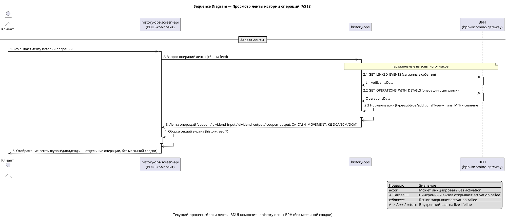
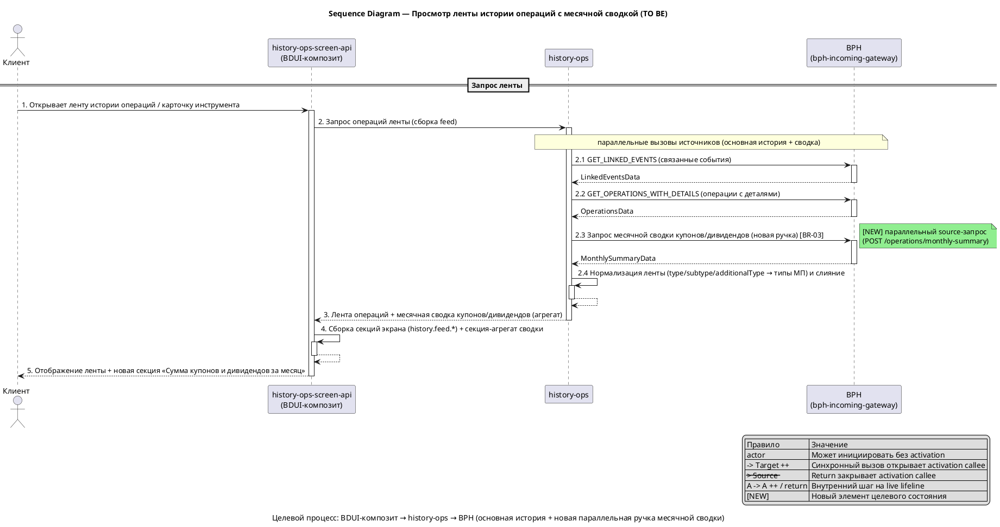
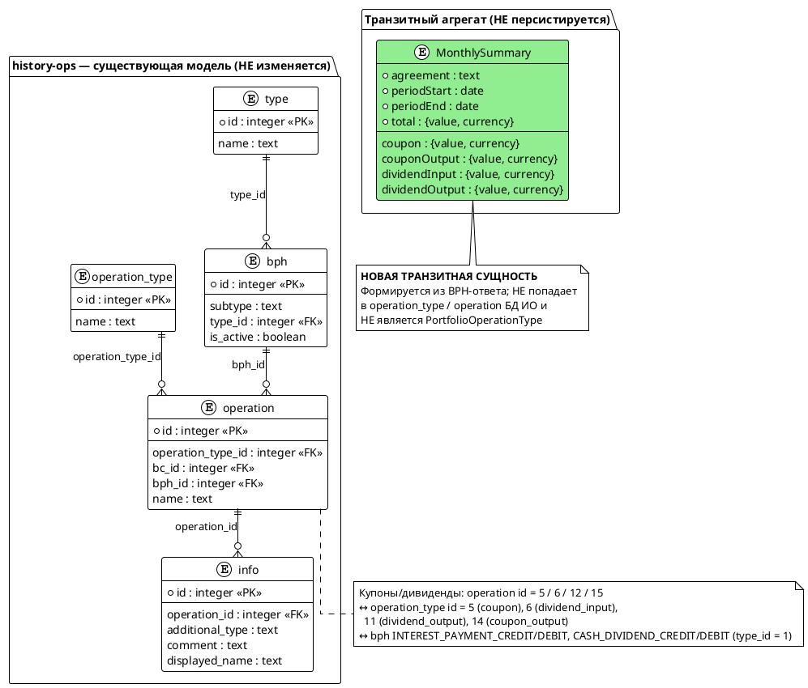

# my-v2-demo

## 1. Бизнес-требования

#### Анализ требований — Сумма купонов и дивидендов за месяц (BPH monthly summary)

**Источник требования:**

| Параметр | Значение |
|----------|----------|
| Фича | Сумма купонов и дивидендов за месяц (BPH monthly summary) |
| Источник | Product request |
| Инициатор | Product Owner истории операций |
| Дата / версия | 2026-09-25 (дата брифа) |

**Стейкхолдеры:**

| Стейкхолдер | Роль | Интерес / ожидание | Влияние / ответственность |
|-------------|------|--------------------|---------------------------|
| Клиент истории операций | Основной пользователь | Видит агрегированную сумму купонов и дивидендов за месяц в одном месте | Использует результат фичи |
| Команда BPH (Brokerage Portfolio History) | Владелец внешней системы и контракта | Получить самодостаточный контракт новой ручки месячной сводки | Реализует новую ручку по спеке |
| Команда history-ops | Владелец агрегации | Подключить параллельный source-запрос к новой ручке, не затронув ленту и КД | Реализует gateway и параллельный вызов |
| Команда history-ops-screen-api (BDUI-композит) | Владелец экранного сервиса | Добавить новую секцию на экране ленты и карточке инструмента | Формирует секцию-агрегат и отдаёт её фронту |
| Product Owner истории операций | Владелец продукта | Получить месячную сводку купонов/дивидендов для пользователя | Принимает функциональный результат |

**Бизнес-правила и ограничения:**

| ID | Тип | Описание | Источник / обоснование |
|----|-----|----------|------------------------|
| BR-01 | Бизнес-правило | Новая ручка BPH возвращает агрегированную месячную сводку «Сумма купонов и дивидендов» за период (месяц) | Product request |
| BR-02 | Бизнес-правило | Сводка агрегирует уже существующие операции купонов и дивидендов: типы МП `coupon`, `coupon_output`, `dividend_input`, `dividend_output` (носитель `CA_CASH_MOVEMENT`) | Product request; CONTEXT_DOC § Релевантный код |
| BR-03 | Бизнес-правило | history-ops подключает параллельный source-запрос к новой ручке одновременно с основной историей (лентой) | Product request |
| BR-04 | Бизнес-правило | Корпоративные действия (DCA/ECM/DCM) и карточки купонов/дивидендов в ленте не заменяются | Product request |
| BR-05 | Бизнес-правило | history-ops-screen-api (BDUI-композит) добавляет новую секцию на экране ленты и на карточке инструмента (раздел «История»); секция — агрегат, не новая операция и не деталка | Product request |
| CN-01 | Ограничение | Контракта нет: `bph.yml` не содержит endpoint месячной сводки — ручку проектируем мы, BPH реализует по спеке | Product request; CONTEXT_DOC § Ограничения и риски |
| CN-02 | Ограничение | Образец подключения — gateway `BphLinkedOperationsGateway` (метод `GetLinkedEvents`), не сам обмен `GET_LINKED_EVENTS` | Product request |
| CN-03 | Ограничение | Обратная совместимость: лента, КД и карточки купонов/дивидендов остаются без изменений; новая секция аддитивна | CONTEXT_DOC § Ограничения и риски |

**Цель фичи:**

| Вопрос | Ответ |
|--------|-------|
| Какую бизнес-проблему решает? | Купоны и дивиденды отображаются только как отдельные операции; у пользователя нет агрегированной суммы купонов и дивидендов за месяц |
| Какую ценность приносит пользователю? | Пользователь видит суммарную величину купонов и дивидендов за месяц в одном месте — на экране ленты и в разделе «История» карточки инструмента |
| Какие метрики улучшает? | Метрики не заданы (допущение) |

**SMART-проверка цели:**

| Критерий | Описание | Значение |
|----------|----------|----------|
| Specific | Конкретная | Реализовать новую ручку BPH месячной сводки + параллельный source-запрос в history-ops + новую секцию в BDUI-композите (лента и карточка инструмента) |
| Measurable | Измеримая | Метрики и целевые значения не заданы (допущение) |
| Achievable | Достижимая | Достижимо при условии согласования контракта BPH и готовности новой ручки (зависимость от внешней системы BPH) |
| Relevant | Релевантная | Напрямую закрывает потребность пользователя в месячной сумме купонов/дивидендов на существующих экранах |
| Time-bound | Ограниченная по времени | Срок/релиз не задан (допущение) |

**Противоречия и решения:**

| Требование 1 | Требование 2 | Источник 1 | Источник 2 | Решение | Обоснование |
|--------------|--------------|------------|------------|---------|-------------|
| Противоречия не выявлены | - | Product request | - | - | На текущем уровне постановки конфликтующих требований нет |

#### Use Case — Просмотреть ленту истории операций

**Структура Use Case:**

| Элемент | Значение |
|---------|----------|
| Название | Просмотреть ленту истории операций |
| Актор(ы) | Клиент (пользователь приложения) |
| Триггер | Клиент открывает экран «История операций» (таб HISTORY) или карточку инструмента (раздел «История») |
| Предусловия | См. таблицу предусловий ниже |
| Постусловия | См. таблицу постусловий ниже |
| Бизнес-правила | BR-02, BR-04 (см. ниже) |

**Предусловия:**

| № | Предусловие | Проверяемое условие |
|---|-------------|---------------------|
| 1 | Пользователь открыл экран ленты истории операций (таб HISTORY) | Вызван endpoint `POST /history/api/public/v1/screens/feed` |
| 2 | Для карточки инструмента задан фильтр по инструменту | Поля фильтра `isin` / `ticker` (тип фильтра `INSTRUMENT`) |

**Постусловия:**

| Исход | Постусловие |
|-------|-------------|
| Успех | На экране отображается лента операций: купоны и дивиденды — отдельными операциями (типы МП `coupon`, `coupon_output`, `dividend_input`, `dividend_output`; носитель `CA_CASH_MOVEMENT`), корпоративные действия (DCA/ECM/DCM), карточки купонов/дивидендов. Месячная сводка купонов/дивидендов отсутствует |
| Неуспех (бизнес) | Лента пуста (нет операций за период) — отображается пустое состояние ленты |
| Неуспех (техн.) | Часть источников недоступна — лента формируется частично (существующий механизм `bcDataComplete` / `failOperationTypes`) |

**Бизнес-правила:**

| ID | Правило | Применяется на шаге |
|----|---------|---------------------|
| BR-02 | Купоны и дивиденды — операции типов МП `coupon`, `coupon_output`, `dividend_input`, `dividend_output`; носитель — BPH-тип `CA_CASH_MOVEMENT`. В ленте отображаются как отдельные операции, без агрегации в сводку | Шаг 7 |
| BR-04 | Корпоративные действия (DCA/ECM/DCM) и карточки купонов/дивидендов отображаются в ленте как самостоятельные сущности | Шаг 7 |

**Основной сценарий — Happy Path:**

```
Шаг 1:  Клиент открывает экран «История операций» (лента, таб HISTORY) или карточку инструмента (раздел «История»)
Шаг 2:  Система (BDUI-композит history-ops-screen-api) принимает запрос на сборку экрана ленты
Шаг 3:  Система запрашивает операции ленты у history-ops
Шаг 4:  history-ops параллельно запрашивает источники, включая BPH (связанные события GET_LINKED_EVENTS и операции с деталями GET_OPERATIONS_WITH_DETAILS)
          ЕСЛИ все источники ответили успешно
            ТО сценарий продолжается с шага 5
          ИНАЧЕ
            ПЕРЕЙТИ К альтернативному сценарию 4a
Шаг 5:  history-ops нормализует операции BPH (type/subtype/additionalType → типы МП) и формирует ленту операций
Шаг 6:  Система собирает секции экрана (типы секций history.feed.*) и возвращает экран ленты
Шаг 7:  Система отображает ленту:
          — купоны и дивиденды как отдельные операции [BR-02] (типы МП coupon, coupon_output, dividend_input, dividend_output; носитель CA_CASH_MOVEMENT)
          — корпоративные действия [BR-04] (DCA/ECM/DCM)
          — карточки купонов/дивидендов [BR-04]
Шаг 8:  Месячная сводка купонов/дивидендов на экране отсутствует (в AS IS такого агрегата нет)
```

**Альтернативные сценарии:**

```
4a. Источник BPH недоступен или вернул ошибку (Технические ошибки):
  4a.1. history-ops формирует ленту частично; типы DIVIDEND_INPUT, DIVIDEND_OUTPUT, COUPON входят в DG_DEPENDENT_OPERATION_TYPES (влияет на полноту данных bcDataComplete)
  4a.2. Лента формируется частично; пользователь видит доступные операции (механизм `bcDataComplete` / `failOperationTypes`)
  4a.3. Возврат к шагу 5
```

**Связи между Use Cases:**

В AS IS сценарий самодостаточен: отдельные связанные Use Case не выделяются. Лента и карточка инструмента — один и тот же сценарий сборки ленты с разным фильтром (портфель vs инструмент `isin`/`ticker`).

#### Sequence Diagram — Просмотр ленты истории операций (AS IS)

**Назначение:**

Диаграмма показывает текущий процесс сборки ленты истории операций: клиент → BDUI-композит (history-ops-screen-api) → history-ops → BPH (параллельные вызовы источников). Месячной сводки купонов/дивидендов на диаграмме нет — это AS IS.

**Участники:**

| Участник | Тип | Роль |
|---|---|---|
| `Client` | actor | Клиент (пользователь приложения) |
| `ScreenApi` | participant | history-ops-screen-api (BDUI-композит / BFF) |
| `HO` | participant | history-ops (агрегация операций ленты) |
| `BPH` | participant | BPH (bph-incoming-gateway) — внешняя система |

**PlantUML:**



**Легенда:**

| Обозначение | Значение |
|---|---|
| `->` | Синхронный вызов (между participant только с `++` на callee) |
| `-->` | Ответ / return (с `--` при закрытии callee) |
| `++` / `--` | Activation start / end на callee |
| `activate` / `deactivate` | Открытие/закрытие lifeline Frontend на scope обработки |
| `actor` | Может инициировать сообщение без activation bar |
| `A -> A ++` / `return` | Внутренний шаг (self-call) на live lifeline |

**Соответствие тексту:**

| Элемент на диаграмме | Номер | Описание в тексте |
|---|---|---|
| Открытие ленты | 1 | Шаг 1 основного сценария |
| Запрос операций ленты (feed) | 2 | Шаг 2–3 основного сценария |
| GET_LINKED_EVENTS | 2.1 | Шаг 4 основного сценария |
| GET_OPERATIONS_WITH_DETAILS | 2.2 | Шаг 4 основного сценария |
| Нормализация и слияние | 2.3 | Шаг 5 основного сценария |
| Лента операций | 3 | Шаг 5 основного сценария |
| Сборка секций экрана | 4 | Шаг 6 основного сценария |
| Отображение ленты | 5 | Шаг 7–8 основного сценария |

#### Use Case — Просмотреть историю операций с месячной сводкой купонов и дивидендов

**Структура Use Case:**

| Элемент | Значение |
|---------|----------|
| Название | Просмотреть историю операций с месячной сводкой купонов и дивидендов |
| Актор(ы) | Клиент (пользователь приложения) |
| Триггер | Клиент открывает экран «История операций» (таб HISTORY) или карточку инструмента (раздел «История») |
| Предусловия | См. таблицу предусловий ниже |
| Постусловия | См. таблицу постусловий ниже |
| Бизнес-правила | BR-01…BR-05 (см. ниже) |

**Предусловия:**

| № | Предусловие | Проверяемое условие |
|---|-------------|---------------------|
| 1 | Пользователь открыл экран ленты истории операций (таб HISTORY) | Вызван endpoint `POST /history/api/public/v1/screens/feed` |
| 2 | Для карточки инструмента задан фильтр по инструменту | Поля фильтра `isin` / `ticker` (тип фильтра `INSTRUMENT`) |

**Постусловия:**

| Исход | Постусловие |
|-------|-------------|
| Успех | На экране отображается лента операций: купоны и дивиденды — отдельными операциями (типы МП `coupon`, `coupon_output`, `dividend_input`, `dividend_output`; носитель `CA_CASH_MOVEMENT`), корпоративные действия (DCA/ECM/DCM), карточки купонов/дивидендов — без изменений; дополнительно отображается новая секция-агрегат «Сумма купонов и дивидендов за месяц» на экране ленты и на карточке инструмента (раздел «История») |
| Неуспех (бизнес) | За период (месяц) нет купонов/дивидендов — секция сводки отображается с нулевыми суммами (bucket `0`) |
| Неуспех (техн.) | Новая ручка BPH недоступна — основная лента формируется без изменений; секция сводки скрывается целиком, не влияет на `bcDataComplete`/`failOperationTypes` ленты |

**Бизнес-правила:**

| ID | Правило | Применяется на шаге |
|----|---------|---------------------|
| BR-01 | Новая ручка BPH возвращает агрегированную месячную сводку «Сумма купонов и дивидендов» за период (месяц) | Шаг 4 |
| BR-02 | Сводка агрегирует уже существующие операции купонов и дивидендов: типы МП `coupon`, `coupon_output`, `dividend_input`, `dividend_output` (носитель `CA_CASH_MOVEMENT`) | Шаг 5 |
| BR-03 | history-ops подключает параллельный source-запрос к новой ручке одновременно с основной историей (лентой) | Шаг 4 |
| BR-04 | Корпоративные действия (DCA/ECM/DCM) и карточки купонов/дивидендов в ленте не заменяются | Шаг 7 |
| BR-05 | history-ops-screen-api (BDUI-композит) добавляет новую секцию на экране ленты и на карточке инструмента (раздел «История»); секция — агрегат, не новая операция и не деталка | Шаг 6, 8 |

**Основной сценарий — Happy Path:**

```
Шаг 1:  Клиент открывает экран «История операций» (лента, таб HISTORY) или карточку инструмента (раздел «История»)
Шаг 2:  Система (BDUI-композит history-ops-screen-api) принимает запрос на сборку экрана ленты
Шаг 3:  Система запрашивает операции ленты у history-ops
Шаг 4:  history-ops параллельно запрашивает источники [BR-03]:
          — основную историю (лента): BPH GET_LINKED_EVENTS, GET_OPERATIONS_WITH_DETAILS и прочие источники
          — новую ручку BPH месячной сводки купонов/дивидендов [BR-01]
          ЕСЛИ все источники ответили успешно
            ТО сценарий продолжается с шага 5
          ИНАЧЕ
            ПЕРЕЙТИ К альтернативному сценарию 4a
Шаг 5:  history-ops нормализует операции ленты (type/subtype/additionalType → типы МП) и получает месячную сводку по купонам/дивидендам [BR-02]
Шаг 6:  Система собирает секции экрана: секции ленты (history.feed.*) и новую секцию-агрегат месячной сводки [BR-05]
Шаг 7:  Система отображает ленту:
          — купоны и дивиденды как отдельные операции [BR-02]
          — корпоративные действия (DCA/ECM/DCM) [BR-04]
          — карточки купонов/дивидендов [BR-04]
          — новую секцию «Сумма купонов и дивидендов за месяц» [BR-05]
Шаг 8:  Система отображает новую секцию месячной сводки на карточке инструмента (раздел «История») [BR-05]
```

**Альтернативные сценарии:**

```
4a. Новая ручка BPH месячной сводки недоступна или вернула ошибку (Технические ошибки):
  4a.1. Основная лента формируется без изменений (купоны/дивиденды, КД DCA/ECM/DCM, карточки — не заменяются) [BR-04]
  4a.2. Секция-агрегат скрывается целиком; основная лента без изменений; не влияет на `bcDataComplete` и `failOperationTypes` ленты
  4a.3. Возврат к шагу 5

6a. За период (месяц) нет купонов и дивидендов (Пограничные случаи):
  6a.1. Секция месячной сводки отображается с нулевыми суммами (bucket `0`)
  6a.2. Возврат к шагу 6
```

**Связи между Use Cases:**

Сценарий самодостаточен: месячная сводка — встроенная секция того же сценария сборки ленты (агрегат, не отдельная операция и не деталка), отдельный Use Case не выделяется. Лента и карточка инструмента — один и тот же сценарий сборки с разным фильтром (портфель vs инструмент `isin`/`ticker`).

#### Sequence Diagram — Просмотр ленты истории операций с месячной сводкой (TO BE)

**Назначение:**

Диаграмма показывает целевой процесс сборки ленты: клиент → BDUI-композит (history-ops-screen-api) → history-ops → BPH. Параллельно с основной историей (лентой) history-ops выполняет новый параллельный source-запрос к ручке BPH месячной сводки; результат — новая секция-агрегат на экране ленты и карточке инструмента.

**Участники:**

| Участник | Тип | Роль |
|---|---|---|
| `Client` | actor | Клиент (пользователь приложения) |
| `ScreenApi` | participant | history-ops-screen-api (BDUI-композит / BFF) |
| `HO` | participant | history-ops (агрегация операций ленты + параллельный source-запрос сводки) |
| `BPH` | participant | BPH (bph-incoming-gateway) — внешняя система |

**PlantUML:**



**Легенда:**

| Обозначение | Значение |
|---|---|
| `->` | Синхронный вызов (между participant только с `++` на callee) |
| `-->` | Ответ / return (с `--` при закрытии callee) |
| `++` / `--` | Activation start / end на callee |
| `activate` / `deactivate` | Открытие/закрытие lifeline Frontend на scope обработки |
| `actor` | Может инициировать сообщение без activation bar |
| `A -> A ++` / `return` | Внутренний шаг (self-call) на live lifeline |
| `[NEW]` | Новый элемент целевого состояния (параллельный source-запрос сводки) |

**Соответствие тексту:**

| Элемент на диаграмме | Номер | Описание в тексте |
|---|---|---|
| Открытие ленты | 1 | Шаг 1 основного сценария |
| Запрос операций ленты (feed) | 2 | Шаг 2–3 основного сценария |
| GET_LINKED_EVENTS | 2.1 | Шаг 4 основного сценария |
| GET_OPERATIONS_WITH_DETAILS | 2.2 | Шаг 4 основного сценария |
| Запрос месячной сводки (новая ручка) | 2.3 | Шаг 4 основного сценария [BR-03] |
| Нормализация и слияние | 2.4 | Шаг 5 основного сценария |
| Лента операций + месячная сводка | 3 | Шаг 5 основного сценария |
| Сборка секций экрана + секция-агрегат | 4 | Шаг 6 основного сценария |
| Отображение ленты + новая секция | 5 | Шаг 7–8 основного сценария |

## 2. Ограничения и допущения

**Ограничения и допущения:**

| ID | Тип | Описание | Источник / обоснование |
|----|-----|----------|------------------------|
| CN-04 | Ограничение | Контракт новой ручки BPH месячной сводки должен быть самодостаточным (service / rpc / message / поля): в `bph.yml` нет endpoint сводки, ручку проектируем мы, команда BPH реализует по спеке | Бриф; CONTEXT_DOC § Ограничения и риски |
| CN-05 | Ограничение | Заголовок `systemName` BPH-вызова для новой ручки — `history_ops` (технический факт: код `BphClient` шлёт `history_ops`; расхождение с analytics `bph.md` = `si2-ops` снято — побеждает код) | CONTEXT_DOC § Ограничения и риски; код `BphClient.java` |
| CN-06 | Ограничение | Месячная сводка — агрегат, не операция: не является `PortfolioOperationType`, не попадает в маппинг `operation_type` / `operation` БД ИО, это отдельная сущность экрана (не новая операция и не деталка) | CONTEXT_DOC § Что учесть; бриф |
| CN-07 | Ограничение | Набор агрегируемых типов МП фиксирован: `coupon`, `coupon_output`, `dividend_input`, `dividend_output` (носитель BPH-типа `CA_CASH_MOVEMENT`; BPH-субтипы `INTEREST_PAYMENT_CREDIT` / `INTEREST_PAYMENT_DEBIT` / `CASH_DIVIDEND_CREDIT` / `CASH_DIVIDEND_DEBIT`) | CONTEXT_DOC § Релевантный код; бриф |
| CN-08 | Ограничение | Новая ручка подключается как параллельный source-запрос наряду с основной лентой (reactor `Mono.zip` в `SourceOperationTradeService` / `SourceOperationService`), не входит в общий merge ленты | CONTEXT_DOC § Интеграции; § Релевантный код |
| CN-09 | Ограничение | Новая секция поставляется за фича-тоглом `enable_monthly_summary` с default `false` (OFF) до готовности BPH (по образцу соседних фич `composite-active-order-commission`, `bph-linked-events-yield`) | Решение D-07; CONTEXT_DOC Q-06 |
| CN-10 | Ограничение | Сводка на карточке инструмента (раздел «История») считается по `instrumentFilter` (`agreements` = `isin`/`ticker`) — только по выбранному инструменту; отличается от сводки ленты (весь портфель) | Решение D-04; CONTEXT_DOC Q-03 |
| CN-11 | Ограничение | Сумма месячной сводки не пересчитывается в единую валюту: формируются отдельные суммы по каждой валюте (RUB / USD / SUR) без единого итога; точность `value` — decimal, округление до 2 знаков; формат `{value, currency}` | Решение D-05; CONTEXT_DOC Q-07 |
| CN-12 | Ограничение | При недоступности/таймауте/ошибке новой ручки BPH сводки секция скрывается целиком; основная лента и КД без изменений; сводка не влияет на `bcDataComplete`/`failOperationTypes` ленты | Решение D-03; CONTEXT_DOC Q-05 |
| CN-13 | Допущение | Количественные NFR/SLO для фичи не задаются: секция аддитивна (один параллельный source-запрос к BPH + одна транзитная секция композита), класс запроса ленты не меняется. Целевые значения p85/RPS/CCU/Web Vitals (LCP/FID/CLS/TTI) и SLO (availability/error rate/latency), параметры Rate Limiting/Throttling/Circuit Breaker и prod-поля лога `service`/`environment` для новой ручки не фиксируются | Решение D-08; CONTEXT_DOC Q-08 |
| CN-14 | Допущение | Метаданные цели: инициатор — Product Owner истории операций, дата — дата брифа (2026-09-25); метрики улучшения и срок/релиз фичи не заданы (цель качественная, Measurable/Time-bound не определены) | Решение D-09; CONTEXT_DOC Q-09 |

## 4. Функциональные требования

#### Интеграции и события

##### 4.1.1 Синхронный контракт — BPH monthly summary (новый)

**Назначение:** history-ops (HO) получает от BPH агрегированную сумму купонов и дивидендов за месяц («месячную сводку») для показа в новой секции BDUI-композита (экран ленты + карточка инструмента, раздел «История»). Сводка — агрегат по уже существующим операциям `CA_CASH_MOVEMENT`, не новая операция и не деталка; корпоративные действия (DCA/ECM/DCM) и карточки купонов/дивидендов в ленте не заменяются [BR-04, BR-05].

**Кратко:**

- Тип интеграции: синхронная
- Протокол: REST (HTTPS), JSON
- Направление: исходящая из history-ops (Request → Response)
- Producer (владелец ручки, система-получатель запроса): BPH (Brokerage Portfolio History)
- Consumer (система-инициатор): history-ops

**Текущее поведение (AS IS):**

Точка входа — `bph-incoming-gateway` (OpenAPI `bph.yml`, info.title `BPH Incoming-gateway`). Существующие обмены: `GET_OPERATIONS_WITH_DETAILS` (`POST /api/v1/incoming-gateway/operations-with-details`), `GET_OPERATION_TYPES` (`GET /api/v1/incoming-gateway/operation-types`), `GET_LINKED_EVENTS` (`POST /api/v1/incoming-gateway/operations/linked-events`). Месячной сводки в `bph.yml` нет.

Образец подключения параллельного source-запроса — `BphLinkedOperationsGateway extends AbstractSplitStatusGateway<..., BphRawLinkedEventsWrapper, String>`: `eventType() = "GET_LINKED_EVENTS"`, `exSystem() = "BPH"`, `getOperationsInternal` строит `RequestLinkedData` через `createRequest` и вызывает `bphClient.getLinkedEvents(requestId, request)`. Заголовки вызова (код `BphClient`): `systemName: history_ops`, `rqUID`. Все ответы BPH имеют энвелоп `{ status: ResponseStatusData{code, message}, data: ... }`; ошибки — `ErrorData{timestamp, status, error, path}` (HTTP 400/500).

Подмножество, агрегируемое в сводку, фиксируется кодом: `BphOperationWrapper.CA_CASH_MOVEMENT = "CA_CASH_MOVEMENT"` и `COUPON_DIVIDEND_SUBTYPES = {INTEREST_PAYMENT_CREDIT, CASH_DIVIDEND_CREDIT, CASH_DIVIDEND_DEBIT, INTEREST_PAYMENT_DEBIT}`; предикат `BphCommonWrapper.isCouponDividendOperation() = "CA_CASH_MOVEMENT".equals(originalType) && COUPON_DIVIDEND_SUBTYPES.contains(bphType)`.

**Участники интеграции:**

| Система | Роль | Что передает | Что получает |
|---|---|---|---|
| BPH (Brokerage Portfolio History) | Producer / владелец новой ручки | Месячную сводку купонов/дивидендов за период | Запрос с периодом и набором договоров |
| history-ops | Consumer | Запрос к новой ручке (`rqUID`, `systemName`, период, договоры) | Агрегированные суммы по типам МП |
| history-ops-screen-api (BDUI-композит) | Downstream-потребитель (через feed history-ops) | — | Готовая секция-агрегат для экрана ленты и карточки инструмента |

**Контракт:**

| Метод / операция / endpoint | Назначение | Producer | Consumer |
|---|---|---|---|
| `getMonthlySummary` (новый метод `BphClient`) + `POST /api/v1/incoming-gateway/operations/monthly-summary` | Получение месячной сводки купонов и дивидендов | BPH | history-ops |

**Endpoint (сигнатура):**

```
POST /api/v1/incoming-gateway/operations/monthly-summary
```

> **Статус:** endpoint новый, в `bph.yml` отсутствует (команда BPH реализует по спеке). Path и метод зафиксированы: `POST /api/v1/incoming-gateway/operations/monthly-summary` (по образцу `/operations/linked-events`).

**Общая информация:**

| Параметр | Значение |
|---|---|
| Назначение | Получение агрегированной суммы купонов и дивидендов за месяц |
| Система-источник | BPH (Brokerage Portfolio History) |
| Система-получатель | history-ops |
| Тип интеграции | Синхронная |
| Протокол | REST (HTTPS) |
| Направление | Однонаправленная (Request → Response) |
| Версия API | v1 (`/api/v1/incoming-gateway/...`) |
| Аутентификация | Не документирована в `bph.yml` (идентификация по заголовкам `rqUID` / `systemName`) |
| Формат данных | JSON |

**Request Headers:**

| Заголовок | Обязат. | Описание | Пример |
|---|---|---|---|
| rqUID | Да | Сквозной идентификатор запроса (UUID) | `c4a5dccd-0fe2-4aa1-823e-a5a5d9ee04a4` |
| systemName | Да | Идентификатор системы-инициатора | `history_ops` (код `BphClient`) |

**Path Parameters:** нет (все параметры в теле POST).

**Query Parameters:** нет (все параметры в теле POST).

**Request body (проектируемый, `RequestMonthlySummaryData`):**

| Параметр | Тип | Формат | Nullable | Описание | Валидация | Пример | Маппинг |
|---|---|---|---|---|---|---|---|
| agreements (новое) | array\<string\> | — | Нет | Массив номеров договоров для расчёта сводки | maxItems: 100; pattern: `^[A-Za-z\d]{1,16}$` | `["KJ28438H394L"]` | По образцу `RequestLinkedData.agreements` |
| startSearchDate (новое) | string | date-time | Нет | Начало периода (начало месяца) | format: date-time | `2026-09-01T00:00:00` | По образцу `RequestLinkedData.startSearchDate` |
| endSearchDate (новое) | string | date-time | Нет | Конец периода (конец месяца) | format: date-time | `2026-09-30T23:59:59` | По образцу `RequestLinkedData.endSearchDate` |
| dateForFilter (новое) | string | enum | Нет | Дата для фильтрации | enum: `FilterDateEnum` | `EVENT_DATE` | `FilterDateEnum` (существующий) |

**Response body 200 OK (проектируемый, `MonthlySummaryData`):**

| Параметр | Тип | Формат | Nullable | Описание | Валидация | Пример | Маппинг |
|---|---|---|---|---|---|---|---|
| agreement (новое) | string | — | Нет | Номер договора | maxLength: 255 | `420012W` | `LinkedEventsData.agreement` |
| periodStart (новое) | string | date-time | Нет | Начало месяца | format: date-time | `2026-09-01T00:00:00` | Вычисляется по запросу |
| periodEnd (новое) | string | date-time | Нет | Конец месяца | format: date-time | `2026-09-30T23:59:59` | Вычисляется по запросу |
| total (новое) | object | money | Нет | Суммарная сумма купонов и дивидендов за месяц | required: [value, currency] | `{ "value": "5000.00", "currency": "RUB" }` | Агрегат по типам МП |
| ├─ value (новое) | string | big_decimal | Нет | Сумма | minimum: 0; округление до 2 знаков | `"5000.00"` | Сумма операций `CA_CASH_MOVEMENT` |
| ├─ currency (новое) | string | CurrencyEnum | Нет | Валюта | enum: CurrencyEnum (RUB / USD / SUR) | `RUB` | `totalPriceCurrency` |
| coupon (новое) | object | money | Нет | Сумма зачислений купонов | required: [value, currency] | `{ "value": "2000.00", "currency": "RUB" }` | МП `coupon` / `INTEREST_PAYMENT_CREDIT` |
| couponOutput (новое) | object | money | Нет | Сумма списаний купонов | required: [value, currency] | `{ "value": "0.00", "currency": "RUB" }` | МП `coupon_output` / `INTEREST_PAYMENT_DEBIT` |
| dividendInput (новое) | object | money | Нет | Сумма зачислений дивидендов | required: [value, currency] | `{ "value": "3000.00", "currency": "RUB" }` | МП `dividend_input` / `CASH_DIVIDEND_CREDIT` |
| dividendOutput (новое) | object | money | Нет | Сумма списаний дивидендов | required: [value, currency] | `{ "value": "0.00", "currency": "RUB" }` | МП `dividend_output` / `CASH_DIVIDEND_DEBIT` |

> **Статус полей:** форма request/response зафиксирована (решение D-01): `RequestMonthlySummaryData` (период + `agreements`) → `MonthlySummaryData` (`total` + `coupon`/`couponOutput`/`dividendInput`/`dividendOutput`, каждое `{value, currency}`); суммы `value` — decimal с округлением до 2 знаков, без пересчёта валют (отдельные суммы по RUB/USD/SUR — CN-11); при отсутствии купонов/дивидендов за месяц возвращаются нулевые суммы (bucket `0`).

**ENUM: dateForFilter (`FilterDateEnum`, существующий):**

| Значение | Описание |
|---|---|
| EVENT_DATE | Дата события |
| FORMATION_DATE | Дата создания/формирования |

**ENUM: currency (`CurrencyEnum`):**

| Значение | Описание |
|---|---|
| RUB | Российский рубль |
| USD | Доллар США |
| SUR | Суверенная расчётная валюта (SUR) |

**Response Headers:** не документированы в `bph.yml` (отсутствует evidence; заголовки ответа не изобретаются).

**Коды ответов:**

| HTTP код | Код ошибки | Описание |
|---|---|---|
| 200 | — | Успешный ответ (`MonthlySummaryData`) |
| 400 | — | Bad Request (`ErrorData`; машиночитаемый код не документирован) |
| 500 | — | Internal Server Error (`ErrorData`) |

**Данные и маппинг (field lineage агрегации):**

| Источник | Поле источника | Получатель | Поле получателя | Правило |
|---|---|---|---|---|
| BPH операция `CA_CASH_MOVEMENT` | `subType = INTEREST_PAYMENT_CREDIT` | Секция-агрегат | `coupon` | Суммируется в зачисление купона (МП `coupon`) |
| BPH операция `CA_CASH_MOVEMENT` | `subType = INTEREST_PAYMENT_DEBIT` | Секция-агрегат | `couponOutput` | Суммируется в списание купона (МП `coupon_output`) |
| BPH операция `CA_CASH_MOVEMENT` | `subType = CASH_DIVIDEND_CREDIT` | Секция-агрегат | `dividendInput` | Суммируется в зачисление дивидендов (МП `dividend_input`) |
| BPH операция `CA_CASH_MOVEMENT` | `subType = CASH_DIVIDEND_DEBIT` | Секция-агрегат | `dividendOutput` | Суммируется в списание дивидендов (МП `dividend_output`) |
| БД ИО `operation_type` | `id=5/6/11/14` | Секция-агрегат | разбивка `coupon`/`dividend_input`/`dividend_output`/`coupon_output` | Четыре типа МП, агрегируемых в сводку |

**Ошибки и исключения:**

| Условие | Ответ / статус | Поведение системы | Evidence |
|---|---|---|---|
| Невалидный запрос (период/договоры) | HTTP 400 (`ErrorData`) | Запрос отклонён | `bph.yml` `/operations/linked-events` responses 400 |
| Внутренняя ошибка BPH | HTTP 500 (`ErrorData`) | Запрос отклонён | `bph.yml` responses 500 |
| Недоступность/таймаут новой ручки в history-ops | — | Секция сводки скрывается целиком; основная лента и КД без изменений; не влияет на `bcDataComplete`/`failOperationTypes` ленты [CN-12] | — |

**Таймауты, retry и fallback:** конфиг вызова BPH задаётся `@ConfigurationProperties(prefix="app-config.bph")` — `BphProperties(deadline, url, pageSizeForLinkedEvents, pageSizeForTrades)`. Дедлайн вызова новой ручки задан существующим конфигом `deadline`; отдельного retry не вводится — при недоступности/таймауте/ошибке секция скрывается целиком [CN-12]. В `BphProperties` добавляется новый ключ конфига (URL/pageSize ручки сводки) [D-01].

**Связанные разделы:**

- Блок `goal` — BR-01…BR-05, CN-01…CN-03.
- Блок `usecase-to-be` — Use Case «Просмотреть историю операций с месячной сводкой».
- Блок `constraints` — CN-04…CN-14 (в т.ч. CN-04 самодостаточность контракта, CN-07 набор типов МП, CN-08 параллельный `Mono.zip`).
- Блок `data-model` — таблицы `operation`, `operation_type`, `bph`.

### 4.2.2. Алгоритм обработки месячной сводки купонов и дивидендов (parallel source → секция композита)

> Раздел описывает алгоритм обработки месячной сводки «Сумма купонов и дивидендов»: как
> `history-ops` параллельно с основной историей (лентой) запрашивает новую ручку BPH месячной
> сводки, как сводка агрегируется по операциям купонов/дивидендов, как она встраивается в новую
> секцию BDUI-композита (экран ленты + карточка инструмента, раздел «История») и что происходит
> при частичной недоступности источника. Форма раздела — Use Case по kit `use-case-standard-kit`.
> Сценарий описан на уровне сервисов/шагов; имена классов/методов приведены как реализация
> (в §4.2.x допустимы). Бизнес-правила BR-01…BR-05 определены в §1.1 и §1.3 Use Case TO BE;
> ограничения CN-06, CN-08, CN-09 — в §2.

**Цепочка обработки месячной сводки (TO BE):**

```
Клиент → history-ops-screen-api (BDUI-композит): запрос ленты / карточки инструмента
  → history-ops: параллельный запуск источников (reactor Mono.zip)
      ├─ основная история (лента): BPH GET_LINKED_EVENTS, GET_OPERATIONS_WITH_DETAILS + прочие источники
      └─ [NEW] месячная сводка купонов/дивидендов (parallel source-запрос):
            новый gateway месячной сводки (образец BphLinkedOperationsGateway; AbstractSplitStatusGateway)
            → bphClient.getMonthlySummary → RequestMonthlySummaryData
            → BPH POST /api/v1/incoming-gateway/operations/monthly-summary → MonthlySummaryData
  → сводка — отдельный агрегат, НЕ сливается в ленту (не PortfolioOperationType, не в operation_type/operation) [CN-06]
  → history-ops-screen-api: сборка секций (history.feed.*) + новая секция-агрегат сводки [BR-05]
  → фронт: отображение секции на экране ленты и на карточке инструмента (раздел «История»)
```

Источник цепочки — `CONTEXT_DOC` § «Релевантный код» (образец `BphLinkedOperationsGateway`,
`BphClient`, `SourceOperationTradeService`/`SourceOperationService`, `AbstractSectionCreator`);
пункты «новая ручка сводки» и «новая секция-агрегат» добавлены фичей.

---

#### Use Case — Сформировать месячную сводку купонов и дивидендов при сборке ленты

**Структура Use Case:**

| Элемент | Значение |
|---------|----------|
| Название | Сформировать месячную сводку купонов и дивидендов при сборке ленты |
| Актор(ы) | `history-ops` (backend агрегации: параллельный запрос новой ручки и передача готовой сводки); `history-ops-screen-api` (BDUI-композит: встраивание секции-агрегата в экран) |
| Триггер | Клиент открывает экран ленты истории операций (`POST /history/api/public/v1/screens/feed`) или карточку инструмента (раздел «История», фильтр `INSTRUMENT`) |
| Предусловия | См. таблицу предусловий ниже |
| Постусловия | См. таблицу постусловий ниже |
| Бизнес-правила | BR-01…BR-05 (см. ниже; определены в §1.1 и §1.3 Use Case TO BE) |

**Предусловия:**

| № | Предусловие | Проверяемое условие |
|---|-------------|---------------------|
| 1 | Клиент запросил сборку ленты | Вызван `POST /history/api/public/v1/screens/feed` (лента) или feed с фильтром `INSTRUMENT` (карточка инструмента, `isin`/`ticker`) |
| 2 | Фича-тогл месячной сводки активен | Признак включения нового параллельного source-запроса сводки включён (ON); default OFF [CN-09] |
| 3 | Новая ручка BPH реализована | Endpoint месячной сводки присутствует в `bph.yml` и реализован владельцами BPH (контракт зафиксирован) |
| 4 | Канал к BPH доступен | `bph-incoming-gateway` отвечает на вызов месячной сводки |

**Постусловия:**

| Исход | Постусловие |
|-------|-------------|
| Успех | history-ops получил от BPH готовую месячную сводку (`MonthlySummaryData`: `total` + разбивка `coupon`/`coupon_output`/`dividend_input`/`dividend_output`), передал её отдельно от ленты; history-ops-screen-api отобразил новую секцию-агрегат «Сумма купонов и дивидендов за месяц» на экране ленты и на карточке инструмента; основная лента (операции купонов/дивидендов, КД DCA/ECM/DCM, карточки купонов/дивидендов) без изменений |
| Неуспех (бизнес) | BPH вернул `status.code ≠ 0` (ошибка ручки): сводка не включается в результат; секция скрывается целиком; основная лента формируется без изменений [CN-12] |
| Неуспех (техн.) | Новая ручка BPH недоступна/таймаут: секция скрывается целиком; основная лента формируется без изменений; не влияет на `bcDataComplete`/`failOperationTypes` [CN-12] |

**Бизнес-правила:**

| ID | Правило | Применяется на шаге |
|----|---------|---------------------|
| BR-01 | Новая ручка BPH возвращает агрегированную месячную сводку «Сумма купонов и дивидендов» за период (месяц) | Шаг 4–5 |
| BR-02 | Сводка агрегирует уже существующие операции купонов и дивидендов: типы МП `coupon`, `coupon_output`, `dividend_input`, `dividend_output` (носитель `CA_CASH_MOVEMENT`) | Шаг 6 |
| BR-03 | history-ops подключает параллельный source-запрос к новой ручке одновременно с основной историей (лентой) | Шаг 3 |
| BR-04 | Корпоративные действия (DCA/ECM/DCM) и карточки купонов/дивидендов в ленте не заменяются | Шаг 7–8 |
| BR-05 | history-ops-screen-api (BDUI-композит) добавляет новую секцию на экране ленты и на карточке инструмента (раздел «История»); секция — агрегат, не новая операция и не деталка | Шаг 8–9 |

**Основной сценарий — Happy Path:**

```
Шаг 1:  Клиент: открывает экран ленты истории операций или карточку инструмента (раздел «История»)
Шаг 2:  history-ops-screen-api: принимает запрос и вызывает history-ops для сборки ленты
Шаг 3:  history-ops: запускает параллельную загрузку источников через Mono.zip [BR-03, CN-08]
          ЕСЛИ [CN-09] фича-тогл месячной сводки активен
            ТО подключить параллельный source-запрос новой ручки BPH месячной сводки
          ИНАЧЕ
            ПЕРЕЙТИ К альтернативному сценарию 3a
Шаг 4:  history-ops: формирует запрос сводки через gateway месячной сводки
          (образец BphLinkedOperationsGateway; createRequest → RequestMonthlySummaryData:
          agreements, startSearchDate, endSearchDate, dateForFilter) и вызывает
          bphClient.getMonthlySummary [BR-01]
          ЕСЛИ вызов принят BPH (канал доступен)
            ТО сценарий продолжается с шага 5
          ИНАЧЕ ЕСЛИ ручка недоступна / таймаут
            ПЕРЕЙТИ К альтернативному сценарию 4a
Шаг 5:  BPH: обрабатывает ручку месячной сводки и возвращает готовую сумму
          ЕСЛИ status.code = 0
            ТО сценарий продолжается с шага 6
          ИНАЧЕ
            ПЕРЕЙТИ К альтернативному сценарию 5a
Шаг 6:  history-ops: получает MonthlySummaryData как отдельный агрегат (не операция)
          Сводка агрегирована BPH по операциям CA_CASH_MOVEMENT типов МП
          coupon/coupon_output/dividend_input/dividend_output [BR-02]
          ЕСЛИ за месяц есть хотя бы один купон или дивиденд
            ТО сводка содержит ненулевые суммы; сценарий продолжается с шага 7
          ИНАЧЕ
            ПЕРЕЙТИ К альтернативному сценарию 6a
Шаг 7:  history-ops: возвращает history-ops-screen-api основную ленту (без изменений)
          и месячную сводку отдельно от ленты (сводка не сливается в merge ленты) [CN-06, BR-04]
Шаг 8:  history-ops-screen-api: собирает секции экрана [BR-05]:
          8.1. секции ленты history.feed.* (операции купонов/дивидендов, КД DCA/ECM/DCM,
               карточки купонов/дивидендов — без изменений) [BR-04]
          8.2. новую секцию-агрегат «Сумма купонов и дивидендов за месяц» —
               код секции `history.feed.monthlySummary`, рендерится транзитно
               (без новой строки в `section`/`content`/`screen_section` БД screen-api)
Шаг 9:  history-ops-screen-api: отдаёт экран клиенту
          Клиент видит новую секцию-агрегат на экране ленты и на карточке инструмента
          (раздел «История») [BR-05]
```

**Альтернативные сценарии:**

```
3a. Фича-тогл месячной сводки OFF [CN-09] (Пограничные случаи):
  3a.1. history-ops не вызывает новую ручку BPH месячной сводки
  3a.2. Секция-агрегат не отображается; лента формируется без изменений
  3a.3. Возврат к шагу 7

4a. Новая ручка BPH недоступна / таймаут (Технические ошибки):
  4a.1. Основная лента формируется без изменений (купоны/дивиденды, КД DCA/ECM/DCM,
        карточки — не заменяются) [BR-04]
  4a.2. Секция-агрегат скрывается целиком; основная лента без изменений;
        не влияет на bcDataComplete и failOperationTypes [CN-12]
  4a.3. Возврат к шагу 7

5a. BPH вернул ошибку ручки (status.code ≠ 0) (Бизнес-ошибки):
  5a.1. Сводка не включается в результат; основная лента формируется без изменений [BR-04]
  5a.2. Секция-агрегат скрывается целиком; основная лента без изменений [CN-12]
  5a.3. Возврат к шагу 7

6a. За месяц нет купонов и дивидендов (Пограничные случаи):
  6a.1. Секция-агрегат отображается с нулевыми суммами (bucket `0`)
  6a.2. Возврат к шагу 7
```

**Связи между Use Cases:**

| Связь | Связанный Use Case | Шаг / Extension Point | Условие |
|-------|--------------------|-----------------------|---------|
| include | Просмотреть историю операций с месячной сводкой купонов и дивидендов (§1.3 Use Case TO BE) | Шаг 3–9 основного сценария | Всегда — обработка месячной сводки выполняется как обязательный подпроцесс сборки ленты при активном фича-тогле [CN-09] |

#### Модель данных — Сумма купонов и дивидендов за месяц (BPH monthly summary)

**Контекст изменения:**

| Элемент | Значение |
|---------|----------|
| Фича / изменение | Сумма купонов и дивидендов за месяц (BPH monthly summary) — новая секция-агрегат на экране ленты и карточке инструмента (раздел «История») |
| Тип хранилища | Реляционное (PostgreSQL); агрегат месячной сводки — транзитный, не персистируется в history-ops |
| СУБД / движок | PostgreSQL (`org.postgresql:postgresql`, `r2dbc-postgresql`, Liquibase; testcontainers `postgres:13.8-alpine`) |
| Тип изменения | Без новых постоянных сущностей в history-ops (`operation_type` / `operation` не меняются); новая транзитная сущность-агрегат + новая транзитная секция экрана в screen-api (`history.feed.monthlySummary`, без постоянной строки в БД) |
| Связанные артефакты | Use Case «Просмотреть историю операций с месячной сводкой купонов и дивидендов» (TO BE); интеграция history-ops → BPH `POST /api/v1/incoming-gateway/operations/monthly-summary` (контракт проектируем) |

**ER-диаграмма:**



**Новые и изменённые сущности:**

Постоянные сущности history-ops не изменяются и не добавляются: сводка является агрегатом, вычисляемым из BPH-ответа на лету. Ниже — существующие сущности-носители (опора для агрегации) и новая транзитная сущность сводки.

**Таблица: `type` (history-ops, существующая, не изменяется)**

| Атрибут | Тип | Nullable | Описание | Ограничения |
|---------|-----|----------|----------|-------------|
| id | integer | NOT NULL | Уникальный идентификатор типа BPH-операции | PK |
| name | text | — | Имя типа; `CA_CASH_MOVEMENT` (id=1) — тип-носитель денежных КД | — |

**Таблица: `operation_type` (history-ops, существующая, не изменяется)**

| Атрибут | Тип | Nullable | Описание | Ограничения |
|---------|-----|----------|----------|-------------|
| id | integer | NOT NULL | Уникальный идентификатор типа МП | PK |
| name | text | — | Имя типа МП; агрегируемые: `coupon` (id=5), `dividend_input` (id=6), `dividend_output` (id=11), `coupon_output` (id=14) | — |

**Таблица: `bph` (history-ops, существующая, не изменяется)**

| Атрибут | Тип | Nullable | Описание | Ограничения |
|---------|-----|----------|----------|-------------|
| id | integer | NOT NULL | Уникальный идентификатор BPH-субтипа | PK |
| subtype | text | — | Имя субтипа BPH; купоны/дивиденды: `INTEREST_PAYMENT_CREDIT` (id=1), `CASH_DIVIDEND_CREDIT` (id=2), `CASH_DIVIDEND_DEBIT` (id=3), `INTEREST_PAYMENT_DEBIT` (id=4) | — |
| type_id | integer | — | Ссылка на `type.id`; для купонов/дивидендов = 1 (`CA_CASH_MOVEMENT`) | FK → type.id |
| is_active | boolean | — | Признак активности субтипа | — |

**Таблица: `operation` (history-ops, существующая, не изменяется)**

| Атрибут | Тип | Nullable | Описание | Ограничения |
|---------|-----|----------|----------|-------------|
| id | integer | NOT NULL | Уникальный идентификатор операции | PK |
| operation_type_id | integer | — | Ссылка на `operation_type.id` | FK → operation_type.id |
| bc_id | integer | NULL | Ссылка на BC-ветку (`bph_bc.id`); для `coupon_output` (id=15) отсутствует | FK → bph_bc.id |
| bph_id | integer | NULL | Ссылка на `bph.id` | FK → bph.id |
| name | text | — | Отображаемое имя: `Зачисление купона` (id=5), `Зачисление дивидендов` (id=6), `Списание дивидендов` (id=12), `Списание купонов` (id=15) | — |

**Таблица: `info` (history-ops, существующая, не изменяется)**

| Атрибут | Тип | Nullable | Описание | Ограничения |
|---------|-----|----------|----------|-------------|
| id | integer | NOT NULL | Уникальный идентификатор карточки контента | PK |
| operation_id | integer | — | Ссылка на `operation.id` | FK → operation.id |
| additional_type | text | NULL | Доп. тип (для купонов/дивидендов — NULL) | — |
| comment | text | NULL | Шаблон комментария (`$name$` для id=5/6/12/15) | — |
| displayed_name | text | NULL | Отображаемое имя карточки | — |

**Таблица (транзитная): `MonthlySummary` — месячная сводка купонов и дивидендов (НОВАЯ, НЕ персистируется)**

Формируется из BPH-ответа новой ручки и рендерится как секция-агрегат. Не сохраняется в БД ИО и не участвует в маппинге `operation_type` / `operation`.

| Атрибут | Тип | Nullable | Описание | Ограничения |
|---------|-----|----------|----------|-------------|
| agreement | text | NOT NULL | Идентификатор соглашения, по которому считается сводка | — |
| periodStart | date | NOT NULL | Начало месяца расчёта | — |
| periodEnd | date | NOT NULL | Конец месяца расчёта | — |
| total | Money `{value, currency}` | NOT NULL | Итоговая сумма купонов и дивидендов за месяц | `value` — decimal, округление до 2 знаков; `currency` — RUB/USD/SUR |
| coupon | Money `{value, currency}` | NOT NULL | Сумма зачисленных купонов (`coupon`, bph `INTEREST_PAYMENT_CREDIT`) | decimal, 2 знака; `currency` RUB/USD/SUR |
| couponOutput | Money `{value, currency}` | NOT NULL | Сумма списанных купонов (`coupon_output`, bph `INTEREST_PAYMENT_DEBIT`) | decimal, 2 знака; `currency` RUB/USD/SUR |
| dividendInput | Money `{value, currency}` | NOT NULL | Сумма зачисленных дивидендов (`dividend_input`, bph `CASH_DIVIDEND_CREDIT`) | decimal, 2 знака; `currency` RUB/USD/SUR |
| dividendOutput | Money `{value, currency}` | NOT NULL | Сумма списанных дивидендов (`dividend_output`, bph `CASH_DIVIDEND_DEBIT`) | decimal, 2 знака; `currency` RUB/USD/SUR |

**Связи между сущностями:**

| Сущность 1 | Сущность 2 | Тип связи | FK / Reference | Описание |
|------------|------------|-----------|----------------|----------|
| type | bph | 1:N | bph.type_id → type.id | Тип BPH-операции классифицирует субтипы; `CA_CASH_MOVEMENT` (id=1) — носитель купонов/дивидендов |
| bph | operation | 1:N | operation.bph_id → bph.id | Субтип BPH конкретизирует операцию (CREDIT=зачисление, DEBIT=списание) |
| operation_type | operation | 1:N | operation.operation_type_id → operation_type.id | Тип МП (`coupon`/`dividend_input`/`dividend_output`/`coupon_output`) определяет операцию |
| operation | info | 1:N | info.operation_id → operation.id | Операция имеет карточку контента (имя, комментарий) |

Месячная сводка `MonthlySummary` не имеет персистентных связей: её источник — BPH-ответ, а не таблицы БД ИО.

**Сводные таблицы (junction):**

Не требуются: в данной фиче бизнес-связь «многие ко многим» отсутствует.

**Область изменения:**

| Категория | Элементы |
|-----------|----------|
| Новые сущности | `MonthlySummary` — транзитная (не персистируется); новая секция композита `history.feed.monthlySummary` рендерится транзитно — постоянной строки в `section` / `content` / `screen_section` screen-api не создаётся |
| Изменённые сущности | — (`type`, `operation_type`, `bph`, `operation`, `info` не меняются) |
| Удалённые / deprecated сущности | — |
| Затронутые связи | — в history-ops связей не меняется; связь `screen ↔ section` в screen-api не создаётся (секция рендерится транзитно) |
| Индексы и ограничения | — новых индексов/ограничений не вводится |

#### Маппинг данных — BPH monthly summary → MonthlySummary (транзитная) → секция композита

**Контекст маппинга:**

| Элемент | Значение |
|---|---|
| Фича | Сумма купонов и дивидендов за месяц (BPH monthly summary) |
| Назначение маппинга | Integration (ответ новой ручки BPH → транзитная модель history-ops → секция-агрегат BDUI-композита) |
| Связанные артефакты | § 4.1.1 (синхронный контракт), § 4.2.3 (модель данных), `analytics/02-Modules/MOD-001-history-ops/integrations/corp-actions.md`, `db-export/БД ИО.md` |
| Статус | draft |

**Source и Target:**

| Сторона | Система / модель | Контракт / версия | Owner |
|---|---|---|---|
| Source | BPH (Brokerage Portfolio History), ответ новой ручки | `MonthlySummaryData` (форма зафиксирована — D-01) | Команда BPH |
| Target (модель) | history-ops, транзитная сущность `MonthlySummary` (не персистируется) | Внутренняя модель HO | history-ops |
| Target (экран) | history-ops-screen-api (BDUI-композит), секция-агрегат | Композит `history.feed.monthlySummary` | history-ops-screen-api |

**Field mapping:**

Маппинг двух слоёв: (1) BPH-ответ → транзитная модель `MonthlySummary`; (2) `MonthlySummary` → секция-агрегат композита. Агрегация (суммирование по типам МП за период) выполняется **на стороне BPH**; history-ops принимает готовую сводку и не пересчитывает её — трансформация в слое (1) является переносом значений (identity), не арифметикой.

| Target field | Source path | Transformation | Required / nullable / default | Validation | Example | Статус |
|---|---|---|---|---|---|---|
| `MonthlySummary.agreement` | `MonthlySummaryData.agreement` | Перенос значения (identity) | Required | Непустой идентификатор соглашения/инструмента; при отсутствии — reject/пустая секция | `"AGR-0001"` | Новое |
| `MonthlySummary.periodStart` | `MonthlySummaryData.periodStart` | Перенос значения; формат даты ISO-8601 | Required | Валидная дата | `"2026-06-01"` | Новое |
| `MonthlySummary.periodEnd` | `MonthlySummaryData.periodEnd` | Перенос значения; формат даты ISO-8601 | Required | Валидная дата, `periodEnd >= periodStart` | `"2026-06-30"` | Новое |
| `MonthlySummary.total` (Money `{value, currency}`) | `MonthlySummaryData.total` | Перенос значения; агрегат уже вычислен BPH | Required | Составное `{value, currency}`; `value` числовая сумма, `currency` из `CurrencyEnum` | `{"value":"1250.50","currency":"RUB"}` | Новое |
| `MonthlySummary.coupon` (Money) | `MonthlySummaryData.coupon` | Перенос значения; = сумма операций типа МП `coupon` (BPH `INTEREST_PAYMENT_CREDIT`, зачисление купона) | Nullable (нет операций → `0` или отсутствие поля) | `{value, currency}` | `{"value":"800.00","currency":"RUB"}` | Новое |
| `MonthlySummary.couponOutput` (Money) | `MonthlySummaryData.couponOutput` | Перенос значения; = сумма типа МП `coupon_output` (BPH `INTEREST_PAYMENT_DEBIT`, списание купона) | Nullable | `{value, currency}` | `{"value":"100.00","currency":"RUB"}` | Новое |
| `MonthlySummary.dividendInput` (Money) | `MonthlySummaryData.dividendInput` | Перенос значения; = сумма типа МП `dividend_input` (BPH `CASH_DIVIDEND_CREDIT`, зачисление дивидендов) | Nullable | `{value, currency}` | `{"value":"300.50","currency":"RUB"}` | Новое |
| `MonthlySummary.dividendOutput` (Money) | `MonthlySummaryData.dividendOutput` | Перенос значения; = сумма типа МП `dividend_output` (BPH `CASH_DIVIDEND_DEBIT`, списание дивидендов) | Nullable | `{value, currency}` | `{"value":"50.00","currency":"RUB"}` | Новое |
| Секция композита: заголовок/код секции | — (статический, рендер) | Заголовок и код секции `history.feed.monthlySummary` (транзитный рендер, без постоянной строки в БД screen-api) | Required для показа секции | Код секции определяется в `AbstractSectionCreator`-аналоге | `history.feed.monthlySummary` | Новое |
| Секция композита: итоговая сумма | `MonthlySummary.total` | Рендер `value` + `currency` | Required | — | `"1 250,50 RUB"` | Новое |
| Секция композита: строки разбивки | `MonthlySummary.coupon`, `.couponOutput`, `.dividendInput`, `.dividendOutput` | Рендер подписей «Зачисление купона» / «Списание купона» / «Зачисление дивидендов» / «Списание дивидендов» (имена `info`, существующие) + `value` + `currency` | Nullable (пустая разбивка не показывается) | — | `"Зачисление купона 800,00 RUB"` | Новое |

**Enum / status mapping:**

Линедж типов: BPH-субтип (подмножество `COUPON_DIVIDEND_SUBTYPES` носителя `CA_CASH_MOVEMENT`) → тип МП (`operation_type`) → корзина агрегата (`MonthlySummaryData.*`). Источник подтверждения — `db-export/БД ИО.md` (таблицы `bph`, `operation_type`, `operation`) и код `BphOperationWrapper.COMPUTED_SUBTYPES`/`COUPON_DIVIDEND_SUBTYPES` (константа `COUPON_DIVIDEND_SUBTYPES`).

| Source value (BPH subtype) | Target value (тип МП / корзина) | Условие / комментарий | Unknown behavior | Статус |
|---|---|---|---|---|
| `INTEREST_PAYMENT_CREDIT` | `coupon` → `coupon` | Зачисление купона; `operation_type` id=5 | Субтип вне `COUPON_DIVIDEND_SUBTYPES` → не операция купона/дивиденда, в сводку не входит (предикат `BphCommonWrapper.isCouponDividendOperation()`) | Существующий |
| `INTEREST_PAYMENT_DEBIT` | `coupon_output` → `couponOutput` | Списание купона; `operation_type` id=14 | то же | Существующий |
| `CASH_DIVIDEND_CREDIT` | `dividend_input` → `dividendInput` | Зачисление дивидендов; `operation_type` id=6 | то же | Существующий |
| `CASH_DIVIDEND_DEBIT` | `dividend_output` → `dividendOutput` | Списание дивидендов; `operation_type` id=11 | то же | Существующий |
| `currency` (Money) | `CurrencyEnum` (RUB / USD / SUR) | Валютный код суммы | Суммы формируются отдельно по каждой валюте (без пересчёта) | Новое (зафиксировано — CN-11) |

**Validation и rejection:**

| Условие | Поведение | Ошибка / событие | Статус |
|---|---|---|---|
| `status.code != 0` (энвелоп ошибки BPH) | Не показывать секцию-агрегат (скрывается целиком); лента формируется по остальным источникам | Ошибка BPH `ErrorData` (HTTP 400/500) | Подтверждено паттерном (энвелоп `ResponseStatusData`); поведение — CN-12 |
| Недоступность/таймаут новой ручки | Секция скрывается целиком; лента и КД не затрагиваются; не влияет на `bcDataComplete`/`failOperationTypes` | partial failure | CN-12 |
| `agreement` пустой/отсутствует | Reject ответа ручки; секция не рендерится | — | Проектируется |
| Корзина отсутствует (нет операций за месяц) | Возвращаются нулевые суммы (bucket `0`) | — | D-01 |
| `currency` вне поддерживаемого набора (RUB/USD/SUR) | Суммы формируются отдельно по каждой валюте; единого итога/пересчёта нет | — | CN-11 |

**Примеры:**

```json
{
  "source": {
    "status": { "code": "0", "message": "OK" },
    "data": {
      "agreement": "AGR-0001",
      "periodStart": "2026-06-01",
      "periodEnd": "2026-06-30",
      "total": { "value": "1250.50", "currency": "RUB" },
      "coupon": { "value": "800.00", "currency": "RUB" },
      "couponOutput": { "value": "100.00", "currency": "RUB" },
      "dividendInput": { "value": "300.50", "currency": "RUB" },
      "dividendOutput": { "value": "50.00", "currency": "RUB" }
    }
  },
  "target": {
    "agreement": "AGR-0001",
    "periodStart": "2026-06-01",
    "periodEnd": "2026-06-30",
    "total": { "value": "1250.50", "currency": "RUB" },
    "coupon": { "value": "800.00", "currency": "RUB" },
    "couponOutput": { "value": "100.00", "currency": "RUB" },
    "dividendInput": { "value": "300.50", "currency": "RUB" },
    "dividendOutput": { "value": "50.00", "currency": "RUB" }
  }
}
```

## 5. Нефункциональные требования

#### NFR — Сумма купонов и дивидендов за месяц (Безопасность)

> **Область влияния фичи:** новая секция-агрегат месячной сводки купонов/дивидендов на экране ленты и на карточке инструмента (раздел «История»). Агрегат не вводит новых операций, новой аутентификации, новых ролей и не расширяет обрабатываемые PII — отображает агрегированные финансовые суммы по уже существующим операциям `CA_CASH_MOVEMENT` [BR-04, BR-05, CN-06].

### Требования к безопасности

Аутентификация:
| Сценарий / Операция | Механизм аутентификации | Требование | Условие / порог | Статус |
|---------------------|-------------------------|------------|-----------------|--------|
| Запрос ленты операций композита (`POST /history/api/public/v1/screens/feed`), на котором рендерится секция-агрегат | sber-auth bearer token | Валидный токен обязателен; невалидный → HTTP 401 | На каждый запрос ленты | Подтверждено — evidence (`analytics/02-Modules/MOD-002-history-ops-screen-api/behavior/composite-feed-backend.md`: «Auth — sber-auth bearer token → 401 if invalid») |
| Запрос history-ops GET_OPERATIONS (перед агрегацией источников) | introspectToken (МП JWT) / authenticateByCookieAndGetActualCookie (web cookie) | Аутентификация до любой бизнес-логики; status ≠ OK → BREAK, downstream-вызовы не выполняются | На каждый GET_OPERATIONS | Подтверждено — evidence (`analytics/02-Modules/MOD-001-history-ops/integrations/sber-auth.md`) |

Авторизация:
| Роль / Субъект | Ресурс / Операция | Разрешение | Условие | Статус |
|----------------|-------------------|------------|---------|--------|
| Аутентифицированный клиент ИО | Секция-агрегат сводки в ленте и на карточке инструмента (раздел «История») | allow | В рамках общей авторизации ленты (sessionId = ucpId после auth) | Подтверждено — evidence (`composite-feed-backend.md`; `sber-auth.md`) |
| Клиент без валидного токена | Лента / секция-агрегат | deny (HTTP 401) | Токен отсутствует / невалиден | Подтверждено — evidence (`composite-feed-backend.md`) |
| Отдельная роль/скоуп на показ сводки | Секция-агрегат | Не вводится | Сводка видна всем аутентифицированным клиентам; отдельного права в брифе/источниках нет | Из постановки (секция — часть ленты, без отдельного разграничения) |

Транспорт и API:
| Граница | Требование | Реализация / политика | Статус |
|---------|------------|----------------------|--------|
| Клиент → композит (`POST /history/api/public/v1/screens/feed`) | Аутентификация + транспортная защита | Bearer-токен; транспорт канала наружу — композит/шлюз ИО | Подтверждено — evidence (`composite-feed-backend.md`) |
| history-ops → BPH (новая ручка месячной сводки) | Транспортная защита + идентификация | REST HTTPS/JSON; идентификация по заголовкам `rqUID` + `systemName`; отдельная auth-конфигурация в `bph.yml` не документирована | Подтверждено — evidence (блок integration; `bph.yml`) |
| Композит → history-ops (gRPC) | Внутренний вызов | `history.ops.details.service.channel` — `negotiationType: PLAINTEXT` | Подтверждено — evidence (`application.yml`) |

Аудит и логирование (без утечки секретов):
| Событие | Что логировать | Маскирование / исключения | Статус |
|---------|----------------|---------------------------|--------|
| Вызов новой ручки BPH (parallel source) | `rqUID`, `eventType`, exSystem `BPH`, контекст запроса | Секреты не передаются и не логируются; логируются идентификаторы | Из постановки (агрегат финансовых сумм, секретов нет) |
| Рендер секции-агрегата | Показ секции — часть отдачи ленты | Отдельное аудит-событие на рендер секции не вводится | Из постановки |

---

### Чувствительные данные и защита

| Данные / Поле | Класс чувствительности | Хранение | Передача | Отображение (UI/API) | Шифрование / маскирование | Срок хранения / удаление | Статус |
|---------------|------------------------|----------|----------|----------------------|---------------------------|--------------------------|--------|
| Суммы сводки `total`, `coupon`, `couponOutput`, `dividendInput`, `dividendOutput` (Money `{value, currency}`) | Финансовые данные (не PII) | Не персистируются в БД — транзитная `MonthlySummary` (блок data-model) | BPH → HO (REST HTTPS/JSON); HO → композит (gRPC); композит → фронт (JSON `sections`) | Показывается в секции-агрегате; маскирование не предусмотрено | at rest не требуется (не персистируется); in transit — HTTPS (BPH) / внутренний gRPC | По времени жизни ответа/секции | Подтверждено — evidence (блок data-model; блок integration) |
| Персональные данные клиента (ФИО, счета, договоры) | PII | БД HO/AG | Внутренние каналы | Не расширяются фичей: секция добавляет только агрегированные суммы | Не затрагивается | Без изменений | Подтверждено — evidence (фича аддитивна; [BR-04], [BR-05]) |
| Секреты / токены | — | Не используются | — | — | В логах не логируются | — | Подтверждено — evidence (`rqUID`/`systemName`, секретов нет) |

---

#### NFR — Сумма купонов и дивидендов за месяц (Производительность)

> **Область влияния фичи:** аддитивное добавление одного параллельного source-запроса к новой ручке BPH месячной сводки при сборке ленты [BR-03, CN-08] и одной секции-агрегата в BDUI-композите. Агрегат не является операцией и не персистируется; лента, КД (DCA/ECM/DCM) и карточки купонов/дивидендов не меняются [BR-04, BR-05, CN-06].

### 5.2.1. ВРЕМЯ ОТКЛИКА

| Endpoint / Операция | p85 | Условия измерения | Критичность | Статус |
|---------------------|-----|-------------------|-------------|--------|
| `POST /history/api/public/v1/screens/feed` (лента с секцией-агрегатом) | Не задано | Не заданы (CCU, RPS, объём данных) | High (экран ленты) | Не задаётся (допущение CN-13) |
| Внутренний gRPC HO → композит (детали/лента) | Не задано | `history.ops.details.service.channel` `deadline: 1s` | High | Подтверждено — evidence (`application.yml`) |
| Новая ручка BPH месячной сводки (parallel source HO → BPH) | Не задано | `app-config.bph.deadline` (значение вне репозитория) | Medium (агрегат, не блокирует ленту) | Подтверждено — дедлайн применяется; отдельного retry нет [CN-12] |

Классификация:
| Endpoint | Категория | Статус |
|----------|-----------|--------|
| `POST /history/api/public/v1/screens/feed` (с секцией-агрегатом) | Стандартная — сборка ленты из шаблонов секций + данные HO + один доп. источник; класс запроса не меняется | Подтверждено — evidence (`composite-feed-backend.md`) |

---

### 5.2.2. ПРОПУСКНАЯ СПОСОБНОСТЬ

| Endpoint / Очередь | Штатная (RPS) | Пиковая (RPS) | Множитель | Продолжительность пика | Статус |
|---------------------|---------------|---------------|-----------|------------------------|--------|
| `POST /history/api/public/v1/screens/feed` | Не задано | Не задано | Не задано | Не задано | Не задаётся (допущение CN-13) |
| Новая ручка BPH месячной сводки | Не задано | Не задано | Не задано | Не задано | Не задаётся (допущение CN-13) |

Профиль нагрузки:
| Параметр | Значение | Статус |
|----------|----------|--------|
| Средний RPS (штатный режим) | Не задано | Не задаётся (допущение CN-13) |
| Пиковый RPS | Не задано | Не задаётся (допущение CN-13) |
| Время пиковой нагрузки | Не задано (для ленты операций окна пика не зафиксированы) | Не задаётся (допущение CN-13) |
| Дополнительная нагрузка от фичи | +1 source-запрос к BPH на запрос ленты | Из постановки ([BR-03], [CN-08]) |

---

### 5.2.3. ВРЕМЯ ОБРАБОТКИ ТРАНЗАКЦИЙ

| Транзакция | SLA (85-й перцентиль) | Включает (ожидаемое время шага) | Таймаут клиента / HTTP | Статус |
|------------|----------------------|--------------------------------|------------------------|--------|
| Загрузка ленты с секцией-агрегатом | Не задано | Сборка секций + основная история + параллельный запрос сводки | Не задано | Не задаётся (допущение CN-13) |

Распределённая транзакция (не saga — read-only сборка ленты, компенсации нет):
| Шаг | Сервис | Ожидаемое время | Step Timeout (макс.) | Компенсация | Статус |
|-----|--------|----------------|---------------------|-------------|--------|
| 1. Аутентификация | sber-auth (AUTH_BE) | — | `grpc.auth.deadline` 5000 ms, retry 3 | — | Подтверждено — evidence (`sber-auth.md`) |
| 2. Получение фича-тоглов | AUTH `getSession` | — | `grpc.auth.deadline` 5000 ms, retry 3 | — | Подтверждено — evidence (`feature-toggle.md`) |
| 3. Параллельные источники ленты | BPH / OG / DCA / ECM / DCM | — | `app-config.bph.deadline` (для BPH; значение вне репозитория) | — (read-only) | Подтверждено — evidence (`BphProperties`; `feed-orchestration.md`) |
| 4. Новая ручка месячной сводки (parallel source) | BPH | — | `app-config.bph.deadline` (без отдельного retry) | — (read-only) | CN-12 |

> **Примечание:** фича не вводит распределённой транзакции; лента — read-only сборка. Новая ручка добавляет один параллельный источник в `Mono.zip`, а не отдельный шаг с компенсацией [CN-08].

---

### 5.2.4. ВРЕМЯ ЗАГРУЗКИ СТРАНИЦ

| Экран | LCP | FID | CLS | TTI | Статус |
|-------|-----|-----|-----|-----|--------|
| Лента операций (с секцией-агрегатом) | Не задано | Не задано | Не задано | Не задано | Не задаётся (допущение CN-13) |
| Карточка инструмента (раздел «История», с секцией-агрегатом) | Не задано | Не задано | Не задано | Не задано | Не задаётся (допущение CN-13) |

Стратегия загрузки:
| Элемент | Стратегия | Обоснование | Статус |
|---------|-----------|-------------|--------|
| Секция-агрегат месячной сводки | Eager (в составе ответа ленты `screenData` + `sections`) | Композит собирает готовый JSON без клиентской логики; отдельной подгрузки секции не требуется | Подтверждено — evidence (`composite-feed-backend.md`) |

---

### 5.2.5. ОДНОВРЕМЕННЫЕ ПОЛЬЗОВАТЕЛИ

| Параметр | Значение | Статус |
|----------|----------|--------|
| Максимум CCU | Не задано | Не задаётся (допущение CN-13) |
| Максимум сессий на пользователя | Не задано | Не задаётся (допущение CN-13) |
| Штатное количество активных | Не задано | Не задаётся (допущение CN-13) |
| Поведение при превышении лимита | Не задано | Не задаётся (допущение CN-13) |

Управление нагрузкой:
| Механизм | Описание | Параметры | Применение | Статус |
|----------|----------|-----------|------------|--------|
| Rate Limiting / Throttling / Circuit Breaker (композит) | Не сконфигурированы | — | — | Подтверждено — evidence (`application.yml` — отсутствуют) |
| Rate Limiting / Throttling / Circuit Breaker (history-ops) | Конфигурация вне репозитория; применимость к новой ручке не выявлена | — | — | Не задаётся (допущение CN-13) |
| Пул потоков сборки ленты | `history.ops.feed.transactions.executor.threads` | 5 потоков | Сборка ленты операций | Подтверждено — evidence (`application.yml`) |
| Пул потоков деталей | `history.ops.details.transaction.executor.threads` | 5 потоков | Сборка деталей операции | Подтверждено — evidence (`application.yml`) |
| Пул Ignite | `ignite.threads.pool` | `coreSize: 3`, `maxSize: 5`, `queueCapacity: 100` | Кэш/обработка Ignite | Подтверждено — evidence (`application.yml`) |

---

### 5.2.6. ПРОИЗВОДИТЕЛЬНОСТЬ БД

| Запрос / Операция | Тип | Макс. время | Объём данных | Требуемые индексы | Статус |
|-------------------|-----|-------------|-------------|-------------------|--------|
| Изменения запросов к БД | — | — | — | — | Схема БД **не меняется**: агрегат не персистируется, новых сущностей/FK/индексов нет (блок data-model). Секция не читает и не пишет БД по сводке |
| Чтение шаблонов секций `sections` (screen-api PostgreSQL) | read | Не задано | Не задано | Существующие | Подтверждено — evidence (`composite-feed-backend.md`: шаблоны `sections` в PostgreSQL, cron-кэш в композите) |

Пул соединений (композит):
| Параметр | Значение | Обоснование | Статус |
|----------|----------|-------------|--------|
| Pool size | `spring.datasource.hikari.maximum-pool-size: 10` | Текущая конфигурация `application.yml`; фича не меняет | Подтверждено — evidence (`application.yml`) |
| Таймаут получения соединения | `spring.datasource.hikari.connection-timeout: 30000` (ms) | Текущая конфигурация `application.yml` | Подтверждено — evidence (`application.yml`) |
| Схема | `history_ops_screen_api` | Текущая конфигурация `application.yml` | Подтверждено — evidence (`application.yml`) |

---

### 5.2.7. КЭШИРОВАНИЕ

| Ресурс / Ключ кэша | Уровень | TTL | Инвалидация | Макс. размер | При промахе | Статус |
|---------------------|---------|-----|-------------|-------------|-------------|--------|
| Кэш композита (`spring.cache.type=caffeine`, `spec=expireAfterWrite=1m`) | L1 — in-memory (Caffeine) | 1 минута | TTL (write-expire) | Не задано | Пересчёт/запрос | Подтверждено — evidence (`application.yml`) |
| Кэш операций Ignite (`SEND_OPERATIONS` + agreements) | L2 — Ignite | TTL операции | Eviction по TTL | — | Новый запрос ленты | Подтверждено — evidence (`composite-feed-backend.md`: Ignite ops cache) |
| Отдельный кэш под сводку | — | — | — | — | — | Не вводится: сводка приходит в составе ответа новой ручки BPH, отдельного кэша не требуется |

---

#### NFR — Сумма купонов и дивидендов за месяц (Надёжность)

> **Область влияния фичи:** единственная новая критичная зависимость — новая ручка BPH месячной сводки (parallel source при сборке ленты). Поведение при её отказе зафиксировано (CN-12): секция скрывается целиком, основная лента без изменений.

### Надёжность

SLA/SLO:
| Метрика | SLO | Описание | Статус |
|---------|-----|----------|--------|
| Availability | Не задано | Сборка ленты/композита; целевой SLO не зафиксирован | Не задаётся (допущение CN-13) |
| Error rate | Не задано | `POST /history/api/public/v1/screens/feed`; целевой SLO не зафиксирован | Не задаётся (допущение CN-13) |
| Latency p85 | Не задано | См. §5.2.1 | Не задаётся (допущение CN-13) |

Graceful Degradation:
| Зависимость | Поведение при отказе | Fallback | Статус |
|-------------|---------------------|----------|--------|
| Новая ручка BPH месячной сводки (parallel source) | Секция скрывается целиком; основная лента и КД без изменений; не влияет на `bcDataComplete` и `failOperationTypes` ленты | Скрытие секции (fallback отсутствует) | CN-12 |
| Основная история BPH (лента) | per-source `dataComplete=false` → `bcDataComplete=false` + `failOperationTypes[]` | Частичная лента + предупреждение «Сбой при загрузке истории…» | Подтверждено — evidence (`feed-orchestration.md` § partial failure) |
| AUTH `getSession` (фича-тоглы) | network/timeout/parse error или status ≠ 0 → ошибка клиента, лента не продолжается | Обхода нет (деградация до AS IS без секции не вводится) | Подтверждено — evidence (`feature-toggle.md`) |
| sber-auth (аутентификация) | Невалидный/отсутствующий токен → HTTP 401 | Доступ к ленте отклоняется | Подтверждено — evidence (`composite-feed-backend.md`) |

---

#### NFR — Сумма купонов и дивидендов за месяц (Конфигурация)

> **Область влияния фичи:** новый источник вызова BPH (новая ручка) потребует нового конфигурационного ключа в `BphProperties` (URL/pageSize сводки). Управление показом секции — через фича-тогл (getSession), не через YAML.

### Настройки и конфигурация

Классификация (справочно):
- Уровень безопасности: `public` / `internal` / `secret`
- Частота изменения: `static` / `dynamic` / `runtime`
- Область: `global` / `environment-specific` / `instance-specific`

| Параметр | Тип | Уровень | Частота | Область | Хранение | По умолчанию | Описание | Валидация | Влияние при изменении | Процедура отката | Статус |
|----------|-----|---------|---------|---------|----------|--------------|----------|-----------|-----------------------|------------------|--------|
| `app-config.bph.deadline` | long | internal | static | global (HO) | Внешний конфиг (в репозитории значение отсутствует) | Не задано (внешний) | Дедлайн вызова BPH | — | Влияет на таймаут вызова BPH | Передеплой/конфиг-рестарт | Подтверждено — evidence (`BphProperties`; значение вне репозитория) |
| `app-config.bph.url` | string | internal | static | global (HO) | Внешний конфиг | Не задано | Базовый URL BPH incoming-gateway | — | Меняет адрес вызова BPH | Передеплой/конфиг-рестарт | Подтверждено — evidence (`BphProperties`) |
| `app-config.bph.pageSizeForLinkedEvents` | int | internal | static | global (HO) | Внешний конфиг | Не задано | Размер страницы linked-events | min ≥ 1 | Меняет размер страницы linked-events | Передеплой/конфиг-рестарт | Подтверждено — evidence (`BphProperties`) |
| `app-config.bph.pageSizeForTrades` | int | internal | static | global (HO) | Внешний конфиг | Не задано | Размер страницы trades | min ≥ 1 | Меняет размер страницы trades | Передеплой/конфиг-рестарт | Подтверждено — evidence (`BphProperties`) |
| (новый) ключ конфига ручки месячной сводки (URL / pageSize) в `BphProperties` | string / int | internal | static | global (HO) | Внешний конфиг | Не задано | URL и размер страницы/периода новой ручки сводки | — | Меняет адрес/параметры вызова сводки | Передеплой/конфиг-рестарт | Подтверждено — новый ключ в `BphProperties` [D-01] |
| `grpc.auth.deadline` / `grpc.auth.retry_count` / `grpc.auth.retry_pause` | long / int / int | internal | static | global (HO) | Конфиг | 5000 ms / 3 / 1000 ms | Timeout/retry AUTH `getSession` | — | Меняет таймаут/повторы получения тоглов | Передеплой/конфиг-рестарт | Подтверждено — evidence (`feature-toggle.md` config) |
| `spring.datasource.hikari.maximum-pool-size` / `connection-timeout` | int | internal | static | global (композит) | `application.yml` | 10 / 30000 ms | Пул соединений к `history_ops_screen_api` | — | Меняет параллелизм БД | Передеплой/конфиг-рестарт | Подтверждено — evidence (`application.yml`) |
| `spring.cache.caffeine.spec` | duration | internal | static | global (композит) | `application.yml` | `expireAfterWrite=1m` | TTL L1-кэша | — | Меняет свежесть/нагрузку кэша | Передеплой/конфиг-рестарт | Подтверждено — evidence (`application.yml`) |
| `history.ops.feed.transactions.executor.threads` | int | internal | static | global (композит) | `application.yml` | 5 | Число потоков сборки ленты | — | Меняет пропускную способность сборки | Передеплой/конфиг-рестарт | Подтверждено — evidence (`application.yml`) |
| Фича-тогл показа секции `enable_monthly_summary` | boolean | internal | runtime | global (HO/screen-api) | Ответ AUTH `getSession` (client-coordinator), НЕ `application.yml` | `false` (OFF) | Включает/выключает показ секции-агрегата | — (bool) | При `false` секция скрыта, лента без изменений | Снять/выставить тогл в AUTH | Подтверждено — имя/default зафиксированы (D-07) |

Способы хранения:
| Способ | Когда использовать | Примеры | Статус |
|--------|-------------------|---------|--------|
| Внешний конфиг HO (`app-config.bph.*`) | Параметры вызовов BPH | `app-config.bph.deadline`, `url`, `pageSizeForLinkedEvents`, `pageSizeForTrades` | Подтверждено — evidence (`BphProperties`) |
| `application.yml` (композит) | Пул БД, кэш, executor-пулы, gRPC-каналы | `spring.datasource.hikari.*`, `spring.cache.*`, `history.ops.*` | Подтверждено — evidence (`application.yml`) |
| AUTH `getSession` (client-coordinator) | Runtime фича-тоглы | `enable_*` (см. §Тогглы) | Подтверждено — evidence (`feature-toggle.md`) |
| Secrets | Секреты в рамках фичи не вводятся | — | Подтверждено — evidence (секретов нет) |

Процедура изменения:
| Тип параметра | Процедура изменения | Кто изменяет | Требуется согласование | Статус |
|---------------|---------------------|--------------|------------------------|--------|
| static (внешний конфиг / `application.yml`) | Передеплой / конфиг-рестарт | DevOps / команда сервиса | Да | Из постановки (стандартная процедура) |
| runtime (фича-тогл) | Через AUTH client-coordinator (`getSession`) | Product / команда | Да | Подтверждено — evidence (`feature-toggle.md`) |

---

#### NFR — Сумма купонов и дивидендов за месяц (Тогглы)

> **Область влияния фичи:** показ новой секции-агрегата управляется фича-тоглом `enable_monthly_summary` (default `false` (OFF) до готовности ручки BPH, по образцу соседних фич).

### Тогглы

**Toggle 1: показ секции месячной сводки купонов и дивидендов**

| Параметр | Значение | Статус |
|----------|----------|--------|
| Название (ключ) | `enable_monthly_summary` | Подтверждено (D-07) |
| Описание | Включает показ секции-агрегата сводки в ленте и на карточке инструмента (раздел «История») | Из постановки ([BR-05]) |
| Тип | Release toggle | Подтверждено (D-07; default OFF до готовности BPH) |
| Владелец | history-ops / history-ops-screen-api | Подтверждено — команды-владельцы |
| Дата создания | Не задана | Не задано (определяется при раскатке) |
| Планируемая дата удаления | Не задана | Не задано (определяется при раскатке) |
| Значение по умолчанию | `false` (OFF) | Подтверждено ([CN-09], D-07) |
| Стратегия раскатки | Не задана | Не задано (определяется при раскатке) |

Поведение:
| Состояние | Поведение | UI | API | Статус |
|-----------|----------|-----|-----|--------|
| ON | Показывается секция-агрегат «Сумма купонов и дивидендов за месяц» в ленте и на карточке инструмента | Секция с суммами по `coupon`/`coupon_output`/`dividend_input`/`dividend_output` | HO выполняет parallel source-запрос к ручке BPH; секция в `sections` ответа ленты | Из постановки ([BR-01], [BR-03], [BR-05]) |
| OFF | Секция скрыта; лента/карточка и карточки купонов/дивидендов без изменений | Секции нет | Parallel source-запрос к ручке не выполняется; лента формируется как AS IS | Допущение ([CN-09]; [BR-04]) |

Зависимости:
| Тогл | Зависит от | Тип | Описание | Статус |
|------|-----------|-----|----------|--------|
| `enable_monthly_summary` | — | — | Зависимости от других тоглов не выявлены | Подтверждено — нет |

План удаления:
| Этап | Действие | Ответственный | Срок |
|------|----------|---------------|------|
| 1 | Раскатка на 100% | Product Owner | Не задано (определяется при раскатке) |
| 2 | Мониторинг (error rate, latency, корректность сумм) | SRE + QA | Не задано (определяется при раскатке) |
| 3 | Удаление кода тогла | Backend Team | Не задано (определяется при раскатке) |

Чек-лист верификации после раскатки:
| Метрика | Порог (OK → продолжить) | Источник | Период наблюдения | Статус |
|---------|-------------------------|----------|-------------------|--------|
| Error rate секции | Не задано | Grafana / Prometheus | Не задано | Не задаётся (допущение CN-13) |
| Latency p85 ленты с секцией | Не задано | Prometheus (`http_request_duration_seconds`) | Не задано | Не задаётся (допущение CN-13) |
| Корректность сумм сводки | Не задано | Analytics / выверка с BPH | Не задано | Не задаётся (допущение CN-13) |

---

#### Логирование — Сумма купонов и дивидендов за месяц

> **Область влияния фичи:** новый параллельный source-запрос history-ops → новая ручка BPH месячной сводки [BR-03, CN-08]. Логирование ведётся существующей инфраструктурой `IntegrationLogService`/`SystemLogService` (имена полей/журналов — как в исходниках); фича аддитивно добавляет один интеграционный вызов.

### Общие требования к логированию

#### Уровни логирования

| Уровень | Когда использовать | Обязательные поля |
|---------|-------------------|-------------------|
| ERROR | Критические ошибки, сбой интеграционного вызова (`IntegrationLogService.logFailureIntegration`) | `timestamp`, `level`, `message`, `exception`, `traceId`, `eventType`, `callType`, `exSystem` |
| WARN | Ошибки конвертации операций (`parse_error`), потенциальные проблемы, retry/деградация | `timestamp`, `level`, `message`, `traceId`, `sessionId`, `ucpId`, `eventType`, `callType`, `exSystem` |
| INFO | Интеграционные вызовы (request/response), бизнес-события, системные события | `timestamp`, `level`, `message`, `traceId`, `sessionId`, `ucpId`, `requestId`, `eventType`, `callType`, `exSystem`, `duration`, `request`, `response` |
| DEBUG | Отладка (только dev/staging) | `timestamp`, `level`, `message` |

#### Таблица событий для логирования

| Журнал | Уровень | Логируемые параметры | Правила инициализации события | Статус |
|--------|---------|---------------------|-------------------------------|--------|
| Интеграционный журнал (`IntegrationLogger`) | INFO | `eventType` = `GET_MONTHLY_SUMMARY`<br>`callType` = OUT<br>`exSystem` = BPH<br>`request` = тело запроса сводки | При запросе к новой ручке BPH (`RequestService.execute` → `logRequest`) | Подтверждено — `eventType=GET_MONTHLY_SUMMARY` |
| Интеграционный журнал (`IntegrationLogger`) | INFO | `eventType` = `GET_MONTHLY_SUMMARY`<br>`callType` = OUT<br>`exSystem` = BPH<br>`response` = тело ответа сводки<br>`duration` = время обработки (мс) | При ответе новой ручки BPH (`RequestService.execute` → `logResponse`); при ошибке — `response` = `e.getMessage()` | Подтверждено — `eventType=GET_MONTHLY_SUMMARY` |
| Интеграционный журнал (`IntegrationLogger`) | WARN | `eventType` = `GET_MONTHLY_SUMMARY`<br>`callType` = OUT<br>`exSystem` = BPH<br>`message` = "Failed to convert operations: errors = …" | При ошибке конвертации элементов ответа сводки (`ListRequestService.convert`) | Подтверждено — `eventType=GET_MONTHLY_SUMMARY` |
| Интеграционный журнал (`IntegrationLogger`) | INFO | `eventType` = GET_LINKED_EVENTS (образец AS IS)<br>`callType` = OUT<br>`exSystem` = BPH | При запросе/ответе существующей ручки linked-events (эталон подключения gateway) | Подтверждено — evidence (`BphLinkedOperationsGateway.java`: `eventType()="GET_LINKED_EVENTS"`, `exSystem()="BPH"`) |
| Системный журнал (root → `system.log`) | INFO | `sessionId`, `traceId`, `ucpId` | События жизненного цикла сервиса (`SystemLogService`) | Подтверждено — evidence (`SystemLogService.java`) |

#### Структура полей лога (автоматические)

| Атрибут | Описание | Обязательность | Пример | Источник | Статус |
|---------|----------|----------------|--------|----------|--------|
| `timestamp` | Дата-время события, формат `yyyy-MM-dd HH:mm:ss.SSS` (UTC) | Да | 2026-09-25 12:34:56.789 | logstash-logback-encoder (`<timestamp>`) | Подтверждено — evidence (`logback-test.xml`) |
| `level` | Уровень логирования | Да | INFO | logstash-logback-encoder (`<logLevel>`) | Подтверждено — evidence (`logback-test.xml`) |
| `logger_name` | Имя логгера | Да | IntegrationLogger | logstash-logback-encoder (`<loggerName>`) | Подтверждено — evidence (`logback-test.xml`) |
| `message` | Текст сообщения | Да | Integration log entry | logstash-logback-encoder (`<message>`) | Подтверждено — evidence (`logback-test.xml`) |
| `exception` | Stack trace (обрезка `ShortenedThrowableConverter`: depth 30, длина 2048) | Нет | — | logstash-logback-encoder (`<stackTrace>`) | Подтверждено — evidence (`logback-test.xml`) |
| `system` | Код автоматизированной системы | Да | SI | `SystemLogJsonProvider` (кастомный provider) | Подтверждено — evidence (`SystemLogJsonProvider.java`) |
| `service` | Имя сервиса | Не задано | — | Конфигурация (prod `logback` вне репозитория) | Не задаётся (допущение CN-13) |
| `environment` | Среда | Не задано | — | Конфигурация (prod `logback` вне репозитория) | Не задаётся (допущение CN-13) |

#### Структура полей лога (прикладные)

| Атрибут | Описание | Обязательность | Пример | Источник | Статус |
|---------|----------|----------------|--------|----------|--------|
| `traceId` | Сквозной ID трассировки запроса (аналог callid) | Да | B870E7E2-…-5C47B2B1FCE3 | `ReactorMdcContext.traceId` (из `ExecutionProcess`) | Подтверждено — evidence (`ReactorMdcContext.java`) |
| `sessionId` | Клиентская сессия | Да (для клиентских запросов) | 91b8d75d… | `ReactorMdcContext.sessionId` | Подтверждено — evidence (`ReactorMdcContext.java`) |
| `ucpId` | ID клиента в ЕПК | Да (для клиентских запросов) | 1129388786934915284 | `ReactorMdcContext.ucpId` | Подтверждено — evidence (`ReactorMdcContext.java`) |
| `requestId` | ID конкретного запроса/ответа | Да (для вызовов BPH) | c7bf5745-… | `RequestIdGenerator` → `ReactorMdcContext.requestId` | Подтверждено — evidence (`RequestService.java`, `ReactorMdcContext.java`) |
| `eventType` | Код события | Да | GET_LINKED_EVENTS | `eventType()` gateway → `ReactorMdcContext.eventType` | Подтверждено — evidence (`BphLinkedOperationsGateway.java`, `ReactorMdcContext.java`) |
| `callType` | Тип вызова (`IN`/`OUT`) | Да | OUT | `initiatedByHistoryOps ? "OUT" : "IN"` | Подтверждено — evidence (`IntegrationLogService.java`) |
| `exSystem` | Внешняя система | Да | BPH | `exSystem()` gateway → `ReactorMdcContext.exSystem` | Подтверждено — evidence (`IntegrationLogService.java`, `BphLinkedOperationsGateway.java`) |
| `duration` | Время обработки вызова (мс) | Нет (для ответов) | 390 | `timed.elapsed()` → `ReactorMdcContext.duration` | Подтверждено — evidence (`RequestService.java`) |
| `request` | Тело запроса (JSON), усечённое до `bodyMaxBytes` | Да (для вызовов) | `{"agreements":[…],…}` | `IntegrationLogService.toJson` | Подтверждено — evidence (`IntegrationLogService.java`) |
| `response` | Тело ответа (JSON), усечённое до `bodyMaxBytes` | Да (для ответов) | `{"status":{…},"data":{…}}` | `IntegrationLogService.toJson` | Подтверждено — evidence (`IntegrationLogService.java`) |
| `level` | Уровень логирования (дублирует автоматический) | Да | INFO | `IntegrationLogService` (`integrationLogger.info/warn/error`) | Подтверждено — evidence (`IntegrationLogService.java`) |
| `message` | Фиксированный текст "Integration log entry" (интеграционный журнал) | Да | Integration log entry | `IntegrationLogService` | Подтверждено — evidence (`IntegrationLogService.java`) |

Маскирование и усечение тел:
| Политика | Значение | Источник | Статус |
|----------|----------|----------|--------|
| Усечение тела запроса/ответа | `app-config.integration-log.bodyMaxBytes` (превышение → текст `"Oops.. content is too long"`) | `IntegrationLogProperties` (`bodyMaxBytes`), `IntegrationLogService.toJson` | Подтверждено — evidence (`IntegrationLogService.java`, `IntegrationLogProperties.java`) |
| Маскирование значений | `LoggerConstants.HIDDEN_TEXT = "*****"` — применяется к суммам сводки (`total`, `coupon`, `couponOutput`, `dividendInput`, `dividendOutput`) | `LoggerConstants.java` | Подтверждено — маскирование сумм по `HIDDEN_TEXT` [D-01] |

---

#### Метрики — Сумма купонов и дивидендов за месяц

> **Область влияния фичи:** новый интеграционный вызов history-ops → BPH (parallel source) автоматически попадает в существующие Micrometer-метрики `history_ops_time`/`history_ops_integration` (префикс `history_ops_`) с labels `ex_system=BPH`, `event_type=GET_MONTHLY_SUMMARY`. Экран ленты/карточки инструмента уже покрыт метриками композита `operations_feed_requests_*`.

### Технические метрики

| Название метрики (Prometheus) | Тип | Описание | Labels | Статус |
|-------------------------------|-----|----------|--------|--------|
| `history_ops_time` | Timer (Histogram) | Время обработки интеграционного вызова; перцентили `{0.5, 0.75, 0.85, 0.95, 0.99}` + histogram | `ex_system`, `event_type` | Подтверждено — evidence (`MeterService.recordPercentile`). Для новой ручки: `ex_system=BPH`, `event_type=GET_MONTHLY_SUMMARY` |
| `history_ops_integration` | Counter | Счётчик интеграционных вызовов (запрос/ответ/ошибки) | `ex_system`, `event_type`, `comment`, `status` | Подтверждено — evidence (`MeterService.addIntegrationMetric`, `countIntegration*`). Для новой ручки: `ex_system=BPH`, `event_type=GET_MONTHLY_SUMMARY`, `comment` = `""`/`response_size`/`parse_error`/`dataCompleteFalse` |
| `history_ops_general` | Counter | Общие счётчики сервиса | `status`, `comment` | Подтверждено — evidence (`MeterService.countGeneral*`) |
| `history_ops_absent_operation_types` | Counter | Количество операций с отсутствующим типом | `operation_type` | Подтверждено — evidence (`MeterService.countOperationTypes`). К новой ручке не применим (агрегат — не `PortfolioOperationType`) |
| `operations_feed_requests_total` | Counter | Количество запросов ленты (композит) | — | Подтверждено — evidence (`HistoryOpsServiceProxy.java`) |
| `operations_feed_requests_duration` | Timer | Длительность сборки ленты (композит) | — | Подтверждено — evidence (`HistoryOpsServiceProxy.java`) |
| `operation_details_requests_total` / `operation_details_requests_duration` | Counter / Timer | Запросы деталки операции (композит) | — | Подтверждено — evidence (`HistoryOpsServiceProxy.java`). К секции-агрегату не применим (агрегат — не деталка) |

### Метрики ошибок

| Название метрики (Prometheus) | Тип | Описание | Статус |
|-------------------------------|-----|----------|--------|
| `history_ops_integration` (`status="error"`, `comment="parse_error"`) | Counter | Ошибки конвертации элементов ответа новой ручки (число ошибок = `errorMessages.size()`) | Подтверждено — evidence (`ListRequestService.convert` → `countIntegrationError(…, "parse_error", …)`); для новой ручки `event_type=GET_MONTHLY_SUMMARY` |
| `history_ops_integration` (`status="error"`, `comment="dataCompleteFalse"`) | Counter | Источник вернул неполные данные (`dataComplete=false`) | Подтверждено — evidence (`MeterService.countIntegrationDataCompleteFalse`); к ручке сводки не применим (агрегат не формирует `dataComplete` и не влияет на полноту ленты — CN-12) |
| `operations_feed_requests_errors_total` | Counter | Ошибки сборки ленты (композит) | Подтверждено — evidence (`HistoryOpsServiceProxy.java`). Покрывает отказ ручки сводки лишь косвенно (в составе ленты) |
| (отдельный счётчик таймаута/отказа новой ручки) | Counter | Выделенный счётчик недоступности/таймаута ручки месячной сводки | Не вводится: отказ ручки фиксируется в `history_ops_integration` (`status="error"`), секция скрывается целиком (CN-12) |

### Бизнес-метрики

| Название метрики (Prometheus) | Тип | Описание | Формула расчёта | Статус |
|-------------------------------|-----|----------|-----------------|--------|
| Сумма месячной сводки по типам (`total`, `coupon`, `couponOutput`, `dividendInput`, `dividendOutput`) | Gauge | Суммы по каждой валюте (RUB / USD / SUR) без пересчёта; округление до 2 знаков | Сумма операций `CA_CASH_MOVEMENT` по типу МП и валюте | D-05 (валюта и округление зафиксированы; целевые пороги дашборда не заданы) |

### Фронтовые метрики

| № | Название события | Параметры | Описание события | Статус |
|---|-----------------|-----------|-----------------|--------|
| 1 | (показ секции-агрегата в ленте) | — | Показ секции `history.feed.monthlySummary` «Сумма купонов и дивидендов за месяц» на экране ленты | Отдельные UI-события не вводятся — секция покрывается существующим UI-событием показа ленты (D-06) |
| 2 | (показ секции-агрегата на карточке инструмента) | — | Показ секции `history.feed.monthlySummary` на карточке инструмента (раздел «История») | Отдельные UI-события не вводятся — секция покрывается существующим UI-событием (D-06) |

> **Примечание:** секция-агрегат — стандартная секция композита `history.feed.monthlySummary` (транзитный рендер, без постоянной строки в БД). Отдельные UI-события и вложенные параметры/интервалы `Event_duration` для секции не вводятся — показ секции покрывается существующими UI-метриками ленты/карточки инструмента.
