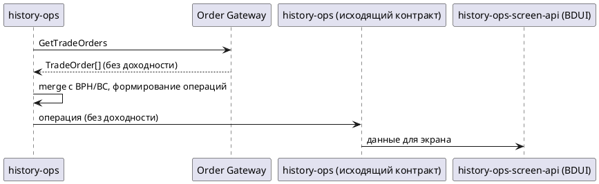
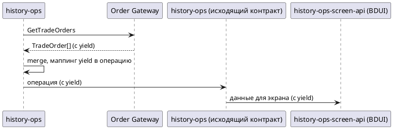

# og-trading-order-yield

## 1. Бизнес-требования

### 1.1. Цель

#### Анализ требований — Доходность торговой заявки в интеграции Order Gateway GetTradeOrders

**Источник требования:**

| Параметр | Значение |
|----------|----------|
| Фича | Новый параметр «доходность» (`yield`) в интеграции `history-ops` ↔ Order Gateway (ОГ) по `GetTradeOrders` |
| Источник | Product request; контекст-документ `Feature-context/og-trading-order-yield.md` |
| Инициатор | Владелец продукта истории операций |
| Дата / версия | Draft 2026-08 |

**Стейкхолдеры:**

| Стейкхолдер | Роль | Интерес / ожидание | Влияние / ответственность |
|-------------|------|--------------------|---------------------------|
| Клиент мобильного банка | Основной пользователь | Видит доходность по торговым заявкам на экране истории | Использует результат фичи |
| Владелец продукта истории операций | Заказчик фичи | Добавить отображение доходности по заявкам из ОГ | Принимает функциональный результат |
| Команда Order Gateway (ОГ) | Поставщик данных | Передавать значение доходности в ответе `GetTradeOrders` | Отвечает за поле в proto `order-gateway.proto` и в ответе |
| Команда `history-ops` (backend) | Владелец агрегации | Прочитать поле из ответа ОГ и пробросить в исходящий контракт | Реализует чтение, маппинг и проброс |
| Команда `history-ops-screen-api` (BDUI) | Владелец экранного сервиса | Учесть доходность в композите экрана | Формирует экран из данных `history-ops` |
| Владельцы контрактов ОГ и screen-api | Владельцы интеграционных контрактов | Согласовать финальное имя и формат поля | Утверждают изменения контрактов |

**Бизнес-правила и ограничения:**

| ID | Тип | Описание | Источник / обоснование |
|----|-----|----------|------------------------|
| BR-01 | Бизнес-правило | Доходность торговой заявки читается из ответа ОГ `GetTradeOrders` (при отсутствии — обогащается из BPH по BR-05) и пробрасывается в `HistoryOperationLead.yield` до фронта через исходящий контракт `history-ops` и композит BDUI | Бриф; контекст-документ `Feature-context/og-trading-order-yield.md`; BR-05 |
| BR-02 | Бизнес-правило | Новое поле добавляется через контракты (`order-gateway.proto`, `history.yml`), а не хардкодится; gRPC/OpenAPI DTO регенерируются | Контекст-документ, раздел «Что учесть при написании фичи» |
| BR-03 | Бизнес-правило | Поле проходит сквозной путь от ответа ОГ до исходящего контракта `history-ops` и композита BDUI; пропуск любого слоя означает, что поле не дойдёт до фронта | Контекст-документ, раздел «Ограничения и риски» |
| BR-04 | Бизнес-правило | Заявки из `GetTradeOrders` (ОГ) являются приоритетным источником торговых заявок относительно BPH и BC; атрибуты заявки берутся из ОГ при совпадении `exchangeOrderId` | `analytics/.../[SIHIST-3502]_...GET_LINKED_EVENTS_(ВЕ).md`, раздел «Насыщение торговых заявок» |
| BR-05 | Бизнес-правило | Доходность (`yield`) читается в первую очередь из ответа ОГ. Если в `TradeOrder` её нет (см. CN-11), но она есть в BPH linked events для той же заявки (матчинг CN-12) — `yield` обогащается из BPH. Если ОГ и BPH оба вернули `yield`, но значения различаются — используется значение ОГ, расхождение логируется (warn) | Решение PO; `OrderMerger` |
| CN-10 | Ограничение | `yield` — единственный атрибут торговой заявки, который может обогащаться из BPH при приоритетном источнике ОГ; остальные атрибуты заявки — строго из ОГ (BR-04) | SIHIST-3502; BR-04, BR-05 |
| CN-11 | Ограничение | В ОГ `yield` считается **отсутствующим** для BR-05, если: поле unset/null, `value` пустой, `currency` отсутствует. **`value = 0` — валидное значение**, BR-05 не применяется | Решение PO |
| CN-12 | Ограничение | Матчинг заявки ОГ ↔ BPH для BR-05: `TradeOrder.exchange_order_id` = `lead.parentIds.selfIdTs` main trade order в BPH. Без `exchangeOrderId` обогащение из BPH **не выполняется** | SIHIST-3502; `OrderMerger.java` |
| CN-01 | Ограничение | Новое поле ответа ОГ должно быть `optional` в proto, чтобы не сломать обратную совместимость | Контекст-документ, раздел «Ограничения и риски» |
| CN-02 | Ограничение | На **instrument screen** (запрос с instrument-filter) пара флагов `app-config-dynamic...ogGetTradeOrders.active`/`inactive` управляет группами статусов в `order_filter.general_status`: `active` — активные статусы, `inactive` — завершённые/неактивные. Если **оба** `false`, фильтр статусов пуст и `GetTradeOrders` **не вызывается**. На ленте **без** instrument-filter эти флаги не применяются. Без вызова ОГ доходность из ОГ не получается | `SplitStatusFilter.java`; `AbstractOperationGateway.java`; `RpcNamesForRequestCondition.OG_GET_TRADE_ORDERS` |
| CN-03 | Ограничение | Поле `yield` в исходящем контракте — inline object `{ value: number, currency: string }` в `HistoryOperationLead`; владелец схемы — `history-ops` / `history.yml`; sibling-фича подстраивается | `Feature-writing/bph-linked-events-yield/bph-linked-events-yield.md` |
| CN-08 | Ограничение | Фича не распространяется на активные заявки (`GetActiveOrders`, `ActiveOrderConverter`) — только история через `GetTradeOrders` | Решение PO |
| CN-09 | Ограничение | Доходность не персистится в PostgreSQL; in-memory при формировании ответа; в Ignite — часть `HistoryOperationBase` с тем же TTL/eviction, что и операция | Решение PO; `db-export/БД ИО.md` |

**Цель фичи:**

| Вопрос | Ответ |
|--------|-------|
| Какую бизнес-проблему решает? | Для торговых заявок, получаемых из Order Gateway, в истории операций нет показателя доходности |
| Какую ценность приносит пользователю? | Пользователь видит доходность по торговым заявкам на экране истории без перехода в другие сервисы |
| Какие метрики улучшает? | TBD — согласовать с владельцем продукта |

**SMART-проверка цели:**

| Критерий | Описание | Значение |
|----------|----------|----------|
| Specific | Конкретная | Добавить поле доходности в ответ `GetTradeOrders`, прочитать его в `history-ops`, пробросить через `history.yml` и учесть в композите BDUI |
| Measurable | Измеримая | Доходность присутствует в `HistoryOperationLead.yield` для заявок из ОГ при её наличии в ответе ОГ или при обогащении из BPH по BR-05 |
| Achievable | Достижимая | Точки расширения известны (proto, gateway, маппинг, creator, исходящий контракт, composite); требуется синхронизация с upstream proto ОГ |
| Relevant | Релевантная | Дополняет sibling-фичу BPH-yield: покрывает приоритетный путь заявок из ОГ |
| Time-bound | Ограниченная по времени | TBD — целевой релиз уточняется у владельца продукта |

**Противоречия и решения:**

| Требование 1 | Требование 2 | Источник 1 | Источник 2 | Решение | Обоснование |
|--------------|--------------|------------|------------|---------|-------------|
| BR-04: атрибуты заявки из ОГ | BR-05: yield из BPH при отсутствии в ОГ | SIHIST-3502 | BR-05/CN-10 | Исключение для `yield` | Атрибуты заявки из ОГ; только `yield` может дополняться из BPH |

### 1.2. Процесс/Сервис AS IS

**Как работает сейчас:**

> `history-ops` запрашивает торговые заявки у Order Gateway (ОГ) через gRPC `GetTradeOrders`. В запросе передаются лимит записей, договоры клиента, фильтр по инструментам, фильтр по статусам заявок и параметры сортировки; при включённом режиме дат — период поиска. ОГ возвращает список заявок (`TradeOrder`) с атрибутами цены, номинала, НКД, комиссий и др. `history-ops` объединяет заявки из ОГ с данными BPH и BC (приоритет у ОГ), формирует торговые операции и отдаёт результат через исходящий контракт `history-ops`, который использует экранный сервис BDUI. Показателя «доходность» в этом потоке сейчас нет. При merge `OrderMerger` находит пару BPH по `exchangeOrderId`, но в OG-path (`getOgTradeOperation`) `BphOrderEnrichDto` **не передаётся** в `TradeOperationCreationContext`; поле `bphOrderEnrichDto` используется только при `TradeOperationType.BPH_LINKED` (`buildBphLinkedTradeOperation`).

**Use Case AS IS:**

| Элемент | Значение |
|---------|----------|
| Название | Получить торговые заявки из Order Gateway для истории |
| Актор(ы) | Сервис `history-ops`, Order Gateway (ОГ) |
| Триггер | Запрос истории операций с типами `transaction_buy` / `transaction_sell` |
| Предусловия | См. таблицу предусловий ниже |
| Постусловия | См. таблицу постусловий ниже |
| Бизнес-правила | BR-04, CN-02 (см. раздел 1.1) |

**Предусловия AS IS:**

| № | Предусловие | Проверяемое условие |
|---|-------------|---------------------|
| 1 | Запрос заявок ОГ возможен | На instrument screen: для нужной группы статусов соответствующий флаг `ogGetTradeOrders.active` или `inactive` = `true`; при обоих `false` запрос к ОГ не выполняется |
| 2 | Известны договоры клиента | Передан непустой список договоров |
| 3 | Заданы параметры фильтрации | Заданы фильтр статусов и лимит записей |

**Постусловия AS IS:**

| Исход | Постусловие |
|-------|-------------|
| Успех | Торговые заявки получены из ОГ, объединены с другими источниками и доступны в исходящем контракте; доходность отсутствует |
| Неуспех (бизнес) | Заявки с неподходящим статусом отфильтрованы |
| Неуспех (техн.) | Ошибка по отдельной заявке не валит весь поток |

**Основной сценарий AS IS:**

```
Шаг 1:  history-ops: формирует запрос GetTradeOrders (договоры, фильтры, лимит, сортировка)
Шаг 2:  history-ops: вызывает GetTradeOrders у Order Gateway
Шаг 3:  ОГ: возвращает список торговых заявок (TradeOrder)
Шаг 4:  history-ops: объединяет заявки ОГ с BPH/BC, формирует торговые операции (цена, номинал, НКД и др.)
Шаг 5:  history-ops: отдаёт операции через исходящий контракт (доходности нет)
Шаг 6:  history-ops-screen-api: формирует экран истории из данных history-ops
```

**Альтернативные сценарии AS IS:**

```
2a. Запрос заявок ОГ не выполняется (instrument screen, Тип: Бизнес-ошибки):
  2a.1. Запрос с instrument-filter; оба флага `ogGetTradeOrders.active` и `inactive` = false
  2a.2. Фильтр статусов пуст — gateway не вызывает GetTradeOrders
  2a.3. Заявки из ОГ не запрашиваются; сценарий завершается для этого источника

4a. Заявка дублируется в BPH/BC (Тип: Бизнес-логика):
  4a.1. Заявка с тем же exchangeOrderId найдена в ответе ОГ
  4a.2. Используются данные ОГ как приоритетные
  4a.3. Возврат к шагу 4 для следующей заявки

4b. BPH-контекст не участвует в OG-path (Тип: Техническое):
  4b.1. mergeTradeOperation получает bphOrder из bphOrdersWithExchangeOrderId по exchangeOrderId (CN-12)
  4b.2. getOgTradeOperation вызывается без bphOrder; TradeOperationCreationContext.bphOrderEnrichDto не заполняется
  4b.3. OgTradeOperationCreator.createOperation не читает context.getBphOrderEnrichDto()
  4b.4. bphOrderEnrichDto в контексте заполняется только в buildBphLinkedTradeOperation (TradeOperationType.BPH_LINKED)
  4b.5. Доходность из BPH при успешной OG-заявке в операцию не попадает (BR-05 — только TO BE)
```

**Таблица проблем AS IS:**

| Проблема | Влияние на бизнес | Частота | Стоимость проблемы | Приоритет |
|----------|-------------------|---------|-------------------|-----------|
| В истории торговых заявок из ОГ нет показателя доходности | Пользователь не видит доходность по заявкам на экране | Постоянно для заявок из ОГ | Не оценена (TBD PO) | Высокий |

**Диаграмма AS IS (желательно):**



### 1.3. Процесс/Сервис TO BE

**Как будет работать:**

> В ответ `GetTradeOrders` Order Gateway добавляется новое опциональное поле `yield` (структура `value` + `currency`). `history-ops` читает доходность из каждой торговой заявки ОГ, при отсутствии в ОГ — обогащает из BPH linked events (BR-05), переносит её в `HistoryOperationLead` и отдаёт через исходящий контракт `history-ops`; экранный сервис BDUI отображает доходность в деталке торговой заявки (SIHIST-3373). При отсутствии поля и в ОГ, и в BPH поведение остаётся прежним.

**Use Case TO BE:**

| Элемент | Значение |
|---------|----------|
| Название | Получить торговые заявки из Order Gateway с доходностью |
| Актор(ы) | Сервис `history-ops`, Order Gateway (ОГ) |
| Триггер | Запрос истории операций с типами `transaction_buy` / `transaction_sell` |
| Предусловия | См. таблицу предусловий ниже |
| Постусловия | См. таблицу постусловий ниже |
| Бизнес-правила | BR-01, BR-02, BR-03, BR-04, BR-05, CN-01, CN-02, CN-03, CN-08, CN-10, CN-11, CN-12 (см. раздел 1.1) |

**Предусловия TO BE:**

| № | Предусловие | Проверяемое условие |
|---|-------------|---------------------|
| 1 | Запрос заявок ОГ возможен | На instrument screen: для нужной группы статусов соответствующий флаг `ogGetTradeOrders.active` или `inactive` = `true`; при обоих `false` запрос к ОГ не выполняется |
| 2 | Контракты обновлены | В proto ОГ и `history.yml` есть поле доходности |
| 3 | ОГ поддерживает возврат доходности | Ответ ОГ может содержать доходность (опционально) |

**Постусловия TO BE:**

| Исход | Постусловие |
|-------|-------------|
| Успех | Торговая операция содержит `HistoryOperationLead.yield` при наличии доходности в ответе ОГ или при обогащении из BPH (BR-05) |
| Неуспех (бизнес) | Доходность отсутствует в ответе ОГ и в BPH linked events — операция формируется без `yield`, остальное без изменений |
| Неуспех (техн.) | Ошибка по отдельной заявке не валит весь поток |

**Основной сценарий TO BE:**

```
Шаг 1:  history-ops: формирует запрос GetTradeOrders
Шаг 2:  history-ops: вызывает GetTradeOrders у Order Gateway
Шаг 3:  ОГ: возвращает список заявок, включая yield (value + currency)
        ЕСЛИ доходность отсутствует в ответе ТО ПЕРЕЙТИ К альтернативному сценарию 3a
Шаг 4:  history-ops: читает yield из заявки ОГ и переносит в HistoryOperationLead
Шаг 5:  history-ops: отдаёт операцию с yield через исходящий контракт
Шаг 6:  history-ops-screen-api: отображает yield в деталке торговой заявки (SIHIST-3373) в формате «N %», рядом с value_per_instrument_item_pcnt
```

**Альтернативные сценарии TO BE:**

```
3a. Доходность отсутствует в ответе ОГ (Тип: Бизнес-логика, CN-11):
  3a.1. yield unset/null, value пустой или currency отсутствует в TradeOrder (value=0 — валидно, BR-05 не применяется)
  3a.2. ЕСЛИ exchangeOrderId задан И yield есть в BPH linked events (CN-12) ТО ПЕРЕЙТИ К сценарию 4a
  3a.3. ИНАЧЕ операция формируется без yield
  3a.4. Возврат к шагу 5 для следующей заявки

4a. Обогащение yield из BPH (Тип: Бизнес-логика, BR-05, CN-12):
  4a.1. Заявка присутствует в ответе ОГ (приоритетный источник заявки)
  4a.2. yield отсутствует в TradeOrder по CN-11
  4a.3. В linked events BPH для той же заявки (exchangeOrderId = selfIdTs) yield заполнен в любом узле дерева
  4a.4. TO BE: getOgTradeOperation принимает bphOrder (nullable), заполняет TradeOperationCreationContext.bphOrderEnrichDto; OgTradeOperationCreator читает yield из BPH только при CN-11 (см. §4.2.3.2)
  4a.5. lead.yield обогащается из BPH; возврат к шагу 5

4b. Конфликт yield ОГ vs BPH (Тип: Бизнес-логика, BR-05):
  4b.1. ОГ и BPH оба вернули yield, но value или currency различаются
  4b.2. Используется yield из ОГ
  4b.3. Расхождение логируется (warn) с exchangeOrderId
  4b.4. Возврат к шагу 5

5a. ОГ UNEXPECTED_ERROR — полный BPH-path (Тип: Бизнес-логика):
  5a.1. general_status = UNEXPECTED_ERROR в TradeOrder
  5a.2. OrderMerger переключается на buildBphLinkedTradeOperation (как AS IS)
  5a.3. yield берётся из BPH-path (sibling-фича bph-linked-events-yield); BR-05 не применяется
  5a.4. Возврат к шагу 5

6a. gRPC error ОГ (Тип: Технический):
  6a.1. GetTradeOrders недоступен; заявки собираются из BPH/BC
  6a.2. yield для таких заявок — через BPH-path (sibling-фича); в scope OG-фичи alt не добавляется

2a. Запрос заявок ОГ не выполняется (instrument screen, Тип: Бизнес-ошибки):
  2a.1. Запрос с instrument-filter; оба флага ogGetTradeOrders.active и inactive = false
  2a.2. Фильтр статусов пуст — gateway не вызывает GetTradeOrders; доходность из ОГ не запрашивается
  2a.3. Если заявка видна через BPH-path — yield приходит из sibling-фичи (ожидаемое поведение, не дефект OG-фичи)
```

**Таблица изменений TO BE:**

| Изменение | AS IS | TO BE | Связь с BR/CN |
|-----------|-------|-------|---------------|
| Поле доходности в ответе ОГ | Отсутствует | Опциональное поле `yield` (`YieldData`: value + currency) в `TradeOrder` | BR-01, CN-01 |
| Исходящий контракт | Без доходности | `HistoryOperationLead.yield` (inline object) | BR-02, CN-03 |
| Экран BDUI | Без доходности | Отображение в деталке торговой заявки (SIHIST-3373), формат «N %» | BR-01 |
| Wiring BR-05 (OrderMerger → creator) | merge находит bphOrder по exchangeOrderId; getOgTradeOperation не передаёт его; OgTradeOperationCreator не читает bphOrderEnrichDto | getOgTradeOperation(bphOrder) + .bphOrderEnrichDto в builder; creator — fallback yield из BPH (CN-10) | BR-05, CN-12; §4.2.3.2 |
| Обогащение yield из BPH | Нет (alt AS IS 4b) | yield из BPH при отсутствии в ОГ по CN-11 | BR-05 |

**Диаграмма TO BE (желательно):**



## 2. Ограничения и допущения

| ID | Тип | Описание | Источник / обоснование |
|----|-----|----------|------------------------|
| CN-04 | Ограничение | Изменение `order-gateway.proto` требует синхронизации с upstream `trade-operations-commons` и регенерации gRPC-классов | Контекст-документ; комментарий в proto |
| CN-05 | Ограничение | Поле доходности в proto ОГ — `optional`; отсутствие поля не должно ломать обработку существующих заявок | CN-01; обратная совместимость |
| CN-06 | Ограничение | Путь счётчика активных операций (counter `GetTradeOrders`) не затрагивается — доходность счётчику не нужна | Контекст-документ, раздел «Релевантный код» |
| CN-07 | Ограничение | Sibling-фича `bph-linked-events-yield` подстраивается под ту же схему `HistoryOperationLead.yield`; имя и структура должны совпадать | CN-03 |

**Технические ограничения и допущения:**

| Ограничение / допущение | Тип | Описание | Источник |
|-------------------------|-----|----------|----------|
| Поле через контракты | Техническое | `yield` добавляется в `order-gateway.proto` и `history.yml`; DTO регенерируются | BR-02 |
| Сквозной проброс | Техническое | Поле должно пройти ответ ОГ → внутренняя модель → creator → `history.yml` → BDUI | BR-03 |
| Приоритет ОГ | Бизнес-ограничение | При совпадении `exchangeOrderId` данные заявки берутся из ОГ; доходность может быть обогащена из BPH, если в ОГ отсутствует | BR-04, BR-05; `SIHIST-3502` |
| Доходность — транзитное поле | Техническое | Отдельной колонки для доходности в PostgreSQL нет; поле живёт in-memory при формировании ответа; в Ignite — как часть `HistoryOperationBase` с тем же TTL/eviction, что и операция целиком | CN-09 |
| Уровень в исходящем контракте | Техническое | `yield` — inline object `{ value, currency }` в `HistoryOperationLead`; облигационные атрибуты ОГ остаются в `ReportOrderOperationDetails` | CN-03; `history.yml:456`, `history.yml:376` |
| Маппинг currency yield из ОГ | Техническое | `yield.currency` в исходящем контракте всегда берётся из `TradeOrder.currency` при маппинге из ОГ; независимо от `HistoryOperationLead.currency` | Решение PO |
| Валидация yield | Техническое | Отрицательные и аномальные значения от ОГ пробрасываются as-is; валидация — на стороне ОГ/BDUI | Решение PO |
| Округление yield | Техническое | `google.type.Decimal` → `number` без `@JsonFormat STRING`; scale сохраняется как в ответе ОГ | Решение PO |
| Wiring BR-05 AS IS | Техническое | `TradeOperationCreationContext.bphOrderEnrichDto` есть, но заполняется только в `buildBphLinkedTradeOperation`; OG-path (`getOgTradeOperation`) контекст BPH не получает | `TradeOperationCreationContext.java:33`; `OrderMerger.java:258–273` |
| Wiring BR-05 TO BE | Техническое | Расширить `getOgTradeOperation`: параметр `BphOrderEnrichDto bphOrder` (nullable из merge); `.bphOrderEnrichDto(bphOrder)` в builder; в `OgTradeOperationCreator` — чтение yield из BPH только при CN-11, без изменения прочих атрибутов заявки (CN-10) | BR-05; `OrderMerger.java`; `OgTradeOperationCreator.java` |
| Применимость по инструментам | Бизнес-ограничение | `history-ops` не фильтрует по типу инструмента: yield пробрасывается для всех заявок, где ОГ (или BPH при BR-05) вернул значение | Решение PO |
| Обновление фикстур | Техническое | Тестовые фикстуры ОГ (`json/response/order_gateway/*`) и интеграционные логи обновляются под новое поле | Контекст-документ |
| Приёмка (unit) | Техническое | Обязательны `OrderMergerTest` и тесты `OgTradeOperationCreator`: OG yield, BPH fallback, конфликт OG/BPH, регрессия `ReportOrderOperationDetails` | Решение PO |

## 4. Функциональные требования

#### 4.1.1. Сервис Order Gateway GetTradeOrders (gRPC)

**Общая информация:**

| Параметр | Значение |
|----------|----------|
| Назначение | Получение списка торговых заявок клиента; в рамках фичи — чтение доходности (`yield`) |
| Система-источник | `history-ops` (вызывает `OrdersService.GetTradeOrders`) |
| Система-получатель | Order Gateway (ОГ), `exSystem="OG"`, `eventType="GET_TRADE_ORDERS"` |
| Тип интеграции | Синхронная |
| Протокол | gRPC |
| Направление | Однонаправленная (запрос-ответ) |
| Контракт | `order-gateway.proto` (upstream: `trade-operations-commons`) |
| Аутентификация | Metadata-заголовки gRPC: `rqTm`, `rqUid`, `operUid` (`GrpcRequestUtil`); отдельной auth-конфигурации для `order_gateway` нет |
| Rate Limit / Timeout / Retry | Timeout: `grpc.order_gateway.deadline` (test: `50000` ms; prod — как в test до уточнения эксплуатацией); **retry не реализован** |

**Метод:** `OrdersService.GetTradeOrders(GetTradeOrdersRequest) → GetTradeOrdersResponse` (`order-gateway.proto:13–14`)

**Входящие параметры (`GetTradeOrdersRequest`, `order-gateway.proto:36`):**

| Параметр | Тип | Обязательность | Описание | Источник |
|----------|-----|----------------|----------|----------|
| limit | int32 | Обязательно | Количество заявок | `app-config.reporting.maxRecords` |
| agreements | repeated Agreement | Обязательно | Договоры клиента | Запрос НО |
| agreements[].si_id | string | Deprecated | Идентификатор счета (legacy) | — |
| agreements[].number | string | Обязательно (в proto3 при наличии agreement) | Номер брокерского договора | Запрос НО |
| start_time | Timestamp | Опционально | Начало периода (при `isOgDatesEnabled()`) | Запрос НО |
| end_time | Timestamp | Опционально | Конец периода | Запрос НО |
| direction | string | Опционально | `BUY` / `SELL` | Фильтр дескриптора |
| instrument_filter | repeated InstrumentFilter | Опционально (может быть пустым) | Фильтр по тикерам | Dictionary Gateway |
| instrument_filter[].ticker | string | Обязательно (в элементе фильтра) | Тикер | DG |
| instrument_filter[].class_code | string | Опционально | Class code | DG |
| order_filter | OrderFilter | Обязательно | Фильтр заявок (всегда формируется в запросе) | Запрос НО |
| order_filter.general_status | repeated string | Опционально (может быть пустым) | Статусы заявок | Фильтр статусов |
| order_filter.from_id | int64 | Опционально | Пагинация | LastSourcesRequest |
| order_by | string | Обязательно (всегда формируется в запросе) | `time_created` / `update_by_exchange_time` | ExecutionProcess |

> Новый параметр запроса для включения доходности в текущем proto **отсутствует** — поле `yield` приходит безусловно в `TradeOrder`, когда ОГ его поддерживает.

**Исходящие параметры — `GetTradeOrdersResponse` (`order-gateway.proto:59`):**

| Параметр | Тип | Обязательность | Описание | Источник |
|----------|-----|----------------|----------|----------|
| orders | repeated TradeOrder | Опционально (может быть пустым) | Список торговых заявок | существующее |

**Поля `orders[]` (`TradeOrder`, `order-gateway.proto:71`):**

| Параметр | Тип | Обязательность | Описание | Источник |
|----------|-----|----------------|----------|----------|
| id | string | Обязательно | ИД заявки | существующее |
| agreement | Agreement | Обязательно | Договор | существующее |
| agreement.si_id | string | Deprecated | Идентификатор счета (legacy) | существующее |
| agreement.number | string | Обязательно (в proto3 при наличии agreement) | Номер брокерского договора | существующее |
| direction | string | Обязательно | `BUY` / `SELL` | существующее |
| type | string | Обязательно | Тип ордера (limit, market, …) | существующее |
| currency | string | Обязательно | Валюта расчётов | существующее |
| created_time | Timestamp | Обязательно | Дата и время создания | существующее |
| instrument_count | int64 | Опционально | Количество инструмента | существующее |
| value_per_instrument_item | google.type.Decimal | Опционально | Цена за единицу в валюте | существующее |
| total_deals_value | google.type.Decimal | Опционально | Общая сумма исполнения по сделкам | существующее |
| total_deals_volume | int64 | Опционально | Общее количество актива по сделкам | существующее |
| commission_value | google.type.Decimal | Опционально | Объём комиссии | существующее |
| total_deals_avg_price | google.type.Decimal | Опционально | Средневзвешенная цена по сделкам | существующее |
| total_deals_commission | google.type.Decimal | Опционально | Общая сумма комиссии по сделкам | существующее |
| general_status | string | Обязательно | Общий статус заявки | существующее |
| exchange_order_id | string | Опционально | Номер заявки в торговой системе | существующее |
| modified_time | Timestamp | Опционально | Время обновления | существующее |
| transaction_time | Timestamp | Опционально | Время завершения заявки | существующее |
| bond_denomination | google.type.Decimal | Опционально | Номинал облигации | существующее |
| total_deals_accrued_interest | google.type.Decimal | Опционально | Общий НКД по сделкам | существующее |
| accrued_interest_by_item | google.type.Decimal | Опционально | НКД на 1 облигацию | существующее |
| total_sum | google.type.Decimal | Опционально | Сумма сделки | существующее |
| stop_loss_px | google.type.Decimal | Опционально | Цена стоп-лосс | существующее |
| take_profit_px | google.type.Decimal | Опционально | Цена тейк-профит | существующее |
| exchange | string | Опционально | Биржа | существующее |
| instrument | Instrument | Обязательно | Инструмент | существующее |
| instrument.ticker | string | Обязательно | Тикер инструмента | существующее |
| instrument.class_code | string | Обязательно | Режим торгов (class code) | существующее |
| instrument.trading_section | string | Опционально | Торговая секция | существующее |
| instrument.main_type | string | Опционально | Основной тип инструмента | существующее |
| template_code | string | Опционально | Код шаблона причины отклонения | существующее |
| reject_reason_text | string | Опционально | Текст причины отклонения | существующее |
| parent_stop_order_type | string | Опционально | Тип родительского стоп-ордера | существующее |
| parent_order_time_created | Timestamp | Опционально | Время создания родительского ордера | существующее |
| stop_loss_px_pcnt | google.type.Decimal | Опционально | Стоп-лосс, % | существующее |
| take_profit_px_pcnt | google.type.Decimal | Опционально | Тейк-профит, % | существующее |
| value_per_instrument_item_pcnt | google.type.Decimal | Опционально | Цена за единицу, % (облигации) | существующее |
| expiry_time | Timestamp | Опционально | Срок действия заявки | существующее |
| initial_margin | google.type.Decimal | Опционально | Первоначальное ГО (фьючерсы) | существующее |
| brokerage_commission | google.type.Decimal | Опционально | Брокерская комиссия по сделкам | существующее |
| exchange_commission | google.type.Decimal | Опционально | Биржевая комиссия по сделкам | существующее |
| commission_value_stop_loss | google.type.Decimal | Опционально | Комиссия по стоп-лимит | существующее |
| commission_value_take_profit | google.type.Decimal | Опционально | Комиссия по тейк-профит | существующее |
| time_in_force | string | Опционально | Вариант исполнения (DAY, …) | существующее |
| contra_broker | string | Опционально | Контрагент (РПС/выкуп) | существующее |
| card_number | string | Опционально | Номер карты | существующее |
| yield | YieldData | Опционально | Доходность торговой заявки (`value` + `currency`) — **новое поле** | **новое поле** |

> `YieldData` — новое proto-сообщение: `google.type.Decimal value`, `string currency`. При маппинге в `history.yml` **`yield.currency` всегда берётся из `TradeOrder.currency`**; `yield.currency` из proto игнорируется. `HistoryOperationLead.currency` и `yield.currency` — независимые поля.
>
> Номер поля `yield` в upstream proto назначает команда ОГ / `trade-operations-commons`; ожидается следующий свободный после `card_number = 41`. Расхождение с upstream — зависимость релиза, adapter-слой не предусмотрен.

**Пример ответа TO BE (фрагмент, после добавления поля в proto):**

```json
{
  "orders": [
    {
      "id": "1234",
      "agreement": { "number": "ABC" },
      "direction": "BUY",
      "type": "limit",
      "currency": "RUB",
      "created_time": "2026-01-15T10:00:00Z",
      "general_status": "executed",
      "exchange_order_id": "ex-001",
      "bond_denomination": { "value": "1000" },
      "value_per_instrument_item_pcnt": { "value": "98.5" },
      "yield": { "value": "12.34", "currency": "RUB" }
    }
  ]
}
```

**Пограничный случай: поле `yield` отсутствует в ОГ (CN-11):**

- unset/null, пустой `value`, отсутствует `currency` → BR-05 при наличии BPH и CN-12.
- `value = 0` — валидное значение, BR-05 не применяется.
- Если yield есть в BPH linked events — обогащение по BR-05 (любой узел linked events с заполненным yield).
- Если yield отсутствует и в ОГ, и в BPH — silent skip, `HistoryOperationLead.yield` не передаётся.

**Пограничный случай: конфликт ОГ vs BPH:**

- Используется yield из ОГ; расхождение логируется (warn) с `exchangeOrderId`.

**Коды ответов / ошибки:**

| Код / ситуация | Описание | Поведение history-ops |
|----------------|----------|----------------------|
| gRPC OK | Успешный ответ | Заявки обрабатываются; `yield` читается при наличии |
| gRPC error | Ошибка вызова ОГ | Заявки из ОГ недоступны; yield для BPH-only заявок — через sibling-фичу (alt 6a) |

#### 4.1.1.1. Исходящий контракт history-ops (проброс на фронт)

**Общая информация:**

| Параметр | Значение |
|----------|----------|
| Назначение | Проброс доходности торговой заявки наружу для screen-api/фронта |
| Система-источник | `history-ops` (`history.yml`, пакет `api.ws`) |
| Система-получатель | `history-ops-screen-api` (BDUI) / фронт |
| Протокол | REST (HTTPS), JSON |

**Исходящие параметры — `HistoryOperationLead` (`history.yml:456`, целевой уровень для `yield`):**

| Параметр | Тип | Обязательность | Описание | Источник |
|----------|-----|----------------|----------|----------|
| id | string | Обязательно | Идентификатор операции | существующее |
| itemtype | string | Обязательно | Тип элемента | существующее |
| type | string (enum `PortfolioOperationType`) | Обязательно | Тип операции | существующее |
| general_status | string (enum `GeneralOperationStatus`) | Обязательно | Общий статус операции | существующее |
| time_happened | string (date-time) | Обязательно | Время события | существующее |
| time_closed | string (date-time) | Опционально | Время завершения | существующее |
| currency | string | Опционально | Валюта операции | существующее |
| value_by_instrument_item | number | Опционально | Стоимость по инструменту | существующее |
| instrument_count | integer (int64) | Опционально | Количество инструментов | существующее |
| total_sum | number | Опционально | Итоговая сумма | существующее |
| total_deals_volume | integer (int64) | Опционально | Суммарный объём сделок | существующее |
| total_deals_avg_price | number | Опционально | Средняя цена по сделкам | существующее |
| comment | string | Опционально | Комментарий | существующее |
| operationDisplayName | string | Опционально | Отображаемое имя операции | существующее |
| available_cancellation | boolean | Опционально | Доступность отмены | существующее |
| cancellation_comment | string | Опционально | Комментарий отмены | существующее |
| channel | string | Опционально | Канал | существующее |
| yield | object | Опционально | Доходность торговой заявки — **новое поле**: `{ "value": number, "currency": string }` | `TradeOrder.yield` или BPH (BR-05) |

> Inline object в `HistoryOperationLead` (без отдельной named-схемы `PriceData` в `history.yml`). Sibling-фича `bph-linked-events-yield` использует ту же структуру. Облигационные атрибуты ОГ по-прежнему в `ReportOrderOperationDetails`; доходность в details **не** размещается. ACL/видимость yield — те же правила, что для `bond_denomination` и `value_per_instrument_item_pcnt` (SIHIST-3373).

**Справочно — `ReportOrderOperationDetails` (`history.yml:376`, без изменений по yield):**

| Параметр | Тип | Обязательность | Описание | Источник |
|----------|-----|----------------|----------|----------|
| bond_denomination | number | Опционально | Номинал облигации | `TradeOrder.bond_denomination` |
| value_per_instrument_item_pcnt | number | Опционально | Цена, % | `TradeOrder.value_per_instrument_item_pcnt` |
| … | … | … | Прочие поля торговой заявки без изменений | существующее |

#### 4.2.3. Модель данных

**Общая информация:**

| Параметр | Значение |
|----------|----------|
| Назначение | Описание данных доходности торговой заявки в потоке ОГ → history-ops → фронт |
| Хранение | Транзитное поле ответа (не персистится в PostgreSQL; CN-09) |
| Связанные контракты | `order-gateway.proto` (`TradeOrder.yield`), `history.yml` (`HistoryOperationLead.yield`) |

**Сущности и атрибуты:**

| Сущность / уровень | Атрибут | Тип (TO BE) | Обязательность | Описание | Источник данных |
|--------------------|---------|-------------|----------------|----------|-----------------|
| `TradeOrder` (ОГ) | `yield` | `YieldData` (`value` Decimal + `currency`) | Опционально | Доходность торговой заявки — **новое поле** | Order Gateway |
| Внутренняя модель заявки ОГ | `yield` | object (value + currency) | Опционально | Значение после чтения из proto | Маппинг из `TradeOrder`; при BR-05 — из BPH |
| Исходящая операция (`history.yml`) | `HistoryOperationLead.yield` | inline object `{ value, currency }` | Опционально | Доходность в ответе НО — **новое поле** | Маппинг из внутренней модели |

**Миграции БД:**

| Миграция | Требуется | Обоснование |
|----------|-----------|-------------|
| DDL для колонки доходности | Нет | Доходность — транзитное поле (CN-09); отдельная колонка не создаётся |

#### 4.2.3.1. Маппинг полей (OG → ответ history-ops)

| Поле источника (ОГ `TradeOrder`) | Поле НО (исходящий контракт) | Трансформация | Условие заполнения | Примечание |
|----------------------------------|------------------------------|--------------|-------------------|------------|
| `yield.value` + `TradeOrder.currency` | `HistoryOperationLead.yield` | value из ОГ; currency **всегда** из `TradeOrder.currency` | Если yield валиден по CN-11 | Основной путь (BR-01) |
| BPH linked events `yield` (любой узел) | `HistoryOperationLead.yield` | Прямой перенос value и currency из BPH | CN-11 + CN-12; exchangeOrderId задан; wiring §4.2.3.2 TO BE | BR-05 |

#### 4.2.3.2. Wiring BR-05: OrderMerger → OgTradeOperationCreator

| Компонент / шаг | AS IS | TO BE | Код |
|-----------------|-------|-------|-----|
| Поиск BPH-пары при merge | `bphOrder = bphOrdersWithExchangeOrderId.get(exchangeOrderId)` | Без изменений | `OrderMerger.java:197–198`, `111–114` |
| Вызов OG-creator | `getOgTradeOperation(...)` без `bphOrder` | Добавить параметр `bphOrder` (nullable) | `OrderMerger.java:221–226`, `258–273` |
| Контекст создания операции | `.bphOrderEnrichDto` не задаётся в OG-path | `.bphOrderEnrichDto(bphOrder)` при сборке контекста | `TradeOperationCreationContext.java:33` |
| BPH-only path | `.bphOrderEnrichDto(bphOrder)` в `buildBphLinkedTradeOperation` | Без изменений | `OrderMerger.java:248–255` |
| OgTradeOperationCreator | `createOperation` не передаёт `bphOrderEnrichDto` в логику lead | При CN-11: yield из `context.getBphOrderEnrichDto()`; иначе — из OG; при конфликте — OG + warn (alt 4b) | `OgTradeOperationCreator.java:68–102` |

> Облигационные поля ОГ по-прежнему маппятся в `ReportOrderOperationDetails`: `value_per_instrument_item_pcnt` → `value_per_instrument_item_pcnt`, `bond_denomination` → `bond_denomination` (`SIHIST-3662`, `OgTradeOperationCreator`).

## 5. Нефункциональные требования

### 5.4. Требования к настройкам

#### NFR — Доходность в интеграции Order Gateway GetTradeOrders (Конфигурация)

**Классификация:**
- Уровень безопасности: `internal`
- Частота изменения: `dynamic`
- Область: `environment-specific`

| Параметр | Тип | Уровень | Частота | Область | Хранение | По умолчанию | Описание | Валидация | Влияние при изменении | Процедура отката |
|----------|-----|---------|---------|---------|----------|-------------|----------|-----------|----------------------|------------------|
| `app-config-dynamic.instrument-filter-requests-dynamic.ogGetTradeOrders.active` | boolean | internal | dynamic | environment-specific | app-config-dynamic (ConfigMap) | `true` в `application-test.yml`; prod — как в test до уточнения эксплуатацией | При **instrument-filter**: включает **активные** статусы в `order_filter.general_status` | true/false | Меняет набор статусов в запросе; при обоих `false` (с `inactive`) запрос не выполняется | Вернуть прежнее значение |
| `app-config-dynamic.instrument-filter-requests-dynamic.ogGetTradeOrders.inactive` | boolean | internal | dynamic | environment-specific | app-config-dynamic (ConfigMap) | `true` в `application-test.yml`; prod — как в test до уточнения эксплуатацией | При **instrument-filter**: включает **неактивные/завершённые** статусы в `order_filter.general_status` | true/false | Меняет набор статусов в запросе; при обоих `false` (с `active`) запрос не выполняется | Вернуть прежнее значение |
| `app-config.reporting.maxRecords` | integer | internal | static | global | application config | `100` в `application-test.yml`; prod — как в test до уточнения эксплуатацией | Лимит записей в `GetTradeOrdersRequest.limit`; yield доступен только для заявок в пределах лимита (acceptable degradation) | > 0 | Ограничивает объём ответа ОГ | Передеплой / изменение конфига |
| `grpc.order_gateway.target` | string | internal | static | environment-specific | application config | localhost в тестах | Адрес gRPC Order Gateway | URL/host | Доступность интеграции | Передеплой |
| `grpc.order_gateway.deadline` | integer (ms) | internal | static | environment-specific | application config | `50000` в `application-test.yml`; prod — как в test до уточнения эксплуатацией | gRPC deadline вызова ОГ (`withDeadlineAfter`); retry не реализован | > 0 | Таймаут ответа ОГ | Передеплой |

**Способы хранения:**

| Способ | Когда использовать | Примеры |
|--------|-------------------|---------|
| app-config-dynamic (ConfigMap) | Динамические флаги запросов источников | `ogGetTradeOrders.active` |
| application.yml / env | Статические параметры gRPC и лимитов | `grpc.order_gateway.target`, `maxRecords` |

**Процедура изменения:**

| Тип параметра | Процедура изменения | Кто изменяет | Требуется согласование |
|---------------|---------------------|--------------|------------------------|
| dynamic | Изменение в app-config-dynamic (ConfigMap) без передеплоя | Команда `history-ops` / эксплуатация | Стандартный процесс изменения ConfigMap |
| static | Передеплой или изменение конфигурации окружения | Эксплуатация | Стандартный процесс деплоя / изменения application config |

> Связанное условие: ключ `ogGetTradeOrders` (`RpcNamesForRequestCondition.OG_GET_TRADE_ORDERS`). Пара `active`/`inactive` управляет **группами статусов** в фильтре и применяется только при **instrument-filter** (`hasInstrumentFilter=true`); `OrderGrpcGateway.enabled()` всегда `true`. Запрос пропускается, если после применения правила `generalStatusFilter` пуст (оба флага `false` на instrument screen).

### 5.5. Feature Toggles

| Toggle / конфиг | Назначение | ON (`true`) | OFF (`false`) | Связь с фичей |
|-----------------|------------|-------------|---------------|---------------|
| `ogGetTradeOrders.active` | Группа **активных** статусов в фильтре (instrument screen) | Активные статусы попадают в `general_status` фильтр | Активные статусы не запрашиваются | CN-02 |
| `ogGetTradeOrders.inactive` | Группа **неактивных/завершённых** статусов в фильтре (instrument screen) | Завершённые статусы попадают в `general_status` фильтр | Завершённые статусы не запрашиваются | CN-02 |

> **Пропуск запроса:** на instrument screen при **обоих** флага `false` фильтр статусов пуст → `GetTradeOrders` не вызывается (см. `OriginalInstrumentWithItsVersionsRequestsConfigMapTest`). На ленте без instrument-filter правило `ogGetTradeOrders` не применяется.
>
> Отдельного feature toggle **только для доходности** нет. Доходность из ОГ доступна только при выполнении `GetTradeOrders` и наличии поля в ответе ОГ (или обогащении из BPH по BR-05). Активные заявки (`GetActiveOrders`) — вне scope (CN-08).
