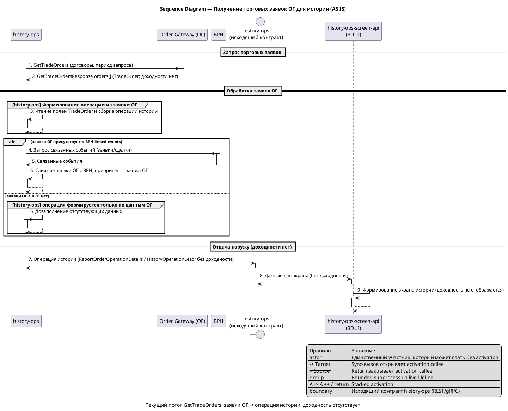
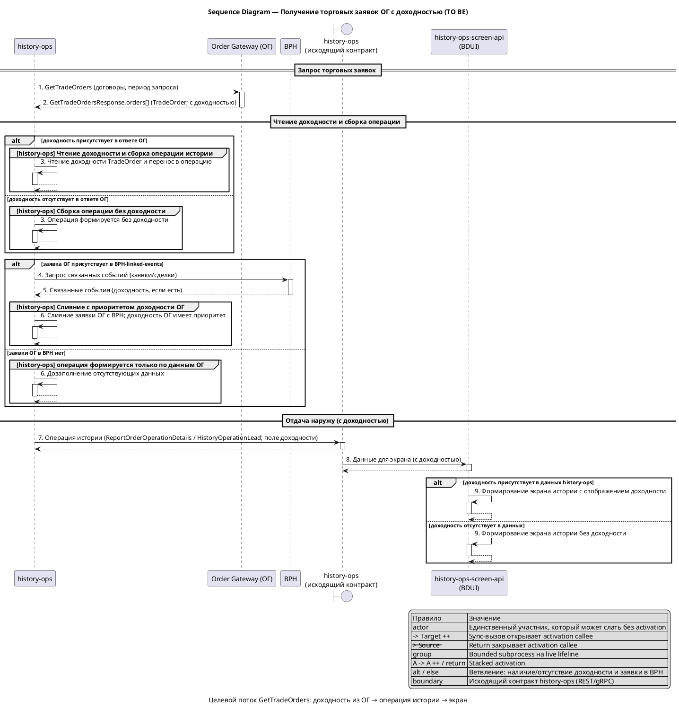
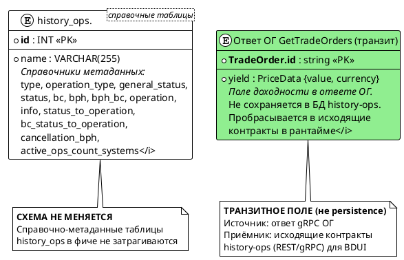

# og-trading-order-yield

## 1. Бизнес-требования

#### Анализ требований — Доходность торговой заявки в интеграции Order Gateway GetTradeOrders

**Источник требования:**

| Параметр | Значение |
|----------|----------|
| Фича | Новое поле «доходность» (рабочее имя `yield`) в ответе Order Gateway `GetTradeOrders` для торговой заявки |
| Источник | Product request (бриф фичи) |
| Инициатор | Владелец продукта истории операций |
| Дата / версия | Draft 2026-09 |

**Стейкхолдеры:**

| Стейкхолдер | Роль | Интерес / ожидание | Влияние / ответственность |
|-------------|------|--------------------|---------------------------|
| Клиент мобильного банка | Основной пользователь | Видит доходность по торговой заявке на экране истории операций | Использует результат фичи |
| Владелец продукта истории операций | Заказчик фичи | Получить доходность по заявкам, приходящим из ОГ, а не только по связанным событиям BPH | Принимает функциональный результат |
| Команда Order Gateway (ОГ) | Поставщик данных | Передавать значение доходности в ответе `GetTradeOrders` (message `TradeOrder`) | Реализует поле в контракте `order-gateway.proto` по составу, зафиксированному в этой аналитике (порядок разработки: `history-ops` первым, ОГ — после) |
| Команда `history-ops` (backend) | Владелец агрегации | Прочитать поле из ответа ОГ, пробросить его через исходящий контракт | Реализует чтение, маппинг и проброс поля сквозь слои |
| Команда `history-ops-screen-api` (BDUI) | Владелец экранного сервиса | Учесть доходность в композите экрана по заявке | Формирует экран из данных `history-ops` |
| Владельцы контрактов ОГ и screen-api | Владельцы интеграционных контрактов | Согласовать финальное имя и формат поля | Утверждают изменения контрактов |
| Команда фичи `bph-linked-events-yield` | Смежная команда (параллельная доработка) | Единая семантика и имя признака «доходность» на обоих путях заявок (ОГ и BPH) | Согласует общие решения по имени/формату поля |

**Бизнес-правила и ограничения:**

| ID | Тип | Описание | Источник / обоснование |
|----|-----|----------|------------------------|
| BR-01 | Бизнес-правило | Доходность торговой заявки читается из ответа Order Gateway `GetTradeOrders` (message `TradeOrder`) и пробрасывается до фронта через исходящий контракт `history-ops` и композит BDUI | Бриф фичи; контекст-документ `Feature-context/og-trading-order-yield.md` |
| BR-02 | Бизнес-правило | Новое поле добавляется через контракты (proto `order-gateway.proto`, `history.yml`, `historyOperationDetails.proto`), а не хардкодится в коде | Контекст-документ, раздел «Что учесть при написании фичи» |
| BR-03 | Бизнес-правило | Доходность — единый показатель с симметричной фичей `bph-linked-events-yield`: одно и то же имя (`yield`) и один и тот же формат — объект `PriceData {value, currency}` | Бриф фичи («так же», симметрия с BPH); `Feature-writing/bph-linked-events-yield/bph-linked-events-yield.md` (§4.1.1) |
| BR-04 | Бизнес-правило | Поле проходит сквозной путь: ОГ `TradeOrder` (`yield`) → чтение и перенос в `history-ops` → исходящая модель операции истории на уровне lead (`HistoryOperationLead`) → `history.yml` / `historyOperationDetails.proto` → композит BDUI; пропуск любого слоя означает, что поле не дойдёт до фронта | Контекст-документ, раздел «Интеграции и контракты» |
| BR-05 | Бизнес-правило | При слиянии заявок OG-заявка приоритетна; доходность для OG-заявки берётся из ОГ; если в ОГ значения нет — доходность дозаполняется из BPH linked events; при отсутствии значения в обоих источниках поле опускается (`null`, не отображается). `0` отображается как значение, отрицательное значение допускается | Контекст-документ; приоритет OG `GetTradeOrders` |
| BR-06 | Бизнес-правило | Доходность — готовое значение от ОГ: агрегированный показатель **по всей заявке целиком** (по всем сделкам заявки, комиссии учтены), актуальный на момент ответа `GetTradeOrders`. `history-ops` доходность **не пересчитывает** и комиссии к ней **не добавляет**; значение переносится как есть | Решение D-19; §4.1.1.2 |
| CN-01 | Ограничение | Новое поле ответа ОГ должно быть опциональным (`optional`), чтобы текущие ответы ОГ без доходности не ломали конвертацию и валидацию обязательных атрибутов заявки | Контекст-документ, раздел «Ограничения и риски» |
| CN-02 | Ограничение | Proto ОГ — внешний контракт: правку поля выполняет команда ОГ в `trade-operations-commons`, `history-ops` лишь пересобирает стабы; блокирующая зависимость от внешней команды | Контекст-документ, раздел «Ограничения и риски» |
| CN-03 | Ограничение | Вызов `GetTradeOrders` всегда включён (признак включения интеграции ОГ зафиксирован в `true`); отдельного тогла на состав ответа нет, существующие фича-тоглы меняют только форму запроса (запрос по датам / активные заявки) | Контекст-документ, раздел «Интеграции и контракты»; D-04 |
| CN-04 | Ограничение | Доходность должна быть добавлена в оба исходящих контракта `history-ops` — `history.yml` (REST) и `historyOperationDetails.proto` (gRPC для screen-api), иначе поле не дойдёт до фронта | Контекст-документ, раздел «Интеграции и контракты» |

**Цель фичи:**

| Вопрос | Ответ |
|--------|-------|
| Какую бизнес-проблему решает? | Сейчас в ответе Order Gateway `GetTradeOrders` и в истории операций `history-ops` нет показателя доходности торговой заявки, поэтому пользователь не видит доходность по заявкам, пришедшим из ОГ |
| Какую ценность приносит пользователю? | Пользователь видит доходность по торговой заявке непосредственно на экране истории операций — так же, как по связанным событиям BPH, без перехода в другие сервисы |
| Какие метрики улучшает? | Улучшение пользовательского опыта (UX) отображения доходности по торговой заявке; отдельная количественная метрика в рамках фичи не задаётся — результат привязывается к релизу симметричной BPH-фичи `bph-linked-events-yield` |

**SMART-проверка цели:**

| Критерий | Описание | Значение |
|----------|----------|----------|
| Specific | Конкретная | Добавить поле «доходность» (рабочее имя `yield`) в ответ ОГ `GetTradeOrders`, прочитать его в `history-ops`, пробросить через исходящие контракты `history.yml` / `historyOperationDetails.proto` и учесть в композите BDUI `history-ops-screen-api` |
| Measurable | Измеримая | Доходность присутствует в ответе исходящего контракта `history-ops` и отображается в композите экрана при её наличии в ответе ОГ |
| Achievable | Достижимая | Достижимо при готовности контракта ОГ: точки расширения известны (proto `TradeOrder`, чтение и перенос в `history-ops`, исходящие контракты, композит BDUI); требуется ребилд стабов/DTO. Блокирующая зависимость — изменение proto на стороне команды ОГ (CN-02) |
| Relevant | Релевантная | Напрямую расширяет пользовательский экран истории операций новым показателем и обеспечивает симметрию с BPH-фичей |
| Time-bound | Ограниченная по времени | Релиз синхронизируется с симметричной BPH-фичей `bph-linked-events-yield` (единая семантика признака «доходность» на обоих путях); отдельный срок не устанавливается |

**Противоречия и решения:**

| Требование 1 | Требование 2 | Источник 1 | Источник 2 | Решение | Обоснование |
|--------------|--------------|------------|------------|---------|-------------|
| Расхождение контракта доходности OG и BPH: BPH-спека описывает `yield` как `number`, обязательность «Да», уровень — открытый `GAP-INT-07`; OG-спека — `PriceData {value, currency}`, `optional`, уровень lead | Синхронный релиз обеих фич с единой семантикой признака | OG-спека (§2, ASM-03) | `bph-linked-events-yield.md` §4.1.1.1 (`yield` = `number`, «Да»), `GAP-INT-05/07`, `GAP-UCTB-03` | Фичи **независимы**: синхронизация BPH-спеки под контракт OG **вне scope** этой фичи; релиз OG **не блокируется** расхождением. Расхождение зафиксировано как ограничение/риск (CN-15) — при подключении обоих путей формат/обязательность должны быть приведены к единому | Решение D-26 (уточнение пользователя); требование к OG-контракту зафиксировано в этой аналитике (D-01/D-02) |

### 1.2. Процесс/Сервис AS IS

**Как работает сейчас:**

> `history-ops` запрашивает у Order Gateway (ОГ) торговые заявки через `GetTradeOrders` (gRPC, `OrdersService`). В ответе ОГ возвращает список заявок (message `TradeOrder`) с реквизитами заявки: идентификатор, договор, направление и тип, валюта, время создания, количество инструментов, стоимость на инструмент, объёмы и комиссии по сделкам, начальная маржа, стоп-цена и тейк-профит, срок действия (`time_in_force`), контрагент и др. `history-ops` обрабатывает ответ, на основе заявки ОГ и её сделок формирует операцию истории и отдаёт результат наружу через исходящий контракт `history-ops`, который использует экранный сервис BDUI. Показателя «доходность» (рабочее имя `yield`) в этом потоке сейчас нет: поля доходности нет ни в ответе ОГ `TradeOrder`, ни в исходящем контракте `history-ops`. Вызов `GetTradeOrders` всегда включён; существующие фича-тоглы меняют только форму запроса (запрос по датам / активные заявки), а не состав ответа.

**Use Case AS IS:**

| Элемент | Значение |
|---------|----------|
| Название | Получить торговые заявки ОГ для истории операций |
| Актор(ы) | Команда `history-ops` (backend), Order Gateway (ОГ, поставщик данных) |
| Триггер | Запрос истории операций, при котором `history-ops` обращается к ОГ за торговыми заявками |
| Предусловия | См. таблицу предусловий ниже |
| Постусловия | См. таблицу постусловий ниже |
| Бизнес-правила | BR-01, BR-04, BR-05, CN-01, CN-02, CN-03 (см. раздел 1.1) |

**Предусловия AS IS:**

| № | Предусловие | Проверяемое условие |
|---|-------------|---------------------|
| 1 | Вызов заявок ОГ доступен | Признак включения интеграции ОГ зафиксирован в `true`, канал к ОГ `OrdersService` доступен |
| 2 | Известны договоры/период запроса | Передан непустой запрос заявок; при активном `enableOrderGatewayRequestDates` заданы даты запроса |
| 3 | Ответ ОГ содержит заявки | В ответе `GetTradeOrdersResponse` присутствует непустой список `orders` (`TradeOrder`) |

**Постусловия AS IS:**

| Исход | Постусловие |
|-------|-------------|
| Успех | Торговые заявки получены из ответа ОГ, обработаны и доступны в исходящем контракте `history-ops`; доходность отсутствует |
| Неуспех (бизнес) | Заявки/операции, не прошедшие отбор (статус/тип), не попадают в результат истории; остальные обрабатываются как прежде |
| Неуспех (техн.) | Ошибка по отдельной заявке или при обращении к ОГ не отдаёт доходность: поток завершается ошибкой обращения к ОГ либо результатом без доходности; поля доходности в контрактах нет |

**Основной сценарий AS IS:**

```
Шаг 1:  history-ops: формирует запрос торговых заявок к ОГ (договоры, период запроса при активном enableOrderGatewayRequestDates)
Шаг 2:  history-ops: вызывает GetTradeOrders у ОГ (OrdersService, gRPC)
Шаг 3:  ОГ: возвращает список торговых заявок TradeOrder (идентификатор, договор, направление, тип, валюта, объёмы, комиссии, начальная маржа, срок действия и др.; доходности нет)
Шаг 4:  history-ops: читает поля заявки и формирует операцию истории на основе заявки ОГ и её сделок
Шаг 5:  history-ops: при наличии заявки ОГ в другом источнике (BPH) сливает её с приоритетом заявки ОГ
Шаг 6:  history-ops: отдаёт операцию через исходящий контракт history-ops (ReportOrderOperationDetails / HistoryOperationLead; доходности нет)
Шаг 7:  history-ops-screen-api: формирует экран истории операций из данных history-ops (доходность не отображается)
```

**Альтернативные сценарии AS IS:**

```
1a. Форма запроса заявок изменена фиче-тоглом (Тип: Бизнес-ошибки):
  1a.1. Тогл enableOrderGatewayRequestDates активен — запрос формируется с датами
  1a.2. Тогл enableOgNewActiveOrdersEndpoint активен — используется эндпоинт активных заявок
  1a.3. Состав ответа ОГ (TradeOrder) при этом не меняется; доходность не запрашивается
  1a.4. Возврат к шагу 1

3a. В ответе ОГ отсутствуют заявки (Тип: Бизнес-ошибки):
  3a.1. Список orders в ответе GetTradeOrdersResponse пуст
  3a.2. Операции по ОГ-заявкам не формируются
  3a.3. Возврат к шагу 4 для обработки ответов других источников

3b. Заявка не проходит отбор в историю (Тип: Бизнес-ошибки):
  3b.1. Заявка не подходит по статусу/типу для истории операций
  3b.2. Заявка исключается из результата
  3b.3. Возврат к шагу 3 для следующей заявки

2a. Ошибка обращения к ОГ (Тип: Технические ошибки):
  2a.1. Канал к ОГ OrdersService недоступен либо вызов GetTradeOrders завершается ошибкой
  2a.2. Заявки ОГ в этом запросе не получены; результат формируется без данных ОГ
  2a.3. Сценарий завершается неуспешно для ветки ОГ

5a. Конфликт источников при слиянии (Тип: Бизнес-ошибки):
  5a.1. Заявка присутствует и в ОГ, и в BPH-linked-events
  5a.2. Приоритет отдаётся заявке ОГ
  5a.3. Возврат к шагу 6
```

**Таблица проблем AS IS:**

| Проблема | Влияние на бизнес | Частота | Стоимость проблемы | Приоритет |
|----------|-------------------|---------|-------------------|-----------|
| В ответе ОГ `GetTradeOrders` и в истории операций нет показателя доходности | Пользователь не видит доходность по торговой заявке, пришедшей из ОГ | Постоянно для всех торговых заявок из ОГ | Оценивается как высокая: показатель отсутствует полностью для всех заявок из ОГ (отдельная количественная оценка не задаётся) | Высокий |
| Значение доходности не описано в аналитике по интеграции ОГ | Нет подтверждённого источника значения доходности (ОГ или HO); решением принято, что доходность возвращает сам ОГ готовым значением, `history-ops` её только читает и пробрасывает | Постоянно | Устранено решением: источник значения — ОГ (готовое значение) | Высокий |

### 1.2.1. Диаграмма AS IS

#### Sequence Diagram — Получение торговых заявок ОГ для истории (AS IS)

**Назначение:**

Диаграмма показывает текущий сценарий получения торговых заявок из ОГ: `history-ops` запрашивает заявки через `GetTradeOrders`, читает их поля, формирует операцию истории, при необходимости сливает с заявкой из BPH (приоритет ОГ) и отдаёт результат наружу через исходящий контракт `history-ops` экранному сервису BDUI. Доходность в этом потоке не передаётся: её нет ни в ответе ОГ, ни в исходящем контракте.

**Участники:**

| Участник | Тип | Роль |
|---|---|---|
| `history-ops` | participant | Сервис агрегации истории операций; вызывает ОГ, формирует операцию |
| `Order Gateway` | participant | Сервис торговых заявок и сделок (ОГ); источник заявок `GetTradeOrders` |
| `BPH` | participant | Источник связанных событий; второй источник заявок для слияния |
| `history-ops (исходящий контракт)` | boundary | Исходящий контракт `history-ops` (REST `history.yml` / gRPC `historyOperationDetails.proto`) |
| `history-ops-screen-api (BDUI)` | participant | Экранный сервис; формирует экран из данных `history-ops` |

**PlantUML:**



**Легенда:**

| Обозначение | Значение |
|---|---|
| `->` | Синхронный вызов (между participant только с `++` на callee) |
| `->>` | Асинхронный вызов |
| `-->` | Ответ / return (с `--` при закрытии callee) |
| `++` / `--` | Activation start / end на callee |
| `group` | Bounded subprocess внутри live lifeline |
| `alt` / `else` | Ветвление: наличие/отсутствие заявки в BPH |
| `boundary` | Исходящий контракт `history-ops` (`history.yml` / `historyOperationDetails.proto`) |

**Соответствие тексту:**

| Элемент на диаграмме | Номер | Описание в тексте |
|---|---|---|
| `GetTradeOrders (договоры, период запроса)` | 1 | Шаг 1 основного сценария — формирование и отправка запроса заявок к ОГ |
| `GetTradeOrdersResponse.orders[] (TradeOrder; доходности нет)` | 2 | Шаг 3 основного сценария — состав ответа ОГ без доходности |
| Сборка операции истории | 3 | Шаг 4 основного сценария — чтение полей заявки и формирование операции |
| Запрос связанных событий у BPH / слияние | 4, 6 | Шаг 5 основного сценария — слияние с BPH с приоритетом заявки ОГ |
| Операция истории (без доходности) | 7 | Шаг 6 основного сценария — отдача через исходящий контракт `history-ops` |
| Данные для экрана (без доходности) | 8, 9 | Шаг 7 основного сценария — формирование экрана BDUI |

> Диаграмма AS IS приведена **процессно**: технические ветки показаны без числовых значений таймаутов/retry, а шаги слияния заявок и сборки операции описаны как элементы процесса (без имён внутренних классов и методов).

### 1.3. Процесс/Сервис TO BE

**Как будет работать:**

> В ответе Order Gateway (ОГ) на вызов `GetTradeOrders` для торговой заявки (message `TradeOrder`) появляется новое опциональное поле «доходность» `yield` типа `PriceData { value, currency }`. Готовое значение формирует ОГ; `history-ops` только читает и переносит его в операцию истории (не вычисляет) и отдаёт через исходящий контракт `history-ops`; экранный сервис BDUI учитывает доходность при формировании экрана. Поле — **транзитное**: в БД `history-ops` не сохраняется. Приоритет источника — ОГ: если та же заявка присутствует в BPH-linked-events и у заявки ОГ нет значения, доходность подмешивается из связанных BPH-событий (тот же приоритет и механизм, что и в фиче `bph-linked-events-yield`); если значения нет ни в ОГ, ни в BPH-linked-events — поле опускается (`null`) и не отображается. Значение `0` отображается как значение; отрицательные значения допустимы. Решение симметрично фиче `bph-linked-events-yield`: тот же признак «доходность» появляется и на пути заявок из ОГ. Ветка активных заявок (`GetActiveOrders`) вне scope.

**Use Case TO BE:**

| Элемент | Значение |
|---------|----------|
| Название | Получить торговые заявки ОГ с доходностью для истории операций |
| Актор(ы) | Команда `history-ops` (backend), Order Gateway (ОГ, поставщик данных), `history-ops-screen-api` (BDUI) |
| Триггер | Запрос истории операций, при котором `history-ops` обращается к ОГ за торговыми заявками |
| Предусловия | См. таблицу предусловий ниже |
| Постусловия | См. таблицу постусловий ниже |
| Бизнес-правила | BR-01, BR-02, BR-03, BR-04, BR-05, CN-01, CN-02, CN-03, CN-04 (см. раздел 1.1) |

**Предусловия TO BE:**

| № | Предусловие | Проверяемое условие |
|---|-------------|---------------------|
| 1 | Вызов заявок ОГ доступен | Признак включения интеграции ОГ зафиксирован в `true`, канал к ОГ `OrdersService` доступен |
| 2 | Контракты обновлены | В контракте ОГ `order-gateway.proto` (message `TradeOrder`) есть новое поле доходности `yield` типа `PriceData { value, currency }`; в исходящих контрактах `history-ops` (`history.yml` и `historyOperationDetails.proto`) есть поле доходности |
| 3 | Ответ ОГ содержит заявки | В ответе `GetTradeOrdersResponse` присутствует непустой список `orders` (`TradeOrder`) |
| 4 | ОГ поддерживает возврат доходности | Ответ ОГ содержит доходность по заявке (опционально; зависит от готовности контракта ОГ, CN-02) |

> Отдельный feature toggle на возврат доходности не вводится: доходность — часть ответа ОГ `GetTradeOrders`, возврат не гейтится. Ветка активных заявок (`GetActiveOrders`/`GetActiveOrdersResponse`) вне scope фичи — доходность описывается только для истории (`GetTradeOrders`).

**Постусловия TO BE:**

| Исход | Постусловие |
|-------|-------------|
| Успех | Доходность получена из ответа ОГ по заявке, перенесена в операцию истории, отдана в исходящем контракте `history-ops` и учтена на экране BDUI |
| Неуспех (бизнес) | Приоритет источника — ОГ: если у заявки ОГ нет доходности, значение подмешивается из связанных BPH-событий (BR-05); если значения нет ни в ОГ, ни в BPH — поле опускается (`null`) и не отображается. Значение `0` отображается как значение; отрицательные значения допустимы |
| Неуспех (техн.) | Ошибка по доходности отдельной заявки не валит весь поток: заявка обрабатывается по текущей логике; отсутствие поля доходности не ломает конвертацию и валидацию обязательных атрибутов заявки, так как поле опционально |

**Основной сценарий TO BE:**

```
Шаг 1:  history-ops: формирует запрос торговых заявок к ОГ (договоры, период запроса при активном enableOrderGatewayRequestDates)
Шаг 2:  history-ops: вызывает GetTradeOrders у ОГ (OrdersService, gRPC)
Шаг 3:  ОГ: возвращает список торговых заявок TradeOrder, включая готовое значение доходности yield (PriceData { value, currency }) по заявке
          ЕСЛИ доходность присутствует в ответе ОГ
            ТО сценарий продолжается с шага 4
          ИНАЧЕ
            ПЕРЕЙТИ К альтернативному сценарию 3a
Шаг 4:  history-ops: читает доходность из заявки ОГ и переносит её в формируемую операцию истории (значение не вычисляется — приходит готовым из ОГ)
          ЕСЛИ чтение доходности завершилось ошибкой
            ТО перейти к проверке обработки по текущей логике пропуска
          ИНАЧЕ
            ПЕРЕЙТИ К альтернативному сценарию 4a
Шаг 5:  history-ops: при наличии заявки ОГ в BPH-linked-events сливает её с приоритетом заявки ОГ
          ЕСЛИ [BR-05] доходность есть в ответе ОГ
            ТО сохранить доходность из ОГ
          ИНАЧЕ ЕСЛИ доходность отсутствует в ОГ, но есть в связанных BPH-событиях
            ТО подмешать доходность из BPH-linked-events
          ИНАЧЕ
            ПЕРЕЙТИ К альтернативному сценарию 5a
Шаг 6:  history-ops: отдаёт операцию с доходностью через исходящий контракт history-ops (поле доходности на уровне lead — HistoryOperationLead; на уровне деталей ReportOrderOperationDetails доходность не передаётся)
          ЕСЛИ операция сформирована
            ТО сценарий продолжается с шага 7
          ИНАЧЕ
            ПЕРЕЙТИ К альтернативному сценарию 6a
Шаг 7:  history-ops-screen-api: учитывает доходность при формировании экрана истории операций
          ЕСЛИ доходность присутствует в данных history-ops
            ТО выполнить отображение доходности по заявке
          ИНАЧЕ
            ПЕРЕЙТИ К альтернативному сценарию 7a
```

**Альтернативные сценарии TO BE:**

```
3a. Доходность отсутствует в ответе ОГ (Тип: Бизнес-ошибки):
  3a.1. В заявке ОГ нет значения доходности
  3a.2. Операция формируется без доходности из ОГ; при наличии связанной заявки в BPH-linked-events значение подмешивается из BPH-событий (BR-05)
  3a.3. Если значения нет ни в ОГ, ни в BPH-linked-events — поле доходности опускается (null) и не отображается; сценарий продолжается с шага 4

4a. Ошибка при чтении доходности отдельной заявки ОГ (Тип: Технические ошибки):
  4a.1. Чтение поля доходности из заявки завершается ошибкой
  4a.2. Заявка обрабатывается по текущей логике пропуска
  4a.3. Возврат к шагу 4 для следующей заявки

5a. Конфликт источников при слиянии (Тип: Бизнес-ошибки):
  5a.1. Заявка присутствует и в ОГ, и в BPH-linked-events, доходность приходит с обеих сторон
  5a.2. Приоритет отдаётся доходности заявки ОГ
  5a.3. Возврат к шагу 6

6a. Операция не сформирована (Тип: Бизнес-ошибки):
  6a.1. Заявка не проходит отбор в историю по статусу/типу
  6a.2. Операция с доходностью не отдаётся в исходящем контракте
  6a.3. Возврат к шагу 3 для следующей заявки

6b. Заявка ОГ исключена из истории, но та же заявка есть в BPH (Тип: Бизнес-ошибки):
  6b.1. Заявка ОГ отфильтрована (статус/тип) и не формирует операцию истории
  6b.2. По общему ключу (exchange_order_id) в BPH-linked-events найдена связанная заявка
  6b.3. В историю попадает операция BPH; доходность берётся у BPH по правилам BPH-фичи
        (доходность исключённой ОГ-заявки не используется)
  6b.4. Двойное отображение отсутствует: одна заявка → одна операция истории
  6b.5. Возврат к шагу 3 для следующей заявки

7a. Доходность отсутствует в данных history-ops (Тип: Бизнес-ошибки):
  7a.1. В данных операции от history-ops нет значения доходности
  7a.2. Экран формируется без отображения доходности по заявке
  7a.3. Сценарий завершается неуспешно для отображения доходности
```

**Изменения относительно AS IS:**

| Что меняется | AS IS | TO BE |
|--------------|-------|-------|
| Поле ответа ОГ | `TradeOrder` без доходности | Добавлено опциональное поле `yield` типа `PriceData { value, currency }` в `TradeOrder` (номер 42) |
| Обработка в `history-ops` | Доходность не читается и не переносится | Доходность читается из ответа ОГ (готовое значение, не вычисляется) и переносится в операцию истории транзитно, без сохранения в БД |
| Исходящий контракт `history-ops` | Без доходности | Добавлено поле доходности на уровне lead (`HistoryOperationLead`) в `history.yml` и `historyOperationDetails.proto`; детали (`ReportOrderOperationDetails`) не используются для доходности |
| Слияние с BPH | Доходность отсутствует на обоих путях | При наличии доходности с обеих сторон приоритет у заявки ОГ; при отсутствии в ОГ значение подмешивается из BPH-linked-events [BR-05] |
| Отбор заявки в историю | Заявка фильтруется по статусу/типу; доходности нет | Отбор не меняется; при исключении заявки ОГ из результата доходность **этой ОГ-заявки** в исходящий контракт не попадает. Если та же заявка (общий `exchange_order_id`) присутствует в BPH и отображается как BPH-операция — доходность берётся у BPH по правилам BPH-фичи, а не у исключённой ОГ-заявки (двойного отображения нет: одна заявка → одна операция в истории) |
| Отмена/отказ заявки | Доходности нет | Доходность приходит в поле ответа ОГ независимо от `general_status`; отдельного правила скрытия для `canceled`/`exchange_rejected` не вводится. Если заявка ОГ не проходит отбор в историю (в т.ч. `unexpected_error` при наличии BPH/BC — §4.2.2 alt 5a) — доходность не отдаётся вместе с заявкой |
| Экран BDUI | Экран без доходности | Экран учитывает доходность по заявке ОГ (отдельная секция карточки заявки) |

**Поведение при ошибке чтения доходности:**

Если значение доходности не удаётся прочитать (ошибка чтения, а не отсутствие значения), это не влияет на отдачу заявки: **отдельное поле-статус/счётчик в контракте не вводится** (D-20); различение «доходности нет» и «доходность нечитаема» обеспечивается только записью WARN в существующую схему логирования, а само нечитаемое значение по поведению **эквивалентно отсутствию** — поле доходности опускается (`null`). Остальные данные операции отдаются штатно. Других потребителей поля доходности, кроме описанных слоёв `history.yml` и `historyOperationDetails.proto`, нет.

**Признак наблюдения «получено, но нечитаемо»:**

Обработка доходности ведётся по заявке независимо от остальных заявок в ответе ОГ: ответ `GetTradeOrders` может содержать N заявок, у части из которых доходность есть, у части — отсутствует, а у отдельных заявок значение может быть нечитаемым. Это **не** признак отказа ОГ в целом и **не** отдельный статус ответа.

Чтобы поддержка/SRE могли отличить системный дефект ОГ («поле приходит, но значение битое») от штатной эксплуатации («поля в заявке нет по типу/статусу»), при нечитаемом значении **дополнительно** к WARN-логу фиксируется существующая метрика ошибок интеграции `history_ops_integration` с `comment` = `parse_error` (labels `ex_system` = `OG`, `event_type` = `GET_TRADE_ORDERS`). Значения для различения:

| Ситуация | WARN-лог | Метрика | Как читать |
|----------|----------|---------|------------|
| Доходность отсутствует в заявке (штатно) | нет | `history_ops_integration` без `parse_error` | поле не пришло — норма для типов/статусов без доходности |
| Значение доходности нечитаемо | есть (сообщение о нечитаемом значении доходности) | `history_ops_integration` (`comment=parse_error`) растёт | поле пришло, но не разобралось — вероятный дефект ОГ |
| Ошибка/отказ вызова ОГ | есть (`gateway error`) | `history_ops_integration` (`status=error`, при недоступности ОГ также `comment=dataCompleteFalse`) | отказал вызов, не значение |

> Наблюдаемость отдельного признака `yieldStatus` в контракте **не** вводится: `HistoryOperationLead`/`GetDetailsResponse` остаются без служебных полей (D-01, D-11). Различение строится на существующих метриках и уровне логов; новых метрик/журналов по доходности не заводится (D-18).

**Примечания по контрактам (уточняются в §4):**

Поле доходности должно пройти сквозной путь (BR-04): ОГ `TradeOrder` → чтение и перенос в `history-ops` → исходящая модель (`HistoryOperationLead`, уровень lead) → `history.yml` (REST) и `historyOperationDetails.proto` (gRPC для screen-api) → композит BDUI. Имя/тип (`yield`, `PriceData { value, currency }`, D-01) и размещение (уровень lead, D-02) зафиксированы; детализация по слоям — в §4 (интеграции и контракты).

### 1.3.1. Диаграмма TO BE

#### Sequence Diagram — Получение торговых заявок ОГ с доходностью (TO BE)

**Назначение:**

Диаграмма показывает целевой сценарий получения торговых заявок из ОГ с доходностью: `history-ops` запрашивает заявки через `GetTradeOrders`, получает в ответе доходность по заявке, переносит её в операцию истории, при необходимости сливает с заявкой из BPH-linked-events с приоритетом доходности ОГ и отдаёт результат наружу через исходящий контракт `history-ops` экранному сервису BDUI, который учитывает доходность на экране. Показаны ветки отсутствия доходности в ответе ОГ и ошибки при её чтении, а также отсутствие доходности в данных для экрана.

**Участники:**

| Участник | Тип | Роль |
|---|---|---|
| `history-ops` | participant | Сервис агрегации истории операций; вызывает ОГ, формирует операцию |
| `Order Gateway` | participant | Сервис торговых заявок и сделок (ОГ); источник заявок `GetTradeOrders` и доходности |
| `BPH` | participant | Источник связанных событий; второй источник заявок для слияния |
| `history-ops (исходящий контракт)` | boundary | Исходящий контракт `history-ops` (REST `history.yml` / gRPC `historyOperationDetails.proto`) |
| `history-ops-screen-api (BDUI)` | participant | Экранный сервис; формирует экран из данных `history-ops`, учитывает доходность |

**PlantUML:**



**Легенда:**

| Обозначение | Значение |
|---|---|
| `->` | Синхронный вызов (между participant только с `++` на callee) |
| `->>` | Асинхронный вызов |
| `-->` | Ответ / return (с `--` при закрытии callee) |
| `++` / `--` | Activation start / end на callee |
| `group` | Bounded subprocess внутри live lifeline |
| `alt` / `else` | Ветвление: наличие/отсутствие доходности (шаги 3, 9) и заявки в BPH (шаг 5) |
| `boundary` | Исходящий контракт `history-ops` (`history.yml` / `historyOperationDetails.proto`) |

**Соответствие тексту:**

| Элемент на диаграмме | Номер | Описание в тексте |
|---|---|---|
| `GetTradeOrders (договоры, период запроса)` | 1 | Шаг 2 основного сценария — вызов заявок у ОГ |
| `GetTradeOrdersResponse.orders[] (TradeOrder; с доходностью)` | 2 | Шаг 3 основного сценария — состав ответа ОГ с доходностью |
| Чтение доходности и сборка операции | 3 | Шаг 4 основного сценария — чтение доходности и перенос в операцию |
| Запрос связанных событий у BPH / слияние | 4, 6 | Шаг 5 основного сценария — слияние с BPH с приоритетом доходности ОГ |
| Операция истории (поле доходности) | 7 | Шаг 6 основного сценария — отдача через исходящий контракт `history-ops` |
| Данные для экрана (с доходностью) | 8, 9 | Шаг 7 основного сценария — формирование экрана BDUI с доходностью |

## 2. Ограничения и допущения

| ID | Ограничение/допущение | Тип | Описание | Источник / обоснование |
|----|----------------------|-----|----------|------------------------|
| CN-01 | Новое поле ответа ОГ должно быть опциональным | Техническое | Поле доходности в message `TradeOrder` (`order-gateway.proto`) должно быть `optional`, чтобы текущие ответы ОГ без доходности не ломали конвертацию и валидацию обязательных атрибутов заявки (при валидации заявки проверяются непустые `currency`, `instrument.ticker`, не-null `instrument.class_code`) | Обратная совместимость; контекст-документ `Feature-context/og-trading-order-yield.md`, раздел «Ограничения и риски текущего состояния» |
| CN-02 | Proto ОГ — внешний контракт, блокирующая зависимость от внешней команды | Организационное / Зависимость | Правку поля выполняет команда ОГ в `trade-operations-commons` (`trade-operations-api/src/main/proto/order-gateway.proto`); `history-ops` лишь пересобирает стабы после обновления proto. До готовности контракта ОГ фича не может быть завершена | `repositories/ИО/history-ops/src/main/proto/order-gateway.proto` (стр. 2, ссылка на `trade-operations-commons`); контекст-документ, раздел «Интеграции и контракты» |
| CN-03 | Вызов `GetTradeOrders` всегда включён; отдельного тогла на состав ответа нет | Техническое | Запрос `GetTradeOrders` в ОГ выполняется всегда (признак включения интеграции зафиксирован в `true`); существующие фича-тоглы меняют только форму запроса (запрос по датам / активные заявки), но не состав ответа. Включить/выключить возврат доходности тоглом нельзя — управление возможно только через контракт источника | `repositories/ИО/history-ops/src/main/java/.../adapter/order_gateway/` (интеграция ОГ); `analytics/02-Modules/MOD-001-history-ops/integrations/feature-toggle.md`; D-04 |
| CN-04 | Поле нужно добавить в оба исходящих контракта `history-ops` | Техническое | Доходность должна появиться и в `history.yml` (REST, `ReportOrderOperationDetails` / `HistoryOperationLead`), и в `historyOperationDetails.proto` (gRPC для screen-api); правка только одного контракта означает, что поле не дойдёт до фронта | Контекст-документ, раздел «Интеграции и контракты»; `history.yml` (стр. 376, 461); `history-ops-grpc-client/.../historyOperationDetails.proto` |
| CN-05 | Взаимодействие с ОГ — синхронный gRPC | Техническое | Вызов `GetTradeOrders` выполняется по gRPC (запрос-ответная схема, асинхронный `Mono`-ответ на стороне `history-ops`) — синхронная запрос-ответная схема; «доходность» не отдельный канал, а поле существующего ответа | `repositories/ИО/history-ops/src/main/java/.../adapter/order_gateway/` (интеграция ОГ); `GetTradeOrdersGateway.java` |
| CN-06 | Единое имя и семантика поля с BPH-фичей | Техническое / Согласование | Признак «доходность» на пути заявок из ОГ должен совпадать по имени и семантике с признаком на пути BPH связанных событий (рабочее имя `yield`) — иначе один и тот же показатель будет приходить двумя разными именами и сломает консистентность данных для screen-api | Бриф фичи («так же» — симметрия); `Feature-writing/bph-linked-events-yield/bph-linked-events-yield.md` (§1.1 CN-01, §2) |
| CN-07 | Приоритет ОГ при слиянии заявок | Бизнес-ограничение | При слиянии заявок OG-заявка приоритетна (правило слияния OG/BPH в `history-ops`). Доходность приоритетно берётся из ОГ; если в ответе ОГ значения нет — доходность подмешивается из BPH-linked-events; если значения нет ни в ОГ, ни в BPH — поле опускается (`null`, не отображается). Значение `0` отображается как значение, отрицательное значение допускается | Контекст-документ, раздел «Интеграции и контракты»; BR-05 (§1.1); D-05, D-09 |
| CN-08 | Правка только через контракты, без хардкода | Техническое | Поле доходности добавляется в контракты (proto ОГ, `history.yml`, `historyOperationDetails.proto`), а не через хардкод в коде; после правки контрактов требуется ребилд генерируемых стабов/DTO | BR-02 (§1.1); контекст-документ, раздел «Что учесть при написании фичи» |
| CN-09 | Устойчивость конвертации и валидации при отсутствии поля | Техническое | Отсутствие доходности в ответе ОГ не должно валить поток: конвертация заявки и валидация обязательных атрибутов продолжают работать по текущей логике; ошибка чтения доходности по отдельной заявке не прерывает обработку остальных | Контекст-документ, раздел «Ограничения и риски»; CN-01; alt-сценарии 3a/4a (§1.3) |
| CN-10 | Единицы измерения доходности — абсолютное значение в валюте, не проценты | Техническое / Данные | `yield.value` — абсолютное значение доходности в валюте `yield.currency` (как и другие денежные `PriceData`-поля заявки), а **не** доля/доля-процент. `history-ops` переносит значение без арифметики (`%`-нормализация не выполняется). Формат отображения — `{value} {currency}` без символа `%` (D-10). Требование к ОГ: возвращать значение в тех же единицах, что и денежные поля заявки; семантический контракт единиц согласуется с командой ОГ (D-08, D-17) | `order-gateway.proto` (`value_per_instrument_item`, `total_deals_value` — денежные Decimal); BR-03; §4.1.1.2; D-01 |
| CN-11 | Отсутствие доходности и `yield = 0` различимы на каждом слое (presence) | Техническое | «Доходности нет» и «доходность = 0» — разные состояния, различимые в контракте и на экране: (proto) поле `optional PriceData yield` — отсутствие объекта = нет значения, объект с `value = "0"` = значение `0`; (REST/gRPC исходящий) `yield` передаётся как объект и не заполняется при отсутствии значения; `0` — валидное значение и отображается. Приведение к примитиву со значением по умолчанию `0` не допускается: на примитивном слое absence → `null` (не `0`). Требование к ОГ: поле — `optional` (presence), а не обязательное с пустым значением | CN-01; ASM-02; D-05; BR-05 |
| CN-12 | Поле пустое/частично заполненное — только объект целиком | Техническое | Частично заполненный `PriceData` (например, `value` заполнен, `currency` пуст; или наоборот) не является валидным значением: значение считается отсутствующим, поле опускается (`null`). Если `currency` заполнен, а `value` пуст — валидация пары не проходит, поле опускается; если `value` заполнен, а `currency` пуст — значение опускается (валюта обязательна для отображения). Требование к ОГ: передавать `PriceData` целиком либо не передавать объект | CN-01; D-05; §4.1.1.2; D-09 |
| CN-13 | Процедура отката/disable доходности | Организационное / Риск | Отдельного фиче-тогла на доходность нет (D-04), поэтому откат возможен: (а) возвратом контракта ОГ к версии без поля `yield` (поле становится `null` во всех операциях — доходность не отображается, поток не ломается благодаря optional/CN-01); (б) откатом версии `history-ops`/`screen-api` на предыдущую сборку. Деградация при откате — graceful: остальные поля операции отдаются штатно | CN-01; D-04; §5.4 |
| CN-14 | Безопасность/фильтрация при показе доходности | Техническое / Безопасность | Доходность отображается только в составе операции истории, уже отфильтрованной по счетам/`ucpId` клиента (существующая фильтрация заявок); отдельное право/аудит-событие не вводится (D-14). Слияние заявок по общему `exchange_order_id` не должно приводить к показу доходности чужой заявки: операция отбирается по владельцу (счет клиента), доходность берётся из заявки того же владельца | D-14; §5.1 «Авторизация»; CN-07 |
| CN-15 | Расхождение контракта доходности с BPH-фичей — ограничение/риск, синхронизация вне scope | Организационное / Риск | OG-спека и `bph-linked-events-yield` — **независимые** фичи: синхронизация BPH-спеки под контракт OG (`PriceData {value, currency}`, `optional`, уровень lead) **не входит в scope** этой фичи и не выполняется в её рамках; правки в `Feature-writing/bph-linked-events-yield/` не вносятся. Текущее расхождение (BPH: `yield` = `number`, обязательность «Да», уровень — `GAP-INT-07`) не блокирует релиз OG. Риск: при одновременном подключении обоих путей (OG + BPH-linked-events) на одном экране формат/обязательность поля должны быть приведены к единому — иначе один показатель придёт двумя формами. Снятие риска — задача синхронизации BPH (отдельный прогон `resolve-*` / решение владельца контракта) | Решение D-26; ASM-03; `bph-linked-events-yield.md` (`GAP-INT-05/07`, `GAP-UCTB-03`) |
| CN-16 | Fallback на BPH не зависит от тогла `bphGetLinkedEvents.active` | Техническое | Подмешивание доходности из BPH-linked-events при отсутствии значения в ОГ — это логика слияния заявок (CN-07, BR-05), а **не** отдельная ветка, гейтируемая тоглом BPH-фичи. При выключенном тогле `bphGetLinkedEvents.active` доходность из BPH не подмешивается, и поле остаётся `null` (доходность ОГ при этом работает штатно). Отдельного тогла на сам fallback не вводится | Решение D-27; CN-07; BR-05; §5.5 |
| CN-17 | Единый контракт UI-секции доходности для путей OG и BPH | Техническое / Согласование | Контракт отображения секции доходности на экране (заголовок «Доходность», позиция после блока цены/суммы, поведение при `null`, знак «как есть», валюта — ISO-код из `currency`) — **единый** для пути OG и пути BPH. Контракт фиксируется в **этой** спеке (раздел «Маппинг данных») как источник истины; BPH-спека ссылается на него отсюда. Правки в BPH-спеку в рамках этой фичи не вносятся | Решение D-28; D-25; раздел «Маппинг данных» |
| ASM-01 | Доходность — транзитное поле ответа ОГ | Допущение (подтверждено) | Доходность приходит из ответа ОГ и пробрасывается в исходящие контракты; отдельной колонки/таблицы в БД `history-ops` под неё нет и не добавляется (схема БД `history-ops` не меняется, миграции не требуются). Согласуется с BPH-контекстом | Решение Q-05 (D-03); Контекст-документ, разделы «Данные (БД, выгрузки)» и «Что учесть» |
| ASM-02 | Номер поля в `TradeOrder` | Допущение (подтверждено) | Новое поле доходности получает свободный номер **42**; тип — вложенное сообщение `PriceData {value, currency}` (инлайн или разделяемое с BPH), а не `google.type.Decimal` и не `number`/`double`. Точную форму определяет команда ОГ по фиксированному требованию этой аналитики | Решение Q-01/Q-03 (D-01); `order-gateway.proto`; §4.1.1.1 |
| ASM-03 | Доходность — единый показатель для обеих фич (требует синхронизации BPH) | Допущение (требует синхронизации BPH) | «Доходность» — один и тот же бизнес-показатель на путях ОГ и BPH; имя `yield`, тип `PriceData {value, currency}` и уровень размещения (lead) — **требование этой аналитики (OG)**, симметрия BPH-фичи. BPH-спека в текущей редакции описывает поле доходности как `number`, обязательность «Да», уровень — открытый `GAP-INT-07`; приведение BPH-спеки к `PriceData`/lead/optional — **задача синхронизации BPH** (отдельный прогон `resolve-*` по `bph-linked-events-yield` / решение владельца контракта), а не факт, подтверждённый BPH-спекой | Решение Q-01 (D-01, D-02) — для OG-контракта; Бриф фичи («так же»). BPH-side: `bph-linked-events-yield.md` §4.1.1.1 (`yield` = `number`, «Да»), `GAP-INT-05/07`, `GAP-UCTB-03` |

## 4. Функциональные требования

### 4.1.1. Синхронный контракт: Order Gateway `GetTradeOrders` и исходящий контракт `history-ops`

> Раздел описывает **входящий** gRPC-контракт `OrdersService.GetTradeOrders` (Order
> Gateway → `history-ops`) и **исходящие** контракты `history-ops`
> (`ReportOrderOperationDetails` / `HistoryOperationLead`), через которые доходность
> доходит до экранного сервиса BDUI. Форма раздела — по gate `integration-review`
> и `grpc-review`. Новое поле доходности помечено **новое поле**; все существующие
> поля `TradeOrder` перечислены полностью (антипаттерн «partial contract tables»).

#### 4.1.1.1. Входящий gRPC-сервис Order Gateway `GetTradeOrders`

**Общая информация:**

| Параметр | Значение |
|----------|----------|
| Назначение | Получение торговых заявок клиента (история и активные) как приоритетного источника заявок; в рамках фичи — чтение доходности (`yield`) торговой заявки |
| Система-источник | `history-ops` (вызывает `GetTradeOrders` у ОГ по gRPC, `OrdersService`) |
| Система-получатель | Order Gateway (ОГ) — `exSystem="OG"`, `eventType="GET_TRADE_ORDERS"`, `rpcName()=OG_ORDERS` |
| Тип интеграции | Синхронная |
| Протокол | gRPC (HTTP/2) |
| Направление | Односторонняя запрос-ответ (Unary) — `history-ops` → ОГ |
| Package | `com.sberbank.si20.trade.operations.api.order.gateway.v1` |
| Service | `OrdersService` |
| Метод | `GetTradeOrders` |
| Тип RPC | Unary |
| Аутентификация | mTLS внутри кластера OpenShift СИ2 (`analytics/02-Modules/MOD-001-history-ops/integrations/order-gateway.md`, раздел «Общая информация») |
| SLA | Числовые гарантии времени ответа (p85) продуктом/эксплуатацией не заданы — выясняется отдельным запросом к эксплуатации/ОГ |
| Timeout | `grpc.order_gateway.deadline` (в тест-конфиге 50000 ms; prod-default — см. §5.4) |
| Retry Policy | Стандартная обработка gRPC-клиента, спец-политика ретраев для `GetTradeOrders` не задаётся |

> Proto-контракт — **внешний**: оригинал лежит в
> `trade-operations-commons/trade-operations-api/src/main/proto/order-gateway.proto`
> (ссылка в шапке локальной копии
> `repositories/ИО/history-ops/src/main/proto/order-gateway.proto`, стр. 1–2).
> `history-ops` лишь пересобирает стабы после обновления proto (CN-02).

**Request Metadata (gRPC Headers):**

| Metadata key | Обязат. | Описание | Пример |
|--------------|---------|----------|--------|
| — | — | Дополнительные заголовки не передаются — стандартный gRPC-вызов через общий адаптер ОГ | — |

**Response Metadata (gRPC Trailing Headers):**

| Metadata key | Описание | Пример |
|--------------|----------|--------|
| — | Дополнительные trailing-заголовки не используются | — |

**Proto Definition (фрагмент; доходность — новое поле `yield`, номер `42`):**

```protobuf
syntax = "proto3";
package com.sberbank.si20.trade.operations.api.order.gateway.v1;

import "google/protobuf/timestamp.proto";
import "google/type/decimal.proto";

service OrdersService {
  rpc GetTradeOrders (GetTradeOrdersRequest) returns (GetTradeOrdersResponse);
}

message GetTradeOrdersResponse {
  repeated TradeOrder orders = 1;
}

message TradeOrder {
  string id = 1;                                            // ID заявки ОГ
  Agreement agreement = 2;                                  // Счёт
  string direction = 3;                                     // BUY, SELL
  string type = 4;                                          // limit, market, take_profit_and_stop_limit, …
  string currency = 5;                                      // Валюта расчётов
  google.protobuf.Timestamp created_time = 6;               // Дата создания
  optional int64 instrument_count = 7;                      // Количество инструментов
  optional google.type.Decimal value_per_instrument_item = 8; // Цена за единицу
  optional google.type.Decimal total_deals_value = 9;       // Сумма по сделкам
  optional int64 total_deals_volume = 10;                   // Объём сделок
  optional google.type.Decimal commission_value = 11;       // Предрассчитанная комиссия
  optional google.type.Decimal total_deals_avg_price = 12;  // Средняя цена по сделкам
  optional google.type.Decimal total_deals_commission = 13; // Фактическая комиссия по сделкам
  string general_status = 14;                               // canceled, in_progress, executed, …
  optional string exchange_order_id = 15;                   // Биржевой ID (ключ GetDeals)
  optional google.protobuf.Timestamp modified_time = 16;    // Обновление / исполнение
  optional google.protobuf.Timestamp transaction_time = 17; // Завершение заявки
  optional google.type.Decimal bond_denomination = 18;      // Номинал облигации
  optional google.type.Decimal total_deals_accrued_interest = 19;  // НКД по сделкам
  optional google.type.Decimal accrued_interest_by_item = 20;      // НКД на единицу
  optional google.type.Decimal total_sum = 21;              // Итоговая сумма
  optional google.type.Decimal stop_loss_px = 22;           // Цена стоп-лимит
  optional google.type.Decimal take_profit_px = 23;         // Цена тейк-профит
  optional string exchange = 24;                            // Биржа (default MOEX в HO)
  Instrument instrument = 25;                               // Инструмент (ticker/class_code/main_type)
  optional string template_code = 26;                       // Код шаблона
  optional string reject_reason_text = 27;                  // Причина отклонения
  optional string parent_stop_order_type = 28;              // Тип родительской стоп-заявки
  optional google.protobuf.Timestamp parent_order_time_created = 29; // Время родительской заявки
  optional google.type.Decimal stop_loss_px_pcnt = 30;      // Стоп-лимит, %
  optional google.type.Decimal take_profit_px_pcnt = 31;    // Тейк-профит, %
  optional google.type.Decimal value_per_instrument_item_pcnt = 32; // Цена за единицу, %
  optional google.protobuf.Timestamp expiry_time = 33;      // Дата отмены
  optional google.type.Decimal initial_margin = 34;         // ГО для фьючерсов
  optional google.type.Decimal brokerage_commission = 35;   // Брокерская комиссия по сделкам
  optional google.type.Decimal exchange_commission = 36;    // Биржевая комиссия по сделкам
  optional google.type.Decimal commission_value_stop_loss = 37;   // Комиссия по стоп-лимит
  optional google.type.Decimal commission_value_take_profit = 38; // Комиссия по тейк-профит
  optional string time_in_force = 39;                       // DAY, GOOD_TILL_DATE, GOOD_TILL_CANCEL
  optional string contra_broker = 40;                       // Контрагент (выкуп/РПС)
  optional string card_number = 41;                         // Номер карты (заявки по карте)

  // НОВОЕ ПОЛЕ — доходность торговой заявки
  optional PriceData yield = 42;                            // Доходность: {value, currency}

  message PriceData {
    google.type.Decimal value = 1;                           // Значение доходности
    string currency = 2;                                     // Валюта доходности
  }

  message Instrument {
    string ticker = 1;
    string class_code = 2;
    optional string trading_section = 3;
    optional string main_type = 4;
  }
}
```

> Существующие поля (1–41) и их номера подтверждены по
> `repositories/ИО/history-ops/src/main/proto/order-gateway.proto` (message
> `TradeOrder`, стр. 71–112). **Новое поле `yield = 42`** типа `PriceData {value, currency}`
> — фиксированное требование этой аналитики к команде ОГ (решение D-01, D-07); состав
> поля симметричен BPH-фиче `bph-linked-events-yield`. Свободных номеров до 42 в message нет,
> поэтому взят 42. Версии `order-gateway.proto` с этим полем пока не существует; ОГ-стабы
> и интеграция выполняются после релиза proto на стороне ОГ (D-07).
>
> Форма `PriceData {value, currency}` совпадает с уже существующим типом `PriceData` в
> `repositories/ИО/.../swagger/bph/bph.yml` (стр. 1226–1240): `{ value, currency }`. Если
> команда ОГ переиспользует общий тип `PriceData` из общей библиотеки/пакета, имя
> пакета/пути импорта остаётся за владельцем контракта (решение D-33).

**Параметры ответа — message `TradeOrder` (все поля; доходность — новое):**

| Параметр | Тип | Номер поля | Обязательность | Описание | Валидация | Пример |
|----------|-----|-----------:|----------------|----------|-----------|--------|
| id | string | 1 | required | ID заявки ОГ | — | `1234` |
| agreement | `Agreement` | 2 | required | Счёт клиента | required: `number` | `{ "number": "403YHCP" }` |
| direction | string | 3 | required | Направление заявки (BUY/SELL) | enum: `BUY`, `SELL` | `BUY` |
| type | string | 4 | required | Тип заявки | enum: `take_profit_by_market`, `stop_loss_by_market`, `limit`, `market`, `stop_limit`, `take_profit`, `take_profit_and_stop_limit` | `limit` |
| currency | string | 5 | required | Валюта расчётов | при валидации заявки требуется непустое значение | `RUB` |
| created_time | `google.protobuf.Timestamp` | 6 | required | Дата создания | — | `{"seconds": 1619764860}` |
| instrument_count | int64 | 7 | optional | Количество инструментов | — | `321` |
| value_per_instrument_item | `google.type.Decimal` | 8 | optional | Цена за единицу | — | `"5.6"` |
| total_deals_value | `google.type.Decimal` | 9 | optional | Сумма по сделкам | — | `"1797.6"` |
| total_deals_volume | int64 | 10 | optional | Объём сделок | — | `321` |
| commission_value | `google.type.Decimal` | 11 | optional | Предрассчитанная комиссия | — | `"126.7"` |
| total_deals_avg_price | `google.type.Decimal` | 12 | optional | Средняя цена по сделкам | — | `"5.6"` |
| total_deals_commission | `google.type.Decimal` | 13 | optional | Фактическая комиссия по сделкам | — | `"56.34"` |
| general_status | string | 14 | required | Общий статус заявки | enum: `canceled`, `cancelling`, `exchange_rejected`, `in_progress`, `executed`, `partially_executed`, `service_error`, `unexpected_error`, `in_progress_client_cancel`, `partially_executed_client_cancel`, `in_progress_partially_executed` | `in_progress` |
| exchange_order_id | string | 15 | optional | Биржевой ID заявки (ключ `GetDeals`) | — | `34133656509` |
| modified_time | `google.protobuf.Timestamp` | 16 | optional | Время обновления / исполнения | — | `{"seconds": 1619765100}` |
| transaction_time | `google.protobuf.Timestamp` | 17 | optional | Время завершения заявки | — | `{"seconds": 1619765100}` |
| bond_denomination | `google.type.Decimal` | 18 | optional | Номинал облигации | — | `"1000.00"` |
| total_deals_accrued_interest | `google.type.Decimal` | 19 | optional | НКД по сделкам | — | `"12.34"` |
| accrued_interest_by_item | `google.type.Decimal` | 20 | optional | НКД на единицу инструмента | — | `"0.04"` |
| total_sum | `google.type.Decimal` | 21 | optional | Итоговая сумма заявки | — | `"1797.6"` |
| stop_loss_px | `google.type.Decimal` | 22 | optional | Цена стоп-лимит | — | `"543.2"` |
| take_profit_px | `google.type.Decimal` | 23 | optional | Цена тейк-профит | — | `"643.3"` |
| exchange | string | 24 | optional | Биржа заявки | в HO по умолчанию `MOEX` при отсутствии | `MOEX` |
| instrument | `Instrument` | 25 | required | Инструмент заявки | required: `ticker`, `class_code` | `{ "ticker": "SBERP", "class_code": "TQBR", "main_type": "EQUITY" }` |
| template_code | string | 26 | optional | Код шаблона заявки | — | — |
| reject_reason_text | string | 27 | optional | Текст причины отклонения | — | — |
| parent_stop_order_type | string | 28 | optional | Тип родительской стоп-заявки | enum: `take_profit_by_market`, `stop_loss_by_market`, `stop_limit`, `take_profit`, `take_profit_and_stop_limit` | `take_profit_and_stop_limit` |
| parent_order_time_created | `google.protobuf.Timestamp` | 29 | optional | Время создания родительской заявки | — | `{"seconds": 1619764000}` |
| stop_loss_px_pcnt | `google.type.Decimal` | 30 | optional | Стоп-лимит, % | — | `"5.0"` |
| take_profit_px_pcnt | `google.type.Decimal` | 31 | optional | Тейк-профит, % | — | `"7.0"` |
| value_per_instrument_item_pcnt | `google.type.Decimal` | 32 | optional | Цена за единицу, % | — | `"1.0"` |
| expiry_time | `google.protobuf.Timestamp` | 33 | optional | Дата отмены заявки | — | `{"seconds": 1711548915}` |
| initial_margin | `google.type.Decimal` | 34 | optional | Первоначальное ГО для фьючерсов | — | `"478.42"` |
| brokerage_commission | `google.type.Decimal` | 35 | optional | Брокерская комиссия по сделкам | — | `"30.20"` |
| exchange_commission | `google.type.Decimal` | 36 | optional | Биржевая комиссия по сделкам | — | `"26.14"` |
| commission_value_stop_loss | `google.type.Decimal` | 37 | optional | Комиссия по условию «Стоп-лимит» | — | `"0"` |
| commission_value_take_profit | `google.type.Decimal` | 38 | optional | Комиссия по условию «Тейк-профит» | — | `"1.08"` |
| time_in_force | string | 39 | optional | Вариант исполнения заявки | enum: `DAY`, `GOOD_TILL_DATE`, `GOOD_TILL_CANCEL` | `GOOD_TILL_DATE` |
| contra_broker | string | 40 | optional | Идентификатор контрагента (выкуп/РПС) | — | `BRK01` |
| card_number | string | 41 | optional | Номер карты заявки | — | `1234 **** 5678` |
| **yield** | `PriceData` | 42 | optional | **Доходность торговой заявки — новое поле** (имя `yield`, тип — сообщение `PriceData {value, currency}`) | `value` — decimal (абсолютное значение в валюте `currency`, не проценты); `currency` — код валюты; значение считается присутствующим только если передан объект `yield` целиком (непустые `value` **и** `currency`); частично заполненный объект невалиден; отсутствие объекта означает отсутствие значения; `value = "0"` — валидное значение | `{ "value": "1.0250", "currency": "RUB" }` |

**Параметры вложенного сообщения `Agreement` (счёт клиента):**

| Параметр | Тип | Номер поля | Обязательность | Описание | Валидация | Пример |
|----------|-----|-----------:|----------------|----------|-----------|--------|
| si_id | string | 1 | required (deprecated) | ID счёта СИ с префиксом `SB_` (в HO префикс снимается) | deprecated (`order-gateway.proto`) | `SB_123` |
| number | string | 2 | required | Номер договора (портфельный счёт) | — | `403YHCP` |

> `Agreement.si_id = 1 [deprecated = true]`; `history-ops` читает именно `si_id`
> (снимает префикс `SB_` для получения ID счёта СИ),
> поэтому поле остаётся обязательным для обработки, несмотря на deprecated.

**Параметры вложенного сообщения `Instrument` (инструмент):**

| Параметр | Тип | Номер поля | Обязательность | Описание | Валидация | Пример |
|----------|-----|-----------:|----------------|----------|-----------|--------|
| ticker | string | 1 | required | Тикер инструмента | при валидации требуется непустое и не whitespace-значение | `SBERP` |
| class_code | string | 2 | required | Класс-код инструмента | при валидации требуется непустое значение | `TQBR` |
| trading_section | string | 3 | optional | Торговая секция | — | — |
| main_type | string | 4 | optional | Основной тип инструмента | — | `EQUITY` |

**Параметры запроса — message `GetTradeOrdersRequest` (для контекста; в фиче не меняется):**

| Параметр | Тип | Обязательность | Описание | Пример |
|----------|-----|----------------|----------|--------|
| limit | int32 | required | Лимит заявок (`app-config.reporting.maxRecords`) | `100` |
| agreements[] | repeated `Agreement` | required | Счета клиента | `[{ "si_id": "SB_123" }]` |
| start_time | `google.protobuf.Timestamp` | conditional | Начало периода; **не передаётся** для активных при `enableOrderGatewayRequestDates=true` | `{"seconds": 1619157000}` |
| end_time | `google.protobuf.Timestamp` | conditional | Конец периода; **не передаётся** для активных | `{"seconds": 1619934600}` |
| direction | string | optional | `BUY` / `SELL` / пусто = все | `BUY` |
| instrument_filter[] | repeated object | optional | Фильтр тикеров (карточка инструмента) | `[{ "ticker": "SBERP" }]` |
| order_filter | object | optional | Фильтр статусов / пагинация активных заявок | `{ "generalStatus": ["in_progress"] }` |

> Состав запроса подтверждён по `analytics/02-Modules/MOD-001-history-ops/integrations/order-gateway.md`
> (раздел «GetTradeOrders → Request»). В рамках фичи запрос **не меняется** —
> доходность приходит в ответе.

**Условия обязательности ответа (conditional requiredness):**

| Поле | Условие обязательности | Поведение при отсутствии |
|------|------------------------|--------------------------|
| currency | Всегда приходит непустым по контракту | При пустом значении валидация падает с NPE → заявка отбрасывается |
| instrument.ticker / class_code | Всегда приходят непустыми | Валидация отклоняет заявку |
| exchange_order_id | Обязателен для вызова `GetDeals` | `GetDeals` для заявки не вызывается (analytics «Ошибки») |
| transaction_time / modified_time | Для финальных (неактивных) статусов | `toClosedTime` берёт первый непустой |
| **yield** | Приходит, когда ОГ рассчитал доходность заявки; может отсутствовать (объект не передан) | Отсутствие объекта означает отсутствие значения: поле опускается (`null`, не отображается) на экране; `0` — валидное значение (отображается); отрицательное значение допускается. Присутствие определяется по наличию объекта `yield` целиком (presence-семантика, объект `optional`), а не по значению `value`: объект с `value = "0"` — значение `0`; частично заполненный объект (только `value` или только `currency`) невалиден и трактуется как отсутствие значения (CN-11, CN-12) |

**Enum-значения (существующие поля):**

`TradeOrder.direction`:

| Значение | Описание | Маппинг в HO |
|----------|----------|--------------|
| BUY | Покупка | `PortfolioOperationType.TRANSACTION_BUY` |
| SELL | Продажа | `PortfolioOperationType.TRANSACTION_SELL` |

`TradeOrder.type` (тип заявки):

| Значение | Описание | Маппинг в HO |
|----------|----------|--------------|
| limit | Лимитная | `order_type = limit` |
| market | Рыночная | `order_type = market` |
| stop_limit | Стоп-лимит | `order_type = stop_limit` |
| take_profit | Тейк-профит | `order_type = take_profit` |
| take_profit_and_stop_limit | Тейк-профит и стоп-лимит | `order_type = take_profit_and_stop_limit` |
| stop_loss_by_market | Стоп-лосс по рынку | `order_type = stop_loss_by_market` |
| take_profit_by_market | Тейк-профит по рынку | `order_type = take_profit_by_market` |

`TradeOrder.general_status` (значения по маппингу статусов ОГ → HO):

| Значение ОГ | Общий статус HO |
|-------------|-----------------|
| in_progress | ACTIVE |
| in_progress_client_cancel | ACTIVE |
| in_progress_partially_executed | ACTIVE |
| cancelling | ACTIVE |
| executed | COMPLETED |
| partially_executed | COMPLETED |
| canceled | CANCELED |
| partially_executed_client_cancel | CANCELED |
| exchange_rejected | REJECTED |
| service_error | ERROR |
| unexpected_error | ERROR |

> Полный набор значений `general_status` и его маппинг приведены в
> аналитике `analytics/02-Modules/MOD-001-history-ops/integrations/order-gateway.md`
> (раздел «GetTradeOrders → Response») и подтверждены маппингом статусов ОГ → HO
> в коде `history-ops`.

`TradeOrder.time_in_force`:

| Значение | Описание |
|----------|----------|
| DAY | До конца торгового дня |
| GOOD_TILL_DATE | До указанной даты (`expiry_time`) |
| GOOD_TILL_CANCEL | До отмены |

**JSON Schema (фрагмент ответа; доходность включена — новое поле):**

```json
{
  "type": "object",
  "properties": {
    "orders": {
      "type": "array",
      "items": {
        "type": "object",
        "required": ["id", "agreement", "direction", "type", "currency", "createdTime", "generalStatus", "instrument"],
        "properties": {
          "id": { "type": "string" },
          "agreement": {
            "type": "object",
            "required": ["number"],
            "properties": {
              "siId": { "type": "string", "example": "SB_123" },
              "number": { "type": "string", "example": "403YHCP" }
            }
          },
          "direction": { "type": "string", "enum": ["BUY", "SELL"] },
          "type": { "type": "string" },
          "currency": { "type": "string", "example": "RUB" },
          "createdTime": { "type": "string", "format": "date-time" },
          "generalStatus": { "type": "string" },
          "totalSum": { "type": "string", "description": "google.type.Decimal.value" },
          "initialMargin": { "type": "string", "description": "google.type.Decimal.value" },
          "yield": {
            "type": "object",
            "description": "Доходность — новое поле; тип PriceData",
            "properties": {
              "value": { "type": "string", "description": "google.type.Decimal.value" },
              "currency": { "type": "string", "example": "RUB" }
            }
          },
          "instrument": {
            "type": "object",
            "required": ["ticker", "classCode"],
            "properties": {
              "ticker": { "type": "string" },
              "classCode": { "type": "string" },
              "mainType": { "type": "string" }
            }
          }
        }
      }
    }
  }
}
```

> В gRPC JSON-маппинге поля proto в `snake_case` сериализуются в `lowerCamelCase`,
> `google.type.Decimal` — объект `{ "value": "..." }`
> (см. пример ответа в `analytics/02-Modules/MOD-001-history-ops/integrations/order-gateway.md`).

**Пример ответа (happy path; доходность — новое поле):**

```json
{
  "orders": [
    {
      "id": "1234",
      "agreement": { "siId": "SB_123", "number": "403YHCP" },
      "direction": "BUY",
      "type": "take_profit_and_stop_limit",
      "currency": "RUB",
      "createdTime": "2021-04-30T08:41:00Z",
      "instrumentCount": 321,
      "valuePerInstrumentItem": { "value": "5.6" },
      "totalDealsValue": { "value": "1797.6" },
      "totalDealsVolume": 321,
      "commissionValue": { "value": "126.7" },
      "totalDealsCommission": { "value": "56.34" },
      "generalStatus": "in_progress",
      "exchangeOrderId": "34133656509",
      "transactionTime": "2022-05-04T10:05:00Z",
      "totalSum": { "value": "1797.6" },
      "stopLossPx": { "value": "543.2" },
      "takeProfitPx": { "value": "643.3" },
      "exchange": "MOEX",
      "expiryTime": "2024-03-27T15:15:15.707Z",
      "timeInForce": "GOOD_TILL_DATE",
      "initialMargin": { "value": "478.42" },
      "yield": { "value": "1.0250", "currency": "RUB" },
      "instrument": {
        "ticker": "SBERP",
        "classCode": "TQBR",
        "mainType": "EQUITY"
      }
    }
  ]
}
```

**Граничные случаи:**

| Случай | Описание входа | Ожидаемое поведение |
|--------|----------------|---------------------|
| Пустой список заявок | `orders: []` | HO возвращает пустой набор операций по OG; fallback на BPH/BC (partial, ожидаемо) |
| **Доходность отсутствует** | `yield` не передан (заявка без расчёта доходности, либо ОГ ещё не отдаёт поле) | Поле опускается (`null`, не отображается); если в BPH-linked-events значение есть — подмешивается оттуда; иначе не отображается |
| Доходность = 0 | `yield: { "value": "0", "currency": "RUB" }` | `0` — валидное значение, отображается как значение |
| Отрицательная доходность | `yield: { "value": "-0.5", "currency": "RUB" }` | Отрицательное значение допускается, отображается |
| Заявка без `exchange_order_id` | `exchangeOrderId` отсутствует | `GetDeals` не вызывается; заявка отдаётся без сделок |
| Заявка в статусе `executed` без сделок | `generalStatus = executed`, нет deals | Заявка не попадает в `SEND_OPERATIONS` (правило слияния BPH/OG) |

**gRPC-статусы и ошибки:**

| Код | Условие | Поведение `history-ops` |
|-----|---------|-------------------------|
| OK | Успешный ответ | Заявки маппятся в операции |
| DEADLINE_EXCEEDED | Превышен timeout | WARN, OG-операции отсутствуют (partial failure) — подтверждено для `GetDeals` (5000 ms); для `GetTradeOrders` действует `grpc.order_gateway.deadline` (§5.4) |
| UNAVAILABLE | ОГ недоступен | OG-операции не в ответе; partial failure; клиент получает только BPH/BC |
| PERMISSION_DENIED / UNAUTHENTICATED | Ошибка mTLS | Общий WARN; OG-операции не в ответе, partial failure (как при `UNAVAILABLE`) |
| INVALID_ARGUMENT | Некорректный запрос (например, невалидный `si_id`) | Общий WARN; OG-операции не в ответе, partial failure |
| Прочие прикладные коды | Внутренняя ошибка ОГ / неизвестная ошибка | Общий WARN; OG-операции не в ответе, partial failure |

> Обработка ошибок вызова ОГ — общая для всех прикладных кодов (WARN + partial
> failure, заявки ОГ отсутствуют); для `GetDeals` подтверждён `DEADLINE_EXCEEDED`
> (`analytics/02-Modules/MOD-001-history-ops/integrations/order-gateway.md`, раздел «Ошибки», SIHIST-833).

#### 4.1.1.2. Сторона `history-ops`: чтение и проброс доходности

**Алгоритм обработки (AS IS → TO BE):**

| Шаг | Что происходит AS IS | Изменение TO BE |
|-----|----------------------|-----------------|
| 1 | Запрашивает у ОГ список торговых заявок | Без изменения — доходность приходит в составе заявки |
| 2 | Читает поля заявки ОГ и собирает внутреннюю модель операции | Дополнительно прочитать объект доходности (`PriceData`): значение и валюту |
| 3 | Собирает операцию истории (уровень lead) | Дополнительно перенести доходность (`value` + `currency`) в поле уровня lead |
| 4 | Сливает заявки ОГ и BPH (приоритет ОГ) | Доходность: значение из ОГ имеет приоритет; при отсутствии в ОГ — подмешивается из BPH-linked-events; при отсутствии в обоих — поле опускается |

**Маппинг доходности на уровне операции:**

| Источник (ОГ, `TradeOrder`) | Тип | Поле операции (HO) | Тип HO | Правило | Статус |
|-----------------------------|-----|--------------------|--------|---------|--------|
| `yield` | `PriceData {value, currency}` (номер 42) | **новое поле доходности** (значение + валюта) | decimal + `String` | значение `yield.value` переносится как decimal, `yield.currency` — как код валюты; перенос без арифметики | Новое поле (D-01) |

**Требование к ОГ о базисе доходности (BR-06, D-19):**

Доходность — **готовое значение от ОГ**, а не вычисляемое на стороне `history-ops`.
Требование к контракту/команде ОГ:

| Аспект | Требование |
|--------|-----------|
| Базис агрегации | Доходность — показатель **по всей заявке целиком**, агрегированный по всем сделкам заявки (не по отдельной сделке) |
| Состав | Комиссии в доходности **уже учтены** ОГ; отдельно прибавлять/вычитать комиссии `history-ops` не должен |
| Момент фиксации | Значение актуально **на момент ответа `GetTradeOrders`** (снимок на момент вызова); пересчёт/пере оценка на стороне `history-ops` не выполняются |
| Действие `history-ops` | Только чтение и перенос значения как есть (без арифметики, без досчёта комиссий, без пересчёта по сделкам) |

**Парсинг и валидация:**

| Аспект | Правило | Источник |
|--------|---------|----------|
| Разбор decimal | Значение `yield.value` разбирается как decimal тем же единым путём, что и прочие decimal-поля заявки ОГ | подтверждено кодом `history-ops` |
| Валидация | Валидация обязательных атрибутов заявки (`currency`, `instrument.ticker`, `instrument.class_code`) **не** расширяется на доходность (доходность опциональна) | подтверждено кодом `history-ops`; CN-01 |
| Отсутствующее значение | Если объект `yield` не передан — значение доходности не заполняется (`null`); на экране не отображается (`0` — валидное значение, отрицательное допускается) | CN-01; BR-05 |

**Правило слияния доходности:**

При слиянии заявок ОГ и BPH (приоритет ОГ) доходность определяется так: непустое значение доходности из ОГ побеждает; если в ОГ значения нет, подмешивается доходность из BPH-linked-events. Объект `PriceData` (значение + валюта) переносится в исходящий контракт без трансформации.

#### 4.1.1.3. Исходящий контракт `history-ops` (до доходности до BDUI)

Доходность торговой заявки должна дойти до экранного сервиса
`history-ops-screen-api` (BDUI composite), который читает детали операции из
исходящих контрактов `history-ops`. Используются два исходящих канала:

- **REST** (`history.yml`) — схемы `ReportOrderOperationDetails` и `HistoryOperationLead`;
- **gRPC** (`historyOperationDetails.proto`) — единое сообщение `GetDetailsResponse` (плоское: группа `HistoryOperationLead` на уровне lead + блок `REPORT ORDER OPERATION` в деталях).

**Общая информация (исходящие контракты):**

| Параметр | REST `ReportOrderOperationDetails` | gRPC `GetDetailsResponse` (блок `REPORT ORDER OPERATION`) | `HistoryOperationLead` (REST) |
|----------|-------------------------------------|-------------------------------------|-------------------------------|
| Файл | `repositories/ИО/history-ops/src/main/swagger/history/history.yml` (стр. ~376–462) | `repositories/ИО/history-ops-grpc-client/history-ops-grpc-client-api/src/main/proto/historyOperationDetails.proto` (стр. ~140–186, блок `REPORT ORDER OPERATION`) | `history.yml` (стр. ~461–510) |
| Потребитель | BDUI / `history-ops-screen-api` | `history-ops-screen-api` | BDUI / `history-ops-screen-api` |
| Формирует | сборка операции истории из заявки ОГ | сборка операции истории из заявки ОГ | сборка операции истории из заявки ОГ |
| Доходность AS IS | отсутствует | отсутствует | отсутствует |

**Поля REST `ReportOrderOperationDetails` (все существующие; доходность — новое):**

| Поле | Тип | Обязательность | Описание | Источник в ОГ |
|------|-----|----------------|----------|---------------|
| exchange_order_number | string | optional | Биржевой ID заявки | `TradeOrder.exchange_order_id` |
| commission_value | number | optional | Предрассчитанная комиссия | `TradeOrder.commission_value` |
| commission_value_stop_loss | number | optional | Комиссия по «Стоп-лимит» | `TradeOrder.commission_value_stop_loss` |
| commission_value_take_profit | number | optional | Комиссия по «Тейк-профит» | `TradeOrder.commission_value_take_profit` |
| total_deals_value | number | optional | Сумма по сделкам | `TradeOrder.total_deals_value` |
| order_type | string | **required** | Тип заявки | `TradeOrder.type` |
| bond_denomination | number | optional | Номинал облигации | `TradeOrder.bond_denomination` |
| total_deals_accrued_interest | number | optional | НКД по сделкам | `TradeOrder.total_deals_accrued_interest` |
| accrued_interest_by_item | number | optional | НКД на единицу | `TradeOrder.accrued_interest_by_item` |
| total_deals_commission | number | optional | Фактическая комиссия по сделкам | `TradeOrder.total_deals_commission` |
| stop_px | number | optional | Цена стоп-лимит | `TradeOrder.stop_loss_px` |
| take_profit_px | number | optional | Цена тейк-профит | `TradeOrder.take_profit_px` |
| template_code | string | optional | Код шаблона | `TradeOrder.template_code` |
| reject_reason_text | string | optional | Причина отклонения | `TradeOrder.reject_reason_text` |
| deals | array `ReportDeal` | **required** | Сделки | `GetDeals` |
| parent_stop_order_type | string | optional | Тип родительской стоп-заявки | `TradeOrder.parent_stop_order_type` |
| parent_order_time_created | string (date-time) | optional | Время родительской заявки | `TradeOrder.parent_order_time_created` |
| take_profit_and_stop_limit_type | string | optional | Тип «ТП и стоп-лимит» | `TradeOrder.type` |
| stop_loss_px_pcnt | number | optional | Стоп-лимит, % | `TradeOrder.stop_loss_px_pcnt` |
| take_profit_px_pcnt | number | optional | Тейк-профит, % | `TradeOrder.take_profit_px_pcnt` |
| value_per_instrument_item_pcnt | number | optional | Цена за единицу, % | `TradeOrder.value_per_instrument_item_pcnt` |
| initial_margin | number | optional | ГО для фьючерсов | `TradeOrder.initial_margin` |
| agreement_number | string | **required** | Номер договора | `TradeOrder.agreement.number` |
| expire_date | `ExpireDate` | optional | Дата экспирации | `TradeOrder.expiry_time` |
| expire_date_details | `ExpireDateDetails` | optional | Детали даты отмены | `TradeOrder.expiry_time`, `time_in_force` |
| contra_broker_id | string | optional | ID контрагента | `TradeOrder.contra_broker` |
| contra_broker_name | string | optional | Имя контрагента | `TradeOrder.contra_broker` |
| total_brokerage_comission | number | optional | Брокерская комиссия | `TradeOrder.brokerage_commission` |
| total_exchange_comission | number | optional | Биржевая комиссия | `TradeOrder.exchange_commission` |
| client_id | string | optional | ID клиента | — |
| time_in_force | string | optional | Вариант исполнения | `TradeOrder.time_in_force` |
| card_number | string | optional | Номер карты | `TradeOrder.card_number` |
| trd_forced_close | boolean | optional | Форсированное закрытие | — |
| auto_follow | boolean | optional | Автоследование | — |

> Порядок и состав полей подтверждены по `history.yml` (схема
> `ReportOrderOperationDetails`, стр. ~376–462). **Доходность в блок деталей не
> добавляется** — по решению D-02 она размещается на уровне lead
> (`HistoryOperationLead`, см. ниже), поэтому схема деталей не меняется.
> Симметрично BPH-фиче `bph-linked-events-yield`.

**Поля gRPC `ReportOrderOperationDetails` (блок `REPORT ORDER OPERATION`, поля 65–98):**

| Поле | Тип | Номер поля | Обязательность | Источник в ОГ |
|------|-----|-----------:|----------------|---------------|
| commission_value | double | 65 | optional | `TradeOrder.commission_value` |
| commission_value_stop_loss | double | 66 | optional | `TradeOrder.commission_value_stop_loss` |
| commission_value_take_profit | double | 67 | optional | `TradeOrder.commission_value_take_profit` |
| total_deals_value | double | 68 | optional | `TradeOrder.total_deals_value` |
| bond_denomination | double | 69 | optional | `TradeOrder.bond_denomination` |
| total_deals_accrued_interest | double | 70 | optional | `TradeOrder.total_deals_accrued_interest` |
| accrued_interest_by_item | double | 71 | optional | `TradeOrder.accrued_interest_by_item` |
| total_deals_commission | double | 72 | optional | `TradeOrder.total_deals_commission` |
| stop_px | double | 73 | optional | `TradeOrder.stop_loss_px` |
| take_profit_px | double | 74 | optional | `TradeOrder.take_profit_px` |
| template_code | string | 75 | optional | `TradeOrder.template_code` |
| reject_reason_text | string | 76 | optional | `TradeOrder.reject_reason_text` |
| deals | repeated `ReportDeal` | 77 | optional | `GetDeals` |
| parent_stop_order_type | string | 78 | optional | `TradeOrder.parent_stop_order_type` |
| parent_order_time_created | int64 | 79 | optional | `TradeOrder.parent_order_time_created` |
| take_profit_and_stop_limit_type | string | 80 | optional | `TradeOrder.type` |
| stop_loss_px_pcnt | double | 81 | optional | `TradeOrder.stop_loss_px_pcnt` |
| take_profit_px_pcnt | double | 82 | optional | `TradeOrder.take_profit_px_pcnt` |
| value_per_instrument_item_pcnt | double | 83 | optional | `TradeOrder.value_per_instrument_item_pcnt` |
| initial_margin | double | 84 | optional | `TradeOrder.initial_margin` |
| expire_date | `ExpireDateDetails` | 85 | optional | `TradeOrder.expiry_time` |
| expire_date_details | `ExpireDateDetails` | 86 | optional | `TradeOrder.expiry_time`, `time_in_force` |
| contra_broker_id | string | 87 | optional | `TradeOrder.contra_broker` |
| contra_broker_name | string | 88 | optional | `TradeOrder.contra_broker` |

> Поля блока `REPORT ORDER OPERATION` (65–88) подтверждены по
> `historyOperationDetails.proto` (стр. ~140–177). Последние занятые номера —
> `96 card_number`, `97 trd_forced_close`, `98 auto_follow`. **Доходность в блок
> деталей не добавляется** (решение D-02): поле размещается на уровне lead
> (`HistoryOperationLead`).

**Proto Definition (фрагмент нового поля исходящего gRPC-контракта):**

```protobuf
// Исходящий gRPC-контракт history-ops: единое сообщение GetDetailsResponse
// (плоское: InstrumentDetails 1–12, AgreementDetails 13–16,
//  HistoryOperationLead 17–33, details 34–64, REPORT ORDER OPERATION 65–98).
// Новое поле добавляется на уровне полей lead (после 33), номер 99 — свободный.
//
// Тип PriceData — ЕДИНОЕ общее сообщение (shared), импортируемое из общего пакета;
// НЕ объявляется локально в этом файле и НЕ дублируется в каждом контракте (D-21).
// Оба пути (OG-фича и BPH-фича) ссылаются на ОДИН и тот же тип PriceData.
import "com/sberbank/si20/history/ops/common/v1/price_data.proto";

message GetDetailsResponse {
  // ... существующие поля (InstrumentDetails, AgreementDetails, lead, details) без изменений ...

  // НОВОЕ ПОЛЕ — доходность торговой заявки (уровень lead)
  optional PriceData yield = 99;
}
```

> `PriceData` — **разделяемый** тип: объявляется один раз в общем пакете
> (common/import) и подключается импортом во всех контрактах, где встречается
> доходность (OG и BPH). Дублирование объявления `PriceData` в каждом файле
> **запрещено** (D-21) — иначе появится несколько несовместимых типов для одного
> показателя. Форма `{ value, currency }` совпадает с уже существующим типом
> `PriceData` в `repositories/ИО/.../swagger/bph/bph.yml` (стр. 1226–1240) — это
> подтверждает совместимость формы. Точное имя общего пакета/пути импорта фиксирует
> команда `history-ops`/владелец контракта (D-33).

> Исходящий gRPC-контракт `history-ops` — единое сообщение **`GetDetailsResponse`**
> (плоское: группы `InstrumentDetails` (1–12), `AgreementDetails` (13–16),
> `HistoryOperationLead` (17–33), `details` (34–64), `REPORT ORDER OPERATION`
> (65–98)). Доходность размещается на уровне **lead** (`HistoryOperationLead`,
> решение D-02), номер `99` — свободный (последний занятый — `98 auto_follow`);
> форма сообщения `PriceData {value, currency}` симметрична BPH-фиче
> `bph-linked-events-yield`. Точное имя/место поля фиксирует команда
> `history-ops` по требованию этой аналитики (D-11).

**Поля `HistoryOperationLead` (REST, уровень lead — здесь размещается доходность):**

| Поле | Тип | Обязательность | Описание |
|------|-----|----------------|----------|
| id | string | **required** | ID операции |
| itemtype | string | **required** | Тип элемента |
| type | `PortfolioOperationType` | **required** | Тип операции (transaction_buy / transaction_sell) |
| general_status | `GeneralOperationStatus` | **required** | Статус |
| time_happened | string (date-time) | **required** | Время операции |
| time_closed | string (date-time) | optional | Время закрытия |
| currency | string | optional | Валюта |
| value_by_instrument_item | number | optional | Цена за единицу |
| instrument_count | int64 | optional | Количество |
| total_sum | number (string-format) | optional | Итоговая сумма |
| total_deals_volume | int64 | optional | Объём сделок |
| total_deals_avg_price | number | optional | Средняя цена |
| comment | string | optional | Комментарий |
| operationDisplayName | string | optional | Отображаемое имя |
| available_cancellation | boolean | optional | Доступность отмены |
| cancellation_comment | string | optional | Комментарий отмены |
| channel | string | optional | Канал |
| **yield** | `PriceData` (**новое**) | optional (**новое**) | **Доходность — новое поле; уровень lead** (решение D-02). Передаётся объектом целиком либо не передаётся; `value` — абсолютное значение в валюте `currency` (не проценты); объект с `value = "0"` — значение `0`; частично заполненный объект невалиден и не передаётся (CN-10, CN-11, CN-12) |

> Состав `HistoryOperationLead` подтверждён по `history.yml` (стр. ~461–510).
> Доходность размещается на уровне **lead** — так же, как в симметричной
> BPH-фиче (`Feature-writing/bph-linked-events-yield/bph-linked-events-yield.md`,
> §4.1.1.1): тип — объект `PriceData {value, currency}`.

**Пример ответа (REST; доходность — новое поле на уровне lead):**

```json
{
  "id": "og_1234",
  "type": "transaction_buy",
  "general_status": "COMPLETED",
  "time_happened": "2021-04-30T08:41:00Z",
  "currency": "RUB",
  "instrument_count": 321,
  "total_sum": "1797.6",
  "yield": { "value": "1.0250", "currency": "RUB" },
  "details": {
    "order_type": "take_profit_and_stop_limit",
    "agreement_number": "403YHCP",
    "exchange_order_number": "34133656509",
    "total_deals_value": 1797.6,
    "commission_value": 126.7,
    "initial_margin": 478.42,
    "deals": [ { "id": "oe_71" } ]
  }
}
```

**Граничные случаи (исходящие контракты):**

| Случай | Ожидаемое поведение |
|--------|---------------------|
| Доходность отсутствует в ОГ и BPH | Поле `yield` не передаётся (`null`), не отображается |
| Доходность = 0 | Передаётся как значение (`{ "value": "0", "currency": "RUB" }`), отображается |
| Частично заполненный объект (`value` без `currency` или наоборот) | Невалиден: значение считается отсутствующим, поле не передаётся (`null`) (CN-12) |
| Отрицательная доходность | Допускается, передаётся и отображается |
| Точность `value` | `google.type.Decimal.value` (строка) — точность сохраняется; единицы — абсолютное значение в валюте, не проценты (CN-10) |
| Обратная совместимость | Поле `yield` объявлено `optional` (presence): старые потребители, не знающие о поле, игнорируют неизвестное поле (proto3-семантика) и продолжают работать. Отдельный технический guard/feature toggle для совместимости **не вводится** — совместимость обеспечивается одним фактом опциональности поля (D-22, CN-01). Версионирование контракта проверяется в `/check-feature-code` |

#### 4.2.2. Алгоритм обработки — доходность торговой заявки Order Gateway `GetTradeOrders`

**Назначение:**

Технический алгоритм обработки на стороне `history-ops`: как доходность торговой заявки читается из ответа Order Gateway (ОГ) `GetTradeOrders`, как парсится и переносится во внутреннюю модель операции истории, как пробрасывается в формируемую операцию истории, как разрешается конфликт при слиянии заявки ОГ с заявкой BPH-linked-events, и как система ведёт себя при отсутствии или нечитаемом значении доходности. Раздел дополняет клиентский сценарий §1.3 (Use Case TO BE) техническими деталями обработки и не повторяет его слово в слово.

| Элемент | Значение |
|---------|----------|
| Название | Обработать доходность торговой заявки ОГ `GetTradeOrders` в `history-ops` |
| Актор(ы) | `history-ops` (backend: чтение, парсинг, проброс, слияние); Order Gateway (ОГ) — источник значения доходности |
| Триггер | `history-ops` получает торговые заявки в ответе ОГ `GetTradeOrdersResponse.orders[]` (`TradeOrder`) и формирует из них операции истории |
| Предусловия | См. таблицу предусловий ниже |
| Постусловия | См. таблицу постусловий ниже |
| Бизнес-правила | BR-01…BR-06 (см. §1.1); CN-01…CN-17 (см. §2) |

**Предусловия:**

| № | Предусловие | Проверяемое условие |
|---|-------------|---------------------|
| 1 | Вызов заявок ОГ включён и доступен | Признак включения интеграции ОГ зафиксирован в `true`; канал к `OrdersService.GetTradeOrders` доступен (CN-03) |
| 2 | Ответ ОГ содержит заявки | `GetTradeOrdersResponse.orders[]` (`TradeOrder`) непустой; `history-ops` извлекает список заявок из ответа |
| 3 | Контракт ОГ содержит поле доходности | В message `TradeOrder` (`order-gateway.proto`) есть новое поле доходности (рабочее имя `yield`) — на стороне команды ОГ (CN-02); до готовности контракта поле отсутствует |
| 4 | Поле доходности опционально | Новое поле — `optional`, отсутствие значения не нарушает валидацию обязательных атрибутов заявки (CN-01) |
| 5 | Единая семантика с фичей `bph-linked-events-yield` | Признак «доходность» на пути ОГ и на пути BPH связанных событий имеет согласованные имя/формат (BR-03, CN-06) |

**Постусловия:**

| Исход | Постусловие |
|-------|-------------|
| Успех | Доходность прочитана из `TradeOrder`, перенесена в операцию истории (уровень lead) и отдана в исходящем контракте `history-ops` (BR-04) |
| Неуспех (бизнес) | Доходность отсутствует в ответе ОГ — операция формируется без доходности; остальное поведение без изменений; при слиянии с BPH-linked-events доходность ОГ (если есть) сохраняет приоритет (BR-05) |
| Неуспех (техн.) | Отсутствие или нечитаемое значение доходности отдельной заявки не завершает обработку: поле остаётся `null`, заявка проходит по текущей логике; исключение по доходности не выбрасывается |

**Бизнес-правила:**

| ID | Правило | Применяется на шаге |
|----|---------|---------------------|
| BR-01 | Доходность торговой заявки читается из ответа ОГ `GetTradeOrders` и пробрасывается до фронта через исходящий контракт `history-ops` | Шаг 2, Шаг 3, Шаг 5 |
| BR-02 | Новое поле добавляется через контракты (proto ОГ, `history.yml`, `historyOperationDetails.proto`), а не хардкодится в коде | Шаг 3, Шаг 5 |
| BR-03 | Решение симметрично фиче `bph-linked-events-yield` — тот же признак «доходность» на пути заявок из ОГ | Шаг 3, Шаг 4 |
| BR-04 | Сквозной путь поля: ОГ `TradeOrder` (`yield`) → чтение и перенос в `history-ops` → операция истории на уровне lead (`HistoryOperationLead`) → `history.yml` / `historyOperationDetails.proto` → screen-api | Шаг 3, Шаг 5 |
| BR-05 | При слиянии заявок заявка ОГ приоритетна; доходность приоритетно берётся из ОГ, при отсутствии — подмешивается из BPH-linked-events, при отсутствии в обоих — поле опускается | Шаг 4 |

**Основной сценарий — Happy Path:**

```
Шаг 1:  history-ops: обращается к ОГ (OrdersService.GetTradeOrders, gRPC; rpcName=OG_ORDERS,
        exSystem="OG", eventType="GET_TRADE_ORDERS")
Шаг 2:  ОГ: возвращает GetTradeOrdersResponse.orders[] (List<TradeOrder>); заявка содержит доходность
          ЕСЛИ доходность присутствует в заявке TradeOrder
            ТО сценарий продолжается с шага 3
          ИНАЧЕ
            ПЕРЕЙТИ К альтернативному сценарию 2a
Шаг 3:  history-ops: читает доходность из заявки ОГ и переносит её в операцию,
        разбирая значение доходности тем же путём, что и прочие decimal-поля заявки:
          3.1. Проверка обязательных атрибутов заявки: currency, instrument.ticker, instrument.class_code
               (доходность в проверку НЕ входит) [CN-01]
          3.2. Доходность: значение yield (decimal) + валюта yield.currency
          3.3. Перенести доходность (значение + валюта) во внутреннюю модель операции [BR-04]
          ЕСЛИ чтение значения доходности завершилось ошибкой
            ПЕРЕЙТИ К альтернативному сценарию 3a
Шаг 4:  Обработка заявки ОГ на стадии слияния заявок:
          4.1. Заявка ОГ проходит фильтрацию и попадает в одну из групп:
               с exchange_order_id (слияние по ключу) либо без него
          4.2. Для ключа exchange_order_id собираются заявки ОГ, BC и BPH-linked-events
          4.3. При выборе источника операции доходность берётся из заявки ОГ [BR-05]
          ЕСЛИ заявка присутствует и в ОГ, и в BPH-linked-events
            ТО доходность приоритетно берётся из ОГ; если в ОГ значения нет —
               подмешивается из BPH-linked-events; если нет ни там, ни там —
               поле опускается (null, не отображается) [BR-05]
Шаг 5:  history-ops: переносит доходность в операцию истории:
          5.1. Lead операции: HistoryOperationLead (id, type, generalStatus, totalSum, … + yield) [BR-02][BR-04]
          5.2. Детали заявки: ReportOrderOperationDetails (orderType, commissionValue,
               totalDealsCommission, initialMargin, …) — доходность сюда НЕ добавляется (D-02)
          5.3. Операция отдаётся в исходящий контракт history-ops
               (history.yml HistoryOperationLead; historyOperationDetails.proto — gRPC для screen-api)
          ЕСЛИ операция сформирована и проходит отбор в историю
            ТО сценарий продолжается с шага 6
          ИНАЧЕ
            ПЕРЕЙТИ К альтернативному сценарию 5a
Шаг 6:  history-ops-screen-api (BDUI): получает операцию истории с доходностью
        через исходящий контракт history-ops и учитывает доходность при формировании экрана
        (секция/кастомайзер заявки)
          ЕСЛИ доходность присутствует в данных history-ops
            ТО выполнить отображение доходности по заявке
          ИНАЧЕ
            ПЕРЕЙТИ К альтернативному сценарию 6a
```

**Альтернативные сценарии:**

```
2a. Доходность отсутствует в ответе ОГ (Бизнес-ошибки):
  2a.1. ОГ не вернул поле доходности по заявке (заявка без расчёта доходности,
        тип/статус заявки без доходности, либо контракт ОГ ещё не отдаёт поле)
  2a.2. Заявка обрабатывается по текущей логике; поле доходности остаётся пустым (null)
  2a.3. Возврат к шагу 3 для следующей заявки (обработка без доходности)

3a. Ошибка чтения/парсинга значения доходности (Технические ошибки):
  3a.1. Разбор значения доходности не удался (в т.ч. если тип поля `yield`
        в контракте ОГ не `google.type.Decimal`)
  3a.2. Ошибка по доходности не выбрасывается наружу: поле остаётся null,
        заявка обрабатывается по текущей логике [CN-01]
  3a.3. Возврат к шагу 4 (или обработка по общему правилу пропуска невалидной заявки)

4a. Конфликт источников при слиянии (Бизнес-ошибки):
  4a.1. Заявка присутствует и в ОГ, и в BPH-linked-events; доходность приходит с обеих сторон
        (либо доходность ОГ пуста, а в BPH есть значение)
  4a.2. Приоритет отдаётся доходности заявки ОГ [BR-05]; если значение ОГ отсутствует —
        доходность подмешивается из BPH-linked-events; если нет ни там, ни там — поле опускается
  4a.3. Возврат к шагу 5

5a. Заявка ОГ в статусе UNEXPECTED_ERROR или не проходит отбор в историю (Бизнес-ошибки):
  5a.1. При заявке ОГ с generalStatus = UNEXPECTED_ERROR (и наличии заявки BPH или BC)
        в историю попадает операция BPH/BC, а не ОГ
  5a.2. Операция ОГ с доходностью не формируется; доходность не отдаётся в исходящем контракте
  5a.3. Возврат к шагу 2 для следующей заявки

6a. Доходность отсутствует в данных history-ops (Бизнес-ошибки):
  6a.1. В данных операции от history-ops нет значения доходности
  6a.2. Экран формируется без отображения доходности по заявке
  6a.3. Сценарий завершается неуспешно для отображения доходности
```

**Связи между Use Cases:**

| Связь | Связанный Use Case | Шаг / Extension Point | Условие |
|-------|--------------------|-----------------------|---------|
| include | Получить торговые заявки ОГ с доходностью для истории операций (§1.3) | Шаги 1–2 основного сценария | Всегда: обращение к ОГ `GetTradeOrders` запускает алгоритм |
| extend | Слияние заявки ОГ с BPH-linked-events | Extension point: Шаг 4 | Заявка ОГ присутствует в BPH-linked-events (общий `exchangeOrderId`) |
| extend | Отображение доходности в композите BDUI | Extension point: Шаг 6 | В данных history-ops присутствует значение доходности |

**Gaps и допущения:**

> Все гэпы алгоритма (источник значения, имя/тип поля, merge, поведение при
> отсутствии значения, активные заявки, композит BDUI, уровень размещения,
> персистентность) закрыты решениями D-01…D-07 — см. §4.1.1 и `GAPS_MAP`.

#### Модель данных — доходность торговой заявки Order Gateway (`GetTradeOrders`)

**Контекст изменения:**

| Элемент | Значение |
|---------|----------|
| Фича / изменение | Добавление доходности (`yield`) торговой заявки на пути Order Gateway `GetTradeOrders` |
| Тип хранилища | Реляционное (PostgreSQL, БД `history-ops`); для самой доходности — транзитные данные ответа, не хранилище |
| СУБД / движок | PostgreSQL (Liquibase changelog `db-export/БД ИО.md`, `repositories/ИО/history-ops/src/main/resources/db/`) |
| Тип изменения | Изменений схемы БД нет (не требуется): доходность — транзитное поле ответа ОГ, пробрасываемое в исходящие контракты; персистентных сущностей фича не добавляет и не меняет |
| Связанные артефакты | Бриф фичи; §1.3 Use Case TO BE; §4.1.1 входящий gRPC `GetTradeOrders` и исходящие контракты `history-ops`; §4.2.2 алгоритм обработки; `Feature-context/og-trading-order-yield.md` |

> **Изменение схемы БД не требуется.** Все таблицы БД `history-ops` — справочно-метаданные
> (`type`, `operation_type`, `general_status`, `status`, `bc`, `bph`, `bph_bc`, `operation`,
> `info`, `status_to_operation`, `bc_status_to_operation`, `cancellation_bph`,
> `active_ops_count_systems`), подтверждено `db-export/БД ИО.md` (раздел «Сводка выгрузки»)
> и Liquibase-changesets `repositories/ИО/history-ops/src/main/resources/db/changesets/`
> (для `operation` — `20241029_SIHIST-2774_7_create_operation.xml`: только
> `id`, `operation_type_id`, `bc_id`, `bph_id`, `name`). Заявки ОГ приходят gRPC-ответом
> `GetTradeOrders` и конвертируются в операцию в рантайме; персистентной сущности
> «торговая заявка ОГ» или колонки доходности в БД `history-ops` нет.

**ER-диаграмма:**



> ER-диаграмма намеренно не вводит новых таблиц: по подтверждённым данным фича не
> создаёт и не меняет персистентных сущностей. Диаграмма фиксирует разграничение
> «справочная схема БД `history-ops` (не меняется)» ↔ «транзитное поле доходности в
> ответе ОГ (не хранится)». Логическая связь между транзитным полем и таблицами
> отсутствует, поскольку данные не персистятся.

**Новые и изменённые сущности:**

Новые и изменённые сущности БД отсутствуют. Фича не добавляет и не изменяет таблиц,
колонок, индексов или ограничений в БД `history-ops` и БД `history_ops_screen_api`.

Перечень существующих таблиц `history-ops`, проверенных на наличие места под доходность
(источник: `db-export/БД ИО.md`, «Сводка выгрузки»; `repositories/ИО/history-ops/src/main/resources/db/changesets/`):

**Таблица: history_ops.operation** (справочник типов операций, не операции-экземпляры)

| Атрибут | Тип | Nullable | Описание | Ограничения |
|---------|-----|----------|----------|-------------|
| id | INT | NOT NULL | Идентификатор записи справочника | PK (`20241029_SIHIST-2774_7_create_operation.xml`) |
| operation_type_id | INT | NOT NULL | Тип операции (ссылка на `operation_type`) | NOT NULL |
| bc_id | INT | NULL | Ссылка на BC/BPH-связку | — |
| bph_id | INT | NULL | Ссылка на BPH-тип | — |
| name | VARCHAR(255) | NOT NULL | Название операции | NOT NULL |

> Таблица `operation` — **справочник типов операций** (26 строк), а не хранилище
> экземпляров операций по клиенту: колонок под сумму, инструмент, дату или доходность
> конкретной заявки в ней нет. Места под доходность ОГ в схеме не обнаружено.

Перечень остальных таблиц `history-ops` (тот же источник): `type` (id, name),
`operation_type` (id, name), `general_status` (id, name), `status`
(id, general_status_id, name), `bc` (id, is_active), `bph` (id, subtype, type_id,
is_active), `bph_bc` (id, bph_type_id, bph_subtype, is_active), `info` (id,
operation_id, additional_type, comment, logo_url, logo_url_small, displayed_name),
`status_to_operation` (id, operation_id, status_id), `bc_status_to_operation`
(id, operation_id, status_id), `cancellation_bph` (id, info_id, status_id,
available_cancellation, cancellation_comment), `active_ops_count_systems` (id, rpc_name,
ex_system_name, is_active, interval_seconds, quantity_limit). Ни в одной из них нет
колонки доходности или места под поля ответа ОГ.

**Связи между сущностями:**

| Сущность 1 | Сущность 2 | Тип связи | FK / Reference | Описание |
|------------|------------|-----------|----------------|----------|
| — | — | — | — | Новых и изменённых связей нет: фича не вводит персистентных сущностей и не меняет существующие |

> Существующие связи справочных таблиц (`operation_type → operation`,
> `bph → operation`, `bph_bc → operation`, `operation → info`,
> `operation → status_to_operation`, `operation → bc_status_to_operation`,
> `general_status → status`, `status → status_to_operation`,
> `status → bc_status_to_operation`, `info → cancellation_bph`,
> `status → cancellation_bph`) задокументированы в `db-export/БД ИО.md`
> (раздел «ERD (PlantUML)») и фичей **не затрагиваются**.

**Сводные таблицы (junction):**

Не требуются: фича не вводит бизнес-связь «многие ко многим» и не создаёт новых
сущностей. Существующие junction-таблицы (`status_to_operation`,
`bc_status_to_operation`, `screen_section`) относятся к справочникам метаданных и
экранной статике, а не к данным заявок ОГ, и в фиче не меняются.

**Область изменения:**

| Категория | Элементы |
|-----------|----------|
| Новые сущности | — (не требуются) |
| Изменённые сущности | — (схема БД `history-ops` / `history_ops_screen_api` не меняется) |
| Удалённые / deprecated сущности | — |
| Затронутые связи | — (существующие справочные связи не затрагиваются) |
| Индексы и ограничения | — (новых индексов/ограничений нет) |

> Вместо персистентной модели фича реализует **транзит** доходности по слоям в рантайме
> (см. §4.1.1 и §4.2.2): входящий gRPC `GetTradeOrders` (ОГ) → чтение/маппинг в
> `history-ops` → исходящие контракты `history.yml` / `historyOperationDetails.proto` →
> композит BDUI. Соответственно DDL/DML-миграция для доходности **не требуется**
> (подтверждено решением D-03). Блок `migration` в план не входит.

#### Маппинг данных — Доходность торговой заявки Order Gateway `GetTradeOrders` (field lineage)

**Контекст маппинга:**

| Элемент | Значение |
|---|---|
| Фича | Доходность торговой заявки в интеграции `history-ops` ↔ Order Gateway `GetTradeOrders` (рабочее имя поля `yield`) |
| Назначение маппинга | Integration (сквозной проброс значения доходности от контракта-источника ОГ до экранного композита BDUI) |
| Связанные артефакты | §1.1 (BR-01…BR-06), §2 (CN-01…CN-17, ASM-01…ASM-03), §4.1.1 входящий gRPC `GetTradeOrders` и исходящие контракты `history-ops`, §4.2.2 алгоритм обработки, раздел «Модель данных»; симметричная фича `Feature-writing/bph-linked-events-yield/bph-linked-events-yield.md` |
| Статус | draft |

**Source и Target:**

| Сторона | Система / модель | Контракт / версия | Owner |
|---|---|---|---|
| Source | Order Gateway (ОГ) — message `TradeOrder` | `order-gateway.proto`, service `OrdersService.GetTradeOrders`, package `com.sberbank.si20.trade.operations.api.order.gateway.v1`; оригинал — `trade-operations-commons/trade-operations-api/src/main/proto/order-gateway.proto` | Команда ОГ (`trade-operations-commons`) |
| Target | `history-ops` → BDUI `history-ops-screen-api` — экранная модель операции истории | REST `history.yml` (`ReportOrderOperationDetails`, `HistoryOperationLead`) и gRPC `historyOperationDetails.proto` (screen-api) | Команда `history-ops`; владелец BDUI `history-ops-screen-api` |

> Source-контракт — **внешний** (правку поля выполняет команда ОГ, `history-ops` пересобирает стабы; CN-02). Target-контракты — два исходящих контракта `history-ops`, поле должно быть добавлено в оба (CN-04).

**Маршрут lineage (сквозная цепочка слоёв, 6 слоёв):**

| Слой | Сущность / компонент | Поле / элемент | Тип | Источник значения / трансформация | Новое / как есть |
|---|---|---|---|---|---|
| 1. Proto ОГ (вход, источник) | message `TradeOrder`, service `OrdersService.GetTradeOrders` | `yield` | `optional PriceData { value, currency }` | Значение формирует ОГ; поле предстоит добавить в контракт (`TradeOrder` содержит 41 поле, доходности нет), номер **42** | **новое** (D-01) |
| 2. Вызов ОГ (gateway) | Запрос `GetTradeOrders` к ОГ | `GetTradeOrdersResponse.orders[]` (`TradeOrder`) | `List<TradeOrder>` | Заявка проезжает «сквозь» без обработки полей; `history-ops` извлекает список заявок из ответа | как есть (изменений нет) |
| 3. Чтение и разбор полей заявки ОГ | Разбор полей заявки, включая объект доходности | доходность ← `yield.value` / `yield.currency` | decimal + `String` | Значение `yield.value` разбирается как decimal тем же путём, что и прочие decimal-поля заявки; валюта — `yield.currency` | **новое** (D-01) |
| 4. Перенос в операцию истории | Формирование поля доходности в операции | доходность (значение + валюта) | decimal + `String` | Значение/валюта переносятся в операцию истории транзитно, без сохранения в БД; доходность — на уровне lead | **новое** (D-01, D-02) |
| 5. Исходящий REST-контракт HO | схема `HistoryOperationLead` в `history.yml` | поле `yield` | объект `PriceData { value, currency }` | Поле добавляется на уровне lead в исходящую схему; в схеме деталей (`ReportOrderOperationDetails`) доходность не заводится | **новое** (D-01, D-02) |
| 5'. Исходящий gRPC-контракт HO | `historyOperationDetails.proto` — уровень lead `HistoryOperationLead` (поля 17–33) | поле `yield`, номер **99** (свободен после `auto_follow = 98`) | `optional PriceData { value, currency }` | Поле добавляется на уровне lead в gRPC-схему для screen-api; в деталях не заводится | **новое** (D-01, D-02) |
| 6. Композит BDUI (screen-api) | Отдельная секция карточки торговой заявки | секция отображения доходности | — | Композит строится из данных исходящего контракта HO; доходность отображается в отдельной секции карточки торговой заявки | **новое** (D-10) |

> Цепочка содержит **6 слоёв**: proto ОГ → вызов ОГ → чтение/разбор полей заявки → операция истории → исходящий контракт REST/gRPC (один уровень, две реализации: `history.yml` и `historyOperationDetails.proto`) → отдельная секция BDUI. Пропуск любого слоя означает, что доходность не дойдёт до фронта (BR-04).

**Field mapping (по целевому полю — доходность):**

| Target field | Source path | Transformation | Required / nullable / default | Validation | Example | Статус |
|---|---|---|---|---|---|---|
| `TradeOrder.yield` (proto ОГ) | — (первичный источник; значение формирует ОГ) | нет (источник) | `optional PriceData`; отсутствие значения → не переданное поле (CN-01) | не входит в валидацию обязательных атрибутов заявки (проверяются `currency`, `instrument.ticker`, `instrument.class_code`) | `{ "value": "1.0250", "currency": "RUB" }` | **новое** (D-01) |
| Поле доходности в операции истории (значение + валюта) | `TradeOrder.yield` (слой 1) | `yield.value` разбирается как decimal; `yield.currency` — как код валюты | nullable decimal + `String`; при отсутствии источника → `null` | ошибка разбора не выбрасывается наружу, поле остаётся `null` | `decimal("1.0250")`, `"RUB"` | **новое** (D-01) |
| `HistoryOperationLead.yield` | операция истории (слой 4) | прямая передача объекта без арифметики на уровень lead | nullable `PriceData`; при `null` в источнике — не заполняется | доходность не входит в обязательный набор схемы | `{ "value": "1.0250", "currency": "RUB" }` | **новое** (D-01, D-02) |
| `yield` в `historyOperationDetails.proto` на уровне lead (номер 99) | `HistoryOperationLead.yield` (слой 5) | передача в gRPC-контракт screen-api | `optional PriceData` | доходность не входит в обязательный набор | `{ "value": "1.0250", "currency": "RUB" }` | **новое** (D-01, D-02) |
| Поле доходности в секции BDUI | исходящий контракт HO (слой 5/5') | отображение в отдельной секции карточки торговой заявки, формат `{value} {currency}`, знак числа как есть | — | — | `1.03 RUB` | **новое** (D-10) |

> Все target-поля имеют либо `Source path`, либо явную пометку «первичный источник». Required-поля без источника нет (доходность опциональна) — правило rejection/fallback см. в таблице «Validation и rejection».

**Enum / status mapping:**

| Source value | Target value | Условие / комментарий | Unknown behavior | Статус |
|---|---|---|---|---|
| — | — | Enum-маппинг **не применяется**: доходность — объект `PriceData { value, currency }` (`value` типа `google.type.Decimal`), а не перечислимое поле | — | Не требуется |

> Доходность не является enum/status-полем; отдельная таблица значений не формируется. Остальные enum-поля заявки ОГ (`direction`, `type`, `general_status`, `time_in_force`) описаны в §4.1.1 и фичей не меняются.

**Validation и rejection:**

| Условие | Поведение | Ошибка / событие | Статус |
|---|---|---|---|
| Доходность отсутствует в ответе ОГ | Заявка обрабатывается по текущей логике; поле остаётся `null`; экран формируется без доходности | не выбрасывается (тихий пропуск) | Подтверждено CN-01, CN-09; §4.2.2 alt 2a/6a |
| Значение доходности нечитаемо (парсинг не удался) | Ошибка по доходности не прерывает обработку заявки: поле остаётся `null`, заявка идёт по общему правилу | исключение по доходности не выбрасывается | Предположение (CN-09); §4.2.2 alt 3a |
| Обязательные атрибуты заявки не прошли валидацию | Заявка отклоняется независимо от доходности: требуется непустые `currency`, `instrument.ticker`, не-null `instrument.class_code` | NPE / исключение валидации | Подтверждено кодом `history-ops` |
| Доходность = 0 | Отображается как значение (`0` — валидное значение) | — | Решение Q-07 (D-05) |
| Отрицательная доходность | Допускается, отображается | — | Решение Q-03/Q-07 (D-05) |
| Доходность приходит и из ОГ, и из BPH-linked-events | Приоритет доходности заявки ОГ; при отсутствии значения в ОГ — подмешивается из BPH; при отсутствии в обоих — поле опускается | — | Решение Q-07 (D-05); BR-05, CN-07 |

**Контракт UI-секции доходности (единый для путей OG и BPH):**

Секция доходности на экране карточки торговой заявки имеет единый контракт для
пути ОГ и пути BPH-linked-events. Контракт фиксируется **здесь** как источник
истины; BPH-спека ссылается на него из этой спеки (CN-17, D-28). Правки в
BPH-спеку в рамках этой фичи не вносятся (D-26).

| Аспект секции | Значение / поведение | Источник |
|---------------|----------------------|----------|
| Заголовок | «Доходность» | D-25 |
| Позиция на экране | После блока цены/суммы (цена, сумма сделки) | D-25 |
| Видимость при `null` | Секция **скрыта**, если значение доходности `null` (нет значения) | D-25; CN-11 |
| Знак числа | Отображается «как есть»: значение `< 0` — со знаком минус, `0` — как значение, `> 0` — без принудительного «+». Приведение знака/модуля не выполняется | D-25; D-05 |
| Валюта | ISO-код валюты берётся из поля `currency` объекта доходности (`yield.currency`); символьное обозначение валюты и локальные форматы не подставляются | D-25 |
| Формат значения | `{value} {currency}` (например, `1.0250 RUB`); единицы — абсолютное значение в валюте, не проценты (CN-10) | D-25; CN-10; D-10 |
| Единство путей | Один и тот же контракт секции применяется и для заявки из ОГ, и для заявки из BPH-linked-events — визуально и по поведению они не различаются | D-28; CN-17 |

**Примеры:**

```json
{
  "source": {
    "layer": "Order Gateway TradeOrder (proto layer 1)",
    "order": {
      "id": "1234",
      "direction": "BUY",
      "type": "take_profit_and_stop_limit",
      "currency": "RUB",
      "totalSum": { "value": "1797.6" },
      "initialMargin": { "value": "478.42" },
      "yield": { "value": "1.0250", "currency": "RUB" }
    }
  },
  "target": {
    "layer": "history-ops outgoing contract (REST history.yml / gRPC historyOperationDetails.proto)",
    "operation": {
      "orderType": "take_profit_and_stop_limit",
      "initialMargin": 478.42,
      "commissionValue": 126.7,
      "yield": { "value": "1.0250", "currency": "RUB" }
    }
  }
}
```

```json
{
  "source": {
    "layer": "Order Gateway TradeOrder — доходность отсутствует",
    "order": {
      "id": "1235",
      "direction": "SELL",
      "currency": "RUB",
      "totalSum": { "value": "500.0" }
    }
  },
  "target": {
    "layer": "history-ops outgoing contract — поле не заполнено",
    "operation": {
      "orderType": "market",
      "totalSum": 500.0,
      "yield": null
    }
  }
}
```

## 5. Нефункциональные требования

### 5.1. Безопасность

#### NFR — Доходность торговой заявки Order Gateway GetTradeOrders (Безопасность)

### Требования к безопасности

Аутентификация:

| Сценарий / Операция | Механизм аутентификации | Требование | Условие / порог | Статус |
|---------------------|-------------------------|------------|-----------------|--------|
| Клиент → `history-ops` (запрос истории операций) | JWT клиента (Sber Auth) | Аутентификация обязательна для получения операций | Всегда, при любом запросе ленты/детали | Подтверждено — evidence (`analytics/02-Modules/MOD-001-history-ops/integrations/feature-toggle.md`, стр. 153: `sessionId = ucpId после introspectToken`) |
| `history-ops` → Order Gateway (`GetTradeOrders`, gRPC) | mTLS внутри кластера OpenShift СИ2 | Взаимная аутентификация сервис-к-сервису | Всегда при вызове ОГ | Подтверждено — evidence (`analytics/02-Modules/MOD-001-history-ops/integrations/order-gateway.md`, стр. 39: «mTLS внутри кластера OpenShift СИ2») |
| `history-ops` → Sber Auth (`getSession`) | gRPC (TLS 1.2+) | Получение фиче-тоглов и параметров сессии | Всегда при старте обработки запроса | Подтверждено — evidence (`feature-toggle.md`, стр. 37, 44) |
| Возврат доходности в ответе ОГ | Отдельного механизма аутентификации нет | Доходность — часть уже аутентифицированного ответа `GetTradeOrders`; дополнительная защита поля не требуется | Появляется в общем ответе | Подтверждено — evidence (`OrderGrpcGateway.enabled(...) = true`, отдельного тогла/контроля на состав ответа нет: CN-03) |

Авторизация:

| Роль / Субъект | Ресурс / Операция | Разрешение | Условие | Статус |
|----------------|-------------------|------------|---------|--------|
| Аутентифицированный клиент | Собственные торговые заявки (`GetTradeOrders`) | allow | Заявки возвращаются по `ucpId`/портфельным счетам клиента | Подтверждено — evidence (`analytics/.../integrations/order-gateway.md`, «Участники интеграции»: HO → OG по счетам клиента) |
| Клиент → доходность чужой заявки | — | deny | Заявки фильтруются по счетам клиента; отдельная роль на поле доходности не вводится | Подтверждено — доступ определяется существующей фильтрацией заявок по счетам |
| Сервис `history-ops` → Order Gateway | gRPC `GetTradeOrders` | allow | По mTLS внутри кластера | Подтверждено — evidence (`order-gateway.md`, стр. 39) |

Транспорт и API:

| Граница | Требование | Реализация / политика | Статус |
|---------|------------|----------------------|--------|
| `history-ops` → Order Gateway | mTLS | gRPC, TLS 1.2+, mTLS внутри кластера OpenShift СИ2 | Подтверждено — evidence (`order-gateway.md`, стр. 37: «gRPC (TLS 1.2+)», стр. 39: mTLS) |
| `history-ops` → Sber Auth | TLS 1.2+ | gRPC getSession | Подтверждено — evidence (`feature-toggle.md`, стр. 37: «gRPC (TLS 1.2+)») |
| `history-ops` → screen-api (BDUI), исходящий gRPC | TLS | Стандартный защищённый TLS-канал исходящего контракта `historyOperationDetails.proto` | Подтверждено — стандартный TLS исходящего контракта |

Аудит и логирование (без утечки секретов):

| Событие | Что логировать | Маскирование / исключения | Статус |
|---------|----------------|---------------------------|--------|
| Вызов `GetTradeOrders` к ОГ | `exSystem=OG`, `eventType=GET_TRADE_ORDERS`, метрика `history.ops.orderGateway.grpc.getTradeOrders`; metadata `rqTm`, `rqUid`, `operUid` | Секреты/токены не логируются; поля заявки — не секреты | Подтверждено — evidence (`order-gateway.md`, стр. 294; `GrpcRequestUtil.java` — metadata `rqTm`/`rqUid`/`operUid`; `OrderGrpcGateway.exSystem()` → `"OG"`) |
| Возврат доходности заявки | Доходность как поле ответа; отдельного аудит-события не требуется | Доходность — не PII/секрет; маскирование в логах не требуется | Подтверждено — отдельные права и аудит-событие по доходности не вводятся |
| Ошибка/частичный отказ ОГ | Ошибка вызова, partial failure (`failOperationTypes`) | Без раскрытия содержимого заявки в логах | Подтверждено — evidence (`order-gateway.md`, стр. 270–273) |

---

### Чувствительные данные и защита

| Данные / Поле | Класс чувствительности | Хранение | Передача | Отображение (UI/API) | Шифрование / маскирование | Срок хранения / удаление | Статус |
|---------------|------------------------|----------|----------|----------------------|---------------------------|--------------------------|--------|
| Доходность торговой заявки (`yield`, новое поле) | Финансовые данные (не PII) | Не хранится в БД `history-ops` — транзитное поле ответа | gRPC ОГ → HO → исходящий gRPC/REST до BDUI, mTLS/TLS 1.2+ | Отображение в отдельной секции карточки заявки, формат `{value} {currency}` | В транзите — TLS/mTLS; at rest — не хранится | Не применимо (персистентности нет) | Подтверждено — evidence (раздел «Модель данных»: изменение схемы БД не требуется; Q-05) |
| Суммы/комиссии заявки (`total_sum`, `commission_value`, `initial_margin`, `total_deals_commission`) | Финансовые данные | Не хранится в HO (транзит) | gRPC ОГ → HO | Ответ API / UI | TLS/mTLS в транзите | Не применимо | Подтверждено — evidence (`order-gateway.md`, «GetTradeOrders»; раздел «Модель данных») |
| ID клиента (`ucpId`, `sessionId`, `client_id`) | PII (идентификатор) | В оперативной обработке; в БД — только метаданные/связки | gRPC metadata (`operUid`, `rqUid`) | Служебное | Не раскрывается в логах как секрет | По регламенту существует и не меняется фичей | Подтверждено — evidence (`feature-toggle.md`, стр. 153; `GrpcRequestUtil.java`) |

---

### 5.2. Производительность

#### NFR — Доходность торговой заявки Order Gateway GetTradeOrders (Производительность)

Фича **не меняет текущие требования к нагрузке**: добавляется лишь новое поле в ответе смежного сервиса, которое `history-ops` обрабатывает. Новые числовые цели (p85, RPS, CCU, Rate Limiting / Throttling / Circuit Breaker) не вводятся и не подтверждены источниками — требования к нагрузке **остаются как есть** (на уровне AS IS). Ниже зафиксировано только то, что подтверждено источником (факт синхронного gRPC-вызова, состав операций в scope, существующие конфигурационные таймауты).

### 7.1.1. ВРЕМЯ ОТКЛИКА

| Endpoint / Операция | p85 | Условия измерения | Критичность | Статус |
|---------------------|-----|-------------------|-------------|--------|
| `history-ops` → ОГ `OrdersService.GetTradeOrders` (gRPC) | Без новых числовых целей — как AS IS | Условия измерения (CCU, RPS, объём данных) не пересматриваются | Critical (приоритетный источник заявок), обоснование: ОГ — приоритетный источник `GET_TRADE_ORDERS` | Требования к нагрузке без изменений |
| Отдача доходности в ответе `GetTradeOrders` (влияние нового поля) | Поле транзитное, вычислений не добавляет | Прирост к базовому времени отклика не вводится как отдельная цель | Medium (поле транзитное) | Требования к нагрузке без изменений |

Классификация:

| Endpoint | Категория | Статус |
|----------|-----------|--------|
| `GetTradeOrders` (ОГ) | Стандартная (сетевой синхронный вызов с deadline) | Без изменений относительно AS IS |

---

### 7.1.2. ПРОПУСКНАЯ СПОСОБНОСТЬ

| Endpoint / Очередь | Штатная (RPS) | Пиковая (RPS) | Множитель | Продолжительность пика | Статус |
|--------------------|---------------|---------------|-----------|------------------------|--------|
| `GetTradeOrders` (ОГ) | Без изменений | Без изменений | — | — | Требования к нагрузке без изменений |

Профиль нагрузки:

| Параметр | Значение | Статус |
|----------|----------|--------|
| Средний RPS (штатный режим) | Без изменений относительно AS IS | Требования без изменений |
| Пиковый RPS | Без изменений относительно AS IS | Требования без изменений |
| Время пиковой нагрузки | Не пересматривается (календарные окна: утро, зарплата, акции) | Требования без изменений |

---

### 7.1.3. ВРЕМЯ ОБРАБОТКИ ТРАНЗАКЦИЙ

| Транзакция | SLA (85-й перцентиль) | Включает (ожидаемое время шага) | Таймаут клиента / HTTP | Статус |
|------------|----------------------|--------------------------------|------------------------|--------|
| Получение ленты/детали операций клиента с доходностью заявки ОГ | Без новых числовых целей | Вызов `GetTradeOrders` (ОГ) → маппинг → исходящий контракт `history-ops` → BDUI | Не меняется относительно AS IS | Требования к нагрузке без изменений |

Распределённая транзакция (оркестрация в `history-ops`, не Saga с компенсацией):

| Шаг | Сервис | Ожидаемое время | Step Timeout (макс.) | Компенсация | Статус |
|-----|--------|----------------|---------------------|-------------|--------|
| 1. `GetTradeOrders` | Order Gateway (ОГ) | Без новых числовых целей | `grpc.order_gateway.deadline` (в тест-конфиге 50000 ms; prod-default — см. §5.4) | Компенсации нет: отказ ОГ → операции ОГ отсутствуют, HO отдаёт BPH/BC (§5.2 Надёжность) | Подтверждено — evidence (`GrpcRequestUtil.executeRequest` применяет `.withDeadlineAfter(grpcProperties.deadline(), MILLISECONDS)`; `application-test.yml` `grpc.order_gateway.deadline: 50000`) |
| 2. `GetDeals` (сделки по заявкам ОГ) | Order Gateway (ОГ) | Без новых числовых целей | 5000 ms | Заявки без deals, WARN (fallback для OG-заявок отсутствует) | Подтверждено — evidence (`order-gateway.md`, стр. 281: «GetDeals timeout 5000 ms (SIHIST-833)») |

---

### 7.1.4. ВРЕМЯ ЗАГРУЗКИ СТРАНИЦ

Фича не вводит новых экранов; доходность отображается в отдельной секции карточки торговой заявки BDUI (D-10), поэтому витрины/стратегии загрузки не меняются. Новые целевые Web Vitals для затронутого экрана не вводятся.

| Экран | LCP | FID | CLS | TTI | Статус |
|-------|-----|-----|-----|-----|--------|
| Экран истории операций / карточка торговой заявки (BDUI) | Без новых целей | Без новых целей | Без новых целей | Без новых целей | Требования к нагрузке без изменений |

Стратегия загрузки:

| Элемент | Стратегия | Обоснование | Статус |
|---------|-----------|-------------|--------|
| Поле доходности заявки в BDUI | Отдельная секция карточки торговой заявки, формат `{value} {currency}`, знак числа как есть (D-10); уровень lead (D-02), детали (`ReportOrderOperationDetails`) для доходности не используются | Стратегия загрузки — как у существующих секций карточки | Подтверждено — D-10 |

---

### 7.1.5. ОДНОВРЕМЕННЫЕ ПОЛЬЗОВАТЕЛИ

| Параметр | Значение | Статус |
|----------|----------|--------|
| Максимум CCU | Без изменений относительно AS IS | Требования без изменений |
| Максимум сессий на пользователя | Без изменений относительно AS IS | Требования без изменений |
| Штатное количество активных | Без изменений относительно AS IS | Требования без изменений |
| Поведение при превышении лимита | Не меняется относительно AS IS | Требования без изменений |

Управление нагрузкой:

| Механизм | Описание | Параметры | Применение | Статус |
|----------|----------|-----------|------------|--------|
| Rate Limiting | Без изменений относительно AS IS | Не вводятся новые | Как AS IS | Требования без изменений |
| Throttling | Без изменений относительно AS IS | Не вводятся новые | Как AS IS | Требования без изменений |
| Circuit Breaker | Не вводится фичей; graceful degradation опирается на deadline вызова ОГ и fallback заявок из BPH | Не вводятся | Как AS IS | Требования без изменений |
| Bulkhead / Backpressure | Без изменений относительно AS IS | Не вводятся новые | Как AS IS | Требования без изменений |

---

### 7.1.6. ПРОИЗВОДИТЕЛЬНОСТЬ БД

| Запрос / Операция | Тип | Макс. время | Объём данных | Требуемые индексы | Статус |
|-------------------|-----|-------------|-------------|-------------------|--------|
| Запись/чтение операций в БД `history-ops` | read/write | Фича новых запросов к БД не вводит (доходность — транзитное поле, раздел «Модель данных») | Не изменяется | Индексы не требуются (схема не меняется) | Подтверждено — evidence (раздел «Модель данных»: изменение схемы БД не требуется) |

Пул соединений:

| Параметр | Значение | Обоснование | Статус |
|----------|----------|-------------|--------|
| Pool size | Без изменений относительно AS IS | Фича не меняет нагрузку на БД | Требования без изменений |
| Таймаут получения соединения | Без изменений относительно AS IS | — | Требования без изменений |
| Max idle connections | Без изменений относительно AS IS | — | Требования без изменений |

---

### 7.1.7. КЭШИРОВАНИЕ

| Ресурс / Ключ кэша | Уровень | TTL | Инвалидация | Макс. размер | При промахе | Статус |
|---------------------|---------|-----|-------------|-------------|-------------|--------|
| SEND_OPERATIONS ops (Ignite) | L2 (распределённый) | ~30 min | Истечение TTL; новый feed создаёт параллельную запись | Без изменений относительно AS IS | Ошибка детали при промахе; лента может работать | Подтверждено — evidence (`analytics/02-Modules/MOD-001-history-ops/data/cache-lifecycle.md`, «SEND_OPERATIONS cache») |
| getClientAgreements (Ignite) | L2 | ~5 min | Истечение TTL | Без изменений относительно AS IS | Обогащение по договорам может отсутствовать | Подтверждено — evidence (`cache-lifecycle.md`, «Agreements cache») |
| Доходность заявки ОГ | Не кэшируется отдельно | — | — | — | Читается в рантайме из ответа ОГ | Подтверждено — evidence (доходность транзитна, раздел «Модель данных»; OG-заявки не персистятся) |

---

### 5.2. Надёжность

#### NFR — Доходность торговой заявки Order Gateway GetTradeOrders (Надёжность)

### 7.2. НАДЁЖНОСТЬ

SLA/SLO:

| Метрика | SLO | Описание | Статус |
|---------|-----|----------|--------|
| Availability | Без изменений относительно AS IS | Фича не вводит новый SLO доступности; требования к надёжности остаются как есть | Требования без изменений |
| Error rate | Без изменений относительно AS IS | Фича не вводит новую долю ошибок | Требования без изменений |
| Latency p85 | Без новых числовых целей (см. §5.2 Производительность) | Требования к нагрузке без изменений | Требования без изменений |

Graceful Degradation:

| Зависимость | Поведение при отказе | Fallback | Статус |
|-------------|---------------------|----------|--------|
| Order Gateway (ОГ, `GetTradeOrders`) | Операции ОГ отсутствуют в ответе; при partial failure клиент видит `failOperationTypes`/неполноту; HO продолжает отдавать операции из BPH/BC | Заявки: BPH `GET_LINKED_EVENTS` → BPH `GET_OPERATION_WITH_DETAILS` (приоритет ОГ снимается) | Подтверждено — evidence (`order-gateway.md`, стр. 270–275: «OG unavailable → gRPC error → Операции OG не в ответе; partial failure», «Fallback заявок BPH…») |
| Order Gateway (`GetDeals`, сделки ОГ-заявок) | WARN «Failed to execute order gateway getDeals»; заявки отдаются без deals | Нет fallback для OG-заявок (deals только из ОГ) | Подтверждено — evidence (`order-gateway.md`, стр. 270, 281: «Fallback сделок: Нет для OG-заявок») |
| Sber Auth (`getSession`, фиче-тоглы) | Ошибка сети/таймаута/парсинга → операция не продолжается; `status ≠ 0` → ошибка | Fallback нет (always gRPC getSession) | Подтверждено — evidence (`feature-toggle.md`, стр. 17, 188–191) |
| Ignite-кэш (SEND_OPERATIONS) | Запись кэша после Simple Retry ×3 — только лог; ответ всё равно отправляется; промах кэша на детали → ошибка детали | Промах кэша: повторный запрос ленты | Подтверждено — evidence (`cache-lifecycle.md`, «SEND_OPERATIONS cache») |
| Доходность отсутствует в ответе ОГ | Поле опускается/`null`; при наличии связанной заявки доходность подмешивается из BPH-linked-events, иначе поле не отображается (D-05) | По BPH-симметрии: тот же приоритет и механизм, что и в фиче `bph-linked-events-yield` (Q-07) | Подтверждено — evidence (решения D-03/D-05; §4.2.2 step 4, CN-07, BR-05) |

> Circuit Breaker для ОГ фичей не вводится; graceful degradation опирается на deadline вызова и fallback заявок из BPH.

---

### 5.4. Требования к настройкам

#### NFR — Доходность торговой заявки Order Gateway GetTradeOrders (Конфигурация)

### Настройки и конфигурация

Классификация:
- Уровень безопасности: `internal`
- Частота изменения: `static` (gRPC-параметры — требуют рестарта) и `dynamic` (флаги активности запроса — из ConfigMap без передеплоя)
- Область: `environment-specific`

| Параметр | Тип | Уровень | Частота | Область | Хранение | По умолчанию | Описание | Валидация | Влияние при изменении | Процедура отката | Статус |
|----------|-----|---------|---------|---------|----------|--------------|----------|-----------|----------------------|------------------|--------|
| `grpc.order_gateway.target` | string | internal | static | environment-specific | env / конфигурация приложения | В тест-конфиге `localhost:${grpcmock.server.port}` (as-is; prod подтвердить у эксплуатации/SRE) | Адрес gRPC Order Gateway (`GrpcProperties.orderGateway`) | валидный host:port | Меняет адрес вызова ОГ | Вернуть прежний адрес | Подтверждено — evidence (`GrpcProperties.java`; `application-test.yml` `grpc.order_gateway.target`) |
| `grpc.order_gateway.deadline` | int (ms) | internal | static | environment-specific | env / конфигурация приложения | В тест-конфиге `50000` (as-is; prod подтвердить у эксплуатации/SRE) | Deadline gRPC-вызова ОГ, применяется в `GrpcRequestUtil.executeRequest` (`.withDeadlineAfter(...)`) — в т.ч. для `GetTradeOrders` | > 0 | Меняет максимальное время ожидания ответа ОГ (включая чтение доходности) | Вернуть прежнее значение | Подтверждено — evidence (`GrpcProperties.GrpcIntegration`; `application-test.yml` `grpc.order_gateway.deadline: 50000`; `GrpcRequestUtil.java`) |
| `app-config-dynamic.instrument-filter-requests-dynamic.ogGetTradeOrders.active` | boolean | internal | dynamic | environment-specific | ConfigMap (внешний, app-config-dynamic) | `true` в `application-test.yml` (as-is; prod подтвердить у эксплуатации/SRE) | Флаг активности запроса `GetTradeOrders` для активных заявок | true/false | Включает/выключает запрос к ОГ (а с ним и получение доходности из ОГ) | Вернуть прежнее значение | Подтверждено — evidence (`application-test.yml`, `app-config-dynamic.instrument-filter-requests-dynamic.ogGetTradeOrders.active: true`) |
| `app-config-dynamic.instrument-filter-requests-dynamic.ogGetTradeOrders.inactive` | boolean | internal | dynamic | environment-specific | ConfigMap (внешний, app-config-dynamic) | `true` в `application-test.yml` (as-is; prod подтвердить у эксплуатации/SRE) | Парный флаг запроса `GetTradeOrders` для неактивных (исторических) заявок | true/false | Включает/выключает запрос к ОГ по неактивным заявкам | Вернуть прежнее значение | Подтверждено — evidence (`application-test.yml`, `app-config-dynamic.instrument-filter-requests-dynamic.ogGetTradeOrders.inactive: true`) |
| `app-config-dynamic.instrument-filter-requests-dynamic.bphGetLinkedEvents.active` | boolean | internal | dynamic | environment-specific | ConfigMap (внешний, app-config-dynamic) | `true` в `application-test.yml` (as-is; prod подтвердить у эксплуатации/SRE) | **Динамический флаг-фильтр** BPH linked-events (не Auth-тоггл). Гейтирует весь путь BPH-linked-events: при `false` доходность из BPH не подмешивается и поле `yield` остаётся `null`; доходность ОГ при этом работает штатно (CN-16) | true/false | Включает/выключает путь BPH-linked-events (подмешивание доходности из BPH) | Вернуть прежнее значение | Подтверждено — evidence (`RpcNamesForRequestCondition.BPH_GET_LINKED_EVENTS` → ключ `app-config-dynamic.instrument-filter-requests-dynamic.bphGetLinkedEvents.active`; `application-test.yml:74`) |
| `app-config.counter.sourceConfigMapDefaultValue` (запись `rpc_name=GetTradeOrders`) | объект | internal | dynamic | environment-specific | ConfigMap (внешний, app-config) | В `application-test.yml`: `{"rpc_name":"GetTradeOrders","is_active":true,"interval_seconds":4,"quantity_limit":1000}` (as-is; prod подтвердить у эксплуатации/SRE) | Параметры интервального опроса/лимита для `GetTradeOrders` | `interval_seconds > 0`, `quantity_limit > 0` | Меняет частоту и объём выборки заявок ОГ | Вернуть прежнее значение | Подтверждено — evidence (`application-test.yml`, `app-config.counter.sourceConfigMapDefaultValue`) |
| `app-config.reporting.maxRecords` | int | internal | static | environment-specific | конфигурация приложения | `100` | Лимит записей в отчётной выборке (влияет на объём данных с доходностью) | > 0 | Меняет объём отчётной выборки | Вернуть прежнее значение | Подтверждено — evidence (`application-test.yml`, `app-config.reporting.maxRecords: 100`) |
| `<новый параметр интеграции доходности>` | — | — | — | — | — | — | Новые настройки под поле доходности (вкл/выкл, формат, пороги) не вводятся: доходность — транзитное поле ответа ОГ, отдельных настроек не требует (D-03/D-04) | — | — | — | Подтверждено — решение D-03/D-04 |

Способы хранения:
- gRPC-параметры (`grpc.*`) — из конфигурации приложения / env (`GrpcProperties`, `@ConfigurationProperties(prefix="grpc")`).
- Динамические флаги (`app-config-dynamic.*`) — во внешнем ConfigMap, подхватываются без рестарта.
- `app-config.*` — из конфигурации приложения.

Процедура изменения:
- `static`-параметры (`grpc.order_gateway.*`) — изменение через конфигурацию окружения с последующим рестартом сервиса (см. CONF-WARN-001: изменение static-параметра без рестарта не применяется).
- `dynamic`-флаги (`app-config-dynamic.*`, `app-config.counter.*`) — правка ConfigMap без передеплоя; применяется в рантайме.

> Доходность — транзитное поле (раздел «Модель данных»), отдельных персистентных настроек не вводит; новых точек хранения по фиче нет (D-03).
>
> Prod-значения параметров `grpc.order_gateway.*`, `app-config-dynamic.*` и `app-config.counter.*` приведены as-is по тест-конфигу — **prod подтвердить у эксплуатации/SRE**.

---

### 5.5. Требования к фиче-тоглам

#### NFR — Доходность торговой заявки Order Gateway GetTradeOrders (Toggles)

### Toggles

Настоящий раздел описывает механизм `sihist`. Тоглы размещаются во **внешнем источнике** `sihist`-стандарта (Sber Auth), считываются через **HTTP-интерфейс** `sihist`-стандарта `getSession` и хранятся в объекте `ExecutionProcess` в памяти процесса. Это **внешний источник** для сервиса: значения приходят из сервиса-владельца `sihist`, локально в `history-ops` не заводятся.

| Тоггл | Источник | Значения | Текущее значение (по умолчанию) | Условие / влияние | Владелец | Зависимости / связанные тоглы | Статус |
|-------|----------|----------|---------------------------------|-------------------|----------|-------------------------------|--------|
| `enableOrderGatewayRequestDates` | Внешний источник (Sber Auth, `getSession`, serviceName `history_ops`) | boolean | `false` (missing toggle → default `false` + INFO-лог) | `true` — активные заявки запрашиваются без дат (с `fromId`); `false` — прежний запрос с `startTime`/`endTime`. Влияет на сам запрос заявок ОГ, а значит и на получение доходности по активным заявкам | Владелец сервиса `history-ops` | Связан с `enableOgNewActiveOrdersEndpoint` (маршрут активных заявок) | Подтверждено — evidence (`analytics/.../integrations/order-gateway.md`, стр. 286: `enableOrderGatewayRequestDates`; `ExecutionProcess.isOgDatesEnabled()` → `FeatureToggleName.ENABLE_ORDER_GATEWAY_REQUEST_DATES`) |
| `enableOgNewActiveOrdersEndpoint` | Внешний источник (Sber Auth, `getSession`, serviceName `history_ops`) | boolean | `false` (missing toggle → default `false` + INFO-лог) | `true` — активные заявки через `ActiveOrderGrpcGateway.getOperations`; `false` — через `OrderGrpcGateway.getOperations`. Определяет эндпоинт получения заявок (и, как следствие, путь дохода) | Владелец сервиса `history-ops` | Связан с `enableOrderGatewayRequestDates` | Подтверждено — evidence (`order-gateway.md`, стр. 288: `enableOgNewActiveOrdersEndpoint`; `ExecutionProcess.enableOgNewActiveOrdersEndpoint()` → `FeatureToggleName.ENABLE_OG_NEW_ACTIVE_ORDERS_ENDPOINT`) |
| `history.ops.orderGateway.grpc.getTradeOrders` (наблюдаемость, не тоггл) | Метрика | — | — | Позволяет наблюдать успех/ошибки вызова `GetTradeOrders` (в т.ч. по доходности) | Владелец сервиса `history-ops` | — | Подтверждено — evidence (`order-gateway.md`, стр. 294: метрика `history.ops.orderGateway.grpc.getTradeOrders`) |
| gRPC-вызов ОГ в целом | — | — | Всегда включён | Отдельного тогла на gRPC Order Gateway нет: `OrderGrpcGateway.enabled() = true`; вызов выполняется всегда, когда активен путь заявок | Владелец сервиса `history-ops` | — | Подтверждено — evidence (`order-gateway.md`, стр. 297: «gRPC OG всегда on, `OrderGrpcGateway.enabled() = true`») |
| Тоггл на возврат/состав доходности (`yield`) в ответе `GetTradeOrders` | — | — | Не вводится | Отдельный тоггл для **доходности** не вводится (D-04): поле — часть ответа ОГ `GetTradeOrders`, возврат не гейтится. Существующие тоглы `enableOrderGatewayRequestDates` / `enableOgNewActiveOrdersEndpoint` управляют только способом/эндпоинтом запроса активных заявок, не составом ответа и не доходностью | Владелец сервиса `history-ops` / команда ОГ | — | Подтверждено — решение D-04 |

Условия применения:
- Все тоглы едины для сервиса и читаются на старте обработки запроса через gRPC `getSession` (serviceName `history_ops`); fallback нет — при недоступности Auth операция не продолжается.
- Отсутствующий тоггл трактуется как `false` со записью INFO-лога (подтверждено: `feature-toggle.md`, стр. 191).
- Влияние тоглов на доходность: они управляют **способом запроса заявок ОГ** (наличие дат, эндпоинт активных заявок), а не вычислением доходности; сама доходность приходит в ответе ОГ при любом включённом пути заявок.
- Флаг `bphGetLinkedEvents.active` **не является** Auth-тоглом этого раздела: это ключ динамического ConfigMap (§5.4, `app-config-dynamic.instrument-filter-requests-dynamic`), см. ниже.

#### Логирование — Доходность торговой заявки в интеграции Order Gateway (GetTradeOrders)

Наблюдаемость доработки «доходность торговой заявки из ОГ» опирается на уже
существующие механизмы `history-ops`: интеграционный журнал
(`IntegrationLogService`, логгер `IntegrationLogger`), системный журнал
(`SystemLogService`) и метрики Micrometer (`MeterService`,
`CommissionsMeterService`). Новых журналов и новых полей в схему логов
доработка не вводит; ниже зафиксирован подтверждённый текущий набор событий и
полей, плюс требования к тем точкам, где появляется новое поле доходности.

### Общие требования к логированию

#### Уровни логирования

| Уровень | Когда использовать | Обязательные поля |
|---------|-------------------|-------------------|
| ERROR | Ошибка обработки ответа ОГ / необработанное исключение при получении или конвертации торговых заявок | `@timestamp`, `callid`, `level`, `logger`, `message`, `exception`, `system` |
| WARN | Деградация интеграции: ошибка вызова шлюза (`gateway error`), ошибка конвертации (`Failed to convert operations`), отсутствие комиссии (`Commissions for deal not found …`) | `@timestamp`, `callid`, `sessionId`, `ucpid`, `eventType`, `callType`, `exSystem`, `duration` (при ответе), `message` |
| INFO | Успешный запрос/ответ интеграции (`Integration log entry`), обогащение заявки предрассчитанной комиссией (`Enriched order with pre-calculated commission from OG`) | `@timestamp`, `callid`, `eventType`, `callType`, `exSystem`, `duration`, `rqStr`, `rsStr` |
| DEBUG | dev/staging only; постоянной DEBUG-схемы событий в интеграционном и системном журналах `history-ops` нет — доработка новых DEBUG-событий не вводит | — |

Уровни и состав обязательных полей соответствуют текущей реализации:
`IntegrationLogService.logRequest`/`logResponse` пишут INFO, `logWarn`/
`logWarnForCounter` — WARN с исключением и сообщением
(`repositories/ИО/history-ops/src/main/java/com/sberbank/si20/history/ops/logger/IntegrationLogService.java`).

#### Таблица событий для логирования

| Журнал | Уровень | Логируемые параметры | Правила инициализации события | Статус |
|--------|---------|---------------------|-------------------------------|--------|
| Интеграционный | INFO | `eventType` = `GET_TRADE_ORDERS`<br>`callType` = `OUT` (запрос) / `IN` (ответ)<br>`exSystem` = `OG`<br>`rqStr` = тело запроса `GetTradeOrders`<br>`rsStr` = тело ответа `GetTradeOrders`<br>`duration` = время ответа, мс | `RequestService.execute` вызывает `integrationLogService.logRequest(...)` при отправке и `logResponse(...)` при получении ответа; событие фиксируется на каждый вызов ОГ | Подтверждено кодом |
| Интеграционный | WARN | `eventType` = `GET_TRADE_ORDERS`<br>`callType` = `OUT`<br>`exSystem` = `OG`<br>`message` = `gateway error`<br>+ `exception` | `AbstractActiveOpsGrpcGateway.getOperationsSafe` → `onErrorResume`: `integrationLogService.logWarnForCounter(traceId, sessionId, ucpId, eventType(), true, exSystem(), e, "gateway error")` | Подтверждено кодом |
| Интеграционный | WARN | `eventType` = `GET_TRADE_ORDERS`<br>`callType` = `OUT`<br>`exSystem` = `OG`<br>`message` = `Failed to convert operations: errors = %s`<br>+ `exception` | Ошибка конвертации в `ListRequestService.executeForCounter` → `integrationLogService.logWarnForCounter(...)` | Подтверждено кодом |
| Системный | WARN | `traceId`, `sessionId`, `ucpId`<br>`message` = `Commissions for deal not found in linked events and legacy, exchangeOrderId = {}, exchangeDealId = {}` | `OgTradeOperationCreator` при отсутствии комиссии по сделке в связанных событиях и legacy; `systemLogService.log(executionProcess, () -> log.warn(...))` | Подтверждено кодом |
| Системный | INFO | `traceId`, `sessionId`, `ucpId`<br>`message` = `Enriched order with pre-calculated commission from OG, exchangeOrderId = {}` | `OgTradeOperationCreator` при успешном обогащении заявки комиссией из ОГ | Подтверждено кодом |
| Системный | WARN | `traceId`, `sessionId`, `ucpId`<br>`message` = сообщение об ошибке шага обработки | `SystemLogService.log(executionProcess, ...)` — общая точка лог-записи ошибок шагов обработки торговой заявки | Подтверждено кодом |

> Важно (текущее поведение): отдельного события/поля для **самого значения
> доходности** в логах `history-ops` не вводится. Значение доходности передаётся
> в теле ответа ОГ и фиксируется в интеграционном логе в составе `rsStr`
> (JSON ответа `GetTradeOrders`); обрезка тела и маскирование применяются к нему
> как к любому полю `rsStr`. Новых журналов, событий и прикладных полей для
> доходности доработка не заводит.

#### Структура полей лога (автоматические)

| Атрибут | Описание | Обязательность | Пример | Источник | Статус |
|---------|----------|----------------|--------|----------|--------|
| `@timestamp` | Время события | Да | `2026-09-12 14:03:21.552` | `SystemLogJsonProvider` (формат `yyyy-MM-dd HH:mm:ss.SSS`, зона системная) | Подтверждено кодом |
| `callid` | ID трассировки | Да | `<traceId>` | `ReactorMdcContext.traceId` (из gRPC metadata `rqUid`/`operUid` через `HistoryOpsDetailsLoggingGrpcInterceptor`) | Подтверждено кодом |
| `sessionId` | Идентификатор сессии | Условно | `<sessionId>` | `ReactorMdcContext.sessionId` (gRPC metadata) | Подтверждено кодом |
| `ucpid` | Идентификатор ЕПК клиента | Условно | `EPK123456789` | `ReactorMdcContext.ucpId` (gRPC metadata) | Подтверждено кодом |
| `service` | Имя сервиса | Да | `history-ops` | logback-конфигурация | Подтверждено кодом |
| `system` | Код системы | Да | `SI` | `SystemLogJsonProvider` | Подтверждено кодом |
| `level` | Уровень логирования | Да | `INFO` / `WARN` / `ERROR` | logback | Подтверждено кодом |
| `logger` | Имя логгера | Да | `IntegrationLogger` | `IntegrationLogService` (`getLogger("IntegrationLogger")`) | Подтверждено кодом |
| `message` | Текст сообщения | Да | `Integration log entry` | Код сервиса | Подтверждено кодом |
| `exception` | Стек-трейс исключения | Для ERROR/WARN с исключением | `<stacktrace>` | `SystemLogJsonProvider` | Подтверждено кодом |

Перечень автоматических полей приведён по `SystemLogJsonProvider` и logback-провайдеру
MDC; полный набор окруженческих атрибутов (`version`, `environment`, `stand`,
`datacenter`, `cluster`, `namespace`, `host`, `pod`, `ip`, `block`, `distrib`,
`client_name`) задаётся по образцу kit
(`kb-writing-kits/.../observability-standard-kit/examples/account-transfer-logging-example.md`)
и наследуется доработкой без изменений.

#### Структура полей лога (прикладные)

| Атрибут | Описание | Обязательность | Пример | Источник | Статус |
|---------|----------|----------------|--------|----------|--------|
| `eventType` | Код события интеграции | Да | `GET_TRADE_ORDERS` | `GetTradeOrdersGateway.eventType()` | Подтверждено кодом |
| `callType` | Направление вызова (`IN`/`OUT`) | Да | `OUT` | `IntegrationLogService.logRequest` (`initiatedByHistoryOps ? "OUT" : "IN"`) | Подтверждено кодом |
| `exSystem` | Внешняя система | Да | `OG` | `GetTradeOrdersGateway.exSystem()` (значение метки `ex_system`) | Подтверждено кодом |
| `duration` | Длительность вызова, мс | Для ответа | `123` | `RequestService.execute` (`.elapsed()` после `.timed()`) | Подтверждено кодом |
| `kind` | Тип записи интеграционного журнала | Для интеграционных записей | `<kind>` | `ReactorMdcContext` / logback | Подтверждено кодом |
| `logger` | Имя логгера | Да | `IntegrationLogger` | `IntegrationLogService` | Подтверждено кодом |
| `message` | Текст сообщения | Да | `Integration log entry` | Код сервиса | Подтверждено кодом |
| `rqStr` | Тело запроса к ОГ | Да (с обрезкой) | JSON запроса `GetTradeOrders` | `RequestService`; при длине > `integrationLogProperties.bodyMaxBytes()` → `Oops.. content is too long` | Подтверждено кодом |
| `rsStr` | Тело ответа ОГ | Да (с обрезкой) | JSON ответа `GetTradeOrders` (при наличии — с полем доходности) | `RequestService`; при ошибке сериализации → `""` | Подтверждено кодом |

Отдельного прикладного поля лога для значения доходности доработка не вводит:
доходность передаётся в составе тела ответа ОГ (`rsStr`) и логируется как часть
JSON ответа `GetTradeOrders`.

Контрольные правила:
- `rqStr`/`rsStr` обрезаются по `integrationLogProperties.bodyMaxBytes()`; при
  превышении пишется `Oops.. content is too long`, при ошибке сериализации —
  пустая строка (`IntegrationLogService`, константа `CONTENT_TOO_LONG`).
- Токены авторизации в интеграционный лог не пишутся
  (`analytics/02-Modules/MOD-001-history-ops/README.md`, раздел
  «Интеграционное логирование»); прикладные поля, содержащие чувствительные
  данные, маскируются (`LoggerConstants.HIDDEN_TEXT = "*****"`).
- Значение доходности, попадая в `rsStr`, наследует обрезку тела и маскирование
  как любое другое поле ответа ОГ.

#### Сквозная трассировка

Путь доходности `history-ops → history-ops-screen-api → МП` трассируется
существующим `traceId`: значение `traceId`, полученное из gRPC metadata
(`rqUid`/`operUid`) через `HistoryOpsDetailsLoggingGrpcInterceptor` и
зафиксированное в MDC (`ReactorMdcContext.traceId`, лог-поле `callid`),
пробрасывается штатным механизмом межсервисной трассировки в downstream-вызовы,
включая `history-ops-screen-api`. Отдельных требований к трассировке доработка
не вводит.

---

#### Метрики — Доходность торговой заявки в интеграции Order Gateway (GetTradeOrders)

### Технические метрики

Подтверждённые технические метрики вызова ОГ (`history-ops`):

| Название метрики (Prometheus) | Тип | Описание | Labels | Статус |
|-------------------------------|-----|----------|--------|--------|
| `history_ops_time` | Timer (percentiles 0.5/0.75/0.85/0.95/0.99 + percentile histogram) | Длительность вызова внешней системы; для `GetTradeOrders` фиксируется в `RequestService.execute` → `meterService.recordPercentile(x, exSystem, eventType)` | `ex_system` = `OG`, `event_type` = `GET_TRADE_ORDERS` | Подтверждено кодом (`MeterService.recordPercentile`) |
| `history_ops_integration` | Counter | Количество вызовов интеграции; `RequestService.execute` → `meterService.addIntegrationMetric(x, exSystem, eventType)`; также `countIntegration(exSystem, eventType, "response_size", list.size())` в `ListRequestService.executeForCounter` | `ex_system` = `OG`, `event_type` = `GET_TRADE_ORDERS`, `comment` = `` / `response_size`, `status` = `` | Подтверждено кодом (`MeterService.countIntegration` / `addIntegrationMetric`) |

Метрики `history-ops-screen-api` (композит/BFF), подтверждённые кодом:

| Название метрики (Prometheus) | Тип | Описание | Labels | Статус |
|-------------------------------|-----|----------|--------|--------|
| `operation_details_requests_duration` | Timer | Длительность запроса деталей операции через прокси HO | подтверждённые кодом | Подтверждено кодом (`HistoryOpsServiceProxy`) |
| `operation_details_requests_total` | Counter | Количество запросов деталей операции | подтверждённые кодом | Подтверждено кодом |
| `operation_details_requests_cache_miss_total` | Counter | Промахи кэша деталей операции | подтверждённые кодом | Подтверждено кодом |
| `operations_feed_requests_duration` | Timer | Длительность запроса ленты операций | подтверждённые кодом | Подтверждено кодом |
| `operations_feed_requests_total` | Counter | Количество запросов ленты операций | подтверждённые кодом | Подтверждено кодом |
| `composite_screen_creation_time` | Timer | Время сборки композитного экрана | подтверждённые кодом | Подтверждено кодом (`CompositeScreenProxy`) |

Доработка доходности новых технических метрик не вводит: используются
существующие интеграционные метрики `history-ops` (`history_ops_time`,
`history_ops_integration`) и метрики прокси `history-ops-screen-api` в текущем
составе labels.

### Метрики ошибок

| Название метрики (Prometheus) | Тип | Описание | Статус |
|-------------------------------|-----|----------|--------|
| `history_ops_integration` (`status` = `error`) | Counter | Ошибка интеграции; `MeterService.countIntegrationError(exSystem, eventType, comment, increment)` (labels: `ex_system` = `OG`, `event_type` = `GET_TRADE_ORDERS`, `comment`, `status` = `error`) | Подтверждено кодом |
| `history_ops_integration` (`comment` = `dataCompleteFalse`, `status` = `error`) | Counter | Неполнота данных от ОГ: `MeterService.countIntegrationDataCompleteFalse(exSystem, eventType)` из `AbstractActiveOpsGrpcGateway.getOperationsSafe.onErrorResume` | Подтверждено кодом |
| `history_ops_integration` (`comment` = `parse_error`) | Counter | Ошибка конвертации операций: `ListRequestService.executeForCounter` → `meterService.countIntegrationError(exSystem, eventType, "parse_error", errorMessages.size())` | Подтверждено кодом |
| `history_ops_general` (`status` = `error`) | Counter | Общая ошибка обработки: `MeterService.countGeneralError` | Подтверждено кодом |
| `operation_details_requests_errors_total` | Counter | Ошибки прокси деталей операции (`history-ops-screen-api`) | Подтверждено кодом |
| `operations_feed_requests_errors_total` | Counter | Ошибки прокси ленты операций (`history-ops-screen-api`) | Подтверждено кодом |
| `composite_screen_not_found_error_total` | Counter | Композитный экран не найден | Подтверждено кодом |
| `composite_screen_obtaining_error_total` | Counter | Ошибка получения композитного экрана | Подтверждено кодом |

Новых error-метрик, специфичных для доходности (отсутствие значения,
невалидность, несоответствие типа), доработка не вводит. Ошибка чтения/разбора
доходности фиксируется существующими error-метриками интеграции
(`history_ops_integration` с `status` = `error`, при необходимости —
`comment` = `parse_error`) и WARN-логом.

### Бизнес-метрики

Подтверждённые бизнес-метрики (`CommissionsMeterService`, `MeterService`),
релевантные торговым заявкам из ОГ:

| Название метрики (Prometheus) | Тип | Описание | Формула расчёта | Статус |
|-------------------------------|-----|----------|-----------------|--------|
| `history_ops_commissions_by_source_total` | Counter | Комиссии по источнику | `+1` на каждую комиссию с tags `source` (`le`/`legacy`/`og`) и `commission_type` | Подтверждено кодом |
| `history_ops_commissions_from_og_total` | Counter | Комиссии, полученные из ОГ | `+1` на каждую комиссию из ОГ (`countCommissionsFromOg`) | Подтверждено кодом |
| `history_ops_commissions_from_legacy_total` | Counter | Комиссии из legacy | `+1`, tag `completeness` (`full`/`partial`) | Подтверждено кодом |
| `history_ops_commissions_partial_from_le_total` | Counter | Частичные комиссии из linked events | `+1`, tag `missing_type` (`exchange_missing`/`broker_missing`) | Подтверждено кодом |
| `history_ops_commissions_full_from_le_total` | Counter | Полные комиссии из linked events | `+1` | Подтверждено кодом |
| `history_ops_commissions_missing_total` | Counter | Комиссии не найдены ни в одном источнике | `+1` (`countCommissionsMissing`) | Подтверждено кодом |
| `history_ops_deals_with_commissions_total` | Counter | Сделки с комиссиями (обработано) | `+1` на каждую сделку с комиссиями | Подтверждено кодом |
| `history_ops_absent_operation_types` | Counter | Отсутствующие типы операций | `+1`, tag `operation_type` (`MeterService.countOperationTypes`) | Подтверждено кодом |

Новой бизнес-метрики по доходности торговой заявки доработка не вводит.
Существующие бизнес-метрики выше относятся к обогащению комиссиями и
интеграции и остаются без изменений.

### Фронтовые метрики

Новых фронтовых UI-событий по отображению доходности торговой заявки в МП /
BDUI-секции доработка не вводит.

> Раздел «Фронтовые метрики» сохранён по форме kit `metrics.template.md`
> (METR-GATE-004); фактических UI-событий по доходности доработка не добавляет.

## 6. Сводная таблица граничных случаев и фикстур

Раздел консолидирует граничные случаи доходности, рассеянные по §4.1.1.1,
§4.1.1.3 и разделу «Маппинг данных», в единую таблицу с проверяемыми фикстурами (D-24). Каждая
строка — проверяемое условие для тест-кейса приёмки (§7).

| ID | Граничный случай | Входные данные (фикстура) | Ожидаемое поведение | § spec |
|----|------------------|---------------------------|---------------------|--------|
| EC-01 | Доходность присутствует | `TradeOrder.yield = {value: "1.0250", currency: "RUB"}` | Значение перенесено в операцию и отдано в исходящих контрактах; секция «Доходность» отображается как `1.0250 RUB` | §4.1.1.1, §4.1.1.2, раздел «Маппинг данных» |
| EC-02 | Доходность отсутствует в ОГ и BPH | `yield` не передан | Поле `null`; секция «Доходность» скрыта; заявка обрабатывается штатно | §1.3 (2a/6a), раздел «Маппинг данных» |
| EC-03 | Доходность отсутствует в ОГ, есть в BPH | `yield` не передан в ОГ; значение есть в BPH-linked-events | Значение подмешано из BPH; отображается | §1.3 (3a), BR-05, CN-07 |
| EC-04 | Доходность есть и в ОГ, и в BPH | В обоих источниках разные значения | Приоритет у значения из ОГ | §1.3 (5a), BR-05, CN-07 |
| EC-05 | Доходность = 0 | `yield = {value: "0", currency: "RUB"}` | `0` — валидное значение, отображается как `0 RUB` (не `null`) | раздел «Маппинг данных», CN-11, D-05 |
| EC-06 | Отрицательная доходность | `yield = {value: "-150.00", currency: "RUB"}` | Отображается со знаком минус «как есть»: `-150.00 RUB` | раздел «Маппинг данных», D-05, D-25 |
| EC-07 | Частично заполненный объект (нет `currency`) | `yield = {value: "1.0250"}` | Объект невалиден: значение считается отсутствующим, поле `null` | §4.1.1.3, CN-12 |
| EC-08 | Частично заполненный объект (нет `value`) | `yield = {currency: "RUB"}` | Объект невалиден: значение считается отсутствующим, поле `null` | §4.1.1.3, CN-12 |
| EC-09 | Нечитаемое значение доходности | `yield.value` не парсится как decimal | Поле `null`; WARN-лог; метрика `history_ops_integration` (`comment=parse_error`); поток заявки не прерывается | §1.3, раздел «Маппинг данных», D-20, CN-09 |
| EC-10 | Ответ ОГ содержит несколько заявок — у части доходность есть, у части нет | N заявок, смешанный состав | Каждая заявка обрабатывается независимо; доходность есть только там, где пришла | §1.3, раздел «Маппинг данных» |
| EC-11 | Точность значения | `yield = {value: "12345.678901", currency: "RUB"}` | Точность `google.type.Decimal` (строка) сохраняется без округления | §4.1.1.3, CN-10 |
| EC-12 | Fallback при выключенном флаге BPH | `bphGetLinkedEvents.active = false`; в ОГ доходности нет | Доходность из BPH не подмешивается; поле `null`; доходность ОГ работает штатно | CN-16, D-27 |
| EC-13 | Заявка ОГ исключена из истории, есть в BPH | Заявка ОГ отфильтрована; связанная заявка в BPH | Доходность исключённой ОГ-заявки не используется; берётся у BPH по правилам BPH-фичи; двойного отображения нет | §1.3 (6b), раздел «Маппинг данных» |
| EC-14 | Расхождение формата OG/BPH при одновременном подключении | Оба пути активны, форматы поля различаются (CN-15) | Риск зафиксирован; требует синхронизации BPH (вне scope этой фичи); релиз OG не блокируется | CN-15, D-26 |

## 7. Критерии приёмки

Раздел фиксирует проверяемый чек-лист приёмки (Definition of Done) фичи (D-23).
Каждый пункт — бинарно проверяемое условие; ссылки на § spec и фикстуры (§6)
задают способ проверки.

**Приёмка контракта (входящий ОГ):**

- [ ] AC-01. В `order-gateway.proto` (message `TradeOrder`) присутствует поле доходности `yield` типа `PriceData { value, currency }` с номером **42**, объявленное `optional` (CN-01, ASM-02).
- [ ] AC-02. Доходность от ОГ агрегирована по всей заявке целиком (по всем сделкам), комиссии учтены, значение актуально на момент ответа `GetTradeOrders` (BR-06, D-19).
- [ ] AC-03. Поле доходности не входит в валидацию обязательных атрибутов заявки (`currency`, `instrument.ticker`, `instrument.class_code`); отсутствие значения не ломает конвертацию (CN-01, CN-09).

**Приёмка контракта (исходящие `history-ops`):**

- [ ] AC-04. Поле доходности добавлено и в `history.yml` (`HistoryOperationLead`, уровень lead), и в `historyOperationDetails.proto` (уровень lead, номер 99) — в оба исходящих контракта (CN-04, D-02).
- [ ] AC-05. В схеме деталей (`ReportOrderOperationDetails`, REST и gRPC) доходности нет — поле размещено только на уровне lead (D-02).
- [ ] AC-06. Тип `PriceData` — единое разделяемое сообщение из общего пакета/импорта; локального дублирования объявления нет (D-21).
- [ ] AC-07. Поле `yield` в gRPC объявлено `optional`; старые потребители игнорируют неизвестное поле; отдельного технического guard/тогла совместимости нет (D-22).

**Приёмка поведения (граничные случаи — см. §6):**

- [ ] AC-08. Фикстуры EC-01…EC-14 (§6) проходят с ожидаемым поведением; расхождений между §4.1.1.1 / §4.1.1.3 / разделом «Маппинг данных» нет (D-24).
- [ ] AC-09. Значения «нет доходности» и «доходность = 0» различимы на всех слоях (proto presence → `null`/значение; отображение) (CN-11, D-05).
- [ ] AC-10. Более одной заявки в ответе обрабатываются независимо; нечитаемое значение одной заявки не влияет на другие и не прерывает поток (CN-09, D-20).
- [ ] AC-11. При нечитаемом значении фиксируется только WARN-лог и существующая метрика `history_ops_integration` (`comment=parse_error`); отдельных полей-статусов/счётчиков по доходности нет (D-20, D-18).
- [ ] AC-12. При отсутствии значения в ОГ и наличии в BPH — значение подмешивается из BPH (при активном пути BPH); при выключенном BPH-пути — поле `null` (BR-05, CN-16, D-27).

**Приёмка UI:**

- [ ] AC-13. Секция «Доходность» расположена после блока цены/суммы; скрыта при `null`; знак «как есть»; валюта — ISO-код из `currency` (D-25).
- [ ] AC-14. Секция доходности отображается одинаково для заявки из ОГ и для заявки из BPH (единый контракт, CN-17, D-28).

**Приёмка данных и интеграций:**

- [ ] AC-15. Схема БД `history-ops` не изменена, миграции не вводятся: доходность — транзитное поле (ASM-01, D-03).
- [ ] AC-16. Отдельный фиче-тогл на доходность не вводится; возврат поля не гейтится; fallback на BPH не имеет собственного тогла (CN-03, CN-16, D-04, D-27).
- [ ] AC-17. Расхождение формата OG/BPH зафиксировано как риск (CN-15) и снято за пределами scope этой фичи; релиз OG расхождением не блокируется (D-26).

