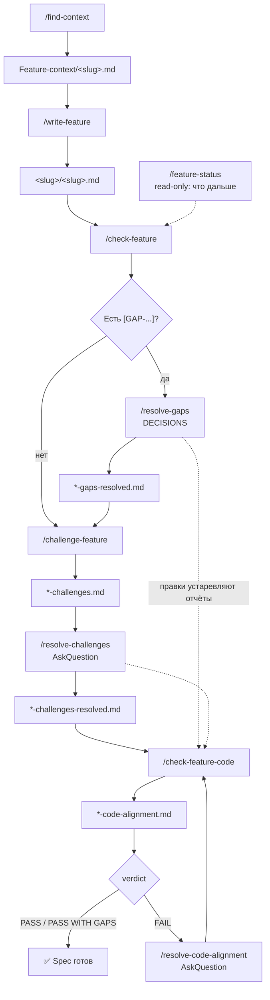

# opencode_analytics

SIHIST / ИО — workspace для написания спецификаций фич по аналитике и коду.

Как это работает целиком (пульт, блоки, скиллы, пайплайн):
[HOW-IT-WORKS.md](HOW-IT-WORKS.md).

Инструменты: сбор контекста, по-блочное написание spec, ревью, закрытие gaps и
критических вопросов (ответы в `*-decisions.md`), сверка с кодом, статус фичи.

## Структура

```
repositories/           — клоны сервисов (read-only контекст для фактов)
analytics/              — актуальная аналитика (SIHIST, экспорт Confluence)
db-export/              — выгрузки БД и справочники
Feature-writing/        — папки фич: <slug>/ со spec и отчётами
Feature-context/        — контекст от find-context
agent-logs/             — телеметрия CLI (Qwen/GigaCode/OpenCode) по slug
kb-writing-kits/        — методология + spec-catalog.yaml (список блоков)
.gigacode/              — GigaCode: agents, commands, skills, rules, settings
GIGACODE.md             — рантайм CLI (оркестратор)
.qwen/                  — Qwen Code (альтернатива): та же схема
QWEN.md                 — рантайм CLI для Qwen
```

`analytics/`, `db-export/` и `repositories/` в git не входят (см. `.gitignore`).
После клонирования их нужно положить локально: без них работают написание и
ревью spec по уже собранному контексту, но `/find-context` и
`/check-feature-code` сверяться с исходниками не смогут.

## GigaCode

CLI: `gigacode` в корне workspace. Slash-команды: наберите `/`. Тексты команд —
`.gigacode/commands/`. Как устроен порт: [`.gigacode/README.md`](.gigacode/README.md).

## Qwen Code

CLI: `qwen` в корне workspace — та же схема, конфиг в `.qwen/`, входной файл `QWEN.md`.
[`.qwen/README.md`](.qwen/README.md).

Каталог `.opencode/` — прежняя конфигурация OpenCode; для GigaCode / Qwen Code не нужен.

Не знаете, с чего начать по существующей фиче — `/feature-status <slug>`.
Оркестратор сам запускает следующий шаг пайплайна; пауза только на вопросы
по существу (набор блоков, гэпы, challenges, alignment, нет брифа).

---

## Процесс (одна фича = один `<slug>`)

### Раскладка артефактов

Один `<slug>` = одна папка. Канон — правило [`artifact-paths`](.qwen/rules/artifact-paths.md).

```
Feature-writing/<slug>/
  <slug>.md                        ← спецификация (финальный артефакт)
  <slug>-decisions.md              ← ответы пользователя (Q/GAP/CH)
  <slug>-code-alignment.md         ← сверка с кодом
  <slug>-gaps-resolved.md          ← карта закрытых [GAP-...]
  <slug>-challenges.md             ← банк каверзных вопросов CH-*
  <slug>-challenges-resolved.md    ← карта закрытых CH-*
Feature-context/<slug>.md       ← контекст (+ § «Закрытые вопросы»)
```

### Схема pipeline



### Фазы

| Фаза | Команды | Что получаешь |
|------|---------|---------------|
| **Навигация** | `/feature-status` | что открыто и **одна** следующая команда |
| **Контекст** | `/find-context` | `Feature-context/<slug>.md` |
| **Черновик spec** | `/write-feature` | план блоков → kit-скилл на блок → `SPEC` |
| **Ревью по источникам** | `/check-feature` | правки spec vs analytics, план, код |
| **Закрытие GAP** | `/resolve-gaps` | чистый spec + `*-gaps-resolved.md` |
| **Критик / corner cases** | `/challenge-feature` → `/resolve-challenges` | `*-challenges.md` + правки spec + `*-challenges-resolved.md` |
| **Сверка с кодом** | `/check-feature-code` ↔ `/resolve-code-alignment` | `*-code-alignment.md`, цикл ≤3 |

### Happy path (рекомендуемый)

```
/find-context <бриф>
    → /write-feature <бриф>
    → /check-feature <slug>
    → /resolve-gaps <slug>              # если есть [GAP-...]
    → /challenge-feature <slug>
    → /resolve-challenges <slug>
    → /check-feature-code <slug>
    → ✅ PASS / PASS WITH GAPS
```

Не помнишь, где остановился — `/feature-status <slug>`.

### Как `/write-feature` пишет spec

Оркестратор не пишет текст сам. На каждый блок — отдельный `spec-writer`:

1. План: `write_feature.py --mode plan --profile sihist` (профиль SIHIST:
   цель, use case + PlantUML, контракт, алгоритм, модель, маппинг, NFR,
   observability).
2. Уточнение набора блоков у пользователя (можно убрать или добавить threat,
   acceptance, migration, async).
3. На каждую строку оркестратор копирует блок задания из плана (вся строка
   `skills:`). Writer загружает эти скиллы и читает **целиком** их template /
   example / gate из `kb-writing-kits/`. Оркестратор один раз гоняет
   `--mode check-part` (UML / пример запроса / ER). Отказ — блок не принят.
4. Протокол интеграции (REST / gRPC / GraphQL / SOAP / Async) — из брифа
   или `--protocol`. Не назван → REST; в брифе Kafka/событие → Async.
5. Сборка: `--mode assemble` склеивает `*.part-*.md` в `SPEC` и удаляет
   рабочие `*.part-*.md` и `*.context.md`. Сразу `/check-feature`.

`--mode block` и выжимки kit (`.pkg`) нет: писать по пакету нельзя.

### Петли перепроверки

Правки spec **устаревляют** ранее собранные отчёты. Правила возврата:

| После | Обязательно | Почему |
|-------|-------------|--------|
| любой `/resolve-*`, если менялись BR/CN/use case | `/check-feature <slug>` | согласованность разделов |
| `/resolve-code-alignment` | `/check-feature-code <slug>` | закрыть петлю alignment |
| цикл challenge завершён (`*-challenges.md` есть, open=0) | `/check-feature-code <slug>` | один автоматический challenge на slug |
| правки spec, если есть `*-code-alignment.md` | `/check-feature-code <slug>` | отчёт больше не отражает spec |

`/feature-status` определяет устаревшие отчёты по времени изменения файлов.

### Обратная связь в контекст-документ

Все `/resolve-*` дописывают закрытые `Q-XX` в `Feature-context/<slug>.md`
секцию `## Закрытые вопросы` и запускают `scripts/refresh_context.py`
(только § «Что учесть», current-state не переписывается).
`/feature-status` считает открытые вопросы как разницу двух секций.

### Цикл code-alignment (если verdict FAIL)

```
/check-feature-code
      ↓ FAIL или closable MISMATCH/PARTIAL
/resolve-code-alignment <slug>     ← AskQuestion → правки spec
      ↓
/check-feature-code                ← повтор (макс. 3 прогона)
      ↓
   PASS / PASS WITH GAPS → готово
```

**Альтернативы правкам** после alignment:

- в чате: «по `*-code-alignment.md` поправь `<slug>.md`»;
- `/check-feature <slug>` с фокусом на findings из alignment.

### Интерактивные скиллы (AskQuestion)

| Команда | Вход | Что закрывает | Карта решений |
|---------|------|---------------|---------------|
| `/resolve-gaps` | spec `[GAP-...]` | неverified факты из write | `*-gaps-resolved.md` |
| `/resolve-challenges` | `*-challenges.md` | каверзные `CH-*` | `*-challenges-resolved.md` |
| `/resolve-code-alignment` | `*-code-alignment.md` | MISMATCH vs код | optional log в alignment |

Spec после resolve остаётся **чистым**: без журналов, без `[GAP-...]` / `[CH-...]` для закрытых пунктов.

### Опционально: code-review

**Skill:** `code-review` (slash-команды нет).

После правок в `/check-feature`, `/resolve-gaps`, `/resolve-challenges` или `/resolve-code-alignment`, **до** финального `/check-feature-code`:

- ось **Spec** — структура vs план / `spec-catalog.yaml`, контракты, traceability;
- ось **Standards** — workspace rules (naming, traceability, …).

### Артефакты `Feature-writing/<slug>/`

| Файл | Команда | Назначение |
|------|---------|------------|
| `<slug>.md` | `/write-feature` | **Финальная спецификация** (чистый документ требований) |
| `<slug>-decisions.md` | оркестратор + `/resolve-*` | Ответы пользователя (`D-*`) |
| `<slug>-code-alignment.md` | `/check-feature-code` | Отчёт сверки с кодом (RU) |
| `<slug>-gaps-resolved.md` | `/resolve-gaps` | Карта закрытых `[GAP-...]` |
| `<slug>-challenges.md` | `/challenge-feature` | Банк каверзных вопросов `CH-*` |
| `<slug>-challenges-resolved.md` | `/resolve-challenges` | Карта закрытых `CH-*` |

Плюс `Feature-context/<slug>.md` от `/find-context`.

### Сводная таблица команд

| Шаг | Команда | Skill | Read/Write spec |
|-----|---------|-------|-----------------|
| 0 | `/feature-status` | `feature-status` | read-only |
| 1 | `/find-context` | `find-context` | — |
| 2 | `/write-feature` | `write-feature` | write |
| 3 | `/check-feature` | `check-feature` | read-write |
| 4 | `/resolve-gaps` | `resolve-gaps` | read-write |
| 5 | `/challenge-feature` | `challenge-feature` | read-only |
| 6 | `/resolve-challenges` | `resolve-challenges` | read-write |
| 7 | `/check-feature-code` | `check-feature-code` | read-only |
| 7a | `/resolve-code-alignment` | `resolve-code-alignment` | read-write |
| опц. | — | `code-review` | review в чат |

### Критерий завершения

- `Feature-writing/<slug>/<slug>.md` — полная спецификация по каталогу блоков;
- `*-code-alignment.md` — **verdict: PASS** или **PASS WITH GAPS**, не старше spec;
- нет **Critical/Major MISMATCH**;
- NOT FOUND для TO BE в коде — нормально (ещё не реализовано);
- открытые `[GAP-...]` и `CH-*` — осознанно (отложены) или закрыты через resolve-скиллы.

Проверить чеклист: `/feature-status <slug>`.

### Минимальный путь (если спешишь)

```
/find-context → /write-feature → /check-feature-code
```

`/check-feature`, `/resolve-gaps`, `/challenge-feature` — рекомендуются, но не блокируют цикл alignment.

---

## Телеметрия (`agent-logs/`)

Отдельная система логов CLI-сессий по slug фичи. Spec и отчёты — в
`Feature-writing/`; **как агенты работали** (skill calls, retries, tool spikes) —
в `agent-logs/<slug>/`.

Субагенты (`spec-writer`, `gap-resolver`, …) логи **не пишут**. Ingest забирает
уже записанную сессию из home CLI и складывает нормализованные артефакты в
workspace.

### Когда обновляется

**После каждого шага пайплайна**, не один раз в конце. Оркестратор
(`spec-orchestrator` в `GIGACODE.md` / `QWEN.md` / `.opencode/`) после каждого
возврата `task` (кроме `session-telemetry-analyst`) вызывает:

```bash
python3 scripts/append_run_log.py --slug <slug> --step <шаг> --subagent <имя> --result ok
python3 scripts/ingest_session_telemetry.py <slug> --cli gigacode   # или qwen, opencode
```

Пример цепочки: `find-context` → ingest → каждый `spec-writer` (блок) → ingest →
`check-feature` → ingest → … до PASS.

| Момент | Поведение |
|--------|-----------|
| Первый ingest новой цепочки | `--new-run` → `runs/run-001/` |
| Каждый следующий шаг | без `--new-run` → тот же run обновляется |
| Конец пайплайна | финальный ingest + путь к `anomalies.md` |
| Новый benchmark с нуля | ingest с `--new-run` → `run-002`, … |

Ошибка ingest **не останавливает** пайплайн — оркестратор пишет одну строку и идёт
дальше.

Это **инструкция оркестратору**, не hook движка CLI. Если нужно вручную:
`/archive-session <slug>`, разбор — `/analyze-telemetry <slug>`.

### Источники по CLI

| CLI | Откуда ingest |
|-----|----------------|
| GigaCode | `~/.gigacode/projects/.../chats/` + `subagents/` (jsonl) |
| Qwen Code | `~/.qwen/projects/.../` (тот же формат) |
| OpenCode | `~/.local/share/opencode/opencode.db` (SQLite) |

### Артефакты

```
agent-logs/<slug>/
  manifest.json
  runs/run-001/
    run-log.jsonl       ← шаги оркестратора
    events.jsonl        ← нормализованные события CLI
    metrics.json        ← счётчики (skill × N, check-part, …)
    anomalies.md        ← эвристики (повторы skill, retry loops)
```

Подробнее: [HOW-IT-WORKS.md §12](HOW-IT-WORKS.md), [agent-logs/README.md](agent-logs/README.md).
Папка в `.gitignore` (локальные логи).

---

## Калибровка (`Calibration/`)

После **PASS** и ваших правок spec — отдельный контур
([HOW-WORK-CALIBRATION.md](HOW-WORK-CALIBRATION.md), [CALIBRATION.md](CALIBRATION.md)):

```
/snapshot-baseline → правки SPEC → /capture-review → /analyze-delta
  → /analyze-telemetry → /propose-calibration → approve → /apply-calibration
  → новая сессия → /benchmark-rerun
```

Или одной командой: `/calibrate <slug>`. Оркестратор: **calibration-orchestrator**
(не spec-orchestrator). Папка `Calibration/<slug>/` в `.gitignore`.

---

## Skills

| Skill | Назначение |
|-------|------------|
| `feature-status` | Read-only дашборд: открытые пункты, verdict, устаревшие отчёты, next step |
| `find-context` | Discovery + проверенный контекст → `Feature-context/<slug>.md` |
| `write-feature` | Правила одного блока; оркестратор: план → spec-writer (kit целиком) → assemble → check-feature |
| `check-feature` | Ревью и правка spec vs analytics, context, catalog |
| `check-feature-code` | Аудит spec vs `repositories/` → `*-code-alignment.md` (RU) |
| `resolve-gaps` | Закрытие `[GAP-...]` через `*-decisions.md` → чистый spec + `*-gaps-resolved.md` |
| `challenge-feature` | Критик: corner cases → `*-challenges.md` (spec read-only) |
| `resolve-challenges` | Закрытие `CH-*` через `*-decisions.md` → правки spec + `*-challenges-resolved.md` |
| `resolve-code-alignment` | Закрытие MISMATCH из code-alignment через `*-decisions.md` |
| `code-review` | Двухосевой review правок spec (Standards + Spec) |
| `archive-session` | Ingest CLI-сессии → `agent-logs/<slug>/` |
| `analyze-telemetry` | Разбор anomalies → `telemetry-analysis.md` |
| `capture-review` / `analyze-delta` / `propose-calibration` / … | Калибровка (`CALIBRATION.md`) |

Пути: `.gigacode/skills/`, `.qwen/skills/` или `.opencode/skills/`.

## Агенты и правила

Сабагенты — `.qwen/agents/` (по одному на шаг пайплайна), правила —
`.qwen/rules/` (подхватываются Qwen Code вместе с `AGENTS.md` / `QWEN.md`).
Подробнее: [AGENTS.md](AGENTS.md).

## Скрипты

| Скрипт | Назначение |
|--------|------------|
| `scripts/find_context.py` | Поиск кандидатов; фокус proto/RPC или миграций по брифу |
| `scripts/discovery_focus.py` | Тип фичи и обязательные якоря для find-context |
| `scripts/write_feature.py` | `--mode plan` / `check-part` / `assemble`; профиль `sihist` |
| `scripts/part_checks.py` | Приём фрагмента: файл не пустой, PlantUML если UML в плане |
| `scripts/section_profiles.py` | Набор разделов: sihist / core / full |
| `scripts/feature_status.py` | Дашборд фичи и один next step |
| `scripts/quality_gates.py` | Structural gates формы SPEC (`/check-feature` гоняет первым) |
| `scripts/refresh_context.py` | Досбор CONTEXT_DOC после resolve |
| `scripts/ingest_session_telemetry.py` | Ingest jsonl (Qwen/GigaCode) или SQLite (OpenCode) → `agent-logs/` |
| `scripts/append_run_log.py` | Одна строка шага оркестратора в `run-log.jsonl` |
| `scripts/snapshot_baseline.py` | Baseline до human review |
| `scripts/sync_gold_spec.py` | Текущий SPEC → gold |
| `scripts/analyze_spec_delta.py` | Diff baseline vs gold |
| `scripts/prepare_benchmark_rerun.py` | Изолированный benchmark workspace |
| `scripts/score_calibration_run.py` | Scorecard калибровки |
| `scripts/analyze_context_gaps.py` | CTX-GAP-*: не хватило analytics/repo/контекста |
| `pipeline-viewer/server.py` | Live-граф: slug + вкладки Spec/Calibration → :8765 |

**Pipeline viewer** (отдельный терминал): [pipeline-viewer/README.md](pipeline-viewer/README.md)

Пример без slash-команд:

```bash
python3 scripts/find_context.py "<бриф>" --name <slug> --out Feature-context/<slug>-discovery.md
python3 scripts/write_feature.py "<бриф>" --mode plan --name <slug> --profile sihist \
  --part-dir Feature-writing/<slug>
python3 scripts/write_feature.py "<бриф>" --mode assemble --name <slug> \
  --part-dir Feature-writing/<slug> --out Feature-writing/<slug>/<slug>.md
python3 scripts/feature_status.py <slug>
python3 scripts/quality_gates.py <slug>
```

Текст блоков пишет `spec-writer` по kit-скиллу, не скрипт.
