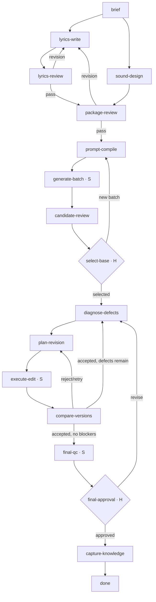

# Music Production: ТЗ и задания для Cursor

Версия: 1.0, 28 сентября 2026 года. Адресат: исполнитель в Cursor (Grok 4.6 High fast). Заказчик музыкальной ветки: Руслан. База: архив `gigacode_analytics-master.zip`, переданный в этом Work. В локальном клоне исполнителя обязательно сверить фактическую ревизию и рабочее дерево: ZIP не содержал `.git`.

## 1. Цель и границы

Создать независимый pack `music-production`, который по готовому заданию на песню пишет и проверяет текст, проектирует музыкальное звучание, готовит запрос к Suno, генерирует несколько вариантов, помогает Алексу выбрать базу, диагностирует и исправляет дефекты, сравнивает версии и доводит трек до финального утверждения. Система сохраняет все запросы, версии, диагнозы и экспертные решения для последующей калибровки.

Вне scope: поиск идеи артиста, анализ музыкального рынка, продвижение, дистрибуция, обещание числа прослушиваний, обход платформенных детекторов. Эти задачи не должны попадать в данный граф. Изменения в `pipelines/spec/`, `pipelines/calibration/`, `Feature-writing/` и банковских kit запрещены. Работать только в отдельной ветке; не коммитить и не отправлять изменения в `master`.

Принятые допущения: Cursor служит средой разработки, а GigaCode CLI — первым адаптером для локального прогона существующего агентного контура репозитория. GigaCode не является бэкендом продукта и не фиксируется как единственный LLM-провайдер. Агентные инструкции и контракты артефактов должны оставаться независимыми от модели. Прямого доступа к документированному Suno API пока нет, поэтому первый end-to-end прогон работает только через `MockSunoAdapter`. Реальный адаптер — отдельный этап после предоставления подтвержденного контракта. Не подставлять API третьих сторон, reverse-engineered endpoints, cookies или браузерную автоматизацию под видом официального Suno API.

### 1.1. Слои исполнения

1. `Pipeline engine` — существующие Python-модули graph/dispatch/status/telemetry. Это логика бэкенда: хранит состояние и определяет следующий шаг. Ее можно запускать локально, отдельным процессом или позднее в Docker.
2. `Agent runtime` — исполняет инструкции конкретного агента через выбранную LLM. Для первого прототипа адаптером служит GigaCode CLI; архитектура должна позволять добавить Qwen или прямой LLM API без переписывания графа.
3. `Production services` — `MockSunoAdapter`/`SunoAdapter`, анализ аудио, версии, jobs и бюджеты. Именно сервисный код выполняет API-вызовы, а LLM формирует проверяемые задания и решения.
4. `Product UI` — рабочий экран Алекса. Он общается с backend/API, а не напрямую с GigaCode CLI.

Cursor и Grok 4.6 High fast используются для написания кода и не входят в runtime готового продукта. В первой локальной версии допустим запуск pipeline через GigaCode CLI, но это способ проверить граф, а не окончательная схема развертывания.

## 2. Целевой граф

Обозначения: `H` — решение Алекса, `S` — детерминированный сервис, остальные шаги — агенты. Имена шагов и агентов отличаются: `step_to_subagent` должен их явно связывать.



`lyrics-write` и `sound-design` логически независимы. Не требовать от текущего runtime параллельного исполнения: допускается последовательный вызов при одинаковых входных данных. Не использовать generic `cycle` для lyric loop: в этом репозитории он завязан на сборку частей спецификации (`write_feature`/`concat`). Цикл здесь задается ребрами и проверяемым состоянием.

Первый human gate перед начальной генерацией опционален в состоянии `package_review_required`; по умолчанию включить для пилота. Два обязательных human gate: `select-base` и `final-approval`. В пакете должны быть отдельные причины паузы и способ продолжения после ответа. Не имитировать ответ человека `PASS` от имени агента.

## 3. Агенты и сервисы

Агенты в `.gigacode/agents/`: `music-orchestrator`, `music-brief-analyst`, `music-lyrics-writer`, `music-lyrics-editor`, `music-sound-director`, `music-package-reviewer`, `music-suno-prompt-compiler`, `music-candidate-critic`, `music-defect-diagnostician`, `music-revision-planner`, `music-version-comparator`, `music-knowledge-capturer`.

Сервисы: `AgentRuntime`, `GigaCodeRuntimeAdapter`, `LLMProvider` (будущий API-адаптер), `SunoAdapter`/`MockSunoAdapter`, `AudioAnalyzer`, `VersionStore`, `JobRunner`, `BudgetGuard`, `ExpertDecisionStore`, `CapabilityRegistry`. API-операции, аудиоизмерения, файловые записи, retry и лимиты реализуются кодом, не свободным рассуждением агента. Субагент получает строго определенные входные артефакты и пишет один артефакт результата. Каждый skill перечисляет допустимые пути, формат ответа, правила `PASS`/`REVISE`/`BLOCKED` и запрещает выдумывать результат прослушивания, если агент не получил аудио или подтвержденный анализ.

## 4. Состояние трека и инварианты

Один `track_id` — один каталог `Music-runs/<track_id>/` (в `.gitignore`). Состояния: `NEW`, `BRIEF_READY`, `PACKAGE_READY`, `PACKAGE_APPROVED`, `GENERATING`, `AWAITING_BASE_SELECTION`, `REVISING`, `FINAL_QC`, `AWAITING_FINAL_APPROVAL`, `APPROVED`, `PAUSED`, `FAILED`. Состояние отражает последнюю завершенную операцию, а не надежду на результат. Переходы определяются наличием валидных артефактов и полями состояния; не использовать только `mtime`.

Минимальные артефакты: `brief.json`, `lyrics.json`, `sound-direction.json`, `song-package.json`, `generation-request.json`, `track-state.json`, `versions.json`, `defects.json`, `decisions.jsonl`, `jobs.jsonl`, `expert-cases.jsonl`, `audio/` или идентификаторы объектов хранилища. Каждый результат должен иметь `schema_version`, `track_id`, `created_at` и ссылки на входные версии. История версий immutable: `version_id`, `parent_version_id`, `operation`, `provider_job_id` (если есть), `prompt_id`, `audio_uri`, `checksum`, `status`. `current_version_id` может переключаться только после принятого сравнения или явного решения Алекса. Отклоненная версия остается в истории.

`defect`: id, `version_id`, начало и конец фрагмента, категория, важность, диагноз, что сохранить, желаемое изменение и status. `revision-plan`: ровно один основной дефект или совместимая группа, выбранная операция, входная версия, инструкция, защищенные свойства, лимит попыток. `version-comparison`: целевой дефект, улучшение/ухудшение, новые дефекты, выбранный исход и обоснование. Решение Алекса всегда содержит его собственный verdict и ссылку на кандидата или версию; агент не может редактировать его задним числом.

Бюджет и завершение: максимумы batch, попыток исправления одного дефекта, общих итераций, времени ожидания API и стоимости — настраиваемые поля брифа/конфига с безопасными значениями по умолчанию. Исчерпание попыток правки — принятое архитектурное решение, а не временное исключение: engine останавливается с `WAITING_FOR_HUMAN` на human gate `REVISION_ESCALATION`; состояние трека не становится окончательно `PAUSED`. `PAUSED` наступает только после human verdict `STOP`, применённого на шаге `capture-knowledge`. Сетевой retry не является новой творческой попыткой; запросы к провайдеру должны иметь idempotency key, если контракт это поддерживает. Никакой бесконечной петли.

Хранить секреты вне Git. Не логировать токены, персональные данные клиента или содержимое приватных аудиофайлов. Не использовать права на голоса/референсы без подтвержденного разрешения. DSP-проверки оценивают качество, а не маскируют происхождение генерации.

## 5. Целевая структура файлов

```text
pipelines/music-production/
  graph.yaml
  dispatch.yaml
  status.yaml
  registry.yaml
  routing_conditions.yaml          # если выбран routing-state; не копировать spec поля
  collectors.py
  validate.py
  README.md
.gigacode/agents/
  music-orchestrator.md
  music-brief-analyst.md
  music-lyrics-writer.md
  music-lyrics-editor.md
  music-sound-director.md
  music-package-reviewer.md
  music-suno-prompt-compiler.md
  music-candidate-critic.md
  music-defect-diagnostician.md
  music-revision-planner.md
  music-version-comparator.md
  music-knowledge-capturer.md
.gigacode/skills/music-{brief,lyrics,lyrics-review,sound-direction,package-review,suno-prompt,candidate-review,defect-diagnosis,revision-plan,version-comparison,knowledge-capture}/SKILL.md
.gigacode/commands/music-production.md
music_production/
  contracts/{brief,song-package,track-state,generation-request,defect,expert-decision}.schema.json
  runtime/{base,gigacode,llm_provider,prompt_registry}.py
  adapters/{base,mock_suno,suno,capabilities}.py
  services/{audio_analyzer,job_runner,version_store,budget_guard,expert_decisions}.py
  fixtures/{sample-brief,mock-generations,sample-expert-decisions}.json
  README.md
scripts/fixtures/dispatch_golden/music-production/{cases.json,COVERAGE.md}
tests/music_production/{test_graph_dispatch,test_suno_adapter_contract,test_version_lineage,test_audio_qc,test_end_to_end_mock}.py
Music-runs/<track_id>/             # runtime output, ignored by Git
```

В репозитории есть общие места, привязанные к спецификациям (`artifact_paths.py`, helper restart, viewer slug-list), и статический matcher hook в `.gigacode/settings.json`. Исполнитель должен проверить их на музыкальном fixture до использования. Если generic pack не работает без изменения ядра, оформить минимальную, локализованную правку с регрессионным тестом; не менять код spec для удобства. Не включать в commit файлы `Music-runs/`, аудио, ключи и случайные изменения старых артефактов.

## 6. Порядок, приемка и контроль Grok

Задачи выполнять строго последовательно. После каждого задания: показать `git diff --stat`, полный список измененных файлов, команды проверок и результат; остановиться, если проверка не прошла. Не продолжать следующий этап автоматически. Нельзя объявлять `PASS`, если тест не запускался. У `pipeline_compile.py --check` проверить и текст результата: в изученном ZIP он печатал `[FAIL] ... content differs`, но завершался с кодом 0. Любое расширение разрешенного списка файлов сначала описать и согласовать с владельцем проекта. Задания ниже можно вставлять в Cursor дословно. Перед первым заданием открыть локальный клон, не архивную копию.

### Промт 0 — рабочая ветка и baseline (только диагностика и безопасная подготовка)

```text
Ты работаешь в локальном клоне gigacode_analytics. Сначала прочитай AGENTS.md, GIGACODE.md, pipelines/README.md, scripts/PIPELINE-PACK-AUTHORING.md и scripts/PIPELINE-RUNTIME.md. Покажи git status --short, текущую ветку, commit SHA, remote URL без токенов и наличие несохраненных изменений. Ничего не удаляй, не сбрасывай, не коммить и не отправляй в remote.

Цель: подготовить отдельную ветку feature/music-production или отдельный worktree от текущей стабильной ревизии. Не переключай грязное рабочее дерево так, чтобы затронуть чужие изменения. Если есть риск — остановись и предложи конкретную безопасную команду, не выполняя ее. Никогда не меняй master. Не исправляй обнаруженные ошибки baseline в этом задании.

Запусти и сохрани в ответе результаты: PYTHONPATH=scripts python3 scripts/pipeline_compile.py --check; PYTHONPATH=scripts python3 -m unittest discover -s scripts -p '*_test.py'. Учитывай, что в переданном ZIP ранее обнаружены невалидный pipelines/spec-v2/status.yaml и ссылки тестов на отсутствующий routing-poc: проверь локальный клон независимо, не считай старый вывод фактом для иной ревизии. Дай таблицу baseline: команда, код возврата, точная причина, исходный ли дефект. Не меняй файлы продукта.
```

### Промт 0Б — исправление baseline, только если промт 0 обнаружил блокеры

```text
Этап 0 показал исходные ошибки baseline. Твоя задача — исправить только эти подтвержденные блокеры в feature/music-production до работы над новым pack. Сначала перечисли точные файлы и минимальные правки; не меняй ничего, пока я не подтвержу этот список. После подтверждения исправь синтаксис YAML, рассогласованные generated files и stale routing-poc references только в объеме, который доказан проверками. Не удаляй тесты или golden cases ради зеленого результата; если routing-poc действительно должен существовать, восстанови pack из доступной истории или остановись за исходником. Каждую правку отдельно объясни. Проверки: compile --check без строк [FAIL], script unit tests и golden suite. Остановись после отчета; не переходи к music-production автоматически.
```

### Промт 1 — контракт данных

```text
Задача только: создать схемы и fixtures для одного музыкального трека. Перед правками проверь ветку feature/music-production, git status и существующий стиль файлов. Прочитай разделы 1–5 Music_Production_Implementation_Spec_and_Cursor_Prompts.md, если документ добавлен в рабочий контекст Cursor; иначе попроси меня приложить его. Не выдумывай требования.

Разрешены только music_production/contracts/*.schema.json, music_production/fixtures/*.json и tests/music_production/test_contracts.py. Не трогай pipelines/, .gigacode/, scripts/ и старые файлы. Сделай схемы для brief, song-package, track-state, generation-request, defect, expert-decision; каждый документ имеет schema_version и track_id. Сделай по одному валидному примеру для полного задания и экспертного решения, отрицательные cases для отсутствующих id, неверного времени и недопустимого verdict. Определи явный список enum для состояний, решений и операций; неизвестную Suno-операцию не объявляй доступной.

Проверки должны реально валидировать fixtures по схемам, а не повторять логику реализации. Если нужной библиотеки JSON Schema нет, не добавляй зависимость скрытно: покажи варианты и остановись. После тестов покажи diff и остановись. Не делай этап 2.
```

### Промт 2 — минимальный исполняемый pack и golden-маршруты

```text
Задача только: создать независимый pack music-production поверх существующего движка. Прочитай существующие pack calibration/spec, PIPELINE-PACK-AUTHORING.md, PIPELINE-REGISTRY.md, PIPELINE-GOLDEN.md и контракты этапа 1. Не копируй graph/spec и не применяй generic cycle к lyrics. Начни с простого маршрута brief → lyrics-write → lyrics-review → sound-design → package-review → prompt-compile → generate-batch → candidate-review → select-base → diagnose-defects → plan-revision → execute-edit → compare-versions → final-qc → final-approval → capture-knowledge → done. Укажи в графе возвраты для REVISE/REJECT и лимит паузы. Запуск последовательный допустим.

Разрешены: pipelines/music-production/{graph,dispatch,status,registry,routing_conditions}.yaml, pipelines/music-production/{collectors,validate}.py, pipelines/music-production/README.md, scripts/fixtures/dispatch_golden/music-production/{cases.json,COVERAGE.md}, tests/music_production/test_graph_dispatch.py и только минимальные заглушки .gigacode/agents/music-*.md, требуемые компилятором. Сначала dry-run/validation, затем compile --apply лишь после проверки diff. Generated registry/schema могут измениться как ожидаемый вывод компиляции; не редактируй их руками. Не трогай spec/calibration/spec-v2. Начинай этот этап только при чистом baseline после этапа 0Б или при доказанно стабильной ревизии из этапа 0.

Golden cases: нет брифа; lyrics требуют правки; package готов; запрос отправлен и ожидается; кандидаты готовы и нужен выбор; база выбрана; дефект открыт; сравнение отклонило правку; правка принята; лимит исчерпан; финальный QC не прошел; финальное решение ожидается; approved. Для каждого зафиксируй next_step или остановку. Если текущий router не способен выразить нужный переход без правки ядра, остановись и покажи минимальный patch-план, а не переписывай engine. Прогони compile, golden, имеющиеся регрессионные тесты и остановись.
```

### Промт 3 — агенты подготовки пакета

```text
Задача только: реализовать music-brief-analyst, music-lyrics-writer, music-lyrics-editor, music-sound-director, music-package-reviewer и music-suno-prompt-compiler, их SKILL.md и команду запуска music-production. Первый локальный runtime — GigaCode CLI, но тексты агентов и JSON-контракты не должны ссылаться на особенности конкретной модели. Прочитай интерфейсы pack и схемы. Разрешены соответствующие .gigacode/agents/music-*.md, .gigacode/skills/music-*/SKILL.md, .gigacode/commands/music-production.md, music_production/fixtures/* и один тест сценария подготовки пакета. Не меняй другие агенты, банковские skills, общие rules и engine.

Для каждого агента укажи: входные файлы, один выходной файл, критерии PASS/REVISE/BLOCKED и запрет утверждать, что он слышал аудио, когда аудио не передано. lyrics-editor проверяет текст, удобство пения и структуру; sound-director описывает звук по готовому брифу; compiler переводит согласованный пакет в абстрактный request для adapter и НЕ придумывает поля недоступного Suno API. Решение человека о package фиксируется отдельно, если package_review_required=true. Проверка: mock-прогон от sample brief до schema-valid generation-request и возврат lyrics-review → lyrics-write. Покажи diff и остановись.
```

### Промт 4 — версии, budget и MockSunoAdapter

```text
Задача только: реализовать music_production/adapters/{base,mock_suno,capabilities}.py и services/{job_runner,version_store,budget_guard}.py с нужными тестами. Не создавай реальных HTTP-запросов. Разрешены только перечисленные файлы, тесты этих модулей, fixtures и точечная интеграция с music-production pack. Не писать suno.py как рабочую интеграцию.

Контракт adapter: submit_generation(request, idempotency_key) -> job_id; get_job(job_id) -> pending/succeeded/failed; get_outputs(job_id) -> список provider output ids и локальных audio_uri; submit_edit(...) только когда capability включена. Mock должен создавать воспроизводимые результаты и позволять управлять pending, fail и timeout через fixture. VersionStore создает неизменяемые записи с parent_version_id/checksum и безопасно меняет current_version_id после принятия версии. BudgetGuard отделяет retry доставки от новой оплачиваемой попытки. Тесты: повторный submit с тем же ключом, сетевой retry, истечение лимита, отказ от недоступной операции, rollback с сохранением истории. Не объявлять mock-аудио музыкально качественным. Покажи проверку и остановись.
```

### Промт 4Б — граница Agent Runtime

```text
Задача только: определить программную границу между pipeline engine и LLM runtime. Разрешены music_production/runtime/{base,gigacode,llm_provider,prompt_registry}.py, их unit tests и минимальная документация. Не реализуй прямой вызов платной LLM и не запускай GigaCode через небезопасную shell-строку.

AgentRuntime принимает agent_id, проверенные пути входных артефактов, JSON schema ожидаемого результата, correlation_id и deadline; возвращает structured result со status succeeded/blocked/failed, output artifact и usage metadata. GigaCodeRuntimeAdapter пока может быть явной заглушкой или безопасным локальным wrapper по фактически доступному CLI-контракту; если такой контракт не подтвержден, возвращай NOT_CONFIGURED. LLMProvider — интерфейс будущего прямого API. PromptRegistry связывает agent_id с versioned instruction bundle и не хранит секреты. Тесты подтверждают, что pipeline не зависит от имени модели и что смена runtime не меняет артефактный контракт. Покажи diff и остановись.
```

### Промт 5 — проверка аудио и выбор базовой версии

```text
Задача только: добавить AudioAnalyzer с детерминированной проверкой файлов и music-candidate-critic со skill; связать готовый batch с select-base human gate. Разрешены music_production/services/audio_analyzer.py, соответствующий agent/skill, fixtures, tests/music_production/test_audio_qc.py и необходимые pack-local файлы. Без реального Suno API и без UI.

AudioAnalyzer проверяет формат/читаемость, длительность, обрыв/пустоту, clipping/peak в рамках доступного декодирования. Для неподдержанного формата возвращает BLOCKED/UNSUPPORTED, не PASS. Не приписывай DSP-метрикам способность доказать «живость» исполнения. candidate-critic получает факты измерения и, если доступно восприятие аудио в используемом runtime, отдельный результат прослушивания; иначе помечает творческую оценку как pending human review. Алекс выбирает version_id из реального batch или NEW_BATCH/STOP; отсутствие решения означает паузу, а не автоматический выбор. Тесты используют реальные короткие звуковые fixtures/сигналы для технических параметров и отдельный mock human verdict. Покажи diff и остановись.
```

### Промт 6 — диагностика и петля правок

```text
Задача только: реализовать music-defect-diagnostician, music-revision-planner, music-version-comparator, их skills, запись defects/revision/comparison и маршруты петли. Разрешены соответствующие music-агенты/skills, music_production/contracts/defect.schema.json, pack-local файлы, tests/music_production/test_version_lineage.py и test_end_to_end_mock.py. Не менять банковский pack или общую логику spec.

Диагноз содержит version_id и таймкод, не утверждает неуслышанных свойств. План правки привязан к одному дефекту, фиксирует preserve/change и выбирает только capability, отмеченную adapter как доступная. В mock первой версии поддержи точечную правку только как симуляцию новой дочерней версии. Comparator сравнивает parent/child с целью правки, возвращает ACCEPTED/PARTIAL/REJECTED/BLOCKED, не перезаписывает экспертное решение. Эскалация — routing consequence для BLOCKED, стагнации, лимита или отсутствующей capability, а не отдельный outcome comparator. Покрой тестами: исправление принято; регрессия отклонена и current_version_id не меняется; попытки закончились → WAITING_FOR_HUMAN на REVISION_ESCALATION, PAUSED только после STOP на capture-knowledge; новая версия по другому parent → BLOCKED; закрытие всех blocking defects → final-qc. Не делай настоящих вызовов Suno. Покажи diff и остановись.
```

### Промт 7 — экспертное решение и накопление знаний

```text
Задача только: реализовать ExpertDecisionStore, music-knowledge-capturer, его skill и два human gate (select-base, final-approval). Разрешены music_production/services/expert_decisions.py, соответствующие agent/skill, schemas/fixtures, pack-local файлы и тесты expert flow. Запись решения immutable: кто принял, версия/дефект, verdict, комментарий, timestamp. Система не подписывает решения именем Алекса автоматически. Из каждого подтвержденного выбора сформируй candidate_case: исходная версия, диагноз, промт, новая версия, технические факты, экспертный verdict. Не обновляй автоматически production prompts/skills по одному кейсу.

Проверки: отсутствие ответа оставляет PAUSED/awaiting; APPROVE после чистого QC завершает граф; REVISE возвращает к дефекту; двойная доставка одного решения не дублирует кейс; экспертные заметки не теряются. Выведи один mock end-to-end trace с путем по графу, но не выдавай его за реальную оценку музыки. Покажи diff и остановись.
```

### Промт 8 — рабочий экран Алекса (после сквозного mock)

```text
Задача только: создать минимальный локальный экран музыкального трека после успешного mock end-to-end. Сначала изучи pipeline-viewer/server.py и существующий UI, а также API/artifact contracts музыкального pack. Покажи план точных файлов до правок. Если музыкальные аудиофайлы нельзя обслуживать без небезопасной раздачи путей, предложи отдельный localhost endpoint с проверкой track_id/version_id и allowlist, без произвольного path-параметра. Не подключай внешний сервис.

Экран должен показывать выбранный трек, A/B двух версий с синхронным стартом, таймкод дефекта, причину правки, промт/параметры, решения ACCEPT/REJECT/REVISE и поле комментария. Кнопки должны сохранять решение через ExpertDecisionStore и обновлять состояние; не писать JSON напрямую из браузера. Не добавляй кампании, артистов, поиск идей, аналитику стримов. Проверка: ручной сценарий с mock-аудио, безопасная обработка несуществующего track_id и попытки traversal, восстановление экрана после перезагрузки. Не менять режим аналитического viewer. Покажи diff, скрин и остановись.
```

### Промт 9 — интеграция Suno (только после предоставления договора/API)

```text
Пока НЕ выполняй это задание без официальной или договорной документации API и тестовых учетных данных, предоставленных владельцем проекта через штатные секреты окружения. Сначала составь таблицу: операция графа → подтвержденный endpoint/метод → вход → выход → лимиты → права → доступна/недоступна. Если контракт не подтверждает Replace Section, Extend, Remaster или stems, оставь capability выключенной и сохрани human fallback.

После одобрения таблицы реализуй только music_production/adapters/suno.py, его contract/integration tests, конфигурацию через переменные окружения и минимальные необходимые wiring-правки. Не используй cookies или непубличные веб-вызовы; не логируй секреты. Отдельный маленький smoke на тестовом аккаунте, с лимитом расходов и без массовой генерации. Покажи фактический ответ API без токенов и остановись.
```

## 7. Передача результата и критерий готовности

Для готовности технического каркаса нужны: отдельная ветка, работающий `music-production` pack, зеленые проверки новых golden cases, end-to-end mock с реальными артефактами и контролируемыми паузами, неизменяемая история версий и human verdict. Для демонстрации Алексу дополнительно нужен рабочий A/B экран. Настоящий Suno API и творческое качество не должны заявляться как готовые до интеграции и его калибровки.

Правило для любого задания в Cursor: если текущий репозиторий отличается от описанной базы, исполнитель сначала показывает расхождение и адаптирует только план, не начинает писать код по догадке. Каждый этап заканчивается отчетом и ожиданием следующего промта.
