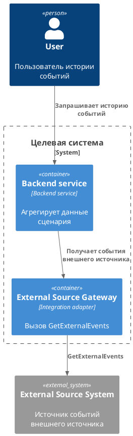

<!--
Imported from: architecture-standard-kit/examples\operation-history-architecture-example.md
Current-state adaptation:
- Use only confirmed current behavior.
- Do not write TO BE, rollout/rollback, future requirements, design proposals, GAP/ASM/DESIGN markers as reader-facing content.
- Put unresolved or future/change-specific material into working-layer gaps, not into permanent KB pages.
-->
#### Архитектура фичи — Подключение External Source GetEvents к истории событий

**Контекст:**

| Элемент | Значение |
|---|---|
| Фича | Подключение External Source GetEvents к истории событий |
| Связанные requirements | `01-Requirements/bph-getlink-events-requirements.md` |
| Уровень описания | C4 Container |
| Статус | draft |

**Архитектурные драйверы и ограничения:**

| ID | Тип | Описание | Источник / статус |
|---|---|---|---|
| DRV-001 | Requirement | История событий должна учитывать события внешнего источника из источника External Source | Подтверждено — вы |
| CON-001 | Constraint | Из External Source приходят только события внешнего источника | Подтверждено — вы |

**Затрагиваемые компоненты:**

| Компонент | Тип | Статус изменения | Ответственность | Владелец / команда |
|---|---|---|---|---|

**C4-диаграмма:**

**Архитектурные решения:**

| ID | Контекст | Решение | Альтернативы | Последствия | Статус |
|---|---|---|---|---|---|

**Impact analysis:**

| Область | Влияние | Связанные артефакты / gaps |
|---|---|---|
| Runtime | Добавляется внешний вызов к External Source | NFR / Observability |
| Data ownership | Владение предметными данными остается за целевой системой | Data mapping |
| Security | Нужны правила доступа к External Source и маскирования данных | Threat model |

**Gaps и допущения:**

| ID | Где найдено | Что неизвестно / что предположено / что спроектировано | Как закрыть |
|---|---|---|---|
