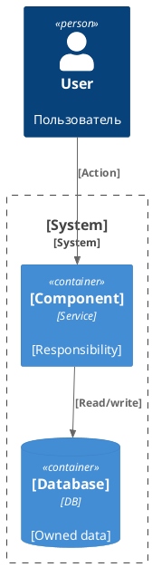

<!--
Imported from: architecture-standard-kit/templates\architecture.template.md
Current-state adaptation:
- Use only confirmed current behavior.
- Do not write TO BE, rollout/rollback, future requirements, design proposals, GAP/ASM/DESIGN markers as reader-facing content.
- Put unresolved or future/change-specific material into working-layer gaps, not into permanent KB pages.
-->
#### Архитектура фичи — [Название фичи]

**Контекст:**

| Элемент | Значение |
|---|---|
| Фича | [Название] |
| Уровень описания | [C4 Container / C4 Component / оба] |
| Статус | [draft / ready-for-review] |

**Архитектурные драйверы и ограничения:**

| ID | Тип | Описание | Источник / статус |
|---|---|---|---|

**Затрагиваемые компоненты:**

| Компонент | Тип | Статус изменения | Ответственность | Владелец / команда |
|---|---|---|---|---|

**C4-диаграмма:**

**Архитектурные решения:**

| ID | Контекст | Решение | Альтернативы | Последствия | Статус |
|---|---|---|---|---|---|

**Impact analysis:**

| Область | Влияние | Связанные артефакты / gaps |
|---|---|---|
| Data ownership | [Влияние] | [Data model / —] |
| Integrations | [Влияние] | [Integration / —] |

**Gaps и допущения:**

| ID | Где найдено | Что неизвестно / что предположено / что спроектировано | Как закрыть |
|---|---|---|---|
